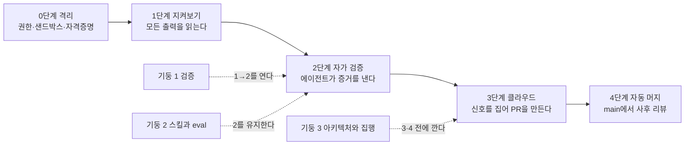

# 1장. 빨라졌는데 왜 더 피곤할까 — 신뢰 곡선이라는 지도

사전 예측은 24% 빨라진다였다. 실측은 19% 느려졌다.

2025년 7월, METR이 발표한 실험의 숫자다. 자기 저장소를 수년간 만져 온 숙련 오픈소스 개발자 16명에게 실제 이슈 246개를 맡기고, 절반은 AI 도구를 허용하고 절반은 금지했다. 참가자들은 시작 전에 "AI를 쓰면 24%쯤 빨라질 것"이라고 예측했다. 끝나고 나서도 "20%쯤 빨라진 것 같다"고 믿었다. 그런데 시계는 반대로 말했다. AI를 허용한 과업이 평균 19% 더 오래 걸렸다. 표본이 16명이고 2025년 초의 도구라는 한계는 있다. 그래도 이 숫자가 불편한 이유는 따로 있다. 느려졌는데 빨라졌다고 느꼈다는 점이다.

같은 해 8월, Lauren Tan(Cursor, React Compiler 코어팀)은 "Climbing the Trust Curve"라는 워크숍을 이렇게 열었다. "AI를 쓰면 코드를 쓰는 시간은 조금 아낀다. 그런데 AI가 한 일을 리뷰하고 고치는 데 시간을 더 쓰고 있는 나를 발견한다." 이 사람은 다섯 달 뒤에 AI 코딩 에이전트가 올린 PR을 자동 머지하는 지점까지 올라간 사람이다. 그 사람도 출발점은 METR의 16명과 같았다.

이 책의 질문은 여기서 시작한다. 빨라진 것 같은데 왜 더 피곤할까? 그리고 피곤함을 덜어내는 데 순서가 있다면, 그 순서는 무엇일까?

### 빨라진 것은 생성, 느려진 것은 검증

생산성 연구의 숫자를 나란히 놓으면 범위가 꽤 넓다. 2023년 Peng 등의 실험은 55.8% 빠름을 보고했다. 단일 과업, 그린필드, 그리고 도구 판매사 소속 저자가 쓴 논문이다. 2025년 Cui 등의 대규모 현장 RCT는 4,867명에게서 완료 과업이 26.08% 늘었다고 했다. Google의 Paradis 등은 96명에게서 약 21% 단축을 봤는데 신뢰구간이 넓다. 그리고 METR의 −19%가 있다. 어느 하나를 "AI의 생산성 효과"로 세우면 틀린다. 가르는 변수가 따로 있기 때문이다.

그 변수가 무엇인지 생각해보자. Peng의 과업은 JavaScript로 HTTP 서버 하나를 처음부터 만드는 일이었다 (사실 확인 필요). 검증할 것이 거의 없다. 돌아가면 끝이다. METR의 과업은 참가자가 수년간 가꾼 저장소의 실제 이슈였다. 그 저장소에는 참가자 머릿속에만 있는 규칙, 깨지면 안 되는 암묵적 불변식, 테스트가 덮지 못하는 모서리가 있다. AI가 낸 변경이 맞는지 확인하려면 그 규칙을 전부 머릿속에서 꺼내 대조해야 한다. 코드 생성은 빨라졌다. 검증은 그대로이거나 오히려 늘었다. 결국 전체 시간을 결정한 것은 **검증 부담**이었다.

이 그림은 다른 연구와도 맞물린다. Wang 등이 2024년 FAccT에서 발표한 개발자 17명 인터뷰에서 가장 자주 호소된 난관은 제안을 검증하는 일이었다. 질적 연구라 숫자로 옮길 수는 없지만, 방향은 METR과 같다. Vasconcelos 등의 2023년 연구(5개 실험, 731명)는 한 발 더 나간다. 검증 비용이 크면 사람은 검증을 건너뛰고 그냥 승인한다. 설명을 읽을지 말지를 전략적으로 선택한다는 것이다. 우리가 PR을 열어 놓고 "대충 맞아 보이네"라며 스탬프를 찍는 순간이 바로 그 선택이다.

그러니까 문제의 이름은 코드 생성이 아니다. 문제의 이름은 검증 비용이다. 이 이름을 붙이고 나면 이 책의 나머지가 한 줄로 요약된다. 검증 비용을 내 어깨에서 에이전트와 저장소로 옮기는 순서를 배우는 것이다.

### 신뢰를 보정한다는 것

"에이전트를 믿어도 될까"라는 질문은 감정의 문제처럼 들린다. 그런데 자동화 연구는 이 질문을 20년 넘게 다른 틀로 다뤄 왔다. Lee와 See가 2004년 *Human Factors*에 쓴 리뷰는 신뢰를 보정(calibration)의 문제로 정의한다. 자동화의 실제 능력보다 신뢰가 높으면 과신이고, 그 결과는 오용(misuse)이다. 실제 능력보다 신뢰가 낮으면 불신이고, 그 결과는 불용(disuse)이다. 둘 다 손해다. 그래서 목표는 신뢰를 실제 능력에 맞추는 것이 된다. 더 믿는 것도, 덜 믿는 것도 목표가 될 수 없다.

이 틀로 METR을 다시 읽어보자. 참가자들은 끝나고도 20% 빨라졌다고 믿었다. 실제 능력보다 신뢰가 높았다. 그래서 검증을 덜 해도 된다고 느꼈을 테고, 그 빈틈을 메우느라 시간이 샜을 수 있다. 반대로 "에이전트는 못 믿어"라며 한 줄 한 줄 다시 읽는 사람도 있다. 실제 능력보다 신뢰가 낮다. 그 사람은 도구를 켜 놓고도 혜택을 못 받는다. 어느 쪽이든 보정이 어긋난 상태다.

그렇다면 보정은 어떻게 하나? Hoff와 Bashir의 2015년 연구는 신뢰를 세 층으로 나눈다. 타고난 성향, 상황, 그리고 사용하면서 관찰로 갱신되는 학습된 신뢰(learned trust)다. 우리가 바꿀 수 있는 것은 세 번째 층이다. 에이전트가 무엇을 읽고 무엇을 건너뛰었는지, 어디서 추측했는지 관찰하면 신뢰가 실제 능력에 가까워진다. 3장에서 툴 콜을 열어 읽는 습관을 이야기하는 이유가 여기에 있다.

Lauren도 같은 말을 엔지니어링 매니저의 비유로 한다. 팀원을 믿지 못하는 매니저는 어깨 너머로 화면을 들여다보느라 자기 일을 못 한다. 믿을 수 있게 되는 길은 팀원이 일을 어떻게 하는지 보고, 확인하는 방법을 만들고, 그다음에 손을 떼는 것이다. 신뢰는 결심으로 생기지 않는다. 관찰과 확인 장치가 쌓인 결과다.

### 신뢰 곡선 — 네 단계, 그리고 0단계

Lauren은 워크숍에서 손으로 그린 차트 하나를 보여 줬다. 본인 말로 "그리 과학적인 차트는 아니다." 세로축은 신뢰, 가로축은 시간이다. 이 책은 이것을 신뢰 곡선(Trust Curve)이라 부른다. 곡선을 네 단계로 나눈 것은 호스트였고, Lauren이 "맞다, 정확히 그렇다"고 동의했다. 그러니 단계 번호는 호스트의 요약에 본인이 동의한 것으로 읽어 두자.

그림 1. 신뢰 곡선의 다섯 단계와 세 기둥이 걸리는 자리

1단계는 지켜보기다. "한두 개, 많아야 몇 개의 에이전트와 아주 깊숙이 루프 안에 있다. 모든 출력을 하나하나 본다." 병렬화는 불가능하다. "하나의 출력도 못 믿으면서 백 개를 띄울 수는 없다." 2단계는 자가 검증이다. 에이전트가 스스로 코드를 실행해 맞는지 확인하고, 사람은 PR만 본다. 3단계는 클라우드다. 버그 리포트 같은 신호를 에이전트가 알아서 집어 PR을 만든다. 4단계는 자동 머지다. 워크숍 당일 아침 Lauren은 20개의 PR이 이미 main에 들어가 있는 것을 보고 사후 리뷰를 했다고 말한다. 그날 아침의 숫자다. 매일 20개라는 뜻은 아니다.

여기서 Lauren이 가장 힘주어 말한 경고 하나를 기억해두자. "아직 이 구간에 있다면 갑자기 수천 개의 클라우드 에이전트를 띄우려 들지 마라. 토큰만 낭비한다." 그리고 "여기서 저기로 가는 지름길은 없다. 이건 에이전트에 대한 당신 개인의 신뢰 수준에 관한 것이기 때문이다." 단계를 건너뛸 수 없다는 말은 이 책의 순서가 곧 목차인 이유다.

한 단계가 더 있다. Lauren의 차트에는 없지만 커뮤니티가 꾸준히 지적한 자리다. 1단계 앞에 격리가 있어야 한다는 것이다. 에이전트가 프로덕션 데이터베이스를 지운 사건이 돌 때마다 같은 반론이 나온다. 신뢰가 올라가는 모델에서 "다 허용" 모드가 너무 이르게 온다, 샌드박스와 자격증명 범위가 왜 전제조건이 아니냐. Lauren 본인도 "인턴이 프로덕션 DB를 지우지 않도록 자격증명을 제한한다"고 말한다. 반론이 아니라 전제다. 그래서 이 책은 0단계 격리를 2장에 두고 거기서 출발한다.

### 세 기둥 — 맞는 코드와 좋은 코드

곡선을 오르는 데 쓰이는 도구는 세 가지다. Lauren은 이것을 세 기둥이라 불렀다. 검증(Verification), 스킬과 eval, 아키텍처와 집행이다.

기둥 1 검증은 에이전트가 "실제로 코드를 실행하고, CPU 트레이스나 힙 스냅샷을 뜨고, iOS 시뮬레이터를 열어 보는" 능력이다. 사용자에게 앱이 노출되는 방식 그대로 에이전트도 앱을 만져 볼 수 있어야 한다. 이 기둥이 있어야 1단계에서 2단계로 넘어간다. 사람이 검증자인 한 병목은 사람이기 때문이다. Mitchell Hashimoto가 2026년 2월에 쓴 도입기에도 같은 관찰이 있다. "에이전트에게 자기 일을 검증할 방법을 주면, 대개는 스스로 실수를 고치고 회귀를 막는다." 검증 장치는 사람의 리뷰 부담을 덜어 주는 것을 넘어, 에이전트 자신의 수정 루프를 닫아 준다. 다만 Lauren의 단서를 그대로 옮기자. "이것이 에이전트가 좋은 코드를 쓴다고 보장하지는 않는다. 하지만 적어도 맞는 코드는 쓰게 해 준다." 맞는 코드와 좋은 코드는 다른 것이다. 기둥 1은 맞는 코드를 맡는다.

기둥 2 스킬과 eval은 2단계를 유지하는 수단이다. 관찰한 실패를 마크다운 스킬로 적고, 그 스킬이 정말 효과가 있는지 eval로 확인한다. 스킬은 에이전트의 온보딩 문서이고 eval은 스킬의 단위 테스트다. 이 기둥이 없으면 오늘 고친 실패가 다음 주에 돌아온다.

기둥 3 아키텍처와 집행은 좋은 코드를 맡는다. 코드베이스에서 가장 짧은 길이 가장 좋은 길이 되도록 구조를 짜고, 규칙을 린트와 CI처럼 잊을 수 없는 자리에 집행한다. 이 기둥은 3단계와 4단계로 올라가기 전에 깔아야 하는 바닥이다. 에이전트가 많아질수록 바닥이 없으면 코드베이스가 먼저 무너진다.

워크숍은 세 기둥 순서로 진행됐다. 이 책은 그 순서를 따르지 않고 신뢰 곡선의 단계 순서를 따른다. 독자의 결정 축이 "어디까지 맡길까"이기 때문이다. 기둥은 각 단계에서 필요해지는 자리에 접어 넣겠다.

### "토큰이 무제한인 사람 얘기 아닌가"

워크숍 채팅창에 같은 질문이 여러 번 올라왔다. 호스트가 대신 물었다. 토큰이 무제한이 아닌 보통 사람에게 이게 현실적인가? 이 책의 독자도 여기서 걸릴 것이다. 그래서 첫 장에서 받는다.

Lauren의 답은 솔직했다. "나는 AI 랩에서 일하고, 토큰이 사실상 무제한이다. 그러니 모두가 나와 똑같이 해야 한다고 말할 수는 없다." 그다음이 중요하다. "그래도 파산하지 않고 이 지점까지 오는 것은 가능하다고 본다." 근거는 ROI의 방향이다. 엔지니어링 리더의 선택지는 둘이다. 이 일을 할 사람을 뽑느냐, 아니면 토큰을 써서 "가장 순진한, 가장 멍청한 에이전트도 잘할 수 있게" 코드베이스를 세팅하느냐. 그리고 이렇게 덧붙인다. 그 지점에 도달하면 "최상위 크기가 아닌 모델도 코드를 훌륭하게 쓴다."

이 마지막 문장을 다시 읽어보자. 제약이 강한 코드베이스일수록 싼 모델이 잘한다. 기둥 3에 투자한 비용은 토큰 비용으로 돌아온다. 무제한 토큰은 Lauren이 빨리 올라간 속도를 설명한다. 올라갈 수 있었던 이유는 따로 있다. 검증 장치와 집행 장치이고, 그것은 설계로 산다.

솔직하게 짚어 둘 것이 하나 더 있다. Lauren의 "지난달 PR 1,000개"는 2026년 7월 기준 본인 보고이고, 외부 감사는 없다. 이 숫자를 목표로 삼을 이유도, 의심할 이유도 없다. 우리가 가져갈 것은 순서다. 숫자는 두고 가자. 토큰 비용과 조직의 현실은 12장에서 운영 수준으로 다시 닫는다. 여기서는 반론이 책을 읽는 내내 머릿속에서 울리지 않도록 받아 두는 것으로 충분하다.

호스트가 한 말도 적어 두자. "로컬에서 두세 개 돌리는 정도고, 여기 계신 분들 대부분도 비슷할 것이다." 워크숍 청중의 다수가 1단계였다. 이 책의 독자도 아마 거기 있을 것이고, 그게 정상이다.

### 당신은 어디에 서 있나

지도를 폈으니 자기 위치를 찍을 차례다. 지난 2주의 에이전트 세션을 돌아보자. Claude Code든 Codex든 상관없다. 세션마다 두 칸으로 나눠 보자. 에이전트가 한 일 가운데 내가 손으로 확인한 것은 무엇이고, 에이전트가 스스로 증거를 가져온 것은 무엇인가. 테스트를 돌려 결과를 보여 줬는가, 아니면 "테스트가 통과할 것입니다"라고 말만 했는가.

왼쪽 칸이 압도적으로 길다면 1단계다. 오른쪽 칸에 뭔가 있는데 그 증거를 당신이 다시 확인하고 있다면 1단계와 2단계 사이다. 오른쪽 칸을 보고 PR만 읽는다면 2단계다. 그리고 왼쪽 칸에 "에이전트가 어디까지 손댈 수 있는지 모르겠다"가 있다면, 아직 0단계가 안 끝난 것이다.

곡선은 개인마다 모양이 다르다. Hashimoto는 자기 여정을 여섯 걸음으로 적었다. 챗봇을 버리고, 자기 일을 에이전트로 재현해 보고, 퇴근 전에 에이전트를 돌려 두고, 확실한 일부터 맡기고, 하네스를 만들고, 항상 에이전트 하나를 돌리는 상태에 이른다. 걸음의 이름은 달라도 방향은 Lauren의 곡선과 같다. 관찰에서 시작해 장치를 쌓고, 그다음에 손을 뗀다.

한 줄로 적어 두자. "나는 지금 N단계이고, 그 이유는 ___이다." 12장 끝에서 이 줄을 다시 적게 할 것이다. 그때 숫자가 바뀌어 있든 아니든, 이유가 더 정확해져 있으면 이 책은 할 일을 한 것이다.

### 이 장의 핵심

- 전체 시간을 결정하는 변수는 검증 부담이다. METR의 −19%와 Peng의 +55.8%는 같은 도구를 다른 검증 부담 위에서 잰 숫자다.
- 신뢰는 보정의 문제다. 과신은 오용으로, 불신은 불용으로 이어지며, 보정은 관찰로 갱신되는 학습된 신뢰에서 온다.
- 신뢰 곡선은 0단계 격리 → 1단계 지켜보기 → 2단계 자가 검증 → 3단계 클라우드 → 4단계 자동 머지이며, 단계를 건너뛸 수 없다.
- 세 기둥 가운데 검증은 맞는 코드를, 아키텍처와 집행은 좋은 코드를 맡고, 스킬과 eval은 2단계를 유지한다.
- 토큰 반론의 답은 ROI의 방향이다. 제약이 강한 코드베이스일수록 싼 모델이 잘하므로, 기둥 3에 쓴 비용은 토큰으로 돌아온다.
