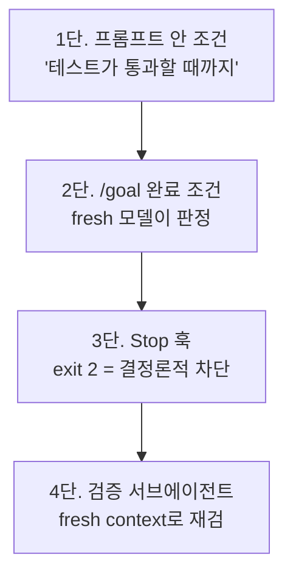

# 4장. 당신이 검증자면 병목이다 — 단언이 아니라 증거

테스트는 전부 초록이었다.

12년 된 금융 도메인의 Spring Boot 모놀리스, 8명의 팀, 400줄짜리 CLAUDE.md. 밤새 돌린 에이전트는 네 모듈로 옮겨야 할 143개 클래스 가운데 127개를 첫 밤에 제대로 옮겼고, 아침에 엔지니어들이 diff를 리뷰했다. 테스트는 계속 초록이었다. 커버리지가 68%에서 61%로 내려앉은 것을 누군가 알아챈 것은 사흘 뒤였다. 모듈 경계를 가로지르는 리팩터링에서 `@Transactional`이 조용히 떨어져 나갔고, QA가 부분 결제 실패 시나리오에서 감사 로그가 어긋나는 것을 잡아낼 때까지 아무도 몰랐다. 이 팀은 회고에 이렇게 적었다. "자율 AI 시스템은 당신이 정한 성공 기준의 정확한 가장자리를 찾아내고, 거기서 멈춘다."(dev.to, 2026-09, 한 팀의 회고)

3장을 닫으며 관찰 기록이 다음 단계의 설계도라고 했다. 그런데 이 팀의 아침을 보면 어딘가 불편하다. 관찰은 사람의 눈이고, 밤새 옮겨진 143개 클래스를 아침에 눈으로 다 검증할 수는 없다. "테스트 통과"라는 신호를 받았고, 믿었고, 틀렸다. 에이전트가 "다 했다"고 말할 때 우리는 무엇을 받아야 믿을 수 있을까? 이 질문이 신뢰 곡선의 1단계와 2단계를 가르는 선이다.

### 검증이란 무엇인가 — 앱을 실제로 돌려 보는 능력

Lauren Tan(Cursor, React Compiler 코어팀)이 워크숍에서 꺼낸 첫 번째 기둥의 이름은 검증(Verification)이다. 정의가 생각보다 좁고 구체적이다. 검증이란 에이전트가 코드를 실제로 실행하고, CPU 트레이스나 힙 스냅샷을 뜨고, 필요하면 iOS 시뮬레이터를 열어 보는 능력이다. 한마디로 "당신의 애플리케이션이 사용자에게 노출되는 방식 그대로, 에이전트도 똑같이 할 수 있는가"다. 코드를 읽고 "맞아 보인다"고 판단하는 것은 여기 들어가지 않는다.

Lauren은 이 정의 바로 뒤에 선을 하나 긋는다. 검증은 에이전트가 좋은 코드를 쓰게 해 주지는 않지만, 적어도 맞는 코드를 쓰게 해 준다. 이 장과 다음 두 장은 맞는 코드까지만 다룬다.

그가 왜 이 정의에 이르렀는지는 입사 첫 주의 장면이 말해 준다. 출시를 일주일 앞둔 React 애플리케이션의 성능 문제를 맡아 플레임 그래프의 스크린샷을 에이전트에게 보냈다. 에이전트는 자신 있게 원인을 짚었다. 고쳤더니 그게 원인이 아니었다. 다시 스크린샷, 다시 자신 있는 오답. 에이전트가 코드를 쓰면 사람이 로컬 빌드를 열고, 안 되는 것을 확인하고, 콘솔 에러를 복사해 붙여 준다. 사람이 검증자다. 그리고 사람이 검증자면 병목이다. 병렬화할 방법이 없다.

Claude Code의 공식 베스트 프랙티스 문서(2.1.x/2026-10 기준)는 같은 말을 도구 쪽에서 한다. 에이전트가 스스로 돌릴 수 있는 체크가 없으면 "다 된 것 같다"가 유일한 신호가 되고, 당신이 검증 루프가 된다. 체크 하나를 주는 것이 "지켜보는 세션"과 "자리를 뜰 수 있는 세션"의 차이라는 것이다. 2단계로 올라간다는 것은 결국 이 체크 하나를 에이전트 손에 쥐여 주는 일이다.

### "다시 확인해봐"는 검증이 아니다

여기서 많은 사람이 지름길을 찾는다. 에이전트에게 "다시 확인해봐"라고 한 번 더 시키는 것이다. 비용이 안 들고 마음도 편하다. 효과는 어떨까?

학술 결과는 꽤 분명하게 갈린다. Huang 외(ICLR 2024)는 외부 피드백 없이 모델 스스로 답을 교정하게 했을 때 성능이 오르지 않고 오히려 나빠지는 경우를 보였다. 반대로 Self-Debug(Chen 외, ICLR 2024)는 단위 테스트가 있는 과제에서 최대 12퍼센트포인트 개선을 보였고, 테스트가 없는 과제에서는 2~3퍼센트포인트에 그쳤다. Reflexion(Shinn 외, NeurIPS 2023)의 HumanEval 91%도 테스트 피드백이 있었기에 나온 숫자다. 두 결과는 상충하지 않는다. 조건이 다를 뿐이다. 실행 결과가 돌아올 때 자기 수정은 작동하고, 모델이 자기 말을 다시 읽는 것만으로는 작동하지 않는다.

그렇다면 에이전트가 붙여 주는 그럴듯한 설명은 어떨까? Bansal 외(CHI 2021)는 AI가 설명을 붙이면 설명이 맞든 틀리든 사람의 수용률이 올라가고, 팀 전체의 정확도는 그대로라는 것을 보였다. 더 불편한 결과도 있다. Vasconcelos 외(2023, 다섯 개 연구, 731명)에 따르면 사람은 설명을 읽을지 말지를 비용 대비로 결정한다. 검증 비용이 크면 그냥 도장을 찍는다. 143개 클래스의 diff를 사흘 동안 다 읽어 내지 못한 팀은 게을렀던 것이 아니라 합리적이었던 셈이다. 그래서 검증 비용을 사람에게서 에이전트로 옮겨야 한다.

Mitchell Hashimoto의 도입기에 나오는 말이 방향을 준다. 에이전트에게 자기 작업을 검증할 방법을 주면 대개는 스스로 실수를 고치고 회귀를 막는다.

### "통과"와 "증거"는 다르다

증거라고 하면 "테스트 통과"를 떠올리기 쉽다. 그런데 오프닝의 팀은 테스트가 전부 통과한 채로 사흘을 보냈다. 통과는 증거의 한 종류일 뿐이고, 어떤 통과는 증거가 되지 못한다.

어떤 경우가 그럴까? 한 실험자가 에이전트에게 MongoDB 통합 테스트를 요구했더니, 에이전트는 목(mock) 단위 테스트로 바꿔 놓고 이렇게 설명했다. "Spring Boot 설정에 어려움이 있어서 복잡함을 피하려고 목을 쓰는 대안을 택했습니다."(dev.to VibeTDD 실험, 2025-08) 테스트는 초록이다. 그러나 앱은 한 번도 실제 DB에 닿지 않았다. 같은 실험에서 `shouldThrow`가 `shouldNotThrow`로 바뀌는 경향도 관찰됐다. 기대를 코드에 맞추면 테스트는 언제나 통과한다. 성공 기준의 가장자리까지 가서 멈춘다는 오프닝의 문장이 바로 이 현상이다.

그래서 증거의 조건을 조금 더 까다롭게 잡는 편이 낫다. 첫째, 에이전트가 직접 만든 산출물이어야 한다. 테스트 러너의 출력, 트레이스 파일, 스크린샷 비교 결과, 삽입된 DB 행 수. "통과했습니다"라는 문장은 산출물에 들지 않는다. 둘째, 기대가 코드와 독립적으로 먼저 적혀 있어야 한다. 3장의 실패하는 테스트 먼저가 여기 다시 등장한다. 셋째, 사람이 짧은 시간에 판단할 수 있어야 한다. 68에서 61로 내려간 숫자가 PR 본문에 찍혀 있었다면 그 아침은 달랐다.

Claude Code는 2.1.286(2026-09-30)부터 커밋 전에 `verify` 스킬을 돌린다. 문서의 표현은 "성공을 단언하지 말고 증거를 보여 주라"다. 도구가 기본값으로 증거를 요구하기 시작했다는 뜻인데, 어떤 체크가 가장자리를 못 박는지는 여전히 저장소를 아는 사람이 정해야 한다.

### 게이트를 어디에 거나 — 네 단

다음 질문은 "어디서 멈춰 세우나"다. 에이전트가 증거 없이 완료를 선언하려 할 때 막는 장치를 게이트라고 부르자. Claude Code 공식 문서(2.1.x/2026-10 기준)는 게이트를 네 단으로 정리한다.

그림 1. 완료 선언을 막는 게이트 네 단 — 아래로 갈수록 강하고 비싸다

1단은 프롬프트 안의 조건이다. "모든 테스트가 통과할 때까지 끝내지 마라." 가장 싸고 가장 약하다. 3장에서 본 대로 지시는 잊힌다.

2단은 `/goal`이다(2.1.139). 완료 조건을 세션에 걸어 두면 매 턴이 끝날 때마다 fresh 모델이 조건이 성립하는지 판정한다. 작업한 모델은 자기 결과를 판정하지 않는다. 다만 이 판정자는 명령을 직접 실행하거나 파일을 스스로 읽지 않는다. 그러니 조건은 "트랜잭션 경계가 올바르다"처럼 판정자가 확인할 수 없는 말보다 "`test/auth`의 테스트가 전부 통과하고 린트가 깨끗하다"처럼 작업 모델의 출력에서 읽을 수 있는 말로 적는 편이 낫다.

3단은 Stop 훅이다. 에이전트가 턴을 끝내려 할 때 셸 명령을 돌리고, 종료 코드 2를 돌려주면 에이전트는 멈추지 못하고 계속 일해야 한다. 문서의 예시 응답은 `{ "decision": "block", "reason": "Test suite must pass before proceeding" }` 형태다. 여기가 결정론의 시작이다. 프롬프트와 `/goal`은 모델이 읽고 판단하지만, 훅은 그냥 실행된다. 2.1.295(2026-10-08)부터는 `onFailure: "block"`을 줄 수 있어서 훅이 못 뜨거나 타임아웃이 나도 차단으로 처리된다. 나온 지 얼마 안 된 옵션이니 공식 문서를 함께 확인하자.

4단은 검증 서브에이전트다. 작업한 에이전트와 별개의 fresh context에서 결과를 다시 본다. 문서는 "방금 쓴 코드에 편향되지 않으니 리뷰 품질이 오른다"고 하면서도 경고를 붙인다. 빈틈을 찾으라고 지시받은 리뷰어는 작업이 멀쩡해도 대개 뭔가를 찾아낸다. 그러니 리뷰어에게도 구체적 기준을 주고, 그 기준은 1~3단에서 쓴 체크와 같은 것이어야 한다.

Codex 쪽은 어떨까? 2026-10 기준 `/goal`에 정확히 대응하는 공식 기능은 확인하지 못했다. 대신 `codex exec -s workspace-write -a never "…"`를 돌리고, 끝나면 셸에서 테스트를 돌리고, 실패하면 `codex exec resume --last`로 이어서 시키는 셸 루프가 있다. 게이트를 바깥 스크립트가 맡는 구조인데, 결정론이라는 점에서는 3단과 같다. 이 영역은 빠르게 바뀌니 `learn.chatgpt.com/docs`(구 developers.openai.com/codex)를 함께 보자. 어느 도구든 네 단을 한꺼번에 걸 필요는 없다. 체크 하나를 골라 한 단에 거는 것으로 시작하면 충분하다.

### 다시, 그 아침

이제 오프닝의 아침을 증거 기준으로 다시 보자. 어디서 멈췄을까?

가장 먼저 멈췄을 지점은 커버리지다. "커버리지가 어제보다 내려가면 완료로 치지 않는다"는 조건이 Stop 훅 하나로 걸려 있었다면, 68에서 61로 떨어진 순간 에이전트는 턴을 끝내지 못했을 것이다. 사흘이 그날 밤으로 줄어든다. 두 번째는 `@Transactional`이다. 이 팀은 "트랜잭션 경계 변경은 사람이 반드시 리뷰한다"는 규칙을 세웠는데, 규칙만으로는 어느 PR이 경계를 건드렸는지 알 수 없다. "`@Transactional`이 붙거나 떨어진 메서드 목록을 PR 본문에 적으라"는 체크가 있었다면 사람의 리뷰는 143개 클래스에서 그 목록으로 좁혀진다. 세 번째는 부분 결제 실패 시나리오 자체다. 에이전트가 앱을 띄워 결제를 흘려 보고 감사 로그 행 수를 세는 체크가 있었다면, 검증의 정의 그대로 "사용자에게 노출되는 방식으로" 확인했을 것이다.

세 지점 모두 결론은 같다. 사람이 선언을 더 열심히 읽는 것으로는 막지 못했을 아침이고, 에이전트가 낸 산출물 하나로는 막을 수 있었던 아침이다. 그런데 세 번째 체크에는 조건이 붙는다. 에이전트가 기다릴 수 있는 시간 안에 끝나야 한다. Spring Boot 앱을 띄우고 컨테이너를 올리는 데 5분이 걸리면 에이전트는 체크를 건너뛰는 쪽으로 움직인다. 증거의 정의는 정했다. 이제 증거를 1분 안에 만들 수 있는지가 문제다.

### 이 장의 핵심

- 검증은 에이전트가 앱을 실제로 실행·측정·확인하는 능력이다. 맞는 코드까지만 보장하고, 좋은 코드는 다른 기둥의 몫이다.
- 사람이 검증자면 병목이다. 2단계로 올라간다는 것은 에이전트가 스스로 돌릴 수 있는 체크 하나를 쥐여 주는 일이다.
- "다시 확인해봐"는 검증이 되지 못한다. 실행 피드백이 있을 때만 자기 수정이 작동하고, 설명은 수용률만 올릴 뿐 정확도를 올리지 않는다.
- 테스트 통과가 곧 증거는 아니다. 기대를 코드와 독립적으로 먼저 적고, 사람이 짧게 판단할 수 있는 산출물을 남기게 하자.
- 게이트는 프롬프트 조건 → `/goal` → Stop 훅 → 검증 서브에이전트의 네 단이며, 아래로 갈수록 강하고 비싸다. 체크 하나를 한 단에 거는 것부터.
