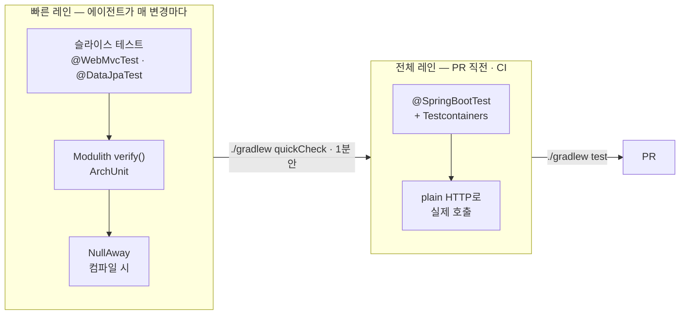

# 5장. Java/Spring 번역 — 검증 단위 시간을 1분 안으로

왜 에이전트는 빌드를 기다리다 대화를 멈춰 버릴까?

컨트롤러 하나를 고치게 했더니 에이전트가 `./gradlew test`를 돌린다. 출력이 한동안 없다. 셸 타임아웃이 걸리고, 에이전트는 "결과를 확인하지 못했습니다"라거나, 더 나쁘게는 "테스트가 통과한 것으로 보입니다"라고 적는다. 한 Java 개발자는 이 현상을 이렇게 요약했다(codenote, 2026-01, 단일 저자 측정). Java와 Spring Boot는 TypeScript나 Python보다 AI 피드백 루프가 길다. `./gradlew test` 한 번에 3~5분, 원인은 JVM 기동과 Spring 빈 초기화와 Testcontainers 부팅이라는 피할 수 없는 오버헤드이고, 그래서 "빌드가 도는 동안 대화가 멈춘다".

4장에서 증거를 정의했다. 에이전트가 스스로 돌린 체크의 산출물을 받자고 했다. 그런데 그 체크 한 번이 5분이라면 무슨 일이 생길까? 에이전트는 체크를 덜 돌리는 쪽으로 움직인다. 4장의 VibeTDD 실험에서 통합 테스트를 목으로 바꿔 놓고 "Spring Boot 설정이 어려워서"라고 변명한 것이 바로 이것이다. 느린 체크는 안 돌리는 체크가 된다.

여기서 숫자를 하나 정의하자. 검증 단위 시간이란 에이전트가 변경 하나를 확인하려고 체크 한 번을 돌렸을 때 결과가 돌아오기까지 걸리는 시간이다. 목표는 이 숫자를 1분 안으로 끌어내리고, 1분 안에 들어오지 않는 검증은 다른 레인으로 분리하는 것이다.

### 처방 1 — 두 층의 레인: 슬라이스 테스트와 quickCheck

전형적인 Spring Boot 저장소는 테스트가 전부 `@SpringBootTest`다. 편하고, 에이전트는 기존 패턴을 베끼기 좋아하니 그대로 복제한다. 찜찜한 구석은 여기에 있다. Spring Boot에는 필요한 층만 띄우는 슬라이스 테스트가 있다. 웹 계층만 띄우는 `@WebMvcTest`, JPA 계층만 띄우는 `@DataJpaTest`가 대표다. 앞서 인용한 측정에서는 `@SpringBootTest`가 테스트당 5~15초 걸릴 때 `@WebMvcTest`는 0.3~0.8초, `@DataJpaTest`는 0.5~1.5초였다. Gradle 데몬·병렬 실행·configuration cache까지 켜면 Gradle 기동 시간도 줄어든다.

```properties
# gradle.properties
org.gradle.daemon=true
org.gradle.parallel=true
org.gradle.caching=true
org.gradle.configuration-cache=true
```

주의할 점이 하나 있다. Spring Boot 4부터 코드베이스가 모듈 단위로 쪼개지면서(Spring Boot 4.1/2026-10 기준) `@WebMvcTest`는 `org.springframework.boot.webmvc.test.autoconfigure`로, `@DataJpaTest`는 `org.springframework.boot.data.jpa.test.autoconfigure`로 옮겨 갔고, 테스트 의존성도 `spring-boot-starter-webmvc-test`·`spring-boot-starter-data-jpa-test`로 갈라졌다. 에이전트는 Boot 3 시절 경로를 먼저 쓴다. 저술 시점에 실제로 그렇게 썼다가 컴파일이 깨지는 것을 보았다. 3장의 버전 고정 규칙이 여기서도 필요하다.

```java
@WebMvcTest(OrderController.class)
class OrderControllerSliceTest {
    @Autowired MockMvc mvc;
    @MockitoBean OrderService orderService;

    @Test
    void returnsOrderDescription() throws Exception {
        given(orderService.describe(7L)).willReturn("order-7");
        mvc.perform(get("/orders/7"))
           .andExpect(status().isOk())
           .andExpect(content().string("order-7"));
    }
}
```

슬라이스 테스트가 준비됐으면 에이전트 전용 레인을 Gradle 태스크로 만들자. 여기서는 `quickCheck`라고 부르겠다. 슬라이스 테스트와 (처방 3에서 만들) 아키텍처 검증만 포함한다.

```groovy
// build.gradle — 에이전트용 빠른 레인
tasks.register('quickCheck', Test) {
    description = 'Fast verification lane for agents'
    group = 'verification'
    testClassesDirs = sourceSets.test.output.classesDirs
    classpath = sourceSets.test.runtimeClasspath
    useJUnitPlatform()
    filter {
        includeTestsMatching '*SliceTest'
        includeTestsMatching '*ModularityTests'
    }
}
```

저술 시점에 Spring Boot 4.1.1과 Java 25, Gradle 9.7.1로 만든 작은 프로젝트에서 `./gradlew quickCheck`는 4초 안팎에 끝났고, Postgres 컨테이너를 띄우는 통합 테스트 하나는 13초가 걸렸다. 장난감 크기이니 숫자보다 비율을 보자.


그림 1. 에이전트용 빠른 레인과 사람·CI용 전체 레인의 2층 구조

### 처방 2 — 앱을 실제로 띄우는 검증은 전체 레인에

빠른 레인만 있으면 4장의 정의를 반만 채운 셈이다. 검증은 앱을 사용자에게 노출되는 방식 그대로 돌려 보는 것이었고, Spring 서비스에서 그 방식은 HTTP다. Lauren이 공개한 검증 스킬 생성 절차(`create-verification-skill`)도 서비스의 기본 레시피를 "plain HTTP"로 적는다. Java 백엔드의 검증 스킬은 결국 앱을 띄우고 HTTP로 때려 보는 것이다.

Spring Boot 4.1/2026-10 기준으로 이것을 가장 짧게 쓰는 방법은 Testcontainers의 `@ServiceConnection`이다. 컨테이너 빈에 이 애노테이션을 붙이면 Spring Boot가 연결 정보를 알아서 데이터소스에 꽂아 준다.

```java
@TestConfiguration(proxyBeanMethods = false)
class TestcontainersConfiguration {
    @Bean
    @ServiceConnection
    PostgreSQLContainer postgresContainer() {
        return new PostgreSQLContainer(DockerImageName.parse("postgres:17-alpine"))
                .withReuse(true);
    }
}
```

여기도 Boot 4의 이름 변화가 있다. 의존성은 `spring-boot-testcontainers`·`testcontainers-junit-jupiter`·`testcontainers-postgresql`이고, 컨테이너 클래스는 `org.testcontainers.postgresql.PostgreSQLContainer`다(Initializr가 생성한 그대로다). 이 설정을 `@SpringBootTest(webEnvironment = RANDOM_PORT)`에 `@Import`하고 JDK의 `HttpClient`로 `/orders/7`을 호출해 응답을 확인하는 테스트가 전체 레인의 기본형이다. 에이전트가 PR을 열기 전에 한 번 돌리고 그 출력을 PR 본문에 붙이게 하자. `withReuse(true)`는 컨테이너를 다음 실행에서 재사용하게 하는 옵션인데, 개발 머신의 Testcontainers 설정에서 재사용을 따로 켜야 동작한다(`~/.testcontainers.properties`의 `testcontainers.reuse.enable=true`)(사실 확인 필요).

### 처방 3 — 아키텍처를 테스트 한 줄로

4장 오프닝의 팀은 또 다른 실패도 겪었다. 에이전트가 모듈 경계를 가로지르며 비즈니스 로직을 복제한 Adapter와 Bridge 클래스 16개를 발명했고, 2주 뒤 프로덕션 버그로 돌아왔다. 경계를 넘은 코드도 동작은 하기 때문에 단위 테스트로는 잡히지 않는다. 잡으려면 경계 자체를 테스트해야 한다.

Spring Modulith(2.1/2026-10 기준)는 이것을 테스트 한 줄로 만든다.

```java
class ModularityTests {
    @Test
    void verifiesModuleStructure() {
        ApplicationModules.of(DemoApplication.class).verify();
    }
}
```

`verify()`는 애플리케이션 모듈 사이에 순환이 없는지, 다른 모듈을 참조할 때 API 패키지만 쓰는지를 검사하고, 위반이 있으면 예외를 던진다. 허용 의존은 `@ApplicationModule(allowedDependencies = …)`로 좁힐 수 있다. 저술 시점에 `order` 모듈의 클래스가 `billing.internal` 패키지의 클래스를 주입받도록 일부러 써 보았더니 `quickCheck`가 이런 메시지로 빨개졌다. "Module 'order' depends on non-exposed type com.example.demo.billing.internal.BillingCalculator within module 'billing'!" 에이전트가 가장 가까운 길로 내부 클래스를 끌어다 쓴 순간, 사람이 리뷰에서 보기 전에 테스트가 먼저 본다.

Modulith가 모듈 경계를 맡는다면 ArchUnit(1.5.x/2026-10 기준)은 그 아래의 규칙을 맡는다. `layeredArchitecture()`로 레이어 의존을, `noClasses().that()…should().dependOnClassesThat()`로 특정 의존을 금지하고, 4장의 팀이 세운 "Adapter·Wrapper·Compat·Legacy라는 이름에는 정당화가 필요하다"는 규칙도 네이밍 규칙으로 옮길 수 있다. 다만 아키텍처 테스트의 결함 예방 효과를 잰 정량 연구는 찾지 못했으니, 효과는 "경계 위반을 리뷰 전에 잡는다"까지만 말하자.

### 처방 4 — 컴파일러를 엄격하게

Lauren은 워크숍에서 Rust가 다시 인기를 얻는 이유를 컴파일러의 엄격함에서 찾았다. unsafe 블록만 막으면 컴파일이 되는 코드는 대개 동작한다는 확신을 가질 수 있다는 것이다. Java 컴파일러는 그만큼 엄격하지 않지만, Error Prone의 플러그인으로 매 빌드마다 널 안전성을 검사하는 NullAway를 얹으면 꽤 가까워진다. Spring Boot 4가 JSpecify 널 안전성 애노테이션을 채택했으니(Spring Boot 4.1/2026-10 기준) 기반도 깔려 있다.

```groovy
plugins {
    id 'net.ltgt.errorprone' version '5.1.1'
}
import net.ltgt.gradle.errorprone.CheckSeverity

dependencies {
    errorprone 'com.google.errorprone:error_prone_core:2.50.0'
    errorprone 'com.uber.nullaway:nullaway:0.14.2'
}

tasks.withType(JavaCompile).configureEach {
    options.errorprone {
        disableAllChecks = true                   // 기존 코드베이스: 전체 체크는 끄고
        check('NullAway', CheckSeverity.ERROR)     // NullAway만, 경고가 아니라 에러로
        option('NullAway:AnnotatedPackages', 'com.example.demo')
    }
    options.compilerArgs << '-Werror'
}
```

두 가지가 중요하다. 첫째, NullAway의 기본 심각도는 경고다. `CheckSeverity.ERROR`로 올리지 않으면 CI가 빨개지지 않고, 빨개지지 않는 경고는 에이전트에게 없는 것과 같다. 둘째, 기존 코드베이스라면 NullAway만 켜서 시작하는 편이 낫다. 수백 개 경고가 한꺼번에 쏟아지면 사람도 에이전트도 억제 애노테이션으로 덮어 버린다. 저술 시점에 위 설정을 Java 25와 Spring Boot 4.1.1 프로젝트에 적용하고 `@Nullable` 반환값을 바로 역참조하는 코드를 쓰자, 컴파일 단계에서 `[NullAway] dereferenced expression 'find(id)' is @Nullable`로 빌드가 멈췄다. 버전은 빠르게 바뀌니 위 세 숫자는 각 프로젝트의 GitHub releases에서 확인하자.

### 린트로 못 올리는 것

네 처방을 다 걸어도 남는 것이 있다. 4장의 팀이 가장 아프게 배운 트랜잭션 경계다. `@Transactional`이 떨어졌는지, `REQUIRES_NEW`가 같은 클래스 안에서 `this`로 호출되어 프록시를 우회하는지는 컴파일러도 Modulith도 모른다. 그 팀의 결론은 "트랜잭션 경계 변경은 사람이 반드시 리뷰한다"였고, 이 책도 그 결론을 따른다. 다만 어느 PR이 경계를 건드렸는지는 4장에서 말했듯 에이전트가 목록으로 내게 하자.

사람이 봐야 하는 나머지 Spring 함정도 목록으로 두는 편이 낫다. 한 정리글(JavaGuide, 2026-01)이 실제 프로젝트에서 모은 네 가지가 출발점이다. `@Transactional` 자기 호출, LLM이 JSON을 항상 정형으로 돌려준다고 가정한 NPE, 엔티티를 지운 뒤 비동기 핸들러가 "Resume does not exist: ID=35"를 무한 재시도하는 행복 경로 편향, `XACK`만 하고 상한 없이 쌓이는 Redis Stream. 여기에 N+1 쿼리와 컬렉션 fetch join에 `Pageable`을 붙인 메모리 페이징을 더하면 지침의 뼈대가 된다.

이 목록은 CLAUDE.md나 AGENTS.md에 적되, 테스트로 옮길 수 있는 것은 옮기자. 토비(이일민)의 라이브 코딩 정리가 기준이 된다. 문제가 있다는 실패하는 테스트를 먼저 만들고 나서 고치게 하라, TDD로 하면 에이전트가 N+1 쿼리를 검증하는 테스트를 만들어 주는데 그게 기가 막히다는 것이다. N+1은 지침 한 줄보다 쿼리 수를 세는 테스트 하나가 훨씬 확실하다. 같은 정리에는 에이전트가 도메인 단위 테스트에 JPA의 `@PrePersist`를 끼워 넣은 장면도 나오니, 어느 레인에 어느 테스트가 들어가는지도 적어 두자.

### 숫자 하나를 재자

처방을 요약하면 레인을 둘로 나누고, 빠른 레인에 슬라이스 테스트·모듈 검증·널 검사를, 전체 레인에 실제 컨테이너와 HTTP 호출을 넣는 것이다. 그런데 처방보다 먼저 할 일이 있다. 재는 것이다.

지금 에이전트가 변경 하나를 확인하려고 돌리는 명령에 `time`을 붙여 한 번 돌려 보자. 1분을 넘으면 에이전트는 이미 체크를 건너뛰고 있을 가능성이 크다. 레인을 나눈 뒤 `./gradlew quickCheck`를 같은 방법으로 재고, 두 숫자를 에이전트 지침 파일에 적어 두자. "커밋 전 `quickCheck`(약 N초), PR 전 `test`(약 M분)"처럼 말이다. 에이전트가 어느 체크를 언제 돌릴지 스스로 고르게 하는 것은 이 두 숫자다.

백엔드에서는 시간이 문제였다. 다음 장의 프런트엔드에서는 문제가 다르다. 체크는 금방 끝나는데, 에이전트가 무엇을 봐야 하는지를 모른다.
