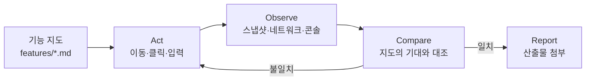

# 6장. React/Next.js 번역 — 브라우저를 에이전트 손에

배포 직전이라고 해보자. 에이전트에게 주문 상세 페이지의 "재주문" 버튼을 고치게 했고, 에이전트는 스크린샷을 한 장 붙여 "수정 완료, 화면 정상 렌더링 확인"이라고 보고했다. 스크린샷은 멀쩡하다. 버튼도 제자리에 있다. 그런데 눌러 보면 아무 일도 일어나지 않는다. 핸들러가 새 컴포넌트에 연결되지 않았고, 네트워크 탭에는 요청이 하나도 없다. 정지 화면에는 "눌리지 않음"이 찍히지 않는다.

5장에서 백엔드의 문제는 시간이었다. 프런트엔드에서는 체크가 금방 끝난다. 문제는 에이전트가 무엇을 봐야 하는지를 모른다는 것이다. 한 프런트 검증 가이드(qaskills, 2026-08)의 문장이 이 상황을 정확히 말한다. "스크린샷 도구가 있는 에이전트도 깨진 페이지에서 자신 있게 성공을 선언한다." 같은 글은 스크린샷에 보이는 실패(렌더링 중 throw로 비어 버린 영역, CSS 충돌, 좁은 뷰포트의 overflow, 올바른 컴포넌트에 들어간 잘못된 데이터)와 스크린샷으로는 안 보이는 실패(콘솔의 에러, 버튼처럼 생겼지만 버튼이 아닌 요소)를 나눈다. 오프닝의 눌리지 않는 버튼과 비어 있는 네트워크 탭도 후자 쪽이다. 스크린샷 하나로 둘 다 잡을 수는 없다.

### 현상: 도구가 있어도 성공을 선언한다

Lauren Tan의 워크숍에서 이 문제는 도구를 만든 뒤에 나타났다. 그는 Cursor의 에이전트 창(코드명 Glass)을 위해 Chrome DevTools Protocol로 앱을 띄우고 조작하고 트레이스를 뜨는 검증 스킬 control-glass를 만들었다. "코드 자체는 그다지 흥미롭지 않다, 당신의 에이전트가 쉽게 하나 만들어 줄 수 있다"는 것이 본인의 말이다. 중요한 것은 그다음이다. 스킬이 생겼는데도 에이전트는 "에이전트 창이 뭔지 전혀 몰랐다". 누가 "왼쪽 사이드바가 버벅인다"고 하면 에이전트는 코드를 뒤지느라 시간을 쓰고, 그 기능이 UI 어디에 있는지 몰라서 눌러야 할 곳을 찾지 못했다. Lauren의 표현으로는 "완전히 쓸모없었다".

왜 그랬을까? 도구는 손을 준다. 클릭하고 입력하고 측정하는 손이다. 그런데 어디를 클릭할지, 무엇이 정상인지는 손이 알려 주지 않는다. 오프닝의 에이전트도 같은 처지다. 스크린샷을 찍을 손은 있었지만, "재주문 버튼을 누르면 `/api/orders/{id}/reorder`로 POST가 나가고 토스트가 뜬다"는 기대는 어디에도 적혀 있지 않았다. 기대가 없으면 비교할 수 없고, 비교할 수 없으면 남는 것은 "화면이 떴다"뿐이다.

프런트엔드에서 특히 아픈 이유가 있다. 백엔드의 기대는 대개 테스트 코드 안에 있지만, 프런트엔드의 기대는 사용자 경로 안에 있다. 토비(이일민)의 라이브 코딩 정리에 React의 effect가 두 번 실행되어 리마인더가 두 개 생기는 장면이 나온다. 화면에는 하나가 멀쩡히 보였을 것이다. DB에 두 개가 들어간 것은 사용자 경로를 끝까지 따라가 봐야 안다.

### 원리: 지도가 먼저다

Lauren이 찾은 답은 기능 지도(Feature Map)였다. 스킬 안에 앱의 기능 목록과, 사용자 관점에서 각 기능까지 가는 경로와, 서브 기능과 키보드 단축키와, 조작에 쓸 DOM 속성까지 적어 둔 파일이다. 이 지도가 생기자 Slack 채널에 올라오는 "???"와 스크린샷 한 장짜리 버그 리포트도 에이전트가 재현할 수 있게 되었다.

control-glass 자체는 공개되지 않았다. 따라 할 수 있는 것은 Lauren이 공개한 두 가지다. pstack의 `create-verification-skill`이 정의하는 지도의 형태, 그리고 `verification-skill-example` 저장소다. 저장소의 README는 자기 자신을 "심하게 허구화된 예시"라고 소개한다. "Atlas"도 "Harbor Labs"도 지어낸 이름이고, "중요한 것은 형태"라고 못 박는다. 그 형태는 단순하다. `features/README.md` 아래에 기능마다 파일 하나, 파일마다 H2 네 개. `Sub-features`, `How to get to it (user POV)`, `Driving it with <harness>`, `Gotchas`. 각 파일은 사용자 관점에서 그 기능이 무엇이고, 어떻게 도달하고, 하네스로 어떻게 조작하고, 어떤 관찰 가능한 최종 상태가 동작을 증명하는지에 답한다.

Next.js 앱으로 번역하면 이런 모양이 된다. 오프닝의 주문 상세 기능을 예로 들면 다음과 같다(형태를 보여 주기 위한 가상의 예시다).

```markdown
# 주문 상세 (/orders/[id])

## Sub-features
- 주문 요약 카드, 배송 상태 타임라인, "재주문" 버튼, 영수증 PDF 링크

## How to get to it (user POV)
- 로그인 → 상단 "주문 내역" → 목록에서 주문 번호 클릭
- 직접 URL: /orders/{id} (비로그인 시 /login?next=... 로 리다이렉트)

## Driving it with Playwright MCP
- 목록 행: role=link, name=/주문 #\d+/
- 재주문: role=button, name="재주문" → 클릭 후 POST /api/orders/{id}/reorder 1회,
  toast(role=status) "장바구니에 담았습니다"

## Gotchas
- 서버 컴포넌트라 `cookies()`는 await 필요(Next.js 16)
- 배송 타임라인은 느린 API — 로딩 스켈레톤이 먼저 보이는 것이 정상
```

이 파일이 있으면 검증 루프가 닫힌다. 행동하고(Act), 관찰하고(Observe), 지도의 기대와 비교하고(Compare), 산출물과 함께 보고한다(Report). 4장의 증거 조건 가운데 "기대가 코드와 독립적으로 먼저 적혀 있어야 한다"가 프런트엔드에서는 이 지도다.


그림 1. 기능 지도를 기준으로 닫히는 Act → Observe → Compare → Report 루프

`create-verification-skill`은 증명의 기준도 적어 둔다. 내부 세터나 테스트 전용 엔드포인트 말고 실제 사용자 경로를 밟을 것, 최종 화면만이 아니라 행동과 그 결과 상태를 함께 담을 것, 부수 효과(쓰인 파일, 삽입된 행, 보내진 메시지)를 확인할 것. 그리고 한 문장을 덧붙인다. "한 번도 실행되지 않은 생성된 스킬은 초안이지 산출물이 아니다." 지도를 쓴 뒤에는 에이전트가 그 지도로 기능 하나를 실제로 통과하게 해 봐야 한다. 지도를 위키 대신 스킬로 두는 이유도 적혀 있다. 위키는 사람에게 좋지만, 에이전트는 다시 읽는 토큰마다 값을 치른다.

### 도구: control-glass 대신 MCP 두 개

지도가 있으면 손은 어디서 빌릴까? Lauren처럼 CDP 스킬을 직접 만들 수도 있지만(공개 대응물은 cursor-team-kit의 `control-ui`), React/Next.js 독자에게는 MCP 서버 두 개면 충분하다(2026-10 기준).

행동은 Playwright MCP가 맡는다. 픽셀 대신 접근성 트리를 쓰기 때문에 `browser_snapshot`이 스크린샷보다 낫다고 README가 직접 말하고, `browser_navigate`·`browser_click`·`browser_fill_form`·`browser_wait_for`·`browser_network_requests` 같은 도구를 준다. 위 지도에서 `role=button, name="재주문"`처럼 접근성 역할과 이름으로 요소를 적은 이유가 이것이다. 설치는 Claude Code에서 `claude mcp add playwright npx @playwright/mcp@latest` 한 줄, Codex는 `codex mcp add`로 같은 서버를 등록한다. 진단은 Chrome DevTools MCP가 맡는다. 살아 있는 Chrome을 에이전트가 제어·검사하게 하고, 트레이스를 기록해 성능 인사이트를 뽑아 준다. 오프닝의 "네트워크 탭에 요청이 없다"를 에이전트가 직접 보는 길이 여기다. Next.js 16의 내장 DevTools MCP는 브라우저 로그와 서버 로그를 한곳에서 보여 주고 에러 스택을 자동으로 가져온다.

비용은 짚고 가자. 접근성 스냅샷이 스크린샷보다 토큰을 훨씬 많이 쓴다는 단일 저자 측정이 있고, "사용자처럼 웹 앱을 테스트하는 것은 토큰 소각기가 될 수 있다"는 HN의 경고도 있다. Compare에는 스냅샷을, 사람에게 보여 줄 Report에는 스크린샷을 쓰는 식으로 나누는 편이 낫다. 지도가 좁을수록 스냅샷도 좁아진다.

### 함정 1: `next build`는 린트를 돌리지 않는다

프런트 검증 레인을 짜다 보면 빌드 통과를 린트 통과로 착각하기 쉽다. Next.js 16(2026-10 기준)에서는 그 착각이 사실과 어긋난다. 릴리스 노트는 `next lint` 명령을 제거하면서 "Biome이나 ESLint를 직접 쓰라, `next build`는 더 이상 린트를 실행하지 않는다"고 적었다. 그러니 `next build`가 초록이어도 린트는 한 번도 돌지 않은 상태일 수 있다. 에이전트가 "빌드 통과"를 증거로 내밀면, 그 증거에 린트는 들어 있지 않다.

처방은 단순하다. CI와 에이전트의 빠른 레인 양쪽에 `eslint .`를 명시적인 단계로 넣는다. `@next/eslint-plugin-next`는 ESLint v10에 맞춰 Flat Config가 기본이 되었으니 설정 파일은 `eslint.config.mjs` 하나다. 5장의 `quickCheck`에 해당하는 프런트 레인은 `eslint . && tsc --noEmit && next build` 정도이고, 지도 기반의 Playwright 통과가 PR 직전 전체 레인이다.

### 함정 2: useEffect를 린트로 막기

Lauren은 워크숍에서 React의 가장 큰 발총(foot gun) 가운데 하나가 `useEffect`라며, Dune과 Grok Bot에서는 이것을 금지했다고 말했다. 과격해 보이지만 근거는 흔하다. 프로덕션에서 실패하는 AI 생성 React 패턴을 정리한 한 글(2026-05)은 1위로 `useEffect`와 `useState`로 데이터를 가져오는 코드를 꼽는다. 오래된 데이터, Strict Mode의 이중 요청, 중복 제거 없음. React 팀도 19.2 릴리스에서 "대부분의 사용자는 그냥 린트 규칙을 끄고 의존성을 뺀다. 그러나 그러면 버그로 이어질 수 있다"고 적었다.

ESLint로 옮기면 두 줄이다. `react-hooks/exhaustive-deps`를 error로 올리고, `no-restricted-syntax`로 `useEffect` 호출 자체를 막는다. 아래 설정은 ESLint 10.12.0과 eslint-plugin-react-hooks 7.1.1에서 실제로 돌려 확인한 것이다(저자 실측, 2026-10 기준).

```js
// eslint.config.mjs
import reactHooks from "eslint-plugin-react-hooks";

export default [
  {
    files: ["**/*.{js,jsx,ts,tsx}"],
    languageOptions: {
      ecmaVersion: 2024,
      sourceType: "module",
      parserOptions: { ecmaFeatures: { jsx: true } },
    },
    plugins: { "react-hooks": reactHooks },
    rules: {
      "react-hooks/rules-of-hooks": "error",
      "react-hooks/exhaustive-deps": "error",
      "no-restricted-syntax": [
        "error",
        { selector: "CallExpression[callee.name='useEffect']",
          message: "useEffect는 쓰지 않는다. 데이터는 서버 컴포넌트나 TanStack Query로, 이벤트는 핸들러로. 예외는 src/effects/ 아래에서만." },
        { selector: "CallExpression[callee.property.name='useEffect']",
          message: "React.useEffect도 같은 이유로 쓰지 않는다." },
      ],
    },
  },
  { files: ["src/effects/**"], rules: { "no-restricted-syntax": "off" } },
];
```

`useEffect(() => …)`와 `React.useEffect(() => …)` 둘 다 error로 잡히고, `src/effects/` 아래 파일은 두 번째 블록이 규칙을 끄기 때문에 통과한다. 메시지에 대안을 적은 것은 의도적이다. 금지만 적으면 에이전트는 다른 우회로를 찾고, 대안을 적으면 그 길로 간다.

전면 금지와 예외 허용 가운데 무엇이 나을까? Dune처럼 에이전트가 쓰도록 처음부터 설계한 코드베이스라면 전면 금지가 깔끔하다. 이미 effect가 수백 개인 기존 앱이라면 허용 디렉터리를 두고 새 코드만 막는 편이 현실적이다. 어느 쪽이든 규칙은 린트에 있어야 한다. 지침 파일의 "useEffect를 피하라"는 3장에서 본 대로 잊힌다.

시각 회귀까지 하드 게이트로 올리고 싶다면 Storybook(10.x/2026-10 기준)과 Chromatic의 "UI Tests"를 required check로 두는 길이 있다. "우연한 UI 버그가 머지되는 것을 막는" 장치인데, 지도의 기대를 픽셀 수준으로 고정하는 셈이라 안정된 기능에만 거는 편이 낫다.

### 지도 없이 붙인 MCP

여기까지 읽으면 순서가 보인다. 기능 지도 하나, MCP 두 개, 린트 함정 두 개. 그런데 실제로 가장 흔한 순서는 반대다. MCP를 먼저 붙인다. 한 줄이면 되고, 붙이자마자 에이전트가 브라우저를 열고 클릭하는 것이 보이니 뭔가 된 것 같다. 그리고 에이전트는 더 자신 있게, 더 많은 스크린샷과 함께 성공을 선언하기 시작한다. 손이 생겼는데 지도가 없으면, 늘어나는 것은 검증이 아니라 성공 선언이다.

그래서 저장소에서 할 일은 하나다. `features/README.md`에 핵심 기능 하나의 지도를 쓰고, Playwright MCP를 연결하고, 에이전트가 그 기능을 사용자처럼 한 번 통과하게 해서 Report가 4장의 증거 조건을 채우는지 본다.

한 가지 더. 이 지도는 검증 스킬의 일부다. Lauren이 `create-verification-skill` 옆에 `maintain-verification`을 따로 둔 이유는 지도가 낡기 때문이다. 기능이 바뀌면 지도도 바뀌어야 하고, 에이전트가 지도대로 했는데 실패한 관찰은 어딘가에 적혀야 한다. 그 "어딘가"가 지침 파일인지, 스킬인지, 훅인지를 가르는 기준이 다음 장의 주제다.
