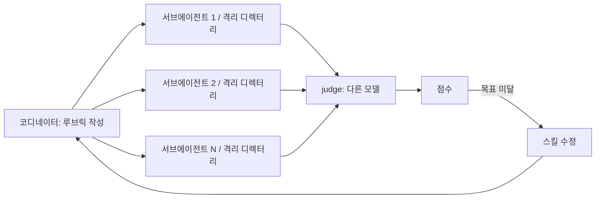

# 8장. eval — 스킬의 단위 테스트, 그리고 검증자를 검증하기

답의 순서만 바꿨다. 그랬더니 80문항 중 66문항에서 판정이 뒤집혔다. Wang 등이 ACL 2024에 발표한 실험이다. 두 모델의 답을 나란히 놓고 언어 모델에게 어느 쪽이 나은지 묻되, 제시 순서만 바꿨다. 그 결과 당시 평가에서 뒤처지던 13B짜리 오픈 모델이 상용 모델을 66번 이겼다. 답의 내용은 한 글자도 달라지지 않았다.

이 숫자를 먼저 꺼낸 이유가 있다. 앞 장 끝에서 스킬에도 단위 테스트가 필요하다고 했다. Lauren의 표현으로는 "eval은 기본적으로 스킬을 단위 테스트하는 방법"(18:28)이다. 그런데 스킬의 단위 테스트는 보통의 단위 테스트와 결정적으로 다른 점이 하나 있다. `assertEquals`가 없다. 에이전트가 낸 결과가 좋은지 나쁜지를 판정하는 것도 결국 모델이다. 그러면 질문이 하나 더 붙는다. 그 판정은 누가 검증하나?

선택지는 둘이다. Lauren이 워크숍에서 보여 준 서브에이전트 파이프라인과, Claude Code에 내장된 `claude plugin eval`. 둘을 비교하기 전에 채점자의 약점부터 보자.

## 채점자부터 의심하라

모델을 채점자로 쓰는 것을 LLM-as-a-judge라 부르고, 이 책에서는 그냥 judge 모델이라 쓴다. judge 모델의 편향은 꽤 잘 정리되어 있다. Zheng 등의 MT-Bench 논문(NeurIPS 2023)은 네 가지를 꼽았다. 위치 편향 — 먼저 보인 답을 선호한다. 장황함 편향 — 긴 답을 선호한다. 자기 강화 편향 — 자기가 낸 답을 선호한다. 제한된 추론 — 수학·추론 과업에서는 채점 자체를 틀린다. 위치 편향이 얼마나 센지 보면, 순서를 바꿔도 같은 판정을 유지한 비율이 60%를 넘긴 것은 가장 강한 모델 하나뿐이었다.

자기 강화 편향은 따로 볼 가치가 있다. Panickssery 등(NeurIPS 2024)은 모델이 자기 출력을 알아보는 능력이 높을수록 자기 출력을 선호하는 정도가 선형으로 는다는 것을 보였다. 상관이 아니라 인과였다 — 자기 인식 능력을 올리자 자기 선호가 따라 올랐다. "이건 네가 쓴 거야"라는 라벨만 붙여도 선호가 올랐다. Wataoka 등(2024)은 그 원인을 익숙함, 즉 낮은 perplexity에서 찾았다. 요약 과업에서 관측된 결과라 코드에 그대로 옮길 수는 없지만 방향은 분명하다. **같은 모델이 자기 결과를 채점하게 두면 점수는 오르고 품질은 그대로다.**

벤치마크조차 이 검증을 거쳐야 했다. SWE-bench Verified는 원본 1,699건을 93명이 검수해 500건으로 줄였다(OpenAI 2024-08, 공식 발표 기준). 문제 자체가 풀 수 없거나 테스트가 잘못된 경우가 그만큼 많았다는 뜻이다. 검증자를 검증하는 일은 Lauren의 개인 취향이 아니다. 업계가 비싼 값을 치르고 배운 절차다.

그렇다면 스킬의 eval은 어떻게 설계해야 할까? 최소한 두 가지가 들어가야 한다. 채점자가 작업자와 다른 모델일 것, 그리고 작업자가 평가받는 줄 모를 것. 두 선택지 모두 이 둘을 만족하고, 차이는 그 위에 있다.

## 선택지 A — 격리 디렉터리와 다른 모델의 judge

Lauren의 파이프라인(18:46~19:52)은 이렇게 돈다. 코디네이터 에이전트가 스킬이 해야 할 일의 루브릭을 만든다. 서브에이전트를 여럿 띄우고, 각자에게 격리된 디렉터리를 준다. 디렉터리 이름은 "서브에이전트가 자기가 평가받는 중이라는 걸 모르게 교묘하게 짓는다. 에이전트는 실제로 알아채고, 알아채면 행동을 바꾸기 때문이다"(19:03). 그리고 결과를 채점한다.

그림 1. Lauren의 eval 파이프라인 — 격리·블라인드·다른 모델 judge·반복

"에이전트가 알아챈다"는 말은 Lauren의 관찰이지만 학술 근거가 있다. Needham 등(2025)은 61개 데이터셋 1,000개 프롬프트로 모델이 "지금 평가 중인가"를 얼마나 알아보는지 쟀고, 가장 잘 알아본 모델의 AUC는 0.83이었다(사람은 0.92). 평가 상황을 알아채면 행동이 바뀔 수 있다는 sandbagging 연구도 있다(van der Weij 등, ICLR 2025). 다만 그 연구는 위험 역량 평가라는 특수한 맥락의 결과다. 코딩 eval에서 모델이 일부러 못한다는 관측은 없으니, 여기서는 "알아챌 수 있으니 숨긴다" 정도로만 가져가자. 디렉터리 이름에 `eval`이나 `test`를 넣지 않는 것, 그게 전부다.

채점은 "다른 모델의 judge 에이전트로 교차 확인해 첫 모델이 편향되지 않았는지 본다"(21:30). 앞 절의 자기 선호 편향에 대한 정확한 처방이다. 그리고 "스킬을 고칠 때마다 이걸 하나 돌린다"(19:52). 회귀 테스트가 된 것이다.

여기에 hill-climb이 붙는다. eval이 점수를 내니, 점수가 목표에 닿을 때까지 스킬 수정을 반복시킬 수 있다. Lauren은 Cursor의 `/loop`로 "모든 항목이 10점 만점이 될 때까지 이 eval을 계속 돌려라"(21:46~22:00)고 했다. Claude Code에서 같은 일을 하려면 두 명령을 나눠 써야 한다(2.1.x/2026-10 기준). `/goal`은 완료 조건을 걸고, 매 턴 끝에 작업 모델이 아닌 새 모델이 조건 충족을 판정한다 — 공식 문서는 이것이 "세션 범위의 프롬프트 기반 Stop 훅을 감싼 것"이라고 설명한다. 단, 이 판정 모델은 명령을 실행하거나 파일을 직접 읽지 않는다. 그러니 "점수 파일에 10/10이 기록되면"처럼 작업자가 보고할 수 있는 조건으로 적어야 한다. `/loop`는 시간 기반이다. `/loop 20m /review-pr 1234`처럼 간격을 주고 스킬을 반복 호출하며, 최소 간격은 1분이고 만든 지 7일이 지나면 만료된다. Codex 쪽은 어떨까? `/goal`·`/loop`에 해당하는 공식 기능은 확인하지 못했다. `codex exec --json -o`를 셸 루프로 감싸 점수를 읽고 반복하는 방식이 현실적인 대응이다.

마지막으로 Lauren은 "검증 스킬을 검증하는 데도 같은 절차를 썼다"(21:15)고 했다. 6장에서 만든 기능 지도와 검증 루프도 스킬이다. 그 스킬이 "성공"이라고 보고하는 것이 진짜 성공인지, 같은 파이프라인으로 돈다. 4장에서 던진 질문 — 검증 루프 자체를 어떻게 믿나 — 의 답이 여기 있다.

## 선택지 B — `claude plugin eval`

Claude Code에는 이 파이프라인의 축약판이 내장돼 있다. `claude plugin eval`(2.1.269+, 2026-10 기준)이다. 이름대로 플러그인을 평가하므로, 스킬 하나를 돌리려면 플러그인 구조 안에 두어야 한다 (사실 확인 필요).

케이스는 프롬프트 하나와 그레이더 몇 개다. 그레이더는 여섯 종류로 고정이다 — `regex`(출력 패턴), `tool_used`(특정 도구를 썼나), `tool_order`(순서대로 썼나), `file_exists`(파일이 생겼나), `llm`(judge 모델 채점), `baseline`(스킬 없을 때와 비교). 커스텀 코드 그레이더는 없다. 답답할 수 있지만, 채점 로직이 늘 같은 틀 안에 있어서 결과를 읽기는 쉽다.

가장 큰 차이는 기본값이다. 한 케이스를 기본 3회 돌리고, 스킬이 있을 때와 없을 때를 각각 돌린다. 합쳐서 6런, 즉 **ablation이 기본이다.** Lauren의 파이프라인에서 코디네이터에게 따로 시켜야 하는 "없을 때 비교"가 여기선 그냥 나온다. `--judge-model`로 judge를 작업 모델과 다른 모델로 지정할 수 있고, 점수가 임계값 아래면 0이 아닌 종료 코드를 내므로 CI 게이트로 바로 쓸 수 있다.

빌드와 테스트 통과는 어떻게 확인할까? 그레이더가 명령을 직접 돌리지는 않는다. 공식 문서의 권고는 스킬이 결과를 파일에 쓰게 하고 `file_exists`로 그 파일을 확인하는 것이다. 7장의 `spring-service-test` 스킬이라면 마지막 단계를 "`./gradlew quickCheck` 결과를 `build/quickcheck-result.txt`에 쓴다"로 고치고, 그 파일을 그레이더로 잡으면 된다.

그리고 문서에 이런 문장이 있다. "케이스의 `tool_used: Skill` 그레이더는 통과했는데 Δ가 음수라면, 플러그인보다 judge를 먼저 의심하라." 스킬은 분명히 호출됐는데 스킬이 있을 때 점수가 더 낮다는 뜻이다. 그럴 때 스킬을 고치기 시작하면 judge의 편향에 스킬을 맞추게 된다. 이 장 첫머리의 66/80이 바로 여기서 다시 나타난다.

## 어느 쪽이 나을까

둘 다 블라인드이고 둘 다 다른 모델의 judge를 쓴다. 그 위의 차이를 보자.

선택지 A는 자유도가 높다. 루브릭을 코디네이터가 쓰니 채점 기준을 우리 말로 적을 수 있고, 서브에이전트는 Claude Code든 Codex든 어느 하네스에서도 띄울 수 있다. 스택도 가리지 않는다. 대신 파이프라인 자체를 우리가 유지해야 하고, "없을 때 비교"를 빠뜨리기 쉽다.

선택지 B는 ablation이 기본이고 CI에 바로 붙는다. 그레이더 여섯 개로 표현되는 기준만 쓸 수 있다는 제약이 있고, Claude Code 전용이다.

그래서 기준은 스킬의 소비자다. 7장처럼 `.claude/skills/`와 `.agents/skills/` 양쪽에 두는 공용 스킬이라면 A로 양쪽 하네스에서 돌리는 편이 낫다. 한쪽에서만 통과하는 스킬은 공용이라 부를 수 없다. Claude Code 전용 스킬이라면 B다.

비용이 걱정될 수 있다. 서브에이전트 N개에 judge까지 띄우면 토큰이 들고, 1장의 반론이 다시 고개를 든다. 여기엔 반대 방향의 근거가 있다. Verga 등(2024)의 PoLL 연구는 작은 모델 여러 개로 심판 패널을 구성하면 큰 단일 judge보다 사람과의 일치율이 높고 비용은 1/7 이하였다고 보고했다. judge가 작아도 된다는 뜻이다. 작업자보다 싼 모델을 judge로 두는 것이 오히려 정석에 가깝다. 범용 도구(promptfoo, Braintrust)는 각주로만 적어 둔다.

## 10/10이면 끝일까

hill-climb을 돌려 10/10이 나왔다. 그럼 스킬은 완성인가? 두 가지가 남는다.

첫째, 10/10은 judge의 기준으로 10/10이다. 점수를 올리는 방향으로 스킬을 고치는 과정은 judge의 취향에 스킬을 맞추는 과정이기도 하다. verify the verifier가 필요한 이유다. judge가 통과시킨 결과물 몇 개를 사람이 툴 콜까지 열어 읽어 보고, judge의 판정과 내 판정이 갈리는 지점을 루브릭에 되먹이는 것까지가 한 사이클이다.

둘째, 모델이 바뀐다. Claude Code 쪽 skill-creator 글(2026-03)에는 이런 문장이 있다 — "지난달에 잘 작동하던 스킬이 오늘은 다르게 행동할 수 있다." 모델 은퇴 주기가 한두 달인 환경에서(부록 A), eval은 한 번 돌리는 검사라기보다 스킬 옆에 두고 계속 돌리는 회귀 테스트다.

그러니 이렇게 해 두자. 7장의 스킬에 케이스 3개를 붙인다. 스킬이 있을 때와 없을 때를 한 번 돌리고, Δ를 기록한다. Δ가 음수면 judge부터 본다.

그런데 eval이 10/10이어도 보장되는 것은 "맞는 코드"까지다. 스킬과 eval은 기둥 2이고, 기둥 2가 하는 일은 에이전트를 더 똑똑하게 만드는 것이다. 똑똑한 에이전트도 아키텍처가 없는 저장소에서는 가장 편한 길로 간다. 1장에서 갈라 둔 "좋은 코드"는 다른 기둥이 받친다. 그 기둥은 리뷰 코멘트에서 시작한다 — 리뷰 코멘트가 왜 code smell인지, 다음 장에서 본다.
