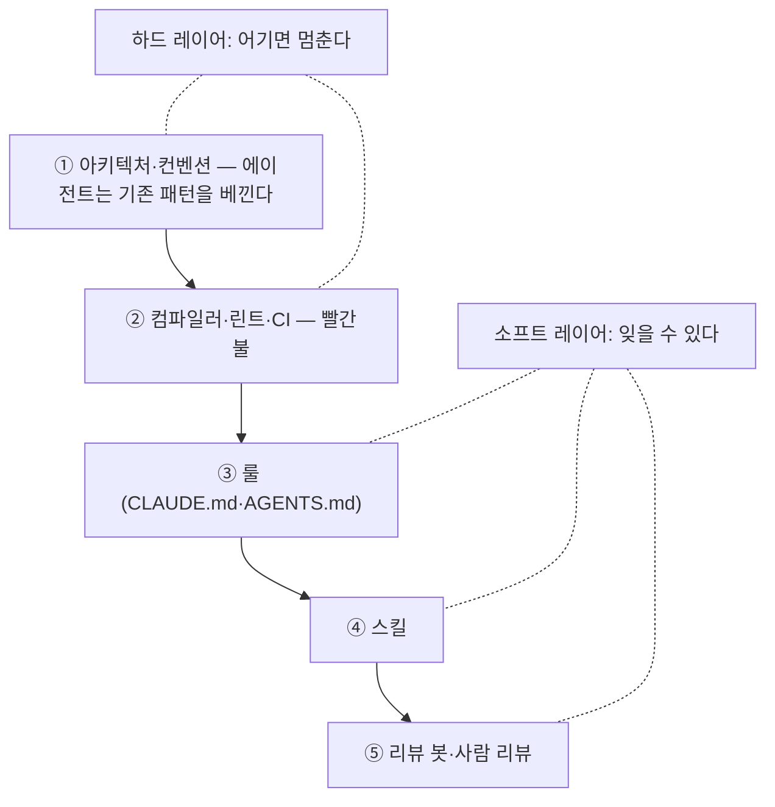

# 9장. 리뷰 코멘트는 code smell이다 — 집행 피라미드

코드 리뷰는 마지막 방어선이라고들 한다. 하지만 그 방어선에서 같은 코멘트를 열 번째 달고 있다면, 리뷰는 방어선이라기보다 집행 실패의 증상에 가깝다. "이 계층에서 리포지토리를 직접 호출하지 마세요." "`useEffect`로 데이터를 가져오지 마세요." 한 번 달면 가르침이고, 열 번 달면 우리 저장소가 그 규칙을 지키게 만들 방법이 없다는 고백이다.

Lauren은 이 상태에 이름을 붙였다. "최악의 자리는 코드 리뷰 랜드에 갇힌 것이다. 코드베이스의 모든 제약과 불변식을, 말 그대로 사람이 코드를 읽고 '이렇게 하면 안 된다'고 말하는 것으로 집행하는 상태"(46:18). 처방도 같이 줬다. "그런 말을 해야 할 때마다 code smell로 여겨라. PR에 코멘트를 다는 대신 — 이걸 어떻게 린트 룰로 만들지? 어떻게 CI 실패로 만들지? 아니면 이 문제를 아예 범주적으로 없앨 수 없을까?"(46:35~47:02)

앞 장의 eval이 보장하는 것은 "맞는 코드"까지다. 맞는 코드가 쌓이는데도 저장소는 썩을 수 있다. 똑똑해진 에이전트는 더 자신 있게 가장 편한 길로 가기 때문이다. 그 길을 누가 정하나? 같은 규칙인데 왜 어떤 저장소에서는 지켜지고 어떤 저장소에서는 썩어 가는가 — 이 장의 질문이다.

## 코드 리뷰 랜드

먼저 리뷰 코멘트의 정체를 보자. Bacchelli와 Bird(ICSE 2013)가 개발자들을 조사했을 때 리뷰의 1순위 동기는 "결함 발견"이었다. 그런데 실제 코멘트를 분류해 보니 다수는 결함보다 지식 전달·가독성·관행에 관한 것이었다. 10년 뒤 Google은 바로 그 관행 코멘트를 자동화했다. AutoCommenter(2024)는 약 80만 건의 리뷰 코멘트로 학습해 관행 위반을 자동으로 단다. 사람이 열 번 다는 코멘트는 거의 언제나 관행이고, 관행은 자동화된다.

Simon Willison은 "모든 줄을 눈으로 보는 것은 소프트웨어 변경을 검증하는 가장 효과적인 방법이었던 적이 한 번도 없다"(2026-08)고 썼다. 리뷰를 없애자는 말이 아니다. 사람이 봐야 하는 것 — 5장의 트랜잭션 경계 변경 같은 것 — 은 남는다. 문제는 그 귀한 시간이 "리포지토리 직접 호출 금지" 같은 코멘트에 쓰이고 있다는 것이다. 리뷰 코멘트를 하나씩 아래층으로 내리는 것이 이 장의 처방이다.

## 집행 피라미드

Lauren은 "좋은 코드베이스를 만드는 데는 여러 층이 있다"(42:13)며 다섯 층을 늘어놓았다. 순서가 곧 강도다.

그림 1. 집행 피라미드 — 위로 갈수록 강하고, ①②만 CI를 빨갛게 만든다

①은 아키텍처와 컨벤션이다. Lauren은 이것을 "가장 강한, 가장 강한 수준의 집행"이라 불렀다. "에이전트는 기존 패턴을 베끼는 걸 아주 좋아하기 때문"(42:27)이다. 기능을 만드는 관례적인 방법이 딱 하나 있으면 에이전트는 그것을 베낀다. ②는 컴파일러 진단, 린트, CI 체크다. "이 둘은 실제로 CI를 빨갛게 만든다"(44:50). ③④⑤는 룰, 스킬, 리뷰 봇이다. "더 소프트하다. 에이전트가 여전히 잊을 수 있고, 항상 일관되게 적용하지 않을 수 있다"(44:50). 이 책의 용어로 ①②가 **하드 레이어**, ③④⑤가 **소프트 레이어**다. 7장에서 훅만 결정론이라고 한 것과 같은 선이다 — 훅은 ②에 속한다.

"룰과 Bugbot과 스킬과 스타일 가이드만 있다면, 코드베이스가 완전히 쓰레기처럼 보이게 되는 건 시간문제다"(45:07). 소프트 레이어를 버리라는 말은 아니다. 다만 "유일한 집행 수단으로 기대지는 않는다".

Claude Code의 GitHub Code Review(2026-10 기준, research preview)는 공식 문서가 스스로 소프트 레이어임을 명시한다 — "발견 사항은 심각도로 태그되며 PR을 승인하거나 차단하지 않는다." **리뷰 봇은 아무리 똑똑해도 ⑤다.** 그 결과로 머지를 막고 싶으면 우리가 ②에 CI를 하나 더 써야 한다. Thoughtworks Radar(2026-04)의 "결정론적 품질 게이트"(요약)와 GeekNews의 "문서를 늘리기보다 코드베이스를 고쳐라"도 같은 층이다.

## 같은 규칙, 다른 자리

규칙은 같은데 집행 위치만 다르면 얼마나 달라질까? 숫자를 댄 산업 사례가 하나 있다. Facebook의 정적 분석기 Infer다(Distefano 등, CACM 2019). 분석 결과를 워크플로 밖에서 목록으로 전달했을 때 수정률은 0에 가까웠고, diff 시점 — 코드 리뷰 워크플로 안에서 변경된 부분만 지적할 때 — 에는 70%를 넘겼다고 보고된다. 두 수치는 논문 본문이 아니라 2차 자료(TechBeacon 기사·InferFix 논문의 관련 연구 절)에서 확인한 값임을 밝혀 둔다. 같은 분석기, 같은 규칙, 같은 개발자인데 워크플로 안이냐 밖이냐가 전부를 갈랐다.

Google의 Sadowski 등(CACM 2018)도 FindBugs 도입이 세 번 실패한 뒤 같은 결론에 닿았고, 한 가지를 보탰다. 오탐이 쌓이면 개발자가 도구 자체를 불신한다. `exhaustive-deps`를 "대부분 그냥 끈다"는 React 공식 블로그의 한탄(6장)이 그것이다. 하드 레이어에는 거짓 양성이 적은 규칙부터 올리는 편이 낫다.

## 가장 짧은 길이 가장 좋은 길

①로 돌아가자. Lauren이 Dune에 둔 핵심 원칙은 "가장 짧은 길이 가장 좋은 길"(43:34)이다. "에이전트는 지름길을 좋아한다. 문제를 푸는 가장 빠른 길을 찾는다. 그러면 그 길을 가장 좋은 길로 만들면 되지 않나?" **기능 하나는 디렉터리 하나다.** 그 기능에 기여하는 코드가 전부 한곳에 모여 있어서(colocation), 에이전트는 "온보딩 기능을 작업하는구나, 이 디렉터리에서 일하면 되겠다"로 끝난다. "가장 멍청한 에이전트를 위해 설계했다. 생각할 필요가 없도록"(43:20).

Dune은 공개되지 않았다. Lauren 본인이 이를 "아이디어와 원칙의 모음"이라 부르며 오픈소스할 계획이 없다고 했으니(44:03), 자막에 나온 것 이상을 추측하지 말자. 나온 것은 세 가지다. feature·entry point·transcript card라는 명사가 있고, 각각을 만드는 관례적인 방법이 하나씩 있다. 에이전트가 못하는 것은 전부 CI로 금지한다 — `useEffect`, 코드 주석, electron-main과 renderer 사이의 교차 임포트(41:37). 명사를 정하고, 한 가지 길만 두고, 나머지는 막는다.

"못하는 걸 전부 금지한다"는 말에 어딘가 찜찜함을 느낄 수 있다. Lauren의 답은 역사에서 온다. "AI slop 이전에 human slop이 있었다"(31:01). 빅테크의 프레임워크와 컨벤션과 가드레일은 "팀에서 가장 역량이 낮은 엔지니어"를 위해 만들어졌고, 인턴이 프로덕션 DB를 지우지 못하게 자격증명을 제한하는 것도 같은 이유였다. 그 설계가 에이전트에 그대로 맞는다. 함정은 하나 있다. Lauren은 에이전트가 "Lauren이 절대 이렇게 하지 말라고 했다"는 식의 주석을 코드에 남긴 사례를 들었다(39:09). 일회성 피드백이 문맥 없이 영구 규칙으로 박제된 것이다. 규칙을 아래층으로 내릴 때는 "왜"를 린트 메시지에 같이 적어 두자.

그린필드가 왜 위험한지도 여기서 보인다. Lauren은 그린필드를 "가장 큰 위험이자 가장 큰 기회"(31:58)라 했다. 관례가 없는 저장소에서 에이전트는 "가장 편한 방법으로" 문제를 풀고, 그 결과는 "이해할 수 없어서 통제를 벗어나는 코드베이스"다(32:52~33:24). GitClear의 2025년 분석이 보고한 5줄 이상 중복 블록 8배 증가(2024년, 2차 보도)가 그 정량 징후다. 베낄 관례가 없으면 에이전트가 베낄 것은 자기가 방금 쓴 코드뿐이다. 리라이트가 답인지는 Lauren도 "정말 경우에 따라 다르다"(29:27)고 했다. 어느 쪽이든 ①을 먼저 세우지 않으면, 에이전트를 늘릴수록 조직 아키텍처만 빨리 자란다.

## 5·6장을 피라미드 좌표로

5·6장이 "빠른 검증"의 관점에서 소개한 도구들을 집행의 관점에서 층에 놓아 보면, 무엇이 비었는지가 드러난다.

### Java/Spring

①에는 Spring Modulith의 `ApplicationModules.of(App.class).verify()`가 온다(2.1/2026-10 기준). 모듈 간 순환 금지, API 패키지 밖의 타입 참조 거부, `@ApplicationModule(allowedDependencies = …)`로 허용 의존 명시 — Dune의 임포트 경계 CI의 Java 번역이다. 테스트 한 줄이 아키텍처를 집행하므로 ①이면서 ②의 빨간불이다. ArchUnit의 `layeredArchitecture()`가 계층 규칙을 맡고, 네이밍 규칙도 올릴 수 있다. 200K줄 모놀리스 팀은 에이전트가 비즈니스 로직을 복제한 Adapter 16개를 만든 뒤 "Adapter·Wrapper·Compat·Legacy는 정당화 없이 금지"를 규칙으로 추가했다. 그 규칙을 ArchUnit 네이밍 룰로 올리면 리뷰 코멘트가 린트가 된다.

②에는 NullAway가 온다. Error Prone 플러그인으로 매 빌드마다 돌고, `-Werror`와 함께 쓰면 null 안전성이 컴파일 오류가 된다. 기본 심각도는 경고라서 Gradle 설정에서 `check("NullAway", CheckSeverity.ERROR)`로 올려야 CI가 빨개진다 (사실 확인 필요). Lauren이 Rust를 두고 말한 "컴파일되면 아마 맞을 것"(45:36)의 Java 판이다. 5장의 `quickCheck`를 CI의 required check로 올리면 ②가 완성된다.

③에는 Spring 함정 목록이 남는다 — `@Transactional` self-invocation, N+1, 컬렉션 fetch join과 `Pageable`의 조합. 지침에 두되, 테스트로 잡을 수 있는 것은 테스트로 내린다. 트랜잭션 경계 변경은 ⑤, 사람 리뷰에 남는다.

### React/Next.js

①은 기능 디렉터리다. `features/onboarding/` 안에 컴포넌트·훅·API 호출·테스트가 같이 산다. 경계는 eslint-plugin-boundaries의 `boundaries/dependencies` 룰이 파일 단위로 즉시 집행하고, dependency-cruiser가 해석된 모듈 그래프에서 허용·금지 임포트를 검사한다. 둘을 겹쳐 쓰는 이유는 Xebia의 글(2026-06)에 있다 — Ghost 저장소에서 ESLint 룰이 놓친 ESM 임포트를 dependency-cruiser가 잡았다. knip은 조직 아키텍처의 부산물인 미사용 코드와 의존성을 걷어 낸다.

②에서 가장 먼저 할 일은 6장의 함정을 메우는 것이다. Next.js 16 기준 `next build`는 린트를 돌리지 않으므로, CI에 ESLint 단계를 명시적으로 두지 않으면 ②가 통째로 비어 있는 셈이다. 그 단계에 `react-hooks/exhaustive-deps: error`와 `useEffect` 호출 금지(`no-restricted-syntax`, 셀렉터는 6장에서 확인한 것)를 올린다. ③에는 비동기 request API·`"use client"` 경계처럼 모델의 지식 컷오프와 프레임워크 메이저가 어긋나는 지점이 남는다(3장).

## 주방을 설계하는 사람

이제 저장소 행동이다. 최근 리뷰 코멘트 10개를 꺼내 놓고 하나씩 묻자. ①로 내릴 수 있나 — 관례를 하나로 만들면 코멘트 자체가 사라지나? ②로 내릴 수 있나 — 린트나 아키텍처 테스트로 빨간불을 켤 수 있나? 아니면 ③에 적어 두고 사람이 계속 봐야 하나? 하나를 골라 이번 주에 린트 룰 또는 아키텍처 테스트로 올려 CI에 넣고, 다음 주에 또 하나. 이 반복이 기둥 3이다.

Lauren은 이 일을 하는 사람을 헤드 셰프에 비유했다. "당신은 레스토랑의 헤드 셰프다. 더 이상 모든 요리를 직접 하지 않는다. 라인 쿡이 있고 수셰프가 있다. 당신의 일은 환경을 설계하는 것이다"(22:48). 리뷰 코멘트를 열 번 다는 사람은 요리를 하고 있다. 그 코멘트를 린트로 내리는 사람은 주방을 설계하고 있다.

주방이 설계되면 손이 빈다. 손이 비면 당연히 이런 생각이 든다. 쿡을 더 뽑으면 되지 않나? 에이전트를 열 개, 백 개 띄우면? 그 질문에 Lauren이 가장 단호하게 답한 지점이 다음 장이다.

### 이 장의 핵심

- 같은 리뷰 코멘트를 반복해서 달고 있다면 집행 실패의 증상이다. 매번 묻자 — 린트로? CI 실패로? 아예 범주적으로 제거?
- 집행 피라미드: ① 아키텍처·컨벤션 > ② 컴파일러·린트·CI > ③④⑤ 룰·스킬·리뷰 봇. ①②만 CI를 빨갛게 만든다. 리뷰 봇은 아무리 좋아도 소프트 레이어다.
- 같은 규칙도 워크플로 안에서 집행할 때와 밖에서 목록으로 줄 때의 수정률이 전혀 다르다(Infer 사례, 수치는 2차 인용).
- 가장 짧은 길을 가장 좋은 길로 만든다 — 기능은 디렉터리 하나, 길은 하나, 나머지는 막는다. 그린필드일수록 먼저.
- Java는 Modulith `verify()`·ArchUnit·NullAway, React는 boundaries·dependency-cruiser·명시적 ESLint CI 단계가 ①②를 채운다.
