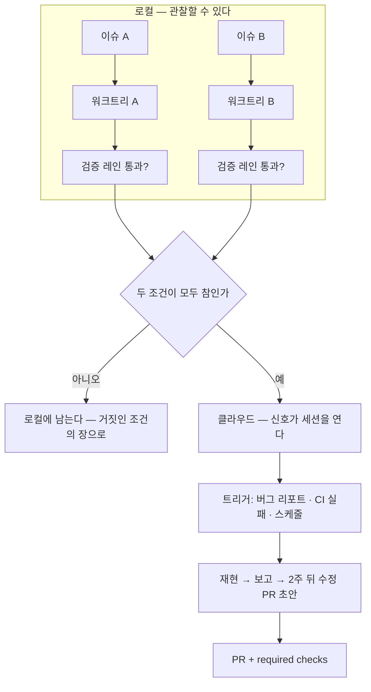

# 10장. 하나를 믿기 전에 백을 띄우지 말라 — 워크트리 병렬에서 클라우드로

## 빈 손이 하고 싶어지는 일

앞 장에서 우리는 주방을 설계했다. 리뷰 코멘트를 린트로 내리고, 아키텍처 규칙을 테스트 한 줄로 바꾸고, 사람이 입으로 외치던 불변식을 CI의 빨간불로 옮겼다. 헤드 셰프는 더 이상 팬을 잡지 않는다. 그런데 주방이 돌아가기 시작하면 묘한 일이 생긴다. 손이 빈다. 그리고 빈 손은 곧 요리사를 더 뽑고 싶어진다. 워크트리를 다섯 개 열고, 클라우드에 세션을 띄우고, 밤새 돌려 아침에 PR을 받아 보는 그림이 그려진다.

이 유혹은 자연스럽다. 그리고 Lauren이 워크숍에서 가장 분명하게 경고한 지점이기도 하다. 에이전트 하나의 출력도 믿지 못하면서 백 개를 띄울 수는 없다고 그는 말한다(03:07–03:36). 아직 지켜보는 단계에 있다면 수백, 수천 개의 클라우드 에이전트로 건너뛰지 말라고도 한다 — 토큰만 낭비하게 될 거라고(26:41). "여기서 저기로 가는 지름길은 없다"(28:01)는 말이 그 뒤에 붙는다. 왜 없을까? 병렬화가 신뢰를 만들어 주지 않기 때문이다. 병렬화는 신뢰를 **소비**한다.

에이전트 하나의 결과를 검증하는 데 당신의 눈이 30분 든다면, 열 개를 띄우면 300분이 든다. 4장의 병목이 그대로 열 배가 된다. 에이전트가 스스로 증거를 내는 레인(5·6장)이 없다면, 병렬화는 당신의 리뷰 큐를 늘리는 장치일 뿐이다. 그래서 이 장은 "어떻게 띄우나"보다 "언제 띄워도 되나"를 먼저 묻는다.

## 검증기가 있을 때만 반복이 이득이다

직관 대신 숫자로 보자. Brown 등(2024)의 "Large Language Monkeys"는 같은 문제에 모델을 여러 번 돌리면 얼마나 더 맞히게 되는지를 쟀다. SWE-bench Lite에서 한 모델의 1회 성공률은 15.9%였지만, 250번 샘플링하면 56%까지 올라갔다. 그런데 이 수치에는 전제가 있다. 어느 샘플이 맞았는지 가려내는 **검증기**가 있어야 한다는 것이다. 코딩 과제에는 단위 테스트가 있어서 가능했고, 검증기가 없는 수학 과제에서는 다수결이나 보상 모델이 그 커버리지를 따라가지 못했다. 250개의 답 가운데 정답이 들어 있어도, 고를 수 없으면 없는 것과 같다.

반대 방향의 숫자도 있다. Kim 등(2025)은 180가지 구성으로 다중 에이전트를 돌려 보고, 단일 에이전트의 기준선이 약하면 병렬화가 오류를 **증폭**한다는 것을 보였다. 독립적으로 움직이는 에이전트들은 오류를 17.2배까지 키웠고, 중앙에서 조율하는 구조는 4.4배였다. 기준선이 약 45%를 넘어야 조율의 이득이 나타났다. 한 명이 못 하는 일을 열 명이 모이면 하게 되는 것이 아니라, 한 명이 못 하는 방식 그대로 열 번 틀린다는 뜻이다. Cemri 등(2025)이 1,600개 넘는 트레이스에서 추린 다중 에이전트 실패 14종의 세 범주 가운데 하나도 "검증과 종료"다. 끝났는지 판정하지 못하는 시스템은 몇 개를 띄우든 끝나지 않는다.

이 세 결과를 겹치면 신뢰 곡선의 순서가 그대로 나온다. 2단계 자가 검증이 3단계와 4단계의 **전제**라는 것은 Lauren의 경험담이면서 동시에 측정된 사실이다. 그렇다면 병렬화 전에 확인할 조건은 둘로 압축된다. 에이전트가 스스로 돌릴 수 있는 검증 레인이 있는가. 그리고 그 레인을 통과한 단일 세션의 결과를, 당신이 손으로 고치지 않고 받아들인 적이 있는가.

## 선택지 A — 로컬 워크트리

조건이 갖춰졌다고 하자. 어디서 늘릴까? 워크숍 Q&A에서 똑같은 질문이 나왔다. 워크트리인가, 클라우드인가, 실제로 어디서 시작하나(23:28). Lauren의 답은 로컬이었다. 관찰할 수 있기 때문이다(23:52). 본인은 거의 클라우드에 올라가 있지만(24:34), 시작점으로는 눈앞에서 돌아가는 쪽을 권했다. 3장의 백시트 드라이버가 하던 일을 병렬 상황에서도 계속할 수 있는 곳이 로컬이다.

Claude Code에서 로컬 병렬의 기본 단위는 워크트리다(2.1.x/2026-10 기준). `claude --worktree <name>`으로 세션을 열면 `.claude/worktrees/<name>/`에 별도 작업 디렉터리가 생기고 `worktree-<name>` 브랜치가 따라온다. 서브에이전트 정의에 `isolation: worktree`를 적으면 그 서브에이전트도 자기 워크트리에서 움직인다. 더 큰 단위로는 `/batch`가 있다 — 지시 하나를 주면 5~30개의 서브에이전트를 각자의 워크트리에 띄운다. 동시 서브에이전트는 20개, 중첩 깊이는 3단까지라는 상한이 문서에 적혀 있다. 2장에서 다룬 `.worktreeinclude`는 여기서 다시 등장한다 — 워크트리마다 `.env`를 복사하되 무엇을 빼야 하는지는 그때 정한 그대로다.

Codex 쪽은 어떨까(0.16x/2026-10 기준)? 서브에이전트 워크플로는 기본으로 켜져 있고, `.codex/agents/` 아래 TOML로 커스텀 에이전트를 정의하며, `max_concurrent_threads_per_session`으로 동시 수를 잡는다. 다만 공식 문서에서 워크트리 격리에 해당하는 언급은 찾지 못했다. Codex로 병렬을 하려면 `git worktree`를 직접 만들고 각 디렉터리에서 세션을 여는 쪽이 현실적이다. 이 부분은 빠르게 바뀔 수 있으니 공식 문서를 함께 확인하자.

로컬 워크트리의 장점은 머지 충돌이 당신 눈앞에서 난다는 것이다. 검증 레인이 워크트리마다 따로 돌고, 깨지면 어느 쪽이 깨졌는지 바로 보인다. 단점은 노트북을 닫으면 멈추고, 세 개를 넘기면 어느 창이 무엇을 하는지 당신이 기억해야 한다는 것이다. 한 실무자의 경고처럼, 작업이 격리되고 범위가 잡히고 검증되지 않는 한 에이전트를 더 돌리는 것은 머지·테스트·리뷰 문제를 키울 뿐이다. 워크트리는 격리를 준다. 범위와 검증은 당신 몫이다.

## 선택지 B — 클라우드

클라우드는 "노트북을 닫아도 계속된다"는 한 문장으로 요약된다. Claude Code는 `claude --cloud "…"`로 세션을 올리고, PR을 지켜보다 CI 실패와 리뷰 코멘트에 스스로 반응하는 `/autofix-pr`이 있다. Routines는 스케줄·API 호출·GitHub 이벤트로 세션을 트리거한다 — 알림을 분류해 수정 초안 PR을 여는 식이다(research preview, 최소 간격 1시간, 권한 모드 선택지 없음). Codex Cloud는 태스크마다 자기 워크스페이스를 가지며, `codex cloud exec --attempts 1–4`로 같은 과제를 여러 번 시도하게 할 수 있다(experimental, `--env` 필요). 이 `--attempts`가 Brown의 best-of-N이고, Brown의 전제도 그대로 붙는다 — 고를 검증기가 없으면 네 배의 토큰만 쓴다.

클라우드가 로컬과 다른 결정적 지점은 **신호**다. 로컬에서는 당신이 이슈를 고르고 세션을 연다. 클라우드에서는 버그 리포트, CI 실패, 스케줄 같은 신호가 세션을 연다. 신뢰 곡선 3단계의 정의 — 신호를 스스로 집어 PR을 만든다 — 가 이것이다. Lauren의 사례인 Benny가 전형이다(25:16–26:14). Slack에 버그 리포트가 들어오면 클라우드에서 에이전트가 뜨고, 검증 스킬로 재현을 시도하고, 결과를 보고한다. 워크숍에서 든 예는 "재현했는데 main에서는 이미 고쳐져 있다"는 보고였다. 한 사람이 한 시간 붙잡고 확인할 일이 사라진 것이다.

독자가 이것을 따라 하려면 Benny를 베낄 필요는 없다. 세 조각만 있으면 된다. 신호를 받는 트리거(Routines의 GitHub 이벤트, Codex의 자동화 트리거), 재현을 시도할 검증 레인(5장의 `quickCheck`, 6장의 기능 지도와 Playwright MCP), 그리고 결과를 PR이나 이슈 코멘트로 남기는 출구. 6장의 Act → Observe → Compare → Report 루프가 사람 없이 한 바퀴 도는 것이 전부다. 처음 설계는 "고치기"가 아니라 "재현해서 보고하기"에서 끝내는 편이 낫다. 재현 보고가 2주 동안 맞으면, 그때 수정 PR 초안까지 열게 한다.

Claude Code의 Agent teams(experimental)는 여러 세션이 팀으로 움직이지만, 공식 문서가 단일 세션보다 토큰을 "상당히 더" 쓴다고 적고 있다(2차 가이드의 약 7배 추정은 확인 필요). 이 책의 기본은 서브에이전트와 워크트리이고, 팀 기능은 그 위에서 선택한다.

그림 1. 로컬 워크트리에서 클라우드로 — 검증 레인을 두 번 통과한 뒤에 올라간다

## 밤새 돌리기 전에

클라우드의 가장 유혹적인 쓰임은 야간 실행이다. Mitchell Hashimoto의 도입 여정에도 "End-of-Day Agents" 단계가 있고, pstack 가이드에는 "자는 동안 일을 돌린다"는 장이 있다. 그런데 여기에 반대 사례를 하나 나란히 두자. dev.to에 실린 200K줄 Java 모놀리스 리팩터링 기록에서, 그 팀은 3주차 이후 야간 완전 자율을 **포기**했다. 돌아간 곳은 "이슈 1개 → 계획 승인 → 검증 스크립트 → diff 리뷰 → 머지"라는 짧은 루프였다. 같은 기술로 한쪽은 야간 자율을 늘리고 한쪽은 접었다. 차이는 어디에 있을까?

아침에 무엇을 보느냐에 있다. 야간 실행이 성립하려면 아침에 당신이 보는 것이 "diff 전체"가 아니라 "검증 레인의 결과와 샘플 몇 개"여야 한다. 200K 팀의 야간 실행이 무너진 것은 아침마다 diff 전체를 사람이 읽어야 했기 때문이고, 그것은 검증 레인이 아직 사람을 대신하지 못했다는 뜻이다. 밤새 쌓인 diff 수천 줄을 월요일 아침에 마주하는 것은 난감한 일이다 — 그 난감함이 곧 아직 올라갈 때가 못 됐다는 신호다. 12장의 "아침에 무엇을 보면 되나"에서 이 조건이 그대로 돌아온다.

긴 세션의 또 다른 현실은 망각이다. 컨텍스트가 압축되면 지침을 잊는다는 보고가 두 도구 모두에 있다. Claude Code 쪽 이슈 #19471(2026-01)은 압축 11회 뒤 규칙을 전부 잊었다는 기록이고, Codex 쪽 #18720(2026-04)은 45분 깊이 들어간 작업을 "잊어서" 다시 해야 했다는 보고다. 후자의 우회책이 흥미롭다 — 압축 뒤 AGENTS.md가 자동으로 다시 읽히는 것을 이용해 `ACTIVE_CONTRACT.md` 같은 파일에 현재 계약을 적어 두고 거기서 참조하게 한 것이다. 밤새 돌릴 세션이라면 "지금 무엇을 하고 있고 무엇이 끝났는가"를 파일에 남기게 하는 편이 낫다. 컨텍스트는 휘발하고, 파일은 남는다.

## 두 조건, 하나의 분기

이제 결정을 내리자. 두 조건을 적어 보자.

첫째, 에이전트가 스스로 돌리는 검증 레인이 있고, 독립된 이슈 두 개를 워크트리 두 개에서 병렬로 처리했을 때 둘 다 그 레인을 통과했는가. 둘째, 통과한 결과를 당신이 diff를 전부 읽지 않고 — 레인의 결과와 샘플만 보고 — 머지한 적이 있는가.

두 조건이 모두 참이면 클라우드로 올라간다. 처음 보낼 것은 가장 반복적이고 가장 범위가 좁은 이슈 하나다. 둘 중 하나라도 거짓이면 로컬에 남는다. 남는 것도 한 걸음이다. 거짓인 조건이 가리키는 장(검증 레인이면 5·6장, 증거를 믿지 못하는 것이면 4장)으로 돌아가 그 조건을 참으로 만드는 것이 다음 할 일이다.

그리고 두 조건이 참이어도 남는 약점이 하나 있다. 레인을 통과한 코드를 누가 리뷰하느냐다. 같은 모델이 쓰고 같은 모델이 "괜찮다"고 하는 구조라면, 레인이 못 잡는 종류의 결함은 그대로 통과한다. 다음 장은 그 약점을 다른 계열의 눈으로 메우는 방법이다.
