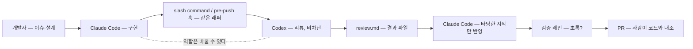

# 11장. Claude Code와 Codex 병용 — 우열이 아니라 교차 리뷰

## "다 했습니다"

2026년 4월, HN의 한 스레드에 올라온 장면이다. 에이전트가 `replace_all`로 문자열 치환을 돌렸는데, 그 문자열이 상수 정의에도 들어 있었다. 결과물 어딘가에 이런 줄이 남았다.

```python
GROQ_URL = GROQ_URL
```

첫 번째 리뷰는 이것을 놓쳤고, 두 번째 리뷰 에이전트 라운드에서야 잡혔다. 올린 사람의 결론은 한 문장이었다 — 자기 검증은 절대 믿을 수 없다. 이 줄을 보면 어딘가 찜찜하다. 코드가 틀려서라기보다, 이 줄을 **쓴 쪽과 확인한 쪽이 같다**는 사실 때문이다. 같은 모델이 같은 컨텍스트에서 자기가 방금 만든 줄을 다시 읽고 "괜찮다"고 했다. 사람이라면 이런 줄은 눈에 걸린다. 그런데 방금 그 줄을 만든 당사자에게는 걸리지 않는다. 왜 그럴까?

앞 장 끝에서 남긴 약점이 바로 이것이다. 검증 레인은 테스트가 잡는 종류의 결함을 잡는다. `GROQ_URL = GROQ_URL`은 테스트를 통과할 수 있다. 린트도 통과할 수 있다. 이것을 잡는 것은 "다른 눈"이고, 문제는 그 눈이 같은 모델의 눈이어도 되느냐다.

## 왜 자기 검증은 안 되나

4장에서 "다시 확인해봐"는 검증으로 치지 않는다는 것(Huang)을 봤다. 외부 피드백 없는 자기 교정은 도움이 안 되거나 오히려 나빠진다. 여기에 한 겹이 더 있다. 모델은 자기가 만든 결과를 **선호**한다. Panickssery 등(2024)은 모델이 자기 출력을 알아보는 능력이 높을수록 자기 출력을 더 높게 채점한다는 것을 보였고, 그 관계가 선형이며, 인과로 보는 설명이 단순한 교란 요인으로는 반박되지 않는다는 것까지 보였다. 어떤 결과에 "자기 것"이라는 라벨만 붙여도 선호가 올라갔다. Wataoka 등(2024)은 그 원인을 익숙함으로 설명한다 — 자기가 생성했을 법한 텍스트는 perplexity가 낮고, 낮은 perplexity는 높은 점수로 이어진다. 두 연구 모두 코드 리뷰에서 직접 측정된 결과는 아니지만(Panickssery의 실험은 요약 과제였다), 메커니즘은 코드에도 그대로 적용된다. 자기가 쓴 `GROQ_URL = GROQ_URL`은 자기에게 가장 익숙한 줄이다.

그렇다면 같은 모델을 네 번 돌려 네 번 리뷰시키면 될까? Addy Osmani의 표현을 빌리면, 한 모델의 복사본 넷은 청구서만 커진 리뷰어 하나다. 네 복사본은 같은 것을 좋아하고 같은 것을 놓친다. 그가 인용한 한 벤더 보고에서는 네 가지 리뷰 도구가 146개 PR에서 찾은 결과의 93.4%를 그중 한 도구만 잡았다고 한다 — 벤더 보고라 수치보다 방향으로 읽자. 도구마다 보는 것이 다르다는 방향이다. Lauren이 eval에서 다른 모델의 judge로 교차 확인하라고 한 것(21:30)은 이 방향을 스킬 평가에 적용한 것이다. 이 장은 같은 원리를 코드 리뷰에 적용한다. 그리고 "다른 모델"을 가장 확실하게 보장하는 방법은 다른 벤더의 도구를 쓰는 것이다.

물론 Claude Code 안에서도 fresh context의 서브에이전트에게 리뷰를 맡길 수 있고, 공식 문서도 방금 쓴 코드에 편향되지 않도록 리뷰는 새 컨텍스트에서 하라고 권한다. 그것으로 컨텍스트의 편향은 줄어든다. 하지만 모델의 편향은 남는다. 같은 계열의 모델은 같은 줄을 익숙하게 느낀다. 그래서 이 장은 Claude Code와 Codex를 함께 쓰되, 어느 쪽이 더 잘하느냐를 가리지 않는다. 가르는 것은 역할이다.

## 레시피 1 — 짜는 쪽과 까는 쪽을 가른다

GeekNews에 올라온 한 달치 실험 기록이 출발점으로 좋다. 제목부터 "Claude한테 짜게 시키고 Codex한테 까게 시키기"다. 같은 저장소에서 Claude Code가 메인 작성자, Codex가 자문 리뷰어를 맡았다. 구조는 두 겹이다. 개발자가 손으로 부르는 slash command 하나, 그리고 `pre-push` 훅 하나 — 둘 다 같은 래퍼 스크립트를 부른다. 래퍼는 변경 규모에 따라 두 경로를 탄다. 소규모 변경이면 `codex review --base main`, 100파일을 넘는 큰 변경이면 `codex exec`에 diff를 직접 먹인다(0.16x/2026-10 기준, `codex review`는 `--uncommitted`·`--base <branch>`·`--commit <SHA>`를 받는다). 한 달 동안 Codex가 잡은 것으로 기록된 것은 race condition과 null 체크 누락이다 — 테스트가 초록이어도 남는 종류의 결함이다.

이 기록에서 가장 중요한 문장은 리뷰 결과로는 **절대 차단하지 않는다**는 것이다. 왜 비차단일까? 차단하는 순간 두 가지가 생긴다. 모델 장애가 나면 push가 막히고, 오탐이 잦으면 개발자가 `--no-verify`를 치기 시작한다. 한 번 `--no-verify`를 치면 그다음부터는 훅이 있으나 없으나 같아진다. Parasuraman과 Riley(1997)가 자동화 연구에서 disuse라고 부른 현상이다 — 오경보가 잦은 자동화는 사람이 꺼 버린다. 9장의 린트는 결정론적이어서 차단해도 된다. 모델 리뷰는 확률적이어서 차단하면 안 된다. 결과는 파일로 남기고, 읽을지는 사람이 정한다. 자문은 자문의 자리에 두자.

```sh
#!/bin/sh
# .git/hooks/pre-push — 요지. 결과는 파일로, 종료 코드는 항상 0
mkdir -p .agent
codex review --base main > .agent/review.md 2>&1 || true
exit 0
```

이 스크립트는 구조만 보여 주는 요지다. `codex review`는 공식 문서가 비대화형 명령으로 적고 있으니 훅 안에서 돌릴 수 있지만, 출력 형식이나 파일 저장 옵션은 문서에 없다(0.16x/2026-10 기준) — 위의 리다이렉션은 셸 관례일 뿐이니 자기 환경에서 한 번 돌려 보고 쓰자. `|| true`와 `exit 0`이 비차단의 전부다. 실제 래퍼에는 변경 규모에 따라 `codex exec`로 갈아타는 분기가 붙고, 결과 파일은 PR 설명에 링크된다. 결과 파일을 Claude Code 세션에 다시 먹이면 — "`.agent/review.md`의 지적 가운데 타당한 것만 고쳐라" — 교차 리뷰의 한 바퀴가 완성된다.

## 레시피 2 — 공식 플러그인, 그리고 대칭

OpenAI가 Claude Code용 플러그인을 직접 공개했다는 사실이 이 구조가 한쪽 진영의 꼼수가 아니라는 신호다. `codex-plugin-cc`(2026-03 공개, 2차 보도)는 Claude Code 안에서 Codex를 부르는 slash command 묶음이다. 설치는 세 줄이다(2026-10 기준).

```
/plugin marketplace add openai/codex-plugin-cc
/plugin install codex@openai-codex
/codex:setup
```

그 뒤로 `/codex:review`(읽기 전용 리뷰), `/codex:adversarial-review`(선택한 구현과 설계에 **도전**하는 리뷰), `/codex:rescue`(막힌 작업 구출), `/codex:transfer`(작업 넘기기)가 생긴다. adversarial-review가 특히 교차 리뷰의 취지에 맞는다. "이 코드가 괜찮은가"를 묻는 리뷰어는 괜찮다고 답하기 쉽다. "이 설계가 틀렸다면 어디서 틀렸나"를 묻는 리뷰어는 다른 것을 본다. 다만 공식 best practices가 경고하듯 빈틈을 찾으라고 시킨 리뷰어는 작업이 멀쩡해도 보통 빈틈을 보고한다 — 그러니 adversarial-review의 결과도 레시피 1과 같이 자문으로 받는다. OpenAI 자신의 경고도 기억해두자. 플러그인의 리뷰 게이트를 켜면 Stop 훅으로 Claude의 종료를 막을 수 있는데, 무인으로 돌리면 Claude와 Codex가 긴 루프에 들어가 사용량이 급격히 소모된다는 것이다(2차). 사람이 없는 자리에서 두 모델이 서로를 승인하게 두지 말자.

지금까지 Claude가 쓰고 Codex가 봤다. 반대는 안 될까? 된다. GeekNews의 다른 사용자는 Codex를 메인으로 쓰자 이번에는 Claude가 Codex의 계획과 코드에서 결함을 찾더라고 적었다. HN에는 같은 모델이 구현자보다 리뷰어로 더 낫다는 관찰도 있고, Claude 서브에이전트와 Codex에 제3의 계열까지 더한 삼각 검증을 하는 사람도 있다. 지시 준수가 어느 쪽이 낫다는 증언은 정반대가 함께 있다 — 한 14년차 개발자는 Codex가 AGENTS.md를 더 잘 따른다고 썼고, 댓글에는 Codex가 지시를 자주 무시한다는 반론이 달렸다. 이 책은 이 논쟁에 표를 던지지 않는다.

핵심은 어느 쪽이 위냐가 아니다. 쓴 쪽과 보는 쪽의 **계열이 다르다**는 것이다. 한국 커뮤니티의 "최강자가 자꾸 바뀐다"는 왕좌 담론에 책을 묶어 두면 유통기한이 모델 은퇴 주기에 맞춰진다. 역할 구조는 모델이 바뀌어도 남는다. 다음 달에 리뷰어가 더 똑똑해지면 리뷰어를 바꾸면 되고, 구현자가 더 똑똑해지면 구현자를 바꾸면 된다. 모델명과 버전은 부록 A의 표가 맡는다.


그림 1. 교차 리뷰 흐름 — 쓰는 쪽과 보는 쪽의 계열을 가른다. 역할은 바꿀 수 있다

## 두 도구가 같은 지침을 읽게 하기

교차 리뷰를 붙이면 바로 부딪히는 문제가 있다. 두 도구가 서로 다른 지침 파일을 읽는다. Claude Code는 CLAUDE.md를, Codex는 AGENTS.md를 읽는다. 7장에서 스킬은 같은 `SKILL.md`를 `.claude/skills/`와 `.agents/skills/` 두 경로에 두면 양쪽에서 동작한다는 것을 봤다. 지침 파일은 어떨까?

사실 관계부터 정리하자(2.1.x·0.16x/2026-10 기준). Claude Code는 2.1.277부터 AGENTS.md를 읽지만, 기본 설정 `claude-md-or-agents-md`에서는 **CLAUDE.md가 없을 때만** 읽는다. 둘 다 읽게 하려면 `/config`에서 `claude-md-and-agents-md`로 바꿔야 한다. 반대로 Codex는 CLAUDE.md를 읽지 않는다 — 문서에 "목록에 없는 파일명은 무시한다"고 적혀 있다. 읽게 하려면 `config.toml`에 `project_doc_fallback_filenames = ["CLAUDE.md"]`를 추가해야 하고, 디렉터리당 한 파일만 읽으며 기본 상한은 32 KiB다.

그렇다면 전략은 셋이다. 첫째, AGENTS.md만 둔다. CLAUDE.md가 없으면 Claude Code는 AGENTS.md를 읽고, Codex는 원래 읽는다. 가장 단순하고 가장 깨지지 않는다. 둘째, Claude Code 전용 지시가 꼭 필요하면 CLAUDE.md를 만들되 첫 줄에 `@AGENTS.md`를 적어 공통 지침을 import하고, 그 아래에 Claude 전용 몇 줄만 둔다. 셋째, 심링크 — 가능하지만 Windows에서 권한 문제가 보고되어 있다(2차). 이 책의 권장은 첫째이고, 둘째는 정말 필요할 때만이다.

여기서 GeekNews 실험 기록이 남긴 경험칙 하나를 보자. 그 팀은 CLAUDE.md에 "만드는 법"을, AGENTS.md에 "리뷰할 것"을 적었는데, 두 파일의 내용이 80%를 넘게 겹치면 분업이 실패한 신호라고 봤다. 같은 말을 두 번 하고 있다면 둘 다 공통 파일로 올리고 역할별 파일은 짧게 유지하자. Codex 문서는 AGENTS.md에 `## Code Review Rules` 섹션을 두면 `@codex review`가 그 규칙을 따른다고 하면서, 포맷과 린트 검사는 CI에 맡기라고 덧붙인다. 9장의 분업 그대로다 — 결정론적인 것은 하드 레이어에, 판단이 필요한 것만 리뷰어에게.

마지막으로 거리를 하나 두자. 두 모델이 같은 답을 냈다고 정답이 보장되지는 않는다 — 한 저장소 이슈에서 나온 이 말이 교차 리뷰의 한계를 정확히 짚는다. 교차 리뷰는 "다른 눈"을 더하는 것이지 최종 판정을 위임하는 것이 아니다. 최종 대조는 코드와 사람이 한다.

그러면 질문이 하나 남는다. Claude가 썼고 Codex가 "괜찮다"고 했다. 검증 레인도 초록이다. 그러면 누가 최종 승인을 누르나? 그 손가락이 사람이어야 하는지, 언제부터 아니어도 되는지 — 다음 장의 질문이다.
