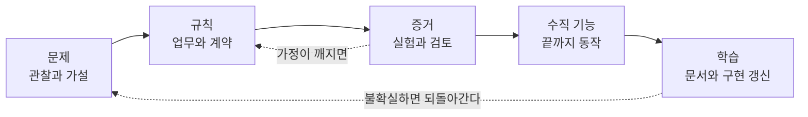

# 1장. 에이전트는 가진 것을 증폭한다

숙련 오픈소스 개발자 열여섯 명이 오래 기여해 온 자기 저장소에서 과제 246개를 처리했다. 과제마다 AI를 써도 되는지를 무작위로 정했고, 도구는 Cursor Pro와 Claude 3.5/3.7 Sonnet이었다. 시작하기 전 개발자들은 AI 덕분에 완료 시간이 24% 줄 것이라고 예상했다. 일을 마친 뒤에도 20% 줄었다고 믿었다. 실제 기록은 반대 방향을 가리켰다. AI를 쓴 과제의 완료 시간은 19% 늘었다.

2025년 초 METR이 진행한 무작위 대조 실험(Becker 외, arXiv 프리프린트)의 결과다. 미리 의견을 물은 경제학 전문가와 머신러닝 전문가도 각각 39%, 38% 단축을 점쳤으니, 예상이 빗나간 사람은 개발자만이 아니었다. 이 장면이 불편한 까닭은 숫자의 방향보다 다른 데 있다. 일을 한 당사자가 끝난 뒤에도 자기 속도를 거꾸로 기억했다. "빨라진 것 같다"는 느낌은 증거가 되지 못한다는 뜻이다. 그렇다면 무엇이 증거가 되어야 할까?

## 같은 질문, 엇갈리는 답

### 19%를 정확하게 읽는 법

먼저 이 숫자를 함부로 넓히지 말자. 이 실험이 알려 주는 것은 "AI를 쓰면 19% 느려진다"는 일반 법칙과 거리가 멀다. 조건이 분명하다. 2025년 초의 도구, 자기 코드를 속속들이 아는 숙련자, 크고 오래된 저장소. 이 조건을 떼어 내고 숫자만 옮기면, 연구가 말하지 않은 것을 연구의 이름으로 말하는 난감한 처지가 된다.

METR은 2026년 2월 블로그에 후속 결과를 올렸다. 동료 심사를 거친 논문은 아니다. 2025년 8월부터 개발자 57명이 저장소 143개에서 과제 800여 개를 수행했고, 이번에는 앞선 연구에서 돌아온 개발자 기준으로 완료 시간 18% 단축이 추정됐다. 그런데 신뢰구간(−38%~+9%)이 0을 포함했다. AI 없이 하기 싫은 과제를 아예 제출하지 않은 개발자가 30~50%에 달해서, 속도 향상이 오히려 과소 추정됐을 수 있다는 단서도 붙었다. METR은 이 결과를 스스로 "only very weak evidence"라고 불렀다. 정확하게 말하면 이렇다. 2025년 초에는 느려졌고, 그 뒤로는 빨라졌을 수도 있다. 다만 측정 자체가 어려워졌다.

원 연구에서 눈여겨볼 대목이 하나 더 있다. 연구진은 느려짐에 기여했을 수 있는 요인 몇 가지를 꼽았는데, 그중 하나가 암묵적 저장소 맥락이다. 오래 일한 사람의 머릿속에만 있는 사정을 AI는 모르니 수정할 위치를 제대로 고르지 못한다는 관찰이다. 연구진이 인과를 증명한 것은 아니고 후보로 든 것이다. 그래도 우리가 이 책에서 붙잡을 질문과 정확히 맞닿는다. 머릿속에만 있는 맥락은 꺼내 놓지 않는 한 에이전트에게 보이지 않는다.

### 측정 단위가 바뀌면 답도 바뀐다

다른 연구들은 다른 답을 내놓는다. Google이 정규직 엔지니어 96명을 대상으로 한 무작위 대조 실험(Paradis 외, ICSE-SEIP 2025)에서는 사내 과제의 처리 시간이 약 21% 줄었다. 저자들은 신뢰구간이 크고, 2024년 여름 사내 도구의 효과를 다른 도구와 시점으로 그대로 옮길 수 없다고 직접 적었다. Microsoft·Accenture·Fortune 100 기업 한 곳의 현장 실험 세 건을 묶은 Cui 외의 연구(Management Science)는 개발자 4,867명에게서 완료한 과제 수가 26.08% 늘었다고 보고했다. 업계가 자주 꺼내는 "55% 빨라졌다"는 숫자의 출처는 Peng 외의 2023년 프리프린트인데, JavaScript로 HTTP 서버 하나를 만드는 작고 새로운 과제에서 나온 값이다.

이 결과들은 서로 모순처럼 보이지만, 사실 재는 것이 다르다. 과제 하나에 걸린 시간, 일정 기간에 끝낸 과제의 수, 깨끗한 새 과제와 십 년 묵은 저장소. 측정 단위와 맥락이 바뀌면 결론도 바뀐다.

시간을 길게 잡으면 그림이 또 달라진다. He 외(MSR 2026)는 Cursor를 도입한 GitHub 프로젝트와 도입하지 않은 비슷한 프로젝트를 이중차분으로 비교했다. 도입 직후 개발 속도는 크게 올랐지만 일시적이었고, 정적 분석 경고와 코드 복잡도는 크게, 그리고 지속적으로 늘었다. 연구진 일부가 겹치는 Agarwal 외(MSR 2026)는 코딩 에이전트를 도입한 저장소를 비슷한 방식(시차 이중차분)으로 보았는데, 속도 증가는 에이전트가 그 프로젝트의 첫 AI 도구일 때만 컸고, 정적 분석 경고 약 18%, 인지 복잡도 약 39% 증가라는 품질 위험은 모든 조건에서 이어졌다. 속도는 지나가고 부채는 남는다.

우리는 어느 연구를 믿어야 할까? 질문을 조금 바꿔 보자. 효과는 맥락에 따라 달라지고, 그 맥락에는 당신의 저장소가 포함된다. 남의 실험 숫자를 빌려 오기보다 당신 저장소에서 직접 재는 편이 낫다. 그리고 재려면 무엇을 "됐다"고 볼지가 먼저 적혀 있어야 한다.

## 매일 쓰는 도구, 각자도생의 현장

### 설문이 그리는 2026년의 책상

업계 조사를 보면 그사이 에이전트가 얼마나 빨리 책상 위로 올라왔는지 실감이 난다. Stack Overflow의 2025년 개발자 설문은 "AI agents are not yet mainstream"이라고 정리했다. 업무에 에이전트를 매일 쓴다는 응답은 14.1%였다. 2026년 설문(결과 발표 2026-10-06, 응답자 3만여 명)에서는 AI 코딩 도우미나 에이전트를 쓴다고 답한 사람 중 73%가 매일 쓴다고 했고, 에이전트로는 Claude Code(66%)와 GitHub Copilot(59%)이 가장 많이 꼽혔다. 두 해의 문항이 같지 않으니 숫자를 바로 빼서 비교할 수는 없다. 그래도 방향은 뚜렷하다.

JetBrains의 2026년 에이전트 조사도 같은 흐름을 보여 준다. JetBrains 원문은 열지 못했고 언론 보도를 거쳐 확인한 수치다. 1만 5천여 명 가운데 업무에 쓰는 에이전트로 Claude Code를 꼽은 비율이 39%로, 전년 조사의 3%에서 크게 뛰었다. Codex는 0%에서 16%가 됐다. 이 책이 Claude Code와 Codex를 함께 쓰는 독자를 상정하는 이유다.

흥미로운 수치가 하나 더 있다. Stack Overflow 2026년 설문에서 AI가 내놓은 것을 신뢰하려면 출처 표시가 필요하다는 응답은 93%였다. 매일 쓰지만 그냥 믿지는 않는다. 근거를 보고 싶어 한다.

Google의 DORA 2025년 보고서(응답자 약 5,000명)는 AI 채택률이 90%에 이르렀다고 보고하면서 AI를 "mirror and a multiplier"라고 불렀다. 응집된 조직에서는 효율을 키우고, 파편화된 조직에서는 약점을 드러낸다는 뜻이다. 이 말을 에이전트에 옮겨 보면 이 장의 제목이 된다. 에이전트는 팀이 이미 가진 것을 비추고 키운다. 합의가 있으면 합의가 커지고, 혼란이 있으면 혼란이 커진다.

### 국내 현장이 먼저 닿은 결론

국내 엔지니어링 블로그에서도 같은 결론이 들린다. 토스페이먼츠의 김용성은 2026년 2월 글에서 많은 팀의 LLM 도입이 냉정하게 보면 "'각자도생'에 가깝습니다"라고 진단했다. 잘 쓰는 사람과 그렇지 못한 사람의 차이에 대해서는 이렇게 적었다. "차이는 단 하나, 작업 전에 컨텍스트를 설계했느냐의 여부입니다." 같은 도구를 쥐여 줘도 결과가 갈리는 지점이 도구 바깥에 있다는 말이다.

컬리 OMS팀 이준환의 2025년 12월 글(Claude Code v2.0.72, Opus 4.5 시점의 경험)은 다른 각도에서 같은 곳을 가리킨다. 코드 작성 시간은 줄었지만 코드 품질과 설계 논의는 오히려 늘었고, 코드 리뷰 시간도 더 많아졌다고 한다. 손으로 치던 시간이 사라진 자리를 무엇을 만들지 합의하고 맞게 만들었는지 확인하는 일이 채운 셈이다.

여기서 흔한 통념 하나가 흔들린다. 문서는 개발을 느리게 만든다는 믿음이다. 사람이 코드를 직접 쓰던 시절에는 문서가 진도를 늦추는 짐처럼 보이기도 했다. 하지만 에이전트가 코드를 대신 쓰는 지금, 코드를 쓰는 속도는 더 이상 병목이 아니다. 병목은 무엇을 만들지 정하는 일, 그리고 만든 것이 맞는지 확인하는 일로 옮겨 갔다. 바로 그 두 가지가 문서가 하는 일이다.

## 증폭될 것을 먼저 설계한다

### 문서가 해야 할 세 가지 일

어떤 문서여야 할까? 이 책의 척추로 삼는 한국어 가이드 「신규 프로젝트 설계와 AI 개발 통제 가이드」(2026년 10월, 이하 원전)는 문서의 가치를 "설명의 양이 아니라, 결정의 명확성과 검증 가능성으로" 판단하자고 말한다. 그리고 문서가 해야 할 일을 셋으로 나눈다.

첫째는 합의의 기준선이다. 문제·범위·용어·업무 규칙을 공유해서, 서로 다른 화면과 구현이 같은 규칙을 다르게 해석하지 않게 한다. 이 문서가 답할 질문은 "무엇이 맞는 동작이고, 무엇은 이번에 하지 않는가?"다. 둘째는 검증의 대상이다. 요구사항을 관찰 가능한 조건으로 바꿔서 프로토타입·계약 테스트·부하 실험·사용자 확인으로 가정과 결정을 가른다. 질문은 "무엇을 보면 이 설계가 충분하다고 말할 수 있는가?"다. 셋째는 변경의 제어 장치다. 코드가 바뀔 때 영향받는 규칙과 테스트를 찾고 의도된 변경인지 확인한다. 질문은 "누가 왜 바꿨고, 어떤 증거로 출시하는가?"다.

세 질문을 에이전트 쪽에서 다시 읽어 보자. 첫째 질문의 답이 없으면 에이전트는 빈칸을 그럴듯하게 채운다. 둘째 질문의 답이 없으면 에이전트가 "다 됐습니다"라고 말할 때 확인할 길이 없다. 셋째 질문의 답이 없으면 에이전트가 바꾼 것이 의도였는지 사고였는지 아무도 모른다. 셋 다 사람끼리 일할 때도 필요했던 것이다. 다만 에이전트와 일할 때는 이 빈자리가 몇 배 빨리, 몇 배 크게 드러난다.

원전은 여기에 핵심 원칙 하나를 얹는다. "하나의 결정에는 하나의 권위 있는 원본을 둡니다. 다른 문서는 그 내용을 복사하지 않고 식별자와 링크로 참조합니다." 같은 규칙이 세 곳에 조금씩 다르게 적혀 있다면 사람은 눈치껏 맞는 쪽을 고르지만, 에이전트는 그중 하나를 골라 그대로 실행할 수 있다. 원본을 하나로 두는 일이 왜 에이전트 시대에 더 중요해지는지는 3장에서 자세히 살펴본다.

그림 1. 원전의 흐름 — 문제에서 학습까지, 필요하면 앞 단계로 되돌아간다

이 흐름에서 오해하기 쉬운 점이 있다. 원전은 분명히 적는다. "이 흐름은 한 번만 통과하는 폭포수 절차가 아닙니다." 불확실성이 큰 부분은 앞 단계로 돌아가고, 작은 변경은 필요한 문서와 검증만 쓴다. 그리고 판단 기준을 이렇게 바꾼다. "'문서 완성률 100%' 대신 '다음 구현을 시작해도 되는가'를 판단합니다." 기억해두자. 문서를 얼마나 썼는지가 진척이 아니다. 다음 구현을 안전하게 시작할 근거가 있는지가 진척이다.

### 기능 하나를 끝까지 따라가는 여정

이 원칙들은 추상적으로 늘어놓으면 금세 공허해진다. 그래서 이 책은 원전이 가상 예시로 제시한 기능 하나를 처음부터 끝까지 따라간다. 결제된 예약을 사용자가 스스로 취소하는 "예약 셀프 취소", 줄여서 CAN이다. 실제 서비스가 아니라 설명을 위해 만든 가상 기능이고, 그 안의 정책과 수치도 예시일 뿐이다. 그런데도 이 기능을 고른 이유가 있다. 작아 보이지만 환불이라는 돈 문제, 예약 소유자만 취소할 수 있다는 권한 문제, 두 번 눌린 버튼이라는 동시성 문제, 결제사라는 외부 연동, 응답이 오지 않는 타임아웃까지 한 번에 품고 있다. 에이전트에게 "알아서 만들어 줘"라고 넘기면 가장 그럴듯하게, 그리고 가장 위험하게 빈칸이 채워질 기능이다.

여정은 네 구간으로 나뉜다. 1부(1~3장)는 왜 지금 문서가 다시 중요해졌는지, 어떤 문서여야 하는지를 다룬다. 2장에서는 스펙 주도 개발(SDD) 도구를 둘러싼 "마크다운 속의 워터폴" 논쟁을 양쪽 모두 듣고, 3장에서는 에이전트가 지시 파일을 실제로 어떻게 읽는지를 본다. 2부(4~7장)에서 CAN 요청이 도착하고, 제품 합의서·도메인 규칙·계약·수용 기준이 한 장에 하나씩 쌓인다. 3부(8~10장)는 착수를 판정하고, 기능 하나를 테스트와 검증 기록까지 끝까지 잇고, 그 사슬을 PR·CI·출시에 묶는다. 4부(11~14장)는 에이전트의 역할과 결정 한계, 결정의 계보와 문서의 유통기한, 상시 에이전트에게 맡길 점검, 그리고 가장 작은 출발점을 다룬다.

앞에서 측정이 어려워졌다고 했다. 이 사실은 이 책의 주장과 곧장 이어진다. 체감은 틀릴 수 있고, 연구 숫자는 당신 저장소의 숫자가 아니며, 에이전트의 "다 됐습니다"는 그 자체로 아무것도 증명하지 못한다. 그렇다면 남는 길은 하나다. 무엇이 맞는 동작인지, 무엇을 보면 됐다고 말할 수 있는지, 바뀐 것이 의도였는지를 미리 적어 두고 그 기준에 비춰 증거를 모으는 것. 검증 증거는 저절로 생기지 않는다. 설계해야 한다.

에이전트는 가진 것을 증폭한다. 흐릿한 합의는 흐릿하게, 빠르게 증폭된다. 그렇다면 에이전트에게 무엇을 건네야 '좋은 것'이 증폭될까?
