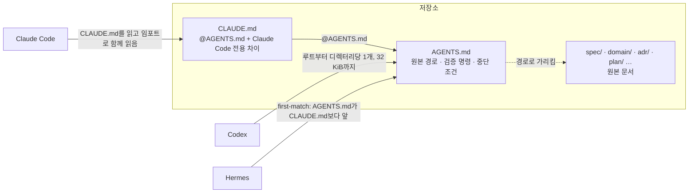

# 3장. 원본은 하나, 에이전트는 링크를 따라온다

문서는 설명이다. 우리는 오랫동안 그렇게 여겨 왔다. 코드가 무엇을 하는지, 왜 그렇게 짰는지 사람에게 알려 주는 글. 그래서 문서가 낡아도 큰일은 아니었다. 읽는 사람이 코드를 열어 보고 "이건 예전 얘기구나" 하고 넘어가면 그만이었다.

에이전트에게 문서는 설명으로 머물지 않는다. 지시다. 에이전트는 문서를 읽고 "아마 예전 얘기겠지" 하며 넘기지 않는다. 적힌 대로 한다. 2026년 10월 Hacker News의 "Show HN: ADRs for AI" 스레드에서 varyherb라는 사용자는 기여자가 수십 명인 코드베이스에서 ADR(아키텍처 결정 기록)을 에이전트에게 주는 방식을 써 봤더니 모델이 내놓는 코드가 놀랄 만큼 빨리 나빠지더라고 적었다. 에이전트에게 왜 그런 억지스러운 코드를 썼느냐고 물으면 결함 있거나 낡은 가정을 근거로 댄다는 것이다. 그리고 이렇게 정리했다. "It's the same old problem of doc rot, but now the docs are blindly obeyed." 한 사람의 경험담이지만, 이 장의 문제를 한 문장으로 요약한다. 낡은 문서는 이제 무시되지 않는다. 실행된다.

## 낡은 문서가 명령이 될 때

### 틀린 문서는 없는 문서보다 해로울 수 있다

경험담만 있는 것은 아니다. MITRE의 Macke와 Doyle은 2024년(Findings of NAACL 2024) LLM에게 코드와 함께 문서를 주고 코드 이해도를 측정했다. 틀린 문서는 이해를 크게 방해했다. 반면 불완전하거나 아예 없는 문서는 이해에 뚜렷한 영향을 주지 않는 것으로 보였다. 2023~2024년 세대 모델로 한 실험이니 지금 모델에 그대로 옮길 수는 없다. 그래도 방향은 분명하다. 문서를 많이 쓰는 것보다 틀린 문서를 남기지 않는 것이 먼저다.

더 최근의, 그리고 더 아찔한 보고도 있다. Xu와 Wu가 2026년 10월 22일 arXiv에 올린 프리프린트는 지시 파일이 기존 코드와 다른 관례를 요구하는 Python 프로젝트 40개를 대상으로 했다. 예를 들면 코드는 logging을 쓰는데 지시 파일은 print를 쓰라고 요구하는 식이다. 이 프로젝트들에서 Claude Code와 Codex CLI를 320번 돌렸다. 둘이 충돌하는 상황에서 에이전트는 90.1%의 경우 낡은 지시 파일을 따랐다. Claude Code는 80번 중 79번 충돌을 알아차리고 지적하고도 결국 파일을 따랐다. Codex CLI는 80번 중 20번 기존 코드를 파일에 맞게 다시 썼고, 그중 17번은 프로젝트 테스트가 깨졌다.

왜 그럴까? 저자들은 두 정보가 에이전트에게 들어가는 경로가 다르다는 데서 원인을 찾는다. 지시 파일은 지시로 들어가고, 코드는 도구 실행 결과로 들어간다. 그리고 모델은 도구 출력을 지시보다 낮게 치도록 훈련되어 있다는 설명이다. 해법도 놀랄 만큼 단순했다. 사용자 지시 파일에 "기존 코드를 우선하라"는 문장 하나를 넣자 코드를 따르는 비율이 4.2%에서 91.4%로, 테스트 통과율이 89.4%에서 100%로 올랐다.

이 보고는 이 책을 쓰는 2026년 10월에 막 게시된 프리프린트이고, 재현된 적이 없으며, Python 프로젝트 40개라는 조건에서 나왔다. 숫자를 일반 법칙처럼 쓰지 말자. 다만 이 실험이 보여 주는 구조는 이 장의 질문과 정확히 겹친다. 문서와 코드가 어긋날 때 에이전트는 문서 쪽으로 기울기 쉽다. 그리고 어느 쪽이 원본인지 한 문장으로 알려 주면 행동이 달라진다. 그렇다면 우리가 할 일은 분명하다. 어느 쪽이 원본인지를 문서에 적어 두는 것이다. 그런데 "어느 쪽이 원본인가"를 적으려면, 먼저 원본이 하나로 정해져 있어야 한다.

## 원본의 책임을 나눈다

### 폴더보다 먼저, 문서가 답할 질문

1장에서 본 원전의 핵심 원칙은 이렇다. 하나의 결정에는 하나의 권위 있는 원본을 두고, 다른 문서는 내용을 복사하지 않고 식별자와 링크로 참조한다. 원전 2절은 이 원칙을 저장소의 위치로 옮긴다. 위치마다 답해야 하는 질문을 정해 두는 것이 핵심이다.

| 위치 | 답해야 하는 질문 | 권위 있는 내용 |
|---|---|---|
| `spec/` | 사용자에게 무엇을 약속하는가? | 기능 범위, 요구사항 ID, 수용 기준, 외부 동작 |
| `domain/` | 업무적으로 무엇이 참이어야 하는가? | 용어, 엔터티, 불변식, 상태 전이, 권한 정책 |
| `ux/` | 사용자는 상태와 선택을 어떻게 이해하는가? | 사용자 여정, 화면 흐름, 로딩·빈 상태·오류·접근성 |
| `adr/` | 왜 이 기술적 선택을 했는가? | 대안, 근거, 비용, 수용한 위험, 결정 상태 |
| `plan/` | 누가 어떤 순서로 구현하고 검증하는가? | 수직 기능, 작업 분해, 의존성, 검증·출시 순서 |
| `guides/` | 같은 일을 어떻게 일관되게 수행하는가? | 개발 환경, 실행·테스트 명령, 코딩·운영 절차 |
| `brainstorming/` | 어떤 가능성과 미해결 가설이 있는가? | 아이디어, 질문, 실험 후보, 기각 사유 |
| `product-brief.md` (선택) | 왜 만들며 무엇으로 성공을 판단하는가? | 대상, 문제, 가치, 범위·비범위, 성공 지표 |
| `architecture/` (선택) | 경계와 통합 방식은 어떻게 구성되는가? | 컴포넌트 경계, 데이터 흐름, API·이벤트 계약의 위치 |
| `validation/` (선택) | 무엇을 어떤 조건에서 확인했는가? | 위험 목록, 실험 설계, 결과, 한계, 증거 링크 |

폴더 이름은 팀에 맞게 바꿔도 된다. 원전도 그렇게 적었다. 마지막 세 위치는 필요할 때 추가하는 선택지다. 작게 시작한다면 제품 합의서는 명세의 첫 페이지로, 아키텍처는 설계 문서의 한 절로, 검증은 로그 파일 하나로 충분하다. 원전의 표현을 빌리면 "폴더를 만드는 것 자체가 설계는 아닙니다." 이 표에서 가져갈 것은 질문이다. 같은 질문에 두 문서가 답하고 있다면 그중 하나는 원본이 아니어야 한다.

원전은 피해야 할 중복을 구체적인 예로 보여 준다. 명세에는 "확정 전 취소", UX 문서에는 "결제 후 취소", 계획 문서에는 "언제든 취소"라고 적혀 있다고 해보자. 사람이 읽으면 고개를 갸웃하며 기획자에게 물을 것이다. 에이전트는 어떨까? Claude Code 공식 문서는 두 지시가 서로 모순되면 Claude가 그중 하나를 임의로 고를 수 있다고 적는다. 세 문장 중 어느 것이 선택될지 알 수 없으니, 취소 규칙이 실행할 때마다 달라질 수도 있는 셈이다. 초난감한 상황이다. 원전은 이럴 때 "코드보다 먼저 충돌을 해결해야 합니다"라고 말한다.

해결의 방향은 원본 하나를 정하는 것이다. 취소 가능한 상태를 정하는 규칙의 원본이 `domain/cancellation.md`라면, 명세는 그 규칙을 참조해 사용자에게 무엇을 약속하는지 설명하고, UX 문서는 그 규칙에 따라 버튼과 안내를 정의한다. 규칙 문장 자체는 한 곳에만 있다. API 스키마를 OpenAPI 같은 별도 파일로 관리한다면 그 스키마가 계약의 원본이 되고, 아키텍처 문서에는 위치와 설명만 둔다. 테스트도 이 그림 안에 자리가 있다. 원전은 테스트를 "규칙을 검증하는 실행 가능한 표현"으로 두고, 테스트가 통과한다는 이유로 문서와 다른 동작을 자동 승인하지 않는다고 못 박는다.

## 에이전트는 무엇을 읽는가

### 세 도구의 로드 규칙

원본을 정했다면 다음 질문은 이것이다. 에이전트는 그 원본까지 어떻게 찾아오는가? 대개 지시 파일이 출발점이 된다. 그런데 Claude Code·Codex·Hermes는 지시 파일을 읽는 규칙이 서로 다르다. 아래는 모두 2026년 10월 공식 문서 기준(Claude Code 2.1.312, Codex CLI 0.165.0, Hermes Agent v0.22.5 시점)이다. 이 규칙은 버전마다 바뀌어 왔으니, 적용하기 전에 공식 문서를 함께 확인하자.

Claude Code부터 보자. 공식 문서는 CLAUDE.md를 "강제 설정이 아니라 컨텍스트"로 다룬다고 분명히 적는다. Claude가 무엇을 판단하든 상관없이 어떤 행동을 막아야 한다면 훅을 쓰라고 안내한다. 파일 하나는 200줄 이하를 목표로 하라고 권하고, 길수록 컨텍스트를 많이 쓰고 지시를 덜 지키게 된다고 설명한다. 특정 경로에서만 필요한 규칙은 `.claude/rules/`에 두고 `paths:`로 범위를 한정할 수 있다. `@path` 임포트는 정리에 도움이 되지만 컨텍스트 비용을 줄여 주지는 않는다. 그리고 Claude Code는 AGENTS.md를 직접 읽는다. 기본 설정에서는 AGENTS.md만 있으면 AGENTS.md를 읽고, AGENTS.md와 CLAUDE.md가 함께 있으면 CLAUDE.md만 읽으며, CLAUDE.md가 AGENTS.md를 임포트하면 둘 다 읽는다. 2025년 블로그 중에는 "Claude Code는 AGENTS.md를 지원하지 않으니 심볼릭 링크를 걸라"고 조언하는 글이 있는데, 지금은 구버전 정보다.

Codex는 프로젝트 루트(대개 Git 루트)에서 현재 작업 디렉터리까지 내려가며 디렉터리마다 `AGENTS.override.md`, `AGENTS.md`, 대체 파일명 순으로 찾아 최대 한 개를 읽는다. 읽은 파일은 루트부터 차례로 이어 붙이고, 작업 디렉터리에 가까운 파일이 뒤에 오므로 앞의 지침을 덮어쓴다. 합계가 `project_doc_max_bytes`(기본 32 KiB)에 닿으면 더 이상 파일을 붙이지 않는다. 목록에 없는 파일명은 지시 파일로 인식하지 않는다.

Hermes Agent(Nous Research)는 세션마다 프로젝트 컨텍스트 유형을 하나만 고른다. `.hermes.md`, `AGENTS.override.md`, `AGENTS.md`, `CLAUDE.md`, `.cursorrules` 순으로 처음 발견한 것이 이긴다. 그리고 Git 저장소 안에서는 루트의 AGENTS.md부터 작업 디렉터리까지의 AGENTS.md를 이어 붙인 체인을 싣고, 세션 중 하위 디렉터리로 들어가면 그곳의 지시 파일을 그때그때 찾아 넣는다. 두 규칙은 "먼저 한 종류를 고르고, 그 종류가 AGENTS.md면 계층 체인을 합친다"로 읽힌다. 이 해석은 이 책의 것이니 Hermes 문서로 한 번 더 확인하는 편이 좋다.


그림 1. 같은 저장소에서 세 에이전트가 지시 파일을 읽는 경로 (2026-10 공식 문서 기준, Hermes 쪽은 책의 해석)

국내에서도 같은 고민이 보인다. 우아한형제들의 이재홍은 2026년 4월 글에서 규칙을 모든 질문에 무조건 넣지 않고 "globs에 지정한 경로의 파일들을 작업할 때만 해당 규칙이 활성화"되게 했다고 적었다. 담는 내용도 골랐다. React 컴포넌트 작성법이나 TypeScript 기본 문법처럼 "LLM의 기본 지식은 제외하고, '프로젝트 특화 규칙'만" 넣었다고 한다.

### 백과사전 대신 목차

세 도구의 규칙을 겹쳐 보면 배치 하나가 떠오른다. 루트의 AGENTS.md를 원본 위치·검증 명령·중단 조건을 가리키는 목차로 두고, CLAUDE.md에는 AGENTS.md 임포트와 Claude Code에만 해당하는 차이만 두는 것이다. 이렇게 하면 Claude Code는 임포트를 통해 AGENTS.md를 읽고, Codex는 AGENTS.md 체인을 읽고, Hermes는 `.hermes.md`나 `AGENTS.override.md`가 없다면 first-match 규칙에서 AGENTS.md를 CLAUDE.md보다 먼저 고른다. 세 도구가 같은 목차를 본다. 같은 규칙을 세 파일에 복사할 필요도, 심볼릭 링크를 걸 필요도 없다. 이 배치는 2026년 10월 문서를 근거로 이 책이 제안하는 것이고, 이후 모든 장이 같은 그림을 쓴다.

```markdown
<!-- AGENTS.md — 예시(미실행). 경로는 원전의 위치를 따랐다 -->
# 이 저장소에서 일하는 법

## 원본 위치
- 사용자 약속(요구사항·수용 기준): spec/
- 업무 규칙(용어·상태·불변식·권한): domain/
  - 예약 취소 규칙의 원본: domain/cancellation.md
- API·이벤트 계약: architecture/contracts/
- 결정과 그 이유: adr/
- 구현 순서와 검증 계획: plan/

## 문서와 코드가 어긋날 때
- 코딩 관례(로깅·포매팅 등)는 기존 코드를 우선한다.
- 업무 규칙은 domain/이 원본이다. 코드가 다르면 어느 쪽도 고치지 말고 멈춰서 보고한다.

## 검증
- 작업을 끝냈다고 보고할 때 실행한 명령과 그 출력을 함께 남긴다.
- 테스트 명령: <팀의 테스트 명령>

## 멈출 때
- domain/에 없는 업무 규칙이 필요해지면 구현을 멈추고 질문한다.
```

```markdown
<!-- CLAUDE.md — 예시(미실행) -->
@AGENTS.md

## Claude Code에서만 다른 점
- (Claude Code 전용 설정이나 경로 한정 규칙의 위치만 적는다)
```

"문서와 코드가 어긋날 때" 절이 바로 앞에서 본 한 문장 처방을 이 책의 원본 원칙에 맞게 다듬은 것이다. 코딩 관례처럼 코드가 이미 사실상의 원본인 영역은 코드를 따르게 하고, 업무 규칙처럼 문서가 원본인 영역은 충돌을 사람에게 올린다. 어느 쪽이 이기는지는 영역별로 적어 두는 편이 낫다.

목차에 무엇을 쓰지 않을지도 정해야 한다. Claude Code의 모범 사례 문서는 저장소를 읽어서 알아낼 수 없는 것만 적으라고 권한다. 저장소에 없는 정보란 회의에서 팀이 내린 결정, 한 사람의 머릿속에만 있는 배포 절차, 통합 테스트에 필요한 환경 변수 같은 것이다. 같은 방향의 근거가 연구에도 있다. 뒤에서 다시 볼 Gloaguen 외의 연구는 저장소 개요가 해결률에 도움이 되지 않았고, LLM이 생성한 지시 파일의 95~100%가 그 개요를 담고 있었다고 보고했다. 2026년 10월 기준 Claude Code 문서는 `/doctor` 점검이 체크인된 CLAUDE.md에서 디렉터리 구조·의존성 목록·아키텍처 개요처럼 코드로 알 수 있는 것은 덜어 내고, 함정·근거·도구 기본값과 다른 관례는 남기자고 제안한다고 설명한다.

다만 한 가지 주의해야 한다. 이렇게 정리해도 지시 파일은 여전히 강제 설정이 아니다. 목차를 잘 쓰면 에이전트가 원본을 찾아갈 확률은 높아지지만, 어떤 줄이 반드시 지켜진다는 보장은 생기지 않는다. 예외 없이 지켜야 하는 규칙을 실제로 집행하는 장치는 따로 있고, 그것은 10장에서 다룬다.

## 효과는 당신 저장소에서 잰다

### 연구끼리도 답이 갈린다

그렇다면 지시 파일은 정말 효과가 있을까? 연구들의 답은 엇갈린다. Gloaguen 외(arXiv 프리프린트)는 SWE-bench Lite와 자체 벤치마크 CTXbench에서 Claude Code와 Codex 등을 평가했다. LLM이 생성한 지시 파일은 없을 때보다 해결률이 0.5%·2% 낮았고, 개발자가 쓴 파일은 없을 때보다 2.4% 높았는데, 모두 통계적으로 유의하지 않았다. 유의했던 차이는 하나다. 개발자가 쓴 파일이 LLM이 생성한 파일보다 평균 7%p 높았다(p=0.038). 비용은 LLM 생성 파일로 약 20~23%, 개발자 작성 파일로 최대 19% 늘었다. 한편 지시 자체는 잘 따랐다. 파일에 `uv`를 언급하면 에이전트가 인스턴스당 약 1.6회 썼고, 언급이 없으면 0.01회 미만이었다.

Lulla 외(arXiv 프리프린트, 5쪽 단편)는 저장소 10개의 PR 124건에서 AGENTS.md가 있을 때 실행 시간 중앙값이 28.64%, 출력 토큰이 16.58% 줄었고 과제 완료 행동은 비슷했다고 보고했다. Khatri(arXiv 프리프린트, 단독 저자)는 Claude Code와 Codex로 실제 과제 17개를 288회 실행했는데, 컨텍스트 전략이 정확도를 측정 가능한 수준으로 바꾸지 못했고 실패 원인은 저장소 지식보다 구현 기술 쪽에 있었다고 했다. Arabat과 Sayagh(MSR 2026)는 프로젝트 148개의 에이전트 PR 15,549건을 보았는데, 지시 파일을 만든 뒤 병합률이 20%p 넘게 오른 프로젝트가 27.7%, 내린 프로젝트가 26.35%였다. 지시 파일을 만든다고 결과가 저절로 좋아지지는 않는다는 뜻이다.

파일의 크기와 위치도 논쟁거리다. Claude Code 공식 문서는 긴 파일이 지시 준수를 떨어뜨린다고 말한다. McMillan(arXiv 프리프린트, 단독 저자)은 Claude Code 세션 1,650회를 돌려 파일 크기·지시 위치·파일 구조·인접 파일의 모순 어느 것에서도 검출 가능한 효과를 찾지 못했고, 가장 큰 효과는 세션 안에서 함수를 하나씩 더 생성할 때마다 준수가 조금씩 떨어지는 쪽에서 나왔다고 보고했다. 두 주장은 아직 정리되지 않았다. 여기서는 모든 것을 다 넣으면 정작 중요한 줄이 묻힐 수 있다는 직관 정도로만 받아 두는 편이 낫다.

연구가 이렇게 갈리는 이유로는 과제 표본과 측정 지표의 차이, 에이전트마다 다른 난이도 경계가 거론된다. 결국 남의 연구가 당신 저장소의 답을 대신해 주지는 않는다. 직접 재야 한다. 방법은 의외로 소박하다. Hacker News에서 pamelafox는 이렇게 적었다. "This is why I only add information to AGENTS.md when the agent has failed at a task. Then, once I've added the information, I revert the desired changes, re-run the task, and see if the output has improved." 에이전트가 실패했을 때만 한 줄을 추가하고, 추가한 뒤에는 원하는 변경을 되돌려 같은 과제를 다시 돌려 본다. 한 사람의 습관이지만, 지시 한 줄을 증거로 검증하는 가장 작은 실험이다.

지금 당신 저장소의 CLAUDE.md와 AGENTS.md를 열어 보자. 줄마다 두 가지를 물어보면 된다. 이 줄은 코드를 읽으면 알 수 있는 내용인가? 이 줄의 원본은 다른 문서에 따로 있는가? 앞의 질문에 "그렇다"면 지우고, 뒤의 질문에 "그렇다"면 내용 대신 원본 경로를 적는다. 그러고 나서 문서와 코드가 어긋날 때 무엇이 이기는지 적은 절이 있는지 확인하자. 없다면 한 절을 더한다. 마지막으로 남은 줄 가운데 하나를 골라 잠시 지우고, 최근에 에이전트에게 맡겼던 과제를 다시 돌려 보자. 결과가 달라지지 않는다면 그 줄은 생각만큼 일하고 있지 않았던 것이다.

### 이 장의 핵심

- 에이전트에게 문서는 지시다. 낡거나 틀린 문서는 무시되지 않고 실행될 수 있다.
- 하나의 결정에는 하나의 원본을 두고, 다른 문서는 식별자와 링크로 참조한다. 모순된 지시가 여럿이면 에이전트는 그중 하나를 골라 따를 수 있다.
- 지시 파일은 강제 설정이 아니다. 원본 경로·검증 명령·중단 조건을 가리키는 목차로 두고, 코드로 알 수 있는 것은 쓰지 않는다.
- 2026년 10월 기준 루트 AGENTS.md를 목차로 두고 CLAUDE.md는 임포트와 차이만 두면, Claude Code·Codex·Hermes가 같은 목차를 읽는다.
- 낡은 지시와 코드가 부딪히면 어느 쪽이 원본인지 영역별로 적고, 지시 한 줄의 효과는 되돌려 다시 돌려 보며 당신 저장소에서 확인한다.
