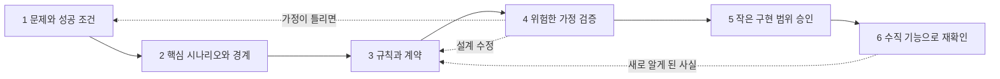

# 4장. 여섯 번의 작은 합의, 그 첫 번째는 짧은 합의서다

월요일 아침, 기획자에게서 메시지가 한 줄 왔다고 해보자. "예약 셀프 취소 기능 하나만 붙여 주세요." 1장에서 예고한 관통 예제 CAN이 이렇게 시작된다. 지금부터 9장까지 한 단계씩 쌓아 갈 이 기능은 원전 가이드가 설명을 위해 만든 가상 예시이고, 메시지를 보낸 기획자도 가상 인물이다. 실제 서비스의 취소·환불 정책이 아니라는 점을 다시 밝혀 둔다.

이 한 줄을 그대로 Claude Code나 Codex에 붙여 넣으면 어떤 일이 벌어질까? 에이전트가 머뭇거리는 모습은 잘 떠오르지 않는다. 예약 상세 화면에 취소 버튼을 달고, 취소 API를 하나 만들고, 요청이 들어오면 예약 상태를 곧바로 '취소됨'으로 바꾸는 코드를 내놓는 장면이 더 쉽게 그려진다. 테스트 몇 개를 곁들여 "완료했습니다"라고 보고할지도 모른다.

그런데 그 코드는 누가 정한 규칙을 따른 것일까? 이용 하루 전까지 취소할 수 있는지, 한 시간 전까지인지, 환불은 전액인지, 결제사가 응답하지 않으면 예약을 취소된 것으로 볼지, 사용자가 버튼을 두 번 누르면 환불도 두 번 나가는지. 요청 메시지에는 이 가운데 어느 것도 적혀 있지 않다. 그 빈칸을 에이전트가 채웠다면, 아무도 내린 적 없는 결정이 코드에 들어간 셈이다. 리뷰에서 그 결정을 하나하나 찾아내야 하는 쪽은 결국 사람이다. 생각만 해도 난감하다.

## 아이디어를 여섯 번에 나눠 합의한다

### 여섯 단계의 지도

원전 가이드는 아이디어가 구현 범위로 바뀌기까지 여섯 번의 작은 합의를 거치자고 권한다. 각 단계는 입력, 활동, 산출물, 검토자, 종료 조건을 갖는다.

첫째, 문제와 성공 조건을 좁힌다. 사용자와 상황을 특정하고, 사실과 가설을 나누고, 이번에 하지 않을 일과 가장 위험한 가정을 적는다. 산출물은 짧은 제품 합의서와 가정 목록, 성공 지표 초안이다. 둘째, 핵심 시나리오와 경계를 그린다. 대표 여정 하나를 정상·실패·복구까지 쓰고, 용어를 맞추고, 시스템 안팎의 책임을 나눈다. 셋째, 규칙과 계약을 구체화한다. 불변식, 전이 조건, 동시성, 멱등성, API·이벤트, 관측 지표를 정하고 품질 목표를 측정식으로 바꾼다. 넷째, 가장 위험한 가정을 작은 기술 실험이나 계약 테스트, 프로토타입 검토로 확인한다. 다섯째, Design Ready를 검토해 작은 구현 범위를 승인한다. 여섯째, UI부터 저장·관측까지 한 번에 관통하는 수직 기능을 만들어 설계를 다시 확인한다.

이 지도에서 눈여겨볼 칸은 종료 조건이다. 단계 1의 종료 조건은 "누구의 어떤 문제인지, 이번에 하지 않을 일, 성공을 관찰할 방법을 설명할 수 있습니다"이다. 단계 3은 "입력과 상태가 주어졌을 때 허용·거절·대기 동작을 예측할 수 있고, 미결정은 담당자와 기한이 있습니다"로 끝난다. 문서가 몇 쪽인지, 템플릿 칸이 다 찼는지는 묻지 않는다. 다음 사람이 무엇을 설명하고 예측할 수 있게 됐는지를 묻는다. 검토자 칸도 같은 역할을 한다. 단계 1의 검토자는 제품·업무 결정권자와 실제 사용자 또는 업무 담당자다. 에이전트는 이 칸에 들어가지 않는다.

여섯 번이라는 숫자에 겁먹을 필요는 없다. 원전은 "위험이 작은 항목은 합치고, 큰 항목은 반복합니다"라고 덧붙인다. 화면 문구 하나를 고치는 일이라면 단계 1부터 3까지를 대화 한 번으로 끝내도 된다. CAN은 사정이 다르다. 돈이 오가고, 소유권을 검사해야 하고, 동시에 들어온 요청을 가려야 하고, 결과를 바로 알 수 없는 외부 결제사와 연동한다. 이런 기능은 단계를 나누고, 위험한 단계는 되풀이하는 편이 낫다.


그림 1. 여섯 번의 작은 합의. 점선은 불확실성이 드러났을 때 앞 단계로 돌아가는 경로다(원전 §01·§03을 바탕으로 책이 그림).

이 여섯 단계가 2부와 3부의 순서다. 단계 1은 이 장에서, 단계 2와 3은 5장부터 7장까지 상태·계약·수용 기준으로, 단계 4와 5는 8장의 Design Ready에서, 단계 6은 9장의 수직 기능에서 다룬다. 점선 화살표를 잊지 말자. 원전은 §01에서 설계 흐름 전체를 두고 "한 번만 통과하는 폭포수 절차가 아닙니다"라고 못 박는다.

### 도구의 흐름과 겹쳐 보기

2장에서 살펴본 스펙 주도 개발 도구들도 비슷한 순서를 따른다. Spec Kit(v1.2.4, 2026-10 기준)은 `/speckit-specify`로 명세를, `/speckit-plan`으로 기술 계획을, `/speckit-tasks`로 작업 목록을 만든다. 거칠게 대응시키면 specify는 단계 1·2의 명세, plan은 단계 3의 아키텍처와 결정 기록, tasks는 단계 5의 구현 계획쯤에 놓인다. 이 대응은 책의 해석이다. Kiro는 요구사항에서 설계, 작업으로 가는 Requirements-First 흐름과, 설계에서 시작하는 Design-First 흐름을 함께 제공한다. 공식 문서(2026-10 기준)는 엄격한 비기능 제약이나 기존 설계 문서가 있는 프로젝트에 Design-First를 권한다. 순서 자체가 프로젝트의 위험에 따라 바뀔 수 있다는 뜻이다.

이런 도구가 널리 알려지기 전의 개인 워크플로도 같은 곳을 가리킨다. Harper Reed는 2025년 2월 블로그 글에서 아이디어를 다듬어 `spec.md`로 저장하고, 계획을 세운 뒤 실행하는 흐름을 소개하며, 실행의 성패는 결국 계획 단계가 얼마나 잘 됐느냐에 달려 있다고 썼다. 당시 모델 기준의 경험이지만 요지는 지금도 유효하다.

그렇다면 원전의 여섯 단계는 도구의 흐름과 무엇이 다를까? 도구는 산출물의 순서를 정해 준다. 원전은 거기에 검토자와 종료 조건을 붙인다. 누가 동의해야 다음으로 넘어가는지, 무엇을 설명할 수 있어야 끝났다고 말하는지를 적는다. Hacker News에서 한 사용자(BonanKou)는 최종 diff를 리뷰하는 일은 너무 낮은 수준이고 너무 늦다며, 차라리 계획과 가정을 리뷰하고 싶다고 했다. 커뮤니티 의견이지만, 검토 지점을 코드 앞으로 당겨야 하는 이유를 현장의 말로 잘 보여 준다.

## CAN의 제품 합의서

### 짧은 합의서 한 장

여섯 번의 합의 가운데 첫 번째 산출물이 제품 합의서(product brief)다. 원전은 무엇을 만들지보다 왜 만들고 어디까지 할지를 먼저 고정하자고 한다. CAN의 합의서는 원전 §04의 예시를 그대로 옮기면 다음과 같다.

```markdown
# product-brief.md — 가상 예시 · 예약 서비스의 셀프 취소

- 사용자와 상황: 확정된 예약을 가진 사용자가 이용 전에 일정을 바꿔야 합니다.
- 문제: 취소하려면 운영자에게 연락해야 하고, 처리 상태를 알기 어렵습니다.
  실제 빈도와 불편 정도는 인터뷰·문의 기록으로 확인합니다.
- 가치 가설: 가능한 예약을 직접 취소하고 상태를 확인할 수 있으면,
  취소 관련 문의와 불확실성이 줄어듭니다.
- 이번 범위: 로그인한 예약 소유자의 전액 취소, 처리 상태 조회,
  환불 연동 결과 반영, 실패 시 운영 인계
- 비범위: 부분 취소, 양도, 다중 결제수단, 운영자 예외 승인 UI.
  실제 요구가 있으면 별도 결정합니다.
- 성공 판단: 셀프 취소 완료율, 취소 관련 문의율, 처리 지연 분포를 비교합니다.
  분모·측정 기간·기준선·목표치는 데이터 확보 후 승인합니다.
- 제약: 결제사 계약, 개인정보 보존 정책, 예약 확정 과정과 취소의 동시성,
  사용자에게 보이는 정합성
- 큰 가정: 결제사가 요청별 멱등성과 결과 조회를 지원하는가?
  사용자가 "요청 접수"와 "취소 완료"를 구분할 수 있는가?
- 결정과 미결정: 범위 승인자: 업무 책임자 역할. 취소 가능 시점·환불 기한·
  예외 처리 권한은 미결정이며, 승인 전 실제 정책처럼 구현하지 않습니다.
```

한 화면에 들어가는 분량이다. 그래도 줄마다 하는 일이 분명하다. 문제 문장 끝에 붙은 단서부터 보자. "실제 빈도와 불편 정도는 인터뷰·문의 기록으로 확인합니다." 문제조차 확인할 가설로 다룬다는 표시다.

가치 가설과 성공 판단은 짝을 이룬다. 가설은 "직접 취소하고 상태를 확인할 수 있으면 문의와 불확실성이 줄어든다"이다. 성공 판단의 세 지표는 이 가설을 나눠서 잰다. 셀프 취소 완료율은 사용자가 정말 혼자 끝낼 수 있는지를, 취소 관련 문의율은 운영자에게 연락하는 일이 줄었는지를, 처리 지연 분포는 상태를 기다리는 시간이 얼마나 되는지를 본다. 지표의 이름은 정했지만 분모와 기간, 기준선과 목표치는 데이터가 생긴 뒤에 승인한다. 숫자가 비어 있다고 불안해할 이유는 없다. 근거 없이 채운 숫자보다 비어 있다고 밝힌 칸이 훨씬 정직하다.

제약 줄도 그냥 지나치기 아깝다. 결제사 계약, 개인정보 보존 정책, 예약 확정 과정과 취소의 동시성, 사용자에게 보이는 정합성. 지금은 단어 몇 개지만, 이 네 가지가 5장의 상태와 권한, 6장의 계약에서 하나씩 구체적인 규칙으로 자란다. 합의서 단계에서 제약을 적어 두면, 나중에 그 규칙이 어디서 왔는지 거슬러 올라갈 수 있다.

비범위는 Malte Ubl이 2020년 글 「Design Docs at Google」에서 내린 정의가 잘 맞는다. 목표가 될 법했지만 일부러 목표에서 뺀 것들이다. 부분 취소, 양도, 다중 결제수단은 누군가 "취소 기능"이라는 말을 듣고 자연스럽게 떠올릴 만한 확장이다. 그래서 적어 둔다. 사람에게도 그렇지만, 요청에 없던 일까지 그럴듯하게 해내려는 에이전트에게도 이 줄은 경계선이 된다.

큰 가정 두 개는 성격이 다르다. 결제사가 요청별 멱등성과 결과 조회를 지원하는지는 실행해 봐야 아는 기술 질문이다. 사용자가 '요청 접수'와 '취소 완료'를 구분할 수 있는지는 사용자를 관찰해야 아는 질문이다. 둘 다 틀리면 설계 전체가 흔들린다. 그래서 합의서 맨 앞쪽, 모두가 보는 자리에 둔다. 이 가정을 어떻게 확인하는지는 8장에서 다시 만난다.

가장 중요한 줄은 마지막 줄이다. 범위를 승인하는 사람은 업무 책임자 역할이고, 취소 가능 시점과 환불 기한, 예외 처리 권한은 아직 정하지 않았다. 그리고 승인 전에는 실제 정책처럼 구현하지 않는다. 에이전트에게 이 문장은 "여기서는 멈추고 물어보라"는 신호다. 이 줄이 없으면 에이전트는 '이용 24시간 전까지 취소 가능' 같은 그럴듯한 숫자를 스스로 골라 넣을 수 있다.

### 인터뷰는 맡기고 결정은 쥐고 있기

합의서를 사람이 처음부터 혼자 써야 할까? 그럴 필요는 없다. Claude Code 공식 Best practices 문서(2026-10 기준)는 아직 충분히 생각해 보지 않은 기능이라면, 명세를 쓸 수 있을 때까지 자신을 인터뷰하게 하고 그 결과를 `SPEC.md`에 쓰게 하라고 권한다. 그리고 `SPEC.md`가 생기면 새 세션에서 구현을 시작하라고 한다. 깨끗한 컨텍스트와 글로 적힌 완료 정의를 가지고 출발하라는 뜻이다. Harper Reed가 쓴 "한 번에 하나씩 질문해 달라"는 요청도 같은 패턴이다.

CAN에 적용하면 이런 식으로 시작할 수 있다.

```text
예약 셀프 취소 기능을 붙이려 한다. 정책은 아직 정하지 않았다.
제품 합의서를 쓸 수 있을 때까지 한 번에 하나씩 질문해 줘.
끝나면 product-brief.md 초안을 쓰고, 사실/가설/미결정을 구분해 표시해 줘.
확인되지 않은 수요·숫자·정책은 추정이라고 적어 줘.
```
(예시, 미실행)

마지막 두 줄은 원전 프롬프트 1에서 가져왔다. 원전의 프롬프트 1은 출력에 사실·가설·미결정의 구분과 비범위를 요구하고, 기술 선택을 먼저 확정하지 말고 질문마다 결정권자 역할을 제안하라고 한다(전문은 부록 B).

물론 인터뷰를 시켰다고 빈칸이 다 드러나지는 않는다. Vijayvargiya 외(ICLR 2026)의 Ambig-SWE 연구는 SWE-bench Verified 과제의 설명을 일부러 모자라게 만든 뒤 에이전트를 관찰했다. 모델은 명세가 충분한 지시와 부족한 지시를 잘 구분하지 못했다. 반면 명세가 부족할 때 사용자와 상호작용하게 하면 그렇지 않을 때보다 성능이 최대 74% 올랐다. 묻게 하면 나아지지만, 무엇을 물어야 하는지는 스스로 잘 알아채지 못한다는 이야기다. Hacker News의 joegibbs도 비슷한 경험을 적었다. 모델이 던지는 질문은 엉뚱한 경우가 많은데, 정작 모호했던 다른 부분은 스스로 가정해 버린다는 것이다(커뮤니티 의견).

그래서 역할을 나누자. 에이전트에게는 질문을 뽑고 초안을 쓰는 일을 맡긴다. 미결정 목록을 확정하고 각 항목의 결정권자를 정하는 일은 사람이 쥐고 있는다. 인터뷰가 끝난 초안에서 사람이 가장 먼저 확인할 곳도 '결정과 미결정' 줄이다.

흐름을 정리하면 이렇다. 인터뷰 세션에서 초안을 받는다. 사람이 초안을 읽고 사실과 가설의 구분, 비범위, 미결정과 결정권자를 고친다. 업무 책임자 역할이 범위를 검토한다. 그다음 단계인 도메인 규칙 작업은 새 세션에서 합의서 파일을 읽히며 시작한다. 인터뷰 대화에는 채택하지 않은 아이디어와 오해가 섞여 있다. 다음 단계가 기대야 할 것은 대화 기록이 아니고 사람이 손본 파일이다. 3장에서 본 저장소 배치를 따른다면, 루트의 AGENTS.md에는 합의서의 경로 한 줄만 적어 두면 된다. Kiro가 steering 기본 파일로 `product.md`를 두는 것도 같은 발상으로 읽을 수 있다(책의 해석). 제품의 목적과 범위를 담은 파일 하나를 에이전트가 늘 참조할 수 있는 자리에 두는 것이다.

### 비기능 요구를 관찰 가능한 문장으로

합의서에는 아직 '빠르게'나 '안전하게' 같은 말이 남아 있기 쉽다. 이런 말은 사람끼리도 뜻이 갈리고, 에이전트는 더더욱 확인할 방법이 없다. 원전은 부하, 환경, 측정 구간, 허용 기준을 적어 관찰 가능한 문장으로 바꾸자고 한다. 아래 표는 원전 §04의 예시다.

| ID와 목표 | 측정 조건과 기준의 예 | 검증 증거와 주의점 |
| --- | --- | --- |
| `NFR-P01` / 접수 응답 지연 | 명시한 스테이징 사양에서 대표 데이터 10만 건, 초당 20건의 취소 요청, 워밍업 후 15분 측정. 유효 요청의 서버 응답 p95 ≤ 500ms, 5xx 비율 ≤ 0.5%. | 외부 환불 완료 시간은 별도 측정. 부하 도구·데이터·설정·커밋·원시 결과를 저장하고, 스테이징 결과를 운영 SLA로 주장하지 않습니다. |
| `NFR-I01` / 중복 부작용 방지 | 동일 요청 재시도·동시 요청·이벤트 재전송 테스트에서 한 예약에 성공한 환불 부작용이 2회 이상 발생하지 않아야 합니다. | DB 제약, 외부 멱등키, 재처리 로그를 함께 확인합니다. 테스트 통과는 모든 장애 순서에 대한 수학적 보증이 아닙니다. |
| `NFR-O01` / 처리 지연 탐지 | 예시 경보 조건: 처리 대기 10분 초과 건 발생 시 운영 알림. 경보·조회·조치 담당자와 재시도 한도를 별도 정의합니다. | 의도적으로 지연을 주입해 경보 도착과 대응 절차를 확인합니다. 고객에게 약속할 완료 기한과 내부 경보 기준은 구분합니다. |

먼저 분명히 해 두자. 표의 숫자는 원전이 밝힌 대로 형식을 보여 주기 위한 예시이고, 권장 기본값이 아니다. p95 500ms나 10분 경보를 당신의 서비스에 그대로 옮겨 적지 않는 편이 좋다. 이 표에서 가져갈 것은 문장의 모양이다. `NFR-P01`은 서버의 접수 응답과 외부 환불 완료 시간을 따로 잰다. 앞의 것은 우리가 통제하지만 뒤의 것은 결제사에 달려 있기 때문이다. `NFR-I01`은 테스트 통과가 모든 장애 순서에 대한 보증이 아니라고 스스로 한계를 적는다. `NFR-O01`은 내부 경보 기준과 고객에게 약속할 완료 기한을 구분한다.

목표치를 정하는 순서도 원전에 있다. 사용자 기대와 사업 제약을 먼저 보고, 실제 기준선을 측정하고, 비용과 기술 가능성을 검토한 뒤, 책임자가 승인한다. 그리고 원전은 이렇게 덧붙인다. "AI가 제안한 숫자를 근거 없이 품질 계약으로 확정하지 않습니다." 인터뷰 도중 에이전트가 "응답 시간은 p95 500ms 정도면 적당합니다"라고 제안했다면, 그 숫자는 합의서에 '추정'으로만 들어갈 수 있다.

현장의 지시 파일은 이 부분이 유독 비어 있다. Chatlatanagulchai 외(ACM TOSEM)는 저장소 1,925개에서 컨텍스트 파일 2,303개를 모으고, 그중 표본 파일의 지시 내용을 유형별로 분류했다. 테스트 절차 지시가 들어 있는 파일은 75.9%, 아키텍처 지시가 들어 있는 파일은 68.1%였던 데 비해 보안은 14.8%, 성능은 14.5%에 그쳤다. 명세 주도 생성에서 기능은 명시되지만 보안은 암묵으로 남는다는 보고도 있다. Grynets 외(arXiv 2606.00167, 프리프린트)는 숨겨 둔 블랙박스 API 테스트 221개를 기준으로, 보안 요구를 넣지 않았을 때 대표 실패(초록의 표현은 modal failures)가 50건, ASVS 기반 요구를 넣었을 때 42건, 다층 보안 모델을 넣었을 때 36건이었다고 보고했다. 지금 저장소의 CLAUDE.md나 AGENTS.md를 열어 보자. 보안과 성능에 관한 줄이 하나라도 있는가?

## 지금까지 만든 것

CAN은 이제 첫 산출물을 갖췄다. 아래 표는 2부와 3부를 지나며 한 줄씩 채워진다.

| 단계 | 산출물 | 상태 | 채우는 장 |
| --- | --- | --- | --- |
| 합의 | `product-brief.md` — 사용자·문제·가치 가설·범위·비범위·성공 판단·제약·큰 가정 2개·결정과 미결정 | 초안, 업무 책임자 검토 대기 | 4장 ✓ |
| 품질 목표 | `NFR-P01`·`NFR-I01`·`NFR-O01` — 문장 형식만, 목표치는 미승인 | 형식 예시 | 4장 ✓ |
| 요구사항·도메인 | 용어, 예약 상태와 시도 상태, 정책, 불변식, 권한·경합 | 비어 있음 | 5장 |
| 계약·경험 | API, 이벤트, UX | 비어 있음 | 6장 |
| 수용 기준 | 정상·확정 실패·중복·지연·권한 | 비어 있음 | 7장 |
| 착수 판정 | 위험 목록과 Design Ready 판정 | 비어 있음 | 8장 |
| 계획·테스트·증거 | 수직 기능, 테스트, 검증 기록 | 비어 있음 | 9장 |

두 줄이 찼다. 합의서에는 '취소'라는 말이 여러 번 나오지만, 취소가 언제 완료되는지를 정한 규칙은 아직 어디에도 없다.
