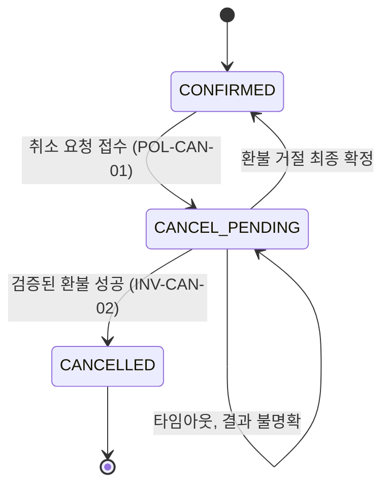
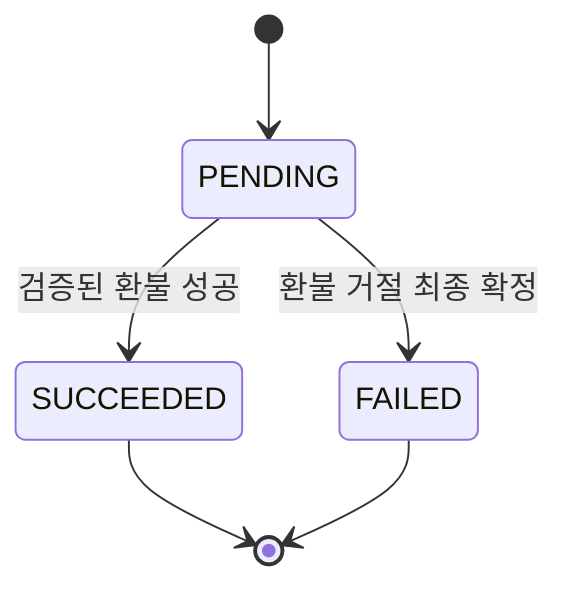

# 5장. 화면보다 먼저 상태와 불변식

취소 버튼을 누른 순간, 예약은 취소된 걸까?

화면 기획서만 보면 답은 간단해 보인다. 버튼을 누르면 확인 창이 뜨고, 확인을 누르면 "취소되었습니다"라는 안내가 나온다. 하지만 4장에서 쓴 CAN의 제품 합의서를 떠올려 보자. 환불은 우리 서비스가 아니라 결제사가 처리한다. 버튼을 누른 순간 일어난 일은 취소 요청의 접수뿐이다. 환불이 성공해야 비로소 취소가 끝난다. 결제사는 환불을 거절할 수도 있고, 아예 응답하지 않을 수도 있다. 합의서의 큰 가정 가운데 하나가 바로 "사용자가 '요청 접수'와 '취소 완료'를 구분할 수 있는가?"였다.

## 화면이 가리는 것

### 화면은 업무 상태를 표현한다

원전 가이드는 이 문제를 한 문장으로 정리한다. "화면은 업무 상태를 표현합니다." 그리고 도메인 규칙과 통합 계약을 먼저 맞춰야 오류와 재시도에도 같은 의미를 유지한다고 덧붙인다.

화면에서 출발한 설계는 어디서 무너질까? 화면에는 대개 두세 가지 모습만 있다. 취소 버튼이 있는 상태, 처리 중을 알리는 아이콘, 그리고 완료 안내. 그 뒤에서 일어나는 일은 훨씬 많다. 접수는 됐지만 환불 결과를 모르는 상태가 있다. 결제사가 거절을 확정한 상태가 있다. 결제사가 응답하지 않아 결과를 알 수 없는 상태도 있다. 화면 하나만 보고 만든 코드는 이 셋을 하나로 뭉개기 쉽다. 요청을 받자마자 예약을 '취소됨'으로 바꾸거나, 응답이 없으면 '실패'로 돌려 버리는 식이다. 에이전트에게 화면 시안만 건넸다면 이런 코드가 나와도 이상하지 않다. 시안에는 그 이상의 정보가 없기 때문이다.

Anthropic이 2025년 7월에 공개한 사내 활용 사례에도 비슷한 대목이 있다. 제품 디자인팀은 설계 단계에서 오류 상태와 로직 흐름, 시스템 상태를 먼저 매핑해 엣지 케이스를 찾았다고 한다. 당시 도구 기준의 사례지만 방향은 분명하다. 화면을 그리기 전에 상태를 그린다.

순서를 이렇게 잡으면 화면 설계도 오히려 쉬워진다. 도메인에 '접수됨', '결과 확인 중', '완료', '거절 확정'이 구분되어 있으면, 화면이 사용자에게 건넬 문장도 그 수만큼 자연스럽게 정해진다. 거꾸로 화면에서 출발하면, 시안에 없는 상태를 만날 때마다 누군가 즉석에서 문구와 동작을 지어내야 한다. 그 누군가가 에이전트라면 리뷰에서 하나하나 걸러 내야 할 결정이 늘어난다.

### 도메인에 꼭 적을 다섯 가지

그렇다면 상태를 그린다는 것은 구체적으로 무엇을 쓰는 일일까? 원전 §05는 도메인 문서에 꼭 적을 것을 다섯 가지로 꼽는다.

첫째는 용어와 소유권이다. 예약, 취소 요청, 환불이 서로 다른 개념인지 정의한다. 같은 말을 사람마다 다르게 쓰면 코드도 그 혼란을 그대로 닮는다. 둘째는 불변식이다. 원전의 예는 "취소 완료는 확인된 환불 성공 이후에만 선언합니다"이다. 어떤 경로로 들어오든 깨지면 안 되는 문장이다. 셋째는 상태 전이다. 시작 상태, 트리거, 조건, 결과를 쓰고, 일어나면 안 되는 금지 전이까지 적는다. 넷째는 권한이다. 주체 × 자원 × 행위 × 조건으로 정의하고, 서버에서 검증한다. 다섯째는 경합과 시간이다. 동시에 들어온 요청 중 누가 이기는지, 마감 시각을 어떻게 판정하는지, 늦게 도착한 결과를 어떻게 다루는지 정한다.

CAN에 대 보면 금방 감이 온다. 용어부터 그렇다. 일상어로는 모두 '취소'지만, CAN에는 적어도 세 가지가 섞여 있다. 사용자가 보낸 취소 요청, 그 요청으로 시작된 취소 시도, 그리고 예약이 취소 완료에 이른 상태다. 환불은 또 다른 개념이다. 결제사 쪽에서 실행되고, 그 결과를 우리가 나중에 전해 받는 거래다. 권한을 주체 × 자원 × 행위 × 조건으로 풀면 "로그인한 사용자가, 자기 소유의 예약에 대해, 취소를 요청할 수 있다. 단 예약이 CONFIRMED이고 정책상 취소 가능할 때"가 된다. 경합과 시간 항목에서는 취소 요청과 이용 시작이 동시에 일어나면 누가 이기는지, 취소 가능 시점의 경계를 어느 시각 기준으로 판정하는지 같은 질문이 나온다.

다섯 가지에는 공통점이 있다. 모두 화면 시안에 드러나지 않고, 모두 코드 어딘가에서는 반드시 결정된다. 문서에 없으면 그 결정은 구현하는 손에 맡겨진다. 에이전트가 그 손이라면, 에이전트는 가장 그럴듯한 답으로 빈칸을 채울 것이다. 그럴듯한 답이 업무 규칙과 다를 때 문제가 커진다.

## CAN의 도메인 원본

### `domain/cancellation.md`

이제 CAN의 도메인 원본을 써 보자. 원전 §06의 가상 설계를 그대로 옮긴다. 파일 하나로 묶은 배치와 소제목은 책이 붙였다. 먼저 요구사항이다.

> **REQ-CAN-01** 예약 소유자는 취소 가능한 확정 예약의 취소를 요청하고 진행 상태를 확인할 수 있습니다. 요청 접수와 완료를 구분하며, 중복 요청이 추가 환불을 만들지 않아야 합니다.

요구사항 한 문장 안에 이미 세 가지 약속이 들어 있다. 소유자만 요청할 수 있다. 접수와 완료는 다르다. 중복 요청이 환불을 늘리지 않는다. 도메인 원본은 이 약속을 상태와 규칙으로 풀어낸다.

```markdown
# domain/cancellation.md — 가상 예시

## 예약 상태
정상 상태 흐름: CONFIRMED → CANCEL_PENDING → CANCELLED

| 예약 상태 | 의미 |
| --- | --- |
| CONFIRMED | 확정 예약 |
| CANCEL_PENDING | 취소 요청 접수 / 환불 결과 확인 중 |
| CANCELLED | 환불 성공 확인 / 취소 완료 |

- 확정된 실패: 환불 거절이 최종 확정되면 예약은 CONFIRMED로 복귀하고
  취소 시도는 FAILED로 기록합니다.
- 결과 불명확: 타임아웃은 실패 확정이 아닙니다. CANCEL_PENDING을 유지하고
  조회·재조정으로 확인합니다.

## 규칙
- POL-CAN-01 소유자이고 CONFIRMED이며 정책상 취소 가능할 때만 신규 시도를 시작합니다.
  예시에서는 아직 이용이 시작되지 않은 예약으로 제한합니다.
- INV-CAN-01 예약당 활성 취소 시도는 최대 하나입니다.
  상태 검사와 활성 시도 생성은 원자적으로 처리합니다.
- INV-CAN-02 검증된 환불 성공 전에는 CANCELLED로 전이하지 않습니다.
- INV-CAN-03 동일 취소 시도의 외부 환불 키는 재시도에도 유지합니다.
  성공한 환불을 다시 실행하지 않습니다.

## 전이와 권한의 부가 조건
- 예약과 취소 시도의 상태는 분리합니다. 시도는 PENDING → SUCCEEDED 또는 FAILED이며
  감사 이력은 남깁니다.
- 취소 요청과 이용 시작이 경합하면, 동일한 상태·버전 조건을 가진 원자적 갱신으로
  하나만 성공하도록 설계합니다.
- 타인의 예약은 예시상 404로 처리해 존재 여부를 노출하지 않습니다.
  내부 감사에는 거절 사유를 구분합니다.
- FAILED 후 재시도는 새 시도로 생성하되, 이전 환불 실패가 최종 확정된 경우에만 허용합니다.
```


그림 1. CAN 예약 상태 전이. 타임아웃은 CANCEL_PENDING에 머문다(원전 §06 가상 설계).


그림 2. 취소 시도 상태. FAILED 뒤의 재시도는 이 시도를 되살리지 않고 새 시도를 만든다.

### 규칙 하나하나에 담긴 결정

파일은 짧지만 결정은 촘촘하다. 하나씩 짚어 보자.

예약 상태와 시도 상태를 왜 나눌까? 한 예약에 취소 시도가 여러 번 있을 수 있기 때문이다. 첫 시도가 거절로 끝나 예약이 CONFIRMED로 돌아간 뒤, 사용자가 다시 취소를 요청할 수 있다. 상태를 하나로 합치면 "이 예약은 지금 확정 상태다"와 "지난번 취소는 실패했다"를 동시에 표현할 길이 없다. 감사 이력도 시도 단위로 남아야 나중에 무슨 일이 있었는지 되짚을 수 있다.

타임아웃 규칙은 이 파일에서 가장 중요한 한 줄이다. 결제사가 응답하지 않을 때 이것을 실패로 처리하면 어떻게 될까? 예약은 CONFIRMED로 돌아가고, 사용자는 다시 취소를 누른다. 그런데 첫 환불은 사실 결제사 쪽에서 성공했을 수 있다. 이제 두 번째 환불이 나간다. 생각만 해도 아찔하다. 그래서 원전은 결과를 모르면 모른다고 기록한다. CANCEL_PENDING을 유지하고, 조회와 재조정으로 결과를 확인한다.

`POL-CAN-01`의 "정책상 취소 가능할 때"는 일부러 비워 둔 자리다. 4장의 합의서에서 취소 가능 시점은 미결정이었다. 규칙의 뼈대, 즉 소유자이고 CONFIRMED여야 한다는 조건은 지금 쓴다. 구체적인 시점은 업무 책임자가 승인한 뒤에 채운다. 예시의 "이용이 시작되지 않은 예약"은 설명을 위한 가정일 뿐이다.

세 불변식은 각각 다른 사고를 막는다. `INV-CAN-01`은 동시에 들어온 요청 두 개가 각자 시도를 만드는 일을 막는다. 상태를 검사하는 일과 시도를 만드는 일 사이에 틈이 있으면, 두 요청이 모두 "활성 시도 없음"을 보고 지나갈 수 있다. 그래서 둘을 원자적으로 처리한다고 적었다. `INV-CAN-02`는 성급한 완료 선언을 막는다. `INV-CAN-03`은 재시도가 새 환불이 되는 일을 막는다. 같은 시도라면 결제사에 보내는 환불 키를 바꾸지 않는다.

이 파일이 원본이라는 점도 기억해두자. 원전 §02의 예처럼 `domain/cancellation.md#POL-CAN-01`이 취소 가능 상태의 원본이라면, 명세는 그 규칙을 참조해 사용자에게 무엇을 약속하는지 설명하고, UX 문서는 그 규칙에 따라 버튼과 안내를 정의한다. 명세나 UX 문서에 "이용 전까지 취소 가능" 같은 문장을 다시 쓰지 않는다. 규칙이 두 곳에 적히는 순간, 언젠가 둘 중 하나는 낡는다.

권한과 경합에 관한 부가 조건도 놓치지 말자. 취소 요청과 이용 시작이 동시에 일어나면, 같은 상태·버전 조건을 건 원자적 갱신으로 하나만 성공하게 한다. 타인의 예약에 대한 요청은 예시상 404로 처리해 그 예약이 존재하는지조차 드러내지 않는다. 다만 404는 이 예제가 고른 방법이고, 정답으로 정해진 코드는 아니다. 내부 감사 기록에서는 왜 거절했는지를 구분해 남긴다.

### 아키텍처에 꼭 적을 것

도메인이 "무엇이 참이어야 하는가"를 적는다면, 아키텍처는 그 참을 어떤 경계 위에서 지키는지를 적는다. 원전은 다섯 가지를 꼽는다. 무엇이 결정을 내리고 무엇이 실행·전달하는지의 책임 경계. 신뢰 경계와 저장 위치, 민감 데이터, 추적 ID를 표시한 데이터 흐름. 하나의 트랜잭션과 비동기 경계를 구분하는 일관성. 타임아웃·재시도·중복·보상·정합성 회복을 정의하는 실패 복구. 관측, 경보, 운영 인계, 배포·복구 책임을 정하는 운영 경계.

CAN에 비춰 보면 이 다섯 항목이 도메인 규칙과 맞물리는 지점이 보인다. 취소할 수 있는지를 판정하는 쪽은 예약 도메인이고, 환불을 실제로 실행하는 쪽은 결제사다. 그 사이의 연동 코드는 요청을 전달하고 결과를 가져올 뿐 정책을 판단하지 않는다(책이 붙인 예시). 일관성 항목은 `INV-CAN-01`과 바로 이어진다. 상태 검사와 시도 생성은 한 트랜잭션 안에 둘 수 있다. 하지만 결제사의 환불 결과는 비동기 경계 너머에 있다. 그 경계를 넘는 동안 예약이 머무는 자리가 CANCEL_PENDING이다. 운영 경계는 합의서의 "실패 시 운영 인계"와 4장의 `NFR-O01`에서 이미 모습을 드러냈다. 결과가 오래 확인되지 않는 건을 누가 보고, 언제 사람에게 넘기는지를 여기에 적는다.

작게 시작하는 프로젝트라면 이 내용을 `architecture/` 폴더 대신 설계 문서의 한 절로 써도 충분하다. 이벤트를 어떻게 발행하고 중복을 어떻게 걸러 낼지는 계약의 몫이다.

## 왜 이것을 사람이 써야 하는가

### 빈칸은 결국 누군가 채운다

이런 규칙까지 꼭 사람이 써야 할까? 에이전트에게 "취소 도메인을 설계해 줘"라고 하면 상태 몇 개와 규칙 몇 줄은 금방 나온다.

Hacker News의 한 토론에서 vincentvandeth는 환불을 이렇게 설명했다. 주문이 존재하고, 반품 기간 안이고, 금액이 맞는지를 따지는 결정론적 업무 규칙이며, 그 판단을 LLM이 해서는 안 된다는 것이다(커뮤니티 의견). CAN의 `POL-CAN-01`과 세 불변식이 바로 그런 규칙이다. 에이전트가 초안을 제안하는 것까지는 괜찮다. 하지만 어떤 조건에서 환불이 나가는지는 업무 책임자가 승인하고 도메인 원본에 적혀 있어야 한다. 원본에 없으면 그 규칙은 코드 속 어딘가에서, 아무도 승인하지 않은 채로 정해진다.

에이전트에게 도메인 초안을 맡길 때는 원전의 프롬프트 2가 쓸 만한 틀을 준다. 용어, 상태 전이, 권한, 불변식, 실패·중복·타임아웃·늦은 결과를 포함해 초안을 쓰게 하되, 업무 규칙은 domain에, 사용자 약속은 spec에 두라고 원본 책임을 정해 준다. 그리고 "미결정은 선택지·장단점·검증 방법으로 제시하고 확정하지 마라"고 못 박는다(전문은 부록 B). CAN이라면 에이전트가 "취소 가능 시점: 이용 24시간 전"이라고 써 오는 대신, "선택지 A: 이용 시작 전까지 / 선택지 B: 이용 N시간 전까지, 결정권자: 업무 책임자"라고 써 오게 만드는 것이다.

용어도 마찬가지다. 한국 AI 커뮤니티 GPTers에 올라온 제이리의 글이 좋은 예다. 야근 기록 앱의 "사유" 필드를 PRD에는 주문건·납기·품질·기타 같은 한글 값으로 적었는데, Claude는 `overtime_order` 같은 영문 식별자로 구현했다. PRD가 저장값과 표시값이 같은지를 정하지 않은 것이 원인이었다. 작성자는 "클로드가 실수한 게 아니라, 제가 기획을 명확하게 안 했어요"라고 썼고, DB에는 영문 코드를, UI에는 한글 라벨을 두고 PRD에 둘 다 적어 해결했다. 용어의 원본을 정한다는 것은 이렇게 작은 결정까지 포함한다.

### 불변식을 실행할 수 있는 문장으로

도메인 규칙을 글로 적었다면 한 걸음 더 나아갈 수 있다. 불변식을 코드가 스스로 확인하는 문장, 즉 단언(assertion)으로 바꾸는 것이다. Endres 외(FSE 2024)의 nl2postcond 연구는 LLM이 자연어 의도를 실행 가능한 사후조건으로 바꿀 수 있는지 살폈다. 생성된 사후조건은 대체로 정확했고, Defects4J에 실린 실제 과거 버그 64개를 잡아냈다. 이 연구를 CAN에 그대로 가져다 쓸 수 있다는 뜻은 아니다. 다만 아이디어는 분명하다. `INV-CAN-02`를 이렇게 옮겨 볼 수 있다.

```kotlin
// INV-CAN-02: 검증된 환불 성공 전에는 CANCELLED로 전이하지 않는다
fun completeCancellation(reservation: Reservation, attempt: CancellationAttempt) {
    check(attempt.status == AttemptStatus.SUCCEEDED) { "INV-CAN-02 위반: ${attempt.id}" }
    reservation.markCancelled(attempt.id)
}
```
(예시, 미실행)

주석에 불변식 ID를 남긴 것을 보자. 규칙이 바뀌면 `INV-CAN-02`로 검색해 원본과 단언을 함께 찾을 수 있다.

같은 생각을 더 밀고 나간 연구도 있다. Sun 외(SAIV 2024)의 Clover는 코드와 docstring, 형식 명세 주석 세 가지가 서로 맞는지를 검사했다. 올바른 사례는 최대 87%까지 받아들였고, 일부러 틀리게 만든 사례는 하나도 통과시키지 않았다고 보고했다. 이 연구는 Dafny라는 검증 언어를 쓴다. 대부분의 독자에게 그대로 옮길 도구는 아니다. 가져갈 것은 발상이다. 문서와 계약과 코드가 따로 놀지 않고 서로를 검증하게 만들 수 있다는 것이다. 도메인 원본의 불변식이 코드 속 단언과 테스트로 이어지면, 셋 중 하나가 어긋날 때 누군가 알아챌 기회가 생긴다.

한국 개발 커뮤니티를 둘러본 리서치에서는 흥미로운 관찰이 하나 나왔다. velog의 에이전트 활용 회고에서 도메인 규칙이나 권한, 멱등성 같은 설계 내용을 문서로 남긴다는 글은 거의 보이지 않았다. 문서화의 대상은 대개 커밋 메시지나 코딩 규칙 같은 작업 방식에 머물렀다. 리서처의 관찰일 뿐이지만, 지금 우리가 쓰는 `domain/cancellation.md`가 바로 그 빈자리에 놓이는 문서다.

버튼은 요청을 접수할 뿐이고, 예약이 언제 취소되는지는 `domain/cancellation.md`의 한 줄이 정한다.
