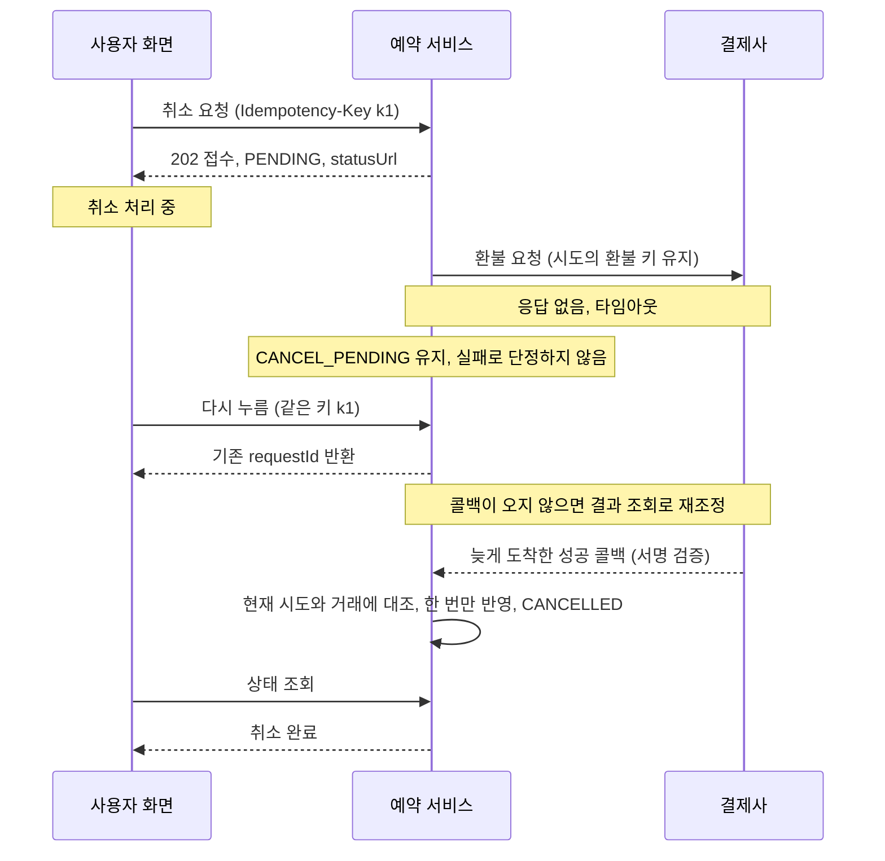

# 6장. 계약은 실패의 의미까지 적는다

가상의 장면이다. 사용자가 CAN의 취소 버튼을 누른다. 예약 서비스는 요청을 받고 결제사에 환불을 요청한다. 3초, 5초, 10초가 지나도 응답이 없다. 화면에서는 처리 중 아이콘이 계속 돈다. 기다리다 지친 사용자는 뒤로 가기를 눌렀다가 예약 상세 화면에 다시 들어와 취소 버튼을 한 번 더 누른다. 그 사이 결제사 쪽에서는 첫 번째 환불이 이미 처리됐을지도 모른다.

이때 서버는 무엇을 해야 할까? 두 번째 요청은 새 취소일까, 첫 번째 요청의 재시도일까? 첫 요청의 결과를 모르는데 화면에 "취소에 실패했습니다"라고 보여 줘도 될까? API 명세에 성공 응답의 모양만 적혀 있다면 이 질문에 답할 근거가 어디에도 없다. 구현하는 사람이, 혹은 구현하는 에이전트가 그 자리에서 답을 정하게 된다.

Stripe의 Brandur Leach는 2017년 글에서 이 상황을 짧게 정리했다. 네트워크는 믿을 수 없고, 요청이 실패하는 여러 경우 가운데 어느 하나만 일어나도 요청을 보낸 클라이언트는 불확실한 상황에 놓인다는 것이다. 5장에서 우리는 이 불확실함을 도메인에 적었다. 타임아웃은 실패 확정이 아니고, 예약은 CANCEL_PENDING에 머문다. 이제 그 규칙을 서비스의 경계 밖으로, 즉 API와 이벤트와 화면으로 전달할 차례다. 그 전달 방식을 적은 문서가 계약이다.

## 계약이 빠뜨리기 쉬운 것

### 계약 체크포인트

원전 §05는 계약 종류마다 반드시 구체화할 내용과 흔한 누락을 표로 정리한다.

| 계약 | 반드시 구체화할 내용 | 흔한 누락 |
| --- | --- | --- |
| API | 인증·권한, 요청·응답 스키마, 상태 코드, 오류 코드, 멱등키 범위·보존 기간, 재시도, 동시성, 버전·호환성 | 성공 응답만 있고 실패의 의미가 없음 |
| 이벤트 | 발행 조건, event ID·버전, entity ID·버전, correlation ID, payload, 전달·순서 보장 수준, 중복 제거, 재처리·실패 큐 정책 | "한 번만 오고 순서대로 온다"는 암묵적 가정 |
| 권한 | 역할·주체, 자원 소유권, 허용 행위, 상태 조건, 관리자 예외와 감사 기록, 거절 시 정보 노출 기준 | 버튼을 숨기는 것만으로 접근을 제한 |
| UX | 초기·로딩·대기·성공·실패·빈 상태, 재시도와 복귀, 중복 클릭, 키보드·초점, 상태 알림, 민감 정보 표시 | 네트워크 타임아웃을 업무 실패로 단정 |

오른쪽 열의 네 가지 누락은 모두 앞의 장면에서 사고로 이어진다. 성공 응답만 정의한 API는 두 번째 클릭을 새 요청으로 받아들인다. 이벤트가 한 번만 온다고 가정한 수신자는 같은 완료 이벤트를 두 번 처리한다. 버튼을 숨겨서 권한을 막았다고 믿은 서버는 API를 직접 호출하는 요청 앞에서 무방비다. 타임아웃을 실패로 단정한 화면은 사용자에게 사실이 아닐 수 있는 말을 한다.

권한 계약은 따로 표를 만들지 않아도 CAN 곳곳에 흩어져 있다. 주체는 로그인한 사용자, 자원은 그 사용자가 소유한 예약, 허용 행위는 취소 요청과 상태 조회, 상태 조건은 CONFIRMED이면서 정책상 취소 가능할 때다. 거절할 때 무엇을 드러낼지는 5장에서 정했다. 타인의 예약이면 존재 여부조차 알리지 않는다. 체크포인트 가운데 아직 비어 있는 칸은 관리자 예외와 감사 기록이다. 4장 합의서에서 운영자 예외 승인 화면은 비범위였고, 예외 처리 권한은 미결정이었다. 계약에도 그 칸이 비어 있다고 적어 두면, 에이전트가 관리자용 우회 경로를 슬쩍 만들어 넣는 일을 막을 수 있다.

CAN의 계약은 이 네 가지 누락을 어떻게 피할까? 원전 §06의 가상 설계를 그대로 옮기고, 그 문장들이 어떤 실패를 염두에 두고 쓰였는지 하나씩 읽어 보자.

## CAN의 세 가지 계약

### `API-CAN-01`: 접수와 결과를 나눈 API

```http
API-CAN-01  POST /reservations/{id}/cancellation-requests
인증       로그인 사용자 + 서버의 예약 소유권 검증
헤더       Idempotency-Key: 요청자가 생성한 키
입력       { "reasonCode": "CHANGE_OF_PLANS" }
접수       202 { requestId, reservationId, status: "PENDING", statusUrl }
조회       GET /cancellation-requests/{requestId}  → 소유자만 조회
재전송     동일 사용자·예약·키 + 동일 입력 → 기존 requestId 반환
키 충돌    동일 키 + 다른 입력 → 409 IDEMPOTENCY_CONFLICT
다른 키    활성 시도가 있으면 409 CANCELLATION_IN_PROGRESS + 상태 조회 위치
종료 상태  이미 CANCELLED인 예약 → 409 ALREADY_CANCELLED, 신규 환불 없음
조건 위반  409 CANCELLATION_NOT_ALLOWED / 인증 없음 401 / 비소유자 404
```

첫눈에 들어오는 것은 접수 응답이 `202`라는 점이다. 이 응답은 "취소됐다"고 말하지 않는다. 요청을 받았고, 시도의 상태는 `PENDING`이며, 결과는 `statusUrl`에서 확인하라고 말한다. 5장의 CANCEL_PENDING이 API의 언어로 옮겨진 모습이다.

이제 앞의 장면으로 돌아가 보자. 사용자가 버튼을 다시 눌렀을 때 클라이언트가 같은 멱등키로 재전송했다면, 서버는 동일한 사용자·예약·키·입력을 확인하고 기존 `requestId`를 돌려준다. 새 시도는 생기지 않는다. 클라이언트가 새 키를 만들어 보냈다면 어떨까? 활성 시도가 이미 있으므로 `409 CANCELLATION_IN_PROGRESS`와 함께 상태를 조회할 위치를 알려 준다. 어느 쪽이든 예약당 활성 시도는 하나라는 `INV-CAN-01`이 지켜진다. 같은 키로 다른 입력을 보낸 경우는 실수일 가능성이 크므로 `409 IDEMPOTENCY_CONFLICT`로 막는다. 이미 CANCELLED인 예약에 대한 요청에는 `ALREADY_CANCELLED`를 돌려주고 새 환불을 만들지 않는다.

비소유자에게 `404`를 돌려주는 줄은 5장의 부가 조건과 이어진다. 예약이 존재하는지조차 알려 주지 않으려는 선택이다. 조회 API에도 "소유자만 조회"가 붙어 있다. 버튼을 숨기는 일과 상관없이, 서버가 소유권을 확인한다.

여기서 원전의 한 문장을 꼭 함께 읽어야 한다. "HTTP 상태 코드는 이 예제의 선택입니다." `202`, `409`, `404`가 표준이라는 뜻은 아니다. 이 계약에서 가져갈 것은 번호보다 구분이다. 재전송, 키 충돌, 진행 중, 종료 상태, 조건 위반이 각각 다른 응답으로 구별된다. 클라이언트와 화면은 그 구별 덕분에 사용자에게 정확한 말을 할 수 있다.

### `EVT-CAN-01`과 '한 번만 온다'는 가정

```text
EVT-CAN-01  ReservationCancellationCompleted.v1
발행 조건  검증된 환불 성공 + 예약 CANCELLED 갱신 후
필드       eventId, occurredAt, reservationId, cancellationRequestId,
           aggregateVersion, correlationId, schemaVersion
전달 가정  적어도 한 번 전달될 수 있음. 수신자는 eventId로 중복 제거
일관성     상태 변경과 outbox 기록을 같은 DB 트랜잭션으로 묶는 안을 검증
순서       aggregateVersion을 확인하고 오래된 상태 덮어쓰기를 금지
```

발행 조건부터 보자. 이 이벤트는 요청을 접수했을 때가 아니라 검증된 환불 성공과 CANCELLED 갱신이 끝난 뒤에 나간다. 알림을 보내거나 좌석을 다시 판매하는 쪽은 이 이벤트를 믿고 움직이기 때문이다. 접수 시점에 "취소 완료"를 방송하면, 나중에 환불이 거절됐을 때 되돌리기 어려운 일이 이미 벌어져 있다.

전달 가정 줄은 계약 체크포인트의 흔한 누락, 곧 "한 번만 오고 순서대로 온다"는 가정을 정면으로 부정한다. 이벤트는 적어도 한 번 전달될 수 있다. 두 번 올 수도 있다는 뜻이다. 그래서 수신자는 `eventId`로 중복을 거른다. 순서도 보장되지 않으므로 `aggregateVersion`을 확인해 오래된 상태가 새 상태를 덮어쓰지 못하게 한다. `correlationId`는 처음의 취소 요청부터 환불 콜백, 완료 이벤트까지 한 줄로 이어 볼 수 있게 해 준다. 결과가 오래 확인되지 않는 건을 운영자에게 넘길 때, 이 값 하나로 흩어진 기록을 모을 수 있다. `schemaVersion`과 이벤트 이름 끝의 `.v1`은 나중에 필드가 바뀌어도 수신자가 어떤 모양을 받았는지 구분하게 해 준다.

일관성 줄의 표현이 조심스럽다는 점도 눈여겨보자. 상태 변경과 outbox 기록을 같은 DB 트랜잭션으로 묶는 '안을 검증'한다고 적었다. 아직 확정한 설계가 아니고, 확인해야 할 후보라는 표시다. Chris Richardson이 정리한 transactional outbox 패턴은 업무 엔터티를 갱신하는 트랜잭션 안에서 메시지도 DB에 저장하고, 별도 프로세스가 그 메시지를 브로커로 보낸다. 그런데 같은 문서는 메시지 릴레이가 한 메시지를 두 번 이상 발행할 수 있고, 그래서 소비자는 멱등해야 한다고 분명히 적는다. 원전도 같은 말을 한다. "outbox는 '정확히 한 번'을 보장하지 않으므로 수신자 중복 처리도 필요합니다."

### `UX-CAN-01`: 화면이 지킬 약속

세 번째 계약은 화면이다. `UX-CAN-01`의 핵심은 접수와 완료를 구분하는 것이다. 원전은 화면 약속을 따로 적지 않고 `AC-CAN-01`의 UX 항목에 담아 두었는데, 그 내용을 옮기면 이렇다. 접수 직후에는 "취소 처리 중"을, 성공이 확정된 뒤에는 "취소 완료"를 보여 준다. 사용자가 확인 화면을 떠나도 다시 방문하면 상태를 조회할 수 있어야 한다. 4장 합의서의 큰 가정, 즉 사용자가 '요청 접수'와 '취소 완료'를 구분할 수 있는지는 바로 이 화면에서 시험대에 오른다.

처음 장면의 처리 중 아이콘을 다시 떠올려 보자. 결제사가 응답하지 않을 때 화면이 "취소에 실패했습니다"라고 말한다면, 그것은 계약 체크포인트가 경고한 바로 그 누락이다. 서버는 CANCEL_PENDING을 유지하고 있는데 화면만 실패를 선언하는 셈이다. 사용자는 다시 누르고, 서버의 멱등 처리가 제대로 짜여 있지 않다면 환불은 두 번 나간다. 중복 클릭을 막으려고 버튼을 비활성화하는 것도 좋다. 다만 그건 편의 기능일 뿐이고, 중복을 실제로 막는 쪽은 서버다.

결과 확인이 길어질 때의 화면도 계약에 넣어 두자. UX 체크포인트는 초기·로딩·대기·성공·실패·빈 상태와 재시도·복귀를 모두 정하라고 한다. CAN이라면 처리 중 상태가 길어질 때 사용자에게 무엇을 보여 주고, 어디서 상태를 다시 확인하거나 문의할 수 있는지가 여기에 해당한다. 이 상황을 수용 기준으로 어떻게 쓰는지는 7장에서 다시 만난다.

아래 그림은 처음 장면이 계약대로 흘러갈 때의 모습이다.


그림 1. 요청, 타임아웃, 늦은 콜백, 조회·재조정. 가상 설계를 바탕으로 책이 그린 흐름이다.

## 사례로 보는 멱등성

### 키를 지운 뒤에도 남아야 하는 방어선

멱등키는 첫 번째 방어선이다. 그런데 그 키를 영원히 보관할 수 있을까? Stripe의 API 문서(2026-10 기준)는 API v1에서 키가 만들어진 지 최소 24시간이 지나면 시스템에서 자동으로 지울 수 있고, 정리된 뒤 같은 키가 다시 쓰이면 새 요청으로 처리한다고 설명한다. 같은 키로 재시도하면 처음 요청의 응답을 그대로 돌려주는데, `500` 오류였다면 그 오류까지 돌려준다. 들어온 파라미터가 원래 요청과 다르면 오류를 낸다. API v2는 동작이 다르다고 따로 밝혀 둔다. 키에 이메일 주소 같은 개인 식별 정보를 쓰지 말라는 권고도 있다.

이 설명을 CAN에 대 보면 반갑지 않은 시나리오가 하나 보인다. 사용자가 취소를 요청하고, 어떤 이유로 클라이언트가 하루 뒤 같은 키로 재전송했다고 해보자. 멱등키 기록만 믿는 서버라면 그 요청을 새 취소로 받아 새 환불을 만들 수 있다. 원전이 이렇게 경고하는 이유다. "키 기록 정리 후에도 예약·시도 이력과 업무 제약이 중복 환불을 방어해야 합니다." CAN에서 그 두 번째 방어선은 5장의 규칙들이다. 활성 시도는 하나뿐이고, 이미 CANCELLED인 예약은 `ALREADY_CANCELLED`로 거절되며, 같은 시도의 외부 환불 키는 바뀌지 않는다.

### 표준이 갈리는 지점은 기록으로 올린다

같은 멱등키로 다른 입력이 들어오면 무엇을 돌려줘야 할까? 자료마다 답이 다르다.

| 출처 | 동일 키 + 다른 입력 | 비고 |
| --- | --- | --- |
| 원전 `API-CAN-01` | `409 IDEMPOTENCY_CONFLICT` | 원전: "HTTP 상태 코드는 이 예제의 선택입니다" |
| IETF `Idempotency-Key` 헤더 초안 -07 (2025-10-15)·-08 (2026-10-22) | `422` (SHOULD) | 두 판 모두 키 누락은 `400`, 원 요청 처리 중 재시도는 `409` (모두 SHOULD) |
| Stripe API v1 (2026-10 기준) | 오류 | 문서는 오류를 낸다고만 설명. 상태 코드 번호는 리서치에서 확인하지 못했다 |

IETF 초안은 2026-10 기준으로 아직 RFC가 아니다. 이 응답 코드가 표준으로 굳지 않았다는 뜻이고, 표에서 보듯 실제 선택도 갈린다. 그렇다고 아무 번호나 골라도 된다는 말은 아니다. 세 자료가 모두 동의하는 점이 있다. 같은 키로 다른 입력이 오면 조용히 처리하지 않고 오류로 알린다는 것이다. Stripe 문서는 그 이유를 실수로 인한 오용을 막기 위해서라고 설명한다. 번호는 갈려도 "이건 클라이언트의 실수일 가능성이 크다"는 판단은 같다. 이런 지점을 계약 안에 조용히 묻어 두면 어떻게 될까? 클라이언트를 만드는 팀은 422를 기대하고, 서버는 409를 돌려주고, 외부 소비자는 또 다른 가정을 한다. 찜찜한 일이다. 표준이 정해지지 않은 지점은 선택지와 이유를 남기는 결정 기록의 대상으로 올리는 편이 낫다. CAN의 이 문제를 결정 기록(ADR)으로 쓰는 일은 12장에서 다시 다룬다.

## 추적 ID로 잇는다

### 바뀔 약속에는 이름을 붙인다

5장과 6장을 지나며 CAN에는 ID가 여럿 생겼다. 원전은 이것들을 하나의 사슬로 잇는다. 요구사항 `REQ-CAN-01` → 규칙 `POL-CAN-01` → 계약 `API-CAN-01` → 수용 기준 `AC-CAN-01`. 그리고 이렇게 덧붙인다. "모든 문장에 번호를 붙일 필요는 없지만, 변경 시 찾고 검증해야 하는 약속에는 안정적인 ID가 필요합니다."

언제 이 사슬이 힘을 쓸까? 업무 책임자가 취소 가능 시점을 바꾸기로 했다고 해보자. `POL-CAN-01`로 검색하면 그 규칙을 참조하는 API의 `CANCELLATION_NOT_ALLOWED` 응답, 화면의 안내 문구, 그리고 곧 쓸 수용 기준이 한 번에 딸려 나온다. ID가 없으면 "취소 가능"이라는 표현이 들어간 곳을 사람이든 에이전트든 짐작으로 찾아야 한다.

이 효과를 잰 연구가 있다. Mäder와 Egyed(Empirical Software Engineering, 2015)는 피험자 71명이 실제 유지보수 과제를 수행하는 통제 실험에서, 요구사항 추적성이 있을 때 평균 24% 더 빠르고 정답을 평균 50% 더 많이 냈다고 보고했다. 수치는 2차 출처로 확인했고, AI가 등장하기 전의 연구다. 변경 영향을 찾아야 하는 에이전트에게도 같은 이득이 있으리라는 연결은 이 책의 추론이다.

계약 자체를 원본으로 두는 길도 있다. 원전은 API 스키마를 OpenAPI 같은 별도 파일로 관리한다면 그 스키마를 계약의 원본으로 정하라고 한다. 원전 §12의 문서 머리말 예시가 가리키는 `architecture/contracts/cancellation.yaml`이 그런 자리다. 우아한형제들(2026-04-17)의 사례가 이 방향을 잘 보여 준다. Swagger 문서에서 타입과 Mock, React Query 훅, 테스트를 생성하고, AI가 코드 전체를 탐색하게 두는 대신 스크립트가 필요한 메타데이터만 JSON으로 요약해 넘겼다고 한다. 스키마가 원본이면 산문 문서는 그 스키마를 ID로 가리키기만 하면 된다.

사슬은 여기서 끝나지 않는다. 원전 §06은 이 연결을 여덟 단계로 늘린다.

| 단계 | 연결 ID와 내용 | 이 책에서 |
| --- | --- | --- |
| 1 / REQUIREMENT | `REQ-CAN-01` / 소유자의 취소 요청·조회 | 5장 |
| 2 / DOMAIN | `POL-CAN-01` / `INV-CAN-01`~`03` | 5장 |
| 3 / CONTRACT | `API-CAN-01` / `EVT-CAN-01` | 6장 |
| 4 / EXPERIENCE | `UX-CAN-01` / 접수와 완료 구분 | 6장 |
| 5 / ACCEPTANCE | `AC-CAN-01`~`05` / 정상·오류·중복·지연·권한 | 7장 |
| 6 / PLAN | `SLICE-CAN-01` / 최소 취소 수직 기능 | 9장 |
| 7 / TEST | `TC-CAN-01`~`05` / 규칙·계약·종단 검증 | 9장 |
| 8 / EVIDENCE | `VAL-CAN-01` / 커밋·명령·결과·한계 | 9장 |

절반이 채워졌다. 남은 절반은 약속을 증거로 바꾸는 단계다.

## 남은 미결정

계약을 쓰다 보면 정하지 못한 것이 보인다. 원전은 멱등키 보존 기간, 환불사 키 정책, 이벤트 보존·재처리 기간을 위험에 맞춰 반드시 결정해야 할 항목으로 꼽는다. 여기에 이 장에서 확인한 응답 코드 문제를 더하면, CAN의 계약에는 아래 미결정이 남는다.

| 미결정 | 선택지와 참고 | 영향 | 담당자 | 기한 |
| --- | --- | --- | --- | --- |
| 멱등키 보존 기간 | 참고: Stripe API v1은 24시간 이후 정리 가능. 정리 후 방어는 이력·업무 제약으로 | 정리 이후 재사용된 키의 처리 | | |
| 동일 키 + 다른 입력 응답 코드 | 원전 예 `409` / IETF 초안 -07·-08 `422` / Stripe 오류 | 클라이언트·외부 소비자의 오류 처리 | | |
| 이벤트 보존·재처리 기간 | 수신자의 `eventId` 중복 제거 창, 실패 큐 정책 | 늦게 온 중복 이벤트의 처리 | | |
| 환불사 키 정책 | 결제사가 요청별 멱등성과 결과 조회를 지원하는가(4장의 큰 가정) | 타임아웃 뒤 재조정이 가능한지 | | |

담당자와 기한 칸은 일부러 비워 두었다. 원전이 단계 3의 종료 조건으로 "미결정은 담당자와 기한이 있습니다"를 꼽은 이유가 이 표에 있다. 이름과 날짜가 들어가기 전까지 이 네 줄은 누구의 일도 아니다.

### 이 장의 핵심

- 계약에는 성공 응답과 함께 실패·중복·지연의 의미를 적는다. 흔한 누락 네 가지(성공 응답만 있음, 한 번만 순서대로 온다는 가정, 버튼 숨기기로 권한 제한, 타임아웃을 실패로 단정)가 기준이다.
- 접수와 완료를 API(`202`·`PENDING`), 이벤트(성공 확정 뒤 발행), 화면("취소 처리 중"과 "취소 완료")에서 모두 구분한다.
- 멱등키는 첫 방어선이다. 키 기록이 정리된 뒤에도 시도 이력과 업무 제약이 중복 환불을 막아야 하고, outbox를 쓰더라도 수신자는 중복을 걸러야 한다.
- 표준이 갈리는 지점(동일 키 + 다른 입력의 응답 코드 등)은 계약에 묻지 말고 결정 기록 대상으로 올린다.
- 바뀔 약속에는 안정적인 ID를 붙여 요구사항에서 계약, 수용 기준까지 잇는다.
