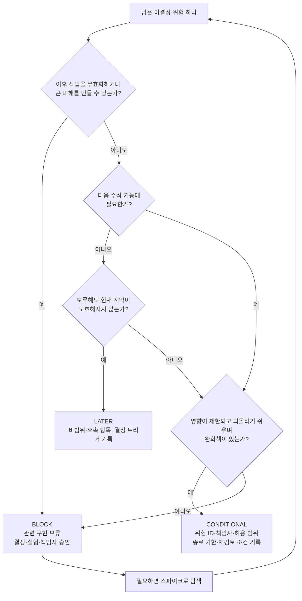

# 8장. Design Ready는 위험이 정한다

앞 장에서 우리는 수용 기준 다섯 개를 썼다. 정상 처리 하나에, 확정된 실패·중복 요청과 동시 클릭·타임아웃과 늦은 콜백·권한과 상태 경합이라는 실패 넷. 4장의 제품 합의서부터 세어 보면 CAN을 위해 쌓인 문서가 제법 된다. 합의서와 큰 가정, `domain/cancellation.md`의 `POL-CAN-01`과 `INV-CAN-01`~`03`, `API-CAN-01`과 `EVT-CAN-01`, 접수와 완료를 구분하는 `UX-CAN-01`, 그리고 `AC-CAN-01`~`05`까지.

이제 구현을 시작해도 될까?

손이 근질거리는 순간이다. 에이전트 창을 열고 "이 문서들대로 만들어 줘"라고 치면 몇 분 안에 뭔가 돌아가는 화면을 보게 될 것이다. 그런데 잠시 멈추고 생각해보자. 6장 끝에 남겨 둔 미결정 목록이 있다. 멱등키 보존 기간, 멱등 충돌 응답 코드, 이벤트 재처리 기간은 아직 아무도 정하지 않았다. 4장의 큰 가정 두 개, 그러니까 결제사가 요청별 멱등성과 결과 조회를 지원하는지, 사용자가 "요청 접수"와 "취소 완료"를 구분할 수 있는지도 여전히 가정이다. 취소 가능 시점은 4장의 합의서에서부터 미결정으로 적혀 있었다.

그렇다고 이 모든 물음표가 사라질 때까지 기다려야 할까? 그러면 영원히 시작하지 못한다. 물음을 바꿔 보자. "의문이 다 풀렸는가?" 대신 "지금 정한 범위를 안전하게 시작할 근거가 있는가?"를 묻는 것이다. 원전은 이 물음에 답하는 장치를 Design Ready라고 부른다. 그리고 그 판정을 AI 리뷰에 맡겨도 되는지도 함께 따져 보자.

## 착수의 기준을 다시 세운다

### 의문이 남아 있어도 시작할 수 있다

원전의 정의는 이렇다. Design Ready는 "모든 의문이 사라지는 시점이 아니라, 지정한 구현 범위를 안전하게 시작할 근거가 있는 시점"이다(원전 §07).

이 문장에서 눈여겨볼 말은 둘이다. 하나는 "지정한 구현 범위"다. 착수 판정의 대상은 다음에 만들 범위 하나로 좁혀진다. 다른 하나는 "근거"다. 일정이 급하다는 사정이나 "이 정도면 되겠지" 하는 감은 근거가 되지 못한다. 판정마다 가리킬 수 있는 문서나 실험 기록이 있어야 한다.

원전은 남은 불확실성을 세 등급으로 나눈다.

| 등급 | 무엇이 여기에 속하나 | 어떻게 처리하나 |
|---|---|---|
| `BLOCK` | 핵심 업무 규칙 미승인, 금전·권한·개인정보 불변식 충돌, 불가능할 수 있는 외부 계약, 데이터 손실 복구 미정처럼 이후 작업을 무효화하거나 큰 피해를 만드는 항목 | 결정·실험·책임자 승인 전에는 관련 구현을 보류한다. 탐색용 스파이크는 따로 허용할 수 있다 |
| `CONDITIONAL` | 영향이 제한되고 되돌리기 쉬우며 완화책이 있는 불확실성 | 미검증 기능 비활성화, 사용자 제한, 추가 관측을 적용하고 위험 ID·책임자·허용 범위·종료 기한·재검토 조건을 기록한다 |
| `LATER` | 다음 수직 기능에 필요하지 않은 미래 확장, 낮은 위험의 표현 세부 | 비범위나 후속 항목으로 표시하고, 결정이 필요해지는 트리거를 남긴다 |

세 등급 가운데 가장 조심해서 다뤄야 할 것은 `CONDITIONAL`이다. "조건부 진행"이라는 말은 듣기에 편하다. 일단 시작하고 나중에 정하자는 말처럼 들리기 때문이다. 하지만 원전이 요구하는 기록 다섯 칸, 즉 위험 ID·책임자·허용 범위·종료 기한·재검토 조건 가운데 하나라도 비어 있다면 그것은 이름만 바꿔 단 `BLOCK`에 가깝다. 담당자도 기한도 없는 "나중에"가 실제로 다시 돌아오는 일은 드물다. 그 뒷맛이 얼마나 찜찜한지는 다들 겪어 봤을 것이다.

`LATER`에도 조건이 하나 붙는다. 보류가 현재 계약을 모호하게 만들지 않아야 한다. CAN에서 부분 취소를 미뤄도 괜찮은 이유가 여기 있다. 6장에서 본 `API-CAN-01`은 요청 본문으로 취소 사유 코드만 받는다. 금액을 받는 칸이 없으니, 계약만 읽어도 "이번에는 전액 취소뿐"이라는 사실이 드러난다. 미룬 결정이 지금의 약속에 구멍을 내지 않는 셈이다.


그림 1. BLOCK / CONDITIONAL / LATER 분류 흐름 (원전 §07의 정의를 이 책이 판단 순서로 정리한 것)

### 게이트에서 묻는 다섯 가지

등급을 매기기 전에 문서 묶음 전체를 한 번 훑는 질문도 있다. 원전은 게이트에서 확인할 다섯 가지를 든다. 명확성·정합성·실현 가능성·추적성·책임성이다. CAN에 하나씩 대어 본다.

명확성은 범위·비범위, 역할, 용어, 수용 기준을 이해할 수 있는지 묻는다. CAN의 합의서에는 비범위(부분 취소, 양도, 다중 결제수단, 운영자 예외 승인 UI)가 적혀 있고 수용 기준도 다섯 개가 있다. 여기는 통과다.

정합성은 명세·도메인·계약·UX 사이에 서로 모순되는 약속이 없는지 묻는다. `UX-CAN-01`이 접수 직후 "취소 처리 중"을 보여 주는 것은 예약 상태 `CANCEL_PENDING`과 맞는다. `EVT-CAN-01`의 발행 조건 "검증된 환불 성공 + 예약 CANCELLED 갱신 후"는 `INV-CAN-02`와 같은 말을 한다. 이 질문은 문서끼리 대조하는 일이라 AI에게 맡기기에도 좋다. 이 점은 뒤에서 다시 다룬다.

실현 가능성에서 CAN이 걸린다. 원전은 외부 연동·성능·보안·운영의 핵심 위험에 "실제 증거"가 있는지 묻는다. 결제사가 요청별 멱등성과 결과 조회를 지원한다는 것은 아직 가정일 뿐, 그것을 확인한 기록은 어디에도 없다.

추적성은 첫 구현 작업과 테스트가 요구사항으로 연결되는지 묻는다. `REQ-CAN-01`에서 `AC-CAN-01`까지의 사슬은 있다. 첫 작업이 어느 수용 기준을 겨냥하는지는 이 장 끝의 판정표에서 정한다.

책임성은 결정권자, 남은 위험의 소유자, 변경 승인 경로를 묻는다. 합의서에 범위 승인자로 업무 책임자 역할이 적혀 있으니 출발점은 있다. 다만 6장의 미결정마다 담당자 칸이 채워졌는지는 다시 확인해야 한다.

다섯 질문에 "예"라고 답했다는 것은, 그 "예"마다 가리킬 문서나 기록이 있다는 뜻이다. 손가락으로 짚을 곳이 없는 "예"는 희망에 가깝다.

## CAN을 판정해 보자

### 위험 목록부터 꺼낸다

이제 CAN에 남은 위험과 미결정을 한 표에 모아 본다. 아래 판정은 이 책이 추가한 가상 예다. 실제 서비스라면 등급은 업무 책임자와 기술 책임자가 함께 매긴다.

| 위험·미결정 | 출처 | 판정 | 이유 |
|---|---|---|---|
| 결제사가 요청별 멱등성과 결과 조회를 지원하는가 | 4장 큰 가정 | `BLOCK` | 지원하지 않으면 `INV-CAN-03`(외부 환불 키 유지)이 성립하지 않고, `AC-CAN-03`·`04`의 설계가 통째로 바뀐다 |
| 취소 가능 시점 | 4장 미결정, `POL-CAN-01` | `BLOCK`(해당 규칙) | 핵심 업무 규칙 미승인 |
| 사용자가 접수와 완료를 구분하는가 | 4장 큰 가정 | `CONDITIONAL` | 틀려도 문구·화면으로 되돌리기 쉽다. 제한된 시연에서 사용자 관찰로 확인 |
| 멱등키 보존 기간 | 6장 미결정 | `CONDITIONAL` | 샌드박스 시연에는 영향이 작다. 실서비스 전에는 정해야 할 값 |
| 멱등 충돌 응답 코드 | 6장 미결정 | `CONDITIONAL` | 원전 예제의 선택으로 진행하되 결정 기록 대상으로 표시 |
| 이벤트 보존·재처리 기간 | 6장 미결정 | `CONDITIONAL` | 첫 시연의 소비자는 내부뿐. 운영 전 재검토 |
| 부분 취소, 양도, 다중 결제수단, 운영자 예외 승인 UI | 4장 비범위 | `LATER` | 다음 수직 기능에 필요 없고, 현재 계약에 자리가 없다 |

첫 줄이 왜 `BLOCK`인지 조금 더 들여다보자. 원전의 불변식 `INV-CAN-03`은 "동일 취소 시도의 외부 환불 키는 재시도에도 유지합니다. 성공한 환불을 다시 실행하지 않습니다"라고 말한다. 이 약속은 결제사가 같은 키의 재요청을 같은 요청으로 알아본다는 전제 위에 서 있다. 그 전제가 무너지면 중복 요청과 늦은 콜백을 다루는 방식, 그러니까 `AC-CAN-03`과 `AC-CAN-04`의 설계 전체를 다시 짜야 한다. 원전이 말한 "이후 작업을 무효화"하는 항목이 바로 이런 것이다. 금전이 걸려 있으니 피해도 크다.

두 번째 줄의 표기 "(해당 규칙)"에도 눈길이 간다. 여기서 `BLOCK`이 멈추는 것은 취소 가능 시점이라는 규칙 하나다. 상태 전이나 권한 검사처럼 이 정책과 무관한 부분까지 묶어 둘 필요는 없다. 판정 단위를 작게 잡을수록 멈추는 범위도 작아진다.

### 스파이크: 질문 하나에 답한다

`BLOCK`을 풀려면 결정이나 실험이 필요하다. 결제사 멱등성처럼 사람이 회의로 정할 수 없는 질문에는 실험이 맞다. 원전은 이것을 스파이크라고 부르고, 쓰는 법을 짧게 정리해 두었다. 질문 하나를 정하고, 최소 코드나 실험으로 답한다. 입력·환경·기대 결과·실패 판단·시간 제한을 먼저 적고, 결과와 한계를 남긴다. 그리고 실험 코드를 곧바로 운영 코드로 간주하지 않는다.

CAN이라면 질문은 원전의 예 그대로다. "응답 유실 후 동일 환불 키 재요청이 추가 환불을 만들지 않는가?" 이 질문을 실험 카드로 옮겨 보면 다음과 같다.

```yaml
# 책이 추가한 가상 예 — 스파이크 카드 (실행 결과가 아니다. <> 칸은 실제 값으로 채운다)
질문: 응답 유실 후 동일 환불 키 재요청이 추가 환불을 만들지 않는가?
입력: 같은 취소 시도, 같은 외부 환불 키로 환불 요청 2회. 1회차 응답은 버린다
환경: 결제사 샌드박스 <계정·설정>, 실험 코드 커밋 <SHA>
기대 결과: 결제사 쪽 환불 거래는 1건. 결과 조회로 1회차 결과를 확인할 수 있다
실패 판단: 환불 거래가 2건 생기거나, 결과 조회로 1회차 결과를 확인할 수 없다
시간 제한: <팀이 정한 기한>
결과·한계: (실행 후 기록) 샌드박스 동작이 운영 환경과 같은지는 별도 확인 대상
```

카드의 핵심은 "실패 판단"을 실험 전에 적는다는 데 있다. 기준을 나중에 정하면 결과를 본 뒤 기준을 결과에 맞추고 싶어진다. 사람도 그렇고 에이전트도 그렇다.

왜 이 탐색을 구현과 따로 떼어 낼까? 프로그래머가 코드 생성 도구와 상호작용하는 방식을 관찰한 Barke 외의 연구(OOPSLA 2023, 참가자 20명)는 그 방식을 두 모드로 나눴다. 다음에 할 일을 알고 빨리 가는 가속 모드, 그리고 모를 때 선택지를 더듬는 탐색 모드다. 이 결과를 설계 문서에 대어 보면 이렇게 읽을 수 있다(이 책의 해석). 설계가 정해진 부분은 가속 모드로 맡길 수 있다. 정해지지 않은 부분을 구현 도중에 만나면, 에이전트는 탐색 모드에서 결정을 대신 내려 버린다. 스파이크는 그 탐색을 별도의 칸으로 옮겨 결과를 기록하게 만드는 장치다.

스파이크가 실패하면 어떻게 할까? 멈추는 것도 정상 결과다. GitHub Spec Kit(v1.2.4/2026-10 기준) README도 사전 평가 확장의 마지막 단계 `/speckit-assess-decide`가 내린 결정(`go`·`needs-clarification`·`kill`)을 설명하면서, 문서화된 이유와 함께 멈추는 것도 유용한 결과라고 적어 둔다. 결제사가 기대대로 동작하지 않는다면 그 사실을 기록하고, 범위를 줄이거나 다른 설계를 검토하는 쪽으로 돌아가면 된다. 실패한 스파이크도 값진 결과다. 구현이 한참 진행된 뒤에야 알았을 사실을 미리 알려 준 것이니까.

## AI 리뷰에 판정을 맡겨도 될까

### 같은 가정을 공유하는 검토자

판정표를 만들고 나면 자연스럽게 이런 생각이 든다. "에이전트에게 이 문서 묶음을 검토시키고 'Design Ready입니다'라는 답을 받으면 되지 않을까?" 앞에서 정합성 질문은 AI에게 맡기기 좋다고 했다. 그렇다면 판정까지 맡겨도 될까?

원전은 여기에 선을 긋는다. "다른 AI 역할의 반박은 누락 탐지에 유용하지만 독립적인 현실 검증은 아닙니다. 같은 잘못된 가정을 공유할 수 있습니다."

이 문장을 뒷받침하는 연구가 꽤 있다. 먼저 자기 교정의 한계다. Huang 외(ICLR 2024)는 외부 피드백 없이 모델이 자기 추론을 고치는 일이 어렵고, 고친 뒤 오히려 성능이 떨어지기도 한다고 보고했다. Kamoi 외(TACL 2024)는 자기 교정 연구를 정리한 서베이에서, 신뢰할 수 있는 외부 피드백을 쓸 수 있는 과제에서는 자기 교정이 잘 작동한다고 결론 내렸다. 두 결과를 거칠게 묶으면, AI는 테스트·컴파일러·계약 검사 같은 외부 신호가 있을 때 스스로를 잘 고친다.

"그렇다면 다른 모델에게 리뷰를 맡기면 독립적이지 않을까?" 이 기대도 생각만큼 단단하지 않다. Kim 외(ICML 2025)는 LLM 350개 이상을 평가해, 한 리더보드 데이터셋에서 두 모델이 모두 틀릴 때 60%의 경우 같은 오답을 고른다고 보고했다. 더 크고 정확한 모델일수록 아키텍처나 제공사가 달라도 오류 상관이 높았다. Goel 외(ICML 2025)는 LLM 판정자가 자신과 비슷한 모델을 편애하고, 능력이 높아질수록 모델들의 오류가 서로 비슷해지는 추세를 보고했다. Panickssery 외(NeurIPS 2024)는 모델이 자기 출력을 알아보는 능력이 강할수록 자기 출력을 선호하는 편향도 강하다는 선형 상관을 찾았다.

이 연구들은 설계 리뷰를 직접 실험한 것은 아니다. 벤치마크와 평가 과제에서 나온 결과를 설계 리뷰에 옮겨 읽는 것은 이 책의 연결이다. 그래도 방향은 분명하다. 모델을 바꿨다고 해서 검토가 독립적이 되는 것은 아니다.

그렇다고 AI 리뷰를 버릴 이유는 없다. 현장에서는 Claude Code로 쓰고 Codex로 리뷰하는 조합이 자주 이야기된다. 커뮤니티 경험담을 보자. Hacker News의 한 사용자는 Codex가 "CC가 못 찾는 오류를 찾는다"(It finds errors CC doesn't.)고 썼고, 다른 사용자는 Codex에게 Claude의 계획을 리뷰시키면 "늘 Claude가 놓친 무언가를 찾는다"(it always find something that claude missed.)고 했다. 둘 다 경험담이지 측정 결과는 아니다. 그래도 누락 탐지 도구로서 쓸모가 있다는 감각은 여러 사람이 공유한다.

여기에 하나를 더 기억해두자. Claude Code 공식 모범 사례 문서(2026-10 기준)는 문제를 찾으라고 시킨 리뷰어는 늘 "무언가"를 찾아낸다고 경고한다. 그 지적을 전부 고치면 쓸데없는 추상화 계층과 일어날 수 없는 경우를 위한 테스트가 늘어난다는 것이다. 리뷰 결과에도 분류가 필요하다는 뜻이다.

정리하면 AI 리뷰의 자리는 이렇다. 정합성처럼 문서끼리 대조하는 질문, 빠진 실패 경로를 찾는 질문에는 적극적으로 쓰자. 결과는 "확인할 질문 목록"으로 받는다. 그 목록에 답하는 일, 그리고 "착수해도 된다"는 판정은 사람과 실제 증거의 몫으로 남긴다.

### 위험에 맞는 증거를 고른다

그렇다면 판정의 근거는 무엇이어야 할까? 원전의 답은 한 문장이다. "정책은 책임자가, 사용성은 사용자 관찰이, 연동·성능은 실행 실험이 확인합니다." 위험의 종류마다 그것을 확인할 수 있는 증거의 종류가 다르다는 말이다.

CAN의 판정표에 대어 보면 깔끔하게 갈린다. 취소 가능 시점은 업무 정책이니 업무 책임자의 승인이 증거다. 에이전트가 아무리 그럴듯한 시점을 제안해도 그 제안은 증거가 되지 못한다. 사용자가 접수와 완료를 구분하는지는 사용성 문제이니, 제한된 시연에서 실제 사용자가 "취소 처리 중" 화면을 보고 어떻게 행동하는지 관찰해야 한다. 결제사 멱등성은 연동 문제이니 스파이크가 증거다. 그리고 중복·경합·권한 같은 시스템 동작은 실행된 테스트가 증거다. 그 테스트를 어떻게 짜고 기록하는지는 수직 기능을 실제로 만들면서 살펴보자.

원전 §13에는 첫 구현 전에 확인할 18개 항목의 체크리스트도 있다(전문은 부록 C). 판정을 돕는 좋은 도구다. 다만 원전 스스로 두 가지를 못 박아 둔다. 체크 표시 자체는 승인이나 실행 증거를 대신하지 않는다. 그리고 18개를 전부 체크해야만 착수할 수 있는 것도 아니다. 해당하지 않는 항목은 이유를 남기고 넘어가면 된다. 반대로 체크가 다 끝났더라도 핵심 위험이 해결되지 않았다면 관련 구현은 보류한다. 체크리스트는 판정을 돕는 질문 목록이고, 판정 그 자체는 위의 증거들이 내린다.

## 판정을 내린다

### 첫 수직 기능의 범위를 확정한다

이제 판정을 마무리할 차례다. 이 책의 가상 예에서는 결제사 샌드박스에서 스파이크가 기대 결과를 확인했고, 업무 책임자가 원전의 예시 조건 "아직 이용이 시작되지 않은 예약"을 첫 시연 범위의 임시 조건으로 승인했다고 가정한다. 실제 결과나 실제 정책이 아니라는 점을 다시 한번 밝혀 둔다.

그러면 첫 수직 기능의 범위는 이렇게 정해진다. 로그인한 예약 소유자가 이용 시작 전 예약의 전액 취소를 요청하면 예약은 `CANCEL_PENDING`이 되고, 검증된 환불 성공이 확인된 뒤에야 `CANCELLED`가 된다. 확정된 실패, 중복 요청, 타임아웃과 늦은 콜백, 권한과 상태 경합까지 같은 범위 안에 넣는다. 결제사는 샌드박스를 쓰고, 기능 플래그로 시연 대상을 내부 사용자로 제한한다.

| 항목 | 최종 판정 | 처리 | 담당(역할) | 기한·재검토 조건 |
|---|---|---|---|---|
| 결제사 멱등성·결과 조회 | `BLOCK` → 해제 | 스파이크 기록을 기술 책임자가 확인. 운영 환경 동작은 출시 게이트에서 다시 확인 | 기술 책임자 | 운영 연동 전 |
| 취소 가능 시점 | `BLOCK` → 임시 조건으로 `CONDITIONAL` | 승인된 임시 조건만 구현하고 "실제 정책 아님"을 명세에 표시 | 업무 책임자 | 실제 정책 승인 시 영향 분석으로 교체 |
| 접수·완료 구분 | `CONDITIONAL` | 제한된 시연에서 사용자 관찰, 결과를 검증 기록에 남김 | UX 담당 | 첫 시연 직후 |
| 멱등키 보존 기간 | `CONDITIONAL` | 샌드박스 시연만 허용. 실서비스 출시 전 결정 | 기술 책임자 | 출시 게이트 전 |
| 멱등 충돌 응답 코드 | `CONDITIONAL` | 원전 예제의 선택으로 진행. 결정 기록 대상으로 표시 | 기술 책임자 | 외부 소비자 공개 전 |
| 이벤트 보존·재처리 기간 | `CONDITIONAL` | 내부 소비자만 연결 | 기술 책임자 | 외부 소비자 연결 전 |
| 부분 취소·양도·다중 결제수단·운영자 예외 승인 UI | `LATER` | 비범위 유지 | 업무 책임자 | 실제 요구가 생기면 별도 결정 |

환불 기한이나 예외 처리 권한처럼 표에 올리지 않은 나머지 미결정도 같은 방식으로 한 줄씩 판정하면 된다. 이 표 한 장이 CAN의 착수 판정이다.

### 이 장의 핵심

- Design Ready는 지정한 구현 범위를 안전하게 시작할 근거가 있는 시점이다. 의문이 남아 있어도 되고, 판정 대상은 다음에 만들 범위 하나다.
- `BLOCK`·`CONDITIONAL`·`LATER`는 처리 방식이 다르다. `CONDITIONAL`은 위험 ID·책임자·허용 범위·종료 기한·재검토 조건 다섯 칸이 채워져야 성립한다.
- 회의로 정할 수 없는 `BLOCK`은 질문 하나짜리 스파이크로 푼다. 실패 판단을 실험 전에 적고, 멈추는 것도 정상 결과로 받아들인다.
- AI 리뷰는 누락 탐지에 쓰고 승인으로 쓰지 않는다. 자기 교정은 외부 신호가 있을 때 잘 작동하고, 다른 모델끼리도 오류가 상관될 수 있다.
- 정책은 책임자가, 사용성은 사용자 관찰이, 연동·성능은 실행 실험이 확인한다. 체크리스트의 체크 표시는 증거가 아니다.
