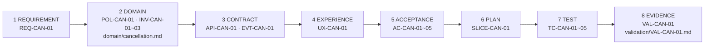

# 9장. 수직 기능 하나를 끝까지

Design Ready 판정을 받은 CAN을 Codex와 Claude Code에 넘기는 날이라고 해보자. 물론 가상의 장면이다. 앞 장의 판정표는 승인됐고, 첫 수직 기능의 범위도 한 문단으로 정리됐다. 이용 시작 전 예약의 전액 취소, 정상 경로와 실패 넷, 결제사 샌드박스, 내부 사용자로 제한한 기능 플래그.

에이전트 창 앞에 앉으면 질문이 하나 남는다. 이걸 어떤 단위로 건네야 할까? "CAN 전부 구현해 줘"라고 하면 너무 크다. 그렇다고 "취소 테이블부터 만들어 줘"라고 하면, 그다음은? 그리고 며칠 뒤 에이전트가 "완료했습니다"라고 보고할 때, 우리는 무엇을 보고 그 말을 믿을 수 있을까?

CAN을 실제로 끝까지 밀어 보면 답이 세 개의 '하나'로 모인다. 단위는 수직 기능 하나, 계획은 파일 하나, 그리고 끝은 검증 기록 한 장이다.

## 어떤 단위로 넘길까

### 가로로 자르면 '끝'이 늦게 온다

가장 익숙한 방법은 층별로 나누는 것이다. 첫 작업은 테이블과 상태 전이, 다음은 API, 그다음은 결제사 연동, 마지막이 화면. 각 층을 작은 태스크로 쪼개 에이전트에게 하나씩 건네면 관리하기도 편해 보인다.

에이전트와 일하는 개발자들이 말하는 "작게 쪼개라"도 대개 이런 모양이다. 큰 작업을 하위 태스크로 나누고, 태스크마다 상세 스펙을 쓰고, 단계마다 세션을 새로 시작한다는 실천은 커뮤니티에서 자주 보인다. 이 책을 위해 커뮤니티를 조사한 리서처는 그 "작게"가 대체로 태스크를 가로로 자르고, 정상·실패·권한·관측을 한 조각 안에 담는 수직 기능 개념은 거의 보이지 않는다고 관찰했다. 의견을 모은 관찰이지 통계는 아니지만, 짚어 볼 만한 차이다.

가로로 자르면 무엇이 문제일까? 각 층은 금방 초록불이 된다. 테이블은 만들어졌고, API 테스트도 통과한다. 그런데 `REQ-CAN-01`의 약속, 즉 "예약 소유자는 취소를 요청하고 진행 상태를 확인할 수 있다"는 마지막 층이 끝날 때까지 한 번도 끝에서 끝까지 확인되지 않는다. 더 난감한 것은 가장 위험한 부분이 맨 뒤로 밀린다는 점이다. 타임아웃과 늦은 콜백은 결제사 연동과 상태 조회와 화면이 만나는 곳에서 드러나는데, 층별 계획에서는 그 셋이 가장 늦게 만난다.

원전은 다른 방향으로 자른다. 단계 5에서 "UI부터 저장·관측까지 한 번에 관통하는 기능"을 나누고, 단계 6에서 그 최소 경로를 구현해 정상·실패 테스트, 관측, 제한된 환경의 시연까지 수행한다. 층을 하나씩 완성하는 대신, 모든 층을 얇게 한 번 꿰뚫는 것이다. 그래야 "끝났다"를 처음부터 끝까지의 동작으로 말할 수 있다.

### SLICE-CAN-01의 순서를 읽는다

원전은 `SLICE-CAN-01`의 구현 순서를 이렇게 적는다. 계약·실패 가짜 서버 작성 → 상태·권한·원자성 테스트 → 접수 API와 상태 조회 → outbox·환불 어댑터·콜백 → 최소 UI → 종단 테스트와 운영 관측. 이 순서에는 이유가 있다. 단계마다 읽어 보자(아래 표의 "이유"는 이 책의 해석이다).

| 순서 | 작업 | 이 순서인 이유 | 주로 겨냥하는 수용 기준 |
|---|---|---|---|
| 1 | 계약·실패 가짜 서버 | 결제사의 거절·지연·중복·역순 콜백을 첫날부터 마음대로 재현할 수 있어야 실패 경로를 처음부터 테스트할 수 있다 | `AC-CAN-02`, `AC-CAN-04` |
| 2 | 상태·권한·원자성 테스트 | `POL-CAN-01`·`INV-CAN-01`을 화면보다 먼저 실행 가능한 형태로 만든다 | `AC-CAN-03`, `AC-CAN-05` |
| 3 | 접수 API와 상태 조회 | `API-CAN-01`의 202 접수와 조회 경로. 접수와 완료를 구분하는 첫 지점 | `AC-CAN-01`, `AC-CAN-03` |
| 4 | outbox·환불 어댑터·콜백 | `EVT-CAN-01`, `INV-CAN-02`·`03`. 1단계의 가짜 서버가 여기서 쓰인다 | `AC-CAN-01`, `AC-CAN-02`, `AC-CAN-04` |
| 5 | 최소 UI | `UX-CAN-01`이 요구하는 것은 상태를 정확히 표현하는 일이다. 꾸미기는 나중에 | `AC-CAN-01` |
| 6 | 종단 테스트와 운영 관측 | 처리 지연을 탐지하는 관측까지 붙여야 수직 기능이 닫힌다 | 전체 |

눈여겨볼 곳은 1단계다. 정상 경로를 만들기 전에 실패를 재현하는 도구부터 만든다. 실패 넷을 수용 기준으로 써 둔 7장의 작업이 여기서 순서로 바뀐다. 실제 결제사는 원할 때 타임아웃을 내 주지 않는다. 가짜 서버가 있어야 늦은 콜백과 잘못된 서명을 매번 같은 방식으로 주입할 수 있다.

원전은 첫 시연을 샌드박스와 기능 플래그로 제한할 수 있다고 하면서 한 줄을 덧붙인다. 실서비스 출시 전에는 중복·권한·지연 결과의 안전 장치를 생략하지 않는다. 시연 범위를 좁히는 것과 안전 장치를 빼는 것은 다른 일이라는 뜻이다. 앞 장에서 `CONDITIONAL`로 미뤄 둔 멱등키 보존 기간 같은 항목이 출시 게이트 전에 다시 돌아와야 하는 이유도 여기 있다.

## 계획을 파일에 둔다

### plan 파일과 도구의 계획 기능

수직 기능을 정했으면 계획을 어디에 둘지 정할 차례다. 원전 §02는 `plan/`을 "누가 어떤 순서로 구현하고 검증하는가?"에 답하는 위치로 둔다. 권위 있는 내용은 수직 기능, 작업 분해, 의존성, 검증·출시 순서다.

도구들도 계획을 중요하게 다룬다. OpenAI Cookbook의 ExecPlan 문서는 ExecPlan을 코딩 에이전트가 따라 할 수 있는 설계 문서로 정의하고, 진행(Progress)·발견(Surprises & Discoveries)·결정 로그(Decision Log)·결과와 회고(Outcomes & Retrospective) 절을 의무로 둔다. 계획은 살아 있는 문서여야 하고, 그 파일 하나만 읽어도 작업할 수 있도록 자기완결적이어야 하며, 수용 기준은 사람이 확인할 수 있는 동작으로 쓰라고 한다. 다만 이 페이지에는 "보관됨(archived), 오래된 모델을 언급할 수 있음"이라는 표시가 붙어 있다. 구버전 정보일 수 있으니 세부는 공식 문서를 함께 확인하자.

두 에이전트에는 플랜 모드도 있다. Codex 공식 모범 사례(2026-10 기준)는 플랜 모드가 구현 전에 맥락을 모으고, 명확히 하는 질문을 하고, 더 단단한 계획을 세우게 해 준다고 설명한다. Claude Code 공식 문서를 검색 요약으로 확인한 바로는, 플랜 모드에서는 파일을 읽고 탐색하며 계획을 쓰되 소스를 편집하지 않고, `/plan`이나 `claude --permission-mode plan`으로 들어갈 수 있다. 이 조작법은 검색 요약을 거친 정보라 버전에 따라 다를 수 있으니, 쓰기 전에 공식 문서를 확인하는 편이 낫다.

그런데 플랜 모드가 아직 필요한지를 두고는 논쟁이 있다. 2026년 9월 Hacker News의 "Plan mode is dead" 스레드에서, 자신을 Claude Code 개발자라고 소개한 사용자는 플랜 모드가 더는 유용하지 않고 처음부터 프롬프트였을 뿐이라고 주장했다. 이 소속과 구현 방식은 확인되지 않은 주장이다. 반대편에서는 모델이 똑똑해져도 시스템의 그림을 머릿속에 유지해야 한다는 의견, 계획을 거의 읽지 않아도 구현 전에 맥락을 최대한 모으게 만드는 효과가 있다는 의견이 나왔다. 흥미로운 것은 세 번째 목소리다. 도구에 내장된 계획 기능은 저장되지도, 버전 관리되지도 않는다는 지적이다. 그 사용자는 계획 문서가 ADR처럼 기록의 역할을 한다고 덧붙였다.

이 논쟁에서 가져갈 교훈은 하나다. 도구 기능과 설계 산출물을 구분하자. 플랜 모드는 계획을 만드는 데 좋은 도구일 수 있다. 하지만 승인된 계획이 사는 곳은 저장소의 `plan/`이어야 한다. 도구는 몇 주 단위로 바뀌어도 파일은 남는다.

현장에서는 이 관행이 아직 드물다. Abubakar 외의 연구(ESEM 2026 Emerging Results)는 저장소 36,710개를 선별해 살폈는데, 에이전트용 계획 파일은 10개 저장소에서 85개만 찾았다. 커뮤니티에서 쓰는 `plan.md`도 대부분 작업 순서만 담고, 도메인 규칙·미결정·검증 증거와는 분리되어 있지 않다(커뮤니티 리서처의 관찰). 그래서 계획 파일은 규칙을 복사하지 말고 원본을 가리켜야 한다. 아래는 이 책이 추가한 가상 예다. 머리말 필드는 원전 §12의 공통 머리말에서 골랐다.

```markdown
---
id: SLICE-CAN-01
title: 최소 취소 수직 기능
status: in-progress
owner: 기술 책임자 역할
updated: YYYY-MM-DD
scope: 이용 시작 전 예약의 전액 취소, 샌드박스 결제사, 내부 사용자 기능 플래그
references: [domain/cancellation.md, architecture/contracts/cancellation.yaml]
validation: [validation/VAL-CAN-01.md]
---
## 기준선
승인 문서 버전 <SPEC-CAN-01 버전>, 착수 판정표 <링크>

## 단계 (각 단계의 완료 조건 = 지정 TC 통과 + 실행 명령과 출력 기록)
1. 계약·실패 가짜 서버 → TC-CAN-02, TC-CAN-04의 주입 경로
2. 상태·권한·원자성 테스트 → TC-CAN-03, TC-CAN-05
...

## 진행
## 발견한 사실
## 결정 요청 (구현 중 생긴 정책 질문. 임의로 정하지 않는다)
```

"진행"과 "발견한 사실"은 ExecPlan의 의무 절에서 빌려 왔다. 다만 되돌리기 비싼 결정의 이유는 계획 파일 안의 로그보다 ADR에 남기는 편이 낫다. 그 이야기는 12장의 몫이다.

### 세션이 바뀌어도 계획은 남는다

계획을 파일로 꺼내 두면 얻는 것이 또 있다. 세션이 바뀌어도 계획이 살아남는다. 대화 속의 계획은 컨텍스트 압축(compaction)이나 세션 교체 때 흐려진다. 커뮤니티에서 이 문제를 겪은 사람들의 해법은 비슷하다. HN 사용자 simonw는 상세 계획을 `spec.md`에 먼저 쓰게 하면 저장소에 남으니 압축을 견디고 아예 새 세션을 시작할 수도 있다고 했다. 다른 사용자는 `STATUS.md` 하나를 두고, 에이전트가 세션마다 먼저 읽고 커밋마다 갱신하게 했더니 Claude Code와 Codex를 오가도 문제가 없었다고 전한다. 또 다른 사용자는 요구사항이 스펙에 다 들어 있으니 단계마다 세션을 재시작할 수 있다고 썼다. 모두 경험담이지만 방향은 같다.

4장에서 합의서를 `SPEC.md`로 남긴 뒤 새 세션에서 구현을 시작하자고 했던 것과 같은 원리다. `SLICE-CAN-01`에서는 이것을 단계마다 반복한다. 단계 하나를 시작할 때 새 세션을 열고, 에이전트에게 계획 파일과 그 단계가 가리키는 원본 경로만 읽힌다. 단계가 끝나면 "진행" 절에 실행한 명령과 결과를 적게 하고 세션을 닫는다. 다음 세션이 이어받는 것은 앞 세션의 대화가 아니라 파일에 정리된 상태다.

Codex와 Claude Code를 함께 쓴다면 한 가지를 더 챙기자. Codex 공식 모범 사례(2026-10 기준)는 Git worktree 없이 같은 파일에서 작업을 동시에 돌리는 것을 흔한 실수로 꼽고, 탐색·테스트·분류 같은 일은 서브에이전트에게 맡겨 메인 에이전트가 핵심 문제에 집중하게 하라고 권한다. 예를 들어 한 에이전트가 2단계의 도메인 테스트를 구현하는 동안, 다른 worktree의 에이전트에게 계획 대비 빠진 실패 시나리오를 찾게 할 수 있다. 앞 장에서 본 것처럼 그 결과는 누락 탐지로 받고, 승인으로 쓰지는 않는다.

## '끝났다'를 증거로 말한다

### 테스트와 증거를 짝짓는다

원전은 수용 기준과 테스트를 같은 번호로 짝짓는다. `AC-CAN-01`은 `TC-CAN-01`로, `AC-CAN-05`는 `TC-CAN-05`로 검증한다. 번호를 맞추는 것은 사소해 보이지만, 나중에 "이 수용 기준은 무엇으로 확인했나?"를 물을 때 찾는 비용을 거의 없앤다.

| 테스트 | 짝 수용 기준 | 테스트 층 (원전의 검증 방법) | 증거로 남길 것 |
|---|---|---|---|
| `TC-CAN-01` | 정상 처리 | 도메인 단위 + 계약 + UI에서 저장·이벤트까지 종단 | 실행 명령, 출력, 환불 부작용 건수 |
| `TC-CAN-02` | 확정된 실패 | 외부 거절 응답 주입, 전이·이벤트 부재·감사 로그 확인 | 주입 조건, 감사 로그 발췌 |
| `TC-CAN-03` | 중복 요청과 동시 클릭 | 병렬 요청, 응답 유실 후 재전송, 키·입력 불일치, outbox 재발행과 소비자 중복 수신 | 병렬 횟수, 활성 시도·환불 건수 |
| `TC-CAN-04` | 타임아웃과 늦은 콜백 | 지연·중복·역순 콜백, 잘못된 서명, 잘못된 거래 ID, 확인 작업 재시작 | 주입 시나리오별 결과 |
| `TC-CAN-05` | 권한과 상태 경합 | API 직접 호출, 다른 사용자의 상태 조회, 낡은 버전의 상태 변경, 경합 재현 | 거절 응답, 경합 재현 횟수와 결과 |

7장에서 테스트 통과가 정답을 보장하지 않는다는 것을 확인했다. 그렇다면 무엇을 받아야 할까? Claude Code 공식 모범 사례 문서(2026-10 기준)의 조언이 명쾌하다. 에이전트에게 증거, 그러니까 실행한 명령과 그 출력, 또는 스크린샷을 요구하라는 것이다. "다 통과했습니다"라는 말만으로는 알 수 있는 것이 거의 없다고 문서는 덧붙인다. 같은 문서에는 이런 관찰도 있다. 에이전트는 일이 끝나 보이면 멈춘다. 실제로 끝났는지 알려 줄 실행 수단이 없으면 "끝나 보인다"가 판단 근거의 전부가 되고, 결국 사람이 테스트 스위트 노릇을 하게 된다.

원전은 이 증거를 담을 그릇으로 `VAL-CAN-01`을 둔다. 남길 것은 테스트한 코드 커밋, 문서 기준선, 환경·외부 샌드박스 조건, 실행 명령, 결과 링크, 실패 로그, 미검증 조건, 검토자다. 그리고 한 줄을 못 박는다. "'AI가 검토 완료' 한 문장은 증거를 대체하지 않습니다." 원전 §12의 검증 기록 템플릿에서 하나를 더 기억해두자. 판정 기준은 "실행 전 정의"한다. 앞 장의 스파이크 카드에서 실패 판단을 먼저 적었던 것과 같은 이유다.

이 기록이 왜 사람에게도 이득일까? Vasconcelos 외(CSCW 2023)는 AI의 설명이 의사결정에서 과의존을 줄일 수 있는지 다섯 개의 연구(N=731)로 살폈다. 결론은 과의존이 피할 수 없는 인지 편향이라기보다 검증 비용과 이득을 저울질한 전략적 선택이고, 검증 비용을 낮추면 과의존이 줄었다는 것이다. 이 결과를 우리 맥락에 옮겨 보면(이 책의 해석), 추적 ID와 검증 기록 템플릿은 사람이 "정말 됐나?"를 확인하는 비용을 낮추는 장치다. 확인이 싸지면 "AI가 됐다고 하니 됐겠지"로 넘어갈 이유도 줄어든다. 원래 연구는 코드 리뷰를 다룬 것이 아니니 이 연결은 가설로 읽어 두자.

### 여덟 단계의 사슬이 닫힌다

이제 원전 §06의 추적 경로가 처음부터 끝까지 채워졌다. 요구사항에서 시작해 증거로 끝나는 여덟 단계다.


그림 1. CAN의 8단계 추적 사슬 (원전 §06)

이 사슬은 양쪽으로 걸을 수 있다. 앞에서 뒤로 걸으면 "이 요구사항은 무엇으로 증명됐나?"에 답한다. `REQ-CAN-01`에서 출발해 `VAL-CAN-01`의 실행 기록까지 따라가면 된다. 뒤에서 앞으로 걸으면 "이 테스트가 깨졌는데 어떤 약속이 위태로운가?"에 답한다. `TC-CAN-04`가 실패했다면 `AC-CAN-04`를 거쳐 `INV-CAN-02`와 `EVT-CAN-01`의 발행 조건까지 거슬러 올라가 볼 수 있다. 둘 중 어느 방향으로도 길이 끊기지 않으면 사슬이 닫힌 것이다.

사슬이 닫혀 있으면 구현 중에 생기는 곤란한 순간도 다루기 쉬워진다. 예를 들어 `TC-CAN-02`를 구현하던 에이전트가 이런 질문에 부딪혔다고 하자. 확정된 실패 뒤에 사용자가 다시 취소를 누르면 몇 번까지 허용할까? 원전의 도메인 규칙은 FAILED 후 재시도를 새 시도로 만들되 이전 실패가 최종 확정된 경우에만 허용한다고 하고, `AC-CAN-02`는 재시도 가능 여부를 정책으로 결정한다고 적어 둔다. 횟수는 어디에도 없다. 이럴 때 에이전트가 그럴듯한 숫자를 골라 코드에 넣어 버리면 어떻게 될까? 정책이 테스트 안에 숨어 버린다. 끔찍한 일이다.

원전의 답은 분명하다. 구현 중 새로운 규칙이 필요해지면 AI나 개발자가 임의로 확정하지 않고, 영향 분석과 승인 경로로 되돌린다. 실무에서는 계획 파일의 "결정 요청" 절에 질문을 적고, 그 질문에 묶인 단계만 멈추면 된다. 멈춘 질문이 어떤 경로로 승인을 받아 다시 원본에 들어가는지는 개발 흐름의 통제 지점 이야기와 함께 다룬다.

### 증거 기록 한 장

마지막으로 첫 수직 기능의 검증 기록을 채워 보자. 아래 값은 모두 가상 예시다. 실제 실행 결과가 아니며, `<>` 칸은 실제 값으로 채울 자리다.

```yaml
# 가상 예시 — 실제 실행 결과가 아니다
ID: VAL-CAN-01
질문 / 위험: SLICE-CAN-01이 샌드박스 결제사와 기능 플래그 범위에서 AC-CAN-01~05를 충족하는가
기준선: SPEC-CAN-01 <승인 버전> + domain/cancellation.md <버전> + 코드 커밋 <SHA>
환경: 스테이징 <사양>, 결제사 샌드박스 <계정·설정>, 기능 플래그 <이름> (내부 사용자만)
절차: <검증 명령>으로 TC-CAN-01~05 실행 / 콜백 지연·역순 주입 <스크립트 경로>
판정 기준: (실행 전 확정) TC-CAN-01~05 전부 통과, 한 예약에 성공한 환불 부작용 2회 이상 없음(NFR-I01)
결과: <CI 실행 링크>, <로그 링크>
  관찰 사실은 문장으로 적는다. 예) "TC-CAN-03: 병렬 요청 <N>회, 활성 시도 <n>건, 환불 부작용 <n>건"
한계: 운영 결제사 미검증 / 멱등키 보존 기간 미결정(CONDITIONAL) / 부하 미측정 / 사용자 관찰 결과 별도 기록
결정: 통과 / 수정 / 보류 중 하나
소유자: <기술 책임자 역할>, 재검토일 <날짜>
검토자: <이름·역할>
```

"한계" 칸이 꽤 길다. 그래도 괜찮다. 이 칸이 비어 있는 기록이 오히려 의심스럽다. 무엇을 확인하지 않았는지 적혀 있어야, 다음 사람이 어디서부터 다시 확인할지 안다.

이것이 "끝났다"의 모양이다. 에이전트의 "완료했습니다" 한 줄 대신, 누가 다시 돌려 봐도 같은 결과를 확인할 수 있는 기록 한 장.
