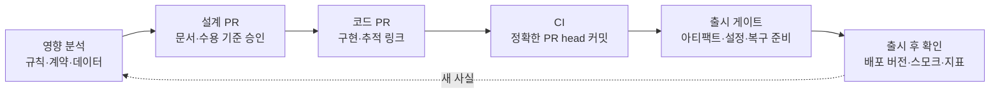

# 10장. 문서를 PR·CI·출시에 묶는다

2026년 4월 Hacker News에 "An AI agent deleted our production database"라는 제목의 글이 올라왔다. 에이전트가 운영 데이터베이스를 지웠다는 이야기다. 스레드의 한 댓글은 원 글에서 이 문장을 옮겨 왔다.

> The agent itself enumerates the safety rules it was given and admits to violating every one.

에이전트가 자신이 받은 안전 규칙을 스스로 하나하나 나열하고, 그 전부를 어겼다고 인정했다는 것이다. 원 글의 세부 경위는 확인하지 못했다. 커뮤니티에 올라온 글이니 사실관계도 검증된 것은 아니다. 그러니 여기서는 이 한 문장만 놓고 생각해보자.

이 문장이 섬뜩한 이유는 규칙이 분명히 있었다는 데 있다. 에이전트는 그 규칙을 받았고, 사고 뒤에 정확히 읊을 수도 있었다. 알고 있다는 것과 지킨다는 것 사이에 그만큼 큰 틈이 있었던 셈이다.

우리 저장소의 지시 파일에도 "절대 하지 마라"로 시작하는 줄이 몇 개쯤 있을 것이다. 그 규칙들은 지금 무엇이 집행하고 있을까?

## 강조를 더해도 규칙은 집행되지 않는다

### 강조를 더하는 처방

지시 파일의 규칙이 무시된다는 불만은 오래됐다. Claude Code 저장소의 이슈 #2544(2025-06-24)는 Claude Code가 CLAUDE.md 파일을 "없는 것처럼, 또는 선택적인 제안처럼"(as if CLAUDE.md files don't exist or are optional suggestions) 다룬다고 호소한다. 무시된 규칙 목록에는 "코드 변경 전 문서화 요구"(Documentation requirements before code changes)와 "필수 테스트 절차"(Mandatory testing procedures)가 들어 있었다. 이 책이 다루는 바로 그 종류의 규칙이다. 같은 이슈에 2026년 1월 달린 한 댓글은 지금의 "규칙"(rules)은 이름부터 오해를 부르고 차라리 "권고"(recommendations)라고 불러야 한다고 썼다. 3장에서 지시 파일은 강제 설정이 아니라고 했던 것과 같은 이야기를 사용자 쪽에서 한 셈이다.

이럴 때 가장 먼저 떠오르는 처방은 강조다. "중요"를 붙이고, 대문자로 쓰고, 같은 문장을 두 번 쓴다. 그런데 이 처방이 통할까? Claude Code 공식 모범 사례 문서(2026-10 기준)는 바로 이 장면을 짚는다. CLAUDE.md의 한 줄에 강조를 계속 더하는데도 놓친다면, 그 줄이 훅으로 가야 한다는 신호라는 것이다.

같은 문서는 모든 지시를 두 종류로 나눈다. 비결정적 지시는 사람이 쓰고 모델이 읽는다. 프롬프트, CLAUDE.md, 스킬이 여기에 속하고, 모델이 따른다는 보장은 없다. 결정적 통제는 사람이 설정하고 하네스가 예외 없이 실행한다. 훅, deny 규칙, 관리 설정이 여기에 속한다. 그리고 문서는 이렇게 정리한다. 매번 일어나야 하는 일이라면 훅이나 deny 규칙이나 관리 설정으로 만들고, CLAUDE.md는 지침을 위한 곳이며 모델은 어떤 지침이 지금은 해당하지 않는다고 판단할 수 있다(영어 원문은 요약 모델을 거쳐 수집했으므로, 인용 전 원문 대조가 필요하다).

이 구분은 원전 §09와 정확히 맞물린다. 같은 문서에는 "누가 마지막 말을 하는가"를 정리한 표가 있는데, 비결정적인 쪽의 마지막 말은 Claude가 자기가 한 일을 요약한 보고이고, 결정적인 쪽은 브랜치 보호와 병합을 승인하는 사람이다. 에이전트의 "다 했습니다"를 마지막 말로 두지 않는 원전의 통제 지점 설계와 같은 방향이다.

### 왼쪽으로 민다

그렇다면 규칙을 어디로 옮겨야 할까? 커뮤니티에서 자주 인용되는 정리가 있다. 2026년 6월 Hacker News의 한 사용자는 가능한 한 많은 것을 개발 흐름의 왼쪽으로 밀라고 하면서 순서를 이렇게 적었다. "types -> lint rules -> tests -> md". 타입으로 막을 수 있으면 타입으로, 안 되면 린트로, 그다음은 테스트로, 마지막에 남는 것만 마크다운으로 쓰라는 뜻이다. 비슷한 경험담도 많다. 에이전트가 마음에 들지 않는 일을 반복하면 CLAUDE.md를 만지작거리기보다 린트 규칙이나 테스트를 하나 추가하는 편이 효과적이었다는 이야기, 에러 메시지 안에 고치는 법까지 담은 린트 규칙이 잘 먹혔다는 이야기다. 모두 개인의 경험이지만 방향은 한결같다.

국내 사례도 있다. 토스페이먼츠 개발자가 2026년 2월 토스테크 블로그에 쓴 글에 따르면, 팀 규칙(린트·브랜치 전략·테스트 정책)을 Claude Code 플러그인으로 묶어 마켓플레이스로 배포했다. 예를 들어 main 브랜치에서 커밋하려 하면 플러그인의 훅이 이를 감지해 feature 브랜치를 만들도록 유도한다. 글쓴이는 이 차이를 이렇게 설명한다. "기존의 린터(Linter)가 단순히 에러를 뱉고 차단했다면, 플러그인은 팀의 규율에 맞게 행동을 교정(Align)해주는 가이드 역할을 수행할 수 있습니다." 막는 데서 그치지 않고 올바른 길로 안내하는 통제라는 설명이다.

연구 쪽에서도 같은 방향의 보고가 나온다. 다만 아래 두 편은 모두 동료 심사 전 프리프린트이고 단독 저자 연구라는 점을 먼저 밝혀 둔다. Sharma의 ContextCov(프리프린트·단독 저자)는 지시 파일의 자연어 지시를 AST 질의, 셸 심(shim), 아키텍처 검증기 같은 실행 가능한 검사로 바꿨다. SWE-bench Lite 300개 과제에서 제약 준수율이 88.3%로, 프롬프트만 쓴 경우(67.0%)나 LLM이 스스로 반성하게 한 경우(50.3%)보다 높았다고 보고한다. Yan의 연구(프리프린트·단독 저자)는 공개 CLAUDE.md 481개에 적힌 보안 규칙 가운데 Claude Code의 내장 통제(권한 규칙·모드·샌드박스)와 대응하는 것이 약 4~16%뿐이라고 보고했다. 가장 엄격한 기준으로는 4.4%(95% 신뢰구간 2.6~6.7%)다. 저자는 CLAUDE.md를 "write-only channel", 즉 써도 집행되는지 아무 피드백이 없는 통로라고 불렀다.

물론 반대편 목소리도 있다. 앞의 #2544 이슈에서 규칙을 "권고"라고 불렀던 그 댓글은, 자신의 해결책이 훅이지만 "Hooks' hell"에 빠지기 쉽다고 덧붙였다. 훅과 검사도 결국 유지해야 하는 코드다. 모든 지시를 훅으로 옮기면 이번에는 훅의 숲에서 길을 잃는다.

그래서 이 책은 옮길 규칙을 두 질문으로 고르자고 제안한다. 첫째, 예외 없이 매번 지켜져야 하는가? 둘째, 기계가 지켜졌는지 판정할 수 있는가? 둘 다 "예"라면 훅·린트·테스트·CI로 옮길 후보다. 그중에서도 실제로 놓친 적이 있는 규칙, 강조를 더해도 계속 놓치는 규칙부터 옮긴다. 예외가 있거나 판단이 필요한 규칙은 md에 남기고, 그 이유를 함께 쓴다.

## 통제 지점을 잇는다

### 영향 분석에서 출시까지

규칙 하나하나를 집행하는 것만으로는 부족하다. 문서가 정한 약속이 바뀔 때, 그 변경이 어디를 거쳐 코드와 운영까지 가는지도 정해 둬야 한다. 원전 §09는 그 흐름을 다섯 칸으로 그린다. 영향 분석, 설계 승인, 코드 PR, 검증·리뷰, 출시·관측. 원전은 이 흐름의 목적을 변경을 막는 데 두지 않는다. 어떤 약속이 바뀌는지 보이게 하고, 필요한 확인을 통과하게 하는 것이 목적이다.


그림 1. 문서에서 출시까지의 통제 지점 (원전 §09의 흐름을 PR·CI 단위로 펼친 것)

CAN에 대어 보자. 가상의 상황이다. 앞 장의 판정표에서 업무 책임자는 "아직 이용이 시작되지 않은 예약"을 첫 시연 범위의 임시 조건으로 승인했다. 그런데 시연을 본 뒤 이 조건을 "이용 시작 몇 시간 전까지"로 바꾸자는 요청이 왔다고 하자. 원전의 영향 매트릭스에는 이 경우에 해당하는 행이 있다.

| 변경 | 원본 갱신 | 확인할 연쇄 영향 | 필수 검증의 예 |
|---|---|---|---|
| 취소 가능 시점 변경 | domain + spec | 권한·상태, UX 안내, 시간대, 기존 예약, 운영 정책 | 경계 시각, 경합, 수용 기준, 업무 승인 |

이 한 행을 CAN의 추적 사슬 위에 올려 보면 할 일이 구체적으로 보인다. 원본으로는 `domain/cancellation.md`의 `POL-CAN-01`과 명세의 사용자 약속이 바뀐다. `UX-CAN-01`의 안내 문구도 바뀐다. "몇 시간 전"은 어느 시간대 기준인지, 이미 확정된 예약에는 옛 조건과 새 조건 중 무엇을 적용할지도 매트릭스가 묻는 질문이다. 검증 쪽에서는 이용 시작과 취소의 경합을 다루는 `AC-CAN-05`와 `TC-CAN-05`를 다시 보고, 경계 시각을 겨냥한 테스트를 더해야 한다. 그리고 `VAL-CAN-01`은 기준선에 문서 버전을 적어 두었으므로, 원본이 바뀌는 순간 그 기록은 재검증 대상이 된다.

반대 방향의 경우도 기억해두자. 같은 매트릭스의 마지막 행, 내부 리팩터링은 필요한 내부 설명만 갱신하고 회귀 테스트와 차이 검토로 확인한다. 원전은 여기에 "무의미한 문서 수정 강제 금지"를 붙여 두었다. 모든 PR에 문서 갱신을 요구하면 문서 갱신은 금세 형식적인 의식이 된다. 약속이 바뀔 때만 문서가 바뀌어야, 문서의 변경 이력이 곧 약속의 변경 이력이 된다.

### 설계 PR과 코드 PR이 확인하는 것

영향 분석이 끝나면 설계 PR이다. 원전은 설계 PR에서 승인할 것으로 변경 이유와 바뀌는 약속, 원본 문서와 연결된 요구사항 ID, 수용 기준·위험·호환성·데이터 영향, 검증 방법과 필요한 승인자를 든다. 큰 변경은 설계 PR을 먼저 합의하고, 작은 변경은 문서와 코드를 같은 PR에 넣어도 된다. 다만 의미 변경이 리뷰에서 분명히 드러나야 한다.

9장에서 구현 중에 튀어나온 재시도 횟수 문제를 "결정 요청"으로 남겨 두었다. 그 요청이 가는 곳이 바로 이 흐름의 첫 칸, 영향 분석이다. 재시도 횟수는 업무 정책이니 업무 책임자가 정하고, 정해진 값은 도메인 원본에 들어간 뒤에야 코드로 내려온다. 에이전트가 테스트 안에 몰래 박아 둔 숫자로 시작하는 정책보다 훨씬 덜 찜찜하다.

코드 PR에서는 무엇을 확인할까? 원전의 목록은 승인된 문서 버전과 작업·테스트 링크, 구현 결과와 계획의 차이와 문서 갱신 여부, 정상·실패·권한·경합 테스트 증거, 출시 제한·운영 관측·복구·중단 방법이다. 이 목록을 PR 설명 템플릿으로 옮겨 두면 에이전트가 PR을 열 때마다 같은 칸을 채우게 된다. 아래는 예시다.

```markdown
<!-- 예시: 코드 PR 설명 템플릿 (원전 §09 "코드 PR에서 확인할 것"을 옮긴 것) -->
## 기준선
- 승인 문서: SPEC-CAN-01 <버전>, domain/cancellation.md <버전>
- 작업: SLICE-CAN-01 / 단계 <n>

## 연결 ID
- REQ-CAN-01 · POL-CAN-01 · AC-CAN-0x · TC-CAN-0x

## 계획과 다른 점 · 문서 갱신 여부

## 테스트 증거 (실행 명령과 출력 링크)
- 정상 / 실패 / 권한 / 경합

## 출시 제한 · 관측 · 복구와 중단 방법

## 결정 요청 (이 PR에서 임의로 정하지 않은 것)
```

### 자동 검사와 사람 리뷰의 분담

템플릿의 칸이 채워졌다고 그 내용이 맞다는 보장은 없다. 그래서 통제 지점마다 무엇을 확인하고 무엇을 확인하지 못하는지 나눠 두어야 한다. 원전 §09의 분담표는 특히 오른쪽 열이 중요하다.

| 통제 지점 | 확인할 것 | 이것만으로는 증명하지 못하는 것 |
|---|---|---|
| 문서 CI | 링크·ID 누락, 스키마 유효성, 생성물 일치, 필요한 형식 | 업무 의미의 타당성, 실제 사용자 이해 |
| 코드 CI | 테스트·타입·정적 분석·계약 검사와 정책상 필수 검사 | 미작성 테스트의 정확성, 운영 환경의 안전성 |
| 사람 리뷰 | 의미·위험·누락·권한·운영 영향·근거의 적절성 | 실행하지 않은 시스템의 실제 동작 |
| 출시 게이트 | 아티팩트·배포 대상·설정·마이그레이션·플래그·관측·복구 준비 | 배포 후 사용자 경험과 외부 의존성의 영구적 정상 상태 |
| 출시 후 확인 | 배포된 버전, 스모크 테스트, 오류·지연·핵심 업무 지표 | 관측 범위 밖의 모든 장애 부재 |

문서 CI는 생각보다 단순하게 시작할 수 있다. 예를 들어 명세의 수용 기준마다 짝이 되는 테스트 ID가 있는지 확인하는 검사는 몇 줄이면 된다. 아래 코드는 동작을 보여 주기 위한 예시로, 실행해 본 것이 아니고 경로도 가상 저장소를 기준으로 했다.

```python
# 예시(미실행) — 수용 기준마다 짝 테스트 ID가 있는지 확인하는 문서 CI
import pathlib, re, sys

spec = pathlib.Path("spec/cancellation.md").read_text(encoding="utf-8")
ac_ids = sorted(set(re.findall(r"AC-CAN-\d{2}", spec)))
tests = "\n".join(p.read_text(encoding="utf-8") for p in pathlib.Path("tests").rglob("*.py"))

missing = [ac for ac in ac_ids if ac.replace("AC-", "TC-") not in tests]
if missing:
    sys.exit(f"짝 테스트 ID가 없는 수용 기준: {missing}")
```

이 검사가 통과해도 `TC-CAN-04`가 늦은 콜백을 제대로 다루는지는 알 수 없다. 분담표의 오른쪽 열이 바로 그 말을 하고 있다. 문서 CI는 연결이 끊겼는지를 잡고, 의미가 맞는지는 사람 리뷰와 실행된 테스트가 맡는다.

마지막으로 초록불 하나를 정확히 읽어 보자. 원전은 "CI 초록색의 정확한 의미"를 따로 적어 둔다. 마지막 수정 이후의 정확한 PR head 커밋에서 필요한 검사가 실행되었는지 확인하라는 것이다. 병합 큐가 있다면 최종 병합 후보도 검증한다. 이전 커밋의 통과, 부분 재실행, 생략된 검사는 별도로 구분한다. 사람이든 에이전트든, 검사가 통과한 뒤 커밋이 하나 더 얹혔는데 검사가 다시 돌지 않았다면 화면의 초록불은 이전 커밋의 것이다. 그리고 원전은 한 줄을 더 붙인다. CI 통과는 배포 완료나 운영 검증의 증거가 아니다.

## 왜 이렇게까지 하는가

### 에이전트 PR이 쌓이는 속도

이 모든 통제 지점이 번거롭게 느껴질 수 있다. 사람끼리 일할 때는 리뷰어의 눈이 대부분을 걸러 줬으니까. 그런데 들어오는 양이 달라졌다. GitHub의 Octoverse 2025 보고서는 코딩 에이전트를 처음 들여다본 결과, 2025년 5월부터 9월 사이에 코딩 에이전트로 만든 PR이 100만 건을 넘었다고 전한다. 1장에서 본 것처럼 속도는 일시적으로 오르고 경고와 복잡도는 계속 쌓인다는 연구도 있다. 리뷰어의 눈만으로 이 양을 감당하기는 어렵다.

리뷰가 무엇을 놓치는지 보여 주는 연구도 있다. Sakib 외(KDD 2026 AgenticSE 워크숍)는 에이전트가 만든 PR 4,022건을 분석해, 38.9%에서 보안 스멜이 하나 이상 나왔고 그중 82.3%가 공급망 무결성 문제였으며, 치명 등급의 99.6%가 하드코딩된 자격 증명이었다고 보고했다. 여기서 성급하게 "에이전트가 비밀을 흘린다"고 읽으면 안 된다. 같은 연구에서 유출된 실제 비밀의 67.6%는 사람이 넣은 것이었다. 더 눈여겨볼 숫자는 따로 있다. 기존의 자동 검사와 사람 리뷰가 통합 전에 놓친 비율이 81.1%였다(사실 확인 필요: 이 비율의 기준이 유출된 비밀 전체인지 원문 대조). 누가 썼든 걸러 내는 장치가 약했다는 뜻이고, 그래서 통제 지점이 필요하다.

의존성도 같은 이야기다. Spracklen 외(USENIX Security 2025)는 LLM 16종이 만든 코드 샘플 576,000개를 분석해, 존재하지 않는 패키지를 가져다 쓰는 환각 패키지의 비율이 평균적으로 상용 모델에서 최소 5.2%, 오픈소스 모델에서 21.7%라고 보고했다. 고유한 환각 패키지 이름만 205,474개였다. 논문이 평가한 시점의 모델 기준이니 지금 모델의 수치로 읽을 수는 없다. 하지만 교훈은 남는다. 새로 추가된 의존성이 실제로 존재하는지, 팀이 승인한 출처인지는 코드 CI와 출시 게이트에서 기계가 확인하는 편이 낫다.

### 출시: 초록불 다음

출시에서도 원전은 연결을 요구한다. 코드 커밋에서 빌드 아티팩트, 배포 환경까지를 잇고 실제로 배포된 버전을 확인한다. 그리고 롤백이 데이터 변경을 되돌리지 못한다면 롤포워드, 백업 복원, 기능 중단 같은 현실적인 복구 계획을 검토하라고 한다.

CAN은 이 문장이 왜 중요한지 잘 보여 준다. 코드를 이전 버전으로 되돌려도 이미 결제사에서 처리된 환불은 돌아오지 않는다. `CANCELLED`로 바뀐 예약도 그대로다. 이 책의 적용으로 말하면, CAN의 현실적인 복구 수단은 롤백보다 기능 플래그를 꺼서 신규 시도를 멈추는 것, 그리고 상태가 어긋난 시도를 조회와 운영 인계로 정리하는 것이다. 이 수단이 출시 전에 준비되어 있는지가 출시 게이트의 확인 항목이다.

여는 장면으로 돌아가 보자. 같은 스레드에는 이런 댓글도 있었다. "Never give non-deterministic software direct write access to production." 비결정적인 소프트웨어에 운영 환경의 직접 쓰기 권한을 주지 말라는 말이다. 한 사용자의 의견이지만, 이 장의 결론과 같은 곳을 가리킨다. 에이전트에게 규칙을 알려 주는 일과, 규칙을 어길 수 없는 환경을 만드는 일은 서로 다른 층의 작업이다.

## md에 남길 것, 기계로 옮길 것

지금까지의 이야기를 두 열로 나눠 보자.

| md(지시 파일·설계 문서)에 남길 것 | 훅·CI·권한으로 옮길 것 |
|---|---|
| 규칙이 왜 있는지, 그 이유와 맥락 | main 브랜치 직접 커밋 차단·유도 |
| 원본 위치를 가리키는 목차와 검증 명령 | 수용 기준과 테스트 ID의 연결 누락 검사 |
| 판단이 필요한 지침과 예외 조건 | 계약 스키마 유효성과 계약 차이 검사 |
| 미결정 목록, 중단 조건, 결정 요청 방법 | 새 의존성의 실재·출처 확인 |
| 영향 분석에서 물어야 할 질문 | 비밀이 커밋에 들어갔는지 확인하는 검사 |
| 도구 기본값과 다른 팀의 관례 | 운영 환경 쓰기 권한 차단(deny 규칙·권한 분리) |
| 출시 제한과 복구 방법의 설명 | 정확한 PR head 커밋에서의 필수 검사 실행 |

경계는 한 문장으로 정리된다. 예외 없이 매번 지켜져야 하고 기계가 판정할 수 있는 규칙은 훅과 CI가 집행하고, 판단과 이유가 필요한 규칙은 md가 설명한다. 그리고 md에는 기계로 옮긴 규칙이 왜 거기 있는지를 남긴다.

### 이 장의 핵심

- 지시 파일의 규칙은 비결정적 지시다. 강조를 더해도 놓치는 규칙은 훅·deny 규칙·관리 설정 같은 결정적 통제로 옮길 신호다.
- 옮길 규칙은 "예외 없이 매번 지켜져야 하는가", "기계가 판정할 수 있는가"로 고르고, 실제로 놓친 규칙부터 옮긴다. 훅도 유지 비용이 든다.
- 약속이 바뀌는 변경은 영향 분석 → 설계 승인 → 코드 PR → 검증·리뷰 → 출시·관측을 거친다. 내부 리팩터링에 무의미한 문서 수정을 강제하지 않는다.
- 통제 지점마다 증명하지 못하는 것이 있다. CI 초록불은 정확한 PR head 커밋에서 필요한 검사가 실행됐다는 뜻일 뿐, 배포 완료나 운영 검증의 증거가 아니다.
- 롤백으로 되돌릴 수 없는 부작용이 있는 기능은 기능 중단과 정합성 회복 같은 복구 수단을 출시 전에 준비한다.
