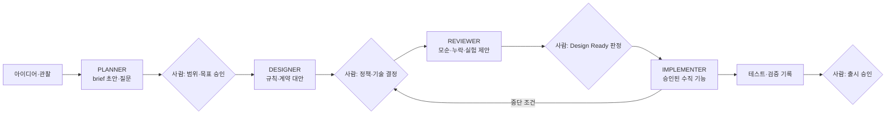

# 11장. AI에게는 역할과 결정 한계를 함께 준다

"역할을 나눈다"는 말을 들으면 대개 이런 그림이 떠오른다. 기획 에이전트가 요구사항을 쓰고, 설계 에이전트가 그걸 받아 구조를 잡고, 구현 에이전트가 코드를 쓰고, 리뷰 에이전트가 마지막에 검토한다. 터미널 창이 네 개 떠 있고, 에이전트끼리 문서를 주고받는다. 역할 분리란 곧 에이전트를 여럿 띄우는 일이라는 생각이다.

원전이 말하는 역할 분리는 조금 다른 곳을 가리킨다. 원전 §10은 이렇게 시작한다. "한 번에 '기획부터 구현까지 알아서'보다, 입력과 출력이 분명한 역할로 나누고 사람이 업무 결정을 소유합니다." 여기서 무게는 "몇 개로 나누는가"에 있지 않다. 각 역할이 무엇을 받아 무엇을 내놓는지, 그리고 어디서 멈춰 사람에게 결정을 넘기는지에 있다. 역할을 나눈다는 것은 결정 한계를 긋는 일이다.

정말 그럴까? 에이전트를 늘리면 결과가 좋아진다는 직관도 만만치 않다. 연구부터 살펴보자.

### 에이전트를 늘리면 좋아질까

역할 분리의 대표 사례로 자주 인용되는 연구가 MetaGPT(Hong 외, ICLR 2024)다. 표준 작업 절차를 프롬프트 순서로 옮겨, 역할별 에이전트가 제품 요구 문서·설계·API 명세 같은 중간 산출물을 만들고 검증하게 했다. 흥미로운 것은 역할을 하나씩 빼 본 실험이다. 논문의 역할 제거 표에서 점수는 엔지니어 역할만 있을 때 1.0, 제품 관리자를 더하면 2.0, 아키텍트까지 더하면 2.5, 네 역할을 모두 두면 4.0이었다. 여기까지 보면 "역할이 많을수록 좋다"로 읽힌다. 그런데 제품 관리자와 프로젝트 관리자를 함께 둔 조합은 2.0에 머물렀다. 역할 수에 따라 단조롭게 오르지 않았다는 뜻이다. 그렇다면 무엇이 효과를 냈을까? 이 책은 역할의 개수보다 역할 사이를 오간 구조화된 중간 문서에 무게를 둔다. 다만 이것은 논문 저자들의 SOP 설명에 기댄 책의 추론이다.

실패 쪽 연구도 같은 방향을 가리킨다. Cemri 외(NeurIPS 2025 Datasets and Benchmarks)는 다중 에이전트 프레임워크 7종의 실행 기록을 주석해 실패 모드 14종을 분류했다. 과제 명세 불이행이 11.8%, 명확화 질문 실패가 6.8%, 검증 없음·불완전이 8.2%, 잘못된 검증이 9.1%였다. 상위 수준의 과제 목표를 검증하는 단계를 더하자 한 과제군(ProgramDev)에서 성공률이 15.6% 올랐다. 실패가 몰린 자리를 보자. 명세를 지키지 않고, 모르는 것을 묻지 않고, 검증하지 않는다. 이 책이 4장부터 쌓아 온 문서·계약·검증 증거가 메우려던 바로 그 빈칸이다.

에이전트 수 자체의 효과는 더 조심스럽다. Wang 외(ACL 2024)는 강한 프롬프트를 가진 단일 에이전트가 가장 좋은 다중 에이전트 토론 방식과 거의 같은 성능을 낸다고 보고했다. Yubin Kim 외(2025, 프리프린트)는 도구·프롬프트·연산량을 맞춘 260개 구성에서 단일 에이전트 대비 상대 성능 변화가 분해하기 좋은 금융 추론 과제의 +80.8%부터 순차 계획 과제의 −70.0%까지 벌어진다고 했다. 과제 구조와 맞지 않는 협업은 오히려 성능을 깎는다.

그래서 이 책은 역할 분리의 목적을 이렇게 정리한다. 에이전트 수를 늘리는 데 목적이 있지 않다. 결정 한계와 검증 지점을 나누는 데 있다. 이 착지는 논문 리서처가 여러 연구를 묶어 제안한 책의 결론이고, 어느 한 논문이 직접 한 말은 아니라는 점도 함께 기억해두자.

### 네 역할, 그리고 각자의 금지

원전은 AI 역할을 넷으로 나눈다. 눈여겨볼 곳은 역할 이름보다 각 역할에 붙은 "금지"다.

| 역할 | 하는 일 (원전 §10) | 금지 (원전 §10) | 사람에게 넘기는 지점 (책의 정리) |
|---|---|---|---|
| PLANNER — 기획 보조 | 문제·범위·가정을 정리하고 질문을 만든다 | 근거 없이 고객 수요나 사업 목표를 사실로 만들기 | 범위·비범위, 성공 지표의 목표치 |
| DESIGNER — 설계 보조 | 규칙·상태·계약의 대안과 비용을 제안한다 | 미결정 정책을 확정 규칙처럼 작성하기 | 업무 정책, 되돌리기 비싼 기술 선택 |
| REVIEWER — 반박 검토 | 모순, 누락, 실패 시나리오와 검증 방법을 찾는다 | "문제 없음"을 실행 증거로 취급하기 | 착수 판정, 위험 수용 |
| IMPLEMENTER — 구현 보조 | 승인된 범위만 구현하고 테스트와 차이를 보고한다 | 편의를 위해 업무 정책·보안을 임의 변경하기 | 문서 충돌, 권한 확대, 계약 파괴 |

금지 하나하나가 앞 장들의 장면과 겹친다. PLANNER의 금지는 4장에서 미결정을 사람이 쓰기로 한 이유와 같다. REVIEWER의 금지는 8장에서 본 상관된 오류와 이어진다. 다른 모델이라도 같은 잘못된 가정을 공유할 수 있으니, 리뷰 에이전트의 "문제 없음"은 누락을 찾아본 흔적일 뿐 실행해 본 증거가 되지 못한다. IMPLEMENTER는 원전 프롬프트 4에서 금지가 더 구체적이다. "범위 밖 리팩터링, 테스트 삭제로 통과 만들기, 미실행 검증 주장." 셋 다 에이전트가 "끝났다"를 쉽게 만드는 지름길이다.

DESIGNER의 금지에는 연구 근거가 하나 더 있다. Zhou 외(ACM TOSEM 2025)는 LLM이 쓴 설계 근거를 전문가의 근거와 비교했다. 정밀도는 0.267~0.278에 그쳤지만 재현율은 0.627~0.715로 높았다. 전문가가 언급하지 않은 논거 가운데 64.45~69.42%는 쓸모가 있었고, 1.59~3.24%는 오도할 수 있는 내용이었다. 정리하면 이렇다. LLM은 고려할 대안을 넓게 펼치는 데는 쓸 만하다. 그 목록에서 하나를 골라 결론을 내리는 일까지 맡기기에는 위험하다. 원전이 DESIGNER에게 "대안과 비용을 제안"까지만 맡기고 확정을 금지한 구조와 잘 맞는다.


그림 1. 네 역할의 입력 → 출력과 사람의 결정 지점

그림에서 화살표보다 마름모를 보자. 역할과 역할 사이에 사람이 결정하는 자리가 있고, IMPLEMENTER에서 설계 결정 지점으로 되돌아가는 화살표가 따로 있다. 이 되돌아가는 길이 다음 절의 "중단 조건"이다.

### 공통 입력 꾸러미와 도구들의 권고

역할마다 무엇을 건네야 할까? 원전은 모든 역할에 공통으로 들어갈 입력 꾸러미를 정해 둔다. 이번 작업의 목표, 범위·비범위, 권위 있는 원본의 경로와 버전, 관련 ID, 미결정 목록, 허용된 변경 범위, 검증 명령, 중단 조건이다. 단서도 붙어 있다. "모든 문서를 무조건 넣기보다 필요한 원본과 관련 연결만 포함합니다."

독자가 쓰는 도구들도 비슷한 권고를 내놓고 있다. 나란히 놓아 보면 무엇이 겹치고 무엇이 비는지 보인다. 대응 관계는 책의 해석이다.

| 원전 공통 입력 꾸러미 | Codex 4요소 | GitHub agents.md 3단 경계 | dots Custom Rules |
|---|---|---|---|
| 목표 | Goal | — | — |
| 원본 경로·버전, 관련 ID | Context | (6영역 중 project structure) | — |
| 범위·비범위, 허용 변경 범위 | Constraints | always / ask first / never | 행동별 규칙 |
| 검증 명령 | Done when | (6영역 중 commands, testing) | — |
| 중단 조건 → 결정 요청을 남긴다 | — | ask first | 먼저 묻기 / 넘기기 |
| 미결정 목록 | — | — | — |

Codex 공식 가이드(2026-10 기준)는 프롬프트에 Goal·Context·Constraints·Done when 네 가지를 넣는 것을 좋은 기본값으로 권한다. GitHub의 Matt Nigh(2025-11-19)는 2,500개가 넘는 저장소를 살펴본 뒤 경계를 "항상 / 먼저 묻기 / 절대 금지" 세 단으로 두라고 했고, 가장 흔하게 도움이 된 제약으로 "Never commit secrets"를 꼽았다. OpenAI dots는 행동마다 규칙을 둬 "묻지 않고 실행 / 사전 승인 시 실행 / 먼저 묻기 / 넘기기" 중 하나를 고르게 한다고 전해진다. 출시 한 달 된 제품이고 공식 문서가 열리지 않아 TechCrunch·DataCamp 보도로 교차 확인한 범위(2026-10 기준)만 옮겼다. dots를 상시 점검에 쓰는 방법은 13장에서 저자 제안으로 따로 다룬다.

표에서 빈칸이 가장 많은 줄은 어디일까? 미결정 목록이다. 도구 권고는 대부분 "무엇을 하라"와 "무엇은 하지 마라"를 다룬다. "아직 정해지지 않은 것"을 건네는 칸은 원전에만 있다. 에이전트가 빈칸을 그럴듯하게 채우는 사고가 바로 이 칸이 비어 있을 때 일어난다.

"확실하지 않으면 물어보라"는 한 줄로 이 칸을 대신할 수 있지 않을까? 커뮤니티에도 비슷한 습관이 있다. jankdc는 모든 프로젝트에 "Prompt for technical decisions from user when choices are unsure"라는 지시를 넣는다고 했다. 쓸모 있는 습관이다. 하지만 joegibbs의 관찰도 함께 들어 두자. 모델이 던지는 질문은 엉뚱한 경우가 많고, 정작 정말 모호한 부분에서는 스스로 가정을 세워 버린다는 것이다(둘 다 커뮤니티 의견). 무엇이 불확실한지를 모델이 스스로 알아채기를 기대하기보다, 사람이 미결정을 목록으로 적어 건네는 편이 낫다. 원전의 중단 조건이 "문서 충돌, 업무 정책 미결정, 권한 확대, 계약 파괴, 데이터 손실 위험"처럼 구체적인 이유도 여기 있다. 멈출 자리가 이름으로 적혀 있어야 에이전트가 거기서 멈출 수 있다.

금지형으로 쓰는 쪽이 낫다는 연구도 있다. Zhang 외(Guardrails Beat Guidance, 프리프린트)는 규칙 파일 679개에서 모은 규칙으로 Claude Code(Claude Opus 4.6)를 SWE-bench Verified에서 5,000회 넘게 돌렸다. 개별적으로 이로웠던 규칙은 모두 "하지 마라" 형태였고, 해로웠던 규칙은 모두 "이렇게 하라" 형태였다. 그런데 같은 연구에서 무작위로 고른 규칙도 전문가 규칙만큼 성능을 올렸다(둘 다 판별 부분집합에서 +13.8%p). 규칙의 내용보다 규칙이 있다는 사실 자체가 맥락을 점화했을 수 있다는 뜻이다. 그러니 "금지형이면 무엇이든 효과가 있다"로 읽지는 말자. 금지형 규칙의 진짜 쓸모는 측정 점수보다 경계를 분명히 하는 데 있다고 보는 편이 안전하다.

### Claude Code와 Codex에 역할을 앉히기

그렇다면 이 역할들을 매일 쓰는 도구에 어떻게 앉힐까? 2026-10 기준으로 확인되는 장치는 두 가지다. 반복해서 쓰는 역할 프롬프트는 스킬로 묶을 수 있다. Claude Code는 `.claude/skills/`에, Codex는 저장소의 `.agents/skills/`에 둔다(두 도구의 공식 문서, 2026-10 기준). Codex 공식 가이드는 같은 프롬프트를 계속 다시 쓰거나 같은 작업 흐름을 계속 고치고 있다면 스킬로 만들 때라고 하고, 메인 에이전트는 핵심 문제에 두고 탐색·테스트·분류 같은 일은 서브에이전트로 나누라고 권한다. 같은 실수를 두 번 하면 회고를 시키고 `AGENTS.md`를 고치라는 권고도 있다. 역할 정의가 한 번에 완성되지 않는다는 뜻이다. 서브에이전트를 정의하는 파일은 위치와 형식이 도구마다 다르다. 2026-10 공식 문서 기준으로 Claude Code는 `.claude/agents/`에 YAML 머리말(`name`·`description` 필수)과 마크다운 본문으로 된 파일을 두고, Codex는 `.codex/agents/`에 에이전트 하나당 TOML 파일 하나(`name`·`description`·`developer_instructions` 필수)를 둔다. 이런 세부는 자주 바뀌니 쓰기 전에 공식 문서를 확인하자. 정의 위치보다 정의에 무엇을 담느냐가 이 장의 관심사다. 역할마다 입력·출력·금지·중단 조건, 이 네 줄이다.

CAN으로 채워 보자. 아래는 원전 프롬프트 4를 9장의 `SLICE-CAN-01`에 맞춰 채운 발췌다. 책이 추가한 가상 예이고, 대괄호 자리는 실제 값으로 바꿔야 한다. 프롬프트 전문은 부록 B에 있다.

```text
역할: 승인된 설계에 따라 구현하는 개발 보조.
기준선: SPEC-CAN-01(accepted), domain/cancellation.md,
        architecture/contracts/cancellation.yaml — 승인 커밋 [커밋 해시]
작업: SLICE-CAN-01
범위: 취소 접수 API와 상태 조회, outbox·환불 어댑터·콜백, 최소 UI
      (결제사 샌드박스, 기능 플래그로 내부 사용자에게만)
관련 ID: REQ-CAN-01, POL-CAN-01, INV-CAN-01~03, API-CAN-01,
         EVT-CAN-01, UX-CAN-01, AC-CAN-01~05, TC-CAN-01~05
미결정: 8장 판정표의 CONDITIONAL·LATER 항목. 기본값을 임의로 정하지 마라.
검증 명령: [팀의 테스트 명령]
중단 조건: 문서 충돌, 업무 정책 미결정, 권한 확대, 계약 파괴,
          데이터 손실 위험 발견 시 임의 해결하지 말고 결정 요청을 남긴다.
금지: 범위 밖 리팩터링, 테스트 삭제로 통과 만들기, 미실행 검증 주장.
보고: 변경 파일, 연결 ID, 실행 명령과 결과, 미검증 항목, 잔여 위험.
```

경로와 ID만 있고 규칙 본문은 없다. 3장에서 지시 파일을 원본을 가리키는 목차로 줄였던 것과 같은 원리다. 규칙을 프롬프트에 복사해 넣으면 원본이 둘이 되고, 둘 중 하나는 언젠가 낡는다.

국내 팀의 사례도 같은 결을 보인다. 컬리 OMS팀(2025-12-24, Claude Code v2.0.72·Opus 4.5 시절의 글이라 도구 세부는 구버전일 수 있다)은 PM 1명과 엔지니어 3명이 MSA 12개를 운영하면서, 역할별 컨텍스트로 "TPM AI 1 + MSA AI 11"을 꾸렸다. 그러면서도 원칙은 "AI 답변을 신입 개발자의 제안이라고 생각하고 검증"이었다. LY Corporation의 글(페이지에 날짜가 없어 2026-01 무렵으로 추정)은 분업을 더 분명하게 적는다. "테스트/리뷰/릴리스 역시 최종적으로는 사람이 책임지는 한편, 구현 계획 수립/구현/PR 작성/초기 리뷰는 AI에게 맡기는 형태로 구성했습니다." 두 팀 모두 AI에게 많은 일을 맡겼다. 동시에 마지막 판단을 어디에 둘지는 미리 정해 두었다.

### 사람이 내려놓으면 안 되는 결정

원전은 사람이 최종 소유할 결정을 다섯 가지로 적는다. 제품 가치와 범위, 가격·환불 같은 업무 정책, 법·보안·개인정보 의무, 위험 수용, 출시 승인이다.

이 목록을 "AI에게 맡기면 안 되는 윤리적 영역" 정도로 읽기 쉽다. 하지만 이 책은 공학적 필요로 읽는다. 사람의 판단력이 통제 계층의 마지막 장치인데, 그 장치가 쓰지 않으면 마모된다는 증거가 쌓이고 있기 때문이다.

먼저 자동화 편향이다. Parasuraman과 Manzey(2010)는 자동화 안주와 자동화 편향이 초보자뿐 아니라 전문가에게서도 나타나고, 단순한 연습으로는 쉽게 사라지지 않는다고 정리했다(이 책은 2차 자료로 확인했다). "나는 숙련자라 괜찮다"는 생각이 통하지 않는 이유다.

코드에서도 같은 구조가 보고됐다. Perry 외(ACM CCS 2023)의 실험에서 AI 도우미를 쓴 참가자는 유의하게 덜 안전한 코드를 썼고, 동시에 자기 코드가 안전하다고 더 굳게 믿었다. 아찔한 조합이다. 덜 안전한데 더 확신한다. 다만 같은 연구에서 AI를 덜 믿고 프롬프트를 적극적으로 다듬은 참가자의 코드는 취약점이 적었다. 실험에 쓰인 모델(codex-davinci-002)이 지금과 다르다는 점은 감안하자.

학습에 미치는 영향은 Shen과 Tamkin(Anthropic, 2026, 프리프린트)이 다뤘다. 참가자 52명이 낯선 Python 비동기 라이브러리 Trio를 익히는 실험에서, AI를 쓴 그룹은 27점 만점 퀴즈에서 평균 4.15점 낮았고 완료 시간도 유의하게 줄지 않았다. 이 결과를 "AI를 쓰면 실력이 떨어진다"로 넓히면 곤란하다. 표본이 작고 과제가 하나다. 오히려 주목할 대목은 점수가 높았던 사람들의 사용 패턴이다. 생성한 뒤 이해하기, 코드와 설명을 함께 요청하기, 개념을 묻기. 점수가 낮았던 쪽은 AI에 통째로 위임하거나, 점점 기대거나, 디버깅을 반복해서 AI에 맡겼다.

지식 노동 전반에서도 비슷한 경향이 보고됐다. Lee 외(CHI 2025, 2차 확인)는 지식 노동자 319명의 실제 사례 936개를 조사해, 생성형 AI를 더 신뢰할수록 비판적 사고를 덜 한다고 했다. 비판적 사고가 향하는 곳도 정보 검증·응답 통합·과제 관리 쪽으로 옮겨 갔다.

이 연구들을 한 줄로 묶어 보면, 설계 문서를 사람이 직접 쓰는 일이 다르게 보인다. 도메인 규칙을 적고, 미결정을 목록으로 만들고, 수용 기준의 실패 시나리오를 고민하는 시간이 Shen과 Tamkin이 말한 "개념을 묻고 이해하는" 패턴과 닮았다. 문서는 에이전트를 위한 입력이면서, 그 에이전트를 감독할 사람의 이해를 지키는 장치이기도 하다. 이 연결은 연구 결과를 이 책의 논리로 이은 해석이다.

역할을 넷으로 나누고, 입력 꾸러미를 채우고, 금지와 중단 조건을 적어도 남는 것이 있다. 원전 §10의 마지막 문장이 그것을 정확히 짚는다. "AI 역할을 나누더라도 이 책임이 자동으로 이전되지는 않습니다."
