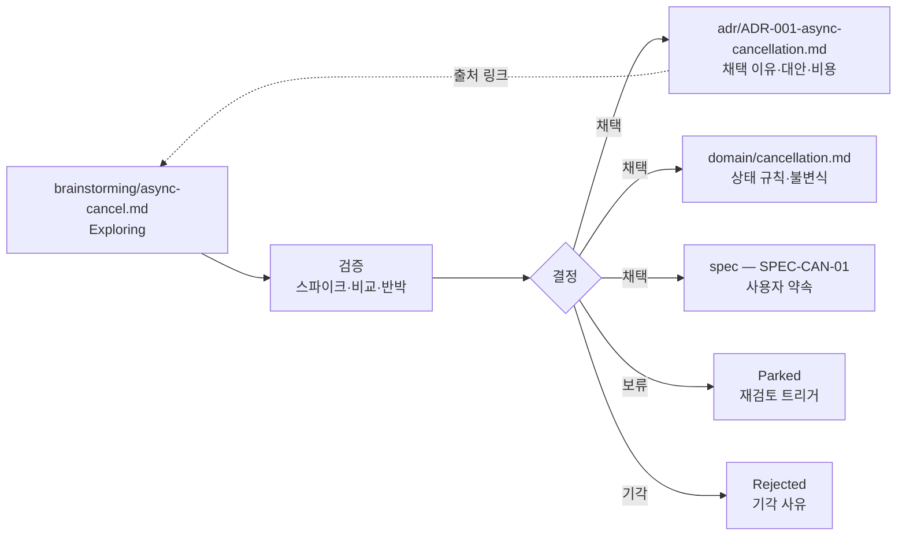

# 12장. 결정의 계보와 문서의 유통기한

2026년 8월, Hacker News에 "I am morally opposed to updating my Claude.md"라는 제목의 글이 올라왔다. 댓글에서 옮겨진 원 글의 한 대목은 이렇다.

> "I'm fairly sure a meaningful percentage of my system prompt is now actively making things worse—instructions written for a model that no longer exists ... But I can't tell which lines those are"

시스템 프롬프트의 상당 부분이 이제는 오히려 일을 망치고 있다고 거의 확신한다. 더는 존재하지 않는 모델을 위해 쓴 지시들이다. 그런데 그게 어느 줄인지 알 수가 없다. 커뮤니티의 한 사람이 남긴 고백이지만, 지시 파일을 몇 달 써 본 사람이라면 고개를 끄덕일 만하다. 같은 스레드에서 JasonSage는 이렇게 덧붙였다. Opus 4.x 시절 모델이 형편없어서 CLAUDE.md에 써 둔 것들은 그 모델, 그 시절의 Claude Code와 시스템 프롬프트, 그리고 작년에 자기 팀이 짠 나쁜 코드에 뿌리를 두고 있었는데, "None of these things exist today but the Claude.md file can stick around."

이유가 사라진 지시가 파일에 남는다. 그리고 그 파일을 에이전트가 오늘도 읽는다. 지시 파일과 설계 문서의 어느 줄이 이미 낡았는지, 우리는 어떻게 알 수 있을까?

### 근거가 사라진 지시는 지워지지 않는다

이 현상을 데이터로 들여다본 연구가 있다. Chakrabarti(2026, 프리프린트·단독 저자)는 저장소 1,867개에서 지시 247,694개의 수명을 추적했다. 지시 파일은 생애 동안 226% 커졌고, 커밋 하나마다 지시가 순증 4.9개씩 늘었다. 오래된 지시일수록 잘 지워지지 않았다. 저자가 꼽은 원인은 근거(rationale)의 상실이다. 왜 그 줄을 넣었는지 아무도 기억하지 못하면, 그 줄을 지우는 일이 위험해진다. 지웠다가 무엇이 깨질지 모르니 그냥 둔다. 그렇게 쌓인다. 같은 연구는 지시 옆에 근거를 주석으로 남기면 과잉 지시를 대부분 걷어 낼 수 있었다고 보고했다. 동료 심사 전 단독 저자 연구라는 점을 감안하더라도, 앞의 HN 고백과 정확히 같은 모양이다.

이 이야기는 낯설지 않다. 사람끼리 일하던 시절에도 설계의 이유는 사라졌다. 결정을 내린 사람이 팀을 떠나고, 회의록은 위키 어딘가에 묻히고, 코드에는 "왜"가 남지 않는다. 흔히 "설계 지식의 증발"이라고 부르는 현상이다. 달라진 점은 하나다. 사람은 이유를 모르는 규칙 앞에서 머뭇거리기라도 했지만, 에이전트는 그 규칙을 지시로 받아 그대로 실행한다. 그래서 "왜"를 남기는 기록, 즉 ADR(아키텍처 결정 기록)이 에이전트 시대에 다시 필요해진다.

### ADR의 생애: Draft에서 Superseded까지

ADR은 새로운 발명이 아니다. Michael Nygard가 2011년에 제안한 형식은 단순하다. 제목, 맥락, 결정, 상태, 결과. 원칙도 몇 줄이다. "One ADR describes one significant decision for a specific project." 번호는 차례대로 매기고 다시 쓰지 않으며, 뒤집힌 결정도 지우지 않고 superseded로 표시한다.

원전 §08은 여기에 생애를 붙인다.

1. **Draft** — 제안, 대안, 확인할 질문
2. **Accepted** — 승인된 결정과 수용한 비용
3. **Superseded** — 새 ADR로 대체, 과거 근거 보존

ADR을 만들 기준도 분명하다. 데이터 소유권, 동기·비동기 경계, 인증 모델, 데이터베이스 선택, 외부 의존성처럼 영향이 크거나 되돌리기 비싼 선택이다. 쓸 때는 맥락과 제약을 먼저 적고, 실제로 고려한 대안과 비용을 비교하고, 결정·근거·부작용·검증 증거를 남기고, 승인자·날짜와 재검토 조건을 기록한다.

가장 중요한 규칙은 이것이다. Accepted ADR의 결론을 조용히 덮어쓰지 않는다. 결정이 바뀌면 새 ADR에 변경 근거를 쓰고, 이전 ADR을 Superseded로 표시하고, 서로 링크한다. 오탈자 수정과 결정 변경은 구분한다. 검토 끝에 채택하지 않은 초안은 Rejected나 Withdrawn으로 남겨도 된다. 이 규칙이 지켜져야 "왜 바뀌었는가"를 나중에 되짚을 수 있다.

MADR 4.0.0(2024-09-17)에는 원전과 맞닿는 선택 절이 하나 있다. "Confirmation", 즉 이 결정이 지켜지고 있는지를 무엇으로 확인할지 적는 칸이다. 원전이 ADR에 "검증 증거"를 남기라고 한 것과 같은 생각이다.

현실은 어떨까? ICSA 2026에 실린 Garcia de Santana Junior 외의 연구는 초록에서 ADR 약 5,800개 가운데 약 63%가 처음부터 "accepted" 상태로 만들어졌다고 보고했다. 이 책은 학회 프로그램 페이지에 실린 초록으로만 확인했고, 논문 본문과 DOI는 확인하지 못했다. 그래도 방향은 분명하다. ADR 파일을 만드는 것과 결정을 숙의하는 것은 별개의 일이다. Draft 단계를 건너뛰면 "어떤 대안을 왜 버렸는가"가 처음부터 비어 있게 된다.

Draft를 채우는 일에는 AI를 써도 좋다. 11장에서 본 것처럼 LLM이 쓴 설계 근거는 대안 목록으로는 쓸 만하지만 결론으로 삼기에는 위험하다. 대안과 비용 비교는 에이전트에게 맡기고, Accepted로 바꾸는 서명은 사람이 하자.

### CAN의 결정은 어디로 가는가

CAN으로 돌아가 보자. 5장과 6장에서 우리는 취소를 비동기로 처리하기로 했다. 접수하면 `CANCEL_PENDING`, 환불 성공이 확인되면 `CANCELLED`. 그런데 이 결정은 처음부터 확정된 것이 아니었다. 누군가 먼저 `brainstorming/async-cancel.md`에 "동기 처리로는 결제사 타임아웃을 감당하기 어렵지 않을까?"라는 아이디어를 적었을 것이다.

원전은 brainstorming을 구현 명세로 보지 않는다. 아이디어는 검증을 거쳐 결정되고, 결정된 것만 공식 원본으로 승격된다. 승격할 때 내용은 성격에 따라 갈라진다.


그림 1. 아이디어 메모에서 ADR·domain·spec으로 갈라지는 승격

채택 이유는 `adr/ADR-001-async-cancellation.md`로, 상태 규칙은 `domain/cancellation.md`로, 사용자 약속은 spec으로 간다. 아이디어 메모에는 "채택됨"과 대상 문서 링크를 남긴다. 공식 문서에도 출처 메모와 ADR을 연결하되, 규칙 본문을 여러 곳에 복제하지 않는다. 메모의 상태 표시는 Exploring / Validated / Promoted / Parked / Rejected 정도면 충분하다. 요구가 어디서 왜 왔는지를 남기는 이 링크는 추적성 연구에서 오래전부터 강조해 온 "명세 이전의 추적성"과 같은 것이다(Gotel & Finkelstein, 1994, 2차 확인).

하나 더 보자. 6장은 결정하지 않은 채 미결정 목록에 남긴 것이 있었다. 같은 멱등키로 다른 입력이 들어왔을 때 무엇을 돌려줄 것인가. 원전 예시는 `409 IDEMPOTENCY_CONFLICT`를 골랐지만, IETF 초안(-07 기준)은 422를 권하고, Stripe는 오류를 돌려준다고만 설명한다. 원전 스스로 "HTTP 상태 코드는 이 예제의 선택입니다"라고 했다. 표준이 갈리는 지점이니 ADR 대상이다. 아래는 책이 추가한 가상 예다.

```markdown
---
id: ADR-002
title: 멱등키 충돌(동일 키 + 다른 입력) 응답 코드
status: draft
owner: 기술 책임자 역할
updated: YYYY-MM-DD
references: [architecture/contracts/cancellation.yaml#API-CAN-01, AC-CAN-03]
---
## 맥락
API-CAN-01은 동일 사용자·예약·키 + 다른 입력을 거절해야 한다.
응답 코드의 선례가 갈린다(2026-10 기준).
- 원전 예시: 409 IDEMPOTENCY_CONFLICT
- IETF Idempotency-Key 초안 -07: 422 (최신 -08에서 바뀌었는지 미확인)
- Stripe API v1: 오류로 거절 (상태 코드 번호는 확인하지 않음)
## 고려한 대안
1. 409 유지  2. 422 채택  3. 둘 중 하나 + 오류 본문 코드로 구분
## 확인할 질문
- 클라이언트·외부 소비자가 이미 기대하는 코드가 있는가?
- 초안 -08의 해당 문장은 무엇인가?
## 결정
(미정 — 8장 착수 판정은 CONDITIONAL. 외부 소비자에게 공개하기 전에 결정하고,
그때까지는 API-CAN-01의 현재 선택을 따른다)
## 확인 방법 (Confirmation)
TC-CAN-03의 키·입력 불일치 케이스가 결정된 코드를 검증한다.
```

Draft ADR이 하는 일은 결론을 내리는 데 있지 않다. 질문과 대안과 확인 방법을 한곳에 묶어, 나중에 결정하는 사람이 처음부터 다시 조사하지 않게 하는 데 있다.

커뮤니티의 경험은 엇갈린다. 수십 명이 기여하는 코드베이스에서 ADR 방식을 써 본 varyherb는 모델이 내놓는 코드가 "놀랄 만큼 빨리" 나빠지기 시작한다고 했다. 에이전트에게 왜 그런 억지스러운 코드를 썼는지 물으면 결함 있거나 낡은 가정을 근거로 든다는 것이다. 그 자신도 대안을 무엇으로 권할지 모르겠다고 덧붙였다. 반대편에서 azeirah는 이렇게 말한다. "An ADR directory is an immutable append-only log of transactions over the architecture ... There are no easy shortcuts." 모순이 쌓였다면 ADR을 잘못 관리한 것이라는 주장이다. 또 다른 쪽에서는 에이전트 전용 문서를 따로 만들지 말라는 목소리도 있다(candiddevmike, "Write readmes for humans, not LLMs."). 모두 커뮤니티 의견이고 증거는 아니다. 원전의 답은 azeirah 쪽에 가깝다. Draft → Accepted → Superseded와 "결정이 바뀌면 새 기록을 쓴다"가 바로 그 유지 규율이다.

### 문서마다 붙이는 작은 머리말

ADR이 결정의 계보를 지킨다면, 문서 하나하나의 상태는 무엇이 지킬까? 원전 §12는 모든 문서에 같은 작은 머리말을 붙이자고 한다. CAN 명세라면 이렇다.

```yaml
---
id: SPEC-CAN-01
title: 예약 취소 기능 명세
status: draft                 # draft / accepted / superseded 등
owner: 업무 책임자 역할       # 실제 적용 시 담당자 지정
reviewers: [기술 책임자 역할]
updated: YYYY-MM-DD
scope: 첫 취소 수직 기능
canonical_for: [REQ-CAN-01, AC-CAN-01~05]
references: [domain/cancellation.md, architecture/contracts/cancellation.yaml]
decisions: [adr/ADR-001-async-cancellation.md]
validation: [validation/VAL-CAN-01.md]
---
```

열한 줄이지만 하는 일이 많다. `canonical_for`는 이 문서가 어떤 ID의 원본인지 밝히고, `references`·`decisions`·`validation`은 다른 원본으로 가는 길을 연다. 사람도 에이전트도 이 머리말만 읽으면 문서의 상태와 책임자와 연결을 알 수 있다. 원전은 "필요한 필드만 유지하세요"라고 덧붙인다.

여기서 원전이 짚는 두 가지를 기억해두자. 하나, Accepted 명세는 승인된 약속이다. "이미 구현됨"을 뜻하지 않는다. 구현·검증·출시 상태는 작업·PR·릴리스에서 따로 추적하고 링크한다. 둘, 문서가 오래됐는지는 수정 날짜만으로 판단하지 않는다. 실제 변경과 어긋나는지로 판단한다. `updated`가 어제여도 그 뒤에 취소 가능 시점 로직이 바뀌었다면 그 문서는 이미 낡았다.

이 머리말을 지시 파일에도 붙여 보자. CLAUDE.md나 AGENTS.md에 `owner`와 `updated`가 있으면, 적어도 누구에게 물어야 할지와 언제부터 손대지 않았는지는 알 수 있다. 3장에서 본 대로 낡은 지시와 코드가 부딪힐 때 어느 쪽이 원본인지 지시 파일에 적어 두는 것도 같은 맥락이다.

### 모델이 바뀌면 지시를 다시 본다

처음의 HN 고백으로 돌아가 보자. 그가 어느 줄이 해로운지 알 수 없었던 이유는 무엇일까? 줄마다 이유가 없었기 때문이다. 그렇다면 대응도 거기서 시작하면 된다.

첫째, 지시 한 줄마다 근거를 짧게 남긴다. "이 지시는 언제, 어떤 실패 때문에 넣었다." Chakrabarti가 근거 주석으로 과잉 지시를 걷어 냈다고 보고한 것과 같은 방향이다. 2026-10 기준 Claude Code 공식 문서도 `/doctor` 점검이 CLAUDE.md에서 코드로 알 수 있는 내용(디렉터리 구조, 의존성 목록, 아키텍처 개요)은 덜어 내되 함정·근거·도구 기본값과 다른 관례는 남기도록 제안한다고 설명한다.

둘째, 모델이나 도구의 버전이 바뀌면 지시 파일을 다시 본다. 근거가 남아 있다면 질문은 간단해진다. "이 실패가 지금 모델에서도 일어나는가?" 일어나지 않는다면 그 줄은 지울 후보다.

셋째, 결정의 "왜"는 다듬어서 커밋·문서·PR 옆에 둔다. rfw300은 에이전트 세션을 "a messy intermediate output"이라고 부르며, 변경의 이유가 중요하다면 에이전트에게 다듬어진 커밋 메시지나 문서를 쓰게 하라고 했다. esafak은 결정 기록을 PR마다 함께 넣는 편이 낫다고 했다. 둘 다 커뮤니티 의견이지만, 원전 §09의 설계 PR 확인 항목("변경 이유와 바뀌는 약속")과 잘 맞는다.

여기까지 오면 할 일 목록이 꽤 길어졌다. ADR의 상태가 실제 코드와 맞는지, 머리말의 `updated` 이후 관련 코드가 바뀌지 않았는지, 지시 파일의 근거가 아직 유효한지, 추적 ID 사이에 끊긴 링크는 없는지. 하나하나는 어렵지 않다. 그런데 이 점검을 사람이 매주 빠짐없이 할 수 있을까?
