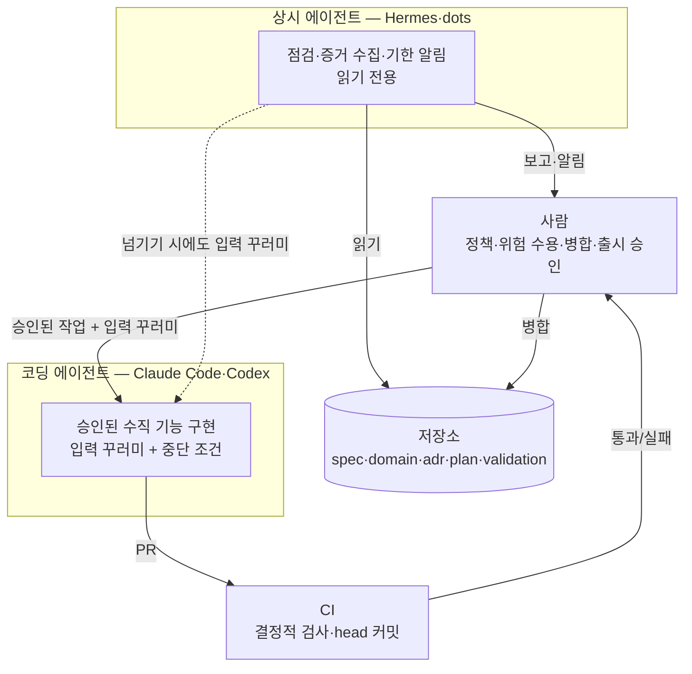

# 13장. 상시 에이전트에게 문서의 정원을 맡긴다 — Hermes와 dots (저자 제안)

새벽, 당신은 자고 있다고 해보자. 그 시간에 Hermes가 저장소를 한 바퀴 돈다. 명세에서 `REQ-CAN-01`을 찾고, 그 요구사항을 가리키는 수용 기준 다섯 개가 모두 살아 있는지 본다. `AC-CAN-04`를 검증한다던 `TC-CAN-04`가 지난주 리팩터링 뒤에도 그 이름으로 남아 있는지, `VAL-CAN-01`의 "미검증 조건" 칸이 비어 있지는 않은지 확인한다. 아침에 메신저를 열면 짧은 보고가 와 있다. "끊긴 링크 1건, 갱신일 이후 관련 코드 변경 2건, 판정은 하지 않았음."

먼저 밝혀 두자. 위 장면은 실제로 본 사례가 아니다. 이 장이 제안하는 운용을 그려 본 것이고, CAN 자체도 원전의 가상 기능이다.

12장은 이런 질문으로 끝났다. 이 점검을 사람이 매주 할 수 있을까? 그렇다면 그 일을 상시 실행 에이전트에게 맡길 수 있을까? 맡긴다면 무엇은 끝까지 맡기지 말아야 할까?

### 먼저 선을 긋자: 사실과 제안

이 장은 다른 장과 성격이 다르다. 2026-10 기준으로, Hermes Agent나 OpenAI dots를 설계 문서와 엮어 운용하는 공개 실천 사례는 찾지 못했다. 커뮤니티 리서치에서도 Hermes 담론은 기억·스킬·cron을 쓰는 개인 비서형 활용이 중심이었고, dots는 출시 한 달 차라 사용 패턴에 대한 논의가 아직 자리 잡기 전이었다.

그래서 이 장은 두 종류의 문장을 섞되, 섞이지 않게 쓴다. 하나는 확인된 사실이다. Hermes는 공식 저장소와 문서를 직접 읽어 확인했고, dots는 공식 도움말과 안전 문서가 열리지 않아 TechCrunch와 DataCamp 보도로 교차 확인한 범위만 옮긴다. 다른 하나는 저자의 제안이다. 제안이 담긴 소절에는 제목에 "[저자 제안]"을 붙였다. "업계에서는 이렇게 한다"로 읽히지 않게 하려는 표시다. 그리고 상시 에이전트는 특히 빠르게 바뀌는 영역이다. 아래 기능 서술은 공식 문서를 함께 확인하자.

### 확인된 사실: Hermes Agent와 dots

**Hermes Agent(Nous Research)**는 v0.22.5(2026-10-23 릴리스, MIT 라이선스)를 기준으로 본다. README는 스스로를 "The self-improving AI agent built by Nous Research"라고 소개한다. 코딩 전용 도구가 아니다. CLI·TUI와 Telegram·Discord·Slack 같은 메신저 게이트웨이로 접근하는 범용 상시 에이전트이고, 서브에이전트("Spawn isolated subagents for parallel workstreams.")와 agentskills.io 표준과 호환되는 스킬, 장기 기억을 갖췄다. 이 장에 가장 중요한 기능은 내장 cron이다. README는 이렇게 쓴다. "Daily reports, nightly backups, weekly audits — all in natural language, running unattended."

독자 환경에서 Hermes의 자리를 정하는 사실이 하나 더 있다. Hermes에는 `claude-code`(v2.2.1, "Delegate coding to Claude Code CLI (features, PRs)")와 같은 계열의 `codex`·`opencode` 번들 스킬이 있다. Hermes가 직접 코드를 짜기보다 Claude Code나 Codex를 부리는 자동화 층으로 쓰일 수 있다는 뜻이다. 커뮤니티에서도 Hermes를 "a harness for claude code/codex"라고 부르는 의견이 있었다(hadlock, 커뮤니티 의견).

Hermes가 저장소의 지시 파일을 읽는 규칙도 공식 문서에 있다. 세션마다 프로젝트 컨텍스트 유형은 하나만 싣고, 먼저 찾은 것이 이긴다. 순서는 `.hermes.md` → `AGENTS.override.md` → `AGENTS.md` → `CLAUDE.md` → `.cursorrules`다. git 저장소 안이라면 루트부터 작업 디렉터리까지의 `AGENTS.md`를 이어 붙인 체인으로 싣고, 하위 디렉터리로 들어갈 때 그곳의 컨텍스트 파일을 점진적으로 찾아 넣는다. 두 규칙을 "먼저 한 유형을 고르고, 그것이 AGENTS.md면 계층 체인을 합친다"로 읽는 것은 책의 해석이니 문서로 한 번 더 확인하자. 3장에서 AGENTS.md를 원본 경로를 가리키는 목차로 두기로 한 배치가 Hermes에서도 그대로 읽힌다는 점이 반갑다.

기억에는 상한이 있다. `MEMORY.md`는 2,200자, `USER.md`는 1,375자이고, 세션 시작 때 고정된 스냅숏으로 주입되며, 넘치면 자동으로 압축하지 않고 오류를 돌려준다. 공식 문서에는 이런 경고도 있다. "Don't point two agent processes at the same Hermes home directory. ... two writers sharing one home will compound each other's entries into state neither of them (nor you) authored." 이 경고는 뒤에서 권한을 설계할 때 다시 쓴다.

**OpenAI dots**는 OpenAI DevDay 2026(2026-09-29)에서 발표된, ChatGPT 안에서 상시 실행되는 개인 에이전트다. 표기는 소문자 dots, 하나는 a dot이다. 교차 확인된 범위(2026-10 기준)는 이렇다. 각 dot은 자체 클라우드 컴퓨터와 브라우저에서 돌고 대화 사이에도 목표를 이어 간다. TechCrunch는 GPT-6 Astra 모델로 동작한다고 썼다. 제공 대상은 대상 지역의 ChatGPT Pro와 Business Premium이고, 채널은 ChatGPT(데스크톱·웹·모바일)·Slack·Teams다. 통제 장치로 Custom Rules가 있어서 행동마다 "묻지 않고 실행 / 사전 승인 시 실행 / 먼저 묻기 / 넘기기" 중 하나를 고르고, 그 아래에서 자동 검토가 계정에 영향을 주거나 정보를 공유하는 행동을 확인한다고 DataCamp가 OpenAI 안전 문서를 인용해 전했다. 개발자에게 중요한 연계는 Codex다. dot은 Codex에서 미리 만들어 둔 클라우드 환경에 클라우드 태스크를 만들 수 있다. 이 범위를 넘는 기능 이야기(연결 앱 수, 가격, 기억을 지울 수 있는지 등)는 확인되지 않아 쓰지 않는다.

| 비교 항목 | Hermes Agent (v0.22.5) | OpenAI dots (2026-10) | CI 스케줄 작업 |
|---|---|---|---|
| 확인 수준 | 공식 저장소·문서 직접 확인 | 언론 2곳 교차 확인, 공식 문서 미열람 | 팀이 직접 정의 |
| 반복 실행 | 내장 cron, 자연어로 지정 | 대화 사이에도 목표 진행 | 스케줄 트리거 |
| 코딩 위임 | `claude-code`·`codex` 번들 스킬 | Codex 클라우드 태스크 생성 | 없음 (정해진 스크립트) |
| 행동 통제 | 전용 장치 확인 안 됨 — 실행 계정 권한·지시로 설계 | Custom Rules 4행동 + 자동 검토 | 스크립트가 할 수 있는 일만 |
| 결과 성격 | 해석이 섞인 보고 | 해석이 섞인 보고 | 통과/실패 |

마지막 줄을 눈여겨보자. 상시 에이전트의 출력은 해석이 섞인다. CI는 같은 입력이면 같은 결과를 낸다. 이 차이가 이후의 모든 제안을 가른다.

### [저자 제안] 패턴 1 — 야간 드리프트 점검

12장에서 남긴 점검 목록을 다시 꺼내 보자. 그중 일부는 사실 상시 에이전트가 필요 없다. 추적 ID가 존재하는지, 링크가 끊겼는지, 머리말 형식이 맞는지는 결정적으로 검사할 수 있다. 10장에서 문서 CI가 "링크·ID 누락, 스키마 유효성"을 확인한다고 했던 그 영역이다. 같은 입력에 같은 답이 나와야 하는 검사를 해석하는 에이전트에게 맡길 이유는 없다.

상시 에이전트에게 남는 몫은 해석이 필요한 점검이다. 저자는 세 가지를 제안한다.

- CAN 추적 사슬(`REQ-CAN-01` → `AC-CAN-01`~`05` → `TC-CAN-01`~`05` → `VAL-CAN-01`)에서 ID는 이어져 있지만 내용이 서로 어긋나 보이는 곳. 예를 들어 `AC-CAN-04`는 "결과 확인 중" 안내를 요구하는데, 최근 UI 변경이 그 문구를 다른 의미로 바꾼 경우.
- 지시 파일의 문장과 실제 코드 관례가 부딪히는 후보. 3장에서 본 것처럼 낡은 지시는 코드보다 우선해 읽힐 수 있으니, 부딪히는 곳을 찾아 사람이 어느 쪽이 원본인지 정하게 한다.
- 문서 머리말의 `updated` 이후 그 문서가 가리키는 코드가 바뀐 경우. 12장의 기준대로 낡음은 날짜가 아니라 실제 변경과의 불일치로 판단한다.

이 점검의 출력은 보고서 하나다. 수정 PR을 열지 않고, 판정도 하지 않는다. Hermes라면 cron 작업을 자연어로 줄 수 있으니, 작업 문장은 대략 이런 모양이 될 것이다.

```text
(예시, 미실행 — Hermes cron에 줄 작업 문장의 초안)
매일 새벽, 읽기 전용 자격 증명으로 받은 저장소 사본을 점검하라.
입력: AGENTS.md가 가리키는 spec·domain·plan·validation 원본, 지난 24시간 커밋.
점검: CAN 추적 ID 사이의 내용 불일치 후보, 지시 파일과 코드 관례의 충돌 후보,
      머리말 updated 이후 관련 코드 변경.
출력: 항목별 [ID | 근거 파일·줄 | 왜 의심하는가 | 확인할 사람 역할] 표.
금지: 파일 수정, PR 생성, "문제 없음" 단정. 찾지 못했으면 점검 범위를 적어라.
```

출력 형식이 원전 프롬프트 3(설계 리뷰어)과 닮았다는 데 주목하자. 이 점검자는 REVIEWER 역할이고, 11장에서 본 대로 REVIEWER의 "문제 없음"은 실행 증거가 되지 못한다.

### [저자 제안] 패턴 2·3 — 증거 수집과 미결정 기한

패턴 2는 증거 수집이다. 열려 있는 PR마다, 10장에서 말한 "CI 초록색의 정확한 의미"를 확인할 재료를 모은다. 필요한 검사가 마지막 수정 이후의 정확한 PR head 커밋에서 실행됐는가, 부분 재실행이나 생략된 검사는 없는가. 그리고 연결된 검증 기록의 빈칸을 찾는다. `VAL-CAN-01`에 실행 명령이 있는가, 결과 링크가 있는가, 미검증 조건이 적혀 있는가. 모은 것은 리뷰어에게 건넨다. 통과·실패를 판정하는 일은 하지 않는다. 증거를 모으는 손과 판정하는 손을 나누는 것, 이것이 이 패턴의 전부다.

패턴 3은 주간 미결정 점검이다. 4장부터 쌓은 미결정 목록과 8장 판정표의 CONDITIONAL 항목에는 담당자와 기한이 붙어 있다. 기한이 지난 항목을 찾아 담당자에게 알리는 일은 지루하고, 지루한 일은 빠지기 쉽다. Hermes라면 메신저 게이트웨이로, dot이라면 Slack이나 Teams 채널로 알림을 보낼 수 있다. 알림에는 항목 ID와 원본 경로만 싣고, 결정은 담는 칸을 비워 둔다.

dots를 쓴다면 Codex 연계를 활용하고 싶어질 것이다. 빈칸을 발견한 dot이 곧바로 Codex 클라우드 태스크를 만들어 고치게 하면 편하지 않을까? 가능은 하다. 하지만 그 순간 점검자는 IMPLEMENTER가 된다. 그렇게 하려면 11장의 입력 꾸러미를 그대로 실어 보내야 한다. 이 부분은 다음 소절에서 다시 보자.

### 권한과 결정 한계를 묶는 법

상시 에이전트는 사람이 보지 않는 시간에 돈다. 그래서 권한 설계가 지시문보다 앞선다. 저자는 세 겹으로 묶기를 제안한다.

첫째, 자격 증명을 읽기 전용으로 둔다. 커뮤니티에서 OliverGuy는 GitLab·AWS·K8s에 읽기 전용 자격 증명을 쓰기 때문에, 에이전트가 할 수 있는 최대치가 자기가 검토하고 병합할 MR을 여는 데까지라서 마음 놓고 맡긴다고 했다. mike_hearn은 전용 UNIX 계정에서 계속 도는 Codex 둘을 "AI employees"로 두고, 밤새 고객 지원 티켓을 처리해 둔 결과가 "waiting for my approval" 상태로 기다리게 한다고 했다. 둘 다 Hermes나 dots 사례가 아니고 커뮤니티 의견이지만, 상시 에이전트에게 그대로 옮길 만한 모양이다.

둘째, 행동마다 결정 한계를 정한다. dots의 Custom Rules 네 가지 행동은 원전의 구조와 맞물린다. "먼저 묻기"와 "넘기기"는 원전 프롬프트 4의 중단 조건, 즉 "임의 해결하지 말고 결정 요청을 남긴다"와 같은 자리다(웹 리서처의 해석). 이를 바탕으로 저자는 이렇게 나눠 보기를 제안한다. 보고서 작성과 알림은 묻지 않고 실행, 리뷰어 지정이나 이슈 생성은 사전 승인 시 실행, 문서나 코드를 바꾸는 행동은 먼저 묻기, 정책이나 위험 수용이 걸린 판단은 사람에게 넘기기. Hermes에는 같은 이름의 장치가 확인되지 않으니, 실행 계정의 권한과 스킬 지시로 같은 경계를 만든다. 공식 경고대로 에이전트마다 Hermes 홈을 따로 두는 것도 잊지 말자. 홈을 공유하면 누구도 쓰지 않은 기억이 쌓인다.

셋째, 넘길 때는 의도를 함께 넘긴다. dots에 대한 커뮤니티 반응 가운데 이 책과 가장 직접 닿는 말이 있다. "The handoff procedure absolutely blows. Just spits in your face re: understanding intent between tasks" (slurpyb, 커뮤니티 의견). 작업 사이에서 의도가 사라진다는 불평이다. 난감한 이야기지만 놀랍지는 않다. 의도는 원래 대화에 남지 않고, 문서에 남는다. 상시 에이전트가 코딩 에이전트에게 일을 넘길 때는 11장의 입력 꾸러미, 곧 목표·원본 경로와 버전·관련 ID·미결정·허용 변경 범위·검증 명령·중단 조건을 그대로 실어 보내자.


그림 1. 코딩 에이전트·상시 에이전트·CI·사람 사이의 역할과 권한 배치 (저자 제안)

그렇다면 어떤 일을 어디에 둘까? 저자의 기준은 이렇다. 같은 입력에 같은 답이 나와야 하는 검사(링크·ID·스키마·head 커밋의 검사 상태)는 CI 스케줄 작업에 둔다. 문서와 코드를 함께 읽고 의미를 견줘야 하는 점검, 그리고 사람에게 알리는 일은 상시 에이전트에 둔다. 코드를 바꾸는 일은 승인된 입력 꾸러미와 함께 코딩 에이전트에게 넘긴다. 상시 에이전트가 이 셋을 모두 하게 두면 편해 보이지만, 그 순간 누가 무엇을 판정했는지가 흐려진다.

### 작게 시험해 보고, 멈출 기준부터 적자

이 장의 제안은 검증되지 않았다. 저자의 경험과 원전의 구조에서 끌어낸 가설이다. 그러니 가장 정직한 다음 걸음은 시험 운영이다.

패턴 하나만 고르자. 처음이라면 패턴 3(미결정 기한 알림)이 가장 안전하다. 읽기만 하고 알리기만 하니 잘못돼도 피해가 작다. 기간을 먼저 정하고, 유지할지 폐기할지를 가를 기준을 시작 전에 적어 두자. 보고된 항목 가운데 사람이 실제로 열어 본 비율, 쓸모없는 경보의 비율, 그 기간에 든 비용 같은 것들이다. 상시 에이전트의 비용은 생각보다 클 수 있다. dot이 프롬프트 없이 하루에 30만 토큰 넘게 썼다는 HN 글 제목이 올라온 적도 있다(2026-10-14, 커뮤니티 주장). 기간이 끝나면 적어 둔 기준대로 판단하자. 기준을 미리 적지 않으면, 이미 돌고 있는 자동화는 잘 멈추지 않는다.
