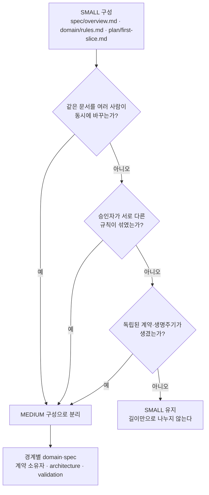

# 14장. 가장 작은 유효한 기준선부터

이 모든 걸 내일 아침 당장 다 해야 할까?

제품 합의서, 도메인 원본, 계약, 수용 기준, Design Ready 판정, 수직 기능 계획, 검증 기록, 영향 매트릭스, 역할별 입력 꾸러미, ADR과 머리말, 그리고 상시 점검까지. 열세 장을 지나오며 쌓인 목록을 한 번에 펼쳐 보면 숨이 막힌다. 두 명이 사이드 프로젝트를 하는 팀에도, 여러 팀이 서비스 경계를 나눠 가진 조직에도 같은 목록을 들이밀어야 할까?

원전의 답은 짧다. "작은 프로젝트는 합치고, 여러 경계와 팀이 생기면 나눕니다. 문서·컨텍스트·보드의 개수를 미리 고정하지 않습니다." 이 답에서 출발해, 지금까지의 여정을 하나의 판단 절차로 묶어 보자.

### 팀 규모보다 위험에 맞춘다

2장에서 이 책은 SDD 논쟁에 대해 입장을 하나 세웠다. 문서의 무게는 위험 크기에 맞춘다는 것이었다. 원전 §11은 그 입장을 두 가지 구성으로 구체화한다.

작게 시작하는 구성(SMALL / LOW COMPLEXITY)은 파일 세 개로 출발한다. `spec/overview.md`에 brief·범위·수용 기준을, `domain/rules.md`에 용어·상태·권한을, `plan/first-slice.md`에 순서와 검증을 둔다. UX와 검증 결과는 이 문서들의 별도 절로 시작하고, 중요한 결정이 생기면 그때 ADR을 더한다.

경계가 늘어날 때의 구성(MEDIUM / MULTIPLE BOUNDARIES)은 다르다. 공통 brief와 용어집을 진입점으로 두고, 업무 능력과 책임 경계별로 domain과 spec을 나누고, API·이벤트 계약과 그 소유자를 밝히고, architecture에서 경계·통합·운영을 잇고, validation에서 위험별 증거와 잔여 위험을 관리한다.

그렇다면 언제 SMALL에서 MEDIUM으로 넘어갈까? 원전이 꼽는 신호는 문서 길이보다 동시 변경, 다른 승인자, 독립된 계약과 생명주기다. 같은 규칙이 여러 곳에서 수정되기 시작하면 책임 분리를 다시 검토할 때다.

그림 1. SMALL에서 MEDIUM으로 넘어가는 신호

작은 구성에도 지킬 선이 하나 있다. 원전은 이렇게 못 박는다. "파일을 합쳐도 각 절의 원본 책임은 유지합니다. 금전·민감정보·외부 연동이 있으면 작은 팀이라도 필요한 안전 검증은 생략하지 않습니다." 파일 수는 줄여도 원본의 책임과 안전 검증은 줄이지 않는다.

CAN을 SMALL 구성으로 접어 보면 이 말이 무슨 뜻인지 보인다. `spec/overview.md`에는 4장의 제품 합의서와 `REQ-CAN-01`, 7장의 `AC-CAN-01`~`05`, `UX-CAN-01`을 담은 UX 절이 들어간다. `domain/rules.md`에는 5장의 상태 전이와 `POL-CAN-01`, `INV-CAN-01`~`03`이 들어간다. `plan/first-slice.md`에는 9장의 `SLICE-CAN-01`과 `TC-CAN-01`~`05`, 그리고 `VAL-CAN-01`을 담을 검증 절이 들어간다. 비동기 취소를 고른 이유만은 되돌리기 비싼 결정이니 ADR 하나로 따로 둔다. 파일은 넷으로 줄었다. 하지만 CAN은 환불이라는 돈과 결제사라는 외부 연동을 안고 있다. 중복 요청과 타임아웃, 권한 검증은 파일이 몇 개든 빠질 수 없다.

### 30분으로 시작하고, 필요할 때 더한다

시작은 생각보다 작아도 된다. 원전 §14의 30분 빠른 시작은 이렇다. 5분 동안 사용자·문제·기대 가치·이번 비범위를 각각 한 문장으로 쓴다. 10분 동안 대표 기능 하나의 정상·실패·중복·지연 시나리오를 적는다. 5분 동안 업무 규칙과 계약의 원본 위치, 결정권자 역할을 정한다. 5분 동안 가장 위험한 가정 하나와 그것을 확인할 실험을 고른다. 마지막 5분 동안 다음 작은 구현 범위와 "끝났다고 말할 조건"을 적는다.

CAN이라면 두 번째 10분이 6장과 7장의 씨앗이 되고, 네 번째 5분이 8장의 스파이크 질문("응답 유실 후 동일 환불 키 재요청이 추가 환불을 만들지 않는가?")이 된다. 원전은 이 30분의 결과를 구현 승인으로 보지 말라고 한다. 다음 결정과 검증이 보이는 초안일 뿐이다. 그 뒤로는 "더 많이 쓰기"보다 모호함을 없애고 증거를 연결하는 데 시간을 쓰자.

첫 주를 어떻게 보낼지에 대한 원전의 일정표도 부록 D에 옮겨 두었다. 다만 원전 스스로 "조정 가능한 예시"라고 부른 표다. 외부 승인·사용자 검증·규제·연동 실험이 필요하면 더 길어지고, 날짜보다 단계별 종료 조건이 먼저다. "하루가 밀렸다고 게이트를 생략하지 않습니다"라는 원전의 문장은 꼭 함께 기억해두자.

도구는 이 원리보다 훨씬 빨리 바뀐다. Harper Reed는 자기 작업 흐름을 소개하며 이렇게 덧붙였다. "This is working well NOW, it will probably not work in 2 weeks, or it will work twice as well." 이 책이 Claude Code·Codex·Hermes·dots의 기능마다 2026-10이라는 날짜를 붙인 이유도 같다. 몇 달 뒤 도구의 이름과 명령은 달라져 있을 것이다. 원본을 하나로 정하고, 미결정을 표시하고, 증거로 끝을 확인하는 일은 그때도 그대로 필요하다.

지시 파일도 같은 원리로 키운다. GitHub의 Matt Nigh는 2,500개 넘는 저장소를 살핀 뒤 이렇게 정리했다. "Start simple. Test it. Add detail when your agent makes mistakes." 커뮤니티에서 pamelafox는 에이전트가 실패했을 때만 AGENTS.md에 내용을 더하고, 더한 뒤에는 변경을 되돌려 같은 작업을 다시 돌려 보며 나아졌는지 확인한다고 했다. simonw는 더 나아가, 프로젝트 자체가 좋은 상태라면, 즉 문서가 분명하고 테스트가 충실하다면 코딩 에이전트에게 말할 것이 많지 않다고 했다(2026-04-28, 커뮤니티 의견). 지시 파일을 키우는 지름길은 지시 파일 밖에 있다는 말로 들린다.

### 흔한 실패 여덟 가지를 다시 읽는다

원전 §14는 흔한 실패 여덟 가지와 대신 할 일을 짝지어 둔다. 이 책의 장들과 나란히 놓으면, 각 실패가 어디서 다뤄졌는지 한눈에 보인다.

| 흔한 실패 (원전 §14) | 대신 할 일 (원전 §14) | 이 책에서 다룬 곳 |
|---|---|---|
| 문서 양과 폴더 개수를 진척으로 판단 | 결정된 질문, 해결된 위험, 실행된 검증으로 진척을 판단 | 1·2장 |
| 같은 규칙을 spec·domain·UX에 복사 | 규칙의 원본 하나를 정하고 나머지는 ID와 링크로 참조 | 3·5·6장 |
| 화면 정상 경로만 상세히 설계 | 권한·중복·경합·시간초과·복구를 같은 기능의 일부로 | 5·6·7장 |
| AI가 그럴듯하게 채운 빈칸을 확정 | 가정·제안·미결정을 표시하고 결정권자와 증거를 붙임 | 4·8·11장 |
| 설계 승인 후 문서를 동결 | 구현에서 발견한 사실을 변경 절차로 반영하고 기준선 갱신 | 9·10장 |
| Accepted ADR을 새 결론으로 덮어쓰기 | 새 ADR과 상호 링크로 결정의 계보를 보존 | 12장 |
| 테스트 통과나 CI 초록을 출시 완료로 해석 | 정확한 코드 버전, 배포된 아티팩트, 운영 상태를 각각 확인 | 7·9·10장 |
| 첫 주에 미래 기능 전체를 설계 | 다음 수직 기능을 막는 결정과 가장 큰 위험부터 | 8·9·14장 |

표를 체크리스트처럼 쓰지는 말자. 여덟 줄을 한꺼번에 고치려 들면 그 자체가 또 하나의 "첫 주에 전체를 설계"가 된다. 지금 팀에서 가장 자주 벌어지는 실패 하나를 고르고, 오른쪽 칸의 "대신 할 일"을 다음 기능 하나에만 적용해 보는 편이 낫다. 문서를 복사하는 습관이 문제라면 다음 기능의 규칙 하나에 원본을 정하고 나머지를 링크로 바꿔 보자. CI 초록을 출시로 읽는 습관이 문제라면 다음 PR 하나에서 head 커밋과 배포된 버전을 따로 확인해 보자.

표를 위에서 아래로 읽으면 한 가지 공통점도 보인다. 여덟 가지 모두 "무언가를 했다"는 느낌을 "무언가가 확인됐다"는 사실로 착각하는 실패다. 문서를 많이 썼다는 느낌, 화면이 돈다는 느낌, AI가 빈칸을 채워 줬다는 느낌, 초록불이 켜졌다는 느낌. 에이전트는 이런 느낌을 아주 빠르게, 아주 그럴듯하게 만들어 낸다. 그래서 에이전트와 일할수록 느낌과 증거를 가르는 장치가 더 필요해진다.

### 하나의 사슬로 되짚기

이제 CAN을 처음부터 끝까지 한 번에 따라가 보자.

4장에서 "예약 셀프 취소 기능 하나만 붙여 주세요"라는 한 줄이 도착했고, 우리는 그것을 짧은 제품 합의서로 바꿨다. 범위와 비범위를 가르고, 결제사가 요청별 멱등성을 지원하는가라는 큰 가정을 적고, 취소 가능 시점은 미결정으로 남겼다. 5장에서는 화면보다 먼저 상태를 적었다. `CONFIRMED`에서 `CANCEL_PENDING`을 거쳐 `CANCELLED`로, 그리고 타임아웃은 실패 확정이 아니라는 규칙을 `POL-CAN-01`과 `INV-CAN-01`~`03`으로 못 박았다. 6장은 그 규칙을 `API-CAN-01`과 `EVT-CAN-01`, `UX-CAN-01`이라는 계약으로 옮기며 실패와 중복과 지연의 의미까지 적었다. 7장은 정상 하나와 실패 넷으로 `AC-CAN-01`~`05`를 썼다.

8장에서 멈춰 섰다. 결제사의 멱등성이 확인되지 않았으니 그 부분은 BLOCK, 스파이크로 질문 하나를 던졌다. 9장은 판정을 통과한 범위를 `SLICE-CAN-01` 하나로 잘라 `TC-CAN-01`~`05`로 검증하고, `VAL-CAN-01`에 커밋과 명령과 결과와 한계를 남겼다. 요구사항에서 증거까지 여덟 단계의 사슬이 그때 처음 이어졌다. 10장은 그 사슬을 PR·CI·출시의 통제 지점에 묶었고, "취소 가능 시점 변경"이 어디까지 번지는지 영향 매트릭스로 따져 봤다. 11장은 이 모든 원본을 경로와 ID로 묶은 입력 꾸러미를 만들어 역할마다 건넸다. 12장은 비동기 취소를 고른 이유를 `ADR-001`에 남기고, 명세에 `SPEC-CAN-01` 머리말을 붙였다. 13장은 그 사슬이 밤사이 끊기지 않았는지 지켜볼 방법을 저자 제안으로 내놓았다.

돌아보면 CAN은 한 번도 "완성된 문서 세트"였던 적이 없다. 장마다 산출물이 한 줄씩 늘었고, 늘어난 줄은 앞의 줄을 ID로 가리켰다. 전체 사슬은 부록 E에 한 장의 표로 모아 두었다.

### 무엇이 증폭되는가

원전은 마지막에 기억할 한 문장을 남긴다.

> 제품의 의도는 spec에, 업무의 진실은 domain에, 상호작용은 계약과 UX에, 결정의 이유는 ADR에, 실행 순서는 plan에 둡니다. 그리고 이 모든 것을 하나의 요구사항에서 테스트와 운영 증거까지 이어지는 연결로 만듭니다.

1장은 이 질문으로 끝났다. 에이전트에게 무엇을 건네야 좋은 것이 증폭될까?

이제 답할 수 있다. 에이전트가 키우는 것은 우리가 건넨 것이다. 원본이 하나로 정해져 있으면 에이전트는 그 원본을 빠르게 따라가고, 원본이 여럿이면 그 혼란을 빠르게 퍼뜨린다. 미결정이 미결정으로 표시돼 있으면 에이전트는 거기서 멈춰 묻고, 비어 있으면 그럴듯하게 채운다. 검증 증거를 요구하는 자리가 있으면 "다 통과했다"는 보고 대신 명령과 결과를 내놓고, 없으면 느낌을 내놓는다. 그러니 건네야 할 것은 문서의 양이 아니다. 합의된 약속과, 그 약속을 확인할 방법과, 사람이 내려야 할 결정의 자리다.

내일 아침에 다 할 필요는 없다. 기능 하나를 골라 30분 동안 써 보자. 사용자와 문제를 한 문장으로, 실패 시나리오 넷을, 원본의 위치를, 가장 위험한 가정 하나를, 그리고 끝났다고 말할 조건을. 그 30분이 당신 저장소의 첫 번째 검증 가능한 약속이 된다.
