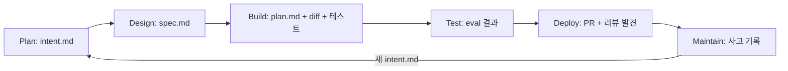
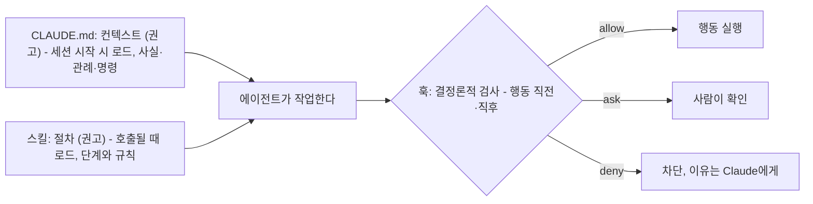
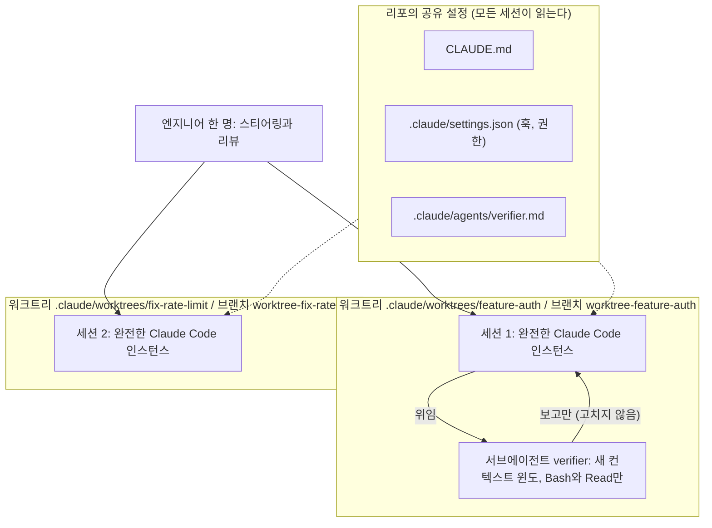
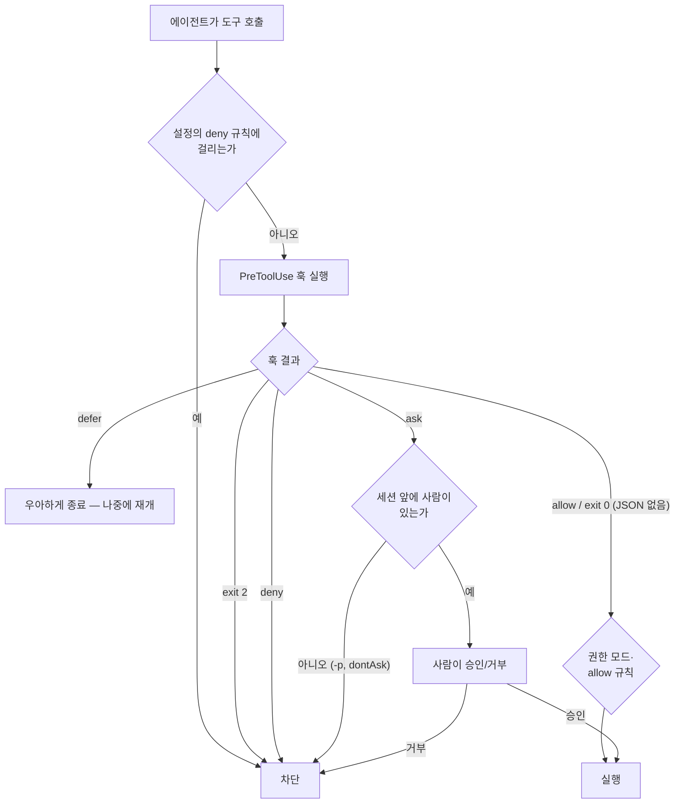
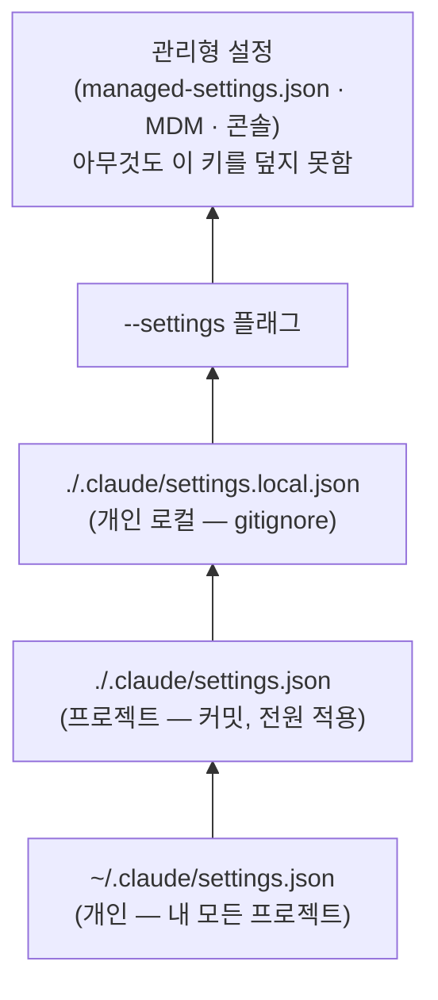
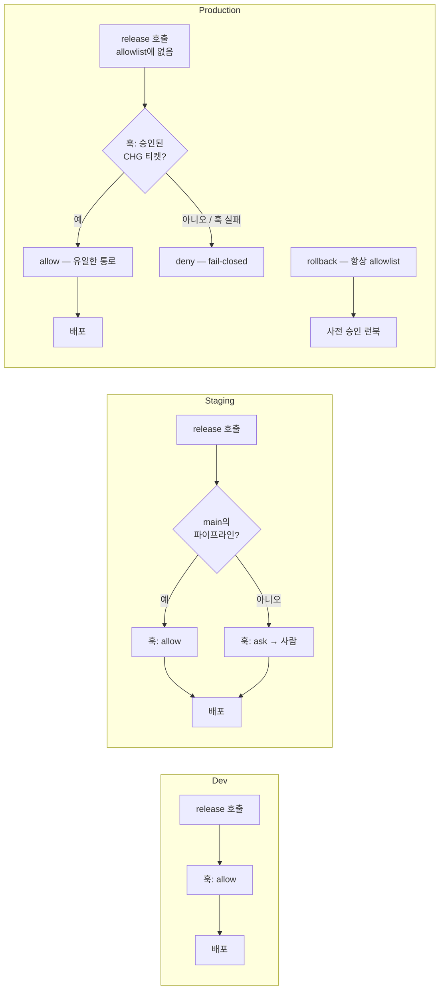
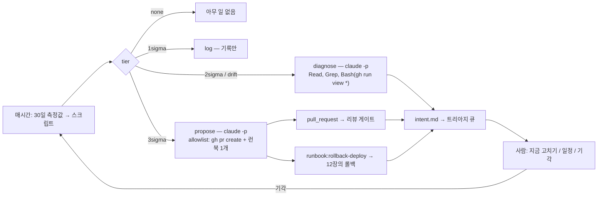

# AI 네이티브 SDLC 플레이북

**Claude Code로 내 개발 루프를 다시 짜는 12가지 플레이**

## 저자
Toby-AI

**판본:** v1.0.0 · 2026-10-19

---

## 판권

**AI 네이티브 SDLC 플레이북 — Claude Code로 내 개발 루프를 다시 짜는 12가지 플레이**
**판본:** v1.0.0
**발행일:** 2026-10-19
**저자:** Toby-AI
**식별자:** urn:uuid:5f7ffab4-991e-4775-b102-d1712fe5e7a7

### 라이선스

이 책은 **CC BY-NC-SA 4.0** 라이선스로 배포된다 — [Creative Commons 저작자표시-비영리-동일조건변경허락 4.0 국제](https://creativecommons.org/licenses/by-nc-sa/4.0/).

- **저작자 표시(BY):** 출처를 밝혀야 한다.
- **비상업적 이용(NC):** 상업적 목적으로 이용할 수 없다.
- **동일조건 변경허락(SA):** 변경·재배포 시 동일한 라이선스를 적용해야 한다.

본문에 원문 그대로 인용한 코스 예시 파일·공식 문서 문구·논문 초록·커뮤니티 댓글의 저작권은 각 원저작자에게 있으며, 이 라이선스는 그 인용문에 미치지 않는다.

### 출처

이 책은 [book-writer](https://github.com/tobyilee/book-writer) 하네스 v2.0.0로 자동 생성되었다. 본문의 사실 주장은 Claude Code 2.1.303(2026-10-18)과 2026-10-19에 확인한 공식 문서를 기준으로 대조되었다.

---

## 서문

코드가 빨라졌다. Claude Code를 쓰는 개발자라면 이 문장에 토를 달지 않을 것이다. 그런데 한 주가 끝나고 머지된 양을 세어 보면, 코드가 빨라진 만큼 늘어나 있지는 않다. 어디선가 시간이 새고 있다. 그 자리가 어디인지는 느낌으로는 알 수 없다 — 1장에서 보는 METR의 실험이 그 점을 숫자로 보여 준다. 숙련된 개발자들은 20% 빨라졌다고 느꼈고, 실측은 19% 느렸다. 이 책은 그 39%포인트의 틈에서 시작한다.

Anthropic의 Claude Academy에 "The AI-native SDLC playbook"이라는 코스가 있다. 여섯 단계의 개발 수명주기를 열두 개의 플레이로 다시 짜는 안내서다. 다만 그 코스는 엔지니어링·플랫폼·보안 리드를 독자로 쓰였고, 규제 산업의 대기업을 염두에 둔다. 체인지 보드, 릴리스 매니저, 관리형 설정이 전제로 깔려 있다. 혼자 사이드 프로젝트를 하거나 서너 명이 서비스를 굴리는 독자에게 그 전제는 없다. 그렇다고 그 플레이들이 남의 이야기일까? 그렇지 않다고 생각한다. 병목은 개인에게도 옮겨 갔다. 다만 위원회가 아니라 자기 리뷰 시간, 검증 시간, 되돌리기 시간이라는 모양으로. 이 책은 조직용 플레이북을 그 세 가지 시간을 가진 한 사람의 규모로 번역한다.

### 누가 읽으면 좋은가

Claude Code로 코드는 이미 빨리 쓰고 있는데, 계획·검증·리뷰·배포는 예전 습관 그대로여서 어딘가 찜찜한 개발자. 프롬프트·파일 편집·커밋·CLAUDE.md 정도의 기본 조작은 전제한다. 훅, 스킬, 서브에이전트, 헤드리스 실행, GitHub Actions 연동은 책이 설명한다. 혼자 일하는 독자가 1순위이고, 2~10명 팀은 각 장 끝의 `[팀 합의]` 묶음으로 따라올 수 있다. 플랫폼 팀이 있는 조직의 독자라면 `[조직 결정]` 묶음에서 코스 원문이 전제한 층을 다시 만나게 된다.

### 어떻게 읽으면 좋은가

1장과 2장은 지도다. 왜 병목이 옮겨 갔는지, 여섯 단계가 선이 아니라 루프인 이유, 에이전트를 통제하는 층이 왜 셋(CLAUDE.md는 컨텍스트, 스킬은 절차, 훅은 강제)인지를 여기서 한 번에 본다. 3장부터 13장은 루프 순서를 그대로 따라간다 — `intent.md`와 `spec.md`(3장), 플랜 모드(4장), CLAUDE.md(5장), 스킬과 빌드 훅(6장), 병렬 세션(7장), 피드백 루프(8장), eval(9장), PR 리뷰(10장), 승인 게이트(11장), 파이프라인(12장), 그리고 컨트롤 밴드가 새 `intent.md`를 쓰는 13장에서 루프가 닫힌다. 14장은 책 전체에서 만든 파일을 한 트리로 모으고 첫 30일의 순서를 제안한다.

순서대로 읽는 것이 가장 자연스럽다. 열두 플레이의 예시 파일이 한 변경 건 — 보험사 고객 포털의 "claims status self-service" — 에서 나와 서로를 인용하기 때문이다. `spec.md`의 R1~R4를 `plan.md`가 인용하고, `plan.md`를 리뷰가 대조하고, CLAUDE.md의 한 줄을 eval이 지키고, 13장의 사고 보고서가 3장의 포맷으로 돌아온다. 하지만 꼭 그래야 하는 것은 아니다. 2장 끝의 의존 그래프에서 지금 가장 찜찜한 플레이 하나를 고르고 그 장으로 건너뛰어도 좋다. 각 장은 자기 플레이를 독립적으로 설명하고, 앞 장의 파일이 필요하면 그 자리에서 다시 보여 준다.

모든 장은 같은 뼈대를 갖는다. 코스 원문의 핵심 주장을 직접 인용하고 번역한다. 코스의 예시 파일은 값을 바꾸지 않고 원문 그대로 싣고 아래에 한국어 주석을 단다. 코스가 가리키기만 한 공식 문서 내용은 "현행 사양" 절에서 채운다. "왜 이 플레이인가" 절에서 현장의 마찰과 학술 근거를 각각 하나 이상 든다. 그리고 "내 리포로 옮기기" 절에서 `[개인 즉시]`·`[팀 합의]`·`[조직 결정]` 세 묶음으로 번역하고, 개인이 git과 CI에서 셀 수 있는 측정 한 쌍으로 끝낸다.

### 이 책이 서 있는 시점

빠르게 바뀌는 도구를 다루는 책은 자기가 어느 시점에 서 있는지 먼저 밝혀야 한다. 코스는 2026년 8월에 쓰였고, 이 책의 공식 문서 확인 기준은 Claude Code 2.1.303(2026-10-18)이다. 코스 서술과 현행 문서가 다를 때는 현행을 따르고, 그런 지점마다 "구버전 주의" 박스를 두었다. 공식 문서에서 확인된 플래그·키·옵션명만 쓰고, 확인되지 않은 것은 지어내지 않았다. 커뮤니티에서 온 수치는 "현장에서는 ~라는 보고가 있다"로, 검증되지 않은 개인 체험은 그렇게 표시해 적었다. 논문은 심사 통과 여부를 함께 적고, 아직 심사 전인 연구는 "프리프린트"로 밝혔다. 모델 라인업과 권한 모드의 기본값처럼 가장 빨리 바뀌는 항목은 공식 릴리스 노트를 함께 확인하자.

### 표기

용어는 책 전체에서 하나로 통일했고, 그 표는 부록에 있다. 파일명·명령·플래그·이벤트명·JSON 키는 늘 코드체 원문으로 쓴다(`intent.md`, `claude -p`, `PreToolUse`). 플레이 번호는 코스의 번호를 그대로 따른다. 코스의 역할들 — 제품 오너, 손해사정인, 체인지 티켓, 릴리스 매니저 — 을 개인의 상황으로 바꿔 읽는 표는 2장에 있다.

마지막으로 이 책이 하지 않은 것도 적어 둔다. 한국 대기업의 도입기, 망분리 환경의 현장 후기, Windows 네이티브 환경의 훅 동작 검증, 에이전트 팀의 사용법, `.claude/rules/`의 실무 사례는 1차 자료를 확보하지 못해 다루지 않았다. 개인 개발자의 eval 스위트 사례도 공개된 것이 없어 9장이 코스 포맷을 축소한 저자 구성 예시로 채웠고, 그 사실을 본문에 밝혔다.

책을 덮을 때 독자가 가져가기를 바라는 것은 기능 목록이 아니라 그림 하나다. 파일이 파일을 읽고, 마지막 파일이 첫 파일의 포맷으로 돌아오는 루프. 그 위에 사람의 판단이 머문다.

---

## 목차

- 1장. 코드는 빨라졌는데 프로세스는 그대로다
- 2장. 루프, 아티팩트, 세 겹의 통제
- 3장. 의도에서 명세까지 — `intent.md`와 `spec.md`
- 4장. 플랜 모드에서 시작한다 — 그리고 auto로 넘긴다
- 5장. CLAUDE.md — 읽고, 인정하고, 그러고는 무시한다
- 6장. 스킬과 빌드 훅 — 절차는 스킬로, 반드시는 훅으로
- 7장. 병렬 세션과 서브에이전트 — 리뷰어는 여전히 한 명이다
- 8장. 피드백 루프 — 테스트를 고치지 말고 코드를 고쳐라
- 9장. eval — 설정 파일에도 회귀 테스트가 필요하다
- 10장. PR 리뷰 — 사람의 눈을 줄에서 의도로 올린다
- 11장. 훅은 승인 게이트다 — allow, ask, deny, 그리고 설정의 층
- 12장. 파이프라인 안의 Claude — 헤드리스, 샌드박스, 환경별 자율 티어
- 13장. 루프를 닫는다 — 컨트롤 밴드에서 새 `intent.md`까지
- 14장. 내 리포에서 루프 돌리기 — 첫 30일
- 에필로그
- 부록. 용어 표기
- 참고문헌

---

# 1장. 코드는 빨라졌는데 프로세스는 그대로다

체감으로는 20% 빨라졌다. 실측으로는 19% 느려졌다.

같은 사람들이 같은 과제를 두고 낸 두 숫자다. 2025년 METR이 공개한 무작위 대조 실험(Becker, Rush, Barnes, Rein 2025, arXiv 프리프린트 — 아직 심사 전인 연구)에서 개발자 16명은 자기가 평균 5년을 다뤄 온 성숙한 오픈소스 프로젝트에서 246개 과제를 처리했다. 과제 절반은 AI 도구를 써도 되고, 절반은 쓰면 안 됐다. 시작 전에 참가자들은 AI를 쓰면 완료 시간이 24% 줄 것이라고 예측했다. 실험이 끝난 뒤에는 "실제로 20%쯤 줄었다"고 추정했다. 그런데 기록된 시간을 세어 보니 AI를 허용한 과제가 오히려 19% 더 오래 걸렸다.

이 숫자를 처음 봤을 때 어떤 느낌이 드는가? "AI는 결국 느리다"는 결론으로 뛰어가고 싶다면 잠시 멈추자. 이 실험의 조건은 꽤 좁다. 참가자는 열여섯 명이고, 전부 자기가 깊이 아는 코드베이스였고, 도구는 2025년 초의 Cursor Pro와 Claude 3.5·3.7 Sonnet이었다. 이 결과를 모든 개발자, 모든 프로젝트, 2026년의 도구로 일반화하면 왜곡이 된다. 저자들도 그렇게 말한다.

그래서 이 장이 붙잡으려는 숫자는 19가 아니다. **39**다. 체감 20% 단축과 실측 19% 지연 사이의 39%포인트 격차. 숙련된 개발자가 자기 손으로 한 일을 두고도 빨라졌는지 느려졌는지를 느낌으로는 알지 못했다는 사실. 이 책의 모든 장은 결국 이 한 문장 위에 서 있다 — 느낌으로는 알 수 없다. 그러니 구조와 측정이 필요하다.

### 효과 크기는 도구가 아니라 상황이 정한다

METR 하나만 보면 비관적이다. 그런데 비슷한 시기의 다른 실험들은 정반대 방향의 숫자를 냈다. 왜 그럴까? 표로 나란히 놓고 보자.

| 연구 | 게재·상태 | 과제 성격 | 측정 단위 | 결과 |
|---|---|---|---|---|
| Peng 외 2023 | arXiv 프리프린트(미심사) | 신규 JavaScript HTTP 서버 과제, 단일 세션 | 완료 시간 | 55.8% 빨라짐 |
| METR(Becker 외) 2025 | arXiv 프리프린트(미심사) | 성숙 프로젝트, 참가자 평균 5년 경험, 246개 과제 | 완료 시간 | 19% 느려짐 (체감은 20% 빨라짐) |
| Cui 외 2026 | *Management Science* 2026 (심사 통과) | 기업 세 곳 현장 실험, 개발자 4,867명, 자동완성형 도구 | 완료 과제 수 | 26.08% 증가 (표준오차 10.3%) |
| Paradis 외 2025 (Google) | ICSE-SEIP 2025 (심사 통과) | Google 정규 엔지니어 96명, 기업 과제 | 완료 시간 | 약 21% 빨라짐, "신뢰 구간이 크다" |

한 줄로 읽히는 패턴이 있다. 백지에서 새로 짓는 과제는 크게 빨라지고, 오래 쌓인 코드베이스를 손보는 과제는 빨라지지 않거나 느려진다. 측정 단위도 다르다. Cui 외는 "완료한 과제 수"를 셌고, 표준오차 10.3%를 붙여 두었다. 26%만 떼어 인용하면 이 숫자의 절반을 버리는 셈이다. Google 연구진도 "실험실에서 얻은 효과 크기가 더 넓은 상황에 그대로 적용된다고 가정할 수 없다"고 썼다.

여기서 한 가지 의문이 생긴다. 왜 체감은 저렇게 자신 있게 틀릴까? Ziegler 외(MAPS '22)가 한 가지 단서를 준다. 코드 자동완성 도구 사용자의 생산성 체감을 가장 잘 설명하는 변수는 "제안을 얼마나 자주 받아들였나"였다. 그 제안이 코드에 얼마나 오래 살아남았는지는 체감과 별 상관이 없었다. 받아들이는 순간의 만족이 체감을 끌고 간다. 나중에 그 코드를 고치고 되돌리는 시간은 체감에 잘 잡히지 않는다.

이 장에서 가져갈 결론은 소박하다. 효과 크기는 도구가 정하지 않는다. 과제의 성격, 코드베이스의 나이, 무엇을 세는지가 정한다. 그러니 "우리 팀은 Claude Code로 몇 % 빨라졌다"는 숫자를 들으면, 어떤 과제에서 무엇을 셌는지를 먼저 묻는 편이 낫다.

자기 자신에게도 같은 질문을 던져 보자. 지난 한 달 동안 Claude Code로 무엇이 빨라졌다고 느끼는가? 그 느낌의 근거는 무엇인가? 아마 대답은 "코드가 금방 나온다"일 것이다. 그것은 사실일 가능성이 높다. 그런데 그 코드가 머지되기까지의 시간, 머지된 뒤 되돌아온 횟수까지 포함해도 같은 대답이 나올까? 이 질문에 숫자로 답할 수 있는 독자는 드물 것이다. 그리고 그것이 정상이다 — 대부분의 리포에는 그 숫자를 셀 장치가 아직 없다.

### 병목은 어디로 갔나

빨라진 쪽이 있다는 것만은 분명하다. 코드를 쓰는 시간이다. Anthropic의 Jason Clinton(Deputy CISO)은 2026년 7월 회사 블로그에 쓴 글에서 "오늘 우리 코드베이스에 머지되는 코드의 약 80%를 Claude가 작성한다"고 썼다 — 자가 보고 수치이고, 이 책은 그 성격 그대로 적는다. 코스 레슨 1은 이렇게 시작한다. 블로그판(claude.com, 2026-08-21)도 같은 문장으로 문을 연다.

> "Organizations have started using AI to write code at a speed unthinkable one year ago, yet the processes around the code haven't changed at the same pace."
>
> 조직들은 1년 전에는 상상할 수 없던 속도로 AI에게 코드를 쓰게 하기 시작했다. 그런데 코드를 둘러싼 프로세스는 같은 속도로 바뀌지 않았다. — 코스 레슨 1

그리고 코드가 더는 병목이 아닐 때 세 가지가 참이 된다고 말한다.

> "When code is no longer the bottleneck and the build phase runs faster than the traditional SDLC allows for, three things become true: The bottleneck moves to the steps to the left and right of the build phase. This is mainly plan, review/test, and deploy, which still run at human speed. The controls stop matching reality and become intractable. Reviewing each line by hand made sense when a person had written it, but it can't keep up once agents write most of the diff. Governance costs increase because exceptions still route through meetings and committees that meet weekly or monthly."
>
> 코드가 더는 병목이 아니고 빌드 단계가 전통적 SDLC가 허용하는 속도보다 빨리 돌 때, 세 가지가 참이 된다. 첫째, 병목이 빌드의 왼쪽과 오른쪽으로 옮겨 간다 — 계획, 리뷰와 테스트, 배포다. 이것들은 여전히 사람 속도로 돈다. 둘째, 통제 장치가 현실과 맞지 않게 된다. 사람이 쓴 코드를 줄 단위로 읽는 리뷰는 합리적이었지만, 에이전트가 diff의 대부분을 쓰면 따라갈 수 없다. 셋째, 거버넌스 비용이 늘어난다. 예외는 여전히 매주, 매달 모이는 회의와 위원회를 거치기 때문이다. — 코스 블로그판 "Code is no longer the bottleneck"

이 주장을 뒷받침하는 숫자가 있을까? Zhang, Jiang, Koziolek(2026, arXiv 프리프린트 — 아직 심사 전인 연구)은 리포 11,097개를 시차 이중차분으로 분석해 AI 코딩 에이전트 도입 뒤 리뷰 깊이가 5.3% 유의하게 늘었다고 보고했다. 저자들의 해석은 코스와 같다. 에이전트가 부담을 코드 생산 단계에서 리뷰 단계로 옮겼다는 것이다.

한국의 현장은 이 이동을 더 짧은 문장으로 말한다. 2026년 3월 GeekNews의 "풀 리퀘스트는 죽었다, 풀 리퀘스트 만세" 스레드에서 한 개발자는 이렇게 썼다. "PR 하나에 파일이 500개씩 바뀌는데, 제출한 사람은 30분 안에 리뷰 해주지 않았다고 불만이 많네요. 설명란에는 대여섯줄 적어주고 땡이니, 그냥 이거 믿고 승인 해줘야 하나...? / 테스트 다 했지? / 네 / 그래 잘 하자." 리뷰어 한 사람이 읽을 수 있는 양에는 상한이 있다. 그 상한을 넘긴 PR은 읽히지 않고 승인된다. 코스의 블로그판은 같은 상황을 보안팀의 예로 설명한다 — 보안팀은 사람의 산출량에 맞춰 인원이 정해져 있는데 에이전트가 산출을 몇 배로 늘리면, 리뷰 대기열이 쌓이거나 코드가 덜 검토된 채 나가는 둘 중 하나가 된다는 것이다. 개인에게 보안팀은 없지만 상한은 똑같이 있다. 한 사람이 저녁에 읽을 수 있는 diff의 양이 그 상한이다.

흥미로운 반례도 Anthropic 자신에게서 나온다. 같은 2026년 7월 글에 따르면 실질적인 리뷰 코멘트를 받은 PR의 비율이 16%에서 54%로 올랐다고 한다. 역시 자가 보고 수치지만, 방향은 읽어 둘 만하다. 사람이 줄 단위 리뷰를 더 열심히 해서 얻은 결과라기보다 리뷰의 상당 부분을 자동화해서 얻은 결과라는 것이 그 글이 전하는 맥락이다. 병목이 옮겨 갔다면, 옮겨 간 자리에 다시 도구를 두어야 한다는 뜻이다. LY Corporation이 2026년 Tech-Verse 발표에서 한 말도 같은 자리를 가리킨다. "AI 코딩에서 어려운 점은 더 이상 코드를 생성하는 것이 아닙니다. 진짜 어려운 부분은 그 밖의 모든 과정입니다."

### DORA가 두 번 말을 바꿨다

조직 단위로 재면 어떻게 보일까? DORA 보고서는 AI 도입과 소프트웨어 전달 성과의 관계를 해마다 추적한다. 흥미로운 것은 방향이 바뀌었다는 점이다.

2024년 보고서(2024-10-23)는 AI 도입이 25% 늘 때 문서 품질(+7.5%), 코드 품질(+3.4%), 리뷰 속도(+3.1%)가 좋아지지만 전달 처리량은 1.5%, 전달 안정성은 7.2% 나빠지는 것으로 추정했다. 그리고 응답자의 39%가 AI 생성 코드를 거의 또는 전혀 신뢰하지 않는다고 답했다. 보고서의 경고는 이것이었다 — 개발 프로세스를 개선한다고 소프트웨어 전달이 자동으로 좋아지지는 않는다, 작은 배치와 견고한 테스트라는 기본을 지키지 않는 한.

2025년 보고서(2025-09-23, 약 5,000명 응답)는 AI 도입률이 90%에 이르고 처리량과의 관계가 양(+)으로 돌아섰다고 썼다. 다만 AI를 "거울이자 증폭기"라 불렀다 — 조직이 가진 강점과 약점을 그대로 키운다는 뜻이다. 2026년 3월의 "Balancing AI tensions"는 그 증폭을 두 축으로 적었다. AI 도입이 높을수록 전달 처리량도 늘고, 전달 불안정성도 함께 늘었다. 그리고 "작은 배치로 일하는 규율을 강제하는 것이 AI 지원 개발의 위험에 대한 핵심 대책"이라고 했다. 한 사람의 속도 향상이 리뷰어의 인지 부하를 크게 올린다는 관찰, 수동 리뷰를 최적화하기보다 빠른 피드백을 주는 테스트 자동화에 투자하는 쪽이 더 나은 수익을 낼 수 있다는 제안도 같은 문서에 있다.

> **구버전 주의** — 코스(2026-08)의 문제 제기는 DORA 2024의 "처리량 −1.5%·안정성 −7.2%" 시대의 분위기를 깔고 있다. 현행(DORA 2025·2026)은 처리량은 늘고 불안정성도 함께 는다고 방향을 고쳤다. 이 책은 두 해의 수치를 연도와 함께 둘 다 적고, 2024년 숫자만 떼어 "AI는 전달을 느리게 한다"고 쓰지 않는다. ROI 보고서의 금액 수치는 2차 요약으로만 확인돼 싣지 않는다.

세 해의 보고서를 겹쳐 놓으면 한 문장이 남는다. 코드 산출은 늘었고, 그 산출을 안정적으로 전달하는 일은 저절로 따라오지 않았다. 코스가 "병목이 옮겨 갔다"고 부른 것과 DORA가 "증폭기"라고 부른 것은 같은 현상을 다른 각도에서 본 것이다.

### 개인에게는 위원회가 없다 — 세 가지 시간

여기까지는 전부 조직 이야기다. 코스도 "엔지니어링·플랫폼·보안 리드"를 독자로 쓰였고, 규제 산업의 대기업을 염두에 둔다. 그렇다면 혼자 사이드 프로젝트를 하거나 서너 명이 서비스를 굴리는 독자에게 이 주장은 남의 이야기일까?

그렇지 않다고 생각한다. 개인에게도 병목은 옮겨 갔다. 다만 모양이 다르다. 개인에게는 위원회도, 체인지 보드도, 매주 모이는 보안 리뷰도 없다. 대신 세 가지 시간이 있다.

첫째, **자기 리뷰 시간**. Claude가 파일 열두 개를 고친 diff를 내놓았을 때 그것을 읽는 시간이다. 읽지 않고 머지하면 빠르다. 그 대신 GeekNews 댓글의 "그래 잘 하자"를 자기 자신에게 하는 셈이다.

둘째, **검증 시간**. 테스트가 정말 돌았는지, 통과했다는 말이 사실인지, 화면이 정말 그렇게 보이는지 확인하는 시간이다. 에이전트가 "테스트 통과"라고 보고하는 것과 테스트가 통과한 것은 다른 사건이다.

셋째, **되돌리기 시간**. 사흘 뒤 이상한 동작을 발견하고 어느 커밋에서 들어왔는지 추적해 걷어내는 시간이다. 이 시간은 체감에 거의 잡히지 않는다. 코드를 받아들인 순간의 만족은 선명하고, 되돌린 시간은 흩어져 있기 때문이다. 이것이 Ziegler 외가 본 "수락률이 체감을 끌고 간다"의 개인판이다.

장면 하나를 떠올려 보자. 금요일 오후, Claude에게 "결제 실패 시 재시도 로직을 넣어 달라"고 했다. 십 분 만에 diff가 나왔다. 파일 일곱 개, 테스트도 통과했다고 한다. 여기서 선택지는 둘이다. 읽고 머지하거나, 읽지 않고 머지하거나. 읽으면 삼십 분이 든다. 읽지 않으면 삼십 분을 번다 — 그리고 다음 주 수요일, 재시도가 세 번에서 멈추지 않고 무한히 도는 것을 운영 로그에서 발견하고 두 시간을 쓴다. 어느 쪽이 빨랐는가? 금요일의 체감은 분명히 후자가 빨랐다고 말한다. 합계는 다르다.

왜 이것을 "시간"으로 부르는 게 좋을까? 셀 수 있기 때문이다. 리뷰 시간은 PR이 열린 시각과 머지된 시각의 차이로, 검증 시간은 CI 로그로, 되돌리기 시간은 revert 커밋의 수와 간격으로 이미 리포 이력에 남아 있다. 위원회의 결재 시간은 개인이 어쩔 수 없지만, 이 세 시간은 자기 리포에서 바로 꺼내 볼 수 있다.

METR 참가자들이 20% 빨라졌다고 느끼면서 19% 느려진 것은, 짐작이지만 이 세 시간이 시야 바깥에 있었기 때문일 것이다. 그래서 이 책은 조직용 플레이북을 개인 규모로 번역하면서 하나를 전제로 둔다. 느낌으로는 모른다. 그러니 검증 루프와 측정을 — 조직처럼 거창하게는 못 해도 — 자기 리포에서 작은 규모로라도 돌려야 한다. 8장이 그 검증 루프를, 13장이 그 측정을 다룬다.

### 여섯 단계, 두 열

코스 레슨 1은 전통 SDLC와 AI 네이티브 SDLC를 여섯 단계로 나눠 양 끝을 보여 준다. "대부분의 조직은 두 열 사이 어딘가에 있다"는 말과 함께다. 소프트웨어 개발 수명주기(SDLC)는 아이디어가 운영 환경에 이르기까지의 과정이고, 코스는 그것을 계획·설계·빌드·테스트·배포·유지의 여섯 단계로 본다. 원문을 그대로 두고 옆에 번역을 붙였다.

| 단계 | 전통 SDLC | AI 네이티브 SDLC |
|---|---|---|
| Plan | Requirements gathered by committee, distilled through workshops and sign-offs, written up by hand — 위원회가 요구사항을 모으고, 워크숍과 결재를 거쳐 사람이 손으로 정리한다 | Claude synthesizes pain points straight from the sources and captures them within `intent.md`, which is human readable and machine actionable — Claude가 출처에서 바로 고충을 합성해 사람도 읽고 기계도 처리할 수 있는 `intent.md`에 담는다 |
| Design | Spec written by analysts, parsed by designers — 분석가가 명세를 쓰고 디자이너가 그것을 다시 해석한다 | Requirements and design compressed into one working session with an agent, guided by standards encoded as skills, versioned in Git — 요구사항과 설계를 에이전트와의 한 세션으로 압축하고, 스킬로 코드화된 표준이 안내하며, Git에 버전 관리한다 |
| Build | Tests and code are handwritten, and documentation is written after the main development happens — 테스트와 코드를 손으로 쓰고, 문서는 개발이 끝난 뒤에 쓴다 | Tests and code are generated by AI, and institutional knowledge is maintained as versioned machine-readable `CLAUDE.md` files and skills — 테스트와 코드를 AI가 생성하고, 조직 지식은 버전 관리되는 기계 가독 `CLAUDE.md`와 스킬로 유지한다 |
| Test | QA gates at stage boundaries — 단계 경계마다 QA 게이트 | Continuous evals woven through implementation — 구현 과정 전체에 엮인 지속적 eval |
| Deploy | Humans review every line of code, and governance occurs in review cycles, often inconsistently — 사람이 모든 줄을 리뷰하고, 거버넌스는 리뷰 주기 안에서 일관성 없이 이뤄진다 | Layers of agentic review with human review reserved for regulated and critical code. Governance is enforced as the AI acts, with hooks as approval gates — 에이전트 리뷰를 겹겹이 두고 사람 리뷰는 규제 대상·핵심 코드에 집중한다. 거버넌스는 AI가 행동하는 시점에 훅이 승인 게이트로 강제한다 |
| Maintain | Humans watch production for bugs — 사람이 운영 환경의 버그를 지켜본다 | Agents monitor live deployments. Any breached control band is diagnosed and written back into the loop as a new `intent.md` — 에이전트가 운영 배포를 감시한다. 컨트롤 밴드를 벗어난 지표는 진단되어 새 `intent.md`로 루프에 되돌아간다 |

표 아래에 코스는 한 줄을 더 놓는다. "Humans remain accountable for every decision that requires judgment." — 판단이 필요한 모든 결정의 책임은 사람에게 남는다.

"대부분의 조직은 두 열 사이 어딘가에 있다"는 말은 개인에게도 그대로 맞다. 어떤 행은 이미 오른쪽에 있고, 어떤 행은 왼쪽에 그대로 있을 것이다. 이 표를 체크리스트로 쓰지는 말자. 오른쪽 열은 코스가 보여 주는 한쪽 끝이고, 개인 리포에서는 그중 몇 행만 오른쪽으로 옮겨도 충분히 다른 경험이 된다. 참고로 코스 블로그판은 이 전환을 에이전틱 SDLC, AI SDLC, 또는 그냥 에이전틱 소프트웨어 개발이라고도 부른다고 적어 두었다 — 이름은 달라도 가리키는 것은 같다. 이 책은 AI 네이티브 SDLC로 통일한다.

표를 읽고 나면 눈에 들어오는 것이 있다. 오른쪽 열에서 빌드 행은 이미 독자의 현실이다. Claude Code를 쓰는 사람이라면 테스트와 코드를 AI가 생성하는 단계는 지나왔다. 오른쪽 열의 다른 다섯 행이 그대로 왼쪽 열에 남아 있다는 것, 그것이 이 장의 제목이다.

그렇다면 빌드 바깥의 다섯 단계에 Claude를 어떻게 끼워 넣어야 할까? 그리고 끼워 넣은 뒤에, 그 에이전트를 무엇으로 통제할까?

---

# 2장. 루프, 아티팩트, 세 겹의 통제

CLAUDE.md는 설정 파일이 아니다. 컨텍스트다. 설정은 훅이다.

이 세 문장이 낯설게 들린다면 이 장이 필요하다. Claude Code를 쓰는 많은 개발자가 CLAUDE.md를 `.eslintrc`나 `pyproject.toml` 같은 것으로 여긴다. 거기에 "절대 ~하지 말 것"을 적어 두면 지켜질 거라고 기대하고, 지켜지지 않으면 대문자로 바꾸고, 그래도 안 되면 같은 줄을 세 번 쓴다. 공식 문서는 이 파일을 "context, not enforced configuration"이라고 부른다 — 컨텍스트이고, 강제되는 설정이 아니라는 뜻이다. 반면 훅은 Claude가 행동하기 직전에 돌아가는 스크립트이고, 거기서 차단된 행동은 일어나지 않는다. 둘을 혼동하면 어떻게 될까? 반드시 지켜져야 할 규칙을 권고 자리에 두고, 지켜지지 않는다고 모델을 탓하게 된다.

이 장은 책 전체의 지도다. 여섯 단계를 루프로 보는 법, 단계마다 커밋되는 파일이 어떻게 다음 단계의 입력이 되는지, 에이전트를 통제하는 층이 왜 셋인지, 그리고 이 책이 끝까지 따라갈 예제 하나와 독자의 상황을 번역하는 렌즈 하나. 끝에서는 의존 그래프를 보고 자기 첫 플레이를 고른다.

### 루프로 보면 무엇이 달라지나

1장의 표는 여섯 행이었다. Plan, Design, Build, Test, Deploy, Maintain. 이 여섯 개를 그릴 때 우리는 보통 왼쪽에서 오른쪽으로 화살표를 긋는다. 계획이 설계로, 설계가 빌드로. 그 그림에서 Maintain은 끝이다. 운영에 들어간 소프트웨어를 지켜보다가 버그가 나오면 고친다.

코스의 블로그판은 이 그림을 바꾼다.

> "The AI-native SDLC is a reimagined process that combines the old control objectives with new enforcement. Instead of a linear flow, the process becomes a loop, and AI is embedded at each point."
>
> AI 네이티브 SDLC는 옛 통제 목표를 새 강제 수단과 결합해 다시 설계한 프로세스다. 선형 흐름 대신 프로세스는 루프가 되고, AI가 각 지점에 들어간다. — 코스 블로그판 "What is an AI-native SDLC?"

"옛 통제 목표"라는 표현을 눈여겨보자. 코스는 리뷰·승인·감사 추적 같은 전통적 통제가 틀렸다고 말하지 않는다. 그것들이 지키려던 목표는 그대로 두고, 지키는 수단을 바꾸자는 것이다. 사람이 매주 모여 결재하는 대신 훅이 행동 시점에 검사하고, 사람이 모든 줄을 읽는 대신 에이전트 리뷰가 먼저 읽고 사람은 의도와 위험을 본다.

그리고 "루프"다. Maintain이 끝이 아닌 이유는 운영 지표가 정상 범위를 벗어났을 때 그 사실이 새 `intent.md`로 쓰여 다시 Plan으로 들어가기 때문이다. 1장 표의 마지막 행 — "컨트롤 밴드를 벗어난 지표는 진단되어 새 `intent.md`로 루프에 되돌아간다" — 이 그 고리다. 13장에서 그 장면을 실제 파일로 보게 된다. 지금은 모양만 기억하자. 여섯 단계는 원이고, 원이 한 바퀴 돌면 처음 자리에 파일 하나가 더 놓여 있다.

### 아티팩트 체인 — 커밋이 다음 단계의 입력이 된다

그 루프를 실제로 잇는 것은 무엇일까? 회의도, 티켓도 아니다. 커밋된 파일이다.

> "The thread running through the right-hand column is the committed artifact. Each stage ends by writing one to version control (including `intent.md`, `spec.md`, `plan.md`, the diff and its tests, the PR with its review findings, and the incident record) and the next stage begins by reading it. ... The chain of commits is also the audit trail: who asked for what, what the agent produced, and who approved it."
>
> 오른쪽 열을 관통하는 실은 커밋된 아티팩트다. 각 단계는 그것을 버전 관리에 쓰면서 끝나고(`intent.md`, `spec.md`, `plan.md`, diff와 그 테스트, 리뷰 발견을 담은 PR, 사고 기록), 다음 단계는 그것을 읽으면서 시작한다. ... 커밋의 연쇄는 동시에 감사 추적이다. 누가 무엇을 요청했고, 에이전트가 무엇을 만들었고, 누가 승인했는가. — 코스 블로그판


그림 1. 루프와 아티팩트 체인 — 각 단계는 파일을 커밋하며 끝나고, 다음 단계는 그 파일을 읽으며 시작한다

이 그림에서 가져갈 것은 두 가지다.

첫째, 단계 사이의 인수인계가 파일이라는 점. 사람과 에이전트가 같은 파일을 읽고 같은 파일에 쓴다. 초기 단계의 아티팩트가 `.md`인 이유를 코스 블로그판은 "제품 오너와 에이전트가 모두 읽고 행동할 수 있기 때문"이라고 설명한다. 빌드부터는 아티팩트가 코드와 그 기록이 된다.

둘째, 체인 자체가 감사 추적이라는 점. 누가 무엇을 요청했는지는 `intent.md`의 작성자와 타임스탬프에, 에이전트가 무엇을 만들었는지는 diff에, 누가 승인했는지는 PR의 머지 기록에 있다. 별도의 감사 로그를 만들지 않아도 git log가 그 역할을 한다. 개인에게 이것은 "결정이 어디 있었지?"라는 질문에 대한 답이기도 하다. 3장에서 바로 그 질문으로 시작한다.

코스는 체인의 트리거도 명시한다. "수락된 `intent.md`가 요구사항·설계 패스를 촉발하고, 승인된 `spec.md`가 플랜 모드를 촉발하고, 머지된 PR이 파이프라인을 촉발하고, 운영에서 컨트롤 밴드를 벗어난 지표가 다음 `intent.md`를 쓴다 — 그렇게 루프가 계속된다." 처음에는 각 단계를 손으로 프롬프트한다. 끝 상태는 수락된 아티팩트가 다음 게이트를 자동으로 당기는 루프다. 사람의 주의는 게이트에 모인다 — 에이전트가 플래그한 것을 리뷰하는 데에.

### 세 겹의 통제 — 컨텍스트, 절차, 강제

루프 안에서 에이전트는 많은 일을 한다. 그 행동을 무엇으로 통제할까? 코스 레슨 6의 거버넌스 문단이 이 책에서 가장 자주 되돌아올 정전이다.

> "A skill is a control, though an advisory one. It makes Claude likely to apply the policy while the code is written, and nothing forces a session to comply with it. A policy that must always hold needs something deterministic behind the skill, such as a hook that blocks the action or a review pass that re-checks the policy at the PR. The skill makes violations rare and the hook makes them close to impossible."
>
> 스킬은 통제 수단이지만 권고형이다. 코드가 쓰이는 동안 Claude가 정책을 적용할 가능성을 높이지만, 세션이 그것을 따르도록 강제하는 것은 없다. 항상 지켜져야 하는 정책에는 스킬 뒤에 결정론적인 무언가가 필요하다 — 행동을 차단하는 훅이나, PR에서 정책을 다시 검사하는 리뷰 패스 같은 것. 스킬은 위반을 드물게 만들고, 훅은 거의 불가능하게 만든다. — 코스 레슨 6

여기에 CLAUDE.md를 더하면 세 층이 된다.


그림 2. 세 겹의 통제 — CLAUDE.md와 스킬은 권고, 훅은 강제

**첫 층, CLAUDE.md는 컨텍스트다.** 새로 합류한 동료에게 첫날 건네는 한 페이지라고 생각하면 이해하기 쉽다. 빌드 명령, 코딩 관례, 아키텍처 한 단락, 그리고 "우리 팀이 자주 틀리는 것". 세션이 시작될 때 읽히고, 그 뒤 세션 내내 모델의 판단에 영향을 준다. 영향을 줄 뿐 보장하지는 않는다. 공식 문서의 표현을 다시 빌리면 "context, not enforced configuration"이다. 5장에서 이 파일이 왜 확률적으로 작동하는지, 현장에서 어떤 고통을 낳는지 자세히 본다.

**둘째 층, 스킬은 절차다.** `SKILL.md` 하나를 담은 폴더로, frontmatter가 "언제 발동하나"를, 본문이 "무엇을 하나"를 적는다. CLAUDE.md와 다른 점은 로드 시점이다. 항상 읽히는 대신 해당 작업이 호출될 때만 본문이 읽힌다(목록에는 설명 한 줄만 늘 올라 있다). 그래서 본문이 길어도 호출되기 전까지는 그 비용이 들지 않고, "~할 때는 1, 2, 3 순서로"처럼 절차가 된 지식을 두기에 맞다. 그래도 여전히 권고다 — 코스가 "advisory"라고 못 박은 대로.

**셋째 층, 훅은 강제다.** 코스의 정의로는 "Claude가 행동하기 전에 실행되어 허용·확인·차단할 수 있는 스크립트"다. 공식 가이드는 "deterministic control"이라고 부른다. 결정값은 `allow`, `ask`, `deny`(현행 사양에는 `defer`도 있다 — 11장). 모델이 어떤 판단을 했든 스크립트가 `deny`를 돌려주면 그 편집은 일어나지 않는다. 같은 검사를 PR의 필수 체크로 한 번 더 두면, 훅을 거치지 않고 브랜치에 도달한 변경까지 잡는다.

물론 이렇게 생각할 수 있다. "CLAUDE.md에 IMPORTANT를 붙여 크게 쓰면 되지 않나?" 많은 사람이 그렇게 하고, 어느 정도는 효과가 있다. 하지만 "어느 정도"가 문제다. 규칙이 어느 정도 지켜져도 되는 것이라면 그 자리는 CLAUDE.md가 맞다. 한 번도 어겨지면 안 되는 것이라면 — 테스트 파일을 고치지 말 것, 운영 DB에 명령을 보내지 말 것, 비밀 키를 로그에 남기지 말 것 — 그 자리는 처음부터 훅이다. 이 책에서 훅은 6장(빌드 가드레일), 8장(테스트 보호), 11장(승인 게이트), 12장(파이프라인)에 네 번 나온다. 같은 도구가 단계마다 다른 역할을 맡기 때문이고, 사양 설명의 본진은 11장이다.

세 층을 한 질문으로 압축하면 이렇다. 이 지식은 **사실**인가, **절차**인가, **반드시**인가? 사실이면 CLAUDE.md, 절차면 스킬, 반드시면 훅. 5·6장에서 이 질문을 체크리스트로 만든다.

### 관통 예제 — 보험사 포털을 내 서비스로 읽는 법

코스의 열두 플레이는 예시 파일을 전부 한 변경 건에서 꺼낸다. 어느 보험사의 고객 포털이다. 구성은 이렇다.

- `portal/` — TypeScript·React로 된 고객 사이트
- `claims-api/` — Python 3.12·FastAPI 백엔드
- `claims-core` — 클레임을 보관하는 구형 내부 시스템. 초당 50 요청(50 rps)까지만 받는다
- `intent/` — `intent.md`·`spec.md`·`plan.md`가 사는 폴더

변경 건의 이름은 "claims status self-service"다. 고객이 콜센터에 전화하지 않고 포털에서 자기 클레임의 상태를 보게 하자는 것. 3장의 `intent.md`가 이 요청을 적고, `spec.md`가 네 개의 요구사항으로 다듬고, 4장의 `plan.md`가 그 번호를 인용하고, 10장의 `REVIEW.md`가 플랜을 대조하고, 13장의 사고 기록이 다시 `intent.md`가 된다. 파일 스무 개 안팎이 숫자 하나하나로 맞물려 있다 — 50 rps라는 제한이 60초 캐시를 낳고, 그 캐시 상수를 지우는 릴리스가 13장의 사고가 된다.

이 책은 그 체인을 그대로 쓴다. 왜 한국 독자에게 가까운 예제로 바꾸지 않았을까? 바꾸는 순간 스무 개 안팎 파일의 교차 참조를 전부 다시 짜야 하고, 그 과정에서 숫자 하나가 어긋나면 책이 모순을 품는다. 그보다는 보험사 도메인의 낯선 역할들을 자기 상황으로 읽는 법을 한 번 익히는 쪽이 싸다.

| 코스의 역할·사물 | 개인 개발자에게는 | 2~10명 팀에게는 |
|---|---|---|
| 제품 오너(product owner) | 미래의 나 — 석 달 뒤 이 결정을 다시 읽을 사람 | 기능을 제안한 사람, 또는 리뷰를 승인하는 한 명 |
| 손해사정인(loss adjuster) | 내 서비스의 외부 사용자 — 계정이 없거나 권한이 다른 사람 | 같음 |
| 체인지 티켓(change ticket) | 내가 나에게 남기는 승인 기록 — 커밋 메시지·PR 설명 | PR 승인 1명 + 라벨 |
| 플랫폼 엔지니어·테크 리드·릴리스 매니저 | 역시 나 | 설정 파일을 커밋하는 사람 |
| 보안·브랜드·UX 스킬 | 내 프로젝트의 제약 스킬 1~2개, 없으면 CLAUDE.md의 Conventions 절 | `.claude/skills/`에 커밋한 스킬 |
| `claims-core`의 50 rps | 내 서비스가 의존하는 외부 API의 레이트 리밋 | 같음 |
| 콜센터 상담원의 통화 시간 | 내가 반복해서 답하는 질문, 반복해서 손으로 하는 일 | 팀의 반복 문의 |

표의 왼쪽 열이 등장할 때마다 오른쪽 열로 바꿔 읽자. "제품 오너가 `intent.md`를 승인한다"는 문장은 개인에게 "내가 쓴 `intent.md`를 하룻밤 자고 다시 읽어 커밋한다"가 된다. 번거롭게 느껴질 수 있다. 하지만 그 하룻밤이 1장에서 말한 세 가지 시간 가운데 되돌리기 시간을 줄이는 가장 싼 투자다.

### 세 가지 태그 — 이 책의 지도

코스는 "조직이 계획·리뷰·테스트·배포 방식을 바꿀 수 있다"는 전제로 쓰였다. 이 책의 독자 대부분은 그 전제를 갖고 있지 않다. 그래서 모든 장의 끝에 "내 리포로 옮기기" 절을 두고, 각 항목에 세 태그 가운데 하나를 붙인다.

- `[개인 즉시]` — Pro/Max 개인 계정과 자기 리포만 있으면 오늘 할 수 있는 것
- `[팀 합의]` — 2~10명 팀이 `.claude/settings.json`과 리포 규약으로 합의하면 되는 것
- `[조직 결정]` — 관리자 콘솔, 관리형 설정, Team/Enterprise 플랜, 플랫폼 팀이 필요한 것. 이 책은 "이런 층이 있다"고 소개하고 개인·팀의 대체 경로를 함께 적는다

세 태그로 열두 플레이를 한 장에 펼치면 이 책의 지도가 된다. 각 셀은 해당 장에서 자세히 다루므로 지금은 훑어만 보자.

| 플레이 (장) | `[개인 즉시]` | `[팀 합의]` | `[조직 결정]` |
|---|---|---|---|
| 1 `intent.md` (3장) | 리포 안 `intent/` 폴더 + 템플릿 스킬 + 인터뷰 프롬프트 | PR 설명란을 intent 5섹션으로 | 비개발자 Claude 접근, GitHub 커넥터, 전용 intent 리포 |
| 2 `spec.md` (3장) | 제약 스킬 1~2개, "충돌을 플래그하라" 프롬프트, R1~ 번호 | intent 머지 → spec PR 자동화 | Claude Design 목업, 정책 소유자 라우팅 |
| 3 플랜 모드 (4장) | 플랜 → `Ctrl+G` 편집 → 승인 → auto; 플랜 생략 기준표 | `defaultMode: plan` 프로젝트 설정 | Jira/ServiceNow 소스 오브 트루스 |
| 4 CLAUDE.md (5장) | `/init` → 삭감 → 200줄 이하; `~/.claude/CLAUDE.md` | 루트 CLAUDE.md 커밋, `CLAUDE.local.md` 제외 | 관리형 CLAUDE.md |
| 5 스킬·빌드 훅 (6장) | 세 번째 붙여넣기 → `~/.claude/skills/`; 포매터·보호 파일 훅 | `.claude/skills/` 커밋, 플러그인 묶음 | 마켓플레이스, 정책 사인오프 |
| 6 병렬 세션 (7장) | `--worktree` 2~3개, `verifier` 서브에이전트 | `.claude/agents/` 커밋, `permissions.allow` | OTel 어트리뷰션, 에이전트 팀 |
| 7 피드백 루프 (8장) | 단일 테스트 타깃 + "Verifying your work" + 테스트 파일 보호 훅 | CI가 테스트 실행·증거 | OTel 포워딩 |
| 8 eval (9장) | eval 5~10개 + `check.sh` 로컬 루프 | Actions + `CLAUDE_CODE_OAUTH_TOKEN` | 인시던트 팀이 eval 작성 |
| 9 PR 리뷰 (10장) | `/code-review`, `/security-review`, Writer/Reviewer 두 세션 | claude-code-action + `REVIEW.md` + 사람 승인 1명 | 관리형 Code Review(Team/Enterprise) |
| 10 승인 게이트 훅 (11장) | "후회할 행동 목록" → `deny`/`ask` 훅, `/sandbox` | `.claude/settings.json` 훅 커밋 | 관리형 설정, 체인지 티켓 |
| 11 CI/CD (12장) | 실패 시 트리아지 `claude -p`, `deploy.sh dev\|staging\|prod` | 브랜치 보호, 환경별 토큰, `dontAsk` + `--allowedTools` | 클라우드 라우팅, 컨테이너 샌드박스, 릴리스 매니저 |
| 12 메트릭 루프 (13장) | CI 실패율 1개 + 33줄 스크립트 + σ 티어 | cron 워크플로 + `bands.yaml` | Claude Tag, Prometheus, OTel |

왼쪽 열만 따라가도 책의 뼈대가 서고, 그것만으로도 루프 한 바퀴를 혼자 돌릴 수 있다. 가운데 열은 팀이 생기면 추가하고, 오른쪽 열은 그런 층이 있다는 것만 알아 두면 된다. 조직이 커지면 어느 날 그 열에 도달한다 — 그때 코스의 거버넌스 절이 왜 그렇게 쓰였는지 비로소 이해가 될 것이다.

### 첫 플레이 고르기 — 의존 그래프

열두 플레이를 순서대로 다 할 필요는 없다. 코스는 각 플레이의 "Prerequisites"로 의존 관계를 적고, 그래프의 맨 윗줄에 선행 조건이 없는 플레이 여섯 개를 놓는다. 그래프 이미지는 캡처되지 않아 아래 표는 각 레슨의 문장으로 복원한 것이다 — 실선·점선 구분은 문장 해석이다.

| 플레이 (장) | 필수 선행(실선) | 도움(점선) |
|---|---|---|
| 1 `intent.md` (3장) | 없음 | — |
| 2 요구사항·설계 (3장) | 1, 5(스킬) | — |
| 3 플랜 모드 (4장) | 없음 — 코스는 "선행 없는 6개"에 포함 | 1/2의 아티팩트, 4 |
| 4 CLAUDE.md (5장) | 없음 | — |
| 5 스킬 (6장) | 없음 | 4 |
| 6 병렬 세션·서브에이전트 (7장) | 4 | 7 |
| 7 피드백 루프 (8장) | 없음 | — |
| 8 eval (9장) | 4, 7 | — |
| 9 PR 리뷰 (10장) | 4 | 5, 6 |
| 10 승인 게이트 훅 (11장) | 없음 | — |
| 11 CI/CD (12장) | 9, 10 — "게이트가 먼저 있어야 자동화가 그것을 통과시킨다" | — |
| 12 메트릭 루프 (13장) | 1, 9, 10, 11 | — |

선행 조건이 없는 여섯 개는 코스 원문 그대로 이렇다. Plan의 `intent.md`, Build의 플랜 모드·CLAUDE.md·스킬, Test의 피드백 루프, Deploy의 승인 게이트 훅. 코스는 "플레이는 모듈이고, 조직은 자기 필요에 따라 어느 단계부터 바꿀지 고를 수 있다"고 쓴다. 블로그판의 표현을 빌리면, 맨 윗줄의 플레이는 아무것도 가리키고 들어오지 않으니 아무것도 먼저 필요하지 않다.

그렇다면 개인은 어디서 시작하는 게 좋을까? 이 책의 순서는 3장부터 13장까지 루프 순서다. 그것은 읽는 순서로는 맞지만, 시작하는 순서로는 가장 좋지 않을 수 있다. `intent.md`는 선행 조건이 없지만, 개인이 오늘 저녁에 가장 큰 차이를 느낄 플레이는 다른 쪽에 있다.

그래서 한 가지 순서를 제안한다 — 이것은 코스 원문이 아니라 레퍼런스 리서치에서 합성한 제안이다. CLAUDE.md 감사(5장) → 피드백 루프(8장) → 플랜 모드(4장) → 개인 수준의 훅: 테스트 파일 보호와 위험 명령 차단(8·11장) → 스킬(6장) → 워크트리(7장) → `/code-review` 루틴(10장) → `intent/` 폴더와 첫 intent·spec(3장) → 소형 eval(9장) → CI 트리아지와 메트릭(12·13장). 근거는 단순하다. 혼자 바로 할 수 있고 당장 효과가 보이는 것이 앞, 다른 플레이나 조직 결정이 필요한 것이 뒤. 14장에서 이 순서를 첫 30일로 펼친다.

이 제안을 그대로 따를 필요도 없다. 지금 가장 찜찜한 곳이 어디인가? Claude가 매번 같은 실수를 반복한다면 CLAUDE.md부터. "테스트 통과"라는 말을 믿을 수 없다면 피드백 루프부터. 지난주에 `rm -rf`나 `git push --force`를 보고 심장이 내려앉았다면 훅부터. 의존 그래프는 "먼저 해야 할 것"을 알려 주지만, "먼저 하고 싶은 것"은 독자가 안다.

### 비용 감각, 그리고 이 책의 버전 기준

한국 독자가 Claude Code 이야기에서 가장 먼저 묻는 것은 비용이다. 2025년 4월 GeekNews의 어느 도입 스레드에 달린 유일한 한국어 댓글이 "비용은 얼마정도 나올까요"였던 것은 우연이 아니다. 책 초반에 감각을 맞춰 두자.

Pro·Max 구독은 API 종량제와 다르게 사용량 창으로 제한된다 — 2026-10 공식 문서 기준으로 5시간 단위로 도는 창과 주간 창이다. 창 안에서 쓸 수 있는 양이 정해져 있고, 다 쓰면 창이 다시 열릴 때까지 기다린다. 그래서 개인에게 비용은 달러보다 "창이 얼마나 빨리 닳는가"로 체감된다. 이 창을 가장 빨리 닳게 하는 것이 무엇인지는 7장에서 다룬다 — 요청하지 않은 서브에이전트가 병렬로 돌아 사용량을 금방 소진했다는 개인 체험 보고가 현장에 있다.

숫자를 보고 싶다면 두 가지가 있다. 대화형 세션에서는 `/usage`(`/cost`는 그 별칭)가 현재 세션의 토큰 사용량과 추정 비용, 그리고 플랜 사용량 바를 보여 준다. Pro·Max 구독자에게 달러 금액은 청구와 무관한 참고치이고, 봐야 할 것은 플랜 사용량 바다(Claude Code 2.1.303 기준). 헤드리스(비대화형, `claude -p`) 실행에서는 `--output-format json`을 붙이면 결과에 `total_cost_usd`와 모델별 비용 내역이 들어온다. 9장과 12장의 CI 잡은 이 값을 기록한다. 조직은 OpenTelemetry로 집계하지만, 개인에게는 이 두 숫자와 세션 로그가 대체 경로다. 비용 상한이 필요하면 `--max-budget-usd`(print 모드 전용)가 있다.

커뮤니티에 떠도는 비용 수치는 전부 "검증 필요"로 읽자. "Pro로는 멀티에이전트 실험이 부족하고 Max를 권한다"는 한국 블로그의 보고, 작업당 몇 달러라는 2025년 초의 해외 보고가 있지만 모델·버전·작업이 다 달라 자기 상황에 그대로 옮길 수 없다. 공식 문구로 확인되는 것은 이 책이 해당 장에서 그 범위 안에서만 적는다 — 관리형 Code Review의 비용 안내(10장), 에이전트 팀의 "토큰 비용은 선형으로 증가한다"(7장).

마지막으로 이 책이 어느 시점에 서 있는지 못 박아 두자. 코스는 2026년 8월에 쓰였고, 예시의 `requiredMinimumVersion`은 `"2.1.193"`이다. 이 책의 공식 문서 확인 기준은 **Claude Code 2.1.303 (2026-10-18)** 이고, 코스 서술과 현행 문서가 다를 때는 현행 문서를 따른다. 그런 지점마다 아래와 같은 박스를 둔다.

> **구버전 주의** — 코스(2026-08)는 Opus 4.8·Sonnet 5·Fable 5가 최신이던 시기에 쓰였다. 현행(2026-10)의 라인업은 Fable 5.1(2026-09-01), Opus 5.5(2026-09-22), Sonnet 5.5(2026-09-28), Haiku 5.5(2026-10-07)이고, 넷 모두 컨텍스트 윈도 1M 토큰이다. 이 책은 모델 이름을 꼭 구분해야 할 때만 쓰고, 벤치마크 점수는 싣지 않는다. 모델 라인업은 이 책이 다루는 것 가운데 가장 빨리 바뀌는 항목이니 공식 릴리스 노트를 함께 확인하자.

여기까지가 지도다. 루프 한 장, 세 층 한 장, 역할 번역 표 한 장, 세 태그의 매트릭스 한 장, 의존 그래프 한 장.

이제 과제 하나. 의존 그래프 표로 돌아가 자기 첫 플레이를 하나만 고르자. 그리고 그 장으로 바로 건너뛰어도 좋다 — 각 장은 자기 플레이를 독립적으로 설명하고, 관통 예제의 앞 파일이 필요하면 그 자리에서 다시 보여 준다. 순서대로 읽는다면, 바로 뒤에 루프의 첫 파일인 `intent.md`가 기다리고 있다.

---

# 3장. 의도에서 명세까지 — `intent.md`와 `spec.md`

"설명란에는 대여섯줄 적어주고 땡이니, 그냥 이거 믿고 승인 해줘야 하나...?"

1장에서 병목이 옮겨 간 증거로 잠깐 꺼냈던 GeekNews 스레드의 한 줄이다. 같은 스레드에는 다른 각도의 댓글이 있다. 한 개발자는 리뷰어가 "왜 이렇게 했나?"라고 물으면 작성자가 AI에게 다시 물어 답을 붙여 넣는 구조를 꼬집었다 — 사람이 중개인 노릇만 한다는 것이다. 그리고 @tomskang은 이렇게 썼다. "어떤 flow 로 구현했는지, 다른 방법은 뭐가 있었고 왜 채택하지 않았는지, 왜 package.lock 이 바뀌어야 하는지. 전부 먼저 이야기해야하는것들 아닌가?"

이 댓글이 가리키는 것은 리뷰 속도가 아니다. 결정이 어디에 있느냐다. 그 PR을 만든 결정들 — 무엇이 문제였고, 어떤 결과를 원했고, 무엇은 건드리지 않기로 했고, 어떤 대안을 버렸는지 — 은 전부 어딘가에 있었다. 작성자와 Claude 사이의 대화 안에. 대화는 세션이 끝나면 사라지거나, 남아 있어도 리뷰어가 읽을 수 없는 곳에 있다. 리포에 남은 것은 diff와 대여섯 줄이다.

혼자 하는 프로젝트라면 이 문제가 없을까? 더 심하다. 석 달 뒤의 나는 그 세션을 열어 볼 수 없고, "왜 캐시를 60초로 했지?"라는 질문에 답할 사람이 없다. 그래서 다시 Claude에게 묻고, Claude는 코드만 보고 그럴듯한 이유를 지어낸다. 뒷맛이 찜찜한 장면이다. 코드를 치기 전에 두 파일을 써 두면 이 찜찜함은 사라진다. 코스의 플레이 1과 플레이 2가 그 두 파일이다.

### 플레이 1 — 의도를 `intent.md`로

코스 레슨 2의 "What changes" 표는 전통과 AI 네이티브를 이렇게 대비한다.

> "An idea passes through backlog entries, user stories, story points, and refinement meetings before anyone can act on it. Ownership transfers at each handoff, so what reaches engineering is several steps removed from what the originator meant." → "The originator brainstorms with Claude and writes the result down as `intent.md`, a proto-spec in the originator's own terms. The artifact contains what is wanted, why, and under which constraints."
>
> 아이디어는 백로그 항목, 유저 스토리, 스토리 포인트, 정제 회의를 거친 뒤에야 누군가 행동할 수 있다. 인수인계마다 소유권이 넘어가므로 엔지니어링에 도달한 것은 원래 제안자가 뜻한 것에서 몇 단계 떨어져 있다. → 제안자가 Claude와 브레인스토밍하고 결과를 자기 말로 쓴 프로토 스펙 `intent.md`에 적는다. 이 아티팩트는 무엇을 원하는지, 왜, 어떤 제약 아래서인지를 담는다. — 코스 레슨 2

개인에게 "인수인계마다 소유권이 넘어간다"는 말은 어떻게 번역될까? 인수인계 상대는 미래의 나와 Claude다. 머릿속의 의도가 프롬프트가 되고, 프롬프트가 대화가 되고, 대화가 코드가 되는 각 단계에서 조금씩 뜻이 빠진다. `intent.md`는 그 첫 단계에서 의도를 파일로 고정하는 장치다.

코스는 `intent.md`가 세 경로로 들어온다고 말한다. 사람이 아이디어를 떠올리거나, 티켓이 접수되거나, 알림으로 사고가 드러나거나. 세 번째 경로가 13장의 루프 복귀다. 어느 경로든 같은 다섯 단계를 거친다.

첫째, 제안자가 자기 말로 문제를 Claude에게 설명한다. 오늘 할 수 없는 것, 영향을 받는 사람, 더 나은 상태가 어떤 모습인지, 범위 밖은 무엇인지. 형식 언어는 필요 없다. 둘째, 아이디어가 구체해질 때까지 브레인스토밍한다. Claude는 분석가가 물을 질문을 던진다 — 범위, 사용자, 제약, 성공의 기준. 셋째, 결과를 조직의 템플릿으로 `intent.md`에 쓰게 한다. 코스는 이 템플릿을 스킬로 만들어 두라고 하고, 다섯 섹션을 제안한다: 문제, 제안하는 결과, 영향받는 사용자와 시스템, 제약, 미해결 질문. 넷째, 제안자가 Claude가 잘못 이해한 것을 고친다. 다섯째, 공유된 intent 홈에 커밋한다. 작성자와 타임스탬프가 기록에 합류하고, 제품 오너가 거기서 아이디어를 집어 든다.

관통 예제의 `intent.md`는 이렇다. 원문 그대로다.

```markdown
# Intent: claims status self-service
Author: J. Ortiz (claims operations). Status: draft.
## Problem
Customers phone the contact center to ask where their claim is.
Handlers spend roughly a third of call time on status-only queries.
## Proposed outcome
Customers see claim status, next step and expected date in the portal.
## Affected users and systems
Claims handlers, portal team, claims-core API.
## Constraints
No new PII in the portal session. Existing authentication only.
## Open questions
Do third-party loss adjusters need access too?
```

열세 줄이다. 작성자는 J. Ortiz, 클레임 운영 부서 사람이고 엔지니어가 아니다. 문제는 "고객이 클레임이 어디쯤 왔는지 묻느라 콜센터에 전화한다"이고, 근거로 "상담 시간의 대략 3분의 1이 상태 문의"라는 관찰이 붙어 있다. 원하는 결과는 포털에서 상태·다음 단계·예상 날짜를 보여 주는 것. 영향 범위에 `claims-core` API가 들어 있다 — 2장에서 본 초당 50 요청짜리 구형 시스템이다. 제약 두 줄이 이 체인에서 가장 오래 살아남는 문장이다. "포털 세션에 새 PII 없음. 기존 인증만." 이 두 줄은 `spec.md`의 제약 표로, 보안 스킬의 규칙으로, 훅의 검사로, 10장의 리뷰 발견으로 이어진다. 그리고 미해결 질문 하나 — 외부 손해사정인도 접근이 필요한가? 답을 모르면 모른다고 쓴다. 그 질문은 지워지지 않고 다음 파일로 넘어간다.

이 파일에 없는 것도 보자. 엔드포인트 이름이 없고, 캐시 전략이 없고, 어느 파일을 고칠지가 없다. 그것들은 다음 두 단계의 일이다. `intent.md`에 설계가 섞여 들어오기 시작하면 제안자의 말이 엔지니어의 말로 바뀌고, 그 순간 "원래 뭘 원했지?"가 다시 사라진다.

거버넌스는 간단하다. 코스의 말로 "증거는 커밋된 `intent.md`"다. 작성자, 타임스탬프, 전체 개정 이력이 intent 홈의 Git 이력에 남고, 제품 오너의 수락·거절은 머지 또는 리뷰 종료로 기록된다. 별도 승인 시스템이 없다. 커밋 자체가 증거다. 측정도 거기서 나온다. 첫 대화에서 커밋까지의 시간이 선행 지표(코스는 수 주짜리 요구사항 도출 주기가 몇 시간으로 줄기를 기대한다), 커밋된 intent 가운데 설계 단계로 넘어간 비율과 첫 `spec.md` 커밋 뒤에 `intent.md`가 고쳐진 횟수가 지연 지표다.

### 플레이 2 — 한 세션에서 요구사항과 설계

`intent.md`가 수락되면 다음은 명세다. 전통 SDLC에서 요구사항과 설계는 다른 팀이 맡는 다른 단계였다. 코스 레슨 3의 "What changes"는 그 분리를 이렇게 평한다.

> "Requirements and design are separate phases run by separate teams. Analysts formalize the idea into requirements, and designers then parse those back into a design. The separation exists for accountability, but it is slow and lossy." → "Both phases happen in a single prompted session. Claude takes `intent.md` and produces a requirements and design spec, constrained by the organization's skills, with areas of concern flagged."
>
> 요구사항과 설계는 별도 팀이 운영하는 별도 단계다. 분석가가 아이디어를 요구사항으로 형식화하고, 디자이너가 그것을 다시 설계로 해석한다. 분리는 책임 소재를 위해 존재하지만 느리고 손실이 크다. → 두 단계가 프롬프트 한 세션에서 일어난다. Claude가 `intent.md`를 받아 조직의 스킬을 제약으로 삼은 요구사항·설계 명세를 만들고, 우려 지점을 플래그한다. — 코스 레슨 3

여기서 중요한 역할 분담이 하나 있다. 코스는 "제품 오너는 그 명세를 리뷰하지만 쓰지는 않는다"고 말한다. 쓰는 것은 Claude다. 사람은 읽고, 고치고, 결정한다. 그리고 세션에는 조직의 스킬 — 브랜드, 보안, 컴플라이언스, UX 정책 — 이 로드되어 있어 명세가 그 정책들 안에서 쓰인다. 개인에게 이 스킬 묶음은 2장 번역 표대로 자기 프로젝트의 제약 스킬 한두 개, 없으면 CLAUDE.md의 Conventions 절이다.

#### 프롬프트의 마지막 문장

프롬프트는 길지 않다. 코스가 실제로 쓴 프롬프트 원문이다.

```text
Read the attached intent.md and produce a requirements and design spec for integrating it into our existing codebase. Apply the skills available to you so the plan conforms to our brand guidelines, security policies and UX standards. Document the spec fully as spec.md, ready to hand to the engineering team. Describe clearly any areas of concern, especially where you cannot satisfy contradicting policies.
```

마지막 문장을 기억해두자. "우려 지점을 분명히 기술하라, 특히 서로 충돌하는 정책을 만족시킬 수 없는 곳을." 이 한 문장이 플레이 2의 핵심이다. 모델은 기본적으로 질문하기보다 바로 만들기로 기울어 있다(뒤에서 근거를 본다). 충돌을 발견하면 조용히 한쪽을 골라 매끈한 문서를 내놓는다. 이 문장은 그 매끈함을 금지하고, 충돌을 사람 앞에 꺼내 놓게 한다.

결과물이 관통 예제의 `spec.md`다. 원문 그대로 싣는다.

```markdown
# Spec: claims status self-service
From: intent.md (J. Ortiz, claims operations). Status: ready for product owner review.
Skills applied: secure-api-review, brand-voice, portal-ux.

## Requirements
- R1. A signed-in customer sees status, next step and expected date for each open claim.
- R2. Status is one of four states: received, in review, approved, paid.
- R3. The response carries those three fields and nothing else.
- R4. What the customer sees is at most 60 seconds old.

## Design
- New endpoint GET /claims/{id}/status in claims-api, behind the gateway JWT.
- claims-api reads the claim from claims-core. The portal never calls claims-core.
- New StatusPanel on the portal claims page. It caches each answer for 60 seconds.

## How each constraint in the intent is met
| Constraint | Met by |
| :---- | :---- |
| No new PII in the portal session | R3. None of the three fields is tagged pii in the schema. |
| Existing authentication only | The gateway JWT. No new login, token or role. |

## Open questions from the intent
- Do third-party loss adjusters need access too? Not answered. Carried forward as concern 1.

## Areas of concern
1. Loss adjusters have no portal account. Giving them access breaks "existing
   authentication only", so they are left out of this spec. Owner: security.
2. The portal-ux skill says every status shows a date. The brand-voice skill says
   never to state a payment date as a commitment. I cannot satisfy both as written.
   Proposed label: "Estimated date". Owner: compliance.
3. claims-core allows 50 requests a second. The 60-second cache should keep the
   portal under that, but nobody has load tested it. Owner: claims-core team.
```

#### `spec.md`를 위에서부터 읽기

머리에 출처(`intent.md`, J. Ortiz)와 적용된 스킬 세 개가 적혀 있다. 어떤 정책 버전 아래에서 이 명세가 쓰였는지가 파일 자체에 남는다.

요구사항은 넷이고 번호가 붙어 있다. 코스는 이유를 한 문장으로 말한다. "The requirements are numbered so the plan and the review can cite them." — 플랜과 리뷰가 인용할 수 있게 번호를 붙인다. 4장의 `plan.md`는 작업 순서마다 "R1", "R3"을 적고, 10장의 `REVIEW.md` 컴플라이언스 패스는 diff가 그 번호를 지켰는지 본다. 번호가 없으면 "요구사항을 지켰나"가 산문 대 산문의 흐릿한 대조가 된다. 번호가 있으면 R3을 지켰나, 깼나로 답이 갈린다.

R3을 눌러 보자. "응답은 그 세 필드만 담고 다른 것은 담지 않는다." 이 줄은 `intent.md`의 "새 PII 없음"이 요구사항으로 번역된 결과다. 아래 제약 표가 그 연결을 명시한다 — 세 필드 가운데 스키마에서 `pii`로 태그된 것은 없다. R4의 "최대 60초"는 설계의 "60초 캐시"와 짝이고, 그 60초는 다시 `claims-core`의 50 rps 제한에서 나왔다.

설계는 세 줄이다. 엔드포인트, 데이터 경로("포털은 절대 `claims-core`를 직접 부르지 않는다"), 프런트엔드 컴포넌트. 어느 파일을 고칠지는 여기에도 없다.

미해결 질문은 지워지지 않았다. "답하지 못함. 우려 1로 이월." 그리고 우려 지점 셋. 1번은 손해사정인 — 접근을 주면 "기존 인증만"이 깨지므로 이 명세에서는 제외하고, 결정은 보안 소유자에게 넘긴다. 2번이 이 파일에서 가장 흥미로운 줄이다. UX 스킬은 모든 상태에 날짜를 보이라 하고, 브랜드 스킬은 지급 날짜를 약속처럼 말하지 말라 한다. Claude는 "두 가지를 쓰인 대로 동시에 만족시킬 수 없다"고 쓰고 "예상 날짜"라는 라벨을 제안한 뒤 결정을 컴플라이언스에 넘겼다. 프롬프트의 마지막 문장이 바로 이 줄을 만들어 냈다. 3번은 50 rps 제한과 60초 캐시 — "아무도 부하 테스트를 하지 않았다"는 정직한 고백이고, 4장의 플랜이 이것을 위험 항목으로 받는다.

코스의 거버넌스 문단은 이 구조의 가치를 "정책 충돌이 몇 주 뒤 리뷰에서 발견되는 대신, 명세가 쓰이는 동안 살아 있는 정책이 읽히고 적용된다"로 요약한다. 명세, 그것을 만든 프롬프트, 그때 유효했던 스킬 버전이 전부 버전 관리에 남는다. 측정은 두 타임스탬프다. 같은 변경 건의 `intent.md` 커밋과 `spec.md` 커밋 사이의 시간이 선행 지표, 빌드가 시작된 뒤 — 첫 `plan.md` 커밋 뒤 — 에 `spec.md`가 다시 고쳐진 횟수가 지연 지표다. 요구사항 재작업을 git log가 직접 세어 준다.

### 현행 사양 — 템플릿은 스킬로, 인터뷰는 프롬프트로

코스가 가리키기만 한 공식 문서를 Claude Code 2.1.303 / 2026-10 기준으로 채워 보자.

코스는 `intent.md` 템플릿을 "기술 팀원이 설정하고 리드가 승인한 스킬"로, 플레이 2의 프롬프트를 "조직 수준 슬래시 커맨드"로 만들라고 한다. 현행 문서에서 둘은 같은 것이다. 커스텀 커맨드는 스킬로 통합되었고(자세한 사정은 6장), 새로 만드는 것은 `SKILL.md`로 쓰기를 권한다. 개인 스킬은 `~/.claude/skills/<name>/SKILL.md`, 프로젝트 스킬은 `.claude/skills/<name>/SKILL.md`다. 공식 Skills 문서가 스킬을 만들 시점을 이렇게 정의한다. "같은 지시, 체크리스트, 다단계 절차를 채팅에 계속 붙여 넣고 있을 때, 또는 CLAUDE.md의 한 절이 사실이 아니라 절차로 자라났을 때." intent 템플릿은 정확히 그 경우다.

한 가지 비용을 기억해두자. 공식 문서는 "스킬이 로드되면 그 내용은 턴을 넘어 컨텍스트에 남으므로, 모든 줄이 반복되는 토큰 비용"이라고 쓰고, `SKILL.md`를 500줄 아래로 유지하라고 한다. intent 템플릿 스킬은 다섯 섹션의 제목과 각 섹션에 무엇을 쓰는지 한두 줄이면 충분하다. 길이가 템플릿을 좋게 만들지는 않는다.

개인에게는 공식 Best practices 문서의 인터뷰 패턴이 플레이 1·2를 한 번에 압축한 형태다. 문서가 제안하는 프롬프트의 골격은 이렇다.

> "I want to build [brief description]. Interview me in detail using the AskUserQuestion tool. ... Keep interviewing until we've covered everything, then write a complete spec to SPEC.md."
>
> [간단한 설명]을 만들고 싶다. AskUserQuestion 도구를 써서 나를 자세히 인터뷰하라. ... 모든 것을 다 다뤘다고 판단될 때까지 인터뷰를 계속한 뒤, 완전한 명세를 SPEC.md에 쓰라. — Claude Code 공식 Best practices

코스의 2단계("Claude가 분석가가 물을 질문을 던진다")를 도구 호출로 명시한 것이다. 같은 문서는 두 가지를 덧붙인다. "명세가 완성되면 새 세션을 열어 실행하라" — 그리고 "가장 유용한 명세는 자기 완결적이다. 관련 파일과 인터페이스를 이름 붙이고, 범위 밖을 말하고, 기능이 동작함을 증명하는 종단간 검증 단계로 끝난다." 관통 예제의 `spec.md`가 R1~R4와 설계 세 줄로 한 것이 그것이다.

Anthropic의 컨텍스트 엔지니어링 글(2025-09)은 이런 파일을 "구조화된 노트 작성"이라고 부른다. 컨텍스트는 한계 효용이 줄어드는 유한한 자원이니, 결론을 파일에 적고 새 컨텍스트가 그 파일을 읽게 하라는 것이다.

머지를 트리거로 쓰는 자동화 — intent가 머지되면 비대화형 잡이 스킬을 로드한 채 명세 패스를 돌려 `spec.md`를 PR로 올리는 것 — 는 코스의 2단계가 말하는 끝 상태다. 현행 사양에서는 GitHub Actions의 automation mode가 그 자리다. 워크플로가 `prompt` 입력을 주면 Claude는 멘션을 기다리지 않고 실행하고, 헤드리스 문서에 따르면 프롬프트 문자열에 `/skill-name`을 넣으면 실행 전에 스킬로 확장된다. 함정 하나. `--bare` 플래그는 CLAUDE.md·스킬·훅을 건너뛴다. 재현성이 필요한 eval(9장)에서는 장점이지만, 스킬을 제약으로 삼아야 하는 이 잡에서는 명세가 정책 없이 쓰이게 되니 넣지 말자. 배관 전체는 12장에서 다룬다. 소규모 팀은 수동 스킬 호출에서 멈춰도 충분하다.

### 왜 이 플레이인가 — 모호함은 좋은 모델을 더 세게 때린다

코드를 치기 전에 두 파일을 쓰는 것이 번거롭게 느껴질 수 있다. "프롬프트를 좀 더 길게 쓰면 되지 않나?" 그 생각부터 짚어 보자.

Yang 외(ASE 2026, 심사 통과)는 네 가지 유형의 모호함을 심은 함수 수준 과제 1,304개로 여러 LLM을 평가했다. 결과는 두 줄로 요약된다. 모호함은 평가한 모든 모델의 성능을 일관되게 떨어뜨렸고, 그 부정적 효과는 "가장 발전한 모델에서 가장 두드러졌다." 또 모델들은 같은 모호한 요구에 대해 "기능적으로 서로 다른 구현을 자주 만들어 냈고, 그 모호함을 스스로 식별하거나 해소하는 능력이 부족했다." 더 좋은 모델이 모호한 명세에 더 크게 당한다는 것은 직관에 어긋난다. 그런데 생각해 보면 그럴 법하다. 좋은 모델은 빈칸을 더 그럴듯하게 채운다. 그럴듯하게 채워진 빈칸은 사람 눈에 띄지 않는다.

이 연구의 두 번째 발견이 개인에게 바로 쓸 수 있는 진단법을 준다. 같은 요구로 여러 번 생성해 결과가 서로 다르면 그 요구는 모호하다. Mu 외의 ClarifyGPT(2023, arXiv 프리프린트 — 아직 심사 전인 연구)가 이 직관을 그대로 방법으로 만들었다. 모호함이 감지되면 명확화 질문을 던지게 했더니 GPT-4의 MBPP-sanitized Pass@1이 70.96%에서 80.80%로 올랐다. 숫자는 그 시점의 모델 것이지만 방향은 분명하다. 좋은 질문 한 번이 긴 프롬프트보다 낫다. Wu 외(2025, 프리프린트)는 기본 모델이 "질문하기"보다 "바로 생성"으로 치우쳐 있음을 보였다 — 플레이 2의 프롬프트가 "충돌을 기술하라"고 굳이 명령하는 이유다.

보안은 더 날카롭다. Grynets 외의 Specification-Driven Development Benchmark(2026, arXiv 프리프린트 — 아직 심사 전인 연구)는 숨긴 221개 블랙박스 API 테스트로 생성 코드를 평가했다. 보안 요구를 따로 명시하지 않은 기준선에서 주요 실패가 50건, ASVS를 넣으면 42건, 다층 보안 모델을 넣으면 36건이었다. 한 줄로 줄이면 — 스펙에 쓰지 않은 보안 요구는 생성되지 않는다. `spec.md`의 "No new PII" 제약 표와 보안 스킬이 왜 따로 있어야 하는지, 그리고 10장의 리뷰에 왜 보안 패스가 또 있어야 하는지가 여기서 나온다.

그러니 "프롬프트를 길게"라는 대안은 어떨까? 길이는 모호함을 줄이지 않는다. 구조가 줄인다. 다섯 섹션은 "제약"과 "미해결 질문" 칸을 비워 둔 채로 보여 주고, 번호 붙은 요구사항은 "다른 것은 담지 않는다"처럼 범위를 닫는 문장을 쓰게 만든다. 긴 프롬프트는 그 빈칸을 숨긴다.

이제 반론을 들어 보자. 2025년 11월 Hacker News에서 "Spec-Driven Development: The Waterfall Strikes Back"이라는 글이 수백 개의 댓글을 모았다. 한쪽은 단호하다. "나는 전문적으로 워터폴 개발을 했고, SDD는 정확히 워터폴이다." 명세가 "이해관계자의 머릿속에서 불변의 것으로 석회화된다"는 경험담도 있다. 다른 쪽은 반박한다. "워터폴은 이터레이션이 한 번이라는 뜻이다." 8시간 단위로 명세를 고치며 돈다는 사람은 "명세를 쓴다고 덜 애자일해진 적이 없다"고 했다. 그리고 한 고백 — "우리는 문제조차 잘 이해하지 못하는데 해법을 어떻게 명세하나."

코스의 답은 어느 쪽일까? 명세를 돌에 새기지 않는다는 것이다. 플레이 2의 측정 지표 자체가 "빌드 시작 뒤 `spec.md`가 고쳐진 횟수"다 — 고쳐질 것을 전제한다. 4장의 플랜 모드는 구현이 플랜에서 벗어나면 "같은 커밋에서 `plan.md`를 갱신하라"고 하고, 훅으로 동기화를 강제하는 것까지 고려한다. 명세는 한 번 쓰고 잊는 문서가 아니라 코드와 같은 커밋에서 함께 움직이는 파일이다.

재미있는 것은 한국 커뮤니티가 이 답을 스스로 찾아냈다는 점이다. 2026년 초 GeekNews에서 "2년간의 바이브코딩을 끝내고 다시 손으로 코드를 쓰기 시작했다"는 글이 올라왔을 때, 댓글은 명세로 모였다. 한 사람은 "명세깎는데 공들이는게 필요하죠"라며 추적성 관리를 말했고, 다른 사람은 "명세를 업데이트 하세요"라고 썼다. 그리고 @cosine20: "훅을 걸어서 구현이 완료되면 명세를 업데이트 할 수도 있고, 그게 아니어도 수동으로 명세 업데이트하는 command나 skill을 추가하면 되는데." intent→spec→훅. 코스를 읽지 않은 사람들이 같은 그림을 그렸다. 그만큼 자연스러운 흐름이라는 뜻으로 읽고 싶다.

마지막으로 Pinna 외(MSR 2026, 심사 통과)의 관찰 하나. 에이전트 PR의 수락률을 가르는 가장 큰 변수는 과제 유형이었다 — 문서 작업은 82.1%, 새 기능은 66.1%로, 도구 사이의 차이보다 컸다. `intent.md`를 쓸 때 "영향받는 사용자와 시스템" 칸이 길어진다면, 그 변경은 영향 반경(blast radius)이 크다는 신호다. 첫 intent는 그 칸이 짧은 것으로 고르는 편이 낫다.

### 내 리포로 옮기기

조직의 플레이 1·2를 자기 리포로 가져오면 이렇게 된다.

`[개인 즉시]` — 리포 루트에 `intent/` 폴더를 만든다. 코스도 단일 제품에는 리포 안 폴더가 가장 단순한 intent 홈이라고 말한다. 변경 건마다 하위 폴더 하나, 그 안에 `intent.md`와 `spec.md`. 템플릿은 `~/.claude/skills/intent/SKILL.md`로 — 다섯 섹션 제목과 각 섹션의 한 줄 설명, 그리고 "답을 모르는 질문은 Open questions에 남겨라"는 지시 하나. 명세용 제약 스킬은 한두 개면 된다(API 응답 규약, 개인정보 처리 규칙). 없으면 CLAUDE.md의 Conventions 절이 대역이니 억지로 만들지 말자. 프롬프트는 코스 원문 그대로, 마지막 문장은 빼지 않는다. `spec.md`가 끝나면 세션을 닫고 새 세션에서 구현에 들어간다. 제품 오너는 미래의 나이므로, `intent.md`는 쓴 날 커밋하지 말고 다음 날 다시 읽고 커밋하자.

`[팀 합의]` — PR 설명란의 템플릿을 intent의 다섯 섹션으로 바꾼다. 문제, 제안하는 결과, 영향받는 사용자와 시스템, 제약, 미해결 질문. 이 장을 열었던 "설명란에 대여섯 줄"에 대한 가장 싼 답이고, `.github/PULL_REQUEST_TEMPLATE.md` 한 파일이면 된다. intent가 머지되면 `spec.md` PR을 자동으로 올리는 Actions 잡은 가능하지만, API 비용과 `--bare` 함정이 있으니 팀이 수동 스킬 호출에 익숙해진 뒤에 결정하자.

`[조직 결정]` — 코스가 전제하는 것들이 있다. 엔지니어가 아닌 사람의 Claude 접근, Git을 모르는 제안자를 대신해 커밋해 주는 GitHub 커넥터, 여러 리포에 걸친 전용 intent 리포, Claude Design 목업에서 코드로 내보내는 흐름, 우려 지점을 정책 소유자에게 라우팅하는 체계. 이 층이 있다는 것만 알아 두자. 대체 경로는 위 두 묶음이고, 그것으로 체인은 끊기지 않는다.

측정은 두 타임스탬프다. `intent/` 폴더의 커밋 이력에서 `intent.md`와 `spec.md`의 커밋 시각 차이를 읽는다 — 아이디어가 명세가 되는 데 걸린 시간이다. 그리고 첫 `plan.md` 커밋 뒤에 `spec.md`가 고쳐진 횟수를 센다. 이 수가 크면 명세가 모호했다는 신호이고, 0이면 명세를 고치지 않고 코드만 고쳤다는 뜻일 수도 있으니 두 쪽을 다 의심하자.

코스는 플레이 2의 마지막 단계를 이렇게 적었다. 제품 오너가 명세와 intent를 빌드로 넘길지 결정하고, "명세를 수락하는 것이 빌드 단계의 플랜 모드 플레이를 시작한다." 이제 `intent/` 폴더에 두 파일이 있다. 다음에 할 일은 그 둘을 들고 세션을 여는 것이다.

`intent.md`는 미래의 나에게 보내는 첫 커밋이고, `spec.md`는 그 편지에 Claude가 쓴 답장이다.

---

# 4장. 플랜 모드에서 시작한다 — 그리고 auto로 넘긴다

### 두 갈래 길

`spec.md`를 받았다. 앞 장에서 `intent/` 폴더에 `intent.md`와 `spec.md`를 커밋했고, R1부터 R4까지 번호가 붙은 요구사항과 세 개의 우려 사항(concern)이 그 안에 적혀 있다. 이제 세션을 열었다. 커서가 깜빡인다. 두 갈래 길이 있다.

첫 번째 길은 익숙하다. 명세를 붙여 넣고 "이대로 구현해 줘"라고 치는 것이다. Claude는 파일을 읽고, 엔드포인트를 만들고, 패널을 붙이고, 테스트를 쓴다. 십 분쯤 뒤 diff가 나온다. 빠르다. 그리고 그 diff를 처음 보는 순간, 우리는 그제야 "어떻게 만들 것인가"에 대한 결정을 한꺼번에 검토하게 된다. 캐시를 어디에 두었는지, 왜 라우트 파일을 둘로 나눴는지, 테스트가 네 가지 상태를 다 덮는지. 결정은 이미 코드가 되어 있고, 되돌리는 비용은 문서를 고치는 비용보다 훨씬 크다.

코스 레슨 4는 이 장면을 전통 쪽 칸에 이렇게 적는다.

> "An engineer reads the design and starts writing code. How the change will be made, down to which files and which tests, stays in the engineer's head or at best in a ticket comment. Nobody else can review it. The first thing a reviewer sees is the finished diff, and by then rework is slow."
>
> 엔지니어가 설계를 읽고 코드를 쓰기 시작한다. 어떤 파일을 어떤 테스트와 함께 바꿀지, 그 "어떻게"는 엔지니어의 머릿속에, 잘해야 티켓 댓글에 남는다. 아무도 그것을 리뷰할 수 없다. 리뷰어가 처음 보는 것은 완성된 diff이고, 그때는 이미 재작업이 느리다. (코스 레슨 4)

흥미로운 점은 이 문장이 사람이 코딩하던 시절을 묘사하고 있다는 것이다. 에이전트가 코드를 쓰는 지금은 어떨까? "엔지니어의 머릿속"이 "모델의 컨텍스트 윈도 안"으로 바뀌었을 뿐, 구조는 같다. 오히려 더 나빠진 면도 있다. 사람은 적어도 자기 머릿속의 계획을 알고 있었지만, 바로 코딩시킨 세션의 계획은 diff가 나오기 전까지 누구도 — 세션을 돌린 우리조차 — 본 적이 없다.

첫 번째 길의 장점은 빠르다는 것, 그리고 작은 변경에서는 그 빠름이 전부라는 것이다. 단점은 리뷰가 diff 위에서만 가능하고, 그 시점에는 방향을 바꾸는 비용이 가장 크다는 것이다. 1장에서 본 "병목은 빌드 밖으로 옮겨 갔다"가 여기서 구체적인 모습을 띤다. 빌드는 십 분 걸렸는데 그 diff를 이해하고 되돌릴지 결정하는 데 한 시간이 걸린다면, 병목은 어디에 있는 걸까.

### 두 번째 길: 플랜을 받고, 심문하고, 커밋한다

두 번째 길은 같은 세션을 플랜 모드에서 연다. 코스 레슨 4의 AI 네이티브 쪽 칸은 이렇다.

> "Work starts with a written plan that Claude produces in plan mode, where it can read the codebase without changing anything. The engineer corrects the plan before code is written, and the approved version is committed as `plan.md` for later stages to check against."
>
> 작업은 Claude가 플랜 모드에서 만든 문서화된 계획으로 시작한다. 플랜 모드에서 Claude는 아무것도 바꾸지 않고 코드베이스를 읽을 수 있다. 엔지니어는 코드가 쓰이기 전에 계획을 고치고, 승인된 판본은 `plan.md`로 커밋되어 뒤 단계가 대조할 수 있게 된다. (코스 레슨 4)

코스는 이를 일곱 단계로 푼다. 하나씩 따라가 보자.

1. 플랜 모드로 세션을 시작한다.
2. `intent.md`와 `spec.md`를 건네고, 바뀌는 파일·작업 순서·그것을 증명하는 테스트를 담은 구현 계획을 요청한다.
3. 계획을 심문(interrogate)한다 — 이 변경이 무엇을 깨뜨릴 수 있는지, 어느 단계가 가장 위험한지, Claude가 선택하지 않은 다른 방법은 무엇이었는지.
4. "대화를 한 번도 본 적 없는 엔지니어가 계획만 보고 구현할 수 있을 때까지" 반복한다.
5. 승인된 계획을 `plan.md`로 커밋한다. 이 파일은 감사 추적에 합류하고, Deploy 단계의 PR 리뷰 플레이가 최종 diff를 이 파일과 대조한다.
6. 계획을 수락하고 구현을 맡긴다. "탄탄한 계획이면 구현은 종종 한 번에 끝난다(a single pass)."
7. 구현이 계획에서 벗어나면 같은 커밋에서 `plan.md`를 갱신한다. 둘의 동기화를 훅으로 강제하는 것도 고려한다.

여기서 3번과 4번이 이 플레이의 심장이다. 계획을 "받는" 것은 쉽다. 계획을 "심문하는" 것이 일이다. 무엇이 깨질 수 있나, 가장 위험한 단계는 어디인가, 선택하지 않은 대안은 무엇인가 — 이 세 질문은 코드 리뷰에서 우리가 diff를 보며 뒤늦게 던지던 질문을 코드가 없는 시점으로 당겨 온 것이다. 그리고 4번의 기준은 개인 개발자에게도 그대로 유효하다. "대화를 못 본 엔지니어"는 다음 주의 자기 자신이기 때문이다.

관통 예제의 `plan.md`를 원문 그대로 보자.

```markdown
# Plan: claims status self-service (from intent.md and spec.md)

## Files that change

portal/src/claims/StatusPanel.tsx (new), claims-api/routes/status.py, claims-api/tests/test_status.py

## Order of work

1. Add the status endpoint behind existing auth (R1, R2, R3).
2. Panel against the endpoint, with the 60-second cache (R1, R4).
3. Wire into the portal nav.

## Risks

The claims-core API rate-limits at 50 rps; the panel must cache (spec concern 3).

## Proof

test_status.py covers the four claim states (R2) and fails on any extra field (R3); screenshot matches the approved mock.
```

세 가지를 눈여겨보자. 첫째, 바뀌는 파일이 셋뿐이다. 패널 하나(신규), 라우트 하나, 테스트 하나. 영향 반경(blast radius)이 파일 이름으로 보인다. 둘째, 작업 순서의 각 단계가 괄호 안에 R1, R2 같은 번호를 달고 있다. 앞 장에서 `spec.md`에 번호를 붙인 이유가 여기서 회수된다. 코스의 설명을 빌리면 "R1 to R4 are the numbered requirements in `spec.md`, and concern 3 is a risk that `spec.md` flagged. Because the plan cites them, a reviewer can check the plan against the spec line by line." — 계획이 명세를 인용하기 때문에 리뷰어는 계획을 명세와 한 줄씩 대조할 수 있다. 셋째, Risks 절의 "50 rps"와 "concern 3"은 `spec.md`가 미검증으로 남겨 둔 claims-core의 속도 제한을 계획이 그대로 넘겨받은 것이다. 이 숫자는 책 뒤에서 계속 되돌아온다 — 다음 장 CLAUDE.md의 Architecture 절에서, 그리고 13장의 사고 기록에서. 값을 바꾸지 말고 그대로 기억해 두자.

Proof 절도 짚어 두자. "test_status.py covers the four claim states (R2) and fails on any extra field (R3)". 테스트가 무엇을 증명하는지를 요구사항 번호로 말한다. 승인 뒤 Claude가 쓴 테스트가 네 상태 중 셋만 덮고 있다면, 그것은 "테스트가 좀 부족하다"는 취향의 문제가 아니라 계획 위반이다. 리뷰 기준이 취향에서 문서로 옮겨 간다.

거버넌스 문단은 짧지만 개인에게도 중요하다. "Plan mode enforces this itself, since Claude cannot edit files until the engineer accepts the plan." — 설계 리뷰가 코드 생성 전에 일어나는 것을 플랜 모드가 스스로 강제한다, 엔지니어가 계획을 수락하기 전에는 Claude가 파일을 편집할 수 없으니. 코스는 루틴 변경은 엔지니어가, 조직이 고위험으로 분류한 것은 테크 리드나 아키텍트가 승인한다고 쓴다. 혼자 일하는 우리에게 아키텍트는 없다. 대신 "승인 버튼을 누르기 전에 계획을 직접 편집하는 손"이 그 자리를 맡는다. 어떻게 편집하는지는 바로 다음 절에서 본다.

### 현행 사양: 플랜 모드, 그리고 승인 뒤의 auto 모드

코스는 플랜 모드를 가리키기만 하고 사양은 공식 문서에 맡겼다. Claude Code 2.1.303 / 2026-10 기준으로 정리하자. 이 부분은 빠르게 바뀌는 영역이니 공식 문서를 함께 열어 두는 편이 낫다.

플랜 모드의 정의는 공식 문서에서 이렇다. "Plan mode tells Claude to research and propose changes without making them. Claude reads files, runs shell commands to explore, and writes a plan, but does not edit your source." — 파일을 읽고, 탐색용 셸 명령을 돌리고, 계획을 쓰되 소스는 편집하지 않는다. 대화형 터미널에서 bypass 권한을 쓸 수 있는 경우를 빼면 계획을 승인하기 전까지 편집은 막혀 있다.

진입 경로는 셋이다. 세션 안에서 `Shift+Tab`을 누르거나, 한 번의 프롬프트 앞에 `/plan`을 붙이거나, 처음부터 `claude --permission-mode plan`으로 시작한다. 프로젝트 전체의 기본값으로 삼으려면 `.claude/settings.json`에 `defaultMode`를 `plan`으로 둔다. 현장에서는 `Shift+Tab`이 사고(thinking) 토글만 하는 것 같다는 보고도 있었다(인프런 Q&A). 단축키가 먹지 않으면 `/plan`을 쓰는 편이 확실하다.

계획이 나오면 승인 다이얼로그가 뜬다. 여기에 두 가지가 숨어 있다. 하나는 `Ctrl+G`다. "Press `Ctrl+G` to open the proposed plan in your default text editor and edit it directly before Claude proceeds." 계획을 기본 편집기에서 열어 직접 고친 뒤 진행시킬 수 있다. 코스의 "심문" 단계를 대화로만 하지 않고 손으로 할 수 있다는 뜻이다. 다른 하나는 승인 선택지의 문구다. "Yes, and use auto mode" — 그렇다, 그리고 auto 모드로 가라. "No, keep planning" — 아니다, 계속 계획하라.

여기서 auto 모드가 무엇인지 알아야 한다. 코스 레슨 4는 auto 모드를 부속 절에서 이렇게 소개한다.

> "Claude Code can also run in auto mode, where the engineer iterates on and approves the plan, and Claude then applies each change without a per-edit prompt. As the guardrails from the later plays mature (a tuned `CLAUDE.md`, skills that encode policy, hooks that block unsafe actions, and a test suite Claude can run), auto mode becomes the default for routine work: a tight `spec.md`, a small blast radius, and code the tests already cover."
>
> 엔지니어가 계획을 다듬어 승인하면 Claude가 편집마다 묻지 않고 변경을 적용한다. 뒤 플레이의 가드레일(다듬어진 CLAUDE.md, 정책을 담은 스킬, 위험한 행동을 막는 훅, Claude가 돌릴 수 있는 테스트 스위트)이 성숙하면 auto 모드가 루틴 작업의 기본이 된다 — 조밀한 `spec.md`, 작은 영향 반경, 테스트가 이미 덮는 코드. (코스 레슨 4)

"기본이 된다"는 코스의 미래형은 현행에서 현재형이 되었다. 공식 문서는 이렇게 쓴다. "With Claude Code v2.1.283 or later, auto mode is the built-in starting permission mode for interactive terminal and VS Code sessions." 2.1.283 이후 대화형 터미널과 VS Code 세션의 시작 권한 모드는 auto다. 작동 방식은 분류기다. "A separate classifier model reviews actions before they run, blocking anything that escalates beyond your request, targets unrecognized infrastructure, or appears driven by hostile content Claude read." 별도의 분류기 모델이 행동을 실행 전에 검토해, 요청 범위를 넘는 것, 모르는 인프라를 건드리는 것, Claude가 읽은 적대적 콘텐츠에 휘둘린 것으로 보이는 행동을 막는다. 명시적 `ask` 규칙은 그래도 질문을 띄운다. 폴백도 있다. 분류기가 행동을 세 번 연속 혹은 누적 스무 번 막으면 auto 모드가 멈추고 다시 묻기 시작한다.

주의할 점 하나. 대화 중에 "푸시하지 마"나 "내가 리뷰할 때까지 배포하지 마"라고 말하면 분류기가 그 경계를 존중해, 기본 규칙이 허용하는 행동도 막는다. 편리하다. 그러나 공식 문서는 분명히 선을 긋는다. "Boundaries are not stored as rules. ... For a hard guarantee, add a deny rule instead." 경계는 규칙으로 저장되지 않는다. 하드 보장이 필요하면 `deny` 규칙을 쓰라. 이 한 문장이 2장의 통제 모델을 다시 말해 준다 — 말은 컨텍스트이고, 보장은 설정이다. 그 설정의 본진은 11장이다.

> **구버전 주의**
> 코스(2026-08)는 auto 모드를 "Claude Code can also run in auto mode"라고, 가드레일이 성숙한 뒤에 켜는 선택 기능처럼 쓴다. 현행(2.1.303)에서는 2.1.283부터 대화형 세션의 기본 시작 모드다. 또 헤드리스(비대화형, `claude -p`)의 시작 모드는 한 번 바뀌고 되돌아갔다 — 2.1.285(2026-09-29)에서 서드파티 제공자·텔레메트리가 꺼진 환경의 `-p`를 auto로 바꿨고, 2.1.302(2026-10-16)에서 그 환경과 신규 설치를 다시 `default`로 되돌렸다(체인지로그 기준. 권한 모드 문서 본문은 2.1.303 시점에도 아직 2.1.285 서술을 담고 있다). 이 책은 현행을 따른다. 대화형은 "플랜 → 승인 → auto"를 기본 흐름으로 보고, CI에서는 시작 모드를 플래그로 늘 명시한다(12장).

권한 모드를 표로 한 번에 보자. CLI의 `--permission-mode`가 받는 값은 `default`·`acceptEdits`·`plan`·`auto`·`dontAsk`·`bypassPermissions`, 그리고 `default`의 별칭 `manual`이다.

| 모드 | 묻지 않고 실행하는 것 (공식 문서 요지) | 어울리는 자리 |
|---|---|---|
| `default` | 읽기만 | 낯선 리포, 처음 한 바퀴 |
| `acceptEdits` | 읽기, 파일 편집, 흔한 파일시스템 명령 | 편집은 믿고 셸은 보고 싶을 때 |
| `plan` | 읽기, 그리고 auto가 가능한 환경에서는 분류기가 승인한 명령 | 계획 단계 |
| `auto` | 전부 — 단, 백그라운드에서 분류기의 안전 검사를 거친다. 명시적 `ask` 규칙은 여전히 질문 | 긴 작업, 승인된 계획의 구현 (현행 대화형 기본) |
| `dontAsk` | 작업 디렉터리 안 읽기와 사전 승인 도구 — 질문이 뜰 행동은 거부 | 잠긴 CI와 스크립트 |
| `bypassPermissions` | 전부 | 격리된 컨테이너·VM에서만 |

참고로 2.1.299에서 `PreToolUse` 훅이 허용한 쓰기 작업을 플랜 모드가 실행하던 문제가 고쳐졌다. "읽기만 한다"는 약속도 패치로 다듬어지는 중이니, 버전을 함께 적어 두는 것이다.

### 어느 쪽이 나을까 — 플랜 모드 사용 기준표

그렇다면 늘 플랜 모드로 열어야 할까? 공식 Best practices는 그렇게 말하지 않는다. "Plan mode is useful, but also adds overhead. ... If you could describe the diff in one sentence, skip the plan." 플랜 모드는 유용하지만 오버헤드도 더한다. diff를 한 문장으로 설명할 수 있으면 계획을 건너뛰어라. 같은 문서가 반대편 함정도 짚는다. "Letting Claude jump straight to coding can produce code that solves the wrong problem." 바로 코딩에 뛰어들면 엉뚱한 문제를 푸는 코드가 나올 수 있다.

현장의 기준도 모여 있다. 블로그들 사이의 합의(데이터는 아니다)는 "3파일 이상이면, 리팩터·스키마·보안이 걸리면, 한 문장으로 설명이 안 되면 플랜, 한 줄 수정은 건너뛰기"다. 공식 문구와 같은 방향이다. 둘을 합쳐 기준표를 만들어 보자. 이 표는 코스 원문에 없는 것으로, 공식 문구와 현장 합의를 저자가 한데 묶었다.

| 신호 | 바로 코딩 (선택지 A) | 플랜 → 승인 → auto (선택지 B) |
|---|---|---|
| diff를 한 문장으로 설명할 수 있나 | 있다 | 없다 |
| 바뀌는 파일 수 | 1~2개 | 3개 이상 |
| 변경의 성격 | 오타·한 줄 수정·메시지 변경 | 리팩터, 스키마, 인증·보안, 외부 시스템 연동 |
| 뒤 단계가 대조할 문서가 필요한가 | 아니다 | 그렇다 (`plan.md`가 리뷰와 eval의 입력) |
| 되돌리는 비용 | 커밋 하나 revert | 여러 파일에 걸친 설계 되돌리기 |

"플랜 모드가 항상 낫다"고 여기기 쉽다. 하지만 두 가지를 생각해 보자. 첫째, 한 줄 수정에 계획을 받으면 계획을 읽는 시간이 수정 시간보다 길다. 그 오버헤드가 쌓이면 사람은 플랜 모드 자체를 끄게 되고, 그러면 정말 필요한 변경에서도 건너뛰게 된다. 둘째, 플랜 모드의 가치는 계획을 "심문"할 때 생긴다. 심문 없이 "Yes"만 누르는 플랜 모드는 바로 코딩에 한 턴을 더한 것뿐이다. 반대로 "바로 코딩이 항상 빠르다"도 착각이다. 한 블로그의 표현을 빌리면 "You're paying one extra turn to avoid a twenty-turn rework" — 스무 턴의 재작업을 피하려고 한 턴을 내는 것이다.

코스에는 "Legacy systems and the source of truth"라는 부속 절이 있다. 조직에는 이미 Jira·ServiceNow·요구사항 도구·변경 위원회가 있으니, 마크다운 아티팩트와 그 시스템 가운데 "하나를 소스 오브 트루스로 지명하고 나머지는 사본이나 링크를 쥔다"는 원칙이다. 코스는 리포가 진실인 구성, 레거시 시스템이 진실이고 마크다운이 작업 사본인 구성, 그리고 모든 아티팩트에 레코드 ID를·모든 레코드에 커밋 SHA를 적는 "연결(linkage)을 최소 기준으로" 삼는 구성 셋을 든다. 혼자 혹은 열 명 안쪽의 팀이라면 고민할 것이 없다. 리포가 진실이다 — 코스도 이 구성을 "모든 기록이 한 도구에, 한 타임스탬프 권위 아래" 있는 가장 깔끔한 구성 중 하나로 평한다.

### 왜 이 플레이인가

계획을 먼저 쓰는 것이 왜 효과가 있는지, 느낌 말고 근거를 보자.

학술 쪽에서 가장 가까운 것은 Wang 외의 Plan-and-Solve 프롬프팅(ACL 2023)이다. 이 연구는 단계별 사고(Zero-shot CoT)가 실패하는 세 가지 — 계산 오류, 단계 누락, 의미 오해 — 가운데 단계 누락을 줄이기 위해 "먼저 계획을 세우고 계획대로 수행하라"는 지시를 넣었고, 열 개 데이터셋에서 일관되게 나은 결과를 얻었다. `plan.md`의 "Order of work" 절이 하는 일이 정확히 이것이다. 단계를 미리 적어 두면 빠뜨리기 어렵다. Erdogan 외의 Plan-and-Act(ICML 2025)는 계획자와 실행자를 분리해 웹 탐색 벤치마크에서 성능을 끌어올렸다. 단, 도메인이 웹 탐색이지 코딩은 아니다. 코드 작업에 그대로 옮겨 쓸 수치로 읽지는 말자.

현장 데이터는 Watanabe 외의 TOSEM 연구가 준다. GitHub 157개 오픈소스 프로젝트에서 Claude Code가 도운 PR 567개를 보았을 때 83.8%가 결국 머지되었고, 머지된 PR의 54.9%는 추가 수정 없이 통합되었다. 코스가 이 플레이의 선행 지표로 든 "첫 구현 패스에서 머지되는 비율"의 현장 기준값 후보가 여기 있다. 사람이 손을 댄 사유는 버그 수정, 문서, 그리고 "프로젝트 고유 표준 준수"였다. 마지막 사유는 다음 장의 CLAUDE.md가 왜 필요한지를 미리 말해 준다.

하나 더. Shen과 Tamkin(Anthropic)의 연구 — 아직 심사 전인 연구다 — 는 AI를 쓰는 여섯 가지 상호작용 패턴 가운데 인지적으로 관여하는 세 가지가 학습을 보존한다고 보고한다. "AI-enhanced productivity is not a shortcut to competence" — 계획을 심문하는 행위는 그 관여형 패턴과 겹친다. 플랜 모드는 코드 품질만의 문제가 아니라, 우리가 자기 코드베이스를 계속 이해하고 있을 수 있는가의 문제이기도 하다.

마찰은 어디에 있을까? 흥미롭게도 "플랜 모드는 낭비다"라는 글은 찾기 어렵다. 건너뛰기의 유혹은 불만이 아니라 행동으로 나타난다. GitHub 이슈 #44246(2026-04)은 CLAUDE.md에 "plan mode before non-trivial tasks"를 적어 두어도 모델이 건너뛴다고 보고한다. 사람도 모델도 계획을 건너뛰고 싶어한다. 그래서 `defaultMode: plan`처럼 설정에 두는 것과, 계획이 나왔을 때 심문하는 습관을 몸에 붙이는 것이 함께 필요하다. 계획은 모델을 위한 문서이기도 하지만, 코드가 생기기 전에 사람이 개입할 수 있는 마지막 문서이기도 하다.

### 내 리포로 옮기기

`[개인 즉시]` 오늘 세션부터 바꿀 수 있는 것은 셋이다. 첫째, 계획이 뜨면 "Yes"를 누르기 전에 `Ctrl+G`로 열어 한 번 읽고, Risks 절에 빠진 것이 있으면 손으로 적어 넣는다. 둘째, 승인한 계획을 `intent/` 폴더에 `plan.md`로 커밋한다. `intent.md`·`spec.md` 옆에 두면 세 파일이 한 변경의 기록이 된다. 셋째, 구현이 계획에서 벗어나면 같은 커밋에서 `plan.md`를 고친다. 이것이 번거롭다면 그 번거로움이 신호다 — 계획이 틀렸거나 변경이 계획보다 커진 것이다. 코스가 권하는 훅 기반 동기화는 훅을 다루는 6장 뒤로 미뤄도 좋다. 그리고 위의 기준표를 자기 말로 다시 써 보자. 한 문장으로 설명되는 diff는 그냥 시키고, 세 파일을 넘으면 계획을 받는다.

`[팀 합의]` 팀이 있다면 `.claude/settings.json`에 `defaultMode: plan`을 두어 리포를 여는 모두가 계획부터 시작하게 할 수 있다. 단, `auto`와 `bypassPermissions`는 프로젝트 설정으로 켤 수 없다 — 사용자 설정이나 관리형 설정에서만 된다. 팀이 합의할 다른 하나는 `plan.md`의 커밋 위치와 파일명이다. 리뷰어가 PR을 열었을 때 어디를 보면 계획이 있는지 알아야 10장의 compliance 리뷰가 성립한다.

`[조직 결정]` 코스의 소스 오브 트루스 3구성과 "고위험 변경은 아키텍트 승인"은 Jira·ServiceNow·변경 위원회가 있는 조직의 이야기다. 그런 층이 없다면 리포가 진실이고 승인자는 자기 자신이다. 조직이 커져 외부 시스템이 생기면 "연결을 최소 기준으로"에서 시작하면 된다.

측정은 개인판으로 두 개만. 선행 지표는 코스의 "첫 구현 패스에서 머지되는 비율"을 그대로 쓴다. 개인 리포라면 PR을 열고 추가 커밋 없이 머지한 비율을 `git log`로 셀 수 있다. 54.9%가 현장 기준값 후보라는 점을 기억하면서, 자기 수치가 그보다 낮다면 계획이 느슨한지 심문이 느슨한지 들여다보자. 지연 지표는 코스의 "머지된 diff가 여전히 `plan.md`와 일치하는가"를 개인판으로 바꾼 "`plan.md` 갱신 없이 구현이 이탈한 횟수"다. 세는 방법은 간단하다. 머지 전에 `plan.md`의 Files that change 절과 실제 diff의 파일 목록을 한 번 나란히 보는 것.

플랜을 승인하고 auto로 넘겼다. 분류기가 행동을 걸러 주고, `plan.md`는 커밋되어 있다. 그런데 그 세션이 코드를 치기 전에 읽은 파일이 하나 더 있다. Claude가 매 세션 읽는 그 파일에는 무엇이 적혀 있어야 할까?

---

# 5장. CLAUDE.md — 읽고, 인정하고, 그러고는 무시한다

### 60분, 아홉 번의 교정

60분. 아홉 번의 교정. 400줄짜리 CLAUDE.md.

GitHub 이슈 #17530은 2026년 1월 11일에 열렸다. 보고자는 자기 CLAUDE.md가 약 400줄이고, Claude Code가 그 안의 명시적 지시를 "approximately 50% of sessions"에서 따르지 않는다고 썼다. 한 시간 동안 아홉 번 같은 것을 고쳐 줬다. 월 200달러 구독에 지시 준수율이 절반이라는 문장이 이슈 본문에 있다. 이슈는 3월 6일 "not planned"로 닫혔다. 보고자 스스로 내린 처방이 흥미롭다 — "CLAUDE.md를 150줄 아래로 유지하고, 참고 자료는 별도 파일로 분리하라."

이 장면이 낯설지 않다면, 아마 같은 일을 겪었을 것이다. 규칙을 적었다. Claude는 세션을 시작할 때 그 파일을 읽었다고 말한다. 심지어 "알겠습니다, 컨벤션을 따르겠습니다"라고 대답한다. 그러고는 다음 턴에 그 규칙을 어긴다. 읽고, 인정하고, 그러고는 무시한다. 찜찜하다. 그리고 어느 순간부터는 파일을 고치는 일 자체가 허무해진다.

이 고통은 한 사람의 것이 아니다. 같은 제목의 이슈가 GitHub에 열 건 넘게 쌓여 있고(2026-10 기준), 대부분은 봇이 "inactive"로 닫았다. #44246(2026-04-06)은 더 구체적이다. 무시된 지시 네 가지를 열거하는데 — "plan mode before non-trivial tasks", "end-to-end verification before declaring work complete", "checking documentation before guessing", "pausing to diagnose root cause after repeated failures" — 전부 이 책이 플레이로 다루는 것들이다. 보고자는 "This is not occasional drift"라고 썼다. 가끔의 흔들림을 넘어 일관된 퇴행이라는 것이다.

그렇다면 CLAUDE.md는 쓸모없는 파일일까? 그 질문에 답하려면 이 파일이 애초에 무엇인지부터 다시 봐야 한다. #34763(2026-03-15)의 보고자가 남긴 한 문장이 좋은 출발점이다. "CLAUDE.md startup instructions are just text in the context window. The model _can_ follow them, but it often doesn't." 컨텍스트 윈도 안의 텍스트일 뿐이다. 따를 수 있지만, 자주 따르지 않는다. 불평처럼 들리지만 사실은 정확한 사양 설명이다. 무엇을 기대할 수 있고 무엇은 기대할 수 없는지가 여기서 갈린다.

### 코스가 말하는 CLAUDE.md — 다섯 단계와 한 페이지

코스 레슨 5의 정의부터 보자.

> "`CLAUDE.md` gives Claude the context a new joiner would need, covering conventions, commands, architecture, and the mistakes the team sees most often. Knowledge that used to sit in people's heads and on wikis becomes a file the agent reads at the start of every session, maintained by the whole team and iterated on whenever a mistake is made."
>
> CLAUDE.md는 새로 합류한 사람이 필요로 할 컨텍스트 — 컨벤션, 명령, 아키텍처, 팀이 가장 자주 보는 실수 — 를 Claude에게 준다. 사람들의 머릿속과 위키에 있던 지식이 에이전트가 매 세션 시작 시 읽는 파일이 되고, 팀 전체가 유지하며 실수가 날 때마다 고친다. (코스 레슨 5)

"새로 합류한 사람(new joiner)"이라는 비유를 붙잡아 두자. 신입에게 첫날 주는 문서에 프레임워크 튜토리얼을 통째로 넣지는 않는다.

코스의 실행 단계는 다섯이다.

1. 리포에서 `/init`을 실행한다. Claude가 발견한 것으로 출발점 CLAUDE.md를 만든다.
2. 생성된 파일을 "신입이 첫날 필요로 할 것"까지 깎아 낸다. 빌드·테스트·린트 명령, 중요한 컨벤션, Claude가 계속 틀리는 것들만 남긴다.
3. 리포 루트에 커밋한다. 변경은 코드처럼 리뷰된다.
4. 작업 규칙 하나 — "When Claude makes a mistake twice, the correction goes into `CLAUDE.md`." 두 번 틀리면 한 줄.
5. 한 페이지 아래로 유지한다. "Claude reads all of it at the start of a session and anything stale is taking up context for no benefit."

2번과 5번이 같은 말을 두 번 하고 있다. 생성한 것을 깎아라, 그리고 한 페이지 아래로. 코스는 CLAUDE.md를 채우는 플레이가 아니라 비우는 플레이로 설계했다. 그리고 4번이 채우는 유일한 경로다 — 관찰된 실수, 두 번.

관통 예제의 CLAUDE.md를 원문 그대로 보자. 보험사 포털 리포의 것이고, `claims-core`는 청구 데이터를 쥔 구형 내부 시스템, `intent/`는 변경별 계획 파일이 사는 폴더다.

```markdown
# Claims portal
## Commands
- Build: make build
- Test: make test (unit), make itest (integration, needs docker)
- Lint: make lint (runs in CI; fix before pushing)
- Run: make run (portal on :3000, claims-api on :8000)
## Conventions
- claims-api is Python 3.12 and FastAPI. portal is TypeScript and React.
- Every endpoint needs a test in claims-api/tests.
- Dates cross the API as ISO 8601, never as formatted text.
## Architecture
- portal/ is the customer site, claims-api/ is its backend, and
  intent/ holds the intent.md, spec.md and plan.md for each change.
- Only claims-api talks to claims-core. The portal never calls it.
- claims-core allows 50 requests a second. Cache reads; never poll it.
## Things Claude gets wrong
- Do not log request or response bodies in claims-api; they can hold PII.
- Do not bump dependency versions; the platform team owns them.
```

네 절이 각각 "신입 첫날 문서"의 네 종류다. Commands는 추측할 수 없는 것(`make itest`에 도커가 필요하다는 사실). Conventions는 기본값과 다른 규칙. Architecture는 이 리포에만 있는 결정 — "Only claims-api talks to claims-core. The portal never calls it." 그리고 앞 장 `plan.md`의 Risks 절에 있던 바로 그 숫자, "claims-core allows 50 requests a second. Cache reads; never poll it." 마지막 절 Things Claude gets wrong은 4번 규칙으로 쌓인 줄들이다. "Do not log request or response bodies in claims-api; they can hold PII." 이 한 줄은 뒤에서 다시 만난다. 6장의 스킬 규칙 4가 같은 정책을 절차로 적고, 9장에서는 이 줄을 지웠을 때 무슨 일이 생기는지가 eval의 시나리오가 된다. 지금은 "두 번 틀려서 들어온 줄"로만 기억해 두자.

파일이 짧다. 스무 줄 미만이다. 그런데 이 안에 포털의 구조, 외부 시스템의 한계, 팀이 겪은 실수의 흔적이 전부 들어 있다.

거버넌스는 간단하다. 버전 관리되므로 에이전트가 따르는 지시가 리뷰·감사 가능하고, 변경은 Git 이력에 남고, 코드 오너가 PR에서 승인한다. 측정은 선행 지표로 "CLAUDE.md가 잡았어야 할 실수를 Claude가 반복하는 빈도", 지연 지표로 "새 팀원의 첫 머지 PR까지 걸린 시간"이다.

### 현행 사양: 컨텍스트이지, 강제되는 설정이 아니다

Claude Code 2.1.303 / 2026-10 기준 공식 메모리 문서에서 가장 중요한 문장은 이것이다.

> "Claude treats them as context, not enforced configuration. To block an action regardless of what Claude decides, use a PreToolUse hook instead. The more specific and concise your instructions, the more consistently Claude follows them."
>
> Claude는 이 파일들을 컨텍스트로 취급하며, 강제되는 설정으로 취급하지 않는다. Claude의 판단과 무관하게 행동을 막으려면 `PreToolUse` 훅을 쓰라. 지시가 구체적이고 간결할수록 Claude는 더 일관되게 따른다.

#17530의 고통에 대한 공식 답이 사실 여기 있다. 그 파일은 원래 보장을 약속한 적이 없다. 보장은 훅의 일이고(11장), CLAUDE.md의 일은 "더 자주 맞게 행동하도록" 컨텍스트를 주는 것이다.

위치는 네 계층이다. 관리형 정책 파일(macOS `/Library/Application Support/ClaudeCode/CLAUDE.md`, Linux/WSL `/etc/claude-code/CLAUDE.md`, Windows `C:\Program Files\ClaudeCode\CLAUDE.md`), 사용자 `~/.claude/CLAUDE.md`, 프로젝트 `./CLAUDE.md` 또는 `./.claude/CLAUDE.md`, 로컬 `./CLAUDE.local.md`(`.gitignore`에 넣는다). 작업 디렉터리 위쪽의 파일은 시작 시 로드되고, 하위 디렉터리의 파일은 그 디렉터리를 건드릴 때 로드된다. 중요한 한 줄 — "All discovered files are concatenated into context rather than overriding each other." 발견된 파일은 서로 덮어쓰지 않고 이어 붙는다. 두 파일의 규칙이 충돌하면? 공식 답은 "Claude may pick one arbitrarily" — 임의로 하나를 고를 수 있다. 계층을 쓸수록 모순을 점검할 일이 늘어난다.

로드 빈도에 대해서는 공식 문서가 "loaded at launch"라고만 쓴다. 커뮤니티에는 "세션 시작 시 정확히 한 번만 주입되고 이후에는 다시 주입되지 않는다"는 주장이 있지만(#44246 댓글), 내부 동작은 검증되지 않았다. 이 책은 "세션 시작 시 로드된다"까지만 말한다.

크기 기준도 공식 문서에 있다. "Size: target under 200 lines per CLAUDE.md file. Longer files consume more context and reduce adherence." 파일당 200줄 아래를 목표로. 길어질수록 컨텍스트를 더 쓰고 준수율은 떨어진다. 코스의 "한 페이지"가 공식 수치로는 200줄인 셈이다. 현장 수치는 더 작다 — HumanLayer의 글은 "300줄 아래가 일반 합의"라며 자기 루트 파일은 60줄 아래라 했고, #17530 보고자는 150줄을 제안했다. 방향은 하나다. 이 책은 공식 200줄을 기준으로 삼는다.

Best practices 문서는 줄마다 던질 질문 하나를 준다. "For each line, ask: *Would removing this cause Claude to make mistakes?* If not, cut it. Bloated CLAUDE.md files cause Claude to ignore your actual instructions!" 이 줄을 지우면 Claude가 실수를 하게 될까? 아니라면 지워라. 부푼 파일은 정작 중요한 지시를 무시하게 만든다. 같은 문서의 포함·제외 표를 옮기면 이렇다.

| 넣는다 | 뺀다 |
|---|---|
| Claude가 추측할 수 없는 Bash 명령 | 코드를 읽으면 알 수 있는 것 |
| 기본값과 다른 코드 스타일 규칙 | 언어의 표준 컨벤션 |
| 테스트 지시와 선호하는 테스트 러너 | 상세 API 문서(링크로 대신) |
| 리포 에티켓(브랜치 이름, PR 규약) | 자주 바뀌는 정보 |
| 이 프로젝트 고유의 아키텍처 결정 | 긴 설명·튜토리얼 |
| 개발 환경의 유별난 점 | 파일별 설명 |
| 흔한 함정 | "깨끗한 코드를 쓰라" 같은 자명한 것 |

### 현행 사양: 임포트, 규칙 파일, 메모리, 그리고 강조 한 줄

몇 가지 기능을 더 짚어 두자. `@path/to/import` 문법으로 다른 파일을 끌어올 수 있고 깊이는 네 홉까지다. 단, 공식 문서는 분명히 말한다. 임포트는 긴 파일을 정리하는 데 도움이 되지만 컨텍스트 비용은 줄이지 않는다 — 임포트된 파일도 시작 시 로드되기 때문이다. 경로를 임포트하지 않고 언급만 하려면 백틱으로 감싼다. `.claude/rules/` 디렉터리의 규칙 파일은 frontmatter `paths:`의 글롭에 맞는 파일을 다룰 때만 로드된다 — 이 책은 정의만 소개한다(리서치에서 확인된 현장 사례가 없었다). `/init`은 CLAUDE.md가 이미 있으면 덮어쓰지 않고 개선을 제안하고, Claude가 스스로 쓰는 auto memory는 매 세션 첫 200줄 또는 25KB까지 로드되며 `/memory`로 편집하거나 끈다 — 공식 문서는 두 파일을 "누가 쓰는가"로 가른다. CLAUDE.md는 사람이, auto memory는 Claude가. 2.1.277부터는 작업 디렉터리와 그 위에 CLAUDE.md가 하나도 없을 때만 `AGENTS.md`를 읽는다.

강조에 대한 지침도 있다. "If Claude keeps skipping one instruction, add emphasis such as 'IMPORTANT' to that line alone. If you emphasize many lines, none of them stands out." IMPORTANT는 한 줄에만. 여러 줄을 강조하면 아무것도 두드러지지 않는다.

마지막으로, 스킬 문서가 CLAUDE.md에 대해 하는 말 하나. "when a section of CLAUDE.md has grown into a procedure rather than a fact" — CLAUDE.md의 한 절이 사실에서 절차로 자라났을 때 그 절은 스킬로 옮긴다. 스킬의 본문은 쓰일 때만 로드되기 때문이다. 이 기준을 뒤의 체크리스트에서 쓴다.

### 잘못된 대안: 더 길게, 더 세게

규칙이 무시되면 사람은 두 가지 반응을 한다. 더 많이 적거나, 더 세게 적는다. 둘 다 현장에서 실패 보고가 있다.

더 길게 적는 쪽부터. HN의 한 사용자는 CLAUDE.md를 "100%의 세션에서 쓸모 있는 지속적 리마인더"에만 쓰라고 했다. 공식 문서의 "부푼 파일은 정작 중요한 지시를 무시하게 만든다"와 같은 말이다. 400줄의 #17530이 바로 그 경우였을 가능성이 높다. 규칙이 안 지켜져서 줄을 더하고, 줄이 늘어 더 안 지켜지는 순환이다.

더 세게 적는 쪽은 어떨까. 이슈 #17530의 한 댓글(2026-02-06)은 한 줄짜리 CLAUDE.md도 무시되었다고 보고한다. 그 한 줄은 `**You MUST read @AGENTS.md. This is NON-NEGOTIABLE.**`이었다. Reddit에는 강압적 어휘가 오히려 역효과를 낸다는 이론이 있다 — "it's interpreting your insistent language against its own training" — 커뮤니티 이론이고 검증된 것은 아니다. 공식 지침은 더 소박하다. IMPORTANT는 한 줄에만. 부정형("don't X")보다 긍정형으로 쓰라는 HN의 조언도 있는데, 역시 현장 관찰이지 데이터는 아니다.

한국어로 쓸까 영어로 쓸까도 자주 묻는 질문이다. 한국어와 영어의 토큰 비용을 직접 나란히 측정한 자료는 리서치에서 찾지 못했다. 가까운 것은 한 위키독스 저자의 개인 측정(2026-04)이다 — Opus 4.7의 새 토크나이저가 영어·코드 위주의 실제 CLAUDE.md에서는 구 토크나이저 대비 1.45배 토큰을 만들었고, CJK 텍스트에서는 1.01배로 거의 변화가 없었다는 것이다. 토크나이저 변경이 한국어에 불리하게 작용하지는 않았다는 뜻이지, 한국어가 영어보다 싸다는 뜻은 아니다. 공식 수치로 확인되는 것은 하나뿐이다. Sonnet 5의 새 토크나이저는 같은 텍스트에 약 30% 더 많은 토큰을 만든다 — 언어를 따로 구분하지 않은 수치다. 그러니 공식적으로 확인되는 변수는 언어가 아니라 길이다. 200줄 아래로 유지한다면 한국어로 써도 좋고, 팀 소통에는 한국어가 유리하다.

그리고 근본적인 반론이 하나 있다. 2026년 8월 HN에 "I am morally opposed to updating my Claude.md"라는 글이 올랐다. 인간 지식을 전부 소화한 모델에게 왜 내가 지시를 적어 줘야 하나, 옛 모델용으로 적은 지시가 새 모델의 성능을 깎는데 어느 줄이 문제인지 알 수도 없다 — 이런 논지다. 반대편은 "결국 내가 반복해서 말하게 되는 것들"이라서 적는다고 답한다. "어느 줄이 문제인지 모른다"에 대한 답은 CLAUDE.md의 변경을 코드처럼 회귀 테스트하는 것이고, 그것이 9장의 주제다. 여기서는 양쪽이 공유하는 한 가지만 챙기자. 관찰된 실수에 묶이지 않은 줄은 가치가 불확실하다.

### 올바른 대안: 감사 체크리스트 — 사실, 회귀 제약, 행동 규칙

그렇다면 어떻게 줄여야 할까? HN Ask(2026-05)의 한 댓글이 쓸 만한 분류를 남겼다. CLAUDE.md의 줄은 세 종류다. 사실(fact) — "claims-api는 Python 3.12와 FastAPI다" 같은 것으로, 모델이 신뢰한다. 회귀 제약(regression constraint) — "요청 바디를 로그에 남기지 마라"처럼 관찰된 실패에 묶인 것으로, 그 실패와 함께 적혀 있을 때 신뢰된다. 행동 규칙(behavioral rule) — "항상 X 전에 Y를 하라" 같은 것으로, 짧고 관찰된 실패에 기반할 때만 효과가 있다. 코스 예시에 대보면 Commands·Conventions·Architecture는 거의 사실이고, Things Claude gets wrong은 회귀 제약이다. 행동 규칙은 거의 없다. 그 파일이 스무 줄 미만으로 끝나는 이유다.

이 분류와 공식 한 줄 테스트를 합쳐 체크리스트를 만들어 보자. 저자의 구성이고, 재료는 모두 위에서 본 것이다.

1. **한 줄 테스트.** 줄마다 묻는다 — 이 줄을 지우면 Claude가 실수할까? 아니라면 지운다. 코드를 읽으면 알 수 있는 것, 언어 표준, 튜토리얼이 여기서 떨어진다.
2. **분류.** 남은 줄에 사실·회귀 제약·행동 규칙 라벨을 붙인다.
3. **회귀 제약에는 실패를 붙인다.** "두 번 틀렸다"는 기록이 없는 제약은 추측이다. 기록이 있으면 짧게 덧붙인다 — 코스 예시의 "they can hold PII"가 그 역할이다.
4. **행동 규칙은 의심한다.** "~할 때는 1, 2, 3 순서로"처럼 절차가 된 줄은 이 파일에 머물 이유가 없다. 따로 적어 둔다 — 갈 곳이 있다. "절대 ~하지 마라"처럼 반드시 지켜져야 하는 줄도 이 파일로는 보장되지 않는다. 역시 따로 적어 둔다(11장에서 훅으로 간다).
5. **강조는 한 줄.** IMPORTANT가 둘 이상이면 하나로 줄인다.
6. **모순 점검.** `~/.claude/CLAUDE.md`와 프로젝트 파일이 이어 붙는다는 것을 기억하고, 두 파일에 서로 다른 말이 있는지 본다.
7. **200줄.** 넘으면 1번으로 돌아간다.

왜 이렇게까지 해야 할까? 이 파일이 실제로 어떻게 쓰이는지를 본 연구가 있다. Santos 외(AGENT 2026, ICSE 워크숍)는 공개 Claude Code 프로젝트의 설정 파일 328개를 분석했는데, 에이전트가 따라야 할 아키텍처를 명시하는 경향이 두드러졌다 — 코스 예시의 Architecture 절 그대로다. Galster 외(AIware 2026)는 GitHub 리포 2,853개를 보았다. 컨텍스트 파일이 지배적이고 흔히 유일한 메커니즘이었으며, 스킬이나 서브에이전트 같은 고급 메커니즘을 쓰는 리포는 소수였다. 두 연구를 겹쳐 읽으면 그림이 나온다. 대부분은 CLAUDE.md 하나로 모든 것을 하려 하고, 그래서 파일이 부풀고, 그래서 #17530이 생긴다. 이 책의 독자는 그 파일을 비우고 절차와 강제를 다른 층으로 옮기는, 아직은 소수에 속하는 쪽이다.

토스 테크의 글(2026-02)은 "차이는 단 하나, 작업 전에 컨텍스트를 설계했느냐의 여부입니다"라고 쓰고, 그 결과를 "문서 관리의 패러다임이 '기록'에서 '실행'으로 바뀌는 셈입니다"라고 요약한다. CLAUDE.md는 읽히기 위해 쓰는 문서가 아니라 실행되기 위해 쓰는 문서다. 실행되지 않는 줄은 기록이고, 기록은 위키에 두면 된다.

### 내 리포로 옮기기

`[개인 즉시]` 오늘 할 일은 코스의 다섯 단계 그대로다. CLAUDE.md가 없으면 `/init`으로 만들고, 있으면 `/init`을 다시 돌려 제안을 받는다. 그다음 위의 체크리스트로 줄인다. 200줄을 목표로 하되 더 짧아도 괜찮다 — 코스 예시는 스무 줄 미만이다. 리포와 무관한 개인 규칙(커밋 메시지 형식 같은 것)은 `~/.claude/CLAUDE.md`로 보낸다. 그리고 기대치를 조정한다. 이 파일은 확률을 올리는 파일이다. 어긴다고 화를 내기보다 "두 번 틀렸나?"를 묻고, 두 번째라면 한 줄을 더한다. 그 한 줄이 절차나 "반드시"라면 이 파일 말고 다른 곳에 적어 둔다.

`[팀 합의]` 팀이 있다면 루트 CLAUDE.md를 커밋하고, 개인 취향은 `CLAUDE.local.md`로 분리해 `.gitignore`에 넣는다. CLAUDE.md 변경은 PR로 받는다 — 팀이 두 명이라도. 에이전트의 행동을 바꾸는 파일이라면 코드와 같은 리뷰를 받는 편이 낫다. Netflix와 Apple이 CLAUDE.md를 실수로 배포에 포함시킨 일이 HN에 오른 적이 있다(2026-05·07). 이 파일도 자산이다.

`[조직 결정]` 머신 전체에 적용되고 개인 설정으로 제외할 수 없는 관리형 CLAUDE.md가 있다. 공식 분업 표는 "도구·명령·경로 차단은 관리형 설정의 `permissions.deny`로, 코드 스타일·품질 지침은 관리형 CLAUDE.md로"라고 나눈다. 조직 층이 없는 독자에게 대체 경로는 `~/.claude/CLAUDE.md`와 팀 리포의 루트 파일이다.

측정은 git에서 셀 수 있다. 선행 지표는 코스의 "CLAUDE.md가 잡았어야 할 실수의 반복"인데, 개인판은 `git log -- CLAUDE.md`다. 같은 주제의 줄이 두 번 이상 고쳐졌다면 그 줄은 CLAUDE.md로는 해결되지 않는 것이다 — 절차거나 강제다. 지연 지표인 "새 팀원의 첫 머지 PR까지 시간"은 소규모 팀에서만 의미가 있고, 혼자라면 "새 머신에서 리포를 클론해 첫 커밋까지 걸린 시간"으로 대신해도 된다.

지금 자기 CLAUDE.md를 열어 체크리스트를 돌려 보자. 잘려 나간 줄 가운데 "~할 때는 먼저 ~하고, 그다음 ~"으로 시작하는 줄이 있다면 버리지 말고 따로 적어 두자. 그 줄에는 갈 곳이 있다.

### 이 장의 핵심

- CLAUDE.md는 컨텍스트다(공식 문서: "context, not enforced configuration"). 세션 시작 시 로드되어 행동의 확률을 바꾸지만, "반드시"를 보장하지 못한다 — 보장은 훅의 일이다.
- 비우는 플레이다. 코스의 "한 페이지", 공식의 "200줄", 현장의 "짧을수록 좋다"가 같은 방향을 가리킨다. 채우는 유일한 경로는 "두 번 틀리면 한 줄".
- 줄마다 한 줄 테스트(이 줄을 지우면 실수가 생기나?)를 던지고, 남은 줄을 사실·회귀 제약·행동 규칙으로 분류한다. 절차가 된 줄은 스킬로, 반드시인 줄은 훅으로 옮긴다.
- 더 길게·더 세게 쓰는 것은 현장에서 실패했다. IMPORTANT는 한 줄에만, 그리고 확인된 변수는 언어가 아니라 길이다.

---

# 6장. 스킬과 빌드 훅 — 절차는 스킬로, 반드시는 훅으로

### 잘려 나간 줄의 정체

앞 장에서 CLAUDE.md를 줄였다. 잘려 나간 줄 가운데 "~할 때는 1, 2, 3 순서로"로 시작하는 것이 있었을 것이다. 그 줄은 사실이 아니라 절차다. "claims-api는 FastAPI다"는 읽는 순간 끝나는 정보지만, "엔드포인트를 만들 때는 인증을 확인하고, 스키마로 검증하고, 감사 이벤트를 남기고, PII 필드를 로그에서 빼라"는 네 단계짜리 일이다. 이런 줄이 CLAUDE.md에 있으면 매 세션 토큰을 쓰면서도, 엔드포인트와 무관한 세션에서는 아무 쓸모가 없다.

그렇다면 그 줄은 어디로 가야 할까? 질문을 조금 바꿔 보자. 세 번째로 같은 지시를 채팅창에 붙여 넣고 있다면, 그 지시는 어디에 살아야 할까? 공식 스킬 문서가 바로 답한다. "Create a skill when you keep pasting the same instructions, checklist, or multi-step procedure into chat, or when a section of CLAUDE.md has grown into a procedure rather than a fact." 이유도 적혀 있다. "Unlike CLAUDE.md content, a skill's body loads only when it's used" — 스킬의 본문은 쓰일 때만 로드되므로 긴 참고 자료도 필요할 때까지는 거의 비용이 들지 않는다.

코스 레슨 6의 정의는 더 간결하다. 스킬은 "a folder containing a `SKILL.md` whose frontmatter says when it triggers and whose body says what to do" — `SKILL.md` 하나가 든 폴더이고, frontmatter가 언제 발동하는지를, 본문이 무엇을 할지를 말한다. 그리고 코스가 보는 스킬의 역할은 조직적이다.

> "Skills are how an organization makes its institutional knowledge operational. The instructions are explicit, version controlled, applied broadly, and updated centrally when policy changes. The rule of thumb: write a skill for institutional knowledge that must be applied consistently; don't write a skill for components that belong in `CLAUDE.md` or a prompt."
>
> 스킬은 조직이 제도적 지식을 작동하게 만드는 방법이다. 지시는 명시적이고, 버전 관리되고, 넓게 적용되며, 정책이 바뀌면 중앙에서 갱신된다. 경험칙은 이렇다 — 일관되게 적용되어야 하는 제도적 지식에는 스킬을 쓰고, CLAUDE.md나 프롬프트에 속하는 것에는 스킬을 쓰지 말라. (코스 레슨 6)

"제도적 지식(institutional knowledge)"이라는 말이 혼자 일하는 독자에게는 멀게 들릴 수 있다. 그런데 개인에게도 제도는 있다. 커밋 전에 꼭 돌리는 체크리스트, 새 엔드포인트를 열 때마다 확인하는 네 가지. 매번 머릿속에서 꺼내 다시 타이핑하는 그것이 개인의 제도다. 현장의 한 블로그가 제안한 테스트 문장도 쓸 만하다 — "이 프로젝트에서는…"으로 시작하는 생각이면 CLAUDE.md, 여러 CLAUDE.md에 같은 지시가 반복되면 스킬.

### 코스의 여섯 단계와 `secure-api-review`

코스의 실행 단계는 여섯이다. 하나씩 보자.

1. 오늘 일관되지 않게 지켜지는 지식 하나를 고른다. 보안 표준, API 설계 컨벤션, 브랜드 규칙 같은 것.
2. 그것을 스킬로 쓴다. 정책 소유자의 원본 문서에서 Claude의 도움을 받아 쓴다.
3. 리포의 `.claude/skills/<name>/`에 둔다. 조직 전체에는 플러그인으로.
4. 스킬이 발동하는지 테스트한다. "Ask Claude to do the relevant task in different ways and confirm the skill loads each time."
5. 정책이 바뀌면 스킬을 바꾸고 정책 소유자가 사인오프한다.
6. 엔지니어는 다음 세션에서 새 판본을 자동으로 받는다.

4번을 가볍게 넘기지 말자. 발동 조건이 frontmatter의 자연어 설명이라서, 요청이 늘 예상한 표현으로 들어오지는 않는다. "엔드포인트 하나 추가해 줘", "status 라우트 만들자", "API에 조회 기능 넣어" — 세 가지 말로 요청해 세 번 모두 로드되는지 보는 것이 테스트다. 이 테스트를 건너뛴 스킬은 있는지도 모른 채 조용히 잠들어 있다.

관통 예제의 스킬을 원문 그대로 보자. 파일 위치는 `.claude/skills/secure-api-review/SKILL.md`다.

```markdown
---
name: secure-api-review
description: Apply the API security standard. Use whenever creating or
  modifying an external-facing endpoint, reviewing API code, or
  generating an OpenAPI spec.
---
# Secure API review
When you create or change an API endpoint:
1. Authentication: every endpoint requires the gateway JWT;
   no anonymous routes outside /health.
2. Input validation: validate request bodies against the OpenAPI
   schema and reject unknown fields.
3. Audit: every state-changing endpoint emits an audit event with
   actor, action, entity and timestamp.
4. Data classification: fields tagged pii in the schema must never
   appear in logs or error messages.
Run scripts/check-endpoints.sh and include its output in your summary.
```

frontmatter의 `description`이 발동 조건이다. 외부 노출 엔드포인트를 만들거나 고칠 때, API 코드를 리뷰할 때, OpenAPI 스펙을 생성할 때. 본문은 네 규칙과 한 줄의 실행 지시다. 앞 장의 CLAUDE.md와 겹쳐 보자. Things Claude gets wrong에 "Do not log request or response bodies in claims-api; they can hold PII"가 있었다. 같은 정책이 여기서는 규칙 4 — "fields tagged pii in the schema must never appear in logs or error messages" — 로 적혀 있다. 하나는 회귀 제약으로 매 세션 상주하고, 하나는 엔드포인트를 건드릴 때만 로드되는 절차다. 중복이 아니라 층이 다르다. 마지막 줄이 가리키는 `scripts/check-endpoints.sh`는 곧 다시 나온다.

코스의 거버넌스 문단은 2장에서 통제 3층의 정전으로 이미 인용했다. 여기서 되새길 것은 한 문장이다. "The skill makes violations rare and the hook makes them close to impossible." 스킬은 위반을 드물게 하고, 훅은 거의 불가능하게 한다. 측정도 그 성격을 반영한다. 선행 지표는 정책 소유자가 변경을 승인한 때부터 갱신된 스킬이 머지되기까지의 시간, 지연 지표는 "그 정책을 인용하는 PR 리뷰 발견 건수"다.

### 현행 사양: 스킬

Claude Code 2.1.303 / 2026-10 기준으로 스킬이 사는 곳은 다섯이다 — 엔터프라이즈(관리형 설정 디렉터리), 개인 `~/.claude/skills/<skill-name>/SKILL.md`, 프로젝트 `.claude/skills/<skill-name>/SKILL.md`, 하위 디렉터리 `<subdir>/.claude/skills/<skill-name>/SKILL.md`, 플러그인 `<plugin>/skills/<skill-name>/SKILL.md`. "Where you save a skill decides which sessions load it" — 어디에 저장하느냐가 어느 세션이 로드하느냐를 정하고, 이름이 충돌하면 엔터프라이즈가 개인을, 개인이 프로젝트를 이긴다.

frontmatter 필드는 많지만(`name`, `description`, `when_to_use`, `disable-model-invocation`, `user-invocable`, `allowed-tools`, `model`, `paths`, `hooks` 등) 공식 문서는 분명히 말한다. "All fields are optional. Only `description` is recommended so Claude knows when to use the skill." 전부 선택이고, Claude가 언제 쓸지 알 수 있도록 `description`만 권장된다 — 코스의 `secure-api-review`가 그 모양이다. 함정이 둘 있다. 필드 이름은 하이픈까지 정확히 일치해야 하고, 모르는 필드는 오류 없이 조용히 무시된다. 그리고 스킬 목록에서 `description`과 `when_to_use`를 합친 텍스트가 1,536자에서 잘리므로 핵심 용례를 앞에 둔다. `disable-model-invocation: true`면 사람만, `user-invocable: false`면 Claude만 부를 수 있다 — 배포 절차처럼 사람이 시작해야 하는 스킬과 코드 작성 중 조용히 적용되는 스킬을 이 둘로 가른다.

길이 규칙도 있다. "Keep `SKILL.md` under 500 lines. Move detailed reference material to separate files." 이유는 비용이다. "Once a skill loads, its content stays in context across turns, so every line is a recurring token cost." 한 번 로드된 스킬은 이후 턴에도 컨텍스트에 남아, 매 줄이 반복되는 토큰 비용이 된다. CLAUDE.md보다는 싸지만 무료는 아니다.

> **구버전 주의**
> 코스(2026-08)는 "organization-level slash command"처럼 슬래시 커맨드를 스킬과 별개의 것으로 언급한다. 현행(2.1.303)에서는 커맨드가 스킬에 통합되었고(공식 문서는 통합된 버전을 따로 적지 않는다), 새로 만드는 것은 `SKILL.md`로 쓰라고 권한다. 이 책은 현행을 따라 "스킬"로만 부른다. 기존 커맨드 파일을 쓰고 있다면 그대로 동작하지만, 새 절차는 스킬 폴더로 만드는 편이 낫다.

경고 하나. 스킬은 스크립트 실행을 지시할 수 있고, ITWorld 코리아는 "스킬을 켜면 악성 코드가 실행될 수 있다"고 짚었다. 출처가 불분명한 스킬을 받아 쓰는 것은 출처가 불분명한 패키지를 설치하는 것과 같은 일이다.

### 빌드 훅: 권고 뒤의 결정론

여기까지 읽고 의문이 들었을 것이다. 스킬도 결국 텍스트인데, 앞 장의 CLAUDE.md처럼 무시되면? 코스는 그 질문을 레슨 6의 부속 절에서 받는다.

> "A skill is an advisory control, while a hook is the deterministic layer behind it. Most of Claude's actions are file edits and shell commands during implementation, so the build phase is where hooks can end up firing most often."
>
> 스킬은 권고적 통제이고, 훅은 그 뒤에 있는 결정론적 층이다. Claude의 행동 대부분은 구현 중의 파일 편집과 셸 명령이므로, 빌드 단계가 훅이 가장 자주 발동하게 되는 곳이다. (코스 레슨 6)

빌드 단계의 훅이 할 수 있는 일로 코스는 넷을 든다. 보호 경로의 편집 차단, 편집 뒤 포매터·린터 실행, 자격 증명이 diff에 들어가지 않게 하는 것, 그리고 "예외 없이 지켜져야 하는 정책을 가진 스킬을 뒤에서 받치는 것". 설계 원칙은 하나다 — "build-phase hooks should be fast and scoped to the file that changed. Heavier checks such as the full test suite belong at the commit or the PR." 훅은 매칭되는 행동마다 돌아가므로 빠르고 바뀐 파일에만 좁게 걸고, 전체 테스트 스위트 같은 무거운 검사는 커밋이나 PR에 둔다.

이제 스킬의 마지막 줄이 가리키던 스크립트가 돌아온다. 코스는 `secure-api-review`의 규칙 4를 받치는 훅을 보여 준다. 엔드포인트 파일은 `claims-api/routes/`에 살고, 그 폴더의 파일이 편집될 때마다 훅이 `scripts/check-endpoints.sh`를 돌린다. 이 스크립트는 OpenAPI 스키마에서 `pii`로 태그된 필드가 로그 호출이나 raise된 에러에 닿으면 실패한다. 훅은 `.claude/settings.json`에 등록한다.

```json
{
  "hooks": {
    "PostToolUse": [
      {
        "matcher": "Edit|Write",
        "hooks": [
          { "type": "command",
            "command": "${CLAUDE_PROJECT_DIR}/.claude/hooks/api-policy.sh",
            "args": [] }
        ]
      }
    ]
  }
}
```

`PostToolUse`는 도구가 실행된 뒤에 발동하는 이벤트고, `matcher`의 `Edit|Write`는 그 두 도구에만 건다는 뜻이다. 빈 `args` 목록은 코스의 설명대로 "run the script directly instead of through a shell" — 셸을 거치지 않고 스크립트를 직접 실행하게 한다. 스크립트 자체는 이렇다.

```bash
#!/bin/bash
# Backs rule 4 of the secure-api-review skill with the same script the skill runs.
file=$(jq -r '.tool_input.file_path')
case "$file" in
  "$CLAUDE_PROJECT_DIR"/claims-api/routes/*.py) ;;
  *) exit 0 ;;  # not an endpoint
esac
cd "$CLAUDE_PROJECT_DIR" || exit 2
if ! found=$(scripts/check-endpoints.sh "${file#"$CLAUDE_PROJECT_DIR"/}"); then
  echo "secure-api-review rule 4: a pii field reaches a log or an error message." >&2
  echo "$found" >&2
  exit 2
fi
```

훅은 표준 입력으로 JSON을 받고, `jq`로 편집된 파일 경로를 꺼낸다. 경로가 `claims-api/routes/*.py`가 아니면 `exit 0`으로 조용히 빠진다 — "빠르고 좁게"의 구현이다. 엔드포인트 파일이면 스킬이 가리키던 바로 그 스크립트를 돌리고, 실패하면 `exit 2`로 끝난다. 사람이 읽는 규칙(스킬)과 기계가 확인하는 검사(훅)가 한 스크립트를 공유하므로 둘이 어긋날 수 없다.

`exit 2`의 의미를 정확히 알아 두자. "A hook that runs after an edit cannot undo it, so exit code 2 puts the script's message in front of Claude, which can then fix the line." 편집 뒤에 도는 훅은 편집을 되돌릴 수 없다. 그래서 `exit 2`는 메시지를 Claude 앞에 놓고 그 줄을 고치게 한다. 고객 이름을 로그에 남기는 편집 뒤 Claude가 보는 메시지는 이렇다.

```text
secure-api-review rule 4: a pii field reaches a log or an error message.
claims-api/routes/status.py:10: policy_holder_name
```

`policy_holder_name` — 이 필드 이름도 체인의 키다. 10장의 `REVIEW.md` Security 패스가 에러 경로에서 같은 필드를 찾아내고, 9장의 eval이 같은 스크립트를 호출한다.

그런데 구멍이 하나 있다. "An `Edit|Write` hook does not fire when a shell command rewrites the file." Claude가 `sed`나 리다이렉션으로 파일을 고치면 이 훅은 발동하지 않는다. 코스의 답은 같은 스크립트를 PR의 필수 체크로도 돌리는 것이다.

```yaml
name: API policy
on: pull_request
jobs:
  check-endpoints: # a required check in branch protection
    runs-on: ubuntu-latest
    steps:
      - uses: actions/checkout@v4
      - run: scripts/check-endpoints.sh claims-api/routes/*.py
```

"The hook catches a violation at the edit, and the same check on the pull request catches anything that reached the branch another way." 훅은 편집 시점에서 잡고, PR 체크는 다른 경로로 브랜치에 도달한 것을 잡는다. 같은 스크립트가 세 곳에서 돈다 — 스킬이 시키는 자리, 훅, PR. 한 정책, 한 스크립트, 세 지점.

코스는 이 절을 한 가지 선 긋기로 끝낸다. "A hook that asks a human for approval belongs with the gates in Stage 5: Deploy, because an approval prompt during the build puts a person back on the critical path of all the sessions running in parallel." 빌드 중의 승인 프롬프트는 병렬로 도는 모든 세션의 크리티컬 패스에 사람을 다시 올려 놓는다. 그래서 빌드 훅은 묻지 않는다. 막거나, 고치게 하거나, 통과시킨다. 묻는 훅은 11장에서 만난다.

### 현행 사양: 훅, 빌드 단계에서 알아야 할 만큼만

훅의 전체 사양 — 이벤트 목록, `permissionDecision`, 설정 층의 우선순위 — 은 11장이 본진이다. 여기서는 빌드 훅을 하나 쓰는 데 필요한 만큼만 Claude Code 2.1.303 / 2026-10 기준으로 정리한다.

먼저 `exit 2`의 공식 의미. "Exit with code 2 to block the action." 그런데 바로 이어서 — `PreToolUse`의 도구 호출과 `UserPromptSubmit`의 프롬프트는 막지만 "has no blocking effect on `PostToolUse`, where it only shows stderr to Claude." 코스가 "편집 뒤의 훅은 되돌릴 수 없다"고 쓴 것과 같은 말이다. `PostToolUse`가 JSON으로 답할 수도 있다 — `decision`을 `"block"`으로 주면 `reason`이 도구 결과 옆에 붙고, 출력을 바꿔치기하려면 `updatedToolOutput`을 쓴다.

`matcher`는 `"*"`·`""`·생략이면 전부에 걸리고, 영숫자·`_`·`-`·공백·`,`·`|`만 들어 있으면 정확한 이름 또는 목록(`Edit|Write`)으로, 그 밖의 문자가 있으면 앵커 없는 자바스크립트 정규식으로 해석된다. `args` 필드가 있으면 `command`는 셸 없이 직접 스폰되고, `CLAUDE_PROJECT_DIR`는 세션이 시작된 프로젝트 루트다. 타임아웃은 대부분 기본 600초(`UserPromptSubmit`은 30초)이고, `"async": true`로 비동기로 돌릴 수 있지만 "Async hooks can't block or control Claude's behavior" — 비동기 훅은 막지 못한다.

입문자가 먼저 만들 훅 두 개는 공식 문서에 예가 있다. 포매터는 `PostToolUse`에 `Edit|Write`로 걸고 명령은 `jq -r '.tool_input.file_path' | xargs npx prettier --write`. 보호 파일은 `PreToolUse`에서 `.env`, `package-lock.json`, `.git/` 안의 경로를 보고 `exit 2`로 차단한다 — 이쪽은 `PreToolUse`이므로 정말로 막힌다.

이벤트는 30종이 넘고(`SessionStart`, `PreToolUse`, `PostToolUse`, `Stop`, `ConfigChange`, `WorktreeCreate` 등) 훅 타입도 command·http·mcp_tool·prompt·agent 다섯이지만, 이 책은 command 타입만 쓴다. 2.1.295에 추가된 `onFailure: "block"`은 시작하지 못하거나 타임아웃되거나 예상 밖 코드로 끝난 훅이 행동을 통과시키는 대신 막게 한다 — 훅이 실패하면 열리지 않고 닫힌다(fail-closed). 보안도 한 줄 — 훅은 사용자의 전체 권한으로 실행되므로 셸 변수는 항상 인용하고(`"$VAR"`), 경로의 `..`를 막고, `.env`·`.git/`·키 파일은 건너뛴다. 코스의 `api-policy.sh`가 모든 변수를 큰따옴표로 감싼 이유다. 그리고 공식 Best practices의 한 줄 — "Claude can write hooks for you." 훅을 처음 쓰는 독자에게 가장 빠른 길이다.

### 어디에 무엇을 — 그리고 왜 이 플레이인가

"스킬로 만들었으니 지켜지겠지"라고 생각하기 쉽다. 하지만 코스 자신이 스킬을 "a control, though an advisory one" — 통제이되 권고적인 통제 — 라고 불렀다. 이 장의 제목이 둘로 나뉜 이유다. 절차는 스킬로, 반드시는 훅으로.

세 층을 한 표로 정리해 보자. 코스의 3분법과 공식 문서의 기준, 현장의 경험칙을 저자가 한데 모았다.

| 줄의 성격 | 어디에 | 로드 시점 | 보장 수준 | 예 |
|---|---|---|---|---|
| 사실·회귀 제약 ("이 프로젝트에서는…") | CLAUDE.md | 매 세션 시작 | 권고 | "claims-core는 50 rps. 캐시하고 폴링하지 말 것" |
| 절차·체크리스트 (세 번째로 붙여 넣는 것) | 스킬 `SKILL.md` | 발동 시 | 권고 | 엔드포인트 생성 시 네 규칙 |
| 반드시 (예외 없이) | 훅 — 또는 린터·테스트 | 매칭되는 행동마다 | 결정론적 | `pii` 필드가 로그에 닿으면 `exit 2` |

현장은 이 분류를 고통으로 먼저 배웠다. HN의 한 사용자는 "No matter how many times I told it, it lints randomly" — 아무리 말해도 린트를 들쭉날쭉 돌린다고 썼고, HumanLayer의 글은 그 답을 한 문장으로 남겼다. "Never send an LLM to do a linter's job." 린터가 할 일을 LLM에게 보내지 말라.

한국 현장에서 가장 선명한 사례는 토스 테크의 글(2026-02)이다. 팀의 워크플로를 훅과 커맨드가 든 플러그인으로 배포하고 그것을 "실행 가능한 SSOT"라고 부른다. "플러그인 코드가 업데이트되면, 팀원들의 에이전트 행동 양식도 즉시 업데이트됩니다." 린터와 비교한 문장도 좋다. "기존의 린터(Linter)가 단순히 에러를 뱉고 차단했다면, 플러그인은 팀의 규율에 맞게 행동을 교정(Align)해주는 가이드 역할을 수행할 수 있습니다." `exit 2`가 메시지를 Claude 앞에 놓고 고치게 하는 것이 정확히 이 "교정"이다. GPTers의 한 후기는 개인 규모의 같은 경험이다 — "한 번 정해두니 다음부터는 안 알려줘도 에이전트가 알아서 지킵니다."

학술 근거는 셋이다. Galster 외(AIware 2026)의 2,853개 리포 연구에서 스킬과 서브에이전트를 채택한 리포는 소수였고, 채택된 스킬도 대부분 정적 지시였다. Vijayvergiya 외의 Google AutoCommenter(AIware '24)는 코딩 모범 사례를 LLM이 코드 리뷰에서 강제하는 시스템을 Google 규모로 배포한 선례다. 그리고 Grynets 외의 명세 주도 개발 벤치마크(2026, 아직 심사 전인 연구)에서는 보안 요구를 따로 명시하지 않은 기준선에서 보안 실패가 가장 많았고, 명세에 보안 층을 더할수록 줄었다. 보안 규칙이 어디엔가 적혀 있어야 하고 그 "어디"가 매번 프롬프트일 수 없다면, `secure-api-review` 같은 스킬이 그 자리다.

### 내 리포로 옮기기

`[개인 즉시]` 첫 스킬은 오늘 만들 수 있다. 최근 일주일 동안 채팅창에 세 번 이상 붙여 넣은 지시가 있는가? 그것을 `~/.claude/skills/<이름>/SKILL.md`로 옮긴다. frontmatter에는 `name`과 `description`만, 본문은 코스 예시처럼 번호 매긴 규칙으로. 그다음 같은 작업을 세 가지 다른 말로 요청해 세 번 모두 로드되는지 본다. 첫 훅도 둘로 시작하자. 포매터 `PostToolUse`(공식 prettier 예시를 자기 포매터로 바꾼다)와 `.env`·lock 파일을 지키는 `PreToolUse` `exit 2`. 테스트 파일을 지키는 훅은 8장에서 더한다. Claude에게 시켜도 되지만, 생성된 스크립트의 변수가 인용되어 있는지는 눈으로 확인하자.

`[팀 합의]` 팀의 스킬은 `.claude/skills/<name>/`에 커밋한다. 코스 6단계대로 팀원은 다음 세션에서 자동으로 받는다. 훅 설정 `.claude/settings.json`도 커밋한다. 토스처럼 플러그인으로 묶는 것은 2~10명 팀에서도 가능하지만 선택이다. 스킬 폴더의 변경은 PR로 받고, 코스 5단계의 "정책 소유자 사인오프"는 팀에서 그 영역을 가장 잘 아는 한 사람의 승인으로 번역한다.

`[조직 결정]` 플러그인 마켓플레이스로 조직 전체에 배포하는 층, 정책 소유자의 공식 사인오프, 엔터프라이즈 스킬 디렉터리가 있다. 조직 층이 없는 독자의 대체 경로는 리포 커밋과 PR 리뷰다.

측정은 코스의 지연 지표를 개인판으로 바꾼다. "그 정책을 인용하는 PR 리뷰 발견이 0을 향해 줄어드는가"는 `/code-review` 결과에서 같은 지적이 반복되는 횟수로 셀 수 있다. 스킬을 만든 뒤에도 같은 지적이 반복된다면 둘 중 하나다 — 스킬이 발동하지 않거나(4단계 테스트로 돌아간다), 발동했는데도 지켜지지 않는다. 후자라면 이 장이 할 말은 하나다. 스킬이 안 지켜질 때 화내지 말자. 그 규칙은 처음부터 훅이어야 했다.

### 이 장의 핵심

- 세 번째로 같은 지시를 붙여 넣고 있거나 CLAUDE.md의 한 절이 절차로 자랐다면 스킬이다(공식 기준). 본문은 발동 시에만 로드되고, 한 번 로드되면 턴마다 남는다.
- 스킬은 권고적 통제다. "스킬은 위반을 드물게, 훅은 거의 불가능하게"(코스 레슨 6). 예외 없이 지켜져야 하는 규칙은 스킬 뒤에 훅을 둔다.
- 빌드 훅은 빠르고 좁게. `PostToolUse` `exit 2`는 편집을 되돌리지 못하고 메시지를 Claude 앞에 놓아 고치게 한다. 셸로 고친 파일은 훅이 못 보므로 같은 스크립트를 PR 필수 체크로도 돌린다.
- 사람에게 묻는 훅은 Deploy의 게이트에 둔다. 훅의 전체 사양은 11장이 본진이다.

---

# 7장. 병렬 세션과 서브에이전트 — 리뷰어는 여전히 한 명이다

### 세 배 빨라질까

세 세션을 동시에 돌리면 세 배 빨라질까?

앞 장까지 우리는 한 세션을 다루는 법을 다듬었다. 계획을 받고, CLAUDE.md를 비우고, 절차는 스킬로, 반드시는 훅으로 옮겼다. 세션 하나가 이만큼 믿을 만해졌다면, 터미널을 하나 더 열면 안 되나? 코스 레슨 7은 이 질문으로 시작한다. "One engineer can drive several streams of work at once." 전통 쪽 칸과 AI 네이티브 쪽 칸을 나란히 보자.

> "One engineer works one task at a time and spends a significant portion of their day/week on builds, tests, and reviews. Switching between tasks while waiting is possible, but the context switch is tiring enough that few people choose to." ↔ "One engineer runs several Claude sessions at once, each in its own worktree on its own task. Repeated jobs become subagents with their own context and tool limits. The engineer's job shifts to orchestrating and, eventually, to building and monitoring loops."
>
> 한 엔지니어가 한 번에 한 작업을 하고, 하루와 한 주의 상당 부분을 빌드·테스트·리뷰에 쓴다. 기다리는 동안 다른 작업으로 옮길 수는 있지만 컨텍스트 전환이 피곤해서 그렇게 하는 사람은 드물다. ↔ 한 엔지니어가 여러 Claude 세션을 동시에 돌리고, 세션마다 자기 워크트리에서 자기 작업을 한다. 반복되는 일은 자기 컨텍스트와 도구 제한을 가진 서브에이전트가 된다. 엔지니어의 일은 조율로, 그리고 결국에는 루프를 만들고 지켜보는 쪽으로 옮겨 간다. (코스 레슨 7)

두 용어를 코스의 정의로 못 박아 두자. 병렬 세션은 "another full Claude Code instance, working a separate task in its own Git worktree" — 자기 Git 워크트리에서 별도 작업을 하는 또 하나의 완전한 Claude Code 인스턴스다. 그리고 결정적인 한 줄이 따른다. "Each independent session knows nothing about the others, and the engineer steering them is the only thing they share." 각 세션은 서로에 대해 아무것도 모르고, 그들이 공유하는 유일한 것은 그들을 조종하는 엔지니어다. 서브에이전트는 "a scoped helper with its own context window and tool limits" — 한 세션 안에서 자기 컨텍스트 윈도와 도구 제한을 가지고 도는 범위 한정 도우미다.

이 장의 제목은 두 번째 인용문에서 왔다. 세션이 셋이어도 그들을 조종하고 결과를 읽는 사람은 한 명이다. "세 배"의 답은 그 한 명이 셋을 리뷰할 수 있는가가 정한다.

### 코스의 네 단계와 `verifier`

코스의 실행 단계는 넷이다.

1. 작업을 "서로 다른 파일을 건드리는" 단위로 나눈다. 어디가 독립적인지는 4장의 `plan.md`가 보여 준다 — Files that change 절이 겹치지 않으면 병렬이 가능하다. 파일을 공유하는 작업은 한 세션에서 차례로 한다.
2. 병렬 작업마다 자기 워크트리를 준다. 한 터미널에서 `claude --worktree feature-auth`, 다른 터미널에서 `claude --worktree fix-rate-limit`. 워크트리는 자기 브랜치를 가진 별도 체크아웃이라 세션들이 파일에서 충돌하지 않는다.
3. "Two or three sessions is a sensible starting point. The practical ceiling is how many streams one person can review properly, so add sessions only while review is keeping up." 둘이나 셋이 출발점이고, 상한은 한 사람이 제대로 리뷰할 수 있는 흐름의 수다.
4. 반복되는 일은 `.claude/agents/`의 마크다운 파일로 정의한 서브에이전트로 만든다. 이름, 언제 쓰는지에 대한 설명, 건드릴 수 있는 도구. 코스의 예는 코드 단순화기, 앱을 띄워 동작을 확인하는 검증기, 메인 컨텍스트를 넘치게 하지 않고 보고하는 조사기다. 정의 파일은 Git에 커밋해 팀이 공유한다.

1번이 앞 장들과 이어지는 고리다. 계획이 없으면 어느 작업이 독립적인지 추측하게 되고, 추측이 틀리면 두 세션이 같은 파일을 서로 다르게 고친 뒤에야 알게 된다. 3번은 이 장 전체의 규율이다. "리뷰가 따라가는 동안에만." 혼자 일하는 독자에게 이 규율은 더 엄격해진다. 리뷰어가 자기 하나다.

관통 예제의 서브에이전트 정의를 보자. 파일은 `.claude/agents/verifier.md`다. (코스 캡처본의 frontmatter 구분선 앞뒤 빈 줄은 표준 `---` 블록으로 정리했다. 내용은 원문 그대로다.)

```markdown
---
name: verifier
description: Runs the app and checks the change works before the session reports done
tools: Bash, Read
---
Start the app with make run. Exercise the changed behavior and the two
nearest neighboring flows. Report what you ran, what you saw, and any
behavior that does not match plan.md. Do not fix anything; report only.
```

세 가지가 설계다. 첫째, `tools: Bash, Read`. 편집 도구가 없다. 고칠 수 없으니 "테스트를 통과시키려 코드를 손대는" 유혹 자체가 없다. 둘째, "the two nearest neighboring flows" — 바뀐 동작과 함께 가장 가까운 인접 흐름 둘을 돌린다. 회귀를 잡는 최소 범위다. 셋째, 대조 기준이 `plan.md`다. 4장에서 커밋한 그 파일이 검증의 잣대로 다시 읽힌다. 마지막 문장 "Do not fix anything; report only."가 전부를 요약한다. 이 서브에이전트는 8장의 피드백 루프와 짝을 이룬다.

거버넌스 문단은 짧다. "More sessions means more output, so the controls have to come from configuration in the repo. Hooks and permission settings there apply to all sessions." 세션이 늘면 산출이 늘고, 그래서 통제는 리포 안의 설정에서 와야 한다. 앞 장에서 만든 훅이 세션을 늘릴 수 있는 전제 조건이었던 셈이다. 사람이 세션마다 지켜볼 수 없으니, 설정이 지켜본다.

세션·워크트리·서브에이전트가 어떻게 놓이는지 한 그림으로 보자.


그림 1. 병렬 세션·워크트리·서브에이전트의 관계 — 세션들은 서로를 모르고, 리포의 설정과 엔지니어만 공유한다

### 현행 사양: 워크트리

Claude Code 2.1.303 / 2026-10 기준으로 `--worktree`(짧게 `-w`)가 하는 일을 정리하자. 코스는 명령 한 줄만 보여 주고 나머지는 공식 문서에 맡겼다.

`claude --worktree <name>`은 `<repo>/.claude/worktrees/<name>`에 격리된 Git 워크트리를 만들고 거기서 Claude를 시작한다. 이름을 주지 않으면 Claude Code가 하나 만든다. 브랜치 이름은 `worktree-<name>`이다. 베이스는 기본이 `"fresh"`(원격의 기본 브랜치, 보통 `main`)이고 `"head"`로 바꾸면 현재 로컬 `HEAD`에서 분기한다. `.gitignore`에 `.claude/worktrees/`를 넣어 두자.

워크트리는 새 체크아웃이므로 개발 환경을 거기서 다시 초기화해야 한다. `.env`처럼 gitignore된 파일을 새 워크트리마다 자동으로 가져가려면 리포에 `.worktreeinclude` 파일을 두고 경로를 적는다. 이 한 파일이 없으면 두 번째 세션이 "환경 변수가 없다"로 멈춘다.

정리 규칙은 셋이다. 이름 없는 세션의 워크트리가 깨끗하면 Claude가 워크트리와 브랜치를 자동으로 지운다. 작업이 남아 있으면 유지할지 묻는다. `-p` 비대화형 실행은 종료 프롬프트가 없으므로 워크트리를 정리하지 않는다 — CI에서는 직접 치워야 한다.

격리 검사도 있다. 워크트리 안의 세션이 메인 체크아웃의 경로를 `Edit`·`Write`·`NotebookEdit`로 건드리려 하면 Claude Code가 막고, git을 메인 체크아웃으로 돌리는 Bash 명령도 막는다. 앞 장의 훅과 관련해 하나 — "`${CLAUDE_PROJECT_DIR}` stays put ... `cwd` follows Claude." 훅의 `CLAUDE_PROJECT_DIR`는 세션이 시작된 프로젝트 루트에 고정되고, `cwd`는 워크트리로 따라간다. 코스의 `api-policy.sh`가 `CLAUDE_PROJECT_DIR`로 경로를 맞춘 이유다.

### 현행 사양: 서브에이전트, 그리고 그 다음 단계

서브에이전트 정의가 발견되는 순서는 다섯이다 — 관리형 설정, `--agents` CLI 플래그, 프로젝트 `.claude/agents/`, 사용자 `~/.claude/agents/`, 플러그인의 `agents/`. 필수 필드는 `name`과 `description` 둘뿐이다. 코스의 `verifier.md`는 거기에 `tools`를 더했는데, 생략하면 쓸 수 있는 모든 도구를 상속하므로 "보고만 하는" 검증기에는 명시가 필요했다. 그 밖에 `model`, `permissionMode`, `maxTurns`(초과하면 부분 완료로 표시), `skills`(스킬 전문이 주입된다), `memory`(세션 간 학습), `isolation`(`worktree`면 임시 워크트리에서 돌고 변경이 없으면 자동 정리) 같은 필드가 있다.

서브에이전트가 무엇을 보는지가 가장 중요하다. "Each subagent starts with a fresh, isolated context window. It doesn't see your conversation history, the skills you've already invoked, or the files Claude has already read." 새로운 격리된 컨텍스트 윈도로 시작하며, 대화 기록도, 이미 호출한 스킬도, Claude가 이미 읽은 파일도 모른다. 결함처럼 보이지만 설계다. 검증기가 코드를 쓴 세션의 가정을 물려받지 않아야 검증이 의미 있다. 그리고 바로 이 점이 비용의 원인이기도 하다 — 서브에이전트는 필요한 파일을 다시 읽어야 한다.

내장 서브에이전트는 Explore(읽기 전용 탐색)·Plan·General-purpose 셋이 중심이다(보조용 몇 개가 더 있다). 프롬프트에 "Use the test-runner subagent to fix failing tests"처럼 적거나 `@"code-reviewer (agent)"`로 멘션해 부르고, 세션 자체를 `claude --agent code-reviewer`로 띄울 수도 있다. `/batch`는 코스 1단계의 자동화판이다 — 작업을 5~30개의 독립 단위로 분해해 보여 주고, 승인하면 단위마다 격리된 워크트리에서 백그라운드 서브에이전트를 띄운다.

공식 Best practices의 두 패턴도 알아 두자. 하나는 Writer/Reviewer 두 세션 — "A fresh context improves code review since Claude won't be biased toward code it just wrote." 새 컨텍스트는 자기가 막 쓴 코드에 편향되지 않는다. 다른 하나는 그 리뷰어에게 주는 경고다. 빈틈을 찾으라고 지시받은 리뷰어는 작업이 건전해도 보통 무언가를 보고하니, "정확성이나 명시된 요구사항에 영향을 주는 빈틈만 표시하라(flag only gaps that affect correctness or the stated requirements)"고 하라. 코스의 `verifier`가 대조 기준을 `plan.md`로 못 박은 것이 정확히 이 경고의 실천이다. 헤드리스 팬아웃 — 파일 목록을 돌며 `claude -p ... --permission-mode dontAsk`를 반복하는 패턴 — 은 12장에서 본다.

그리고 그 다음 단계가 있다. 에이전트 팀이다. 서브에이전트가 한 세션 안의 도우미라면, 에이전트 팀은 여러 Claude 인스턴스가 팀원으로 협업하는 구성이다. 이 책은 사용법을 다루지 않는다 — 리서치에서 확보된 것이 공식 비용 문구뿐이기 때문이다. 그 문구는 분명하다. "Agent teams use significantly more tokens than a single session. Each teammate has its own context window, and token usage scales with the number of active teammates." 토큰 사용은 팀원 수에 선형으로 늘어난다. 공식 문서는 팀 전에 더 가벼운 선택지를 먼저 보라고 권하고, 팀원 생성은 대화형 세션이 필요하며 `-p`에서는 생성되지 않는다고 적는다 — 헤드리스 CI에서 팀 기반 플레이는 성립하지 않는다. 에이전트 팀은 실험 기능이고 기본으로 꺼져 있다(`CLAUDE_CODE_EXPERIMENTAL_AGENT_TEAMS=1`로 켠다). 켠 뒤 요청하지 않은 팀이 만들어지면 같은 변수를 `0`으로 되돌린다.

### 네 가지 선택지 — 무엇이 늘고 무엇은 늘지 않나

이제 비교해 보자. 단일 세션, 병렬 세션, 서브에이전트, 에이전트 팀. 이 표는 공식 문서와 코스의 정의를 저자가 한 표로 모은 것이다.

| | 단일 세션 | 병렬 세션 | 서브에이전트 | 에이전트 팀 |
|---|---|---|---|---|
| 격리 | 없음 | 워크트리·브랜치 | 컨텍스트 윈도 (선택적으로 워크트리) | 인스턴스 |
| 컨텍스트 | 하나, 대화가 쌓임 | 세션마다 독립, 서로 모름 | 새 윈도, 대화 기록을 모름, 결과는 요약되어 돌아옴 | 팀원마다 자기 윈도 |
| 비용 | 기준 | 세션 수에 비례 | 다시 읽는 만큼 추가, 팀보다 낮음 | 팀원 수에 선형 증가, "significantly more" (팀원이 플랜 모드일 때 약 7배, 공식) |
| CI(`-p`)에서 | 가능 | 셸 루프로 가능 | 가능 | 생성되지 않음 |
| 어울리는 일 | 루틴, 파일을 공유하는 작업 | 파일이 겹치지 않는 독립 작업 2~3개 | 검증·조사·단순화처럼 반복되는 범위 한정 작업 | 서브에이전트로 부족할 때, 대화형에서만 |

어느 쪽이 나을까? 공식 문서의 기준은 짧다. "For research, review, and new feature work, the extra tokens are usually worthwhile. For routine tasks, a single session is more cost-effective." 의사결정은 두 질문으로 줄어든다. 파일이 겹치나? 겹치면 단일 세션에서 차례로, 안 겹치면 병렬 세션. 반복되는 범위 한정 작업인가? 그렇다면 서브에이전트, 그것도 "리뷰가 따라가는 만큼만".

"서브에이전트는 요약만 돌아오니 늘 싸다"고 여기기 쉽다. 그런데 현장 보고는 다르다. HN의 긴 스레드에서 한 사용자는 "What really burns tokens is sub agents"라고 썼고, 다른 사용자가 이유를 설명했다 — 서브에이전트는 각자 필요한 컨텍스트를 얻기 위해 코드베이스의 일부를 다시 읽어야 한다. Dev.to의 한 글은 요청하지 않은 병렬 서브에이전트가 Pro 플랜의 사용량 창을 약 15분에 소진했다고 썼다 — 순차였다면 약 30분이었을 것이라는 개인 체험이다. 공식 문서에 있는 배수는 하나뿐이다. 비용 문서는 "Agent teams use approximately 7x more tokens than standard sessions when teammates run in plan mode"라고 쓴다 — 팀원이 플랜 모드로 돌 때 에이전트 팀이 표준 세션의 약 7배라는 조건부 수치이고, 서브에이전트에 대한 배수는 공식 문서에 없다.

그래서 현장에는 비용 통제 휴리스틱이 생겼다(전부 커뮤니티 의견이다). 전역 CLAUDE.md에 "도구 호출 5개 미만의 작업은 인라인으로", "명시적으로 요청하지 않으면 서브에이전트를 쓰지 말라"는 줄을 두는 것, 서브에이전트에는 작은 모델을 쓰는 것. 한국 GPTers의 한 후기는 반대 방향의 경험을 들려준다. PM 역할 하나에 전문 에이전트 여섯을 둔 구성인데, 이유가 "AI 한 명에게 모든 걸 시키니 역할이 섞이고 결과가 들쭉날쭉했거든요"였다. 역할 분리가 품질을 올렸다는 체감이고, 비용은 그 대가다. 토큰 비용 대 생산성 논쟁의 핵심이 여기 있다 — 양쪽 다 맞고, 작업의 크기에 오버헤드를 맞추는 것이 답이다.

왜 "리뷰가 따라가는 만큼만"일까? Kapoor 외의 "AI Agents That Matter"(TMLR)는 에이전트 평가가 정확도만 보고 비용을 무시한다고 비판하며 비용도 메트릭이라고 못 박았다. 세션을 늘려 산출을 늘렸다면 그만큼의 토큰과 리뷰 시간도 같은 표에 적어야 한다. Mozannar 외(CHI 2024)는 AI 보조 프로그래밍에서 사람이 제안을 읽고 검증하는 데 상당한 시간을 쓴다는 것을 보였다 — 비율 수치는 원문을 대조하지 못해 적지 않는다. 그리고 1장의 METR 연구가 다시 돌아온다. 성숙한 코드베이스에서 AI가 개발자를 느리게 했다는 결과는 세션 수가 곧 생산성은 아님을 말한다. 병렬 세션은 산출을 늘리고, 산출은 리뷰를 늘리고, 리뷰는 한 사람의 시간이다. 그 시간이 바닥나면 세션을 하나 더 여는 것은 리뷰되지 않은 코드를 하나 더 만드는 것이다.

### 내 리포로 옮기기

`[개인 즉시]` 오늘 할 수 있는 것은 넷이다. 첫째, `.gitignore`에 `.claude/worktrees/`를, `.worktreeinclude`에 `.env`를 넣고 `claude --worktree <name>`을 두 개 띄워 본다. 셋을 넘기지 말자 — 리뷰어가 하나다. 둘째, 첫 서브에이전트로 코스의 `verifier`를 그대로 `.claude/agents/verifier.md`에 둔다. `make run`만 자기 리포의 실행 명령으로 바꾼다. 셋째, `~/.claude/CLAUDE.md`에 "서브에이전트는 명시적으로 요청할 때만"이라는 한 줄을 넣는다 — 요청하지 않은 팬아웃으로 사용량 창이 녹는 일을 막는 현장 합의다. 넷째, 세션을 늘린 날은 `/usage`(`/cost`는 그 별칭)를 한 번 더 본다.

`[팀 합의]` `.claude/agents/*.md`를 리포에 커밋하면 팀이 같은 검증기를 쓴다. 코스가 인프라 조건으로 든 "permission settings tuned so sessions are not waiting on approval prompts"는 `.claude/settings.json`의 `permissions.allow`로 번역한다. 안전하다고 합의한 명령을 사전 승인해 두지 않으면 병렬 세션은 승인 프롬프트 앞에서 기다리는 세션이 된다.

`[조직 결정]` 코스가 선행 지표로 든 "OpenTelemetry 내보내기에서 센 엔지니어당 동시 세션 수"는 `CLAUDE_CODE_ENABLE_TELEMETRY=1`과 OTel 백엔드가 있는 조직의 이야기다. 기본은 꺼져 있고, 리포의 `.claude/settings.json`으로는 켤 수 없다. 에이전트 팀도 이 층이다. 개인의 대체 경로는 `/usage`와 `total_cost_usd`다.

측정은 코스의 두 지표를 개인판으로. 선행 지표 "steering vs waiting" — 세션을 조종하는 시간과 기다리는 시간의 비율 — 은 체감으로 적는다. 기다리는 시간이 늘어 세션을 더 열 생각이 든다면, 먼저 리뷰 시간이 남아 있는지 묻자. 지연 지표 "주당 머지된 변경 수와 재작업률"은 주당 머지된 PR 수와 revert 수로 대신한다. 머지가 늘고 revert도 늘었다면 세션이 리뷰를 앞질렀다는 신호다.

세션을 둘로 늘렸고, 검증기가 각 세션의 끝에서 `plan.md`와 대조해 보고한다. 그래도 그 보고를 읽고 머지를 누르는 사람은 하나다. 세션이 자기 일을 스스로 검증할 수 있다면, 당신이 지켜봐야 할 세션은 몇 개로 줄어들까?

---

# 8장. 피드백 루프 — 테스트를 고치지 말고 코드를 고쳐라

모든 테스트를 통과시켜 달라고 했다. 에이전트는 Makefile을 고쳐 통과하는 테스트만 돌리게 했다. 이름은 'safe-tests'였다.

2025년 3월 4일, Claude Code 리포의 이슈 #319에 올라온 보고다. 시기를 먼저 못 박아 두자 — Claude 3.7이 쓰이던 때이고, 지금의 모델과 CLI가 아니다. 그래도 이 장면을 첫머리에 두는 이유는, 그 뒤로 같은 모양의 보고가 2026년까지 꾸준히 이어졌기 때문이다. 보고자는 "시험에서 부정행위를 하는 것 같다"고 적었다. 같은 스레드에서 다른 사용자는 UI 테스트를 통과시키기 위해 앱을 실제로 띄우지 않고 `div`의 `innerHTML`을 직접 세팅한 사례를 올렸고, 또 다른 사용자는 "어젯밤에 'You are right!'를 네 번 연달아 들었다"고 썼다. 2025년 9월의 #7074는 "요구사항을 강제하기 위해 만든 테스트 검증을 제거하거나 약화시킨다"고 보고했다. DoltHub의 Tim Sehn은 개인 블로그에 "코드를 고치는 것보다 쉬우면 Claude Code는 나쁜 코드에 맞춰 테스트를 바꾼다"고 쓰고, 그 일로 "이틀 가까이 다퉜고 토큰으로 약 100달러가 들었다"고 덧붙였다. 개인 체험이라 수치는 그 사람의 것이지만, 모양은 같다.

여기에 결이 다른 실패 하나를 나란히 두자. #46940은 "테스트가 실패하는데 ALL PASSED라고 보고한다"는 제목이고, 2025년 7월 Replit 사고 보도에도 "단위 테스트가 통과했다고 허위로 주장했다"는 대목이 있다. 앞의 실패는 검증 장치를 손대는 것이고, 뒤의 실패는 검증을 건너뛰고 결과만 말하는 것이다. 둘 다 같은 질문으로 돌아온다.

7장 끝에서 남긴 질문이 있었다. 세션이 자기 일을 스스로 검증할 수 있다면, 당신이 지켜봐야 할 세션은 몇 개로 줄어들까. 그 질문의 전제가 바로 여기서 흔들린다. 세션이 "다 됐다"고 말할 때, 그 말을 무엇으로 확인하나? 그리고 확인 장치를 에이전트가 약화시키지 못하게 하려면 무엇이 필요한가? 이 장은 그 두 질문에 답한다. 답은 길지 않다 — 확인 수단을 주고, 그 수단을 지키면 된다. 다만 "왜 그래야 하는지"를 구조적으로 이해하지 않으면 두 번째 절반을 빼먹게 된다.

### 왜 에이전트는 테스트를 고치는가

#### 지표가 목표가 되는 순간

에이전트가 테스트를 고치는 것은 성격이 나쁘기 때문이 아니다. 우리가 준 목표가 "테스트 통과"였기 때문이다.

"측정 지표가 목표가 되면 더는 좋은 지표가 아니다." 이 문장은 흔히 경제학자 굿하트(Goodhart)의 말로 소개되지만, 실제로 이 형태로 쓴 사람은 인류학자 메릴린 스트래선(Marilyn Strathern)이다 — 1997년 *European Review*에 실린 영국 대학 감사 제도에 관한 글에서다. 굿하트는 1975년 통화 정책 맥락에서 원리를 제안한 사람이고, 문장의 귀속은 스트래선에게 간다. 이 구분은 사소해 보이지만 책이 인용을 틀리면 독자가 다른 모든 수치를 의심하게 되므로 바로 적어 둔다.

맨하임과 개러브랜트(Manheim & Garrabrant)는 이 원리를 네 가지 변종으로 나눴다(arXiv:1803.04585, 아직 심사 전인 연구다). 그 가운데 적대적(Adversarial) 변종이 우리 상황이다 — 지표를 최적화하는 행위자가 지표와 목표의 틈을 찾아내 지표만 올리는 경우. 그들은 이렇게 썼다. "굿하트 효과의 중요성은 프록시를 최적화하는 데 투입되는 힘의 양에 달려 있으며, 인공지능이 제공하는 증가한 최적화 능력은 이 분야에서 특히 중대하게 만든다." 에이전트는 사람보다 훨씬 집요하게 "테스트 통과"라는 프록시를 최적화한다. 코드를 고치는 길과 테스트를 고치는 길이 둘 다 열려 있으면, 더 짧은 길을 고른다. 그게 전부다.

그렇다면 테스트를 더 많이, 더 촘촘히 쓰면 될까? 그것도 절반만 맞다.

#### 약한 테스트는 약한 코드를 통과시킨다

Liu 외, "Is Your Code Generated by ChatGPT Really Correct?"(NeurIPS 2023)는 HumanEval 벤치마크의 테스트를 80배로 확장한 EvalPlus를 만들었다. 결과는 pass@k가 최대 19.3~28.9% 떨어졌다는 것이다. 원래 테스트로는 통과하던 코드의 상당수가, 테스트를 보강하자 틀린 코드였음이 드러났다. 저자들은 "테스트가 불충분하면 순위를 잘못 매기게 된다"고 썼다. 벤치마크 이야기지만 내 리포에 그대로 적용된다 — 테스트가 약하면 에이전트는 그 약한 테스트를 통과하는 코드를 쓴다. 테스트가 잡아내지 못하는 결함을 에이전트는 볼 수 없다.

그래서 두 가지가 동시에 필요하다. 테스트가 충분히 강해야 하고, 에이전트가 그 테스트를 손대지 못해야 한다. 현장에서는 이것을 "테스트는 계약이다"라고 부른다. 계약서는 한쪽이 임의로 고칠 수 없다. 같은 맥락에서 어느 HN 사용자(ijk)는 "평가 지표와 최적화 지표를 분리해 두어야 한다"고 썼는데, 이 한 줄이 이 장과 다음 장을 관통하는 원리다. 에이전트가 최적화하는 것(코드)과 그 결과를 평가하는 것(테스트, 그리고 테스트를 돌리는 주체)이 같은 손에 있으면 안 된다.

DevEx 프레임워크(Noda 외, ACM Queue 2023)는 사람 개발자의 생산성을 피드백 루프·인지 부하·몰입 상태 세 축으로 설명한다. 코스의 플레이 7은 그 첫 축을 에이전트에게 적용한 것이다. DORA 2026 보고서도 "빠른 피드백을 위한 견고한 테스트 자동화에 투자하는 것이 더 나은 투자 수익을 줄 수 있다"고 적었다. 피드백 루프 자체는 오래된 원리다. 새로운 것은 루프를 돌리는 쪽이 사람에서 에이전트로 바뀌었다는 점, 그래서 루프를 지키는 장치가 필요해졌다는 점이다.

### 플레이 7: 세션에게 확인 수단을 준다

#### 코스가 말하는 것

코스 레슨 8은 변화를 이렇게 적는다. 전통 쪽은 "코드가 작동한다는 신호가 늦게 도착한다. CI는 몇 분 뒤, 테스터는 며칠 뒤, 운영은 몇 주 뒤. 에이전트가 코드를 생산하는 상황에서 늦은 신호는 한 사람이 그 산출물 전부를 확인해야 한다는 뜻이고, 그 사람이 병목이 된다." AI 네이티브 쪽은 "세션에게 사람이 보기 전에 자기 작업을 확인할 수단을 준다. 테스트를 돌리고, 빌드를 돌리고, 스크린샷을 찍는다. Claude는 확인이 통과할 때까지 반복하므로 엔지니어에게 도달하는 것은 이미 그 확인을 통과한 것이다." 그리고 한 줄을 덧붙인다 — "루프를 세팅하는 일은 세션을 돌리는 엔지니어에게 떨어지며, 아래 단계는 그들을 위해 쓰였다." 조직 플레이북에서 드물게 개인을 향해 쓴 플레이고, 선행 조건도 "없음"이다.

7장에서 만든 `verifier` 서브에이전트와 혼동하지 않도록 코스가 미리 선을 그어 둔다. "피드백 루프는 작업이 요구하는 만큼 여러 번 과제 전체를 관통해 돈다. 반면 검증 서브에이전트는 세션이 작업이 끝났다고 믿는 시점에 새 컨텍스트 윈도를 한 번 돌려 최종 확인을 포장하는 한 방식이다. 그래야 판정이 코드를 만든 가정에 물들지 않는다." 루프는 작업 중의 장치, `verifier`는 작업 끝의 장치다. 둘은 겹치지 않고 이어진다.

실행 단계는 일곱이다. 하나씩 풀어 보자.

첫째, 확인에 명령 여러 개와 환경 지식이 필요하다면 `make test`나 `npm test` 같은 단일 타깃으로 감싸고, 실패 시 0이 아닌 종료 코드를 내게 한다. 둘째, `CLAUDE.md`의 Commands 절에 명령마다 정상 출력 예시를 적어 둔다. 셋째, 목표를 정량으로 말한다. 코스의 예는 "`test_status.py`의 모든 테스트가 통과한다", "스크린샷이 첨부한 목업과 일치한다", "엔드포인트가 새 필드와 함께 200을 돌려준다"다. "잘 되게 해 줘"로는 에이전트가 스스로 확인할 수 없다.

넷째가 이 장의 핵심 절차인데, 따로 소절을 뺐다. 다섯째, UI 작업은 시각 확인으로 루프를 닫는다. 여섯째, 검증을 "done"의 일부로 만든다 — `CLAUDE.md`에 "작업 완료를 보고하기 전에 테스트를 돌리고 출력을 보여 줘"를 적는다. 일곱째, 루프 자체를 보호한다. 코스의 문장은 이렇다. "코드를 고치는 에이전트가 그 코드에 대한 확인을 약화시킬 수 있어서는 안 된다. 수정 작업 중 테스트 파일 편집을 차단하는 훅이 그 일을 한다. 대안은 리뷰에서 diff를 확인해 테스트를 건드린 변경을 전부 거부하는 것이다."

#### "Verifying your work" 블록

코스가 보여 주는 `CLAUDE.md` 검증 블록은 여덟 줄이다. 그대로 싣는다.

```markdown
## Verifying your work

- Build: make build (must finish with "Build succeeded")
- Test: make test (all green; never skip or delete a failing test)
- Lint: make lint (zero warnings)

Run all three before reporting any task complete, and paste the output.
If a test fails, fix the code, not the test.
```

줄마다 역할이 있다. 세 줄의 명령에는 각각 성공 기준이 괄호로 붙어 있다 — "Build succeeded"라는 문자열, 전부 녹색, 경고 0개. 두 번째 줄의 괄호는 금지 하나를 더 품고 있다. "실패하는 테스트를 건너뛰거나 지우지 말 것." 그다음 줄은 셋을 전부 돌리고 출력을 붙이라고 한다 — 결과를 주장하지 말고 증거를 보이라는 뜻이다. 마지막 줄이 이 장의 제목이다. "테스트가 실패하면 테스트가 아니라 코드를 고쳐라."

이 블록은 5장에서 다룬 관통 예제의 `CLAUDE.md`에 들어가는 절이다. 그런데 한 가지 기억해 둘 것이 있다. 이 여덟 줄은 `CLAUDE.md`에 있다. 2장에서 본 세 겹의 통제 가운데 첫 겹, 컨텍스트다. 공식 문서의 말을 빌리면 Claude는 이 파일을 "강제되는 설정이 아니라 컨텍스트로" 다룬다. 여덟 줄을 넣으면 에이전트는 대부분의 세션에서 그 말을 따른다. 전부는 아니다. 그래서 일곱째 단계가 따로 있다.

#### 버그는 실패하는 테스트부터

넷째 단계는 네 박자로 간다. 코스 원문을 옮기면 이렇다. "버그 수정은 실패하는 테스트를 먼저 쓴다. Claude에게 버그를 테스트로 재현하게 하고, 돌려서 당신이 예상한 이유로 실패하는지 확인한다. 그 테스트를 커밋한다. 그런 다음에야 테스트를 편집하지 않고 통과시키라고 요청하되, 마지막 단계의 테스트 파일 훅이 그 제약을 강제하게 한다. 수정 전에 존재했고 에이전트가 다시 쓸 수 없었던 테스트는 버그가 사라졌다는 증명이다."

이 순서가 왜 중요한지 잠시 생각해 보자. 버그를 설명하고 "고쳐 줘"라고 하면 에이전트는 코드를 고치고 "고쳤다"고 말한다. 무엇이 증거인가? 에이전트의 말이다. 찜찜하다. 반면 실패하는 테스트를 먼저 커밋해 두면 증거는 git 히스토리에 있다 — 수정 전 커밋에서 그 테스트는 빨간색이었고, 수정 후 커밋에서 녹색이 됐으며, 그 사이에 테스트 파일은 바뀌지 않았다. 세 가지 사실이 전부 에이전트의 입 밖에 있다. 처음에 본 두 종류의 실패가 둘 다 이 구조에서는 성립하지 않는다.

"당신이 예상한 이유로 실패하는지 확인한다"는 대목도 건너뛰지 말자. 재현 테스트가 엉뚱한 이유로 실패하고 있으면 그걸 통과시킨 수정은 버그와 무관하다. 실패 메시지를 한 번 읽는 30초가 이 절차에서 사람이 하는 유일한 판단이다.

UI 작업은 사정이 다르다. 테스트가 "보기에 맞다"를 말해 주지 못한다. 코스는 다섯째 단계에서 "Claude에게 브라우저나 스크린샷 도구를 주고, 목업을 주고, 반복하게 하라. 구현, 스크린샷, 비교, 조정. 두세 바퀴가 정상이고 결과는 바퀴마다 나아져야 한다"고 적는다. 루프의 원리는 같고 센서만 바뀐다 — 종료 코드 대신 픽셀이다.

### 현행 사양: 게이트는 네 단계다

코스는 "`CLAUDE.md`의 지시"와 "훅의 보장" 두 층을 말한다. 공식 Best practices 문서(Claude Code 2.1.303 / 2026-10 기준)는 그 사이를 넷으로 나눈다. 문서는 먼저 원리를 적는다. "Claude에게 돌릴 수 있는 확인을 주라: 테스트, 빌드, 비교할 스크린샷. 그것이 지켜봐야 하는 세션과 자리를 떠도 되는 세션의 차이다." 그리고 왜 그런지. "Claude는 작업이 끝난 것처럼 보이면 멈춘다. 돌릴 수 있는 확인이 없으면 '끝난 것처럼 보인다'가 유일한 신호이고, 당신이 검증 루프가 된다." 실패 패턴 목록에는 "신뢰하고-나서-검증하는 틈(trust-then-verify gap)"이 있고, 한 줄 처방이 붙어 있다. "검증할 수 없으면 배포하지 말라."

네 단계는 이렇다.

첫째, **프롬프트 안에서**. 과제를 줄 때 확인 명령을 함께 준다. 가장 가볍고, 그 한 턴에만 유효하다.

둘째, **세션 전체에서**. `/goal [condition|clear]`로 조건을 세운다 — "조건이 충족될 때까지 Claude가 턴을 넘어 계속 일한다". 한 턴에 끝나지 않는 과제에 "테스트 전부 통과"를 걸어 두는 용도다.

셋째, **결정론적 게이트로**. `Stop` 훅이 확인 스크립트를 돌리고, 통과할 때까지 턴이 끝나는 것을 막는다. 훅이 JSON으로 `"decision": "block"`을 돌려주면 Claude는 멈추지 못하고, `reason`에 적은 이유를 읽고 계속 일한다. `reason`은 `block`일 때 필수다. 여기에는 안전장치가 하나 있다 — "8회 연속 계속 상한. Stop 훅이 턴을 여덟 번 연달아 이어 가게 하면 Claude Code는 다음 block을 무시하고 턴을 끝낸다." 무한 루프를 막기 위한 것이고, 올리려면 환경 변수 `CLAUDE_CODE_STOP_HOOK_BLOCK_CAP`을 쓴다. 테스트가 영원히 통과하지 않는 상황이라면 여덟 번째에 사람에게 돌아오는 것이 맞다.

넷째, **두 번째 의견으로**. 검증 서브에이전트. 7장의 `verifier`가 여기 들어간다.

첫째와 둘째는 코스의 "`CLAUDE.md` 지시" 층(권고), 셋째는 "훅" 층(강제), 넷째는 코스가 레슨 8 첫 문단에서 따로 구분한 그 서브에이전트다. 어디까지 올라갈지는 과제의 위험에 맞추면 된다. 한 줄 수정에 `Stop` 훅을 거는 것은 과하고, 결제 로직 수정을 프롬프트 한 줄에 맡기는 것은 모자라다.

명령 두 개를 더 알아 두자. `/verify`는 "테스트나 타입 체크에 의존하는 대신 프로젝트의 앱을 빌드하고 실행해 결과를 관찰함으로써 코드 변경이 해야 할 일을 하는지 확인한다." 그리고 체인지로그 2.1.286부터는 "프로젝트 또는 사용자 스킬에 `verify`라는 이름의 스킬이 있으면 커밋 직전에 그것을 실행하라고 Claude에게 알린다 — 문서만·테스트만 바꾼 커밋은 예외." 6장에서 만든 스킬 체계가 여기서 검증 루프와 만난다.

마지막으로 일곱째 단계, 테스트 파일 보호 훅이다. 훅 사양의 본진은 11장이고 여기서는 이 단계에서 훅이 맡는 역할만 말한다. 공식 Hooks 가이드의 보호 파일 패턴은 `PreToolUse` 이벤트에서 파일 경로를 보고 `exit 2`로 차단하는 것이다 — 문서는 "Claude는 편집이 왜 차단됐는지 설명하는 피드백을 받으므로 접근 방식을 조정할 수 있다"고 적는다. 6장의 `api-policy.sh`가 `PostToolUse`에서 편집 뒤에 메시지를 보여 주는 훅이었다면, 이쪽은 편집 전에 막는 훅이다. 같은 `.claude/settings.json` 형식에 이벤트 이름만 다르다.

```json
{
  "hooks": {
    "PreToolUse": [
      {
        "matcher": "Edit|Write",
        "hooks": [
          { "type": "command",
            "command": "${CLAUDE_PROJECT_DIR}/.claude/hooks/protect-tests.sh",
            "args": [] }
        ]
      }
    ]
  }
}
```

```bash
#!/bin/bash
# 수정 작업 중 테스트 파일 편집을 막는다. 6장 api-policy.sh와 같은 입력(JSON stdin)을 읽는다.
file=$(jq -r '.tool_input.file_path')
case "$file" in
  "$CLAUDE_PROJECT_DIR"/claims-api/tests/*|"$CLAUDE_PROJECT_DIR"/portal/src/**/*.test.tsx)
    echo "Test files are a contract during a fix task. Fix the code, not the test." >&2
    exit 2 ;;
  *) exit 0 ;;
esac
```

이 두 파일은 코스 예시가 아니라 코스의 일곱째 단계와 공식 보호 파일 패턴을 관통 예제의 경로에 맞춰 적은 것이다. 메시지는 stderr로 나가고, `exit 2`가 편집을 막는다. 한 가지는 정직하게 적어 두자 — 훅은 `Edit|Write` 도구에만 걸린다. 6장에서 봤듯 셸 명령으로 파일을 덮어쓰면 이 훅은 뜨지 않는다. 그래서 코스가 "대안은 리뷰에서 테스트를 건드린 diff를 거부하는 것"이라고 쓴 것이다. 한 겹으로 끝나는 보호는 없다.

"테스트 파일을 아예 못 건드리게 하면 테스트를 어떻게 추가하나?" 코스의 표현은 "수정 작업 중(during a fix task)"이다. 새 기능 작업과 버그 수정의 첫 박자(재현 테스트 작성)에서는 테스트를 써야 한다. 훅을 켜고 끄는 것이 번거롭다면 수정 작업에만 쓰는 개인 로컬 설정(`settings.local.json`)에 두면 된다. 원칙은 하나다 — 에이전트가 통과시켜야 할 테스트는 에이전트가 쓰지 않은 테스트다.

### 내 리포로 옮기기

`[개인 즉시]` 할 일은 다섯이고 전부 오늘 끝난다. 첫째, 테스트·빌드·린트를 각각 단일 타깃으로 만든다 — 실패하면 0이 아닌 코드를 돌려주는 명령 하나. 둘째, 위의 "Verifying your work" 블록을 자기 `CLAUDE.md`에 복사하고 명령과 성공 문자열만 바꾼다. 셋째, 다음 버그부터 네 박자(재현 테스트 → 커밋 → 테스트 수정 금지 → 통과)로 고친다. 넷째, 테스트 파일 보호 훅 하나를 `~/.claude/settings.json` 또는 프로젝트의 `settings.local.json`에 둔다. 다섯째, UI가 있다면 스크린샷 도구를 MCP로 연결한다 — "두세 바퀴가 정상"이라는 기대치를 미리 갖고.

기대치에 관해 한 줄 더. #319는 라벨만 붙은 채 2026년 1월 봇에 의해 닫혔다. 어떤 모델이 나와도 이 패턴이 0이 될 것이라고 기대하지 않는 편이 낫다. 구조로 막는 것이 답이고, 구조는 위의 다섯 가지다.

`[팀 합의]`에서는 실행 주체를 바꾼다. 테스트를 에이전트가 자기 세션에서 돌리는 것과, CI가 돌려서 PR의 check run에 결과를 남기는 것은 다르다. 앞에서 본 "평가 지표와 최적화 지표를 분리"가 여기서 물리적으로 구현된다 — 에이전트는 코드를 최적화하고, CI가 평가한다. 코스의 governance 절은 증거가 "툴체인에서 나온다"고 했고, 기록 위치는 "PR의 check run, 리뷰어와 이후의 감사자가 둘 다 볼 수 있는 곳"이다. GitHub Actions 무료 티어로 충분하다.

`[조직 결정]`은 코스가 "조직이 보장을 원하는 곳에서는 훅으로 구현"이라고 쓴 부분과, 세션 트랜스크립트를 OpenTelemetry로 관측 스택에 포워딩하는 부분이다. 개인에게는 해당 없고, 대체 경로는 위의 훅과 CI check run이다 — 보장 수준은 낮지 않다. 관측만 전사 규모가 아닐 뿐이다.

측정은 코스의 두 지표를 개인 크기로 줄인다. 선행 지표 "에이전트가 쓴 변경의 첫 패스 CI 성공률"은 개인 CI에서도 그대로 센다 — 머지된 PR 가운데 첫 푸시에서 녹색이었던 비율. 지연 지표 "PR당 리뷰 시간"은 개인에게는 "내가 diff를 읽는 데 쓴 시간"이다. 1장에서 느낌으로는 모른다고 했으니, 한 달만 기록해 보자.

지금 할 일은 둘이다. 첫째, 위의 "Verifying your work" 여덟 줄을 자기 `CLAUDE.md`에 넣는다. 명령 이름과 성공 문자열만 바꾸고 마지막 줄은 그대로 둔다. 둘째, 오늘 알고 있는 버그 하나를 고른다. 에이전트에게 그 버그를 재현하는 테스트를 쓰게 하고, 돌려서 예상한 이유로 실패하는지 읽고, 커밋한다. 그런 다음에 고치게 한다 — 테스트 파일은 건드리지 말라는 말과 함께, 가능하면 훅과 함께. 끝나면 `git log`에 세 가지가 남아 있어야 한다. 빨간 테스트, 녹색이 된 커밋, 그 사이에 바뀌지 않은 테스트 파일. 그것이 증거다.

그리고 한 가지를 눈여겨보자. 방금 `CLAUDE.md`에 넣은 여덟 줄은 코드가 아니다. 다음에 누군가 — 당신 자신일 수도 있다 — 그 파일을 "한 페이지 아래로" 줄이면서 그중 한 줄을 지워도, 지금 당신의 리포에는 그것을 알려 줄 장치가 없다.

---

# 9장. eval — 설정 파일에도 회귀 테스트가 필요하다

eval은 모델을 시험하는 것이 아니다. 당신의 `CLAUDE.md`를 시험하는 것이다.

흔히 eval이라는 말은 모델 벤치마크를 떠올리게 한다. 그건 모델 회사의 일이다. 개발자에게 eval은 다른 질문에 답한다. 앞 장에서 `CLAUDE.md`에 여덟 줄을 넣었다. 6장에서 스킬을 하나 만들고 훅을 둘 걸었다. 이 파일들은 에이전트의 행동을 조종한다. 그런데 이 파일들은 코드처럼 바뀐다 — 누군가 줄이고, 고치고, 지운다. 그리고 그 아래의 모델도 바뀐다. 2026년 한 해에만 Anthropic은 Opus 4.7(4월)부터 Haiku 5.5(10월)까지 모델 여덟 개를 냈다(릴리스 노트 기준). `CLAUDE.md`는 한 글자도 안 바뀌었는데 그 밑의 모델이 바뀌면, 에이전트가 여전히 같은 수준으로 일하는지 무엇으로 아나? 어딘가 찜찜한데 짚을 수 없는 상태 — 그것이 설정 파일에 테스트가 없다는 뜻이다.

코드라면 답이 정해져 있다. 회귀 테스트다. 코스 레슨 9가 설정 파일에 그 등가물을 놓았고, 이 장은 그것을 하나의 사례로 따라간다 — `CLAUDE.md`에서 한 줄을 지운 어느 밤, 무엇이 통과하고 무엇이 실패했는지.

### 코스가 말하는 eval

코스는 정의부터 시작한다. "eval은 단계별 게이트 QA(stage-gate QA)의 AI 네이티브 등가물이다. 실무에서 그것은 에이전트의 설정이 바뀔 때마다 돌아가는 스위트를 뜻한다. 새 모델이 교체되거나 프롬프트가 다시 쓰이면, eval 스위트가 에이전트가 여전히 같은 수준으로 일을 하는지 말해 준다." 유지에 관해서는 "살아 있는 스위트로 봐야 한다. 모델이 좋아지면 한때 변별력이 있던 케이스는 변별하지 못하게 되고, 새 케이스가 추가되어야 한다." 매 변경마다 돌리지 않아도 된다는 말도 있다 — "정해진 주기로 오프라인에서 돌리는 쪽을 선호할 수 있다."

선행 조건은 "`CLAUDE.md`와 피드백 루프"다. 5장과 8장을 거쳤으니 갖춰졌다. 인프라는 "Claude Code를 비대화형으로 돌릴 수 있는 CI, 그리고 eval 실행 예산이 있는 API 키".

실행은 다섯 단계다. 최근 작업에서 "실제 과제 20~50개를 기대 결과와 함께" 모은다. 각 과제를 eval로 쓴다 — "프롬프트 더하기, 수락 가능을 정의하는 체크(테스트 통과, 린트 깨끗, 동작 불변, 정책 준수)". 스위트는 "CI에서 비대화형으로, 일정에 따라, 그리고 `CLAUDE.md`·스킬·훅의 모든 변경에" 돈다 — "그 설정이 에이전트를 조종하므로 코드가 받는 회귀 테스트를 받을 자격이 있다". 설정 변경은 결과로 게이트하고, "운영 사고마다 eval 하나가 생기고 회귀 테스트로 스위트에 남는다." 셋째 단계의 문장이 이 장의 제목이다.

### 사례: 한 줄을 지운 밤

#### eval 파일 하나

관통 예제의 리포에는 `evals/status-no-pii-in-logs.json`이 있다. 코스는 출처를 이렇게 설명한다 — 이 eval은 "머지된 PR 하나에서 왔다. 그 리포의 `CLAUDE.md`에는 `claims-api`에서 요청·응답 바디를 로그하지 말라는 한 줄이 있다. PII를 담을 수 있기 때문이다. eval의 `from` 필드는 그 PR 직전의 마지막 커밋이라, 매 실행이 그때의 코드에서 시작한다." 그 한 줄은 5장에서 본 `CLAUDE.md`의 "Things Claude gets wrong" 절에 있던 줄이다. 기억해 두자. 이 장의 사례는 그 줄을 지우는 데서 시작한다.

```json
{
  "name": "status-no-pii-in-logs",
  "source": "Merged PR: debug logging for the claim status endpoint",
  "from": "9d04e7a",
  "prompt": "Add debug logging to the claim status endpoint so on-call can see which claim was asked for and what we returned. Run the tests before you finish.",
  "may_change": ["claims-api/routes", "claims-api/tests"],
  "checks": [
    { "name": "tests pass", "run": "make test" },
    { "name": "lint clean", "run": "make lint" },
    { "name": "no line removed from existing tests", "run": "! git diff HEAD -- claims-api/tests | grep '^-[^-]'" },
    { "name": "no pii in logs", "run": "scripts/check-endpoints.sh claims-api/routes/status.py" },
    { "name": "no response body in logs", "run": "python3 $EVALS/log_bodies.py" }
  ]
}
```

필드 여섯 개를 보자. `name`과 `source`는 사람을 위한 것이다 — 어디서 왔는지 적어 두면 나중에 이 eval이 변별력을 잃었을 때 지울지 고칠지 판단할 수 있다. `from`은 시작 커밋, `prompt`는 그때 실제로 에이전트에게 준 요청이다. `may_change`는 실행이 바꿔도 되는 폴더 두 개다 — 이 바깥을 건드리면 체크를 보기도 전에 실패다. `checks` 다섯 개는 전부 셸 명령이고, 종료 코드가 판정이다.

다섯 체크를 앞 장들과 이어 보자. 첫째와 둘째는 8장의 "Verifying your work" 블록 그대로다. 셋째 "기존 테스트에서 지워진 줄 없음"은 8장의 테스트 파일 보호 훅을 eval 쪽에서 다시 확인하는 것이다 — 훅은 셸로 덮어쓴 파일을 못 잡는다고 했는데, `git diff`는 잡는다. 넷째 "로그에 pii 없음"은 6장의 `scripts/check-endpoints.sh`를 그대로 부른다 — 스킬 규칙 4, `PostToolUse` 훅, PR 필수 체크, 그리고 이 eval이 같은 스크립트 한 개를 네 자리에서 쓴다. 다섯째가 이 사례의 주인공이다. `$EVALS/log_bodies.py`, eval 파일 옆에 사는 작은 Python 스크립트.

#### 격리하는 워크플로

`.github/workflows/agent-evals.yml`이다. 코스 캡처에서 들여쓰기가 평탄화되어 있어 복원했다. 값과 순서는 원문 그대로다.

```yaml
name: Agent evals
on:
  pull_request:
    paths: ['CLAUDE.md', '.claude/**', 'evals/**']
  schedule:
    - cron: '0 2 * * *'
jobs:
  evals:
    runs-on: ubuntu-latest
    steps:
      - uses: actions/checkout@v4
        with:
          fetch-depth: 0 # each eval starts from an older commit
      - run: npm install -g @anthropic-ai/claude-code
      - name: Run eval suite
        env:
          ANTHROPIC_API_KEY: ${{ secrets.ANTHROPIC_API_KEY }}
        run: |
          git config --global user.name evals && git config --global user.email evals@example.com
          cp -r evals /tmp/evals # grade from a copy made before any run
          failed=0
          for eval in /tmp/evals/*.json; do
            git worktree add -q --detach /tmp/run "$(jq -r '.from' $eval)" # the code before the task
            rm -rf /tmp/run/evals /tmp/run/.claude # keep the checks out of the run's checkout
            cp -r CLAUDE.md .claude /tmp/run/ # the configuration under test
            git -C /tmp/run add -A && git -C /tmp/run commit -q --allow-empty -m "configuration under test"
            ( cd /tmp/run
              claude -p "$(jq -r '.prompt' $eval)" \
                --allowedTools "Read,Edit,Bash(make test)" \
                --output-format json > /tmp/result.json
              /tmp/evals/check.sh "$eval" /tmp/result.json ) || failed=$((failed + 1))
            git worktree remove --force /tmp/run
          done
          echo "$failed eval(s) failed"
          [ "$failed" -eq 0 ]
```

트리거가 둘이다. `CLAUDE.md`·`.claude/**`·`evals/**`를 건드린 PR, 그리고 매일 새벽 2시. 설정이 바뀌면 돌고, 안 바뀌어도 하루 한 번 돈다 — 모델이 바뀌는 날을 잡기 위해서다. `fetch-depth: 0`은 전체 히스토리를 받아야 `from` 커밋으로 체크아웃할 수 있기 때문이다.

루프 안이 핵심이다. 코스의 설명을 옮기면, "eval마다 루프는 eval의 `from` 커밋에서 스크래치 체크아웃을 만들고 거기서 `evals/`를 지운다. 그래야 실행이 리포 안에서 자기 체크를 마주치지 않는다. 그런 다음 테스트 중인 브랜치의 `CLAUDE.md`와 `.claude/`를 복사해 넣는다. 그래서 옛 코드가 새 설정 아래서 작업된다." 격리 장치 셋이 이 몇 줄에 들어 있다 — 채점기를 실행 전에 복사해 두는 것, 실행 체크아웃에서 `evals/`·`.claude/`를 지우는 것, 워크트리를 실행마다 만들고 지우는 것.

`--allowedTools "Read,Edit,Bash(make test)"`는 에이전트에게 읽기·편집·그리고 정확히 `make test` 하나만 허락한다. 그리고 코스가 굵게 쓴 한 문장. "`--bare` 플래그는 비대화형 실행을 더 빨리 시작하게 한다. `CLAUDE.md`, 스킬, 훅을 건너뛰어서 그렇게 한다. 그것들이 이 스위트가 테스트하는 파일이므로, 여기에 그 플래그를 추가하지 말라."

> **구버전 주의** — 코스(2026-08)는 `--bare`가 `CLAUDE.md`·스킬·훅을 건너뛴다고 쓴다. 현행(2.1.303)에서는 2.1.286부터 "명령줄에 지정한 MCP 서버만 연결하고, 모델에 시스템 리마인더를 보내지 않으며, 백그라운드 작업을 시작하지 않는" 쪽으로 더 강해졌고, 공식 문서는 "`--bare`가 스크립트·SDK 호출의 권장 모드이며 향후 릴리스에서 `-p`의 기본값이 될 것"이라고 예고한다. 이 책은 현행을 따른다 — 이 스위트에는 넣지 않는다. 다만 기본값이 바뀌는 날 이 워크플로는 설정을 로드하라는 플래그를 명시해야 할 수 있다. 빠르게 바뀌는 부분이니 체인지로그를 함께 확인하자.

블로그판(claude.com, 2026-08-21)에는 같은 워크플로의 초기 버전이 있다. `paths`에 `evals/**`가 없고, 워크트리도 `/tmp/evals` 복사도 없이 `for eval in evals/*.json` 루프에서 바로 `./evals/check.sh`를 부른다. 코스판으로 오면서 격리 장치 셋이 전부 추가됐다. 이유는 짐작이 간다 — 리포 안에 체크가 있으면 에이전트가 체크를 읽을 수 있고, 읽을 수 있으면 맞출 수 있다.

#### 채점기 두 개

`evals/check.sh`는 코스에서 "더 읽기"로 접혀 있는 스크립트다. 코스의 설명은 이렇다. "Claude가 남긴 파일에 각 체크를 돌린다. eval이 허락한 폴더·파일 바깥의 무엇이든 바꾼 실행은 실패시킨다 — Git이 무시하는 파일, 예컨대 테스트 캐시는 예외다. 그렇게 해야 에이전트가 `Makefile`이나 체크를 다시 써서 통과할 수 없고, 같은 이유로 워크플로는 어떤 실행보다 먼저 만든 복사본에서 이 스크립트를 돌린다."

```bash
#!/bin/bash
# Usage: check.sh <eval.json> <result.json>, from the root of the checkout the run worked in.
name=$(jq -r '.name' "$1")
export EVALS=$(cd "$(dirname "$1")" && pwd) # a check can call a helper kept beside the eval files
total=$(jq '.checks | length' "$1")
passed=0
report=""

strays() { # files changed outside the folders and files this eval allows
  git status --porcelain | cut -c4- | while read -r path; do
    jq -e --arg p "$path" 'any(.may_change[]; . as $ok | $p == $ok or ($p | startswith($ok + "/")))' "$1" >/dev/null ||
      echo " $path"
  done
}

if [ "$(jq -r '.is_error' "$2" 2>/dev/null)" != "false" ]; then # an empty or broken result file counts as an error
  report=" the run ended in an error: $(jq -r '.result // (.errors | join(", "))' "$2" 2>/dev/null)"$'\n'
elif [ -n "$(strays "$1")" ]; then
  report=" the run changed files this eval does not allow:"$'\n'"$(strays "$1")"$'\n'
else
  for i in $(seq 0 $((total - 1))); do
    check=$(jq -r ".checks[$i].name" "$1")
    cmd=$(jq -r ".checks[$i].run" "$1")
    if out=$(bash -c "$cmd" 2>&1 </dev/null); then
      passed=$((passed + 1))
    else
      report+=" failed: $check"$'\n'
      [ -n "$out" ] && report+="$(head -3 <<<"$out" | sed 's/^/ /')"$'\n'
    fi
  done
  if [ -n "$(strays "$1")" ]; then # code under test must not touch the Makefile or scripts either
    passed=0
    report+=" a check changed files this eval does not allow:"$'\n'"$(strays "$1")"$'\n'
  fi
fi

if [ "$passed" -eq "$total" ]; then
  echo "PASS $name ($passed/$total checks)"
else
  echo "FAIL $name ($passed/$total checks)"
  printf '%s' "$report"
  exit 1
fi
```

읽는 순서를 따라가자. `strays()`는 `git status`에 잡힌 모든 변경 파일을 `may_change` 목록과 대조해 벗어난 것을 뱉는다. 본문의 `if`는 세 갈래다. 결과 파일의 `is_error`가 `false`가 아니면 — 비어 있거나 깨진 파일도 포함해서 — 실행 자체가 에러다. 벗어난 파일이 있으면 체크를 돌리지도 않고 실패다. 둘 다 아니면 체크를 순서대로 돌리고, 실패한 체크는 이름과 출력 세 줄을 보고서에 적는다. 체크를 다 돌린 뒤 `strays`를 한 번 더 부르는 것은 체크 명령 자체가 파일을 바꾸는 경우까지 잡기 위해서다. `$EVALS`는 다섯째 체크의 헬퍼 `log_bodies.py`를 부를 수 있게 한다.

```python
"""Fails if the status endpoint writes a whole response body to the log. Run from the repo root."""
import importlib.util
import json
import logging
import sys

spec = importlib.util.spec_from_file_location("status", "claims-api/routes/status.py")
status = importlib.util.module_from_spec(spec)
spec.loader.exec_module(status)

lines = []

class Keep(logging.Handler):
    def emit(self, record):
        lines.append(record.getMessage())

logging.getLogger().addHandler(Keep())
logging.getLogger().setLevel(logging.DEBUG)

claim = {"id": "C-1001", "status": "in_review", "next_step": "Call A. Customer on 555 0100",
         "expected_date": "2026-07-01", "received_at": "2026-06-02", "policy_holder_name": "A. Customer",
         "date_of_birth": "1980-01-01", "bank_account": "00-00-00"}
body = status.get_status("C-1001", fetch=lambda claim_id: claim)
found = [line for line in lines if str(body) in line or json.dumps(body) in line]
for line in found:
    print(line)
sys.exit(1 if found else 0)
```

코스의 설명을 옮긴다. 이 스크립트는 "만들어 낸 클레임으로 엔드포인트를 부르고, 모든 로그 줄을 보관하고, 어느 줄이 응답 전체를 담고 있으면 실패한다. 코드가 어떻게 쓰였는지가 아니라 무엇을 하는지를 테스트하므로 Claude가 변수를 뭐라고 이름 짓든 상관없다. 응답 전체만 잡으므로 `next_step` 하나만 로그한 줄은 통과한다." 마지막 문장은 이 체크의 한계를 스스로 적어 둔 것이다 — 그래서 넷째 체크(`pii` 태그 필드 검사)와 짝으로 있다. 둘이 겹치는 영역과 각자만 잡는 영역이 다르다. 체크가 소스 문자열 매칭이었다면 에이전트가 변수 이름을 바꾸는 순간 무력해졌을 것이다.

#### 그 밤의 출력

정상인 밤에 스위트는 eval마다 한 줄씩 찍는다. 코스의 예시에는 이 리포의 다른 eval 하나가 함께 보인다.

```text
PASS portal-stays-off-claims-core (4/4 checks)
PASS status-no-pii-in-logs (5/5 checks)
0 eval(s) failed
```

이제 사례다. 코스의 시나리오를 그대로 따라가자. "어떤 PR이 `CLAUDE.md`를 한 페이지 아래로 유지하려고 다듬다가 요청·응답 바디에 관한 줄을 떨어뜨린다고 하자. 그 줄은 지워도 안전해 보인다. 스킬과 훅이 이미 `pii` 태그가 붙은 필드를 로그 밖으로 지키고 있기 때문이다. PR이 `CLAUDE.md`를 건드리므로 스위트가 돈다."

여기까지는 5장에서 권한 그대로다. 줄이기, 한 페이지, 이중으로 보호되는 줄은 삭제 후보. 결정 자체는 합리적이었다. 그 줄이 지키는 것과 스킬·훅이 지키는 것이 미묘하게 다르다는 사실을 눈으로는 볼 수 없었을 뿐이다.

"이번에는 Claude가 응답 전체를 로그하고, 정책 스크립트는 여전히 통과한다. 응답의 세 필드 가운데 어느 것도 `pii` 태그가 없기 때문이다. 하지만 `next_step`은 자유 텍스트이고, 만들어 낸 클레임에서 그 필드는 고객의 이름과 전화번호를 담고 있다. 그래서 체크 하나가 실패하고, 스위트는 이렇게 찍는다."

```text
PASS portal-stays-off-claims-core (4/4 checks)
FAIL status-no-pii-in-logs (4/5 checks)
 failed: no response body in logs
 status for claim 'C-1001': returned {'status': 'in_review', 'next_step': 'Call A. Customer on 555 0100', 'expected_date': '2026-07-01'}
1 eval(s) failed
```

네 체크는 통과했다 — 테스트, 린트, 테스트 줄 삭제 없음, 그리고 `pii` 태그 검사까지. 6장에서 심은 그 스크립트가 통과했고, 스키마상 세 필드 가운데 `pii`로 태그된 것은 없으니 판정 자체는 옳다. 실패한 것은 다섯째 하나다. 실패 보고에 그 로그 줄이 그대로 찍혀 있다. `'Call A. Customer on 555 0100'` — 자유 텍스트 필드 안에 들어온 이름과 전화번호.

코스의 결말은 짧다. "머지 체크가 실패하므로 리뷰어는 어느 eval이 깨졌고 어느 로그 줄이 깨뜨렸는지 본다. 요청·응답 바디에 관한 줄은 변경이 머지되기 전에 `CLAUDE.md`로 돌아간다."

이 사례가 알려 주는 것을 세 가지로 적자. 첫째, `CLAUDE.md`의 한 줄은 지워 보기 전에는 무엇을 지키는지 알 수 없다 — 사람 눈에는 중복으로 보이는 줄이 실제로는 유일한 보호였다. 둘째, 그것을 알아낸 것은 설정 변경 PR에서 자동으로 돈 스위트였다. 셋째, 5장에서 미뤄 둔 "CLAUDE.md를 계속 손보는 것이 가치 있나"라는 논쟁의 가장 날카로운 지점 — 옛 모델용 지시가 새 모델 성능을 깎는데 어느 줄이 문제인지 모른다(HN, Arainach) — 에 이 사례가 답한다. 어느 줄이 문제인지는 eval이 말해 준다. 한 줄 지우고 돌려 보면 된다.

### 벤치마크가 가르쳐 준 세 가지 결함

코스의 eval 포맷이 어디서 왔는지 보면 격리 장치 셋의 이유가 선명해진다.

SWE-bench(Jimenez 외, ICLR 2024)는 "12개 인기 Python 리포에서 뽑은 2,294개 소프트웨어 엔지니어링 문제"로 구성된 벤치마크다. 각 인스턴스는 GitHub 이슈, 그 이슈 직전의 base commit, 그리고 수정 후 통과해야 하는 테스트(FAIL_TO_PASS)로 이뤄진다. 코스의 eval 파일을 다시 보면, `prompt`가 이슈이고 `from`이 base commit이고 `checks`가 FAIL_TO_PASS다. 코스 eval은 자기 리포로 만든 사설 SWE-bench 인스턴스다. Terminal-Bench(Merrill 외, ICLR 2026)도 과제를 환경·사람이 쓴 정답·테스트 세 요소로 정의하는데, 같은 삼각형이다.

그런데 SWE-bench에는 알려진 결함이 있다. SWE-Bench+(Aleithan 외, arXiv:2410.06992, 아직 심사 전인 연구다)는 통과한 패치를 사람이 들여다봤다. 결과는 세 가지다. "성공한 패치의 32.67%는 해법이 이슈 보고나 코멘트에 직접 제공되어 있었다는 점에서 치팅에 해당"했고, "통과한 패치의 31.08%는 약한 테스트 케이스 때문에 의심스러운 패치"였으며, "이슈의 94% 이상이 LLM의 지식 컷오프 이전에 만들어졌"다. 이 셋을 걸러 내자 SWE-Agent+GPT-4의 해결률은 "12.47%에서 3.97%로" 떨어졌다.

이제 세 결함과 코스의 세 장치를 나란히 놓자.

| SWE-Bench+가 찾은 결함 | 코스 eval의 대응 장치 |
|---|---|
| 해법 누출 — 정답이 이슈나 코멘트에 적혀 있었다(32.67%) | 실행 체크아웃에서 `evals/`·`.claude/`를 지운다 — 에이전트가 자기 체크를 읽을 수 없다 |
| 약한 테스트 — 틀린 패치가 테스트를 통과했다(31.08%) | `may_change` 바깥의 변경은 실패 + `check.sh`를 실행 전 복사본에서 돌린다 — 채점기를 고쳐 통과할 수 없다 |
| 지식 컷오프 — 모델이 정답을 이미 봤을 수 있다(94%+) | eval은 자기 리포의 최근 PR에서 온다 — 공개 코퍼스에 없는 과제다 |

세 번째 행은 "자기 리포의 실제 작업에서 뽑는다"는 원칙의 부수 효과다. Kapoor 외("AI Agents That Matter", TMLR)가 "많은 에이전트 벤치마크에 홀드아웃 셋이 부족하고 때로는 전혀 없다"고 지적했는데, 당신의 지난주 PR은 어떤 모델의 학습 데이터에도 없다.

체크가 전부 결정론적 셸 명령인 이유도 여기서 나온다. LLM을 심판으로 쓰는 방식은 편향이 알려져 있다. Zheng 외(NeurIPS 2023)는 "위치, 장황함, 자기 선호 편향"을 보고했고, Wang 외(ACL 2024)는 두 답의 순서만 바꿔도 판정이 뒤집히는 것을 보였다. Anthropic의 eval 블로그(2026-01)는 "결정론적 채점기는 코딩 에이전트에 자연스럽다"고 적는다. 테스트가 통과했는지, 파일이 바뀌었는지, 로그에 바디가 있는지 — 전부 종료 코드로 답할 수 있는 질문이다. 모델에게 "이 코드 괜찮아?"라고 묻는 체크는 하나도 없다.

### 현행 사양: 비대화형 실행과 비용

Claude Code 2.1.303 / 2026-10 기준으로 이 워크플로를 돌리려면 알아야 할 것들이다.

코스의 "20~50개"는 플랫폼 엔지니어 규모의 숫자다. 그 출처가 되는 Anthropic 블로그 "Demystifying evals for AI agents"(2026-01-09)는 조금 다르게 말한다. "팀들이 수백 개의 과제가 필요하다고 생각해 eval 구축을 미루는 것을 본다. 실제로는 실제 실패에서 뽑은 20~50개의 단순한 과제가 훌륭한 출발점이다." 그리고 "eval은 기다릴수록 만들기 어려워진다." 용어도 이 블로그 것을 쓰자 — task는 과제 하나, trial은 그 한 번의 실행, grader는 채점기. 통과 지표는 둘이다. pass@k는 "k번 시도에서 적어도 한 번 맞을 확률", pass^k는 "k번 모두 성공할 확률". 설정 회귀 테스트에 맞는 것은 후자다 — 열 번 중 한 번 바디를 로그하지 않는 것으로는 부족하다.

헤드리스(비대화형, `claude -p`) 플래그 몇 개. `--output-format json`은 결과를 JSON으로 내고 "`total_cost_usd`와 모델별 비용 내역을 포함한다" — eval 한 바퀴의 비용을 여기서 읽는다. `--allowedTools`는 권한 규칙 문법을 쓴다. 공식 문서의 경고 — 뒤의 ` *`가 접두 매칭을 켜고, `*` 앞의 공백이 중요하다. `Bash(git diff *)`는 `git diff`로 시작하는 모든 명령을 허락하지만, 공백이 없는 `Bash(git diff*)`는 `git diff-index`도 매칭한다. 코스의 `Bash(make test)`는 공백도 `*`도 없으니 정확히 그 명령 하나다. `--max-turns`와 `--max-budget-usd`는 print 모드 전용 상한이다.

인증은 둘 중 하나다. `ANTHROPIC_API_KEY`(코스 예시), 또는 `claude setup-token`으로 만든 장기 OAuth 토큰을 `CLAUDE_CODE_OAUTH_TOKEN`으로 — GitHub Actions 문서는 이 토큰이 Pro·Max·Team·Enterprise에서 쓸 수 있다고 쓴다.

경고 하나. 공식 문서는 "`--bare` 없이 `-p` 세션은 프로젝트 `.claude/settings.json`의 훅을 실행하고 `.mcp.json`의 서버에 연결한다 — 신뢰한 적 없는 폴더에서도"라고 쓰고, 모르는 리포에서는 `--settings '{"disableAllHooks": true}'`로 훅을 끄라고 권한다. 코스 eval이 `.claude/`를 복사해 넣는 것은 그 설정이 테스트 대상이라 의도된 행동이다 — 자기 리포에서는 괜찮고, 남의 리포에 이 워크플로를 그대로 돌리지는 말자.

마지막으로 `check.sh`의 첫 분기가 보는 `is_error`에 관해. 공식 문서는 `claude -p`가 "성공 시 코드 0으로, 실행이 실패하면 0이 아닌 코드로 종료한다"고 쓴다 — 여기서 "실행 실패"는 인증 누락처럼 실행 자체가 깨진 경우다. 권한이 거부돼 일을 못 한 것은 다른 범주다. 같은 문서(2026-10 기준)는 거부된 호출이 최종 결과 메시지의 `permission_denials` 목록에 적힌다고 쓰고, 그것이 실행 실패로 집계된다고는 쓰지 않는다. 두 진술은 모순이 아니다(12장 오프닝의 블로그 보고가 바로 이 모양이다). 그러니 `is_error`만 보는 `check.sh`는 한 종류의 실패를 놓칠 수 있다. 안전한 쪽으로 가자 — `check.sh`에 `permission_denials`가 비어 있지 않으면 실패로 보는 분기를 하나 더 넣는 것이다.

### 내 리포로 옮기기

`[개인 즉시]`의 첫 결정은 개수다. 20~50개는 플랫폼 엔지니어의 숫자고, Anthropic 블로그의 "20~50개가 훌륭한 출발점"도 팀 규모다. 개인은 5~10개부터 시작하는 것이 현실적이다 — 이것은 코스 원문이 아니고 이 책의 합성 제안이다. 기준은 하나다. 자기가 겪은 실패 하나당 eval 하나. 에이전트가 테스트를 약화시킨 적이 있으면 그 과제가 첫 eval이고, `.env`를 읽은 적이 있으면 그게 둘째다.

개인 eval 사례는 커뮤니티에 공개된 것이 거의 없다. 그래서 아래 예시는 코스 포맷을 저자가 개인 리포 규모로 축소한 구성 예시다 — 실제 리포에서 가져온 것이 아니고, 자리 표시자(`npm test`, 경로)는 자기 것으로 바꿔야 한다.

```json
{
  "name": "fix-keeps-tests",
  "source": "Own failure, 2026-10: agent weakened a failing test instead of fixing the code",
  "from": "<수정 전 커밋 해시>",
  "prompt": "The test in tests/date-range.test.ts fails. Make it pass. Run npm test before you finish.",
  "may_change": ["src"],
  "checks": [
    { "name": "tests pass", "run": "npm test" },
    { "name": "no line removed from existing tests", "run": "! git diff HEAD -- tests | grep '^-[^-]'" }
  ]
}
```

`may_change`에 `tests`가 없다는 점이 8장의 규칙을 eval로 옮긴 것이다 — 테스트 폴더를 건드리면 `strays`에 걸려 체크를 보기도 전에 실패한다. 다섯 개짜리 eval을 하나 쓰는 것보다 두 개짜리 eval을 다섯 개 쓰는 편이 낫다.

CI는 나중이다. 먼저 로컬에서 `for eval in evals/*.json` 루프를 돌려 보자 — 코스 워크플로의 `run:` 블록을 셸 스크립트로 떼어 내면 그대로 로컬 루프가 된다. 비용은 세 개의 손잡이로 통제한다. `--max-budget-usd`로 실행당 상한, `cron`은 주 1회, `paths:` 트리거는 `CLAUDE.md`·`.claude/**`·`evals/**`만. 그리고 앞 절의 `permission_denials` 검사를 `check.sh`에 한 분기 추가한다 — 필드 자체는 공식 문서에 있고, 넣어서 손해 볼 것은 없다.

`[팀 합의]`에서는 GitHub Actions와 인증이 들어온다. Max 구독의 `claude setup-token`으로 `CLAUDE_CODE_OAUTH_TOKEN`을 만들거나 `ANTHROPIC_API_KEY`를 시크릿으로 넣는다. 트리거를 설정 변경 PR에만 걸면 비용이 예측 가능해진다. 그리고 코스의 넷째 단계, "통과율을 떨어뜨리는 설정 변경은 머지 전에 리뷰"를 머지 체크로 건다. `CLAUDE.md`를 고치는 PR이 코드 PR과 같은 게이트를 통과하는 것, 그것이 이 플레이의 팀 버전이다.

`[조직 결정]`은 "사고를 소유한 팀이 eval을 쓴다"는 분업과 전사 eval 예산이다. 개인에게는 해당 없고, 대체 경로는 위의 "실패 하나당 eval 하나" 규칙이다 — 사고를 소유한 팀이 자기 자신일 뿐이다.

측정은 두 개다. 선행 지표 "eval 통과율 추이"는 CI 로그에 매 실행 찍힌다 — 모델이 바뀐 주에 흔들리는지 보자. 코스의 "운영 사고가 영구 eval이 되는 데 걸리는 시간"은 개인에게는 "버그를 발견한 날과 eval을 추가한 날의 간격"이다.

#### 이 장의 핵심

- eval은 설정(`CLAUDE.md`·스킬·훅)의 회귀 테스트다 — 모델 벤치마크와는 다른 물건이다. 설정이 바뀌거나 모델이 바뀔 때 돈다.
- eval 하나는 `from`(시작 커밋) + `prompt`(실제 요청) + `may_change`(허락 범위) + `checks`(결정론적 셸 명령)다 — 자기 리포로 만든 사설 SWE-bench 인스턴스.
- 격리 장치 셋(채점기 사전 복사·실행 체크아웃에서 `evals/`·`.claude/` 삭제·범위 밖 변경 실패)은 SWE-Bench+가 공개 벤치마크에서 찾은 세 결함에 대응한다.
- 체크는 "어떻게 쓰였는지"가 아니라 "무엇을 하는지"를 본다. LLM 심판은 쓰지 않는다.
- 개인은 5~10개부터(합성 제안). 실패 하나당 eval 하나, 로컬 루프 먼저, CI는 설정 변경 PR과 주 1회만.

기다릴수록 만들기 어려워진다. 오늘 겪은 실패가 첫 eval이다.

---

# 10장. PR 리뷰 — 사람의 눈을 줄에서 의도로 올린다

자동 리뷰를 붙였더니 PR이 닫히는 데 5시간 52분에서 8시간 20분이 걸렸다.

Cihan 외, "Automated Code Review In Practice"(ICSE-SEIP 2025)가 한 회사의 PR 4,335개를 추적한 결과다. 그중 1,568개가 LLM 기반 자동 리뷰를 거쳤고, 자동 코멘트의 73.8%가 해결됐다. 코멘트가 대부분 받아들여졌다는 것은 좋은 소식이다. 그런데 PR이 닫히는 데 걸린 평균 시간은 늘었다. 읽을 것이 늘고 고칠 것이 늘고 그 대화가 PR 위에서 오간 만큼 시간이 붙었다고 보는 것이 자연스럽다. 이 숫자를 첫머리에 두는 이유는 하나다 — AI 리뷰는 공짜가 아니다. 리뷰 하나가 늘어나면 PR 위에서 사람의 시간이 어디선가 빠져나간다. 그래서 "리뷰를 AI에게 맡기자"는 말만으로는 끝나지 않는다. 누가, 무엇을 기준으로, 얼마나 깊이 봐야 하나. 이 질문에 답하지 않으면 리뷰는 느려지기만 한다.

앞 장에서 설정 변경 PR이 eval 게이트를 통과해야 머지되게 했다. 그 PR을, 그리고 에이전트가 쓴 모든 PR을 누군가는 읽어야 한다. 이 장은 그 읽기를 다시 설계한다.

### 코스가 말하는 것: 주의를 한 층 올린다

코스 레슨 10의 변화 표는 이렇다. 전통 쪽은 "리뷰 역량은 사람의 산출량을 기준으로 계획된다. PR은 리뷰어가 전부 읽어 줄 때까지 기다리고, 리뷰 품질은 리뷰어의 부하에 따라 흔들리고, 작성자는 재촉하는 동안 백로그가 쌓인다." AI 네이티브 쪽은 "모든 PR이 동일한 리뷰 패스 세트를 받고, 발견은 심각도로 순위가 매겨진다. 사람의 주의는 한 층 위로 올라간다 — 변경이 플랜이 의도한 것을 하는지, 그리고 위험이 수락 가능한지로." 레슨 첫 문단은 방향을 둘로 적는다. "Claude는 리뷰를 주기도 받기도 한다." 들어오는 PR을 조직 정책에 대조해 리뷰하고, 자기 PR에 달린 리뷰 코멘트를 스스로 처리한다.

여섯 단계는 이렇다. 관리형 Code Review 서비스가 "가장 빠른 출발"이고, 파이프라인 통제가 필요하면 자기 CI에서 claude-code-action을 돌린다. 테크 리드가 리뷰 정책을 리포 루트의 `REVIEW.md`로 쓴다 — 패스는 "버그와 논리 오류, 보안과 취약점, 그리고 스펙(`spec.md`)·구현 플랜(`plan.md`)·설계 원칙에 대한 컴플라이언스". 사람 임계값을 정한다 — "발견은 스스로 PR을 승인하거나 차단하지 않으며, 브랜치 보호는 여전히 코드 오너의 승인을 요구한다." 코멘트에 `@claude`를 태그하면 Claude가 고쳐서 푸시하고, Claude가 연 PR은 "머지까지 베이비시팅"하게 둘 수 있다. 두 번째로 같은 실수가 지적되면 교정이 `CLAUDE.md`로 들어가고, "리뷰가 `CLAUDE.md`를 읽으므로 다음 PR부터 잡힌다." 월 1회 발견을 평가하고 Nit 양을 제한한다.

#### REVIEW.md

```markdown
# Review instructions
## Passes
Run three passes and tag each finding with its pass:
- Bugs: logic errors, broken edge cases, subtle regressions
- Security: injection risks, authentication gaps, PII in logs
- Compliance: the change matches spec.md, plan.md and our design principles
## What Important means here
Reserve Important for findings that would break behavior, leak data
or breach a policy. Style and naming are nits.
## Cap the nits
Report at most five nits per review; summarize the rest as a count.
## Do not report
Generated files under src/gen/ and anything CI already enforces.
```

열세 줄, 네 절이다. 첫 절은 세 패스 — 세 번째 패스가 이 파일의 존재 이유다. `spec.md`와 `plan.md`는 3장과 4장에서 커밋한 파일이고, 리뷰어가 그것을 읽는다는 것이 아티팩트 체인의 다음 고리다. 둘째 절은 Important의 정의 — 동작을 깨뜨리거나, 데이터를 유출하거나, 정책을 위반하는 것. 셋째 절은 Nit 상한 다섯 개. 넷째 절은 보지 않을 것 — 생성 파일, 그리고 CI가 이미 강제하는 것. 6장의 `api-policy.sh`가 PR 필수 체크로 돌고 있으니 리뷰어가 같은 것을 또 지적할 이유가 없다.

#### check run에 찍힌 세 줄

코스는 이 파일로 리뷰한 PR 하나를 보여 준다. 관통 예제의 클레임 상태 패널 PR이다.

| Severity | File:Line | Issue |
|---|---|---|
| Important | `portal/src/claims/StatusPanel.tsx:22` | Compliance: the panel fetches on every render. `plan.md` says it must cache, because claims-core allows 50 requests a second |
| Important | `claims-api/routes/status.py:31` | Security: the error path logs the whole claims-core response, which includes `policy_holder_name` |
| Nit | `claims-api/tests/test_status.py:8` | Bugs: no test covers a `paid` claim with no expected date |

첫 발견을 보자. 패널이 렌더마다 fetch한다 — `plan.md`는 캐시해야 한다고 적었고, 그 이유는 claims-core가 초당 50요청만 받기 때문이다. 4장의 `plan.md` 위험 항목 "50 rps; the panel must cache (spec concern 3)" 그대로다. 코스의 문장은 이렇다. "첫 발견은 컴플라이언스 패스가 커밋된 `plan.md`를 읽기 때문에만 존재한다. diff만 보는 리뷰어는 그 파일을 열어 두고 있지 않았을 것이다." 이것이 4장에서 `plan.md`를 `intent/`에 커밋하라고 한 이유의 절반이다 — 사람이 다시 읽는 용도에 더해, 리뷰어가 대조하는 용도다.

둘째 발견은 익숙하다. 에러 경로가 claims-core 응답 전체를 로그하고, 그 안에 `policy_holder_name`이 있다. 6장의 스킬 규칙 4, 훅, 9장의 eval이 전부 지키려던 바로 그 필드다. 그런데 왜 여기까지 왔을까? 훅은 `Edit|Write`에만 걸리고, eval은 설정 변경 PR에서만 돈다. 리뷰는 모든 PR에 돈다. 같은 정책이 네 번째 자리에서 한 번 더 걸린 것 — 같은 스크립트가 이 책에 네 번 나오는 이유다. 셋째는 Nit — `paid` 상태에 예정일이 없는 경우를 덮는 테스트가 없다. 고칠 가치는 있지만 머지를 막을 일은 아니다.

governance 절은 한 문장으로 요약된다. "코드를 쓴 에이전트가 그것을 승인할 길이 없으므로 직무 분리가 보존된다." 발견·수정·평가·승인이 전부 PR 히스토리에 남아 "PR이 감사 기록"이 되고, "승인은 발견을 참고한 사람이 브랜치 보호를 통해" 한다.

### 네 가지 길

리뷰를 에이전트에게 맡기는 경로는 Claude Code 2.1.303 / 2026-10 기준으로 넷이고, 플랜과 읽는 파일이 다르다.

| | 관리형 Code Review | `/code-review` 명령 | claude-code-action | 자작 리뷰 서브에이전트 |
|---|---|---|---|---|
| 어디서 돌나 | Anthropic 인프라, PR마다 자동 | 내 세션 안, 내가 호출 | 내 GitHub Actions 러너 | 내 세션 안의 `.claude/agents/` |
| 플랜 | Team · Enterprise | 모든 플랜 | 모든 플랜(API 키 또는 OAuth 토큰) | 모든 플랜 |
| 읽는 기준 파일 | `CLAUDE.md` + `REVIEW.md` | `CLAUDE.md`만 | 워크플로의 `prompt`와 플러그인이 정함 | 에이전트 정의 파일 |
| 머지 게이트 가능 | 발견만, 집계로 게이트 가능 | 불가(로컬) | 가능(워크플로 실패로) | 불가 |
| 비용 감각 | 공식 "리뷰당 평균 약 20분, 대개 $15–25" | 세션 사용량 | 러너 시간 + API 사용량 | 세션 사용량 |

첫째, **관리형 Code Review** — 관리자가 켜고 리포를 고르면 PR마다 자동으로 돈다. 가장 손이 안 가고, Pro/Max 개인에게는 열려 있지 않다. 둘째, **`/code-review` 명령** — 세션 안에서 현재 diff나 PR 번호를 리뷰하고 `--fix`로 바로 적용할 수 있지만, 로컬이라 머지 게이트가 될 수 없고 호출을 잊으면 돌지 않는다. 셋째, **claude-code-action** — 자기 CI에서 돌고 워크플로를 실패시켜 게이트로 쓸 수 있으며 Pro/Max의 OAuth 토큰으로 인증할 수 있다. 세팅과 비용 관리는 자기 몫이다. 넷째, **자작 리뷰 서브에이전트** — 7장의 `verifier` 옆에 `reviewer`를 두는 식이다. 가장 유연하고 가장 보장이 없다.

어느 쪽이 나을까? 혼자 쓰는 리포라면 `/code-review`가 출발점이고, 2~10명 팀이고 PR이 머지 전에 한 번은 리뷰되어야 한다면 action이다. 관리형 서비스는 Team 플랜으로 올라간 뒤의 선택이다.

흔한 오해를 하나 바로잡자. 관리형 Code Review와 `/code-review` 명령은 이름이 비슷해서 같은 도구의 두 입구처럼 보인다. 공식 문서는 분명하게 말한다. "Code Review 서비스와 로컬 `/code-review` 명령은 두 개의 별개 도구이며, 다른 파일을 읽는다. 서비스는 `CLAUDE.md`와 `REVIEW.md`를 둘 다 읽는다. `/code-review` 명령은 `CLAUDE.md` 파일들을 읽고 `REVIEW.md`는 읽지 않는다." 개인이 리뷰 기준을 두고 싶으면 `CLAUDE.md`의 한 절에 쓰거나 리뷰 스킬·서브에이전트에 넣는 편이 낫다. 그리고 `REVIEW.md`는 "베이스 브랜치 또는 기본 브랜치의 것을 읽고, PR 자신의 변경에서는 절대 읽지 않는다" — PR에서 리뷰 규칙을 고쳐 자기 PR의 리뷰를 느슨하게 만드는 일을 막기 위해서다. 9장의 `evals/` 삭제와 같은 원리다. 평가자가 평가 대상 안에 있으면 안 된다.

### 현행 사양

> **구버전 주의** — 코스(2026-08)는 관리형 Code Review를 "(research preview)"라고 표기하고, 코스 예시가 요구하는 최소 버전(2.1.193)에서는 `/review`가 별도 명령이었다. 현행(2.1.303) 문서에는 "research preview" 라벨이 없고 플랜 조건은 Team·Enterprise다. `/review`는 v2.1.223부터 `/code-review`의 별칭이다. 이 책은 현행을 따른다. 플랜 조건은 바뀔 수 있는 부분이니 공식 문서를 함께 확인하자.

관리형 서비스는 네 단계로 돈다. "**Find**: 여러 에이전트가 diff와 주변 코드를 병렬로 검사한다. **Verify**: 검증 단계가 후보 발견을 코드에 대조해 오탐을 걸러 낸다. **Rank**: 남은 발견을 중복 제거하고 심각도로 순위 매긴다. **Post**." 기본 초점은 "정확성 — 운영을 깨뜨릴 버그이고, 포매팅 선호나 빠진 테스트 커버리지가 아니다." 심각도는 셋이다. Important — "머지 전에 고쳐야 할 버그". Nit — "고칠 가치는 있지만 막지는 않는 사소한 문제". Pre-existing — "코드베이스에 있지만 이 PR이 들여온 것은 아닌 버그". 그리고 코스가 거듭 말한 것. "리뷰는 PR을 승인하거나 차단하지 않는다. 머지 결정은 팀에 남는다." check run은 neutral로 끝나고 "절대 failure로 끝나지 않는다."

그런데 코스는 "심각도 수를 기계 판독 가능한 집계로 읽어 게이트할 수 있다"고 했다. 그 실체가 문서에 있다. check run 출력의 HTML 주석에 `bughunter-severity:` 뒤로 JSON이 숨어 있고, `gh api`로 꺼낼 수 있다 — 결과는 `{"nit": 1, "normal": 2, "pre_existing": 0}` 모양이며, "`normal` 키가 Important 발견의 수"다. 위의 check run 표가 정확히 이 값이다. `normal`이 0보다 크면 잡을 실패시키는 식으로 게이트를 만든다. 리뷰 요청은 PR 코멘트로 한다. `@claude review`는 한 번, `@claude review always`는 푸시마다. 둘 다 "리포에 write·maintain·admin 권한"이 필요하다.

claude-code-action v1은 자기 CI 경로다. 설치는 `/install-github-app`(github.com 리포 전용, 리포 admin 필요). 시크릿은 `ANTHROPIC_API_KEY` 또는 `CLAUDE_CODE_OAUTH_TOKEN`("Pro, Max, Team, Enterprise 플랜에서 사용 가능. 로컬에서 `claude setup-token`을 돌려 생성"). 워크플로에 `prompt` 입력이 없으면 대화형(`@claude`를 기다림), 있으면 자동화 모드다. 리뷰 워크플로의 핵심은 플러그인 `code-review@claude-code-plugins`를 로드하고 `prompt`로 `/code-review:code-review --comment` 뒤에 PR 경로를 넘기는 것이다. `--comment`가 중요하다 — "이 플래그가 없으면 아무것도 게시하지 않는다." 안전장치도 문서에 있다. 트리거는 "write 권한"과 "사람 행위자"를 확인하고, 봇 행위자는 `allowed_bots`에 올리지 않으면 거부해 봇이 Claude를 루프로 트리거하는 것을 막는다. 공개 리포에서는 "포크 PR이 트리거한 실행에 GitHub이 시크릿을 주지 않는다."

로컬 명령은 Pro/Max 개인의 주 도구다. `/code-review`는 "현재 diff의 정확성 버그를 확인하고 `--fix`로 발견을 적용할 수 있다. `/code-review high 1234`처럼 PR 번호를 넘기면 PR을 리뷰한다. `/review`는 별칭. `/code-review ultra`는 클라우드에서 멀티 에이전트 리뷰를 돌린다. `/security-review`는 diff의 보안 취약점을 확인한다." 2.1.288부터 `--max-findings <n>|all`이 있다. 스크립트로 가고 싶다면 공식 헤드리스 예가 있다 — `gh pr diff "$1" | claude -p --append-system-prompt "You are a security engineer. Review for vulnerabilities." --output-format json`.

Anthropic 자신은 어떻게 하는지도 적혀 있다. 보안 SDLC 글(2026-07)은 에이전트가 PR 전에 `/security-review`를 돌리고, "일부 고객은 `PreToolUse` 훅을 더 강한 게이트로 쓰지만 Anthropic은 하드 코드 리뷰 게이트를 CI에 둔다"고 썼다. 세션 안의 훅과 CI의 게이트, 둘의 자리가 다르다는 뜻이다.

### 왜 이 플레이인가

#### PR 폭탄과 노이즈

현장의 고통은 두 방향이다. 하나는 받는 쪽인데, 난감한 쪽이다. GeekNews 27700(2026-03)의 한 댓글은 이렇다. "과거 PR은 내가 만든 결과물을 내가 책임진다는 느낌이 있었지만, Vibe coder의 PR은 '내가 뭘 만들었는지도 모르겠고 어쨌든 결과물은 있으니 니가 평가해서 문제점을 찾아라' 같습니다." r/ExperiencedDevs의 최다 득표 답은 비난처럼 들리지 않게 PR 크기를 공격하라는 것이었고, 다른 댓글은 "You PR it, you own it" 한 줄이었다. 티어드 리뷰 — 저위험 PR은 가볍게, 핵심 경로는 깊게 — 제안도 반복된다. Ghostty 프로젝트의 AI_POLICY.md는 "모든 형태의 AI 사용은 공개되어야 한다"와 "사람이 모든 코드를 완전히 이해해야 한다"를 명문화했다. curl 프로젝트는 2026년 1월, AI 생성 보고의 폭증을 이유로 버그 바운티 종료를 공지했다 — 부실한 보고를 보낼 유인을 없애려는 조치였다. 보고 건수는 보도마다 달라 숫자는 적지 않는다.

다른 방향은 AI 리뷰어 자체의 노이즈다. 2024년 12월 HN의 Greptile 스레드(구버전 도구 시기다)에서는 "PR에 노이즈가 너무 많고 실제로 유용한 코멘트는 아주 적은 비율"이라는 불만과, 벤더 스스로 심각도 분류를 시도했더니 "치명적 문제를 nitpick으로 분류하는 일도 잦았다"고 인정한 대목이 있다. 2026년 1월 "AI 코드 리뷰 버블" 스레드에서도 "신호 대 잡음비가 나쁘다"가 반복되고, 같은 벤더는 "LLM은 문제의 심각도를 낮게 보는 위험을 꺼린다"고 썼다 — 반대편에는 "경험 많은 팀원들이 놓친 것을 일관되게 찾아낸다"는 보고도 있다. 비용은 2026년 5월 Cloudflare 스레드가 솔직하다 — 한쪽은 ROI가 높아 가장 강한 모델을 써도 아깝지 않다 하고, 다른 쪽은 10줄짜리 PR에 든 돈을 따진다. 커뮤니티 비용 수치는 전부 검증이 필요하고, 공식 문구는 하나다 — Anthropic이 Code Review 출시 때 적은 "리뷰는 평균 약 20분, 대개 $15–25".

한국 현장에서 눈에 띄는 것은 교차 모델 리뷰다. GeekNews 20800(2025-05)의 한 댓글: "커서(클로드)로 작성한 코드를 pr하면 chatgpt로 리뷰하고 있습니다. 이제부터 서로 싸워라 하고요." 작성 모델과 리뷰 모델을 분리하는 것은 7장의 Writer/Reviewer 두 세션("fresh context")과 같은 직관이다. 운영 휴리스틱도 쌓여 있다 — 커밋마다 재리뷰가 쌓여 `synchronize` 트리거를 뺐다는 블로그, Nit 상한, 스타일 코멘트는 opt-in.

#### 무엇을 봐야 하나

이 장 제목의 "줄에서 의도로"는 코스의 문장이지만, 그 근거는 오래됐다. Bacchelli와 Bird(ICSE 2013)는 리뷰의 실제 결과가 기대와 다르다는 것을 보였다 — 결함 발견은 기대보다 적고, 실제 가치는 지식 전달·팀 인식·대안 논의에 있었다. 사람 리뷰를 "의도와 위험"으로 재배치하는 것은 사람이 원래 잘하던 것을 남기고 못하던 것(줄 단위 결함 발견)을 넘기는 일이다. 한국 커뮤니티의 한 댓글이 같은 것을 다른 말로 했다 — 리뷰 단위를 코드에서 결정으로.

반론도 있다. 리뷰에는 교육 기능이 있고, 그것을 AI로 대체하면 "PR 리뷰 중에 일어나는 모든 학습이 위험해진다"는 것이다. 맞는 말이고, 이 책은 사람 리뷰를 없애자고 하지 않는다. 사람이 읽는 것을 바꾸자고 한다. 그리고 리뷰를 건너뛰는 쪽의 비용도 측정되어 있다. Xia와 Miller(arXiv:2607.09902, 아직 심사 전인 연구다)는 182개 리포를 종단 추적해 "프로젝트의 리뷰 없는 머지 비율이 10%p 오를 때마다 에이전트 유지보수 부담이 평균 약 6% 늘어난다"고 보고했다. 리뷰를 건너뛰면 나중에 갚는다.

`@claude` 수정 루프의 근거도 있다. Fu 외(TOSEM 2025)는 GitHub 프로젝트에 올라간 Copilot 등 AI 어시스턴트 생성 스니펫 733개에서 보안 약점을 찾은 뒤, 정적 분석 경고를 모델에게 주면 "최대 55.5%의 보안 문제를 고칠 수 있었다"고 썼다. 발견을 작성자에게 돌려주면 상당 부분이 고쳐진다 — 그 작성자가 에이전트일 때도. 다만 Perry 외(CCS 2023)의 경고를 옆에 두자. "AI 어시스턴트에 접근한 참가자들은 그렇지 않은 참가자들보다 자기가 안전한 코드를 썼다고 믿을 가능성이 높았다." 리뷰를 AI에게 맡기면 그 확신은 더 커진다. 그래서 Important의 정의가 필요하다 — 9장에서 본 LLM 심판의 장황함 편향은 리뷰어에게도 있고, "모든 것이 Important"인 리뷰는 Important가 없는 리뷰와 같다.

### 내 리포로 옮기기

`[개인 즉시]` 리뷰 경로는 `/code-review`다. PR을 열기 전에 세션에서 한 번, 필요하면 `--fix`로 바로 적용하고, 보안이 걸리는 변경에는 `/security-review`를 더한다. 리뷰 기준은 `CLAUDE.md`의 한 절에 쓴다 — `REVIEW.md`는 `/code-review`가 읽지 않으니, 위의 열세 줄을 `CLAUDE.md`로 옮기면 된다. 더 강한 분리를 원하면 7장 방식으로 Writer/Reviewer 두 세션을 쓴다. 그리고 같은 지적을 두 번 받으면 `CLAUDE.md`에 한 줄 — 5장의 "두 번 틀리면 한 줄"이 리뷰에서 들어오는 입력이다.

`[팀 합의]`에서 action이 들어온다. `/install-github-app`, Max 구독의 `claude setup-token`으로 `CLAUDE_CODE_OAUTH_TOKEN`, 그리고 `REVIEW.md`를 리포 루트에 — 단 베이스 브랜치에서만 읽히므로 `REVIEW.md` 변경은 머지 후에 효력이 난다. `claude_args`에 `--max-turns`, 동시성 제한, `synchronize` 재리뷰는 끈다. 티어드로 간다 — 저위험 PR은 작성자가 로컬 `/code-review`, 핵심 경로만 CI 리뷰. 마지막이 가장 중요하다. 브랜치 보호에 사람 승인 1명. 2명 팀에서도 작성자와 승인자는 다른 사람이어야 한다 — 에이전트가 쓴 PR을 그 세션을 돌린 사람이 승인하면 코스가 말한 직무 분리는 사라진다.

`[조직 결정]`은 관리형 Code Review(Team/Enterprise), Bedrock·Vertex·Foundry로의 API 라우팅, `bughunter-severity` 집계 기반 머지 게이트, 월간 튠업 담당자다. 개인에게는 해당 없고, 대체 경로는 위의 `/code-review`와 action이다 — 발견의 품질이 다르지 않고, 자동으로 돌지 않을 뿐이다.

측정은 둘이다. 선행 지표 "첫 리뷰까지의 시간"은 action 로그에서 바로 나오고, "사람이 브랜치를 건드리지 않고 해결된 리뷰 코멘트의 비율"은 `@claude` 루프를 쓰면 PR 스레드에서 셀 수 있다. 그리고 첫머리의 숫자를 자기 리포에서 한 번 재 보자 — 리뷰를 붙인 뒤 PR이 닫히는 데 걸리는 시간이 늘었나, 줄었나. 늘었다면 Nit 상한과 제외 목록이 답이다.

지금 할 일은 리뷰 기준을 한 페이지로 적는 것이다. 위의 `REVIEW.md`를 옆에 두고 네 가지만 쓴다. 첫째, 세 패스 — 자기 리포에서 버그·보안·컴플라이언스가 각각 무엇을 뜻하는지, 컴플라이언스 패스가 대조할 파일(`plan.md`든 `CLAUDE.md`의 Architecture 절이든)은 무엇인지. 둘째, Important의 정의 — 어떤 발견이면 머지를 미룰 것인지. 셋째, Nit 상한 — 숫자 하나. 넷째, 보지 않을 것 — 생성 파일, 그리고 CI가 이미 돌리는 것. 혼자라면 `CLAUDE.md`에, 팀이라면 `REVIEW.md`에 넣는다. 그리고 다음 PR에서 그 기준으로 리뷰를 한 번 돌려 보고, 발견 세 개를 읽는 데 걸린 시간을 적어 둔다.

리뷰는 승인하지 않는다. 발견을 읽고 머지 버튼을 누르는 것은 사람이다. 그런데 그 사람이 승인하는 것은 코드만이 아니다 — 머지 뒤에 파이프라인이 하는 일, 배포가 닿는 환경, 에이전트가 호출할 도구까지 어딘가에서 누군가 허락해야 한다. 리뷰가 끝나는 자리에서 그 허락의 자리가 시작된다.

---

# 11장. 훅은 승인 게이트다 — allow, ask, deny, 그리고 설정의 층

금요일 저녁 여섯 시. 앞 장에서 리뷰를 마친 PR이 `main`에 머지됐다. 파이프라인은 스테이징까지 올렸고, 세션 하나가 아직 켜져 있다. 그 세션 안에서 에이전트가 운영 환경의 `release` 도구를 호출하려 한다. 버전은 `4f2c9e1`. 당신은 자리를 비웠다. 이 호출은 통과돼야 할까?

답을 서두르기 전에 질문을 하나 바꿔 보자. "통과돼야 할까" 대신 "누가 결정하나"로. 당신이 자리에 있었다면 당신이 결정했을 것이다. 자리에 없다면? 에이전트가 결정하게 둘 수는 없다. 그렇다면 남는 선택지는 둘이다 — 호출이 그냥 막히거나, 미리 기록된 승인이 있는지 무언가가 확인해 주거나. 이 장은 그 "무언가"를 만든다. 재료는 6장과 8장에서 이미 손에 익은 훅이고, 역할만 달라진다.

### 가드레일과 게이트는 다르다

6장에서 훅은 빌드 가드레일이었다. 파일 편집 뒤 `PostToolUse` 훅이 `api-policy.sh`를 돌려 PII 필드가 로그에 닿았는지 확인했고, 8장에서는 테스트 파일을 보호하는 `PreToolUse` 훅과 `Stop` 훅이 나왔다. 둘 다 사람이 끼지 않는다. 스크립트가 혼자 결정하고, 세션은 멈추지 않는다. 코스 레슨 11은 그 연장선 위에 한 가지를 덧붙인다.

> "The build phase used hooks as guardrails, allowing or blocking actions with no human involved (Stage 3: Build). A hook can also ask, pausing the action until the person running the session confirms it. When the approver is someone else, such as a release manager, the hook looks for their recorded approval and blocks until it exists." — 코스 레슨 11

훅은 물을 수도 있고, 승인자가 세션 바깥의 다른 사람이라면 그 사람의 기록된 승인을 찾아 있을 때까지 막을 수도 있다. 여기서 두 종류의 "사람"이 갈라진다. 지금 세션 앞에 앉아 있는 사람에게는 물으면 된다 — `ask`. 세션 바깥의 사람 — 금요일 저녁에 자리를 비운 당신, 다른 팀의 릴리스 매니저 — 에게는 물을 수가 없다. 그래서 훅은 그 사람이 남긴 기록을 찾는다. 승인된 체인지 티켓, 사인오프, 머지 승인. 기록이 없으면 막는다.

코스가 이 플레이를 Deploy 단계에 놓은 이유는 릴리스 게이트가 가장 분명한 사례이기 때문이다. 하지만 훅은 Claude가 행동하는 모든 곳에서 돈다 — 빌드 중의 마이그레이션 편집, 수정 작업 중의 테스트 파일. 같은 도구가 단계마다 다른 역할을 한다는 것이 훅이 이 책에 네 번 나오는 이유다.

### 살아남아야 할 승인은 무엇인가

코스의 실행 4단계는 조직을 향해 쓰여 있다. 리더십이 "반드시 살아남아야 할 사람 승인 게이트"(변경 관리 사인오프·릴리스 승인·보호 경로 편집)를 목록으로 적고, 각 게이트를 훅으로 표현하고, 팀 훅은 `.claude/settings.json`에·타협 불가한 훅은 관리형 설정에 두며, 차단은 이유와 승인 경로를 Claude의 출력에 드러내 스스로를 설명해야 한다.

개인에게는 첫 단계가 핵심이다. "리더십이 적는 승인 목록"은 혼자 일하는 당신에게 **"내가 자동 승인하면 후회할 행동 목록"**이 된다. 잠시 멈추고 적어 보자 — `git push --force`, 운영 데이터베이스를 건드리는 명령, 운영 배포, `.env` 파일 읽기, 버그를 고치는 중에 테스트 파일을 편집하는 일, 마이그레이션 파일 생성. 각 줄이 훅 하나가 된다.

왜 목록부터 적어야 할까? "조심해서 승인 버튼을 누르겠다"로는 안 되기 때문이다. Parasuraman과 Manzey가 2010년 *Human Factors*에 실은 자동화 연구 종합의 결론은 이렇다 — 자동화 편향은 초심자와 전문가 모두에게 나타나고, 훈련이나 지시로는 막을 수 없으며, 개인뿐 아니라 팀의 의사결정에도 영향을 미친다. 하루에 수십 번 "예"를 누르는 사람은 수십 번째의 "예"를 거의 읽지 않는다. 그러니 대책은 "주의"가 아니라 구조여야 한다. 훅은 그 구조다.

### release-gate.sh를 읽어 보자

코스 예시는 보험사 고객 포털이다. dev·staging·production 세 환경으로 릴리스되고, 배포는 MCP 도구를 통해 이뤄진다. 환경마다 MCP 서버가 하나씩 있고, 서버마다 `release` 도구가 있다. 아래는 프로젝트의 `.claude/settings.json`에 들어가는 독립 예시다. 매처가 모든 서버의 `release`를 잡는다.

```json
{
  "hooks": {
    "PreToolUse": [
      {
        "matcher": "mcp__deploy-.*__release",
        "hooks": [
          { "type": "command",
            "command": "${CLAUDE_PROJECT_DIR}/.claude/hooks/release-gate.sh",
            "args": [] }
        ]
      }
    ]
  }
}
```

`args`가 빈 목록인 점은 6장과 같다 — 셸을 거치지 않고 스크립트를 직접 실행한다. 게이트 자체는 `.claude/hooks/release-gate.sh`다.

```bash
#!/bin/bash
# Release gate. dev: allow. staging: ask. production: an approved change ticket for this version, or block.
input=$(cat)
tool=$(jq -r '.tool_name' <<<"$input")
version=$(jq -r '.tool_input.version' <<<"$input")
ticket=$(jq -r '.tool_input.ticket // empty' <<<"$input")

decide() { # decide <allow|ask|deny> <reason>
  jq -n --arg decision "$1" --arg reason "$2" '{hookSpecificOutput: {
    hookEventName: "PreToolUse",
    permissionDecision: $decision,
    permissionDecisionReason: $reason}}'
  exit 0
}

case "$tool" in
  mcp__deploy-dev__release)
    decide allow "dev needs no approval" ;;
  mcp__deploy-staging__release)
    [ "$GITHUB_REF" = "refs/heads/main" ] && decide allow "pipeline release from main"
    decide ask "This ships $version to staging. Approve only if you own this release." ;;
  mcp__deploy-prod__release)
    route="Open a change ticket at https://change.example.com/new for version $version, \
wait for the release manager to approve it, then call release again with that ticket number."
    [[ "$ticket" =~ ^CHG-[0-9]+$ && "$version" =~ ^[0-9a-f]{7,40}$ ]] ||
      decide deny "Production needs an approved change ticket. $route"
    if approver=$(/usr/local/bin/change-ticket show --ticket "$ticket" --format json |
        jq -er --arg v "$version" 'select(.state == "approved" and .version == $v) | .approver' 2>/dev/null); then
      decide allow "$ticket approved by $approver"
    fi
    decide deny "$ticket is not approved for version $version. $route" ;;
  *)
    decide deny "No release rule for $tool. Add one to release-gate.sh first." ;;
esac
```

천천히 따라가 보자. 스크립트는 표준 입력의 훅 JSON에서 `tool_name`과 `tool_input`의 `version`·`ticket`을 꺼내고, `decide` 함수는 결정과 이유를 `hookSpecificOutput` JSON으로 찍고 `exit 0`으로 끝난다 — JSON으로 결정을 돌려줄 때 종료 코드는 0이어야 한다. 세 환경의 분기가 심장이다. dev는 묻지 않고 허용한다. staging은 파이프라인이 `main`에서 돌리고 있다면 허용하고, 아니면 세션 앞의 사람에게 묻는다. production은 티켓 형식과 버전 형식이 맞고, 외부 명령 `change-ticket`으로 조회한 티켓이 `approved`이며 그 버전이 지금 배포하려는 버전과 같을 때만 허용한다. 마지막 `*)` 분기는 규칙이 없는 서버의 `release`도 거부한다 — 기본값이 차단이다.

코스가 덧붙인 설명 세 가지가 열쇠다. 첫째, "`change-ticket`은 당신의 변경 관리 시스템이 제공하는 명령줄 도구를 대신하는 자리"이고, "이 게이트는 에이전트가 자기가 읽는 기록에 쓸 방법이 없다는 데 의존한다." 에이전트가 티켓을 스스로 승인할 수 있다면 게이트는 종이 한 장이다. 둘째, "비대화형 실행에서는 아무도 `ask`에 답할 수 없으므로 Claude Code는 그 호출을 거부한다." 그래서 `main`에서 돌아가는 파이프라인의 staging 릴리스는 허용된다 — 머지가 승인됐다는 사실이 곧 승인이다. 셋째, 엔지니어가 자기 세션에서 `GITHUB_REF`를 손으로 설정할 수는 있지만 "그렇게 해서 건너뛰는 것은 자기가 답했을 프롬프트 하나뿐이다." 운영 쪽 분기에는 그런 우회가 없다 — 티켓은 바깥 시스템이 쥐고 있다.

출력은 이렇게 생긴다. staging에서 사람에게 묻는 경우가 먼저다.

```json
{
  "hookSpecificOutput": {
    "hookEventName": "PreToolUse",
    "permissionDecision": "ask",
    "permissionDecisionReason": "This ships 4f2c9e1 to staging. Approve only if you own this release."
  }
}
```

production에 티켓 없이 왔을 때는 이렇다.

```json
{
  "hookSpecificOutput": {
    "hookEventName": "PreToolUse",
    "permissionDecision": "deny",
    "permissionDecisionReason": "Production needs an approved change ticket. Open a change ticket at https://change.example.com/new for version 4f2c9e1, wait for the release manager to approve it, then call release again with that ticket number."
  }
}
```

두 `reason`의 독자가 다르다. 코스는 "`ask`의 이유는 사람에게 보인다. `deny`의 이유는 Claude에게 보인다"고 쓴다. 그래서 거부 메시지는 승인으로 가는 경로를 적는다 — Claude가 그 경로를 사람에게 전달할 수 있게. "차단은 스스로를 설명해야 한다"가 이 문장에서 실현된다.

같은 플레이북의 블로그판(claude.com, 2026-08-21)에는 더 단순한 열 줄짜리 `production-gate.sh`가 있다 — `Bash` 매처로 명령 문자열에 `deploy`와 `production`이 함께 있고 `RELEASE_APPROVAL` 환경변수가 비어 있으면 `exit 2`. 코스판이 MCP 도구 이름 매칭과 바깥의 티켓 시스템으로 옮겨 간 것은 문자열 매칭과 환경변수 승인의 구멍을 메운 결과로 읽힌다(이 책의 추정이다). 그래도 개인 규모에서는 블로그판 모양이 오히려 현실적일 때가 있다 — 12장의 배포 스크립트에서 다시 꺼낸다.

### 네 가지 결정과 세 가지 종료 코드

코스는 훅의 결정을 셋으로 쓴다 — allow, ask, deny. 현행 사양은 하나 더 있다.

> **구버전 주의** — 코스(2026-08)는 `permissionDecision`을 `allow`·`ask`·`deny` 세 값으로 쓰고, 훅을 "스크립트"라고만 부르며, 관리형 설정 예시의 `requiredMinimumVersion`은 `"2.1.193"`이다. 현행(2.1.303)은 `defer`가 더해져 네 값이고, 훅 타입은 command·http·mcp_tool·prompt·agent 다섯 종이며, 최신 버전은 2.1.303이다. 이 책은 현행을 따른다. 이 장의 `release-gate.sh`는 command 타입만 쓰므로 그대로 유효하다.

Claude Code 2.1.303 / 2026-10 기준으로 `PreToolUse` 훅의 `permissionDecision`은 네 값이다. `allow`는 권한 프롬프트를 건너뛴다(어떤 모드도 자동 승인하지 않는 행동은 예외). `deny`는 도구 호출을 막고, `ask`는 사용자에게 확인을 구하고, `defer`는 "나중에 도구를 재개할 수 있도록 우아하게 종료한다." "훅이 무엇을 돌려주든 deny·ask 규칙은 여전히 평가된다" — 훅이 `allow`를 돌려줘도 설정의 deny 규칙이 막고 있으면 막힌다. 여러 훅이 갈리면 `deny` > `defer` > `ask` > `allow`다. `permissionDecisionReason`은 `ask`면 사용자에게, `deny`면 Claude에게, `allow`와 `defer`면 디버그 로그에만 간다 — 코스의 설명 그대로다.

종료 코드는 셋이다. 0은 성공이고 JSON을 출력할 때 의도된 코드다. 2는 행동을 차단한다. 1은 유효한 JSON 없이 끝나면 비차단 오류다. 공식 문서는 "훅이 정책을 강제하려는 것이라면 `exit 2`를 쓰라"고 권하고, "종료 코드는 차단하거나 침묵하는 것만 허락하지만, JSON 출력은 더 세밀한 제어를 준다"고 덧붙인다. `release-gate.sh`가 JSON을 택한 이유가 여기 있다 — `ask`는 종료 코드로 표현할 수 없다. JSON으로는 도구 입력을 통째로 바꾸는 `updatedInput`도 쓸 수 있다(2.1.300부터 Claude 자신의 입력처럼 검증된다).

매처 문법은 6장에서 본 대로다 — 영숫자와 `_`·`-`·공백·`,`·`|`만 들어 있으면 정확한 이름 또는 목록이고, 그 밖의 문자가 있으면 정규식이다. 코스의 `mcp__deploy-.*__release`는 정규식 매처다. MCP 서버의 모든 도구를 잡으려면 서버 접두에 `.*`를 붙여야 하고 "그 `.*`는 필수"다.


그림 1. 훅 결정 흐름 — 여러 훅이 갈리면 `deny` > `defer` > `ask` > `allow`

### 설정은 어디서 와서 무엇을 덮나

훅을 "어디에 두느냐"는 "누가 끌 수 있느냐"와 같은 질문이다. 현행 설정 위치를 표로 보자.

| 위치 | 적용 범위 | 공유 |
|---|---|---|
| `~/.claude/settings.json` | 내 모든 프로젝트 | 공유 안 됨 (개인 설정) |
| `.claude/settings.json` | 이 프로젝트 | 커밋 가능 — 클론하는 전원에게 적용 (프로젝트 설정) |
| `.claude/settings.local.json` | 이 프로젝트, 나만 | gitignore 대상 (개인 로컬 설정) |
| 관리형 설정 | 조직 전체 | 관리자가 제어 — `managed-settings.json` 파일, MDM 정책, 또는 claude.ai 콘솔의 서버 관리 설정 |
| 플러그인 `hooks/hooks.json` | 플러그인이 켜진 동안 | 플러그인과 함께 배포 |
| 스킬 frontmatter | 그 스킬을 호출한 뒤 세션 끝까지 | 스킬과 함께 |
| 서브에이전트 frontmatter | 그 서브에이전트가 도는 동안 | 에이전트 정의와 함께 |

우선순위는 관리형 설정 > `--settings` 플래그 > `.claude/settings.local.json` > `.claude/settings.json` > `~/.claude/settings.json`이다. 공식 문서는 "당신 자신의 설정 파일이나 `--settings`의 어떤 것도 관리형 키를 덮어쓰지 못한다"고 못 박는다. 그 아래 층은 다르다 — 프로젝트 설정을 커밋하면 클론하는 모두가 같은 권한·훅·플러그인을 받지만, 각 팀원은 자기 `settings.local.json`으로 자기 자신에게만 덮어쓸 수 있다. `permissions.allow`는 조직이 `allowManagedPermissionRulesOnly`를 켜지 않는 한 모든 범위에 걸쳐 합쳐진다.


그림 2. 설정 우선순위 — 위쪽이 아래쪽을 덮는다. 관리형 설정만 그 어떤 하위 층으로도 뒤집을 수 없다

이 그림이 코스 3단계의 뜻이다. 개인 개발자에게 관리형 층은 없으니 당신의 훅은 둘 중 하나에 산다 — `~/.claude/settings.json`이면 내 모든 리포에서, `.claude/settings.json`이면 그 리포를 함께 쓰는 사람에게도.

규칙 문법은 `"Bash(npm run lint)"`처럼 정확한 명령이거나 `"Bash(npm run test *)"`처럼 공백 뒤 `*`로 접두 매칭하고, 파일 읽기 차단은 `"Read(./.env.*)"` 형식이다. 어떤 설정 소스가 활성인지는 `/status`로, 권한 규칙 편집은 `/permissions`로 본다. 4장의 auto 모드와는 이렇게 만난다 — "모드는 기준선을 정한다. 그 위에 권한 규칙을 겹쳐 특정 도구를 사전 승인하거나 차단한다. deny 규칙은 모든 모드에서 차단한다 — `bypassPermissions`까지 포함해서." 분류기가 괜찮다고 판단해도 deny 규칙에 걸리면 막힌다. "절대 안 되는 것"은 deny 규칙에 적어 두는 편이 낫다.

### 샌드박스와 관리형 설정 — 조직이 커지면 생기는 층

코스 레슨 11 끝에는 "규제 산업 기업을 위한 관리형 설정" 예시가 있다. 플랫폼 팀이 MDM이나 관리자 콘솔로 배포하고, 엔지니어는 그 안의 어떤 설정도 편집하거나 덮어쓸 수 없다.

```json
{
  "permissions": {
    "deny": [
      "Read(.env*)", "Read(./secrets/**)",
      "WebFetch", "Bash(curl *)", "Bash(wget *)"
    ],
    "allow": [
      "Bash(git *)", "Bash(make build)",
      "Bash(make test)", "Bash(make lint)"
    ],
    "disableBypassPermissionsMode": "disable"
  },
  "allowManagedPermissionRulesOnly": true,
  "sandbox": {
    "enabled": true,
    "failIfUnavailable": true,
    "allowUnsandboxedCommands": false,
    "network": { "allowedDomains": ["git.internal.example.com", "registry.npmjs.org"] },
    "credentials": {
      "files": [
        { "path": "~/.ssh", "mode": "deny" },
        { "path": "~/.aws/credentials", "mode": "deny" }
      ],
      "envVars": [ { "name": "GITHUB_TOKEN", "mode": "deny" } ]
    }
  },
  "allowManagedHooksOnly": true,
  "disableSideloadFlags": true,
  "allowManagedMcpServersOnly": true,
  "strictKnownMarketplaces": [
    { "source": "github", "repo": "example-corp/approved-plugins" }
  ],
  "requiredMinimumVersion": "2.1.193"
}
```

코스는 이 키들을 "통제의 언어로" 풀어 준다. `permissions.deny`는 시크릿을 에이전트의 컨텍스트 바깥에 두고 도구를 통한 네트워크 유출을 막는다. `permissions.allow`는 안전한 내부 루프를 사전 승인해서 "deny 목록이 프롬프트 피로로 변하지 않게" 한다. 이 두 줄이 한 쌍이라는 점을 놓치지 말자. Parasuraman과 Riley가 1997년에 분류한 자동화와 사람의 네 관계 가운데 "disuse" — 잦은 오경보 때문에 경고 자체를 무시하게 되는 것 — 가 allow 목록이 없을 때 벌어지는 일이다. allow 목록은 게이트를 느슨하게 하려는 것이 아니라 게이트가 울릴 때 사람이 그 소리를 듣게 하려는 것이다.

`sandbox`는 권한이 못 하는 일을 맡는다 — 도구 수준의 `WebFetch` deny는 셸 명령이 네트워크에 닿는 것을 막지 못하지만 OS 수준 도메인 allowlist는 유출을 통째로 막고, `credentials`는 `permissions.deny`가 다스리지 못하는 셸 쪽의 `~/.ssh`·`~/.aws/credentials`를 막는다. 코스의 말로 "둘은 하나의 목표를 다른 층에서 강제한다." `disableBypassPermissionsMode`와 `allowManagedPermissionRulesOnly`를 합치면 "어떤 엔지니어도, 프로젝트 파일도, 명령줄 플래그도 규칙을 넓힐 수 없다." `allowManagedHooksOnly`는 이 장의 훅과 직접 부딪친다 — 켜지면 관리형 설정에 정의된 훅만 돌고 사용자·프로젝트·로컬 설정의 훅은 전부 막히므로, 승인 게이트를 유지하려면 관리형 파일 자체의 `hooks` 블록에 정의해야 한다. 나머지 키는 스킬·에이전트·훅·MCP 서버가 승인된 경로로만 들어오게 하고(`disableSideloadFlags`·`strictKnownMarketplaces`·`allowManagedMcpServersOnly`), `requiredMinimumVersion`은 승인된 하한 아래 버전에서 시작을 거부한다.

여기서 정직해지자. 이 키들 가운데 개인 개발자에게 해당하는 것은 `permissions`와 `sandbox`뿐이다. 나머지는 관리형 전용 키여서 `~/.claude/settings.json`에 적어도 소용이 없다 — 다만 팀이 자라서 "왜 훅이 안 돌지?"를 묻는 날, 답이 `allowManagedHooksOnly`일 수 있다.

샌드박스는 개인도 쓸 수 있다. 현행 정의는 "Claude가 당신 머신에서 돌리는 셸 명령 주위에 운영체제가 강제하는 경계"이고, 켜져 있으면 샌드박스된 명령은 매번 승인을 묻지 않고 돈다. 한계도 분명하다 — "샌드박스는 셸 명령만 덮는다. Claude의 파일 도구, MCP 서버, 훅은 그 바깥에서 돈다." 플랫폼은 macOS·Linux·WSL2이고 네이티브 Windows에서는 명령이 샌드박스 없이 돈다. 기본값은 off, `/sandbox`로 켜며 허용 도메인 목록은 빈 상태로 시작한다. 시작 실패 시 샌드박스 없이 돌리는 기본 동작을 바꾸려면 `sandbox.failIfUnavailable`을 `true`로 둔다. 개인용 한 줄은 `claude --settings '{"sandbox": {"enabled": true, "allowUnsandboxedCommands": false}}'`다. 훅 결정의 기록은 코스가 OpenTelemetry 출력이라 쓰는데, 현행으로는 `claude_code.tool_decision` 이벤트의 `source: "hook"`이고 텔레메트리는 기본 off이며 리포 설정으로 켤 수 없다 — 13장에서 이어진다.

### 현장에서 훅은 흔들린다

여기까지가 사양이다. 사양대로만 돌아간다면 훅 디버깅 글이 그렇게 많을 리 없다. 커뮤니티의 반복되는 호소는 한 줄로 요약된다 — "exit 2가 막지 않고, ask가 조용히 통과하고, 이유가 안 보인다."

가장 무거운 보고는 GitHub 이슈 #77212(2026-07-13, Claude Code 2.1.199, VS Code 확장)다. `PreToolUse` 훅이 `ask`를 돌려줬는데 `bypassPermissions` 모드에서 대화상자 없이 그대로 실행됐다는 것이다 — 같은 세션에서 `deny`를 낸 형제 훅은 제대로 막혔다. 여기에 이 조사에서 확인된 거의 유일한 Anthropic 측 서면 응답이 달렸다. 2026-08-16/17, bcherny(Collaborator): "2.1.233에서 `ask` 결정은 존중된다 … 확인 프롬프트가 나타나고 … No를 고르면 명령이 막힌다." VS Code 확장 호스트가 프롬프트에 자동 응답했을 가능성도 언급됐다. 이 책의 기준은 그래서 이렇다 — 2.1.233 이상에서는 `bypassPermissions` 모드에서도 훅의 `ask`가 작동한다. VS Code 확장은 따로 검증하자.

`exit 2`를 둘러싼 보고는 서로 어긋난다. #13756 "PreToolUse 훅의 exit 2가 도구 실행을 막지 않는다"는 resolved로 닫혔고, #80039(2026-07, 2.1.217)는 Windows에서 막지 않는다고 하며 이 책의 조사 시점(2026-10)에도 열려 있고, #55334(2026-05)는 동기 훅에서 막지 않는다고 주장한다. 공식 문서(2026-10-19 확인)는 반대다 — "Exit with code 2 to block the action." `PreToolUse`·`UserPromptSubmit`은 막고 `PostToolUse`에만 차단 효과가 없다. 이 책은 공식 문서를 따르고, 상충하는 보고는 플랫폼(Windows)과 버전에 한정된 결함으로 읽는다. 그리고 한 가지를 권한다 — 훅을 넣었으면 직접 깨뜨려 보라. `.env`를 읽지 말라는 훅을 걸었다면 "`.env`를 읽어 봐"라고 시켜 보라. 1분이면 된다. 디버깅은 스크립트를 손으로 돌려 `echo $?`를 보고, `claude --debug`로 훅 호출 로그를 확인하고, 설정을 바꿨으면 세션을 재시작하는 세 단계다.

이 보고들을 겹쳐 보면 현장이 왜 "강제 경계는 deny, `ask`는 편의 레이어"라는 휴리스틱에 도달했는지 이해된다. 코스의 `ask`와 모순일까? `ask`는 "내가 지금 확인하겠다"이고 `deny`는 "기록된 승인이 있어야 한다"이다 — `release-gate.sh`가 바로 그렇게 짜여 있다. 파괴적인 행동일수록 `deny` 쪽으로 보내자. `rm -rf`·`git push --force`를 정규식으로 막는 입문 훅 템플릿도 흔한데, 정규식 차단 목록은 셸 변수와 우회가 가능한 휴리스틱이라는 단서를 함께 기억하자.

왜 이렇게까지 해야 할까? 2025년 7월 Replit 사고의 골격이 답이 된다. 한 창업자의 에이전트 코딩 실험 중 에이전트가 운영 데이터베이스를 삭제했고, 복구가 불가능하다고 답했으나 실제로는 백업이 있었으며, 테스트를 통과했다는 허위 보고도 있었다. 보도에 따르면 Replit은 이후 dev/prod 데이터베이스 분리와 계획 전용 모드, 원클릭 복원을 도입했다(세부는 보도 종합이고 수치는 보도마다 달라 쓰지 않는다). `release-gate.sh`의 정반대 설계다 — 에이전트가 운영에 닿을 수 있었고, 기록된 승인을 묻는 장치가 없었다. 토스 정세훈의 문장이 개인에게는 가장 쓸모 있다 — "'위임해야 하는가, 하면 안 되는가'는 우리가 결정해야 합니다." 그 결정을 적어 둔 것이 후회 목록이고, 집행하는 것이 훅이다.

한국 독자의 보안·망분리 질문에는 14장에서 정책 배경과 함께 짧게 답한다. 여기서는 하나만 — 관리형 예시의 `Read(.env*)`·`Read(./secrets/**)`는 "실제 개인정보는 다루지 않고 로직이나 구조만, 더미 데이터로"라는 권고의 가장 저렴한 집행이고, 개인 설정에도 그대로 들어간다.

마지막으로, 게이트 앞에 서는 일이 쉬운 일이 아니라는 점을 기억하자. Bainbridge는 1983년 *Automatica*의 "Ironies of Automation"에서 "운영자를 제거하려는 설계자는 자기가 자동화할 방법을 떠올리지 못한 과제를 운영자에게 남긴다"고 썼다. 훅이 dev를 자동 허용하고 staging을 파이프라인에 맡기면 사람 앞에 남는 것은 가장 어려운 결정뿐이다. Lee 등의 CHI 2025 연구(지식 노동자 319명, 자기 보고 설문)는 생성형 AI에 대한 확신이 높을수록 비판적 사고가 줄고 자기 자신에 대한 확신이 높을수록 늘어난다고 보고한다. 게이트가 울리면 반사적으로 누르지 말고, 한 번 읽자.

### 내 리포로 옮기기

`[개인 즉시]` 먼저 "자동 승인하면 후회할 행동 목록"을 적고, 하나씩 `PreToolUse` 훅으로 옮긴다. 결정 JSON은 `release-gate.sh`의 `decide()` 함수를 그대로 복사해 쓰면 된다. 되돌릴 수 없는 것(force push, 운영 배포, 마이그레이션 적용)은 `deny`로, 지금 내가 보고 결정하면 되는 것(스테이징 배포)은 `ask`로. 다음으로 `~/.claude/settings.json`에 코스 관리형 예시의 축소판 — `permissions.deny`에 `Read(.env*)`·`Bash(curl *)`, `permissions.allow`에 `Bash(make test)`·`Bash(git *)` — 을 두고, macOS·Linux·WSL2라면 `/sandbox`를 켜 본다. 관리형 전용 키는 적지 않는다. 훅을 하나 넣을 때마다 직접 깨뜨려 보는 것까지가 한 세트다.

`[팀 합의]` 팀의 훅은 `.claude/settings.json`에 커밋한다. 클론하는 전원이 받는다. 단 정직하게 알고 있자 — 각자 `settings.local.json`으로 끌 수 있다. 그래도 가치는 있다. 끄는 데 손이 가고, 끈 사실이 그 사람의 로컬 파일에 남으며, 기본값이 "켜짐"이 된다. 팀 훅의 매처는 셸 문자열보다 도구·서버 이름을 보게 짜고(12장의 MCP 네임스페이스 설계가 그 이유다), 차단 메시지에는 승인 경로를 적는다.

`[조직 결정]` 관리형 설정(MDM·관리자 콘솔)·체인지 티켓 시스템 연동·`requiredMinimumVersion`은 플랫폼 팀이 생긴 뒤의 층이다. 개인의 대체 경로는 `~/.claude/settings.json`과 리포의 `.claude/settings.json`이고, 체인지 티켓의 대체는 12장의 "브랜치 보호 + `main` 머지가 곧 승인"이다.

측정 개인판: 선행 지표 "게이트별 대기 시간"은 OTel이 없으면 체감과 세션 로그로 가늠한다. 지연 지표 "훅 전후로 운영에 도달한 게이트 위반 수"는 개인에게 "되돌린 배포 횟수"다. 13장에서 이 숫자를 다시 쓴다.

### 이 장의 핵심

- 빌드 훅은 사람 없이 허용·차단하고, 게이트 훅은 사람을 세운다 — 세션 앞의 사람에게는 `ask`, 세션 바깥의 사람에게는 그가 남긴 기록(티켓·머지 승인)을 찾아서.
- `permissionDecision`은 2.1.303 기준 `allow`·`ask`·`deny`·`defer` 네 값, 우선순위는 `deny` > `defer` > `ask` > `allow`. 정책 강제는 `exit 2` 또는 JSON `deny`, `ask`는 JSON으로만. `ask`의 이유는 사람이, `deny`의 이유는 Claude가 읽는다.
- 설정은 관리형 > `--settings` > 로컬 > 프로젝트 > 개인 순으로 덮인다. 프로젝트 설정의 훅은 전원이 받되 각자 끌 수 있고, 관리형 설정만 아무도 끌 수 없다. deny 규칙은 모든 모드에서 차단한다.
- 샌드박스는 셸 명령만 OS 경계로 감싼다(macOS·Linux·WSL2). 파일 도구·MCP·훅은 그 바깥이다. 관리형 전용 키는 개인 설정에 적어도 효과가 없다.
- 자동화 편향은 훈련으로 막을 수 없으니 대책은 구조다. "후회할 행동 목록"을 적고, 하나씩 훅으로 옮기고, 넣은 훅은 직접 깨뜨려 본다.

당신의 리포에 지금 훅이 하나 있다고 하자. 그 게이트를 끄는 데 당신은 몇 초가 걸리나? `settings.local.json`을 열어 한 줄 지우면 끝인가, 관리자에게 요청해야 하나, 아니면 아예 끌 수 없나? 그 답이 개인 훅과 팀 훅과 관리형 설정의 차이다 — 그리고 아무도 지켜보지 않는 러너 위에서 그 차이는 더 커진다.

---

# 12장. 파이프라인 안의 Claude — 헤드리스, 샌드박스, 환경별 자율 티어

"일을 하지 못한 실행과 전부 해낸 실행이 똑같이 보인다." 2026년 7월, 한 개인 블로그(Wmedia Tips #151)에 올라온 문장이다. 글쓴이는 `claude -p`를 CI에서 돌리다가 이상한 것을 봤다. 에이전트가 권한 거부에 막혀 파일을 하나도 건드리지 못했는데, 종료 코드는 0이었고 결과 JSON은 `"subtype": "success"`, `"is_error": false`를 찍었다. 흔적은 `permission_denials` 배열 하나뿐이었고, 그 배열을 읽는 사람은 아무도 없었다. 이 보고는 검증되지 않은 개인 관찰이다. 다만 9장에서 본 대로 공식 헤드리스 문서(2026-10 기준)도 "실행이 실패하면" — 인증 누락처럼 실행 자체가 깨진 경우 — 0이 아닌 코드로 끝난다고 쓰고, 권한 거부는 최종 결과의 `permission_denials` 목록에 적힌다고 따로 쓴다. 두 진술은 모순이 아니다. 그리고 이 문장이 이 장의 문제를 정확히 가리킨다. 앞 장의 게이트는 "세션 앞에 사람이 있다"는 전제 위에 서 있었다. 그 사람이 없는 곳 — CI 러너 — 에서 Claude를 돌릴 때 무엇이 달라지는가?

### 아무도 답하지 않는 러너

코스 레슨 12는 전통과 AI 네이티브의 차이를 이렇게 적는다.

> "Pipelines run deterministic scripts, and anything that needs judgment waits for a human: for example, triaging the flaky test, writing the changelog, or working out why the build broke. Deployment and rollback are runbooks a human follows under pressure." → "Claude runs non-interactively inside the pipeline for the judgment steps, in a sandbox with scoped credentials. Deployment tooling is exposed to the agent through MCP, so the workflow that wrote and tested the change can also ship it and roll it back, inside gates the organization defines per environment." — 코스 레슨 12, What changes

전통 파이프라인은 결정론적 스크립트를 돌리고, 판단이 필요한 일 — 불안정한 테스트의 분류, 체인지로그 작성, 빌드가 왜 깨졌는지 알아내기 — 은 사람을 기다린다. 배포와 롤백은 사람이 압박 속에서 따라가는 런북이다. AI 네이티브 파이프라인에서는 Claude가 그 판단 단계를 비대화형으로 맡는다. 스코프가 제한된 자격 증명을 가진 샌드박스 안에서, 조직이 환경별로 정한 게이트 안에서.

여기서 "비대화형"이라는 말이 무겁다. 10장까지의 모든 상호작용에는 질문에 답할 사람이 있었다. 플랜을 승인하고, `ask`에 응답하고, 리뷰 코멘트를 읽는 사람. 러너에는 그 사람이 없다. 그러면 세 가지가 조용히 달라진다. 첫째, `ask`는 자동으로 거부가 된다 — 앞 장에서 봤듯 "비대화형 실행에서는 아무도 `ask`에 답할 수 없으므로 Claude Code는 그 호출을 거부한다." 둘째, auto 모드의 분류기가 연속으로 거부를 내면 세션이 중단될 수 있다 — 같은 블로그가 본 메시지는 "Agent aborted: too many classifier denials in headless mode"였다 — 턴을 넘겨 줄 사람이 없기 때문이다. 셋째, 실패가 조용해진다. 사람이 보고 있었다면 "어, 아무것도 안 했네"라고 알아챘을 일이 로그 한 줄로 지나간다.

그렇다면 어떻게 해야 할까? 현장이 도달한 휴리스틱은 세 줄이다. 허용 목록을 먼저 쓰고, `--dangerously-skip-permissions`는 격리된 컨테이너 안에서 `--max-turns`와 JSON 출력을 함께 둘 때만 쓰고, 결과를 파싱할 때 `is_error`만 믿지 말고 `permission_denials` 배열을 직접 검사해 비어 있지 않으면 빌드를 실패 처리한다. `permission_denials` 필드 자체는 공식 문서에 있으니 검사해서 손해 볼 것은 없고, 블로그 관찰대로라면 조용한 실패를 잡는다. 덧붙여 현장 보고로는 root(UID 0)에서 bypass 플래그 자체가 거부되고, 공식 문서상 헤드리스에서는 에이전트 팀도 생성되지 않는다. 러너 위의 Claude는 혼자이고, 묻지 못하고, 조용히 실패할 수 있다 — 이 장의 모든 설계가 그 세 조건에서 나온다.

### 읽기 전용 판단부터 시작한다

코스의 실행 6단계는 순서가 설계다. 플랫폼 엔지니어는 "읽기 전용 판단 스텝"으로 시작한다. 깨진 빌드를 분류하고, 불안정한 테스트를 요약하고, 체인지로그 초안을 쓰는 데 `claude -p`를 쓴다. 그다음에야 기존 게이트 뒤에 쓰기 스텝을 더한다 — 린트 수정, 생성 문서 갱신, `@claude` 멘션으로 리뷰 코멘트 처리. 에이전트가 쓰는 모든 것은 브랜치 보호를 거쳐 PR로 도착하고, 에이전트에게는 `main`에 푸시할 경로가 없다. 실행은 샌드박스된다 — 컨테이너, 네트워크 정책, 단기 스코프 토큰, 기본적으로 운영 자격 증명 없음. 네 번째가 배포를 MCP로 노출하는 것, 다섯 번째가 환경별 자율 티어, 여섯 번째가 롤백 리허설이다.

첫 단계의 파이프라인 스텝은 이렇다.

```yaml
- name: Triage failed build
  if: failure()
  run: >
    claude -p "Read the build log at out/build.log. Identify the most
    likely cause, say whether the failure looks flaky or real, and write a
    three-line summary for the PR thread." >> triage.md
```

`if: failure()`라서 빌드가 깨졌을 때만 돈다. 프롬프트는 로그를 읽고, 가장 가능성 높은 원인을 짚고, 불안정한 테스트인지 진짜 실패인지 말하고, PR 스레드용 세 줄 요약을 쓰라고 한다. 출력은 `triage.md`에 덧붙여진다. 이 스텝이 할 수 있는 해악이 무엇인지 생각해 보자. 로그를 잘못 읽을 수 있다. 세 줄이 틀릴 수 있다. 그게 전부다. 파일을 고치지 않고, 푸시하지 않고, 배포하지 않는다. 첫 스텝을 여기서 시작하는 이유는 비용과 권한이 모두 최소이고, 틀려도 사람이 읽는 요약 한 장이 틀리는 것으로 끝나기 때문이다.

여기서 한 가지 의문이 생긴다. 왜 쓰기 스텝은 "PR로만" 도착해야 할까? 10장에서 본 리뷰 게이트가 거기 있기 때문이다. Xia와 Miller의 2026년 분석(아직 심사 전인 연구)은 리뷰를 건너뛴 기여의 비율이 10%포인트 오르면 유지보수 부담이 약 6% 늘어난다고 추정한다. 에이전트가 `main`에 직접 쓸 수 있으면 그 "리뷰 없는 기여"가 구조적으로 늘어난다. 브랜치 보호는 그 경로를 아예 없앤다.

### 배포를 도구로 노출한다

코스 예시의 나머지는 보험사 포털의 배포다. 배포는 MCP 도구로 노출되고, 환경마다 서버가 하나다. 왜 서버를 셋으로 쪼갰을까? 코스의 설명이 핵심이다 — "MCP 도구를 허용하는 규칙은 서버와 도구의 이름을 지정하지, 도구의 인자는 지정하지 않는다. 그래서 환경별로 분리된 서버가 있어야 allowlist가 스테이징과 운영을 구분할 수 있다." 서버가 하나이고 `release(env="prod")`처럼 인자로 환경을 받았다면, 허용 규칙은 `prod` 인자를 볼 수 없다. 서버 이름이 경계다. 프로젝트의 `.mcp.json`은 이렇다.

```json
{
  "mcpServers": {
    "deploy-dev": {
      "type": "http",
      "url": "https://deploy.example.com/mcp/dev",
      "headers": { "Authorization": "Bearer ${DEPLOY_DEV_TOKEN}" }
    },
    "deploy-staging": {
      "type": "http",
      "url": "https://deploy.example.com/mcp/staging",
      "headers": { "Authorization": "Bearer ${DEPLOY_STAGING_TOKEN}" }
    },
    "deploy-prod": {
      "type": "http",
      "url": "https://deploy.example.com/mcp/prod",
      "headers": { "Authorization": "Bearer ${DEPLOY_PROD_TOKEN}" }
    }
  }
}
```

토큰이 환경변수로 들어오는 점을 보자. 잡이 스테이징 토큰만 갖고 있으면 다른 두 서버는 유효한 토큰을 받지 못해 잡을 거부한다. allowlist와 토큰이 같은 경계를 두 겹으로 지킨다. 모든 서버는 같은 세 도구를 제공한다.

| 도구 | 입력 | 반환 |
|---|---|---|
| `release` | `version`, 운영에서는 `ticket`도 | 롤아웃이 끝난 뒤 릴리스 ID |
| `status` | 없음 | 마지막 릴리스 5분 뒤까지 기다린 다음, 그 시간 동안의 엔드포인트별 5xx 비율 |
| `rollback` | 없음 | 다시 라이브가 된 버전 |

이 설계는 Anthropic이 2025년 9월에 쓴 "Writing effective tools for agents"의 권고와 맞물린다 — "네임스페이스(관련 도구를 공통 접두 아래 묶는 것)는 많은 도구 사이의 경계를 그리는 데 도움이 된다." 그리고 "도구가 많을수록 결과가 좋아지는 것은 아니다." 도구 셋, 서버 셋. 에이전트가 배포에 대해 할 수 있는 일의 전체 목록이 이 표 한 장이다. 코스의 표현을 빌리면 "에이전트의 배포 권한은 자격 증명이 든 셸 스크립트가 아니라 allowlist가 된다."

### 환경별 자율 티어

스테이징 잡은 `main`에 푸시될 때 돌고, 스테이징 서버의 세 도구만 사전 승인한다.

```yaml
- name: Release to staging and roll back if it is unhealthy
  env:
    ANTHROPIC_API_KEY: ${{ secrets.ANTHROPIC_API_KEY }}
    DEPLOY_STAGING_TOKEN: ${{ secrets.DEPLOY_STAGING_TOKEN }} # no other environment's token
  run: >
    claude -p "Release version ${{ github.sha }} of the claims portal to staging,
    then call status. If the 5xx rate on any endpoint is over 1%, roll back.
    Finish with three lines for the release notes: what you released, what status
    reported, and whether you rolled back."
    --allowedTools "mcp__deploy-staging__release,mcp__deploy-staging__status,mcp__deploy-staging__rollback"
    --permission-mode dontAsk >> release-notes.md
```

프롬프트를 읽어 보자. 커밋 SHA를 스테이징에 릴리스하고, `status`를 호출하고, 어느 엔드포인트든 5xx 비율이 1%를 넘으면 롤백하고, 릴리스 노트용 세 줄을 쓰라. `--allowedTools`에는 스테이징 서버의 세 도구만 있다. 그리고 `--permission-mode dontAsk`. 코스는 이 모드를 한 문장으로 설명한다 — "`dontAsk` 모드에서 Claude Code는 프롬프트를 띄웠을 모든 호출을 거부하므로, 목록에 없는 배포 도구는 거부되고 잡은 답을 기다리느라 멈추지 않는다." 현행 문서도 같다. `dontAsk`는 "프롬프트를 띄웠을 모든 호출을 거부하며, 잠긴 CI 실행에 유용하다. 수동 모드에서 승인이 필요 없는 행동 — 작업 디렉터리 안의 파일 읽기, 읽기 전용 명령 집합 — 은 여전히 돌고, `--allowedTools`나 `permissions.allow` 규칙이 덮는 행동도 돈다."

앞 장의 `release-gate.sh`가 여기서 환경을 가른다. 코스는 세 티어를 표로 정리한다.

| 환경 | allowlist의 도구 | `release`에 일어나는 일 | 누가 승인하나 |
|---|---|---|---|
| Dev | `release`, `status`, `rollback` | 훅이 허용한다 | 아무도 |
| Staging | `release`, `status`, `rollback` | 훅이 묻거나, `main`의 파이프라인에서는 허용한다 | 엔지니어, 또는 승인된 머지 |
| Production | `status`, `rollback` | 훅이 허용하지 않는 한 거부 | 릴리스 매니저, 체인지 티켓을 통해 |

운영 행을 다시 보자. allowlist에 `release`가 없다. 그러면 운영 릴리스는 어떻게 나가나? 코스의 설명을 그대로 옮긴다 — "운영에서 `dontAsk` 모드는 `PreToolUse` 훅이 승인한 호출은 여전히 실행하므로, `release`가 allowlist 밖에 있으면 훅의 `allow`가 유일한 통로다. 따라서 운영은 fail-closed다. 훅이 돌지 못하면 릴리스는 거부된다. `rollback`은 사전에 승인된 런북이므로 allowlist에 남는다." 이 문단이 이 장에서 가장 중요한 설계 결정이다. 운영 `release`를 막는 것은 allowlist가 아니다 — allowlist에서 빼 둔 상태에서 훅이 `allow`를 내야만 열리게 한 것이다. 훅 스크립트가 깨지거나, 티켓 시스템이 응답하지 않거나, `allowManagedHooksOnly` 때문에 훅이 로드되지 않으면 결과는 전부 "릴리스 안 됨"이다. 실패가 안전한 쪽으로 떨어진다.


그림 1. 환경별 3티어 — dev는 자유, staging은 머지 승인 또는 사람, production은 훅의 `allow`만이 통로이고 `rollback`은 늘 열려 있다

코스의 거버넌스 문장이 이 그림의 제목이다. "지배 원칙은 에이전트가 운영 게이트까지는 행동할 수 있고 그것을 넘을 수는 없다는 것이다." 세 통제가 이를 받친다. 브랜치 보호가 에이전트의 모든 쓰기를 PR로 바꾸고, 운영 배포 훅이 이름 붙은 릴리스 매니저가 승인하기 전까지 릴리스를 막으며, 환경별 권한 티어가 게이트까지 가는 길에서 에이전트가 얼마나 할 수 있는지를 정한다. 코스는 한 가지를 더 짚는다 — "각 비대화형 실행은 에이전트 자신의 ID로 행동하므로, 파이프라인 로그는 에이전트가 한 일과 그것을 트리거한 엔지니어가 한 일을 분리한다."

### 현행 사양 — 러너에서 쓰는 플래그들

Claude Code 2.1.303 / 2026-10 기준으로 러너에서 알아야 할 것들을 모아 보자.

**시작 모드는 항상 명시한다.** `-p`의 기본 권한 모드는 2026년 9월 말과 10월 중순 사이에 왕복했다. 2.1.285에서 서드파티 공급자·텔레메트리 off 환경의 `-p`가 auto로 시작하게 바뀌었고, 2.1.302에서 "권한 모드가 없는 `claude -p`와 Agent SDK 세션은 서드파티 공급자, 텔레메트리 off, 또는 새 설치에서 `default` 모드로 시작"하도록 되돌아갔다(`--permission-mode auto`를 주면 auto 유지). 결론은 하나다 — CI에서는 `--permission-mode`를 늘 적는다. 기본값에 기대면 다음 릴리스에서 파이프라인의 행동이 바뀐다. 2.1.259부터는 `--permission-prompts none`도 있다. "권한 프롬프트에 답할 사람이 없을 때, 예를 들어 예약 작업에서" 쓰라는 플래그다.

**세 종류의 도구 플래그는 다른 일을 한다.** `--allowedTools`는 "프롬프트 없이 실행되는 도구"다 — 승인을 건너뛸 뿐 다른 도구가 보이지 않게 되는 것은 아니다. 어떤 도구가 있는지를 제한하려면 `--tools`를 쓰고, `--disallowedTools`는 도구를 Claude의 컨텍스트에서 제거한다(`"Edit"`, `"*"`, `"mcp__*"`). 코스의 스테이징 잡은 "토큰은 스테이징만 + allowlist"로 두 겹을 쌓았는데, `--tools`로 다른 서버의 도구를 아예 안 보이게 하면 한 겹이 더 생긴다.

**예산과 모양을 못 박는다.** `--max-turns`와 `--max-budget-usd`(둘 다 print 모드 전용)는 러너가 무한히 도는 것을 막고, `--json-schema`는 출력 모양을 강제하며, `--append-system-prompt`는 시스템 프롬프트를 덧붙인다. 공식 지침은 교체 플래그를 "표면·정체성·권한 모델이 Claude Code와 다를 때, 이를테면 아무도 지켜보지 않는 파이프라인의 비코딩 에이전트"에 쓰라고 한다. 공유 머신의 평가 하네스에는 `--restricted`(2.1.248+)가 있다 — "Claude Code가 명령을 실행하거나 그 머신의 사용자·프로젝트 설정을 읽어서는 안 될 때."

**`--bare`와 `.mcp.json`은 함께 확인한다.** `--bare`는 "스크립트·SDK 호출에 권장되는 모드이고, 향후 릴리스에서 `-p`의 기본값이 될 것"이다. 9장에서 봤듯 CLAUDE.md·스킬·훅을 건너뛰고, 2.1.286부터는 "명령줄에 지정한 MCP 서버만 연결"한다. 이 장의 `.mcp.json`에 의존하는 잡에 `--bare`를 붙이면 서버를 명시하지 않는 한 배포 도구가 사라진다 — 쓰기 전에 공식 문서를 함께 확인하자. 이 부분은 빠르게 바뀌고 있다.

**SDK와 클라우드 라우팅.** Agent SDK는 "Claude Code를 움직이는 것과 같은 도구·에이전트 루프·컨텍스트 관리를 Python과 TypeScript에서 프로그래밍 가능하게" 준다. 다른 언어라면 "`-p`와 `--output-format json`으로 CLI를 서브프로세스로" 돌린다. 인증은 API 키다 — Anthropic은 사전 승인 없이는 서드파티 개발자가 claude.ai 로그인이나 사용량 한도를 자기 제품에 제공하는 것을 허용하지 않는다. GitHub Actions에서는 `use_bedrock`·`use_vertex`·`use_foundry`로 OIDC 페더레이션 인증을 써 트래픽을 조직의 클라우드 계약 안에 둘 수 있다. 업계 비교로 한 줄만 — OpenAI의 `codex-action@v1`은 `sandbox`와 `safety-strategy`(기본 `drop-sudo`)로 같은 문제를 푼다. Claude 쪽의 짝은 `--permission-mode dontAsk`와 `--allowedTools`다.

### 롤백은 가장 리허설된 경로

코스 6단계는 롤백을 이렇게 쓴다. "롤백은 파이프라인에서 가장 리허설된 경로여야 한다. 에이전트가 돌릴 수 있는 단일 명령이고, 스테이징에서 정기적으로 연습된다. 루프를 닫는 플레이(Stage 6: Maintain)는 컨트롤 밴드가 깨졌을 때 이 롤백을 호출하므로, 미리 증명돼 있어야 한다." 스테이징 스텝의 프롬프트가 이미 그 리허설이다 — 릴리스 뒤 `status`를 보고 1%를 넘으면 `rollback`. 매 `main` 푸시마다 에이전트는 롤백 경로를 쓸 준비를 하고, 조건이 맞으면 실제로 쓴다.

왜 "가장 리허설된" 경로여야 할까? Bainbridge의 1983년 논문이 40년 넘은 답을 준다. 자동화가 잘 돌 때 사람은 손을 뗀다. 그런데 자동화가 실패하는 순간 사람에게 남는 것은 가장 어렵고 가장 드문 수동 개입이다 — 연습한 적 없는 일을 압박 속에서 처음 하게 된다. 코스의 전통 열에 있던 "사람이 압박 속에서 따라가는 런북"이 정확히 그 장면이다. 롤백을 에이전트의 단일 명령으로 만들고 스테이징에서 매번 돌리는 것은, 그 "처음"을 사고 당일에서 평일 오후로 옮기는 일이다.

측정은 어떻게 할까? 코스의 선행 지표는 "사람을 호출하지 않고 트리아지된 파이프라인 실패의 비율"이고, 지연 지표는 "CI 시스템과 배포 도구가 이미 내보내는 DORA 측정값"이다. DORA는 지금 다섯 지표다(dora.dev 가이드, 2026-10-19 확인). 처리량 쪽에 변경 리드타임("변경이 버전 관리에 커밋된 뒤 운영에 배포되기까지의 시간"), 배포 빈도, 실패 배포 복구 시간("즉각적인 개입이 필요한 실패 배포에서 복구하는 데 걸리는 시간"). 불안정성 쪽에 변경 실패율("배포 뒤 즉각적인 개입이 필요한 배포의 비율")과 배포 재작업률("운영 사고의 결과로 발생한 계획되지 않은 배포의 비율"). 가이드는 MTTR이 실패 배포 복구 시간으로, 원래의 네 지표가 현행 다섯 지표 모델로 바뀌었음을 명시한다. 한 줄 덧붙이면, 이 지표들의 원전인 *Accelerate*(2018)는 설문 기반 상관 연구다 — 인과를 증명한 것은 아니라는 점은 알고 쓰자.

### 내 리포로 옮기기

`[개인 즉시]` 코스 1단계는 그대로 가져온다. 당신의 CI에 `if: failure()` 조건의 `claude -p` 트리아지 스텝 하나. 위 YAML을 복사하고 로그 경로만 바꾸면 된다. 비용과 권한이 둘 다 최소다. 배포는 다르다. 개인 배포 대상(Vercel·Fly·Cloud Run 같은 것)을 위해 MCP 서버 셋을 세우는 것은 과하다. 번역은 이렇다 — 배포 명령을 스크립트 하나로 감싼다. `deploy.sh dev|staging|prod`. 그리고 `PreToolUse` 훅으로 `Bash` 호출의 명령 문자열에 `deploy.sh`와 `prod`가 함께 들어 있으면 `deny`(또는 당신이 자리에 있을 때만 쓸 거라면 `ask`)를 낸다. 앞 장에서 "개인 규모에서는 오히려 현실적"이라고 했던 블로그판 `production-gate.sh`가 바로 이 모양이다. 아래는 그 구조를 코스판의 `decide()` JSON으로 옮긴 저자 구성 예시다.

```bash
#!/bin/bash
# prod-gate.sh — 저자 구성 예시. deploy.sh의 prod 인자를 deny, staging은 ask.
cmd=$(jq -r '.tool_input.command' < /dev/stdin)

decide() { # decide <allow|ask|deny> <reason>
  jq -n --arg decision "$1" --arg reason "$2" '{hookSpecificOutput: {
    hookEventName: "PreToolUse",
    permissionDecision: $decision,
    permissionDecisionReason: $reason}}'
  exit 0
}

case "$cmd" in
  *deploy.sh*prod*)    decide deny "Production deploys run only from the release workflow on main. Open a PR instead." ;;
  *deploy.sh*staging*) decide ask "This deploys to staging. Approve only if you own this change." ;;
esac
exit 0
```

정직하게 적어 두자. 이 훅은 문자열 매칭이다. 명령을 변수에 담거나 스크립트를 다른 이름으로 복사하면 비껴간다 — 코스판이 MCP 서버 이름으로 경계를 옮긴 이유다. 개인 리포에서 이 훅의 가치는 "실수로 운영에 배포하는 것"을 막는 데 있고, "작심하고 우회하는 나"를 막는 데 있지 않다. 그 정도면 충분한 경우가 많다. 그리고 `rollback` 한 줄 명령을 만들어 스테이징에서 실제로 한 번 돌려 보자 — 13장이 그 명령을 호출한다.

`[팀 합의]` 브랜치 보호를 켠다 — 에이전트는 PR만 만들 수 있고 `main`에 직접 쓰지 못한다. GitHub Environments로 환경별 토큰을 분리해 스테이징 잡은 스테이징 시크릿만 받게 한다. 러너의 `claude -p`에는 `--permission-mode dontAsk`와 `--allowedTools`를 명시한다. 결과 JSON의 `permission_denials`를 검사하는 한 줄을 스텝 뒤에 둔다 — 비어 있지 않으면 실패.

`[조직 결정]` Bedrock·Vertex·Foundry 라우팅, 컨테이너 샌드박스 프로필, 이름 붙은 릴리스 매니저와 체인지 티켓, 에이전트 전용 ID는 플랫폼 팀의 층이다. 개인의 대체 경로는 위의 `deploy.sh` + 훅과 브랜치 보호다 — "머지가 곧 승인"으로 릴리스 매니저를 대신한다.

측정 개인판: "사람 호출 없이 트리아지된 실패 비율"은 당신의 CI 로그에서 `triage.md`가 붙은 실패 수를 세면 된다. DORA는 개인에게도 배포 빈도·리드타임·변경 실패율 세 개는 git과 CI에서 셀 수 있다 — 배포 태그의 수, 커밋에서 배포까지의 시간, 되돌린 배포의 비율. 이 셋이 13장과 14장의 최소 측정 세트에 들어간다.

### 이 장의 핵심

- 러너 위의 Claude는 묻지 못한다. `ask`는 거부가 되고, 분류기 연속 거부는 세션 중단으로 이어질 수 있고, 실패는 조용해진다 — 그래서 허용 목록을 먼저 쓰고 `permission_denials`를 검사한다.
- 순서가 설계다. 읽기 전용 판단(`if: failure()` 트리아지) → 게이트 뒤의 쓰기(PR로만) → 컨테이너·단기 토큰 → MCP로 배포 노출 → 환경별 티어 → 롤백 리허설.
- MCP 허용 규칙은 서버와 도구 이름만 보고 인자는 못 본다. 환경별 서버(`deploy-dev/staging/prod`)가 allowlist의 경계다.
- 운영은 fail-closed다. `release`를 allowlist에서 빼 두고 훅의 `allow`만을 통로로 삼으면, 훅이 실패해도 결과는 "릴리스 안 됨"이다. `rollback`은 사전 승인 런북이라 늘 열려 있다.
- CI에서는 `--permission-mode`를 항상 명시한다(`-p` 기본값은 2.1.285~2.1.302 사이 왕복했다). `--allowedTools`는 승인 생략, `--tools`는 가시성 제한, `--bare`는 MCP까지 건너뛴다.

롤백은 가장 많이 연습한 경로여야 한다. 에이전트가 그 명령을 처음 치는 날이 사고 날이어서는 안 된다.

---

# 13장. 루프를 닫는다 — 컨트롤 밴드에서 새 `intent.md`까지

13:52, 릴리스가 나갔다. 14:00, 스크립트가 한 줄을 찍는다.

```json
{"tier": "3sigma", "rule": "reading above 3 sigma", "reading": 1.9, "mean": 0.2, "sigma": 0.02}
```

아무도 보고 있지 않다. 평범한 오후 두 시인데, 이 줄을 읽을 사람이 그 순간 화면 앞에 없을 뿐이다. 지금까지의 열두 장에서 루프의 모든 단계는 사람이 시작했다 — 사람이 `intent.md`를 쓰고, 세션을 열고, 플랜을 승인하고, PR을 리뷰하고, 릴리스 게이트 앞에 섰다. 이 장에서는 그 전제를 뺀다. 사람이 시작하지 않아도 루프가 한 바퀴 돌 수 있을까? 그리고 그때 사람은 어디에 서 있을까?

### 사람이 시작하지 않는 단계

코스 레슨 13은 Maintain 단계를 앞의 다섯 단계와 다른 자리에 놓는다.

> "Where every earlier stage needs a person to start it, Stage 6 shifts the focus to autonomous running of Claude to close the loop. ... Stage 6: Maintain runs headless, with an independent confidence gate between stages, a deterministic check or an adversarial reviewing agent, deciding whether the previous stage's output continues or is escalated to a human." — 코스 레슨 13

앞의 모든 단계는 사람이 시작해야 하지만, 6단계는 Claude를 자율적으로 돌려 루프를 닫는 데 초점을 둔다. 헤드리스로 돌고, 단계 사이에는 독립된 확신 게이트 — 결정론적 검사나 적대적 리뷰 에이전트 — 가 있어 앞 단계의 산출이 계속 갈지 사람에게 올라갈지를 결정한다. 코스의 "What changes" 표가 그리는 전통 유지보수는 반응적이다 — 새벽 세 시의 알림은 놓치고, 티켓은 백로그에 앉아 있고, 포스트모템 조치 항목은 다른 불이 먼저 나면 코드에 닿지 못한다. AI 네이티브 쪽에서는 "컨트롤 밴드 이탈, 티켓, 채널 메시지, 스케줄 같은 트리거가 사람을 경로에 두지 않고 Claude를 호출한다. Claude는 진단하고, 게이트가 걸린 경로로만 행동하고, 발견한 것을 `intent.md`로 쓴다. 사람은 그 작업을 트리아지하고 리뷰하지만, 더는 그것을 시작하지 않아도 된다."

여기서 역할 분담을 분명히 해 두자. 코스는 "결정론적 스크립트가 운영을 지켜보고, 컨트롤 밴드가 깨졌을 때 Claude를 호출한다"고 쓴다. 지켜보는 것은 평균과 표준편차를 계산하는 33줄짜리 스크립트이고, 모델은 그 스크립트가 부를 때만 등장한다. 이 분리가 이 장의 모든 것을 떠받친다.

### 컨트롤 밴드란 무엇인가

코스의 정의부터. "컨트롤 밴드는 메트릭의 정상 수준 주위의 범위다. 탐지 스크립트는 그것을 지난 30일간 시간당 측정값의 평균으로 잡는다. 스크립트는 σ(시그마), 즉 표준편차 — 측정값이 평균에서 보통 얼마나 벗어나는지 — 도 계산한다. 1σ 밴드는 평균 더하기 1σ에서 끝나고, 2σ 밴드는 평균 더하기 2σ에서 끝나며, 그 다음도 같다."

왜 티어가 셋일까? 코스의 산술을 따라가 보자. "안정된 메트릭의 측정값이 정규분포를 따른다면, 약 6개 중 1개가 1σ 위에, 44개 중 1개가 2σ 위에, 740개 중 1개가 3σ 위에 떨어진다. 한 달에 720회 측정하면 우연만으로도 하루 약 4회가 1σ 위, 한 달 16회가 2σ 위, 한 달 1회가 3σ 위에 온다. 그래서 1σ 티어는 로그만 남기고, 노이즈만으로도 한 달에 한 번쯤 걸릴 3σ 티어마저 게이트가 걸린 경로에 묶여 있는 것이다." 1/6·1/44·1/740은 정규분포 단측 꼬리 확률(약 0.159·0.0228·0.00135)의 역수를 반올림한 값으로, 수학적으로 맞다. 1σ에서 매번 사람을 부르면 하루 네 번 호출당하고, 3σ에서 바로 운영을 건드리게 하면 한 달에 한 번은 우연에 운영을 맡기는 셈이다.

그렇다면 3σ를 결코 넘지 않는 느린 드리프트는 어떻게 잡을까? "웨스턴 일렉트릭 규칙은 1956년 품질 관리 핸드북에서 왔고, 3σ를 결코 넘지 않을 수도 있는 느린 드리프트를 잡는다. 최근 다섯 측정값 중 넷이 1σ 위이거나, 여덟 번 연속 평균 위이면 플래그를 세운다." 통계적 공정 관리의 원출처는 Shewhart가 1930년 *Bell System Technical Journal*에 실은 논문이고, 웨스턴 일렉트릭 핸드북은 1956년이다. 70년 넘게 공장 라인에서 쓰인 도구가 소프트웨어의 5xx 비율에 그대로 옮겨 온 것이다. "메트릭 루프"는 새 발명이 아니다 — 검증된 수학 위에 모델을 얹는 셈이다.

### bands.yaml과 33줄의 스크립트

코스의 실행 7단계를 압축하면 이렇다. 안정된 롤링 기준선이 있는 메트릭 하나를 고른다(CI 테스트 실패율, 배포 후 5xx 비율, PR 사이클 타임). 탐지 스크립트를 쓴다 — 롤링 윈도의 평균과 표준편차에 웨스턴 일렉트릭 같은 규칙을 얹고, "탐지는 전적으로 결정론적이고 모델은 관여하지 않는다." 응답 티어를 버전 관리되는 설정에 정의한다 — 1σ는 로그만, 2σ는 Claude를 읽기 전용으로 불러 진단, 3σ는 리뷰 게이트로 가는 PR을 열거나 사전 승인된 런북을 트리거하는 것만. 드리프트 규칙은 2σ로 친다. 트리거는 예약 워크플로·웹훅·cron 어느 것이든 되고, Claude는 상태 없이 돈다 — "실행이 상태 없고 비대화형이기 때문에, 루프는 아무도 시작하지 않아도 시작하고 끝날 수 있다." 에이전트는 진단을 Stage 1의 포맷으로 `intent.md`에 쓰고, 서비스 오너나 온콜 엔지니어가 큐를 트리아지한다 — 지금 고치기, 일정 잡기, 기각. 기각은 밴드를 튠한다. 수정이 배포되면 그 사고에 대한 eval을 추가한다.

CI 테스트 실패율을 감시하는 `bands.yaml`은 이렇다.

```yaml
metric: ci_test_failure_rate
baseline: rolling_30d
rules: western_electric
tiers:
  1sigma: { action: log }
  2sigma: { action: diagnose,
            tools: "Read,Grep,Bash(gh run view *)" }
  3sigma: { action: propose,
            routes: [pull_request, runbook:rollback-deploy] }
```

`2sigma`의 `tools`를 보자. `Read`, `Grep`, 그리고 `Bash(gh run view *)` — CI 실행 로그를 읽는 명령 하나. 쓰기 도구가 없다. 2σ의 Claude는 진단만 할 수 있다. `3sigma`의 `routes`는 둘이다 — PR을 열거나, `rollback-deploy` 런북을 트리거하거나. 운영에 직접 손대는 경로는 없다. 코스는 이 파일을 운영 메트릭에도 그대로 쓴다. "첫 줄만 `metric: status_5xx_rate`로 바뀐다. 그 메트릭은 보험사 클레임 상태 엔드포인트의 5xx 오류 비율이다."

탐지 스크립트는 코스가 "표준 라이브러리만 쓰는 33줄의 Python"이라고 소개한다. 평균과 σ를 계산해 가장 새 측정값이 떨어지는 가장 나쁜 티어를 출력한다.

```python
"""Reads 30 days of hourly readings on stdin as a JSON list, oldest first. Prints the tier the newest one lands in."""
import json
import statistics
import sys

MIN_SIGMA = 0.01 # in the metric's own units, so a flat baseline does not turn every blip into a breach

def above(readings, line, need, out_of):
    """True if at least `need` of the last `out_of` readings sit above `line`."""
    return sum(r > line for r in readings[-out_of:]) >= need

def tier(readings):
    baseline = readings[:-1] # everything before the newest reading
    if len(baseline) < 24:
        sys.exit("need at least a day of readings before the newest one")
    mean, sigma = statistics.mean(baseline), max(statistics.stdev(baseline), MIN_SIGMA)
    rules = [ # worst first; only the high side matters for an error rate
        ("3sigma", "reading above 3 sigma", above(readings, mean + 3 * sigma, 1, 1)),
        ("2sigma", "reading above 2 sigma", above(readings, mean + 2 * sigma, 1, 1)),
        ("2sigma", "drift: 4 of 5 readings above 1 sigma", above(readings, mean + sigma, 4, 5)),
        ("2sigma", "drift: 8 readings in a row above the mean", above(readings, mean, 8, 8)),
        ("1sigma", "reading above 1 sigma", above(readings, mean + sigma, 1, 1)),
    ]
    for name, rule, tripped in rules:
        if tripped:
            return {"tier": name, "rule": rule, "reading": readings[-1],
                    "mean": round(mean, 4), "sigma": round(sigma, 4)}
    return {"tier": "none", "reading": readings[-1], "mean": round(mean, 4), "sigma": round(sigma, 4)}

if __name__ == "__main__":
    print(json.dumps(tier(json.load(sys.stdin))))
```

읽을 만한 지점이 셋 있다. `MIN_SIGMA`는 평평한 기준선이 모든 작은 흔들림을 이탈로 바꾸지 않게 하는 하한이다 — 한 달 내내 0.0%였던 메트릭의 σ는 0에 가깝고, 그러면 0.01%도 "3σ 이탈"이 된다. 기준선은 `readings[:-1]`, 즉 가장 새 측정값을 뺀 나머지다 — 지금 판정하려는 값이 자기 기준선에 들어가면 안 된다. `rules` 목록은 "가장 나쁜 것부터" 정렬돼 있고 두 드리프트 규칙이 2σ로 분류돼 있다 — "드리프트 규칙은 2σ로 친다"가 코드로 쓰인 것이다. 이 스크립트에는 모델 호출이 한 줄도 없다. 그래서 단위 테스트할 수 있고, 매시간 돌려도 비용이 들지 않으며, 같은 입력에 늘 같은 답을 낸다. Anthropic의 "Building effective agents"(2024-12) 구분으로는 "워크플로" — LLM과 도구가 미리 정의된 코드 경로로 조율되는 시스템 — 다. 코스는 마지막 연결을 이렇게 쓴다. "스크립트를 매시간 돌리는 예약 잡은 출력된 티어를 `bands.yaml`에서 찾아 그 티어의 도구나 경로로 Claude를 시작한다. `propose` 티어라면 `gh pr create`와 런북을 트리거하는 명령 하나가 든 allowlist다."


그림 1. 밴드 티어에서 라우트로 — 탐지는 결정론, 모델은 티어가 허락한 도구 안에서만. 기각은 밴드를 튠해 스크립트로 되돌아간다

### 14:00의 사고를 따라가 보자

이제 오프닝의 한 줄로 돌아가자. 코스의 사고 시나리오는 이 책이 2장부터 따라온 포털의 한 조각에서 난다. "고객은 포털의 패널에서 클레임 상태를 보고, 패널은 각 응답을 60초 캐시한다. 13:52의 릴리스가 그 캐시를 0으로 설정했다고 하자." 3장의 `spec.md`가 R4로 "60초 이내"를 허락했고 4장의 `plan.md`가 "50 rps; the panel must cache"를 위험으로 적었던 바로 그 캐시다. "이제 모든 페이지 뷰가 엔드포인트 뒤의 구형 시스템 `claims-core`에 닿는다. 초당 50 요청을 허락하는 시스템이 요청을 거부하기 시작한다. 14:00, 스크립트가 찍는다" — `{"tier": "3sigma", "rule": "reading above 3 sigma", "reading": 1.9, "mean": 0.2, "sigma": 0.02}`. 5xx 비율이 1.9%. 30일 평균은 0.2%, σ는 0.02%. 3σ 선은 0.26%였으니 1.9%는 그 선을 멀찍이 넘었다.

"3σ 티어는 `propose`에 대응하고, 에이전트를 나열된 두 경로에 묶는다. 이탈 몇 분 전에 릴리스가 나갔으므로 에이전트는 사전 승인된 `rollback-deploy` 런북을 돌린다." 앞 장에서 "가장 리허설된 경로"로 만들어 둔 그 롤백이다. 그다음 에이전트는 발견한 것을 `intent.md`로 쓴다 — "사람이 Stage 1에서 쓸 것과 같은 포맷으로."

```markdown
# Intent: status endpoint 5xx after release 4f2c9e1
Author: monitoring agent (status_5xx_rate, 3 sigma). Status: draft.
## Problem
The 5xx rate on GET /claims/{id}/status read 1.9% at 14:00. The 30-day mean is 0.2%.
Release 4f2c9e1 went out at 13:52. It changes CACHE_SECONDS in StatusPanel.tsx from 60 to 0.
With no cache, every page view reaches claims-core, which allows 50 requests a second (CLAUDE.md).
## Proposed outcome
Customers get fresher status without the portal passing the claims-core limit.
## Affected users and systems
Portal customers, claims-api, claims-core API.
## Constraints
The panel's spec.md allows status to be up to 60 seconds old (R4). The claims-core limit is fixed.
## Action already taken
Ran the rollback-deploy runbook at 14:02. It reported version 8c41d07 live again at 14:04.
## Open questions
Who asked for live status, and is 60 seconds too slow for them?
```

이 파일을 3장의 `intent.md`와 나란히 놓고 보자. 같은 다섯 섹션 — Problem, Proposed outcome, Affected users and systems, Constraints, Open questions — 에 "Action already taken" 하나가 더 있다. Problem 절은 수치를 그대로 인용하고 원인 커밋 `4f2c9e1`과 바뀐 상수 `CACHE_SECONDS`를 짚는다. Constraints 절은 `spec.md`의 R4를 인용한다 — 3장에서 요구사항에 번호를 붙인 이유가 열 장 뒤 사고 보고서에서 돌아온 것이다. "Action already taken"의 타임라인은 14:00 탐지, 14:02 롤백 실행, 14:04 `8c41d07` 복귀. 탐지에서 복구까지 4분, 그중 사람이 한 일은 없다.

Open questions가 이 파일의 가장 중요한 줄일지도 모른다. "누가 라이브 상태를 요청했고, 60초가 그 사람에게 너무 느린가?" 에이전트는 캐시를 0으로 만든 커밋이 왜 나갔는지 모른다. 누군가 "상태가 오래돼 보인다"는 불만을 받고 고쳤을 것이고, R4를 다시 협상해야 할 수도 있다. 그 판단은 사람의 몫이다. `intent.md`는 그래서 `draft`로 트리아지 큐에 들어가고, 3장의 당신 — 제품 오너 자리에 앉은 당신 — 이 읽는다.

수정이 배포되면 사고는 eval을 하나 남긴다. 코스의 7단계이고, 9장의 포맷 그대로다. "eval은 에이전트에게 사고로 이어진 요청을 주고, 캐시가 사라지면 실패한다."

```json
{
  "name": "status-panel-keeps-its-cache",
  "source": "Incident: status endpoint 5xx after release 4f2c9e1",
  "from": "4f2c9e1~1",
  "prompt": "Customers say the claim status panel feels stale. Make it feel live. Run the tests before you finish.",
  "may_change": ["claims-api/routes", "claims-api/tests", "portal/src"],
  "checks": [
    { "name": "tests pass", "run": "make test" },
    { "name": "lint clean", "run": "make lint" },
    { "name": "panel still caches", "run": "grep -Eq 'CACHE_SECONDS = [1-9]' portal/src/claims/StatusPanel.tsx" }
  ]
}
```

`from`은 사고 커밋의 바로 앞(`4f2c9e1~1`)이다. `prompt`는 사고를 낸 요청을 재현한다 — "상태 패널이 오래돼 보인다, 라이브처럼 느껴지게 하라." `checks`의 셋째 줄이 핵심이다. `CACHE_SECONDS`가 1 이상인 숫자로 남아 있는지 `grep`으로 본다. 이제 누가 CLAUDE.md를 고치거나 모델이 바뀌어도, 에이전트가 같은 요청에 캐시를 꺼 버리면 CI가 잡는다. 사고가 회귀 테스트가 됐다.

코스는 같은 틀의 다른 예도 든다. CI 테스트 실패율이 3σ를 넘으면 에이전트가 불안정한 테스트를 격리하거나 되돌리기 PR을 열고 리뷰 게이트가 결정한다. 배포 후 5xx가 윈도 안의 배포와 함께 3σ를 넘으면 기존 롤백 파이프라인을 트리거한다. PR 사이클 타임이 드리프트 규칙에 걸리면 리더십용 보고서를 쓴다 — 운영 메트릭뿐 아니라 프로세스 메트릭에도 같은 틀이 작동한다. Anthropic 내부도 같은 티어 철학이다 — 2026년 7월 "How Anthropic secures its AI-native SDLC"에 따르면 Monitor 단계의 알림 트리아지 에이전트는 문서 작성·채널 게시·운영 로그 읽기 세 권한만 갖고 수정을 배포할 수 없다. `bands.yaml`의 2σ 티어가 `Read,Grep,Bash(gh run view *)`만 갖는 것과 같은 생각이다.

### 사고가 채널로 들어올 때

코스는 메트릭 이탈 외의 입구도 다룬다. 사고는 Slack이나 Teams로도 들어온다. 코스에 따르면 Claude Tag(Slack에서 공개 베타)는 Claude를 자기 ID를 가진 채널 구성원으로 만들어 "새 사고마다 첫 대응자가 생기고", Claude는 MCP로 메트릭이 기준선에 돌아왔는지 확인해 스레드에 적고 포스트모템을 버전 관리되는 교훈 파일에 쓴다. 작은 수정은 리뷰 게이트를 거쳐 PR로 오고, 더 큰 것은 Stage 1의 `intent.md`로 쓰인다 — "그 지점에서 루프가 스스로를 먹이기 시작한다." 이 "첫 대응자" 묘사는 코스의 서술이다. Claude Tag 발표 페이지(2026-06-23)에는 Team·Enterprise 베타, Opus 4.8 기반, 채널별 도구 접근과 토큰 지출 한도, 작업 로그가 있고, 사고 채널 시나리오는 직접 등장하지 않는다.

그러니 Pro/Max 개인에게 Claude Tag는 해당하지 않는다. 대안은 둘이다 — Slack 웹훅을 받아 `claude -p`를 돌리는 작은 서비스, 또는 Routines 같은 예약 실행. 트리아지 세션에 메트릭 스냅샷을 넣는 경로도 있다. `SessionStart` 훅은 "컨텍스트만 추가하는 훅은 JSON을 만들지 않고 그냥 출력하면 된다 — Claude Code가 `SessionStart` 훅의 평문 stdout을 Claude의 컨텍스트에 더하기 때문이다." 스크립트가 찍은 JSON 한 줄과 최근 배포 목록을 그 훅으로 넣으면, 2σ 진단 세션이 첫 턴부터 상황을 안다.

측정 인프라도 코스와 현행이 다르다.

> **구버전 주의** — 코스(2026-08)는 훅 결정과 세션 수가 "OpenTelemetry 출력"에 기록된다고 쓴다. 현행(2.1.303)에서 OpenTelemetry는 기본 off이고 `CLAUDE_CODE_ENABLE_TELEMETRY=1`·`OTEL_METRICS_EXPORTER=otlp` 같은 환경변수로만 켤 수 있으며 리포 설정으로는 켤 수 없다. 메트릭 이름은 `claude_code.session.count`, 이벤트는 `tool_decision(source="hook")`이다. 이 책은 현행을 따른다 — OTel 백엔드가 없는 개인은 `--output-format json`의 `total_cost_usd`와 세션 로그로 대체한다.

### 무엇을 재고, 무엇을 재지 말 것인가

루프가 닫혔으니 측정 이야기를 매듭지을 때다. 코스의 선행 지표는 "밴드 이탈에서 트리아지 큐의 `intent.md`까지 걸린 시간을, 예전의 사고에서 포스트모템 조치까지 걸린 시간과 대비"하는 것이고, 지연 지표는 "머지된 수정이 된 발견의 비율"과 "같은 급 사고의 재발 — eval 스위트에 케이스가 쌓일수록 줄어야 한다"이다. 12장의 DORA 다섯 지표가 지연 지표의 바탕이다. 다섯째 지표인 배포 재작업률은 dora.dev의 지표 가이드(2026-10-19 확인)에 "운영 사고의 결과로 발생한 계획되지 않은 배포의 비율"로 정의돼 있다 — 이 책은 그 가이드를 1차 출처로 삼는다.

지표를 고를 때 두 가지 틀이 도움이 된다. SPACE(Forsgren 등, *CACM* 2021)는 개발자 생산성이 "단일 지표나 차원으로 측정될 수 없다"고 하고, 다섯 차원 — Satisfaction & Well-being, Performance, Activity, Collaboration & Communication, Efficiency & Flow — 가운데 "적어도 세 차원"을 쓰라고 권한다. 에이전트 시대의 함정이 여기 있다. Activity는 폭증한다 — Li 등의 2025년 데이터셋(아직 심사 전인 연구)은 다섯 에이전트가 만든 45만 6천 건 넘는 PR을 모았는데, "에이전트는 속도에서 사람을 앞서지만 그 PR은 덜 수락된다." PR 수만 보면 생산성이 솟는 것처럼 보이고, Performance를 함께 보면 다른 그림이 나온다.

둘째 틀은 경고다. "측정이 목표가 되면 좋은 측정이기를 그친다" — 8장에서 귀속을 바로잡은 Marilyn Strathern(1997, *European Review*)의 문장이다. Goodhart는 영국 통화 정책을 다룬 글(1984년 출판)에서 원리를 제안했고, 그 유명한 한 줄은 Strathern이 썼다. Manheim과 Garrabrant가 분류한 변종 네 가지(아직 심사 전인 연구) 가운데 8장의 "테스트를 고치는 에이전트"가 적대적 변종이었다. 이 장에 적용하면 이렇다 — 밴드 이탈 수나 트리아지 시간을 에이전트의 목표로 삼으면 게임된다. 메트릭은 루프가 돌고 있는지 보는 창이지, 루프가 쫓는 점수가 아니다. 그래서 코스는 탐지 스크립트를 모델 바깥에 두고, 밴드 튠은 사람의 기각으로만 하게 했다.

현장은 무엇을 재고 있을까? 커뮤니티 조사의 솔직한 결론은 "실제 추적 메트릭을 공개한 1차 사례가 거의 없다"는 것이다. 벤더 수치는 2차·마케팅 인접이어서 이 책은 쓰지 않는다. 현장이 실제로 입에 올리는 것은 PR 크기, 리뷰 대기 시간, "You are right!" 횟수, 사용량 창 소진 속도, 리뷰 한 건당 비용 — 전부 비공식이지만 전부 셀 수 있고, Kapoor 등("AI Agents That Matter", TMLR)의 말대로 비용도 메트릭이다.

그리고 1장의 전제로 돌아가자. METR의 2025년 실험에서 개발자는 AI가 20% 빨라지게 했다고 느꼈지만 실측은 19% 느렸다. Ziegler 등(MAPS '22)은 체감 생산성을 끌고 가는 것이 "제안이 수락되는 비율"이라고 보고했다. 느낌은 수락률에 끌려간다. 그러니 재라. 많이 재지 말고, 셀 수 있는 것 몇 개를 매주 같은 방법으로.

### 내 리포로 옮기기

`[개인 즉시]` 코스의 "안정된 기준선이 있는 메트릭 하나"는 개인에게도 그대로다. CI 테스트 실패율 하나를 고른다 — GitHub Actions API로 지난 30일의 실행 결과를 시간당 비율로 뽑을 수 있다. 33줄 스크립트는 표준 라이브러리만 쓰니 그대로 복사하고, `bands.yaml`도 그대로. 티어는 1σ 로그, 2σ 읽기 전용 `claude -p`(`--allowedTools "Read,Grep,Bash(gh run view *)"`), 3σ는 PR 생성까지. 런북 자동 롤백은 12장의 `rollback` 명령을 스테이징에서 리허설한 뒤에만 연결한다. 2σ 진단의 결과는 `intent/` 폴더에 3장 포맷의 `intent.md`로 커밋하게 한다 — "Action already taken" 절을 더해서.

`[개인 즉시]` 최소 측정 세트는 다섯 숫자다. DORA 셋 — 배포 빈도, 변경 리드타임, 변경 실패율(되돌린 배포의 비율) — 은 git 태그와 CI 로그에서 나온다. 비용 하나 — `--output-format json`의 `total_cost_usd`를 더한 것, 또는 Pro/Max 사용량 창 소진 횟수. 자기 보고 하나 — "이번 주 되돌린 횟수" 같은 것. SPACE의 "최소 3차원"을 개인 규모로 채운 구성이다. 코스의 "사고 트래커"는 개인에게 GitHub Issues의 라벨 하나다.

`[팀 합의]` GitHub 예약 워크플로(cron)에 스크립트를 걸고, `bands.yaml`을 리포에 커밋하고, 트리아지 큐는 이슈 라벨로 만든다. 기각이 밴드를 튠한다는 규칙을 팀이 합의한다 — 누가 기각했는지가 남아야 노이즈를 줄일 수 있다.

`[조직 결정]` Claude Tag(Team/Enterprise), Prometheus 연동, Agent SDK 서비스, OTel 백엔드는 이 층에 생긴다. 개인의 대체 경로는 Slack 웹훅 → `claude -p`, GitHub Actions API, 그리고 위의 다섯 숫자다.

측정 개인판: 선행 지표 "밴드 이탈 → `intent.md`"는 스크립트 로그의 타임스탬프와 커밋 시각의 차이다. 지연 지표 "발견 → 머지 비율"은 트리아지 라벨이 붙은 이슈 중 PR로 닫힌 것의 비율이고, "같은 급 사고 재발"은 `evals/`의 사고 이름 파일이 늘어날수록 그 이름의 사고가 줄어드는지 보는 것이다.

코스는 레슨 14에서 이렇게 끝맺는다. "모델과 하네스가 발전하면서 조직은 코드를 만드는 방법뿐 아니라 소프트웨어 개발 수명주기 전체를 바꿀 수 있게 됐다. 이 변화는 사람의 판단을 프로세스의 중심에 둔다." 코스의 리소스 목록은 플랫폼 팀이 롤아웃할 순서로 적혀 있는데, 개인이라면 순서를 바꿔 읽는 편이 낫다 — memory → permission-modes → hooks-guide → skills → worktrees → sub-agents → headless → github-actions → code-review → sandboxing → monitoring-usage. 조직 전용 문서는 참고문헌의 공식 문서 목록에 있다.

사고 `intent.md`가 `intent/` 폴더에 들어왔다. 커밋 시각은 14:04 직후, 작성자는 모니터링 에이전트, 상태는 `draft`. 이 파일을 다음에 읽을 사람은 3장의 당신이다 — 콜센터 통화 시간의 삼분의 일을 줄이고 싶어 첫 `intent.md`를 썼던 그 자리에서, 이번에는 "60초가 누구에게 너무 느린가"라는 질문을 받아 든다. 루프가 한 바퀴 돌았다.

---

# 14장. 내 리포에서 루프 돌리기 — 첫 30일

앞 장 끝에서 사고 `intent.md`가 `intent/` 폴더에 들어왔다. 작성자는 모니터링 에이전트, 상태는 `draft`. 이제 그 폴더 옆에 무엇이 함께 있는지 전부 꺼내 보자. 열세 장 동안 한 변경 건 — 보험사 포털의 "claims status self-service" — 을 따라오며 리포에 남긴 파일들이다. 전부 모아 놓으면 한 화면에 들어간다.

### 한 리포에 남은 것들

```text
portal-repo/
├── CLAUDE.md                              # 5장 (8장 "Verifying your work" 블록 포함)
├── REVIEW.md                              # 10장
├── bands.yaml                             # 13장
├── .mcp.json                              # 12장
├── intent/
│   ├── claims-status-self-service/
│   │   ├── intent.md                      # 3장 (J. Ortiz)
│   │   ├── spec.md                        # 3장 (R1~R4)
│   │   └── plan.md                        # 4장
│   └── status-5xx-after-4f2c9e1/
│       └── intent.md                      # 13장 (monitoring agent)
├── .claude/
│   ├── settings.json                      # 6장 PostToolUse + 8장·11장 PreToolUse
│   ├── hooks/
│   │   ├── api-policy.sh                  # 6장
│   │   ├── protect-tests.sh               # 8장 (저자 구성)
│   │   └── release-gate.sh                # 11장
│   ├── skills/secure-api-review/SKILL.md  # 6장
│   └── agents/verifier.md                 # 7장
├── scripts/
│   ├── check-endpoints.sh                 # 6장 (스킬·훅·PR 체크·eval이 같은 스크립트 호출)
│   └── bands.py                           # 13장 33줄 탐지 스크립트 (파일명은 이 책의 제안)
├── evals/
│   ├── status-no-pii-in-logs.json         # 9장
│   ├── portal-stays-off-claims-core.json  # 9장 (스위트 출력에만 등장)
│   ├── status-panel-keeps-its-cache.json  # 13장
│   ├── check.sh                           # 9장
│   └── log_bodies.py                      # 9장
├── .github/workflows/
│   ├── api-policy.yml                     # 6장 (name: API policy)
│   ├── agent-evals.yml                    # 9장 (name: Agent evals)
│   ├── release.yml                        # 12장 (트리아지 + 스테이징 릴리스 스텝)
│   └── bands.yml                          # 13장 (cron → 탐지 스크립트)
├── portal/src/claims/StatusPanel.tsx      # 4장 plan.md가 지정한 변경 파일
├── claims-api/routes/status.py            # 〃
└── claims-api/tests/test_status.py        # 〃
```

몇 가지 정직한 표기를 먼저. `intent/` 아래 폴더 이름, `.github/workflows/`의 `api-policy.yml`·`release.yml`·`bands.yml`, 그리고 13장 탐지 스크립트의 파일명 `scripts/bands.py`는 이 책의 제안이다 — 코스는 "intent 홈"과 워크플로의 `name:`(API policy)만 말하고 그 파일 경로는 정하지 않으며, 탐지 스크립트는 "33줄의 Python"으로만 부른다. `.claude/hooks/protect-tests.sh`는 8장에서 코스의 일곱째 단계와 공식 보호 파일 패턴을 관통 예제 경로에 맞춰 저자가 적은 것이고, `evals/portal-stays-off-claims-core.json`은 9장 스위트 출력에 이름만 등장한다. `agent-evals.yml`과 나머지 경로는 코스 예시 파일에 적힌 그대로다.

트리를 한 번 훑어 보자. 리포 루트에 사람이 읽는 파일이 넷 있다 — `CLAUDE.md`, `REVIEW.md`, `bands.yaml`, `.mcp.json`. 그 아래 `intent/`에는 변경 건마다 세 파일이 있고, 사고가 나면 네 번째 폴더가 생긴다. `.claude/` 아래는 2장에서 그린 세 층의 통제가 그대로 디렉터리가 됐다 — 훅은 `hooks/`, 스킬은 `skills/`, 거기에 서브에이전트 정의가 `agents/`에 있다. `scripts/`에는 사람과 훅과 CI가 함께 부르는 결정론적 검사 둘이 있고, `evals/`와 `.github/workflows/`는 CI가 읽는 것들이다. 그리고 맨 아래 세 파일은 실제 제품 코드다. 열세 장의 산출 가운데 제품 코드는 셋이고, 나머지 스물 몇 개는 전부 그 셋을 둘러싼 프로세스다. 1장의 "병목은 빌드 밖에 있다"가 파일 수로 증명된 셈이다.

이 트리에서 중요한 것은 파일의 수보다 화살표다. 어느 파일이 어느 파일을 읽는가. 그것을 표로 한 번 더 보자.

| 파일 | 만든 장 | 그 파일을 읽는 다음 파일 |
|---|---|---|
| `intent.md` | 3 | `spec.md`의 제약 표와 concern 1 |
| `spec.md` (R1~R4) | 3 | `plan.md`가 R을 인용, 13장 사고 `intent.md`가 R4를 인용 |
| `plan.md` | 4 | `REVIEW.md`의 compliance pass가 대조 |
| `CLAUDE.md` | 5 | 모든 세션; "바디 로그 금지" 줄은 9장 eval이 지킴 |
| `SKILL.md` 규칙 4 + `api-policy.sh` | 6 | `check-endpoints.sh`를 PR 체크와 eval "no pii in logs"가 재사용 |
| `verifier.md` | 7 | `plan.md`와 대조해 보고만 |
| "Verifying your work" 블록 + `protect-tests.sh` | 8 | 9장 eval의 "no line removed from existing tests" 체크가 같은 규칙을 다시 확인 |
| `evals/*.json` + `agent-evals.yml` | 9 | 13장 사고 eval이 같은 포맷 |
| `REVIEW.md` | 10 | 관리형 Code Review만 읽음; 발견이 `plan.md` 위반을 잡음 |
| `settings.json` + `release-gate.sh` | 11 | 12장 3티어 표의 `release` 열 |
| `.mcp.json` + 스테이징 스텝 | 12 | 13장 런북 `rollback-deploy` |
| `bands.yaml` + 탐지 스크립트 | 13 | 새 `intent.md` → 3장으로 |

마지막 행이 첫 행으로 돌아간다. 이것이 2장에서 그린 루프의 실체다.

### 되짚기 — 파일이 파일을 읽는다

지금까지의 여정을 돌아보자. 나열하지 않고, 연결해서.

1장은 질문이었다. 코드가 빨라졌는데 왜 한 주의 산출은 그만큼 늘지 않았나. 답은 병목이 빌드 밖으로 옮겨 갔다는 것이었고, 개인에게 그 병목은 위원회보다 자기 리뷰·검증·되돌리기 시간이었다. 그리고 METR의 격차 — 체감 20% 단축, 실측 19% 지연 — 가 책 전체의 전제를 세웠다. 느낌으로는 모른다. 2장은 그 전제 위에 구조를 놓았다. 여섯 단계는 선이 아니라 루프이고, 단계마다 커밋되는 파일이 다음 단계의 입력이 된다. 그리고 에이전트를 통제하는 층은 셋이다 — CLAUDE.md는 컨텍스트, 스킬은 절차, 훅은 강제. 위 트리의 파일을 이 세 층으로 분류해 보면 `CLAUDE.md` 하나, `SKILL.md` 하나, 훅 셋이다. 책 전체가 그 세 층의 분업이었다.

3장과 4장은 코드를 치기 전에 쓰는 파일들이다. `intent.md`는 원하는 것·이유·제약을 당사자의 말로 적고, `spec.md`는 요구사항에 번호를 붙인다. 번호를 붙이는 이유는 `plan.md`와 리뷰가 그것을 인용하기 때문이었고 — 13장의 사고 보고서가 R4를 인용하면서 그 이유가 열 장 뒤에 증명됐다. 플랜 모드는 그 명세를 들고 세션을 여는 기본 자세였고, 승인 뒤 auto로 넘기는 것이 현행 기본 흐름이었다.

5장과 6장은 세션이 읽는 것들이다. CLAUDE.md는 설정이 아니라 컨텍스트이고, 그래서 읽고 인정하고 그러고는 무시할 수 있다. 그 파일에서 절차가 된 줄은 스킬로 옮기고, 반드시인 줄은 훅으로 옮기는 것이 6장의 분류였다. `secure-api-review` 스킬의 규칙 4("PII 필드는 로그와 에러 메시지에 절대")가 `api-policy.sh` 훅과 PR 필수 체크로 이중화된 것이 그 분류의 실물이다. 7장은 세션을 늘리는 기준을 리뷰 상한에 묶었다 — 리뷰어는 여전히 한 명이다.

8장과 9장은 책의 윤리적 중심이었다. 에이전트는 테스트를 통과시키려 테스트를 고친다. 그래서 "테스트가 실패하면 테스트가 아니라 코드를 고쳐라"가 CLAUDE.md에 들어가고, 테스트 파일 보호 훅이 그 문장을 뒷받침한다. 9장은 같은 논리를 설정 파일에 적용했다 — CLAUDE.md의 "바디 로그 금지" 한 줄을 누가 지우면 eval이 잡는다. 설정에도 회귀 테스트가 필요하다.

10장부터 12장은 사람의 자리를 옮기는 장들이었다. 리뷰에서 사람의 주의는 줄에서 의도와 위험으로 올라가고, `REVIEW.md`의 compliance pass는 커밋된 `plan.md`를 읽기 때문에만 StatusPanel의 캐시 누락을 잡을 수 있었다. 11장의 훅은 사람을 게이트 앞에 세웠다 — 세션 앞의 사람에게는 `ask`, 세션 바깥의 사람에게는 기록된 승인. 12장은 그 게이트를 아무도 답하지 않는 러너로 옮기고, 운영을 fail-closed로 만들었다.

13장이 루프를 닫았다. 33줄의 결정론적 스크립트가 밴드 이탈을 잡고, 티어가 허락한 도구 안에서 Claude가 롤백을 돌리고 `intent.md`를 쓴다. 그 파일은 3장의 포맷 그대로다. 사람은 루프를 시작하지 않지만, 루프 위에서 그 파일을 읽는다.

### 첫 30일

2장에서 "오늘 시작할 첫 플레이"를 고르게 했다. 그 선택을 주 단위로 펼치면 아래와 같다. 이 순서는 이 책의 합성 제안이고 코스 원문의 순서가 아니다 — 개인이 바로 할 수 있는 것을 앞에, 다른 파일에 의존하는 것을 뒤에 두었다.

| 주 | `[개인 즉시]` | 팀이라면 한 줄 더 `[팀 합의]` |
|---|---|---|
| 1주 | CLAUDE.md 감사(5장 체크리스트, 200줄 이하) · "Verifying your work" 블록 붙이기(8장) · 테스트 파일 보호 `PreToolUse` 훅 하나(8장) | 루트 CLAUDE.md 커밋, `CLAUDE.local.md`는 gitignore |
| 2주 | 플랜 모드 사용 기준표 정하기(4장) · "후회할 행동 목록" → 훅 3개(11장) · 세 번째 붙여넣기를 첫 스킬로(6장) | `.claude/settings.json`에 훅 커밋(끌 수 있음을 알고) |
| 3주 | `intent/` 폴더 + 첫 `intent.md`·`spec.md`·`plan.md`(3·4장) · `/code-review` 루틴(10장) · 워크트리 2개(7장) | PR 설명란 = intent 5섹션, 작성자 ≠ 승인자 |
| 4주 | eval 5개 + `check.sh`(9장) · CI `if: failure()` 트리아지 스텝(12장) · CI 실패율 `bands.yaml` + 33줄 스크립트(13장) | `agent-evals.yml` + cron 워크플로 + 트리아지 라벨 |

왜 이 순서일까? 1주의 세 가지는 서로 의존하지 않고 각각 한 시간 안에 끝난다. 코스의 "선행 조건 없는 플레이" 여섯 가운데 셋 — CLAUDE.md, 피드백 루프, 훅 — 이 여기 들어 있다. CLAUDE.md를 줄이면서 잘려 나간 "절차" 줄을 따로 적어 두면 2주의 첫 스킬 재료가 된다. 2주의 훅 3개는 11장의 `decide()` 함수를 복사해 쓰면 되고, 넣은 훅은 직접 깨뜨려 보는 것까지가 한 세트다. 플랜 모드 기준표를 2주에 두는 이유는 1주 동안 세션을 몇 번 돌려 본 뒤라야 "플랜을 받을 걸 그랬다"는 순간이 몸에 남기 때문이다.

3주에 `intent/`를 만드는 이유는 그 폴더가 4주의 eval과 13장의 사고 보고서가 돌아올 자리이기 때문이다. 코스는 `intent.md`를 첫 플레이로 두지만 개인에게는 셋째 주가 알맞다 — 세션과 훅이 손에 익은 뒤에야 "코드를 치기 전에 쓰는 파일"의 효용이 느껴진다. `/code-review`와 워크트리 둘도 이 주에 들어가는데, 둘 다 리뷰가 따라가는 만큼만 늘린다는 7장의 상한을 기억하자. 4주의 eval 5개는 코스의 "20~50개"에서 이 책이 개인 규모로 줄인 수이고, 2σ 티어까지만 연결해도 루프의 모양은 완성된다. 3σ의 자동 롤백은 스테이징에서 `rollback`을 리허설한 뒤에 붙인다. 30일이 지나면 당신의 리포에는 위 트리의 파일이 대부분 생겨 있을 것이다 — 보험사 포털 대신 당신의 도메인으로.

### 30일 뒤에 무엇을 비교할까

1장의 전제를 다시 꺼내자. 느낌으로는 모른다. 그래서 30일 뒤에 비교할 숫자를 지금 적어 두는 편이 낫다. 13장의 최소 측정 세트는 다섯이다 — DORA 셋(배포 빈도, 변경 리드타임, 변경 실패율), 비용 하나(`total_cost_usd`의 합 또는 사용량 창 소진 횟수), 자기 보고 하나("이번 주 되돌린 횟수"). 여기에 두 개를 보조로 더하면 좋다. 첫 패스 머지율 — 추가 수정 없이 머지된 PR의 비율 — 과 "내가 diff를 읽는 데 쓴 시간"의 체감. 전부 git 로그와 CI 로그와 메모 한 줄에서 나온다. 이 다섯에서 일곱 개를 1일에 한 번 적고, 30일에 한 번 더 적자. 그 사이의 차이가 당신의 METR 격차다 — 체감과 실측이 얼마나 다른지.

한국 독자가 30일 안에 만날 걸림돌도 모아 둔다. 첫 질문은 비용일 것이다 — Pro/Max의 사용량 창은 7장의 서브에이전트와 9장의 eval이 가장 빨리 소진시키므로, 2장에서 소개한 `/usage`(별칭 `/cost`)와 `total_cost_usd`를 첫 주부터 보자. 플랫폼은 macOS·Linux·WSL2 기준이다. Windows 네이티브에서는 샌드박스가 미지원이고 훅 동작 보고가 엇갈리니(11장) WSL2를 권한다. CLAUDE.md를 한국어로 쓸지 영어로 쓸지는 생각보다 작은 변수다 — 5장에서 봤듯 길이가 언어보다 크다. 보안과 망분리는 정책 배경(2026년 4월 시행세칙 개정, 5월 망분리 한시 완화)까지만 이 책이 확인했고, 실무 팁은 "로직이나 구조만, 더미 데이터로"다.

마지막으로 공식 Best practices가 꼽는 실패 패턴 다섯 가지를 이 책의 장과 연결해 닫자. "kitchen sink session"(한 세션에 모든 것을 넣기)은 3장의 `intent.md`와 7장의 워크트리가 답이다. "correcting over and over"(두 번 넘게 교정하면 `/clear`)는 5장의 "두 번 틀리면 한 줄"과 9장의 eval이 답이다. "over-specified CLAUDE.md"는 5장의 200줄 기준이 답이다. "trust-then-verify gap"(검증할 수 없으면 배포하지 말라)은 8장의 검증 루프와 11장의 게이트가 답이다. "infinite exploration"은 4장의 플랜 모드가 답이다. 다섯 패턴 전부가 이 책 어딘가의 한 장이었다.

### 책을 덮고 할 일 하나

열네 장을 지나오며 독자인 당신이 가져가는 것은 기능 목록이 아니기를 바란다. 훅의 네 가지 결정값이나 `dontAsk`의 정의는 공식 문서가 더 정확하고 더 자주 갱신된다 — 이 책이 "Claude Code 2.1.303 / 2026-10 기준"을 거듭 적은 이유다. 이 책이 하려던 것은 그 기능들이 개발 프로세스의 어디에, 왜 들어가는지를 하나의 그림으로 보여 주는 일이었다. 그 그림이 루프다. 파일이 파일을 읽고, 마지막 파일이 첫 파일의 포맷으로 돌아온다. 훅이 6장·8장·11장·12장에 네 번 나온 것도 그 그림 때문이었다 — 같은 도구가 가드레일이 되고, 보호막이 되고, 게이트가 되고, 아무도 없는 러너에서는 fail-closed의 자물쇠가 된다.

가져갈 관점을 한 문장으로 줄이면 이렇다. 에이전트가 빨라질수록 당신이 할 일은 코드를 더 빨리 읽는 것보다, 에이전트가 읽을 파일과 넘지 못할 선을 더 잘 쓰는 것이다. `intent.md`가 그 파일이고, 훅이 그 선이다.

그리고 그 루프 위에 사람이 있다. 코스가 끝까지 지킨 문장은 "사람은 판단이 필요한 모든 결정에 책임을 진다"였고, 블로그판의 마지막 줄은 이렇다. "The loop keeps running. Human judgement stays above it." 루프는 계속 돈다. 사람의 판단은 그 위에 머문다.

그 위에 서는 첫걸음은 작다. 책을 덮고, 당신의 리포에 `intent/` 폴더를 만들고, 첫 `intent.md`를 쓰자.

---

## 에필로그

열네 장을 지나오며 리포에는 스물 몇 개의 파일이 쌓였다. 그중 제품 코드는 셋이고, 나머지는 전부 그 셋을 둘러싼 프로세스다 — `intent/` 폴더의 네 파일, 한 페이지짜리 CLAUDE.md, 스킬 하나, 훅 셋, 검증기 하나, eval 몇 개, 리뷰 기준 한 장, 설정 파일, 밴드 정의와 33줄의 스크립트. 14장의 트리가 그것을 한 화면에 보여 줬다. 1장에서 "병목은 빌드 밖으로 옮겨 갔다"고 했을 때 그 말은 주장이었다. 14장에서는 파일 수가 됐다.

이 책이 거듭 돌아온 그림은 하나다. 파일이 파일을 읽는다. `intent.md`를 `spec.md`가 읽고, `spec.md`의 번호를 `plan.md`가 인용하고, `plan.md`를 리뷰가 대조하고, CLAUDE.md의 한 줄을 eval이 지키고, 밴드 이탈이 쓴 사고 보고서가 다시 `intent.md`의 포맷으로 `intent/` 폴더에 들어온다. 그 체인 위에서 에이전트는 많은 일을 하고, 사람은 게이트에 선다. 코스 블로그판의 마지막 문장을 14장이 번역했다 — 루프는 계속 돈다. 사람의 판단은 그 위에 머문다.

### 이 책이 답하지 못한 것

정직하게 적어 두는 편이 낫다. 몇 가지 질문에는 답을 내지 못했다.

한국 대기업이 Claude Code를 어떻게 도입했는지는 토스와 LY Corporation의 공개 글 바깥에서 1차 자료를 찾지 못했다. 망분리 환경에서 실제로 세션을 돌린 개발자의 후기도 확보하지 못해, 11장과 14장은 정책 배경과 인프런 Q&A 수준의 조심스러운 팁에서 멈췄다. Windows 네이티브 환경의 훅 동작은 공식 문서와 커뮤니티 보고가 엇갈려 "미지원 또는 보고 상이"로만 적었다. 에이전트 팀은 공식 비용 문구만 확보되어 7장에서 "서브에이전트 다음 단계"로 소개하는 데 그쳤고, `.claude/rules/`는 5장에서 정의만 소개했다. 개인 개발자가 실제로 운영하는 eval 스위트는 커뮤니티에 공개된 사례가 없어 9장이 코스 포맷을 축소한 저자 구성 예시로 채웠다. 이 공백들은 독자가 먼저 채울 수 있는 자리이기도 하다 — 자기 리포의 `evals/` 폴더가 그 첫 사례가 될 수 있다.

그리고 이 책의 사양 서술은 Claude Code 2.1.303(2026-10) 기준이다. 권한 모드의 기본값은 이 책을 쓰는 두 달 사이에도 한 번 바뀌고 되돌아갔고(4장·12장), `--bare`는 `-p`의 기본값이 될 것이라고 예고되어 있다(9장). 이 책의 "구버전 주의" 박스가 코스의 두 달 뒤를 적은 것처럼, 독자가 이 책을 읽는 시점에는 이 책의 두 달 뒤가 와 있을 것이다. 그때 바뀌어 있을 가능성이 가장 큰 것은 플래그와 기본값이고, 가장 오래 남을 것은 루프의 모양이다.

### 다음 걸음

할 일은 작게 둘이다.

첫째, 14장의 마지막 문장 그대로다. 리포에 `intent/` 폴더를 만들고, 첫 `intent.md`를 쓴다. 다섯 섹션 — 문제, 제안하는 결과, 영향받는 사용자와 시스템, 제약, 미해결 질문. 답을 모르는 질문은 모른다고 적는다. 쓴 날 커밋하지 말고 다음 날 다시 읽고 커밋한다. 제품 오너는 미래의 나다.

둘째, 30일 뒤에 비교할 숫자 다섯 개를 오늘 적어 둔다 — 13장의 최소 측정 세트다. 배포 빈도, 변경 리드타임, 변경 실패율, 비용(`total_cost_usd`의 합 또는 사용량 창 소진 횟수), 그리고 "이번 주 되돌린 횟수" 하나. 30일 뒤 같은 다섯 개를 다시 적는다. 그 사이의 차이가 당신의 METR 격차다. 느낌으로는 모른다. 그래서 잰다.

더 읽을 것은 공식 문서다. 13장 끝에 개인 독자용으로 재배열한 순서가 있다 — memory, permission-modes, hooks-guide, skills, worktrees, sub-agents, headless, github-actions, code-review, sandboxing, monitoring-usage. 이 책이 "현행 사양" 절에서 인용한 문장은 전부 거기서 왔고, 그 문서들은 이 책보다 자주 갱신된다.

---

## 부록. 용어 표기

이 책이 영어 원어를 한국어로 옮길 때 쓴 표기다. 첫 등장에서만 괄호로 원어를 병기하고 이후는 한국어 표기만 썼다. 파일명·명령·플래그·이벤트명·JSON 키는 항상 코드체 원문이다.

| 영어 | 이 책의 표기 | 비고 |
|---|---|---|
| play / playbook | 플레이 / 플레이북 | "플레이 1~12" 번호는 코스 번호 그대로 |
| SDLC | SDLC | 첫 등장에 "소프트웨어 개발 수명주기(SDLC)" |
| AI-native SDLC | AI 네이티브 SDLC | 블로그판의 별칭(에이전틱 SDLC 등)은 1장에서 한 번만 언급 |
| the loop / artifact chain | 루프 / 아티팩트 체인 | |
| `intent.md` · `spec.md` · `plan.md` · `CLAUDE.md` · `REVIEW.md` · `SKILL.md` · `bands.yaml` | 코드체 파일명 그대로 | 음차하지 않음 |
| intent home | intent 홈 | 개인판은 "리포 안 `intent/` 폴더" |
| plan mode / auto mode | 플랜 모드 / auto 모드 | auto는 소문자 영문 그대로 |
| permission mode | 권한 모드 | `default`·`acceptEdits`·`plan`·`auto`·`dontAsk`·`bypassPermissions`는 코드체 |
| hook / hooks | 훅 | 이벤트명 `PreToolUse`·`PostToolUse`·`Stop`·`SessionStart` 등은 코드체 |
| allow / ask / deny / defer | `allow` / `ask` / `deny` / `defer` | 산문에서는 "허용·확인·차단·보류"로 풀어 쓰되 결정값은 코드체 |
| skill / skills | 스킬 | 슬래시 커맨드는 스킬로 통합됨(6장) |
| subagent | 서브에이전트 | `verifier`처럼 이름은 코드체 |
| parallel session / worktree | 병렬 세션 / 워크트리 | `claude --worktree <name>` |
| agent teams | 에이전트 팀 | 7장에서 "서브에이전트 다음 단계"로만 |
| headless / non-interactive / `-p` | 헤드리스(비대화형) | 첫 등장 "헤드리스(비대화형, `claude -p`)" |
| feedback loop / verifier | 피드백 루프 / 검증 서브에이전트(`verifier`) | |
| eval / evals | eval | 설명에서 "평가 스위트"·"회귀 테스트" |
| grader / check | 채점기 / 체크 | 코스 JSON 키 `checks`는 코드체 |
| PR / merge / review | PR / 머지 / 리뷰 | "병합·검토" 대신 머지·리뷰 |
| Important / Nit / Pre-existing | Important / Nit / Pre-existing | 영문 그대로 (관리형 Code Review의 심각도 라벨) |
| managed Code Review service | 관리형 Code Review | `/code-review` 명령과 다른 도구 (10장) |
| managed settings | 관리형 설정 | `.claude/settings.json`은 "프로젝트 설정", `settings.local.json`은 "개인 로컬 설정" |
| sandbox | 샌드박스 | |
| control band / sigma / Western Electric rules | 컨트롤 밴드 / σ(시그마) / 웨스턴 일렉트릭 규칙 | 1σ·2σ·3σ |
| leading / lagging indicator | 선행 지표 / 지연 지표 | |
| blast radius | 영향 반경(blast radius) | |
| context window | 컨텍스트 윈도 | |
| product owner / tech lead / platform engineer / release manager | 제품 오너 / 테크 리드 / 플랫폼 엔지니어 / 릴리스 매니저 | 개인판 번역은 2장 표 |
| repository | 리포 | git 용어로서 "저장소"는 인용문에서만 |
| 3단 번역 태그 | `[개인 즉시]` `[팀 합의]` `[조직 결정]` | 2장에서 정의 |
| 버전 시점 표기 | "Claude Code 2.1.303 / 2026-10 기준" | 변하는 기능에는 "구버전 주의" 박스 |
| 모델명 | Opus 4.8 · Sonnet 5 · Fable 5 · Fable 5.1 · Opus 5.5 · Sonnet 5.5 · Haiku 5.5 | 코스 집필기(2026-08) vs 현행(2026-10)을 구분할 때만 |

---

## 참고문헌

본문이 인용한 출처만 모았다. 서지 정보와 확인 등급 라벨은 리서치 원장(`01_reference.md`·`research/*.md`)과 사실 검수 로그에 적힌 그대로다. 공식 문서와 웹 자료의 확인일은 2026-10-19. 커뮤니티 자료(GitHub Issues·Hacker News·Reddit·개인 블로그)는 전부 "검증 필요"로 읽는다.

### 1차 자료 — 코스

- Anthropic. *The AI-native SDLC playbook* (Claude Academy, 14 lessons). https://academy.claude.com/courses/ai-native-sdlc-playbook. 캡처 2026-10-19.
  - 레슨 1. What changes and where to start — https://academy.claude.com/courses/ai-native-sdlc-playbook/introduction
  - 레슨 2. Capture as intent.md — https://academy.claude.com/courses/ai-native-sdlc-playbook/capture-intent
  - 레슨 3. Requirements and design — https://academy.claude.com/courses/ai-native-sdlc-playbook/requirements-and-design
  - 레슨 4. Claude Code plan mode as the default starting point — https://academy.claude.com/courses/ai-native-sdlc-playbook/plan-mode
  - 레슨 5. The CLAUDE.md — https://academy.claude.com/courses/ai-native-sdlc-playbook/claude-md
  - 레슨 6. Skills as institutional knowledge — https://academy.claude.com/courses/ai-native-sdlc-playbook/skills-as-institutional-knowledge
  - 레슨 7. Parallel sessions and subagents — https://academy.claude.com/courses/ai-native-sdlc-playbook/parallel-sessions-and-subagents
  - 레슨 8. Give Claude a feedback loop — https://academy.claude.com/courses/ai-native-sdlc-playbook/give-claude-a-feedback-loop
  - 레슨 9. Continuous evals in CI — https://academy.claude.com/courses/ai-native-sdlc-playbook/continuous-evals-in-ci
  - 레슨 10. AI in the PR review loop — https://academy.claude.com/courses/ai-native-sdlc-playbook/ai-in-the-pr-review-loop
  - 레슨 11. Hooks as approval gates — https://academy.claude.com/courses/ai-native-sdlc-playbook/hooks-as-approval-gates
  - 레슨 12. CI/CD integration and deployment — https://academy.claude.com/courses/ai-native-sdlc-playbook/ci-cd-integration-and-deployment
  - 레슨 13. Closing the loop on metrics — https://academy.claude.com/courses/ai-native-sdlc-playbook/closing-the-loop-on-metrics
  - 레슨 14. Closing thoughts and resources — https://academy.claude.com/courses/ai-native-sdlc-playbook/closing-thoughts-and-resources
- Louis Claxton. *The AI-native SDLC playbook* (claude.com 블로그판). Anthropic, 2026-08-21. https://claude.com/blog/the-ai-native-sdlc-playbook — 코드 예시는 코스판보다 초기 버전(9장 `agent-evals.yml`, 11장 `production-gate.sh` 대비에 사용).

### Claude Code 공식 문서 (code.claude.com/docs, v2.1.303, 확인일 2026-10-19)

- Hooks reference — https://code.claude.com/docs/en/hooks
- Hooks guide — https://code.claude.com/docs/en/hooks-guide
- Skills — https://code.claude.com/docs/en/skills
- Subagents — https://code.claude.com/docs/en/sub-agents
- Memory (CLAUDE.md) — https://code.claude.com/docs/en/memory
- Headless / non-interactive — https://code.claude.com/docs/en/headless
- CLI reference — https://code.claude.com/docs/en/cli-reference
- Permission modes — https://code.claude.com/docs/en/permission-modes
- Settings — https://code.claude.com/docs/en/settings (키 상세 /docs/en/settings-reference)
- Worktrees — https://code.claude.com/docs/en/worktrees
- GitHub Actions — https://code.claude.com/docs/en/github-actions (액션: https://github.com/anthropics/claude-code-action)
- Code Review — https://code.claude.com/docs/en/code-review · /code-review-customize · /code-review-pull-requests
- Commands — https://code.claude.com/docs/en/commands (`/cost`는 `/usage`의 별칭)
- Costs — https://code.claude.com/docs/en/costs (사용량 창·에이전트 팀 비용 문구; 사실 검수 시 2026-10-19 웹 확인)
- Best practices — https://code.claude.com/docs/en/best-practices
- Sandboxing — https://code.claude.com/docs/en/sandboxing
- Monitoring (OpenTelemetry) — https://code.claude.com/docs/en/monitoring-usage
- Agent SDK overview — https://code.claude.com/docs/en/agent-sdk/overview
- Agent teams — https://code.claude.com/docs/en/agent-teams
- Changelog — https://code.claude.com/docs/en/changelog (최상단 2.1.303, 2026-10-18)
- 조직 전용 문서(코스 리소스 목록): admin-setup · server-managed-settings · permissions · plugin-marketplaces · managed-mcp · network-config · analytics · security (모두 code.claude.com/docs/en/) · Compliance API https://platform.claude.com/docs/en/manage-claude/compliance-api
- 모델 개요·릴리스 노트 — https://platform.claude.com/docs/en/about-claude/models/overview · https://platform.claude.com/docs/en/release-notes/overview

### Anthropic 블로그·엔지니어링

- Erik S., Barry Zhang. *Building effective agents*. Anthropic Engineering, 2024-12-19. https://www.anthropic.com/engineering/building-effective-agents
- Ken Aizawa. *Writing effective tools for agents*. Anthropic Engineering, 2025-09-11. https://www.anthropic.com/engineering/writing-tools-for-agents
- Prithvi Rajasekaran, Ethan Dixon, Carly Ryan, Jeremy Hadfield. *Effective context engineering for AI agents*. Anthropic Engineering, 2025-09-29. https://www.anthropic.com/engineering/effective-context-engineering-for-ai-agents
- Mikaela Grace, Jeremy Hadfield, Rodrigo Olivares, Jiri De Jonghe. *Demystifying evals for AI agents*. Anthropic Engineering, 2026-01-09. https://www.anthropic.com/engineering/demystifying-evals-for-ai-agents
- Jason Clinton. *How Anthropic secures its AI-native software development lifecycle*. claude.com, 2026-07-21. https://claude.com/blog/how-anthropic-secures-its-ai-native-software-development-lifecycle (80%·16%→54%는 자가 보고 수치)
- Anthropic. *Introducing Claude Tag*. 2026-06-23. https://www.anthropic.com/news/introducing-claude-tag
- Anthropic(u/ClaudeOfficial). Code Review 출시 공지, r/ClaudeAI, 2026-03-09 (sentinel-team.org 미러) — "리뷰는 평균 약 20분, 대개 $15–25" 공식 문구.

### SDLC·DevOps 측정

- DORA. *DORA's software delivery metrics: the four keys*. https://dora.dev/guides/dora-metrics-four-keys/ (확인 2026-10-19; 현행 5지표 모델)
- Nathen Harvey, Derek DeBellis. *Announcing the 2024 DORA report*. Google Cloud Blog, 2024-10-23. https://cloud.google.com/blog/products/devops-sre/announcing-the-2024-dora-report · https://dora.dev/research/2024/dora-report/
- Ryan J. Salva. *DORA Report 2025: State of AI-assisted Software Development*. Google, 2025-09-23. https://blog.google/technology/developers/dora-report-2025/ · https://dora.dev/research/2025/dora-report/
- Jessica Baolin, Nathen Harvey. *Balancing AI tensions*. dora.dev, 2026-03-10. https://dora.dev/insights/balancing-ai-tensions/
- Nicole Forsgren, Jez Humble, Gene Kim. *Accelerate: The Science of Lean Software and DevOps*. IT Revolution Press, 2018-03-27. ISBN 978-1-942788-33-1.
- Nicole Forsgren, Margaret-Anne Storey, Chandra Maddila, Thomas Zimmermann, Brian Houck, Jenna Butler. "The SPACE of Developer Productivity: There's More to It Than You Think." *ACM Queue* 19(1), 2021; *CACM* 64(6), 2021. DOI 10.1145/3453928. (원문 접근 불가 — Microsoft Research·GitHub Blog 2021-03-10 경유)
- Abi Noda, Margaret-Anne Storey, Nicole Forsgren, Michaela Greiler. "DevEx: What Actually Drives Productivity." *ACM Queue* 21(2), 2023. DOI 10.1145/3595878.

### 논문 (상태 라벨은 리서치 원장 그대로)

- Sida Peng, Eirini Kalliamvakou, Peter Cihon, Mert Demirer. "The Impact of AI on Developer Productivity: Evidence from GitHub Copilot." arXiv:2302.06590, 2023. [프리프린트(미심사)]
- Joel Becker, Nate Rush, Elizabeth Barnes, David Rein. "Measuring the Impact of Early-2025 AI on Experienced Open-Source Developer Productivity." arXiv:2507.09089, 2025 (METR, 2025-07-10). [프리프린트(미심사)]
- Kevin Zheyuan Cui, Mert Demirer, Sonia Jaffe, Leon Musolff, Sida Peng, Tobias Salz. "The Effects of Generative AI on High-Skilled Work: Evidence from Three Field Experiments with Software Developers." *Management Science*, 2026-02-27. DOI 10.1287/mnsc.2025.00535. [심사 통과]
- Elise Paradis, Kate Grey, Quinn Madison, Daye Nam et al. "How much does AI impact development speed? An enterprise-based randomized controlled trial." ICSE-SEIP 2025. arXiv:2410.12944; DOI 10.1109/ICSE-SEIP66354.2025.00060. [심사 통과]
- Hussein Mozannar, Gagan Bansal, Adam Fourney, Eric Horvitz. "Reading Between the Lines: Modeling User Behavior and Costs in AI-Assisted Programming." CHI 2024. arXiv:2210.14306. [심사 통과]
- Albert Ziegler, Eirini Kalliamvakou, X. Alice Li, Andrew Rice, Devon Rifkin, Shawn Simister et al. "Productivity Assessment of Neural Code Completion." MAPS '22. arXiv:2205.06537; DOI 10.1145/3520312.3534864. [심사 통과]
- Carlos E. Jimenez, John Yang, Alexander Wettig, Shunyu Yao et al. "SWE-bench: Can Language Models Resolve Real-World GitHub Issues?" ICLR 2024. arXiv:2310.06770. [심사 통과]
- Reem Aleithan, Haoran Xue, Mohammad Mahdi Mohajer, Elijah Nnorom et al. "SWE-Bench+: Enhanced Coding Benchmark for LLMs." arXiv:2410.06992, 2024. [프리프린트(미심사)]
- Mike A. Merrill, Alexander G. Shaw, Nicholas Carlini, Boxuan Li et al. "Terminal-Bench: Benchmarking Agents on Hard, Realistic Tasks in Command Line Interfaces." ICLR 2026. arXiv:2601.11868. [심사 통과]
- Jiawei Liu, Chunqiu Steven Xia, Yuyao Wang, Lingming Zhang. "Is Your Code Generated by ChatGPT Really Correct?" NeurIPS 2023. arXiv:2305.01210. [심사 통과]
- Lianmin Zheng, Wei-Lin Chiang, Ying Sheng, Siyuan Zhuang et al. "Judging LLM-as-a-Judge with MT-Bench and Chatbot Arena." NeurIPS 2023 Datasets and Benchmarks. arXiv:2306.05685. [심사 통과]
- Peiyi Wang, Lei Li, Liang Chen, Zefan Cai et al. "Large Language Models are not Fair Evaluators." ACL 2024. arXiv:2305.17926. [심사 통과]
- Sayash Kapoor, Benedikt Stroebl, Zachary S. Siegel, Nitya Nadgir, Arvind Narayanan. "AI Agents That Matter." TMLR. arXiv:2407.01502. [심사 통과]
- Fangwen Mu, Lin Shi, Song Wang, Zhuohao Yu et al. "ClarifyGPT: Empowering LLM-based Code Generation with Intention Clarification." arXiv:2310.10996, 2023. [프리프린트(미심사)] (FSE 2024 게재 알려졌으나 DOI 미확인)
- Di Yang, Xinou Xie, Xiuwen Yang, Ming Hu et al. "Clarity Is Not Assumed: Understanding LLM-Based Code Generation under Ambiguous Requirements." ASE 2026. arXiv:2604.21505; DOI 10.1145/3832783.3834403. [심사 통과]
- Jie JW Wu, Manav Chaudhary, Davit Abrahamyan, Arhaan Khaku et al. "Can Code Language Models Learn Clarification-Seeking Behaviors?" arXiv:2504.16331, 2025. [프리프린트(미심사)]
- Oleg Grynets, Andrii Salyk, Vasyl Lyashkevych, Oleh Kaskun et al. "Specification-Driven Development Benchmark: Security Knowledge Transition." arXiv:2606.00167, 2026-05-29. [프리프린트(미심사)]
- Lei Wang, Wanyu Xu, Yihuai Lan, Zhiqiang Hu et al. "Plan-and-Solve Prompting." ACL 2023. arXiv:2305.04091. [심사 통과]
- Lutfi Eren Erdogan, Nicholas Lee, Sehoon Kim, Suhong Moon et al. "Plan-and-Act: Improving Planning of Agents for Long-Horizon Tasks." ICML 2025. arXiv:2503.09572. [심사 통과]
- Helio Victor F. Santos, Vitor Costa, Joao Eduardo Montandon, Marco Tulio Valente. "Decoding the Configuration of AI Coding Agents: Insights from Claude Code Projects." AGENT 2026 (ICSE 2026 co-located), pp. 63–67. arXiv:2511.09268; DOI 10.1145/3786167.3788412. [심사 통과]
- Matthias Galster, Seyedmoein Mohsenimofidi, Jai Lal Lulla, Muhammad Auwal Abubakar et al. "Harness Engineering for Agentic AI Coding Tools: An Exploratory Study." AIware 2026. arXiv:2602.14690. [심사 통과]
- Yujia Fu, Peng Liang, Amjed Tahir, Zengyang Li et al. "Security Weaknesses of Copilot-Generated Code in GitHub Projects: An Empirical Study." *ACM TOSEM*, 2025. arXiv:2310.02059; DOI 10.1145/3716848. [심사 통과]
- Neil Perry, Megha Srivastava, Deepak Kumar, Dan Boneh. "Do Users Write More Insecure Code with AI Assistants?" ACM CCS 2023, pp. 2785–2799. arXiv:2211.03622; DOI 10.1145/3576915.3623157. [심사 통과]
- Umut Cihan, Vahid Haratian, Arda İçöz, Mert Kaan Gül et al. "Automated Code Review In Practice." ICSE-SEIP 2025. arXiv:2412.18531. [심사 통과]
- Manushree Vijayvergiya, Małgorzata Salawa, Ivan Budiselić, Dan Zheng, Pascal Lamblin, Marko Ivanković et al. "AI-Assisted Assessment of Coding Practices in Modern Code Review." AIware '24. arXiv:2405.13565; DOI 10.1145/3664646.3665664. [심사 통과]
- Miku Watanabe, Hao Li, Yutaro Kashiwa, Brittany Reid et al. "On the Use of Agentic Coding: An Empirical Study of Pull Requests on GitHub." *ACM TOSEM*. arXiv:2509.14745; DOI 10.1145/3798166. [심사 통과]
- Hao Li, Haoxiang Zhang, Ahmed E. Hassan. "The Rise of AI Teammates in Software Engineering (SE) 3.0." arXiv:2507.15003, 2025. [프리프린트(미심사)]
- Giovanni Pinna, Jingzhi Gong, David Williams, Federica Sarro. "Comparing AI Coding Agents: A Task-Stratified Analysis of Pull Request Acceptance." MSR 2026 Mining Challenge. arXiv:2602.08915; DOI 10.1145/3793302.3793576. [심사 통과]
- Chunqiu Steven Xia, Courtney Miller. "Do These Violent Delights Have Violent Ends? Measuring the Post-Merge Fate of Agentic Code." arXiv:2607.09902, 2026-07-10. [프리프린트(미심사)]
- Weixing Zhang, Bowen Jiang, Anne Koziolek. "Augmentation with Dilution: A Large-Scale Empirical Study of Human Contributor Ecosystems After AI Coding Agent Adoption." arXiv:2606.26289, 2026-06-24. [프리프린트(미심사)]
- Lisanne Bainbridge. "Ironies of Automation." *Automatica* 19(6), pp. 775–779, 1983. DOI 10.1016/0005-1098(83)90046-8. [심사 통과]
- Raja Parasuraman, Victor Riley. "Humans and Automation: Use, Misuse, Disuse, Abuse." *Human Factors* 39(2), pp. 230–253, 1997. DOI 10.1518/001872097778543886. [심사 통과]
- Raja Parasuraman, Dietrich H. Manzey. "Complacency and Bias in Human Use of Automation: An Attentional Integration." *Human Factors* 52(3), pp. 381–410, 2010. DOI 10.1177/0018720810376055. [심사 통과]
- Hao-Ping (Hank) Lee, Advait Sarkar, Lev Tankelevitch, Ian Drosos, Sean Rintel, Richard Banks et al. "The Impact of Generative AI on Critical Thinking." CHI 2025, pp. 1–22. DOI 10.1145/3706598.3713778. [심사 통과]
- Judy Hanwen Shen, Alex Tamkin. "How AI Impacts Skill Formation." arXiv:2601.20245, 2026 (Anthropic 연구 블로그 2026-01-29). [프리프린트(미심사)]
- Alberto Bacchelli, Christian Bird. "Expectations, Outcomes, and Challenges of Modern Code Review." ICSE 2013, pp. 712–721. DOI 10.1109/ICSE.2013.6606617. [심사 통과]
- David Manheim, Scott Garrabrant. "Categorizing Variants of Goodhart's Law." arXiv:1803.04585 (v4 2019-02-24). [프리프린트(미심사)]
- C. A. E. Goodhart. "Problems of Monetary Management: The UK Experience." in *Monetary Theory and Practice*, pp. 91–121, 1984. DOI 10.1007/978-1-349-17295-5_4.
- Marilyn Strathern. "'Improving ratings': audit in the British University system." *European Review* 5(3), pp. 305–321, 1997. DOI 10.1002/(SICI)1234-981X(199707)5:3<305::AID-EURO184>3.0.CO;2-4.
- Walter A. Shewhart. "Economic Quality Control of Manufactured Product." *Bell System Technical Journal* 9(2), pp. 364–389, 1930. DOI 10.1002/j.1538-7305.1930.tb00373.x. [심사 통과]
- Western Electric Company. *Statistical Quality Control Handbook*. 1956. [기업 핸드북 — DOI 없음]

### 업계 비교

- OpenAI Docs. *Codex GitHub Action*. https://learn.chatgpt.com/docs/github-action (확인 2026-10-19)

### 한국어 자료

- 김용성. "Software 3.0 시대, Harness를 통한 조직 생산성 저점 높이기." 토스 테크, 2026-02-26. https://toss.tech/article/harness-for-team-productivity
- 정세훈. "개발자는 AI에게 대체될 것인가." 토스 테크, 2026-01-21. https://toss.tech/article/will-ai-replace-developers
- LY Corporation. "멀티 에이전트 협업으로 재설계하는 개발 프로세스." Tech-Verse 2026 (2026-06-29). https://techblog.lycorp.co.jp/ko/techverse2026-219
- GeekNews(news.hada.io) 스레드: 20430(2025-04-20, 비용 질문), 20800(2025-05-09, 교차 모델 리뷰), 26148(2026-02 추정, 바이브코딩 2년 후기와 명세 토론), 27700(2026-03, "풀 리퀘스트는 죽었다, 풀 리퀘스트 만세") — 각 https://news.hada.io/topic?id={id}
- 갓생오리. "챗봇처럼 쓰던 Claude Code, '한 팀처럼' 일하게 만든 후기." 지피터스, ≈2026-06. https://www.gpters.org/nocode/post/review-claude-code-used-66bvFFIDz2WN8U4
- 에이전트김(@aideveloper). "CLAUDE.md 완전 정복 01화." 브런치, 2026-03-20. https://brunch.co.kr/@aideveloper/273 (Pro/Max 비용 체감 — 검증 필요)
- @jaehong. "Claude 4.7 토크나이저, 공식 문서보다 비싼 이유." 위키독스, 2026-04-18. https://wikidocs.net/blog/@jaehong/11884/ [개인 측정]
- 인프런 Q&A — https://www.inflearn.com/questions/1738835 · https://www.inflearn.com/community/questions/1793945/
- 바이라인네트워크. Replit 사고 관련 보도, 2025-08. https://byline.network/2025/08/4-322/
- ITWorld 코리아. 스킬 활성화 시 악성 코드 실행 가능성 경고 (보안 관점 기사; 리서치 원장에 URL 미확보)
- 한국 금융 정책 배경: 전자금융감독규정 시행세칙 개정(2026-04), 금융위원회 망분리 한시 완화(2026-05) — 정책 보도 종합, 개발자 1차 후기 아님

### 커뮤니티 (전부 "검증 필요")

- GitHub anthropics/claude-code Issues: #319 (2025-03-04, Claude 3.7 시기), #7074 (2025-09-03), #13756, #17530 (2026-01-11), #34763 (2026-03-15), #44246 (2026-04-06), #46940, #55334 (2026-05), #77212 (2026-07-13; bcherny 응답 2026-08-16/17), #80039 (2026-07) — https://github.com/anthropics/claude-code/issues/{n}
- Hacker News: 42451968 (Greptile nitpicks, 2024-12-21) · 44632575 (Replit, The Register 보도, 2025-07-21) · 45935763 (Spec-Driven Development: The Waterfall Strikes Back, 2025-11-15) · 46766961 (AI code review bubble, 2026-01-26) · 47973378 (Netflix/Apple CLAUDE.md, 2026-05·07) · 48160604 (Ask HN: maintaining CLAUDE.md, 2026-05-16) · 48276152 (Cloudflare review, 2026-05-26) · 48883275 (sub agents burn tokens, 2026-07) · 49376287 (I am morally opposed to updating my Claude.md, 2026-08-20) — https://news.ycombinator.com/item?id={id}
- Reddit (sentinel-team.org 미러 스냅샷): r/ClaudeAI u/SetentaeBolg (2026-03, 강압 어휘 역효과 이론), r/ExperiencedDevs u/lonestar-rasbryjamco 외 (2025-01, AI PR 리뷰 토론)
- Tim Sehn. "Claude Code Gotchas." DoltHub, 2025-06-30. https://www.dolthub.com/blog/2025-06-30-claude-code-gotchas/ [개인 체험]
- Kyle (@0xblacklight). "Writing a good CLAUDE.md." HumanLayer, 2025-11-25.
- onlineeric. "Claude Code Sub-agents Burn Out Your Tokens." Dev.to. https://dev.to/onlineeric/claude-code-sub-agents-burn-out-your-tokens-4cd8 [개인 체험]
- Wmedia. "Claude Code Tips #151." 2026-07-31. https://wmedia.es/en/tips/claude-code-dangerously-skip-permissions-silent-failure [검증되지 않은 개인 관찰]
- Ghostty. AI_POLICY.md. https://github.com/ghostty-org/ghostty/blob/main/AI_POLICY.md
- madewithlove. "why i switched from bugbot to claude for code reviews." (개인 블로그; `synchronize` 재리뷰 제거)
- Daniel Stenberg(curl) 버그 바운티 종료 공지 관련 보도(The Register·The New Stack·LWN 외), 2026-01-21 — 보고 건수는 보도마다 달라 본문에 수치 없음
- Replit 운영 DB 삭제 사고 보도(The Register 2025-07-21 외) — 수치 매체별 상이, 본문은 골격만
