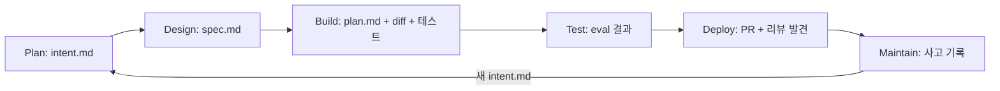
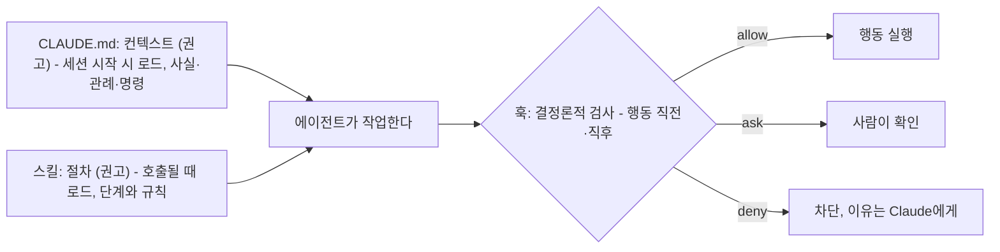

# 2장. 루프, 아티팩트, 세 겹의 통제

CLAUDE.md는 설정 파일이 아니다. 컨텍스트다. 설정은 훅이다.

이 세 문장이 낯설게 들린다면 이 장이 필요하다. Claude Code를 쓰는 많은 개발자가 CLAUDE.md를 `.eslintrc`나 `pyproject.toml` 같은 것으로 여긴다. 거기에 "절대 ~하지 말 것"을 적어 두면 지켜질 거라고 기대하고, 지켜지지 않으면 대문자로 바꾸고, 그래도 안 되면 같은 줄을 세 번 쓴다. 공식 문서는 이 파일을 "context, not enforced configuration"이라고 부른다 — 컨텍스트이고, 강제되는 설정이 아니라는 뜻이다. 반면 훅은 Claude가 행동하기 직전에 돌아가는 스크립트이고, 거기서 차단된 행동은 일어나지 않는다. 둘을 혼동하면 어떻게 될까? 반드시 지켜져야 할 규칙을 권고 자리에 두고, 지켜지지 않는다고 모델을 탓하게 된다.

이 장은 책 전체의 지도다. 여섯 단계를 루프로 보는 법, 단계마다 커밋되는 파일이 어떻게 다음 단계의 입력이 되는지, 에이전트를 통제하는 층이 왜 셋인지, 그리고 이 책이 끝까지 따라갈 예제 하나와 독자의 상황을 번역하는 렌즈 하나. 끝에서는 의존 그래프를 보고 자기 첫 플레이를 고른다.

## 루프로 보면 무엇이 달라지나

1장의 표는 여섯 행이었다. Plan, Design, Build, Test, Deploy, Maintain. 이 여섯 개를 그릴 때 우리는 보통 왼쪽에서 오른쪽으로 화살표를 긋는다. 계획이 설계로, 설계가 빌드로. 그 그림에서 Maintain은 끝이다. 운영에 들어간 소프트웨어를 지켜보다가 버그가 나오면 고친다.

코스의 블로그판은 이 그림을 바꾼다.

> "The AI-native SDLC is a reimagined process that combines the old control objectives with new enforcement. Instead of a linear flow, the process becomes a loop, and AI is embedded at each point."
>
> AI 네이티브 SDLC는 옛 통제 목표를 새 강제 수단과 결합해 다시 설계한 프로세스다. 선형 흐름 대신 프로세스는 루프가 되고, AI가 각 지점에 들어간다. — 코스 블로그판 "What is an AI-native SDLC?"

"옛 통제 목표"라는 표현을 눈여겨보자. 코스는 리뷰·승인·감사 추적 같은 전통적 통제가 틀렸다고 말하지 않는다. 그것들이 지키려던 목표는 그대로 두고, 지키는 수단을 바꾸자는 것이다. 사람이 매주 모여 결재하는 대신 훅이 행동 시점에 검사하고, 사람이 모든 줄을 읽는 대신 에이전트 리뷰가 먼저 읽고 사람은 의도와 위험을 본다.

그리고 "루프"다. Maintain이 끝이 아닌 이유는 운영 지표가 정상 범위를 벗어났을 때 그 사실이 새 `intent.md`로 쓰여 다시 Plan으로 들어가기 때문이다. 1장 표의 마지막 행 — "컨트롤 밴드를 벗어난 지표는 진단되어 새 `intent.md`로 루프에 되돌아간다" — 이 그 고리다. 13장에서 그 장면을 실제 파일로 보게 된다. 지금은 모양만 기억하자. 여섯 단계는 원이고, 원이 한 바퀴 돌면 처음 자리에 파일 하나가 더 놓여 있다.

## 아티팩트 체인 — 커밋이 다음 단계의 입력이 된다

그 루프를 실제로 잇는 것은 무엇일까? 회의도, 티켓도 아니다. 커밋된 파일이다.

> "The thread running through the right-hand column is the committed artifact. Each stage ends by writing one to version control (including `intent.md`, `spec.md`, `plan.md`, the diff and its tests, the PR with its review findings, and the incident record) and the next stage begins by reading it. ... The chain of commits is also the audit trail: who asked for what, what the agent produced, and who approved it."
>
> 오른쪽 열을 관통하는 실은 커밋된 아티팩트다. 각 단계는 그것을 버전 관리에 쓰면서 끝나고(`intent.md`, `spec.md`, `plan.md`, diff와 그 테스트, 리뷰 발견을 담은 PR, 사고 기록), 다음 단계는 그것을 읽으면서 시작한다. ... 커밋의 연쇄는 동시에 감사 추적이다. 누가 무엇을 요청했고, 에이전트가 무엇을 만들었고, 누가 승인했는가. — 코스 블로그판

그림 1. 루프와 아티팩트 체인 — 각 단계는 파일을 커밋하며 끝나고, 다음 단계는 그 파일을 읽으며 시작한다

이 그림에서 가져갈 것은 두 가지다.

첫째, 단계 사이의 인수인계가 파일이라는 점. 사람과 에이전트가 같은 파일을 읽고 같은 파일에 쓴다. 초기 단계의 아티팩트가 `.md`인 이유를 코스는 "제품 오너와 에이전트가 모두 읽고 행동할 수 있기 때문"이라고 설명한다. 빌드부터는 아티팩트가 코드와 그 기록이 된다.

둘째, 체인 자체가 감사 추적이라는 점. 누가 무엇을 요청했는지는 `intent.md`의 작성자와 타임스탬프에, 에이전트가 무엇을 만들었는지는 diff에, 누가 승인했는지는 PR의 머지 기록에 있다. 별도의 감사 로그를 만들지 않아도 git log가 그 역할을 한다. 개인에게 이것은 "결정이 어디 있었지?"라는 질문에 대한 답이기도 하다. 3장에서 바로 그 질문으로 시작한다.

코스는 체인의 트리거도 명시한다. "수락된 `intent.md`가 요구사항·설계 패스를 촉발하고, 승인된 `spec.md`가 플랜 모드를 촉발하고, 머지된 PR이 파이프라인을 촉발하고, 운영에서 컨트롤 밴드를 벗어난 지표가 다음 `intent.md`를 쓴다 — 그렇게 루프가 계속된다." 처음에는 각 단계를 손으로 프롬프트한다. 끝 상태는 수락된 아티팩트가 다음 게이트를 자동으로 당기는 루프다. 사람의 주의는 게이트에 모인다 — 에이전트가 플래그한 것을 리뷰하는 데에.

## 세 겹의 통제 — 컨텍스트, 절차, 강제

루프 안에서 에이전트는 많은 일을 한다. 그 행동을 무엇으로 통제할까? 코스 레슨 6의 거버넌스 문단이 이 책에서 가장 자주 되돌아올 정전이다.

> "A skill is a control, though an advisory one. It makes Claude likely to apply the policy while the code is written, and nothing forces a session to comply with it. A policy that must always hold needs something deterministic behind the skill, such as a hook that blocks the action or a review pass that re-checks the policy at the PR. The skill makes violations rare and the hook makes them close to impossible."
>
> 스킬은 통제 수단이지만 권고형이다. 코드가 쓰이는 동안 Claude가 정책을 적용할 가능성을 높이지만, 세션이 그것을 따르도록 강제하는 것은 없다. 항상 지켜져야 하는 정책에는 스킬 뒤에 결정론적인 무언가가 필요하다 — 행동을 차단하는 훅이나, PR에서 정책을 다시 검사하는 리뷰 패스 같은 것. 스킬은 위반을 드물게 만들고, 훅은 거의 불가능하게 만든다. — 코스 레슨 6

여기에 CLAUDE.md를 더하면 세 층이 된다.

그림 2. 세 겹의 통제 — CLAUDE.md와 스킬은 권고, 훅은 강제

**첫 층, CLAUDE.md는 컨텍스트다.** 새로 합류한 동료에게 첫날 건네는 한 페이지라고 생각하면 이해하기 쉽다. 빌드 명령, 코딩 관례, 아키텍처 한 단락, 그리고 "우리 팀이 자주 틀리는 것". 세션이 시작될 때 읽히고, 그 뒤 세션 내내 모델의 판단에 영향을 준다. 영향을 줄 뿐 보장하지는 않는다. 공식 문서의 표현을 다시 빌리면 "context, not enforced configuration"이다. 5장에서 이 파일이 왜 확률적으로 작동하는지, 현장에서 어떤 고통을 낳는지 자세히 본다.

**둘째 층, 스킬은 절차다.** `SKILL.md` 하나를 담은 폴더로, frontmatter가 "언제 발동하나"를, 본문이 "무엇을 하나"를 적는다. CLAUDE.md와 다른 점은 로드 시점이다. 항상 읽히는 대신 해당 작업이 호출될 때만 읽힌다. 그래서 길어도 평소에는 비용이 들지 않고, "~할 때는 1, 2, 3 순서로"처럼 절차가 된 지식을 두기에 맞다. 그래도 여전히 권고다 — 코스가 "advisory"라고 못 박은 대로.

**셋째 층, 훅은 강제다.** 코스의 정의로는 "Claude가 행동하기 전에 실행되어 허용·확인·차단할 수 있는 스크립트"다. 공식 가이드는 "deterministic control"이라고 부른다. 결정값은 `allow`, `ask`, `deny`(현행 사양에는 `defer`도 있다 — 11장). 모델이 어떤 판단을 했든 스크립트가 `deny`를 돌려주면 그 편집은 일어나지 않는다. 같은 검사를 PR의 필수 체크로 한 번 더 두면, 훅을 거치지 않고 브랜치에 도달한 변경까지 잡는다.

물론 이렇게 생각할 수 있다. "CLAUDE.md에 IMPORTANT를 붙여 크게 쓰면 되지 않나?" 많은 사람이 그렇게 하고, 어느 정도는 효과가 있다. 하지만 "어느 정도"가 문제다. 규칙이 어느 정도 지켜져도 되는 것이라면 그 자리는 CLAUDE.md가 맞다. 한 번도 어겨지면 안 되는 것이라면 — 테스트 파일을 고치지 말 것, 운영 DB에 명령을 보내지 말 것, 비밀 키를 로그에 남기지 말 것 — 그 자리는 처음부터 훅이다. 이 책에서 훅은 6장(빌드 가드레일), 8장(테스트 보호), 11장(승인 게이트), 12장(파이프라인)에 네 번 나온다. 같은 도구가 단계마다 다른 역할을 맡기 때문이고, 사양 설명의 본진은 11장이다.

세 층을 한 질문으로 압축하면 이렇다. 이 지식은 **사실**인가, **절차**인가, **반드시**인가? 사실이면 CLAUDE.md, 절차면 스킬, 반드시면 훅. 5·6장에서 이 질문을 체크리스트로 만든다.

## 관통 예제 — 보험사 포털을 내 서비스로 읽는 법

코스의 열두 플레이는 예시 파일을 전부 한 변경 건에서 꺼낸다. 어느 보험사의 고객 포털이다. 구성은 이렇다.

- `portal/` — TypeScript·React로 된 고객 사이트
- `claims-api/` — Python 3.12·FastAPI 백엔드
- `claims-core` — 클레임을 보관하는 구형 내부 시스템. 초당 50 요청(50 rps)까지만 받는다
- `intent/` — `intent.md`·`spec.md`·`plan.md`가 사는 폴더

변경 건의 이름은 "claims status self-service"다. 고객이 콜센터에 전화하지 않고 포털에서 자기 클레임의 상태를 보게 하자는 것. 3장의 `intent.md`가 이 요청을 적고, `spec.md`가 네 개의 요구사항으로 다듬고, 4장의 `plan.md`가 그 번호를 인용하고, 10장의 `REVIEW.md`가 플랜을 대조하고, 13장의 사고 기록이 다시 `intent.md`가 된다. 파일 열다섯 개쯤이 숫자 하나하나로 맞물려 있다 — 50 rps라는 제한이 60초 캐시를 낳고, 그 캐시 상수를 지우는 릴리스가 13장의 사고가 된다.

이 책은 그 체인을 그대로 쓴다. 왜 한국 독자에게 가까운 예제로 바꾸지 않았을까? 바꾸는 순간 열다섯 파일의 교차 참조를 전부 다시 짜야 하고, 그 과정에서 숫자 하나가 어긋나면 책이 모순을 품는다. 그보다는 보험사 도메인의 낯선 역할들을 자기 상황으로 읽는 법을 한 번 익히는 쪽이 싸다.

| 코스의 역할·사물 | 개인 개발자에게는 | 2~10명 팀에게는 |
|---|---|---|
| 제품 오너(product owner) | 미래의 나 — 석 달 뒤 이 결정을 다시 읽을 사람 | 기능을 제안한 사람, 또는 리뷰를 승인하는 한 명 |
| 손해사정인(loss adjuster) | 내 서비스의 외부 사용자 — 계정이 없거나 권한이 다른 사람 | 같음 |
| 체인지 티켓(change ticket) | 내가 나에게 남기는 승인 기록 — 커밋 메시지·PR 설명 | PR 승인 1명 + 라벨 |
| 플랫폼 엔지니어·테크 리드·릴리스 매니저 | 역시 나 | 설정 파일을 커밋하는 사람 |
| 보안·브랜드·UX 스킬 | 내 프로젝트의 제약 스킬 1~2개, 없으면 CLAUDE.md의 Conventions 절 | `.claude/skills/`에 커밋한 스킬 |
| `claims-core`의 50 rps | 내 서비스가 의존하는 외부 API의 레이트 리밋 | 같음 |
| 콜센터 상담원의 통화 시간 | 내가 반복해서 답하는 질문, 반복해서 손으로 하는 일 | 팀의 반복 문의 |

표의 왼쪽 열이 등장할 때마다 오른쪽 열로 바꿔 읽자. "제품 오너가 `intent.md`를 승인한다"는 문장은 개인에게 "내가 쓴 `intent.md`를 하룻밤 자고 다시 읽어 커밋한다"가 된다. 번거롭게 느껴질 수 있다. 하지만 그 하룻밤이 1장에서 말한 세 가지 시간 가운데 되돌리기 시간을 줄이는 가장 싼 투자다.

## 세 가지 태그 — 이 책의 지도

코스는 "조직이 계획·리뷰·테스트·배포 방식을 바꿀 수 있다"는 전제로 쓰였다. 이 책의 독자 대부분은 그 전제를 갖고 있지 않다. 그래서 모든 장의 끝에 "내 리포로 옮기기" 절을 두고, 각 항목에 세 태그 가운데 하나를 붙인다.

- `[개인 즉시]` — Pro/Max 개인 계정과 자기 리포만 있으면 오늘 할 수 있는 것
- `[팀 합의]` — 2~10명 팀이 `.claude/settings.json`과 리포 규약으로 합의하면 되는 것
- `[조직 결정]` — 관리자 콘솔, 관리형 설정, Team/Enterprise 플랜, 플랫폼 팀이 필요한 것. 이 책은 "이런 층이 있다"고 소개하고 개인·팀의 대체 경로를 함께 적는다

세 태그로 열두 플레이를 한 장에 펼치면 이 책의 지도가 된다. 각 셀은 해당 장에서 자세히 다루므로 지금은 훑어만 보자.

| 플레이 (장) | `[개인 즉시]` | `[팀 합의]` | `[조직 결정]` |
|---|---|---|---|
| 1 `intent.md` (3장) | 리포 안 `intent/` 폴더 + 템플릿 스킬 + 인터뷰 프롬프트 | PR 설명란을 intent 5섹션으로 | 비개발자 Claude 접근, GitHub 커넥터, 전용 intent 리포 |
| 2 `spec.md` (3장) | 제약 스킬 1~2개, "충돌을 플래그하라" 프롬프트, R1~ 번호 | intent 머지 → spec PR 자동화 | Claude Design 목업, 정책 소유자 라우팅 |
| 3 플랜 모드 (4장) | 플랜 → `Ctrl+G` 편집 → 승인 → auto; 플랜 생략 기준표 | `defaultMode: plan` 프로젝트 설정 | Jira/ServiceNow 소스 오브 트루스 |
| 4 CLAUDE.md (5장) | `/init` → 삭감 → 200줄 이하; `~/.claude/CLAUDE.md` | 루트 CLAUDE.md 커밋, `CLAUDE.local.md` 제외 | 관리형 CLAUDE.md |
| 5 스킬·빌드 훅 (6장) | 세 번째 붙여넣기 → `~/.claude/skills/`; 포매터·보호 파일 훅 | `.claude/skills/` 커밋, 플러그인 묶음 | 마켓플레이스, 정책 사인오프 |
| 6 병렬 세션 (7장) | `--worktree` 2~3개, `verifier` 서브에이전트 | `.claude/agents/` 커밋, `permissions.allow` | OTel 어트리뷰션, 에이전트 팀 |
| 7 피드백 루프 (8장) | 단일 테스트 타깃 + "Verifying your work" + 테스트 파일 보호 훅 | CI가 테스트 실행·증거 | OTel 포워딩 |
| 8 eval (9장) | eval 5~10개 + `check.sh` 로컬 루프 | Actions + `CLAUDE_CODE_OAUTH_TOKEN` | 인시던트 팀이 eval 작성 |
| 9 PR 리뷰 (10장) | `/code-review`, `/security-review`, Writer/Reviewer 두 세션 | claude-code-action + `REVIEW.md` + 사람 승인 1명 | 관리형 Code Review(Team/Enterprise) |
| 10 승인 게이트 훅 (11장) | "후회할 행동 목록" → `deny`/`ask` 훅, `/sandbox` | `.claude/settings.json` 훅 커밋 | 관리형 설정, 체인지 티켓 |
| 11 CI/CD (12장) | 실패 시 트리아지 `claude -p`, `deploy.sh dev\|staging\|prod` | 브랜치 보호, 환경별 토큰, `dontAsk` + `--allowedTools` | 클라우드 라우팅, 컨테이너 샌드박스, 릴리스 매니저 |
| 12 메트릭 루프 (13장) | CI 실패율 1개 + 33줄 스크립트 + σ 티어 | cron 워크플로 + `bands.yaml` | Claude Tag, Prometheus, OTel |

왼쪽 열만 따라가도 책의 뼈대가 서고, 그것만으로도 루프 한 바퀴를 혼자 돌릴 수 있다. 가운데 열은 팀이 생기면 추가하고, 오른쪽 열은 그런 층이 있다는 것만 알아 두면 된다. 조직이 커지면 어느 날 그 열에 도달한다 — 그때 코스의 거버넌스 절이 왜 그렇게 쓰였는지 비로소 이해가 될 것이다.

## 첫 플레이 고르기 — 의존 그래프

열두 플레이를 순서대로 다 할 필요는 없다. 코스는 각 플레이의 "Prerequisites"로 의존 관계를 적고, 그래프의 맨 윗줄에 선행 조건이 없는 플레이 여섯 개를 놓는다. 그래프 이미지는 캡처되지 않아 아래 표는 각 레슨의 문장으로 복원한 것이다 — 실선·점선 구분은 문장 해석이다.

| 플레이 (장) | 필수 선행(실선) | 도움(점선) |
|---|---|---|
| 1 `intent.md` (3장) | 없음 | — |
| 2 요구사항·설계 (3장) | 1, 5(스킬) | — |
| 3 플랜 모드 (4장) | 없음 — 코스는 "선행 없는 6개"에 포함 | 1/2의 아티팩트, 4 |
| 4 CLAUDE.md (5장) | 없음 | — |
| 5 스킬 (6장) | 없음 | 4 |
| 6 병렬 세션·서브에이전트 (7장) | 4 | 7 |
| 7 피드백 루프 (8장) | 없음 | — |
| 8 eval (9장) | 4, 7 | — |
| 9 PR 리뷰 (10장) | 4 | 5, 6 |
| 10 승인 게이트 훅 (11장) | 없음 | — |
| 11 CI/CD (12장) | 9, 10 — "게이트가 먼저 있어야 자동화가 그것을 통과시킨다" | — |
| 12 메트릭 루프 (13장) | 1, 9, 10, 11 | — |

선행 조건이 없는 여섯 개는 코스 원문 그대로 이렇다. Plan의 `intent.md`, Build의 플랜 모드·CLAUDE.md·스킬, Test의 피드백 루프, Deploy의 승인 게이트 훅. 코스는 "플레이는 모듈이고, 조직은 자기 필요에 따라 어느 단계부터 바꿀지 고를 수 있다"고 쓴다. 블로그판의 표현을 빌리면, 맨 윗줄의 플레이는 아무것도 가리키고 들어오지 않으니 아무것도 먼저 필요하지 않다.

그렇다면 개인은 어디서 시작하는 게 좋을까? 이 책의 순서는 3장부터 13장까지 루프 순서다. 그것은 읽는 순서로는 맞지만, 시작하는 순서로는 가장 좋지 않을 수 있다. `intent.md`는 선행 조건이 없지만, 개인이 오늘 저녁에 가장 큰 차이를 느낄 플레이는 다른 쪽에 있다.

그래서 한 가지 순서를 제안한다 — 이것은 코스 원문이 아니라 레퍼런스 리서치에서 합성한 제안이다. CLAUDE.md 감사(5장) → 피드백 루프(8장) → 플랜 모드(4장) → 개인 수준의 훅: 테스트 파일 보호와 위험 명령 차단(8·11장) → 스킬(6장) → 워크트리(7장) → `/code-review` 루틴(10장) → `intent/` 폴더와 첫 intent·spec(3장) → 소형 eval(9장) → CI 트리아지와 메트릭(12·13장). 근거는 단순하다. 혼자 바로 할 수 있고 당장 효과가 보이는 것이 앞, 다른 플레이나 조직 결정이 필요한 것이 뒤. 14장에서 이 순서를 첫 30일로 펼친다.

이 제안을 그대로 따를 필요도 없다. 지금 가장 찜찜한 곳이 어디인가? Claude가 매번 같은 실수를 반복한다면 CLAUDE.md부터. "테스트 통과"라는 말을 믿을 수 없다면 피드백 루프부터. 지난주에 `rm -rf`나 `git push --force`를 보고 심장이 내려앉았다면 훅부터. 의존 그래프는 "먼저 해야 할 것"을 알려 주지만, "먼저 하고 싶은 것"은 독자가 안다.

## 비용 감각, 그리고 이 책의 버전 기준

한국 독자가 Claude Code 이야기에서 가장 먼저 묻는 것은 비용이다. GeekNews의 어느 도입 스레드에서 첫 댓글이 "비용은 얼마정도 나올까요"였던 것은 우연이 아니다. 책 초반에 감각을 맞춰 두자.

Pro·Max 구독은 API 종량제와 다르게 사용량 창으로 제한된다. 일정 시간 창 안에서 쓸 수 있는 양이 정해져 있고, 다 쓰면 창이 다시 열릴 때까지 기다린다. 그래서 개인에게 비용은 달러보다 "창이 얼마나 빨리 닳는가"로 체감된다. 이 창을 가장 빨리 닳게 하는 것이 무엇인지는 7장에서 다룬다 — 요청하지 않은 서브에이전트가 병렬로 돌아 사용량을 금방 소진했다는 개인 체험 보고가 현장에 있다.

숫자를 보고 싶다면 두 가지가 있다. 대화형 세션에서는 `/cost`가 현재 세션의 사용량을 보여 준다. 헤드리스(비대화형, `claude -p`) 실행에서는 `--output-format json`을 붙이면 결과에 `total_cost_usd`와 모델별 비용 내역이 들어온다. 9장과 12장의 CI 잡은 이 값을 기록한다. 조직은 OpenTelemetry로 집계하지만, 개인에게는 이 두 숫자와 세션 로그가 대체 경로다. 비용 상한이 필요하면 `--max-budget-usd`(print 모드 전용)가 있다.

커뮤니티에 떠도는 비용 수치는 전부 "검증 필요"로 읽자. "Pro로는 멀티에이전트 실험이 부족하고 Max를 권한다"는 한국 블로그의 보고, 작업당 몇 달러라는 2025년 초의 해외 보고가 있지만 모델·버전·작업이 다 달라 자기 상황에 그대로 옮길 수 없다. 공식 문구로 확인되는 것은 이 책이 해당 장에서 그 범위 안에서만 적는다 — 관리형 Code Review의 비용 안내(10장), 에이전트 팀의 "토큰 비용은 선형으로 증가한다"(7장).

마지막으로 이 책이 어느 시점에 서 있는지 못 박아 두자. 코스는 2026년 8월에 쓰였고, 예시의 `requiredMinimumVersion`은 `"2.1.193"`이다. 이 책의 공식 문서 확인 기준은 **Claude Code 2.1.303 (2026-10-18)** 이고, 코스 서술과 현행 문서가 다를 때는 현행 문서를 따른다. 그런 지점마다 아래와 같은 박스를 둔다.

> **구버전 주의** — 코스(2026-08)는 Opus 4.8·Sonnet 5·Fable 5가 최신이던 시기에 쓰였다. 현행(2026-10)의 라인업은 Fable 5.1(2026-09-01), Opus 5.5(2026-09-22), Sonnet 5.5(2026-09-28), Haiku 5.5(2026-10-07)이고, 넷 모두 컨텍스트 윈도 1M 토큰이다. 이 책은 모델 이름을 꼭 구분해야 할 때만 쓰고, 벤치마크 점수는 싣지 않는다. 모델 라인업은 이 책이 다루는 것 가운데 가장 빨리 바뀌는 항목이니 공식 릴리스 노트를 함께 확인하자.

여기까지가 지도다. 루프 한 장, 세 층 한 장, 역할 번역 표 한 장, 세 태그의 매트릭스 한 장, 의존 그래프 한 장.

이제 과제 하나. 의존 그래프 표로 돌아가 자기 첫 플레이를 하나만 고르자. 그리고 그 장으로 바로 건너뛰어도 좋다 — 각 장은 자기 플레이를 독립적으로 설명하고, 관통 예제의 앞 파일이 필요하면 그 자리에서 다시 보여 준다. 순서대로 읽는다면, 바로 뒤에 루프의 첫 파일인 `intent.md`가 기다리고 있다.
