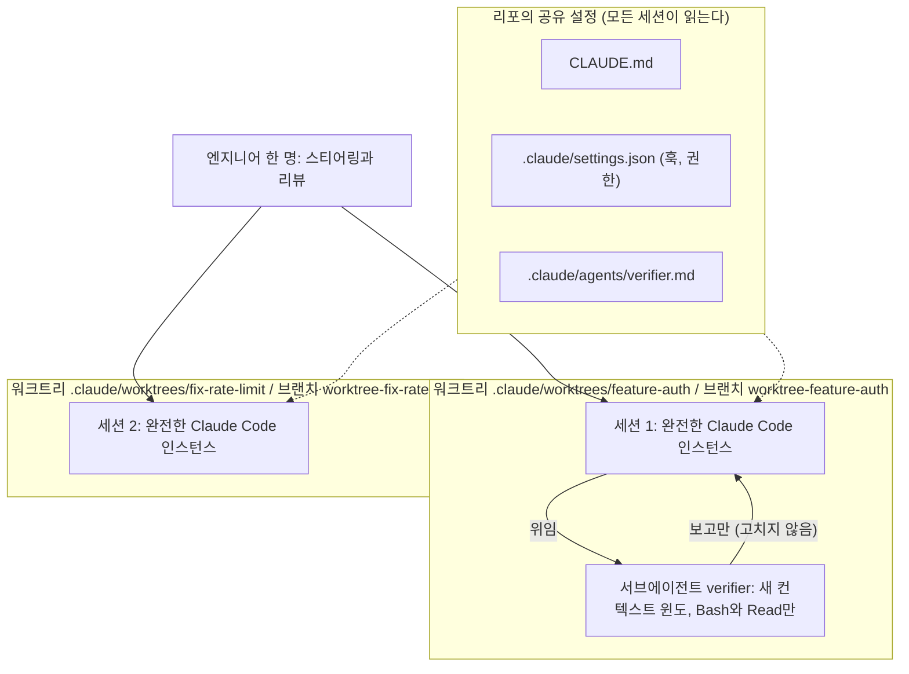

# 7장. 병렬 세션과 서브에이전트 — 리뷰어는 여전히 한 명이다

### 세 배 빨라질까

세 세션을 동시에 돌리면 세 배 빨라질까?

앞 장까지 우리는 한 세션을 다루는 법을 다듬었다. 계획을 받고, CLAUDE.md를 비우고, 절차는 스킬로, 반드시는 훅으로 옮겼다. 세션 하나가 이만큼 믿을 만해졌다면, 터미널을 하나 더 열면 안 되나? 코스 레슨 7은 이 질문으로 시작한다. "One engineer can drive several streams of work at once." 전통 쪽 칸과 AI 네이티브 쪽 칸을 나란히 보자.

> "One engineer works one task at a time and spends a significant portion of their day/week on builds, tests, and reviews. Switching between tasks while waiting is possible, but the context switch is tiring enough that few people choose to." ↔ "One engineer runs several Claude sessions at once, each in its own worktree on its own task. Repeated jobs become subagents with their own context and tool limits. The engineer's job shifts to orchestrating and, eventually, to building and monitoring loops."
>
> 한 엔지니어가 한 번에 한 작업을 하고, 하루와 한 주의 상당 부분을 빌드·테스트·리뷰에 쓴다. 기다리는 동안 다른 작업으로 옮길 수는 있지만 컨텍스트 전환이 피곤해서 그렇게 하는 사람은 드물다. ↔ 한 엔지니어가 여러 Claude 세션을 동시에 돌리고, 세션마다 자기 워크트리에서 자기 작업을 한다. 반복되는 일은 자기 컨텍스트와 도구 제한을 가진 서브에이전트가 된다. 엔지니어의 일은 조율로, 그리고 결국에는 루프를 만들고 지켜보는 쪽으로 옮겨 간다. (코스 레슨 7)

두 용어를 코스의 정의로 못 박아 두자. 병렬 세션은 "another full Claude Code instance, working a separate task in its own Git worktree" — 자기 Git 워크트리에서 별도 작업을 하는 또 하나의 완전한 Claude Code 인스턴스다. 그리고 결정적인 한 줄이 따른다. "Each independent session knows nothing about the others, and the engineer steering them is the only thing they share." 각 세션은 서로에 대해 아무것도 모르고, 그들이 공유하는 유일한 것은 그들을 조종하는 엔지니어다. 서브에이전트는 "a scoped helper with its own context window and tool limits" — 한 세션 안에서 자기 컨텍스트 윈도와 도구 제한을 가지고 도는 범위 한정 도우미다.

이 장의 제목은 두 번째 인용문에서 왔다. 세션이 셋이어도 그들을 조종하고 결과를 읽는 사람은 한 명이다. "세 배"의 답은 그 한 명이 셋을 리뷰할 수 있는가가 정한다.

### 코스의 네 단계와 `verifier`

코스의 실행 단계는 넷이다.

1. 작업을 "서로 다른 파일을 건드리는" 단위로 나눈다. 어디가 독립적인지는 4장의 `plan.md`가 보여 준다 — Files that change 절이 겹치지 않으면 병렬이 가능하다. 파일을 공유하는 작업은 한 세션에서 차례로 한다.
2. 병렬 작업마다 자기 워크트리를 준다. 한 터미널에서 `claude --worktree feature-auth`, 다른 터미널에서 `claude --worktree fix-rate-limit`. 워크트리는 자기 브랜치를 가진 별도 체크아웃이라 세션들이 파일에서 충돌하지 않는다.
3. "Two or three sessions is a sensible starting point. The practical ceiling is how many streams one person can review properly, so add sessions only while review is keeping up." 둘이나 셋이 출발점이고, 상한은 한 사람이 제대로 리뷰할 수 있는 흐름의 수다.
4. 반복되는 일은 `.claude/agents/`의 마크다운 파일로 정의한 서브에이전트로 만든다. 이름, 언제 쓰는지에 대한 설명, 건드릴 수 있는 도구. 코스의 예는 코드 단순화기, 앱을 띄워 동작을 확인하는 검증기, 메인 컨텍스트를 넘치게 하지 않고 보고하는 조사기다. 정의 파일은 Git에 커밋해 팀이 공유한다.

1번이 앞 장들과 이어지는 고리다. 계획이 없으면 어느 작업이 독립적인지 추측하게 되고, 추측이 틀리면 두 세션이 같은 파일을 서로 다르게 고친 뒤에야 알게 된다. 3번은 이 장 전체의 규율이다. "리뷰가 따라가는 동안에만." 혼자 일하는 독자에게 이 규율은 더 엄격해진다. 리뷰어가 자기 하나다.

관통 예제의 서브에이전트 정의를 보자. 파일은 `.claude/agents/verifier.md`다. (코스 캡처본의 frontmatter 구분선 앞뒤 빈 줄은 표준 `---` 블록으로 정리했다. 내용은 원문 그대로다.)

```markdown
---
name: verifier
description: Runs the app and checks the change works before the session reports done
tools: Bash, Read
---
Start the app with make run. Exercise the changed behavior and the two
nearest neighboring flows. Report what you ran, what you saw, and any
behavior that does not match plan.md. Do not fix anything; report only.
```

세 가지가 설계다. 첫째, `tools: Bash, Read`. 편집 도구가 없다. 고칠 수 없으니 "테스트를 통과시키려 코드를 손대는" 유혹 자체가 없다. 둘째, "the two nearest neighboring flows" — 바뀐 동작과 함께 가장 가까운 인접 흐름 둘을 돌린다. 회귀를 잡는 최소 범위다. 셋째, 대조 기준이 `plan.md`다. 4장에서 커밋한 그 파일이 검증의 잣대로 다시 읽힌다. 마지막 문장 "Do not fix anything; report only."가 전부를 요약한다. 이 서브에이전트는 8장의 피드백 루프와 짝을 이룬다.

거버넌스 문단은 짧다. "More sessions means more output, so the controls have to come from configuration in the repo. Hooks and permission settings there apply to all sessions." 세션이 늘면 산출이 늘고, 그래서 통제는 리포 안의 설정에서 와야 한다. 앞 장에서 만든 훅이 세션을 늘릴 수 있는 전제 조건이었던 셈이다. 사람이 세션마다 지켜볼 수 없으니, 설정이 지켜본다.

세션·워크트리·서브에이전트가 어떻게 놓이는지 한 그림으로 보자.


그림 1. 병렬 세션·워크트리·서브에이전트의 관계 — 세션들은 서로를 모르고, 리포의 설정과 엔지니어만 공유한다

### 현행 사양: 워크트리

Claude Code 2.1.303 / 2026-10 기준으로 `--worktree`(짧게 `-w`)가 하는 일을 정리하자. 코스는 명령 한 줄만 보여 주고 나머지는 공식 문서에 맡겼다.

`claude --worktree <name>`은 `<repo>/.claude/worktrees/<name>`에 격리된 Git 워크트리를 만들고 거기서 Claude를 시작한다. 이름을 주지 않으면 Claude Code가 하나 만든다. 브랜치 이름은 `worktree-<name>`이다. 이름 자리에 `#<number>`나 GitHub PR URL을 주면 `origin`에서 그 PR을 받아 워크트리를 딴다. 베이스는 기본이 `"fresh"`(원격의 기본 브랜치, 보통 `main`)이고 `"head"`로 바꾸면 현재 로컬 `HEAD`에서 분기한다. `.gitignore`에 `.claude/worktrees/`를 넣어 두자.

워크트리는 새 체크아웃이므로 개발 환경을 거기서 다시 초기화해야 한다. `.env`처럼 gitignore된 파일을 새 워크트리마다 자동으로 가져가려면 리포에 `.worktreeinclude` 파일을 두고 경로를 적는다. 이 한 파일이 없으면 두 번째 세션이 "환경 변수가 없다"로 멈춘다.

정리 규칙은 셋이다. 이름 없는 세션의 워크트리가 깨끗하면 Claude가 워크트리와 브랜치를 자동으로 지운다. 작업이 남아 있으면 유지할지 묻는다. `-p` 비대화형 실행은 종료 프롬프트가 없으므로 워크트리를 정리하지 않는다 — CI에서는 직접 치워야 한다.

격리 검사도 있다. 워크트리 안의 세션이 메인 체크아웃의 경로를 `Edit`·`Write`·`NotebookEdit`로 건드리려 하면 Claude Code가 막고, git을 메인 체크아웃으로 돌리는 Bash 명령도 막는다. 앞 장의 훅과 관련해 하나 — "`${CLAUDE_PROJECT_DIR}` stays put ... `cwd` follows Claude." 훅의 `CLAUDE_PROJECT_DIR`는 세션이 시작된 프로젝트 루트에 고정되고, `cwd`는 워크트리로 따라간다. 코스의 `api-policy.sh`가 `CLAUDE_PROJECT_DIR`로 경로를 맞춘 이유다. 워크트리에서 "Yes, and don't ask again"을 누른 결정은 메인 체크아웃의 `.claude/settings.local.json`에 저장된다.

### 현행 사양: 서브에이전트, 그리고 그 다음 단계

서브에이전트 정의가 발견되는 순서는 다섯이다. 관리형 설정, `--agents` CLI 플래그, 프로젝트 `.claude/agents/`, 사용자 `~/.claude/agents/`, 플러그인의 `agents/`. 필수 필드는 `name`과 `description` 둘뿐이다. 코스의 `verifier.md`는 거기에 `tools`를 더했는데, 생략하면 쓸 수 있는 모든 도구를 상속하므로 "보고만 하는" 검증기에는 명시가 필요했다. 그 밖에 `model`(`sonnet`·`opus`·`haiku`·`fable`, 전체 모델 ID, 또는 `inherit`), `permissionMode`, `maxTurns`(초과하면 결과가 부분 완료로 표시된다), `skills`(스킬 전문이 주입된다), `memory`(세션 간 학습), `isolation`(`worktree`로 두면 임시 워크트리에서 돌고 변경이 없으면 자동 정리된다) 같은 필드가 있다.

서브에이전트가 무엇을 보는지가 가장 중요하다. "Each subagent starts with a fresh, isolated context window. It doesn't see your conversation history, the skills you've already invoked, or the files Claude has already read." 새로운 격리된 컨텍스트 윈도로 시작하며, 대화 기록도, 이미 호출한 스킬도, Claude가 이미 읽은 파일도 모른다. 받는 것은 자기 정의 파일의 시스템 프롬프트와 작업 디렉터리 같은 기본 환경 정보뿐이다. 결함처럼 보이지만 설계다. 검증기가 코드를 쓴 세션의 가정을 물려받지 않아야 검증이 의미 있다. 그리고 바로 이 점이 비용의 원인이기도 하다 — 서브에이전트는 필요한 파일을 다시 읽어야 한다.

내장 서브에이전트는 셋이다. Explore(읽기 전용 코드베이스 탐색), Plan, General-purpose. 부르는 방법은 프롬프트에 "Use the test-runner subagent to fix failing tests"처럼 적거나, `@"code-reviewer (agent)"`처럼 멘션하거나, 세션 자체를 `claude --agent code-reviewer`로 띄우는 것이다. `/batch`는 코스 1단계의 자동화판이다 — 작업을 5~30개의 독립 단위로 분해해 계획을 보여 주고, 승인하면 단위마다 격리된 워크트리에서 백그라운드 서브에이전트를 띄운다.

공식 Best practices의 두 패턴도 알아 두자. 하나는 Writer/Reviewer 두 세션이다. "A fresh context improves code review since Claude won't be biased toward code it just wrote." 새 컨텍스트는 자기가 막 쓴 코드에 편향되지 않는다. 다른 하나는 그 리뷰어에게 주는 경고다. "A reviewer prompted to find gaps will usually report some, even when the work is sound ... Tell the reviewer to flag only gaps that affect correctness or the stated requirements." 빈틈을 찾으라고 지시받은 리뷰어는 작업이 건전해도 보통 무언가를 보고하니, 정확성이나 명시된 요구사항에 영향을 주는 빈틈만 표시하라고 하라. 코스의 `verifier`가 대조 기준을 `plan.md`로 못 박은 것이 정확히 이 경고의 실천이다. 헤드리스 팬아웃 — 파일 목록을 돌며 `claude -p ... --permission-mode dontAsk`를 반복하는 패턴 — 은 12장에서 본다.

그리고 그 다음 단계가 있다. 에이전트 팀이다. 서브에이전트가 한 세션 안의 도우미라면, 에이전트 팀은 여러 Claude 인스턴스가 팀원으로 협업하는 구성이다. 이 책은 사용법을 다루지 않는다 — 리서치에서 확보된 것이 공식 비용 문구뿐이기 때문이다. 그 문구는 분명하다. "Agent teams use significantly more tokens than a single session. Each teammate has its own context window, and token usage scales with the number of active teammates." 토큰 사용은 팀원 수에 선형으로 늘어난다. 공식 문서는 "Before you set up a team, check whether a lighter option does the job"이라고 권하고, 팀원 생성은 대화형 세션이 필요하며 `-p`에서는 생성되지 않는다고 적는다. 헤드리스 CI에서 팀 기반 플레이는 성립하지 않는다는 뜻이다. 의도치 않은 팀 생성을 막으려면 `CLAUDE_CODE_EXPERIMENTAL_AGENT_TEAMS=0`을 둔다.

### 네 가지 선택지 — 무엇이 늘고 무엇은 늘지 않나

이제 비교해 보자. 단일 세션, 병렬 세션, 서브에이전트, 에이전트 팀. 이 표는 공식 문서와 코스의 정의를 저자가 한 표로 모은 것이다.

| | 단일 세션 | 병렬 세션 | 서브에이전트 | 에이전트 팀 |
|---|---|---|---|---|
| 격리 | 없음 | 워크트리·브랜치 | 컨텍스트 윈도 (선택적으로 워크트리) | 인스턴스 |
| 컨텍스트 | 하나, 대화가 쌓임 | 세션마다 독립, 서로 모름 | 새 윈도, 대화 기록을 모름, 결과는 요약되어 돌아옴 | 팀원마다 자기 윈도 |
| 비용 | 기준 | 세션 수에 비례 | 다시 읽는 만큼 추가, 팀보다 낮음 | 팀원 수에 선형 증가, "significantly more" |
| CI(`-p`)에서 | 가능 | 셸 루프로 가능 | 가능 | 생성되지 않음 |
| 어울리는 일 | 루틴, 파일을 공유하는 작업 | 파일이 겹치지 않는 독립 작업 2~3개 | 검증·조사·단순화처럼 반복되는 범위 한정 작업 | 서브에이전트로 부족할 때, 대화형에서만 |

어느 쪽이 나을까? 공식 문서의 기준은 짧다. "For research, review, and new feature work, the extra tokens are usually worthwhile. For routine tasks, a single session is more cost-effective." 조사·리뷰·새 기능에는 추가 토큰이 보통 값어치를 하고, 루틴 작업에는 단일 세션이 비용 효율적이다. 의사결정은 두 질문으로 줄어든다. 파일이 겹치나? 겹치면 단일 세션에서 차례로, 안 겹치면 병렬 세션. 반복되는 범위 한정 작업인가? 그렇다면 서브에이전트, 그것도 "리뷰가 따라가는 만큼만".

"서브에이전트는 요약만 돌아오니 늘 싸다"고 여기기 쉽다. 그런데 현장 보고는 다르다. HN의 긴 스레드에서 한 사용자는 "What really burns tokens is sub agents"라고 썼고, 다른 사용자가 이유를 설명했다. 서브에이전트는 각자 필요한 컨텍스트를 얻기 위해 코드베이스의 일부를 다시 읽어야 한다. "fresh, isolated context window"의 뒷면이다. Dev.to의 한 글은 요청하지 않은 병렬 서브에이전트가 Pro 플랜의 사용량 창을 약 15분에 소진했다고 썼다 — 순차 실행이었다면 약 30분이었을 것이라는 개인 체험이다. 블로그에는 구체적인 배수가 떠돌지만 공식 페이지에서 확인되지 않으므로 이 책은 인용하지 않는다. 확인되는 것은 "significantly more"와 "선형 증가"까지다.

그래서 현장에는 비용 통제 휴리스틱이 생겼다(전부 커뮤니티 의견이다). 전역 CLAUDE.md에 "도구 호출 5개 미만의 작업은 인라인으로", "명시적으로 요청하지 않으면 서브에이전트를 쓰지 말라"는 줄을 두는 것, 서브에이전트에는 작은 모델을 쓰는 것, 그리고 공식 권고와 같은 순서 — 팀 전에 서브에이전트를, 서브에이전트 전에 단일 세션을 검토하는 것. 한국 GPTers의 한 후기는 반대 방향의 경험을 들려준다. PM 역할 하나에 전문 에이전트 여섯을 둔 구성인데, 이유가 "AI 한 명에게 모든 걸 시키니 역할이 섞이고 결과가 들쭉날쭉했거든요"였다. 역할 분리가 품질을 올렸다는 체감이고, 비용은 그 대가다. 토큰 비용 대 생산성 논쟁의 핵심이 여기 있다 — 양쪽 다 맞고, 작업의 크기에 오버헤드를 맞추는 것이 답이다.

왜 "리뷰가 따라가는 만큼만"일까? Kapoor 외의 "AI Agents That Matter"(TMLR)는 에이전트 평가가 정확도만 보고 비용을 무시한다고 비판하며 비용도 메트릭이라고 못 박았다. 세션을 늘려 산출을 늘렸다면 그만큼의 토큰과 리뷰 시간도 같은 표에 적어야 한다. Mozannar 외(CHI 2024)는 AI 보조 프로그래밍에서 사람이 제안을 읽고 검증하는 데 상당한 시간을 쓴다는 것을 보였다 — 비율 수치는 원문을 대조하지 못해 적지 않는다. 그리고 1장의 METR 연구가 다시 돌아온다. 성숙한 코드베이스에서 AI가 개발자를 느리게 했다는 결과는 세션 수가 곧 생산성은 아님을 말한다. 병렬 세션은 산출을 늘리고, 산출은 리뷰를 늘리고, 리뷰는 한 사람의 시간이다. 그 시간이 바닥나면 세션을 하나 더 여는 것은 리뷰되지 않은 코드를 하나 더 만드는 것이다.

### 내 리포로 옮기기

`[개인 즉시]` 오늘 할 수 있는 것은 넷이다. 첫째, `.gitignore`에 `.claude/worktrees/`를, `.worktreeinclude`에 `.env`를 넣고 `claude --worktree <name>`을 두 개 띄워 본다. 셋을 넘기지 말자 — 리뷰어가 하나다. 둘째, 첫 서브에이전트로 코스의 `verifier`를 그대로 `.claude/agents/verifier.md`에 둔다. `make run`만 자기 리포의 실행 명령으로 바꾼다. 셋째, `~/.claude/CLAUDE.md`에 "서브에이전트는 명시적으로 요청할 때만"이라는 한 줄을 넣는다 — 요청하지 않은 팬아웃으로 사용량 창이 녹는 일을 막는 현장 합의다. 넷째, 세션을 늘린 날은 `/cost`를 한 번 더 본다. 비대화형이라면 `--output-format json`의 `total_cost_usd`가 같은 역할을 한다.

`[팀 합의]` `.claude/agents/*.md`를 리포에 커밋하면 팀이 같은 검증기를 쓴다. 코스가 인프라 조건으로 든 "permission settings tuned so sessions are not waiting on approval prompts"는 `.claude/settings.json`의 `permissions.allow`로 번역한다. 안전하다고 합의한 명령을 사전 승인해 두지 않으면 병렬 세션은 승인 프롬프트 앞에서 기다리는 세션이 된다.

`[조직 결정]` 코스가 선행 지표로 든 "OpenTelemetry 내보내기에서 센 엔지니어당 동시 세션 수"는 `CLAUDE_CODE_ENABLE_TELEMETRY=1`과 OTel 백엔드가 있는 조직의 이야기다. 기본은 꺼져 있고, 리포의 `.claude/settings.json`으로는 켤 수 없다. 에이전트 팀은 토큰이 선형으로 늘고 대화형 전용이므로 "서브에이전트 다음 단계"로만 둔다. 개인의 대체 경로는 `/cost`와 `total_cost_usd`다.

측정은 코스의 두 지표를 개인판으로. 선행 지표 "steering vs waiting" — 세션을 조종하는 시간과 기다리는 시간의 비율 — 은 체감으로 적는다. 기다리는 시간이 늘어 세션을 더 열 생각이 든다면, 먼저 리뷰 시간이 남아 있는지 묻자. 지연 지표 "주당 머지된 변경 수와 재작업률"은 주당 머지된 PR 수와 revert 수로 대신한다. 머지가 늘고 revert도 늘었다면 세션이 리뷰를 앞질렀다는 신호다.

세션을 둘로 늘렸고, 검증기가 각 세션의 끝에서 `plan.md`와 대조해 보고한다. 그래도 그 보고를 읽고 머지를 누르는 사람은 하나다. 세션이 자기 일을 스스로 검증할 수 있다면, 당신이 지켜봐야 할 세션은 몇 개로 줄어들까?
