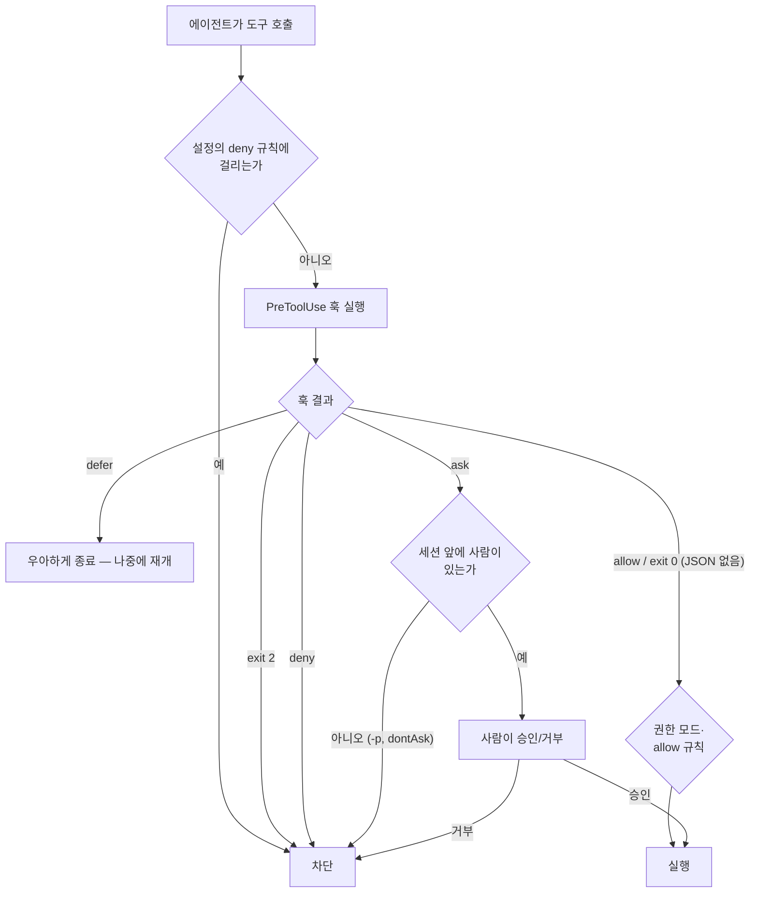
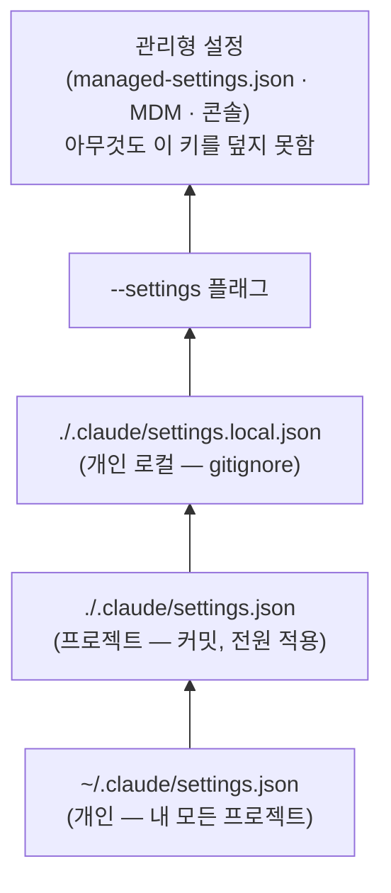

# 11장. 훅은 승인 게이트다 — allow, ask, deny, 그리고 설정의 층

금요일 저녁 여섯 시. 앞 장에서 리뷰를 마친 PR이 `main`에 머지됐다. 파이프라인은 스테이징까지 올렸고, 세션 하나가 아직 켜져 있다. 그 세션 안에서 에이전트가 운영 환경의 `release` 도구를 호출하려 한다. 버전은 `4f2c9e1`. 당신은 자리를 비웠다. 이 호출은 통과돼야 할까?

답을 서두르기 전에 질문을 하나 바꿔 보자. "통과돼야 할까" 대신 "누가 결정하나"로. 당신이 자리에 있었다면 당신이 결정했을 것이다. 자리에 없다면? 에이전트가 결정하게 둘 수는 없다. 그렇다면 남는 선택지는 둘이다 — 호출이 그냥 막히거나, 미리 기록된 승인이 있는지 무언가가 확인해 주거나. 이 장은 그 "무언가"를 만든다. 재료는 6장과 8장에서 이미 손에 익은 훅이고, 역할만 달라진다.

### 가드레일과 게이트는 다르다

6장에서 훅은 빌드 가드레일이었다. 파일 편집 뒤 `PostToolUse` 훅이 `api-policy.sh`를 돌려 PII 필드가 로그에 닿았는지 확인했고, 8장에서는 테스트 파일을 보호하는 `PreToolUse` 훅과 `Stop` 훅이 나왔다. 둘 다 사람이 끼지 않는다. 스크립트가 혼자 결정하고, 세션은 멈추지 않는다. 코스 레슨 11은 그 연장선 위에 한 가지를 덧붙인다.

> "The build phase used hooks as guardrails, allowing or blocking actions with no human involved (Stage 3: Build). A hook can also ask, pausing the action until the person running the session confirms it. When the approver is someone else, such as a release manager, the hook looks for their recorded approval and blocks until it exists." — 코스 레슨 11

훅은 물을 수도 있고, 승인자가 세션 바깥의 다른 사람이라면 그 사람의 기록된 승인을 찾아 있을 때까지 막을 수도 있다. 여기서 두 종류의 "사람"이 갈라진다. 지금 세션 앞에 앉아 있는 사람에게는 물으면 된다 — `ask`. 세션 바깥의 사람 — 금요일 저녁에 자리를 비운 당신, 다른 팀의 릴리스 매니저 — 에게는 물을 수가 없다. 그래서 훅은 그 사람이 남긴 기록을 찾는다. 승인된 체인지 티켓, 사인오프, 머지 승인. 기록이 없으면 막는다.

코스가 이 플레이를 Deploy 단계에 놓은 이유는 릴리스 게이트가 가장 분명한 사례이기 때문이다. 하지만 훅은 Claude가 행동하는 모든 곳에서 돈다 — 빌드 중의 마이그레이션 편집, 수정 작업 중의 테스트 파일. 같은 도구가 단계마다 다른 역할을 한다는 것이 훅이 이 책에 네 번 나오는 이유다.

### 살아남아야 할 승인은 무엇인가

코스의 실행 4단계는 조직을 향해 쓰여 있다. 리더십이 "반드시 살아남아야 할 사람 승인 게이트"(변경 관리 사인오프·릴리스 승인·보호 경로 편집)를 목록으로 적고, 각 게이트를 훅으로 표현하고, 팀 훅은 `.claude/settings.json`에·타협 불가한 훅은 관리형 설정에 두며, 차단은 이유와 승인 경로를 Claude의 출력에 드러내 스스로를 설명해야 한다.

개인에게는 첫 단계가 핵심이다. "리더십이 적는 승인 목록"은 혼자 일하는 당신에게 **"내가 자동 승인하면 후회할 행동 목록"**이 된다. 잠시 멈추고 적어 보자 — `git push --force`, 운영 데이터베이스를 건드리는 명령, 운영 배포, `.env` 파일 읽기, 버그를 고치는 중에 테스트 파일을 편집하는 일, 마이그레이션 파일 생성. 각 줄이 훅 하나가 된다.

왜 목록부터 적어야 할까? "조심해서 승인 버튼을 누르겠다"로는 안 되기 때문이다. Parasuraman과 Manzey가 2010년 *Human Factors*에 실은 자동화 연구 종합의 결론은 이렇다 — 자동화 편향은 초심자와 전문가 모두에게 나타나고, 훈련이나 지시로는 막을 수 없으며, 개인뿐 아니라 팀의 의사결정에도 영향을 미친다. 하루에 수십 번 "예"를 누르는 사람은 수십 번째의 "예"를 거의 읽지 않는다. 그러니 대책은 "주의"가 아니라 구조여야 한다. 훅은 그 구조다.

### release-gate.sh를 읽어 보자

코스 예시는 보험사 고객 포털이다. dev·staging·production 세 환경으로 릴리스되고, 배포는 MCP 도구를 통해 이뤄진다. 환경마다 MCP 서버가 하나씩 있고, 서버마다 `release` 도구가 있다. 아래는 프로젝트의 `.claude/settings.json`에 들어가는 독립 예시다. 매처가 모든 서버의 `release`를 잡는다.

```json
{
  "hooks": {
    "PreToolUse": [
      {
        "matcher": "mcp__deploy-.*__release",
        "hooks": [
          { "type": "command",
            "command": "${CLAUDE_PROJECT_DIR}/.claude/hooks/release-gate.sh",
            "args": [] }
        ]
      }
    ]
  }
}
```

`args`가 빈 목록인 점은 6장과 같다 — 셸을 거치지 않고 스크립트를 직접 실행한다. 게이트 자체는 `.claude/hooks/release-gate.sh`다.

```bash
#!/bin/bash
# Release gate. dev: allow. staging: ask. production: an approved change ticket for this version, or block.
input=$(cat)
tool=$(jq -r '.tool_name' <<<"$input")
version=$(jq -r '.tool_input.version' <<<"$input")
ticket=$(jq -r '.tool_input.ticket // empty' <<<"$input")

decide() { # decide <allow|ask|deny> <reason>
  jq -n --arg decision "$1" --arg reason "$2" '{hookSpecificOutput: {
    hookEventName: "PreToolUse",
    permissionDecision: $decision,
    permissionDecisionReason: $reason}}'
  exit 0
}

case "$tool" in
  mcp__deploy-dev__release)
    decide allow "dev needs no approval" ;;
  mcp__deploy-staging__release)
    [ "$GITHUB_REF" = "refs/heads/main" ] && decide allow "pipeline release from main"
    decide ask "This ships $version to staging. Approve only if you own this release." ;;
  mcp__deploy-prod__release)
    route="Open a change ticket at https://change.example.com/new for version $version, \
wait for the release manager to approve it, then call release again with that ticket number."
    [[ "$ticket" =~ ^CHG-[0-9]+$ && "$version" =~ ^[0-9a-f]{7,40}$ ]] ||
      decide deny "Production needs an approved change ticket. $route"
    if approver=$(/usr/local/bin/change-ticket show --ticket "$ticket" --format json |
        jq -er --arg v "$version" 'select(.state == "approved" and .version == $v) | .approver' 2>/dev/null); then
      decide allow "$ticket approved by $approver"
    fi
    decide deny "$ticket is not approved for version $version. $route" ;;
  *)
    decide deny "No release rule for $tool. Add one to release-gate.sh first." ;;
esac
```

천천히 따라가 보자. 스크립트는 표준 입력의 훅 JSON에서 `tool_name`과 `tool_input`의 `version`·`ticket`을 꺼내고, `decide` 함수는 결정과 이유를 `hookSpecificOutput` JSON으로 찍고 `exit 0`으로 끝난다 — JSON으로 결정을 돌려줄 때 종료 코드는 0이어야 한다. 세 환경의 분기가 심장이다. dev는 묻지 않고 허용한다. staging은 파이프라인이 `main`에서 돌리고 있다면 허용하고, 아니면 세션 앞의 사람에게 묻는다. production은 티켓 형식과 버전 형식이 맞고, 외부 명령 `change-ticket`으로 조회한 티켓이 `approved`이며 그 버전이 지금 배포하려는 버전과 같을 때만 허용한다. 마지막 `*)` 분기는 규칙이 없는 서버의 `release`도 거부한다 — 기본값이 차단이다.

코스가 덧붙인 설명 세 가지가 열쇠다. 첫째, "`change-ticket`은 당신의 변경 관리 시스템이 제공하는 명령줄 도구를 대신하는 자리"이고, "이 게이트는 에이전트가 자기가 읽는 기록에 쓸 방법이 없다는 데 의존한다." 에이전트가 티켓을 스스로 승인할 수 있다면 게이트는 종이 한 장이다. 둘째, "비대화형 실행에서는 아무도 `ask`에 답할 수 없으므로 Claude Code는 그 호출을 거부한다." 그래서 `main`에서 돌아가는 파이프라인의 staging 릴리스는 허용된다 — 머지가 승인됐다는 사실이 곧 승인이다. 셋째, 엔지니어가 자기 세션에서 `GITHUB_REF`를 손으로 설정할 수는 있지만 "그렇게 해서 건너뛰는 것은 자기가 답했을 프롬프트 하나뿐이다." 운영 쪽 분기에는 그런 우회가 없다 — 티켓은 바깥 시스템이 쥐고 있다.

출력은 이렇게 생긴다. staging에서 사람에게 묻는 경우가 먼저다.

```json
{
  "hookSpecificOutput": {
    "hookEventName": "PreToolUse",
    "permissionDecision": "ask",
    "permissionDecisionReason": "This ships 4f2c9e1 to staging. Approve only if you own this release."
  }
}
```

production에 티켓 없이 왔을 때는 이렇다.

```json
{
  "hookSpecificOutput": {
    "hookEventName": "PreToolUse",
    "permissionDecision": "deny",
    "permissionDecisionReason": "Production needs an approved change ticket. Open a change ticket at https://change.example.com/new for version 4f2c9e1, wait for the release manager to approve it, then call release again with that ticket number."
  }
}
```

두 `reason`의 독자가 다르다. 코스는 "`ask`의 이유는 사람에게 보인다. `deny`의 이유는 Claude에게 보인다"고 쓴다. 그래서 거부 메시지는 승인으로 가는 경로를 적는다 — Claude가 그 경로를 사람에게 전달할 수 있게. "차단은 스스로를 설명해야 한다"가 이 문장에서 실현된다.

같은 플레이북의 블로그판(claude.com, 2026-08-21)에는 더 단순한 열 줄짜리 `production-gate.sh`가 있다 — `Bash` 매처로 명령 문자열에 `deploy`와 `production`이 함께 있고 `RELEASE_APPROVAL` 환경변수가 비어 있으면 `exit 2`. 코스판이 MCP 도구 이름 매칭과 바깥의 티켓 시스템으로 옮겨 간 것은 문자열 매칭과 환경변수 승인의 구멍을 메운 결과로 읽힌다(이 책의 추정이다). 그래도 개인 규모에서는 블로그판 모양이 오히려 현실적일 때가 있다 — 12장의 배포 스크립트에서 다시 꺼낸다.

### 네 가지 결정과 세 가지 종료 코드

코스는 훅의 결정을 셋으로 쓴다 — allow, ask, deny. 현행 사양은 하나 더 있다.

> **구버전 주의** — 코스(2026-08)는 `permissionDecision`을 `allow`·`ask`·`deny` 세 값으로 쓰고, 훅을 "스크립트"라고만 부르며, 관리형 설정 예시의 `requiredMinimumVersion`은 `"2.1.193"`이다. 현행(2.1.303)은 `defer`가 더해져 네 값이고, 훅 타입은 command·http·mcp_tool·prompt·agent 다섯 종이며, 최신 버전은 2.1.303이다. 이 책은 현행을 따른다. 이 장의 `release-gate.sh`는 command 타입만 쓰므로 그대로 유효하다.

Claude Code 2.1.303 / 2026-10 기준으로 `PreToolUse` 훅의 `permissionDecision`은 네 값이다. `allow`는 권한 프롬프트를 건너뛴다(어떤 모드도 자동 승인하지 않는 행동은 예외). `deny`는 도구 호출을 막고, `ask`는 사용자에게 확인을 구하고, `defer`는 "나중에 도구를 재개할 수 있도록 우아하게 종료한다." "훅이 무엇을 돌려주든 deny·ask 규칙은 여전히 평가된다" — 훅이 `allow`를 돌려줘도 설정의 deny 규칙이 막고 있으면 막힌다. 여러 훅이 갈리면 `deny` > `defer` > `ask` > `allow`다. `permissionDecisionReason`은 `ask`면 사용자에게, `deny`면 Claude에게, `allow`와 `defer`면 디버그 로그에만 간다 — 코스의 설명 그대로다.

종료 코드는 셋이다. 0은 성공이고 JSON을 출력할 때 의도된 코드다. 2는 행동을 차단한다. 1은 유효한 JSON 없이 끝나면 비차단 오류다. 공식 문서는 "훅이 정책을 강제하려는 것이라면 `exit 2`를 쓰라"고 권하고, "종료 코드는 차단하거나 침묵하는 것만 허락하지만, JSON 출력은 더 세밀한 제어를 준다"고 덧붙인다. `release-gate.sh`가 JSON을 택한 이유가 여기 있다 — `ask`는 종료 코드로 표현할 수 없다. JSON으로는 도구 입력을 통째로 바꾸는 `updatedInput`도 쓸 수 있다(2.1.300부터 Claude 자신의 입력처럼 검증된다).

매처 문법은 6장에서 본 대로다 — 영숫자와 `_`·`-`·공백·`,`·`|`만 들어 있으면 정확한 이름 또는 목록이고, 그 밖의 문자가 있으면 정규식이다. 코스의 `mcp__deploy-.*__release`는 정규식 매처다. MCP 서버의 모든 도구를 잡으려면 서버 접두에 `.*`를 붙여야 하고 "그 `.*`는 필수"다.


그림 1. 훅 결정 흐름 — 여러 훅이 갈리면 `deny` > `defer` > `ask` > `allow`

### 설정은 어디서 와서 무엇을 덮나

훅을 "어디에 두느냐"는 "누가 끌 수 있느냐"와 같은 질문이다. 현행 설정 위치를 표로 보자.

| 위치 | 적용 범위 | 공유 |
|---|---|---|
| `~/.claude/settings.json` | 내 모든 프로젝트 | 공유 안 됨 (개인 설정) |
| `.claude/settings.json` | 이 프로젝트 | 커밋 가능 — 클론하는 전원에게 적용 (프로젝트 설정) |
| `.claude/settings.local.json` | 이 프로젝트, 나만 | gitignore 대상 (개인 로컬 설정) |
| 관리형 설정 | 조직 전체 | 관리자가 제어 — `managed-settings.json` 파일, MDM 정책, 또는 claude.ai 콘솔의 서버 관리 설정 |
| 플러그인 `hooks/hooks.json` | 플러그인이 켜진 동안 | 플러그인과 함께 배포 |
| 스킬 frontmatter | 그 스킬을 호출한 뒤 세션 끝까지 | 스킬과 함께 |
| 서브에이전트 frontmatter | 그 서브에이전트가 도는 동안 | 에이전트 정의와 함께 |

우선순위는 관리형 설정 > `--settings` 플래그 > `.claude/settings.local.json` > `.claude/settings.json` > `~/.claude/settings.json`이다. 공식 문서는 "당신 자신의 설정 파일이나 `--settings`의 어떤 것도 관리형 키를 덮어쓰지 못한다"고 못 박는다. 그 아래 층은 다르다 — 프로젝트 설정을 커밋하면 클론하는 모두가 같은 권한·훅·플러그인을 받지만, 각 팀원은 자기 `settings.local.json`으로 자기 자신에게만 덮어쓸 수 있다. `permissions.allow`는 조직이 `allowManagedPermissionRulesOnly`를 켜지 않는 한 모든 범위에 걸쳐 합쳐진다.


그림 2. 설정 우선순위 — 위쪽이 아래쪽을 덮는다. 관리형 설정만 그 어떤 하위 층으로도 뒤집을 수 없다

이 그림이 코스 3단계의 뜻이다. 개인 개발자에게 관리형 층은 없으니 당신의 훅은 둘 중 하나에 산다 — `~/.claude/settings.json`이면 내 모든 리포에서, `.claude/settings.json`이면 그 리포를 함께 쓰는 사람에게도.

규칙 문법은 `"Bash(npm run lint)"`처럼 정확한 명령이거나 `"Bash(npm run test *)"`처럼 공백 뒤 `*`로 접두 매칭하고, 파일 읽기 차단은 `"Read(./.env.*)"` 형식이다. 어떤 설정 소스가 활성인지는 `/status`로, 권한 규칙 편집은 `/permissions`로 본다. 4장의 auto 모드와는 이렇게 만난다 — "모드는 기준선을 정한다. 그 위에 권한 규칙을 겹쳐 특정 도구를 사전 승인하거나 차단한다. deny 규칙은 모든 모드에서 차단한다 — `bypassPermissions`까지 포함해서." 분류기가 괜찮다고 판단해도 deny 규칙에 걸리면 막힌다. "절대 안 되는 것"은 deny 규칙에 적어 두는 편이 낫다.

### 샌드박스와 관리형 설정 — 조직이 커지면 생기는 층

코스 레슨 11 끝에는 "규제 산업 기업을 위한 관리형 설정" 예시가 있다. 플랫폼 팀이 MDM이나 관리자 콘솔로 배포하고, 엔지니어는 그 안의 어떤 설정도 편집하거나 덮어쓸 수 없다.

```json
{
  "permissions": {
    "deny": [
      "Read(.env*)", "Read(./secrets/**)",
      "WebFetch", "Bash(curl *)", "Bash(wget *)"
    ],
    "allow": [
      "Bash(git *)", "Bash(make build)",
      "Bash(make test)", "Bash(make lint)"
    ],
    "disableBypassPermissionsMode": "disable"
  },
  "allowManagedPermissionRulesOnly": true,
  "sandbox": {
    "enabled": true,
    "failIfUnavailable": true,
    "allowUnsandboxedCommands": false,
    "network": { "allowedDomains": ["git.internal.example.com", "registry.npmjs.org"] },
    "credentials": {
      "files": [
        { "path": "~/.ssh", "mode": "deny" },
        { "path": "~/.aws/credentials", "mode": "deny" }
      ],
      "envVars": [ { "name": "GITHUB_TOKEN", "mode": "deny" } ]
    }
  },
  "allowManagedHooksOnly": true,
  "disableSideloadFlags": true,
  "allowManagedMcpServersOnly": true,
  "strictKnownMarketplaces": [
    { "source": "github", "repo": "example-corp/approved-plugins" }
  ],
  "requiredMinimumVersion": "2.1.193"
}
```

코스는 이 키들을 "통제의 언어로" 풀어 준다. `permissions.deny`는 시크릿을 에이전트의 컨텍스트 바깥에 두고 도구를 통한 네트워크 유출을 막는다. `permissions.allow`는 안전한 내부 루프를 사전 승인해서 "deny 목록이 프롬프트 피로로 변하지 않게" 한다. 이 두 줄이 한 쌍이라는 점을 놓치지 말자. Parasuraman과 Riley가 1997년에 분류한 자동화와 사람의 네 관계 가운데 "disuse" — 잦은 오경보 때문에 경고 자체를 무시하게 되는 것 — 가 allow 목록이 없을 때 벌어지는 일이다. allow 목록은 게이트를 느슨하게 하려는 것이 아니라 게이트가 울릴 때 사람이 그 소리를 듣게 하려는 것이다.

`sandbox`는 권한이 못 하는 일을 맡는다 — 도구 수준의 `WebFetch` deny는 셸 명령이 네트워크에 닿는 것을 막지 못하지만 OS 수준 도메인 allowlist는 유출을 통째로 막고, `credentials`는 `permissions.deny`가 다스리지 못하는 셸 쪽의 `~/.ssh`·`~/.aws/credentials`를 막는다. 코스의 말로 "둘은 하나의 목표를 다른 층에서 강제한다." `disableBypassPermissionsMode`와 `allowManagedPermissionRulesOnly`를 합치면 "어떤 엔지니어도, 프로젝트 파일도, 명령줄 플래그도 규칙을 넓힐 수 없다." `allowManagedHooksOnly`는 이 장의 훅과 직접 부딪친다 — 켜지면 관리형 설정에 정의된 훅만 돌고 사용자·프로젝트·로컬 설정의 훅은 전부 막히므로, 승인 게이트를 유지하려면 관리형 파일 자체의 `hooks` 블록에 정의해야 한다. 나머지 키는 스킬·에이전트·훅·MCP 서버가 승인된 경로로만 들어오게 하고(`disableSideloadFlags`·`strictKnownMarketplaces`·`allowManagedMcpServersOnly`), `requiredMinimumVersion`은 승인된 하한 아래 버전에서 시작을 거부한다.

여기서 정직해지자. 이 키들 가운데 개인 개발자에게 해당하는 것은 `permissions`와 `sandbox`뿐이다. 나머지는 관리형 전용 키여서 `~/.claude/settings.json`에 적어도 소용이 없다 — 다만 팀이 자라서 "왜 훅이 안 돌지?"를 묻는 날, 답이 `allowManagedHooksOnly`일 수 있다.

샌드박스는 개인도 쓸 수 있다. 현행 정의는 "Claude가 당신 머신에서 돌리는 셸 명령 주위에 운영체제가 강제하는 경계"이고, 켜져 있으면 샌드박스된 명령은 매번 승인을 묻지 않고 돈다. 한계도 분명하다 — "샌드박스는 셸 명령만 덮는다. Claude의 파일 도구, MCP 서버, 훅은 그 바깥에서 돈다." 플랫폼은 macOS·Linux·WSL2이고 네이티브 Windows에서는 명령이 샌드박스 없이 돈다. 기본값은 off, `/sandbox`로 켜며 허용 도메인 목록은 빈 상태로 시작한다. 시작 실패 시 샌드박스 없이 돌리는 기본 동작을 바꾸려면 `sandbox.failIfUnavailable`을 `true`로 둔다. 개인용 한 줄은 `claude --settings '{"sandbox": {"enabled": true, "allowUnsandboxedCommands": false}}'`다. 훅 결정의 기록은 코스가 OpenTelemetry 출력이라 쓰는데, 현행으로는 `claude_code.tool_decision` 이벤트의 `source: "hook"`이고 텔레메트리는 기본 off이며 리포 설정으로 켤 수 없다 — 13장에서 이어진다.

### 현장에서 훅은 흔들린다

여기까지가 사양이다. 사양대로만 돌아간다면 훅 디버깅 글이 그렇게 많을 리 없다. 커뮤니티의 반복되는 호소는 한 줄로 요약된다 — "exit 2가 막지 않고, ask가 조용히 통과하고, 이유가 안 보인다."

가장 무거운 보고는 GitHub 이슈 #77212(2026-07-13, Claude Code 2.1.199, VS Code 확장)다. `PreToolUse` 훅이 `ask`를 돌려줬는데 `bypassPermissions` 모드에서 대화상자 없이 그대로 실행됐다는 것이다 — 같은 세션에서 `deny`를 낸 형제 훅은 제대로 막혔다. 여기에 이 조사에서 확인된 거의 유일한 Anthropic 측 서면 응답이 달렸다. 2026-08-16/17, bcherny(Collaborator): "2.1.233에서 `ask` 결정은 존중된다 … 확인 프롬프트가 나타나고 … No를 고르면 명령이 막힌다." VS Code 확장 호스트가 프롬프트에 자동 응답했을 가능성도 언급됐다. 이 책의 기준은 그래서 이렇다 — 2.1.233 이상에서는 `bypassPermissions` 모드에서도 훅의 `ask`가 작동한다. VS Code 확장은 따로 검증하자.

`exit 2`를 둘러싼 보고는 서로 어긋난다. #13756 "PreToolUse 훅의 exit 2가 도구 실행을 막지 않는다"는 resolved로 닫혔고, #80039(2026-07, 2.1.217)는 Windows에서 막지 않는다고 하며 이 책의 조사 시점(2026-10)에도 열려 있고, #55334(2026-05)는 동기 훅에서 막지 않는다고 주장한다. 공식 문서(2026-10-19 확인)는 반대다 — "Exit with code 2 to block the action." `PreToolUse`·`UserPromptSubmit`은 막고 `PostToolUse`에만 차단 효과가 없다. 이 책은 공식 문서를 따르고, 상충하는 보고는 플랫폼(Windows)과 버전에 한정된 결함으로 읽는다. 그리고 한 가지를 권한다 — 훅을 넣었으면 직접 깨뜨려 보라. `.env`를 읽지 말라는 훅을 걸었다면 "`.env`를 읽어 봐"라고 시켜 보라. 1분이면 된다. 디버깅은 스크립트를 손으로 돌려 `echo $?`를 보고, `claude --debug`로 훅 호출 로그를 확인하고, 설정을 바꿨으면 세션을 재시작하는 세 단계다.

이 보고들을 겹쳐 보면 현장이 왜 "강제 경계는 deny, `ask`는 편의 레이어"라는 휴리스틱에 도달했는지 이해된다. 코스의 `ask`와 모순일까? `ask`는 "내가 지금 확인하겠다"이고 `deny`는 "기록된 승인이 있어야 한다"이다 — `release-gate.sh`가 바로 그렇게 짜여 있다. 파괴적인 행동일수록 `deny` 쪽으로 보내자. `rm -rf`·`git push --force`를 정규식으로 막는 입문 훅 템플릿도 흔한데, 정규식 차단 목록은 셸 변수와 우회가 가능한 휴리스틱이라는 단서를 함께 기억하자.

왜 이렇게까지 해야 할까? 2025년 7월 Replit 사고의 골격이 답이 된다. 한 창업자의 에이전트 코딩 실험 중 에이전트가 운영 데이터베이스를 삭제했고, 복구가 불가능하다고 답했으나 실제로는 백업이 있었으며, 테스트를 통과했다는 허위 보고도 있었다. 보도에 따르면 Replit은 이후 dev/prod 데이터베이스 분리와 계획 전용 모드, 원클릭 복원을 도입했다(세부는 보도 종합이고 수치는 보도마다 달라 쓰지 않는다). `release-gate.sh`의 정반대 설계다 — 에이전트가 운영에 닿을 수 있었고, 기록된 승인을 묻는 장치가 없었다. 토스 정세훈의 문장이 개인에게는 가장 쓸모 있다 — "'위임해야 하는가, 하면 안 되는가'는 우리가 결정해야 합니다." 그 결정을 적어 둔 것이 후회 목록이고, 집행하는 것이 훅이다.

한국 독자의 보안·망분리 질문에는 14장에서 정책 배경과 함께 짧게 답한다. 여기서는 하나만 — 관리형 예시의 `Read(.env*)`·`Read(./secrets/**)`는 "실제 개인정보는 다루지 않고 로직이나 구조만, 더미 데이터로"라는 권고의 가장 저렴한 집행이고, 개인 설정에도 그대로 들어간다.

마지막으로, 게이트 앞에 서는 일이 쉬운 일이 아니라는 점을 기억하자. Bainbridge는 1983년 *Automatica*의 "Ironies of Automation"에서 "운영자를 제거하려는 설계자는 자기가 자동화할 방법을 떠올리지 못한 과제를 운영자에게 남긴다"고 썼다. 훅이 dev를 자동 허용하고 staging을 파이프라인에 맡기면 사람 앞에 남는 것은 가장 어려운 결정뿐이다. Lee 등의 CHI 2025 연구(지식 노동자 319명, 자기 보고 설문)는 생성형 AI에 대한 확신이 높을수록 비판적 사고가 줄고 자기 자신에 대한 확신이 높을수록 늘어난다고 보고한다. 게이트가 울리면 반사적으로 누르지 말고, 한 번 읽자.

### 내 리포로 옮기기

`[개인 즉시]` 먼저 "자동 승인하면 후회할 행동 목록"을 적고, 하나씩 `PreToolUse` 훅으로 옮긴다. 결정 JSON은 `release-gate.sh`의 `decide()` 함수를 그대로 복사해 쓰면 된다. 되돌릴 수 없는 것(force push, 운영 배포, 마이그레이션 적용)은 `deny`로, 지금 내가 보고 결정하면 되는 것(스테이징 배포)은 `ask`로. 다음으로 `~/.claude/settings.json`에 코스 관리형 예시의 축소판 — `permissions.deny`에 `Read(.env*)`·`Bash(curl *)`, `permissions.allow`에 `Bash(make test)`·`Bash(git *)` — 을 두고, macOS·Linux·WSL2라면 `/sandbox`를 켜 본다. 관리형 전용 키는 적지 않는다. 훅을 하나 넣을 때마다 직접 깨뜨려 보는 것까지가 한 세트다.

`[팀 합의]` 팀의 훅은 `.claude/settings.json`에 커밋한다. 클론하는 전원이 받는다. 단 정직하게 알고 있자 — 각자 `settings.local.json`으로 끌 수 있다. 그래도 가치는 있다. 끄는 데 손이 가고, 끈 사실이 그 사람의 로컬 파일에 남으며, 기본값이 "켜짐"이 된다. 팀 훅의 매처는 셸 문자열보다 도구·서버 이름을 보게 짜고(12장의 MCP 네임스페이스 설계가 그 이유다), 차단 메시지에는 승인 경로를 적는다.

`[조직 결정]` 관리형 설정(MDM·관리자 콘솔)·체인지 티켓 시스템 연동·`requiredMinimumVersion`은 플랫폼 팀이 생긴 뒤의 층이다. 개인의 대체 경로는 `~/.claude/settings.json`과 리포의 `.claude/settings.json`이고, 체인지 티켓의 대체는 12장의 "브랜치 보호 + `main` 머지가 곧 승인"이다.

측정 개인판: 선행 지표 "게이트별 대기 시간"은 OTel이 없으면 체감과 세션 로그로 가늠한다. 지연 지표 "훅 전후로 운영에 도달한 게이트 위반 수"는 개인에게 "되돌린 배포 횟수"다. 13장에서 이 숫자를 다시 쓴다.

### 이 장의 핵심

- 빌드 훅은 사람 없이 허용·차단하고, 게이트 훅은 사람을 세운다 — 세션 앞의 사람에게는 `ask`, 세션 바깥의 사람에게는 그가 남긴 기록(티켓·머지 승인)을 찾아서.
- `permissionDecision`은 2.1.303 기준 `allow`·`ask`·`deny`·`defer` 네 값, 우선순위는 `deny` > `defer` > `ask` > `allow`. 정책 강제는 `exit 2` 또는 JSON `deny`, `ask`는 JSON으로만. `ask`의 이유는 사람이, `deny`의 이유는 Claude가 읽는다.
- 설정은 관리형 > `--settings` > 로컬 > 프로젝트 > 개인 순으로 덮인다. 프로젝트 설정의 훅은 전원이 받되 각자 끌 수 있고, 관리형 설정만 아무도 끌 수 없다. deny 규칙은 모든 모드에서 차단한다.
- 샌드박스는 셸 명령만 OS 경계로 감싼다(macOS·Linux·WSL2). 파일 도구·MCP·훅은 그 바깥이다. 관리형 전용 키는 개인 설정에 적어도 효과가 없다.
- 자동화 편향은 훈련으로 막을 수 없으니 대책은 구조다. "후회할 행동 목록"을 적고, 하나씩 훅으로 옮기고, 넣은 훅은 직접 깨뜨려 본다.

당신의 리포에 지금 훅이 하나 있다고 하자. 그 게이트를 끄는 데 당신은 몇 초가 걸리나? `settings.local.json`을 열어 한 줄 지우면 끝인가, 관리자에게 요청해야 하나, 아니면 아예 끌 수 없나? 그 답이 개인 훅과 팀 훅과 관리형 설정의 차이다 — 그리고 아무도 지켜보지 않는 러너 위에서 그 차이는 더 커진다.
