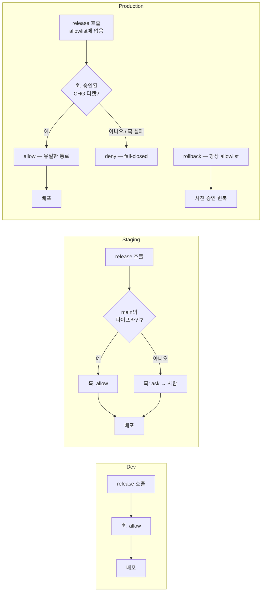

# 12장. 파이프라인 안의 Claude — 헤드리스, 샌드박스, 환경별 자율 티어

"일을 하지 못한 실행과 전부 해낸 실행이 똑같이 보인다." 2026년 7월, 한 개인 블로그(Wmedia Tips #151)에 올라온 문장이다. 글쓴이는 `claude -p`를 CI에서 돌리다가 이상한 것을 봤다. 에이전트가 권한 거부에 막혀 파일을 하나도 건드리지 못했는데, 종료 코드는 0이었고 결과 JSON은 `"subtype": "success"`, `"is_error": false`를 찍었다. 흔적은 `permission_denials` 배열 하나뿐이었고, 그 배열을 읽는 사람은 아무도 없었다. 이 보고는 검증되지 않은 개인 관찰이다. 다만 9장에서 본 대로 공식 헤드리스 문서(2026-10 기준)도 "실행이 실패하면" — 인증 누락처럼 실행 자체가 깨진 경우 — 0이 아닌 코드로 끝난다고 쓰고, 권한 거부는 최종 결과의 `permission_denials` 목록에 적힌다고 따로 쓴다. 두 진술은 모순이 아니다. 그리고 이 문장이 이 장의 문제를 정확히 가리킨다. 앞 장의 게이트는 "세션 앞에 사람이 있다"는 전제 위에 서 있었다. 그 사람이 없는 곳 — CI 러너 — 에서 Claude를 돌릴 때 무엇이 달라지는가?

### 아무도 답하지 않는 러너

코스 레슨 12는 전통과 AI 네이티브의 차이를 이렇게 적는다.

> "Pipelines run deterministic scripts, and anything that needs judgment waits for a human: for example, triaging the flaky test, writing the changelog, or working out why the build broke. Deployment and rollback are runbooks a human follows under pressure." → "Claude runs non-interactively inside the pipeline for the judgment steps, in a sandbox with scoped credentials. Deployment tooling is exposed to the agent through MCP, so the workflow that wrote and tested the change can also ship it and roll it back, inside gates the organization defines per environment." — 코스 레슨 12, What changes

전통 파이프라인은 결정론적 스크립트를 돌리고, 판단이 필요한 일 — 불안정한 테스트의 분류, 체인지로그 작성, 빌드가 왜 깨졌는지 알아내기 — 은 사람을 기다린다. 배포와 롤백은 사람이 압박 속에서 따라가는 런북이다. AI 네이티브 파이프라인에서는 Claude가 그 판단 단계를 비대화형으로 맡는다. 스코프가 제한된 자격 증명을 가진 샌드박스 안에서, 조직이 환경별로 정한 게이트 안에서.

여기서 "비대화형"이라는 말이 무겁다. 10장까지의 모든 상호작용에는 질문에 답할 사람이 있었다. 플랜을 승인하고, `ask`에 응답하고, 리뷰 코멘트를 읽는 사람. 러너에는 그 사람이 없다. 그러면 세 가지가 조용히 달라진다. 첫째, `ask`는 자동으로 거부가 된다 — 앞 장에서 봤듯 "비대화형 실행에서는 아무도 `ask`에 답할 수 없으므로 Claude Code는 그 호출을 거부한다." 둘째, auto 모드의 분류기가 연속으로 거부를 내면 세션이 중단될 수 있다 — 같은 블로그가 본 메시지는 "Agent aborted: too many classifier denials in headless mode"였다 — 턴을 넘겨 줄 사람이 없기 때문이다. 셋째, 실패가 조용해진다. 사람이 보고 있었다면 "어, 아무것도 안 했네"라고 알아챘을 일이 로그 한 줄로 지나간다.

그렇다면 어떻게 해야 할까? 현장이 도달한 휴리스틱은 세 줄이다. 허용 목록을 먼저 쓰고, `--dangerously-skip-permissions`는 격리된 컨테이너 안에서 `--max-turns`와 JSON 출력을 함께 둘 때만 쓰고, 결과를 파싱할 때 `is_error`만 믿지 말고 `permission_denials` 배열을 직접 검사해 비어 있지 않으면 빌드를 실패 처리한다. `permission_denials` 필드 자체는 공식 문서에 있으니 검사해서 손해 볼 것은 없고, 블로그 관찰대로라면 조용한 실패를 잡는다. 덧붙여 현장 보고로는 root(UID 0)에서 bypass 플래그 자체가 거부되고, 공식 문서상 헤드리스에서는 에이전트 팀도 생성되지 않는다. 러너 위의 Claude는 혼자이고, 묻지 못하고, 조용히 실패할 수 있다 — 이 장의 모든 설계가 그 세 조건에서 나온다.

### 읽기 전용 판단부터 시작한다

코스의 실행 6단계는 순서가 설계다. 플랫폼 엔지니어는 "읽기 전용 판단 스텝"으로 시작한다. 깨진 빌드를 분류하고, 불안정한 테스트를 요약하고, 체인지로그 초안을 쓰는 데 `claude -p`를 쓴다. 그다음에야 기존 게이트 뒤에 쓰기 스텝을 더한다 — 린트 수정, 생성 문서 갱신, `@claude` 멘션으로 리뷰 코멘트 처리. 에이전트가 쓰는 모든 것은 브랜치 보호를 거쳐 PR로 도착하고, 에이전트에게는 `main`에 푸시할 경로가 없다. 실행은 샌드박스된다 — 컨테이너, 네트워크 정책, 단기 스코프 토큰, 기본적으로 운영 자격 증명 없음. 네 번째가 배포를 MCP로 노출하는 것, 다섯 번째가 환경별 자율 티어, 여섯 번째가 롤백 리허설이다.

첫 단계의 파이프라인 스텝은 이렇다.

```yaml
- name: Triage failed build
  if: failure()
  run: >
    claude -p "Read the build log at out/build.log. Identify the most
    likely cause, say whether the failure looks flaky or real, and write a
    three-line summary for the PR thread." >> triage.md
```

`if: failure()`라서 빌드가 깨졌을 때만 돈다. 프롬프트는 로그를 읽고, 가장 가능성 높은 원인을 짚고, 불안정한 테스트인지 진짜 실패인지 말하고, PR 스레드용 세 줄 요약을 쓰라고 한다. 출력은 `triage.md`에 덧붙여진다. 이 스텝이 할 수 있는 해악이 무엇인지 생각해 보자. 로그를 잘못 읽을 수 있다. 세 줄이 틀릴 수 있다. 그게 전부다. 파일을 고치지 않고, 푸시하지 않고, 배포하지 않는다. 첫 스텝을 여기서 시작하는 이유는 비용과 권한이 모두 최소이고, 틀려도 사람이 읽는 요약 한 장이 틀리는 것으로 끝나기 때문이다.

여기서 한 가지 의문이 생긴다. 왜 쓰기 스텝은 "PR로만" 도착해야 할까? 10장에서 본 리뷰 게이트가 거기 있기 때문이다. Xia와 Miller의 2026년 분석(아직 심사 전인 연구)은 리뷰를 건너뛴 기여의 비율이 10%포인트 오르면 유지보수 부담이 약 6% 늘어난다고 추정한다. 에이전트가 `main`에 직접 쓸 수 있으면 그 "리뷰 없는 기여"가 구조적으로 늘어난다. 브랜치 보호는 그 경로를 아예 없앤다.

### 배포를 도구로 노출한다

코스 예시의 나머지는 보험사 포털의 배포다. 배포는 MCP 도구로 노출되고, 환경마다 서버가 하나다. 왜 서버를 셋으로 쪼갰을까? 코스의 설명이 핵심이다 — "MCP 도구를 허용하는 규칙은 서버와 도구의 이름을 지정하지, 도구의 인자는 지정하지 않는다. 그래서 환경별로 분리된 서버가 있어야 allowlist가 스테이징과 운영을 구분할 수 있다." 서버가 하나이고 `release(env="prod")`처럼 인자로 환경을 받았다면, 허용 규칙은 `prod` 인자를 볼 수 없다. 서버 이름이 경계다. 프로젝트의 `.mcp.json`은 이렇다.

```json
{
  "mcpServers": {
    "deploy-dev": {
      "type": "http",
      "url": "https://deploy.example.com/mcp/dev",
      "headers": { "Authorization": "Bearer ${DEPLOY_DEV_TOKEN}" }
    },
    "deploy-staging": {
      "type": "http",
      "url": "https://deploy.example.com/mcp/staging",
      "headers": { "Authorization": "Bearer ${DEPLOY_STAGING_TOKEN}" }
    },
    "deploy-prod": {
      "type": "http",
      "url": "https://deploy.example.com/mcp/prod",
      "headers": { "Authorization": "Bearer ${DEPLOY_PROD_TOKEN}" }
    }
  }
}
```

토큰이 환경변수로 들어오는 점을 보자. 잡이 스테이징 토큰만 갖고 있으면 다른 두 서버는 유효한 토큰을 받지 못해 잡을 거부한다. allowlist와 토큰이 같은 경계를 두 겹으로 지킨다. 모든 서버는 같은 세 도구를 제공한다.

| 도구 | 입력 | 반환 |
|---|---|---|
| `release` | `version`, 운영에서는 `ticket`도 | 롤아웃이 끝난 뒤 릴리스 ID |
| `status` | 없음 | 마지막 릴리스 5분 뒤까지 기다린 다음, 그 시간 동안의 엔드포인트별 5xx 비율 |
| `rollback` | 없음 | 다시 라이브가 된 버전 |

이 설계는 Anthropic이 2025년 9월에 쓴 "Writing effective tools for agents"의 권고와 맞물린다 — "네임스페이스(관련 도구를 공통 접두 아래 묶는 것)는 많은 도구 사이의 경계를 그리는 데 도움이 된다." 그리고 "도구가 많을수록 결과가 좋아지는 것은 아니다." 도구 셋, 서버 셋. 에이전트가 배포에 대해 할 수 있는 일의 전체 목록이 이 표 한 장이다. 코스의 표현을 빌리면 "에이전트의 배포 권한은 자격 증명이 든 셸 스크립트가 아니라 allowlist가 된다."

### 환경별 자율 티어

스테이징 잡은 `main`에 푸시될 때 돌고, 스테이징 서버의 세 도구만 사전 승인한다.

```yaml
- name: Release to staging and roll back if it is unhealthy
  env:
    ANTHROPIC_API_KEY: ${{ secrets.ANTHROPIC_API_KEY }}
    DEPLOY_STAGING_TOKEN: ${{ secrets.DEPLOY_STAGING_TOKEN }} # no other environment's token
  run: >
    claude -p "Release version ${{ github.sha }} of the claims portal to staging,
    then call status. If the 5xx rate on any endpoint is over 1%, roll back.
    Finish with three lines for the release notes: what you released, what status
    reported, and whether you rolled back."
    --allowedTools "mcp__deploy-staging__release,mcp__deploy-staging__status,mcp__deploy-staging__rollback"
    --permission-mode dontAsk >> release-notes.md
```

프롬프트를 읽어 보자. 커밋 SHA를 스테이징에 릴리스하고, `status`를 호출하고, 어느 엔드포인트든 5xx 비율이 1%를 넘으면 롤백하고, 릴리스 노트용 세 줄을 쓰라. `--allowedTools`에는 스테이징 서버의 세 도구만 있다. 그리고 `--permission-mode dontAsk`. 코스는 이 모드를 한 문장으로 설명한다 — "`dontAsk` 모드에서 Claude Code는 프롬프트를 띄웠을 모든 호출을 거부하므로, 목록에 없는 배포 도구는 거부되고 잡은 답을 기다리느라 멈추지 않는다." 현행 문서도 같다. `dontAsk`는 "프롬프트를 띄웠을 모든 호출을 거부하며, 잠긴 CI 실행에 유용하다. 수동 모드에서 승인이 필요 없는 행동 — 작업 디렉터리 안의 파일 읽기, 읽기 전용 명령 집합 — 은 여전히 돌고, `--allowedTools`나 `permissions.allow` 규칙이 덮는 행동도 돈다."

앞 장의 `release-gate.sh`가 여기서 환경을 가른다. 코스는 세 티어를 표로 정리한다.

| 환경 | allowlist의 도구 | `release`에 일어나는 일 | 누가 승인하나 |
|---|---|---|---|
| Dev | `release`, `status`, `rollback` | 훅이 허용한다 | 아무도 |
| Staging | `release`, `status`, `rollback` | 훅이 묻거나, `main`의 파이프라인에서는 허용한다 | 엔지니어, 또는 승인된 머지 |
| Production | `status`, `rollback` | 훅이 허용하지 않는 한 거부 | 릴리스 매니저, 체인지 티켓을 통해 |

운영 행을 다시 보자. allowlist에 `release`가 없다. 그러면 운영 릴리스는 어떻게 나가나? 코스의 설명을 그대로 옮긴다 — "운영에서 `dontAsk` 모드는 `PreToolUse` 훅이 승인한 호출은 여전히 실행하므로, `release`가 allowlist 밖에 있으면 훅의 `allow`가 유일한 통로다. 따라서 운영은 fail-closed다. 훅이 돌지 못하면 릴리스는 거부된다. `rollback`은 사전에 승인된 런북이므로 allowlist에 남는다." 이 문단이 이 장에서 가장 중요한 설계 결정이다. 운영 `release`를 막는 것은 allowlist가 아니다 — allowlist에서 빼 둔 상태에서 훅이 `allow`를 내야만 열리게 한 것이다. 훅 스크립트가 깨지거나, 티켓 시스템이 응답하지 않거나, `allowManagedHooksOnly` 때문에 훅이 로드되지 않으면 결과는 전부 "릴리스 안 됨"이다. 실패가 안전한 쪽으로 떨어진다.


그림 1. 환경별 3티어 — dev는 자유, staging은 머지 승인 또는 사람, production은 훅의 `allow`만이 통로이고 `rollback`은 늘 열려 있다

코스의 거버넌스 문장이 이 그림의 제목이다. "지배 원칙은 에이전트가 운영 게이트까지는 행동할 수 있고 그것을 넘을 수는 없다는 것이다." 세 통제가 이를 받친다. 브랜치 보호가 에이전트의 모든 쓰기를 PR로 바꾸고, 운영 배포 훅이 이름 붙은 릴리스 매니저가 승인하기 전까지 릴리스를 막으며, 환경별 권한 티어가 게이트까지 가는 길에서 에이전트가 얼마나 할 수 있는지를 정한다. 코스는 한 가지를 더 짚는다 — "각 비대화형 실행은 에이전트 자신의 ID로 행동하므로, 파이프라인 로그는 에이전트가 한 일과 그것을 트리거한 엔지니어가 한 일을 분리한다."

### 현행 사양 — 러너에서 쓰는 플래그들

Claude Code 2.1.303 / 2026-10 기준으로 러너에서 알아야 할 것들을 모아 보자.

**시작 모드는 항상 명시한다.** `-p`의 기본 권한 모드는 2026년 9월 말과 10월 중순 사이에 왕복했다. 2.1.285에서 서드파티 공급자·텔레메트리 off 환경의 `-p`가 auto로 시작하게 바뀌었고, 2.1.302에서 "권한 모드가 없는 `claude -p`와 Agent SDK 세션은 서드파티 공급자, 텔레메트리 off, 또는 새 설치에서 `default` 모드로 시작"하도록 되돌아갔다(`--permission-mode auto`를 주면 auto 유지). 결론은 하나다 — CI에서는 `--permission-mode`를 늘 적는다. 기본값에 기대면 다음 릴리스에서 파이프라인의 행동이 바뀐다. 2.1.259부터는 `--permission-prompts none`도 있다. "권한 프롬프트에 답할 사람이 없을 때, 예를 들어 예약 작업에서" 쓰라는 플래그다.

**세 종류의 도구 플래그는 다른 일을 한다.** `--allowedTools`는 "프롬프트 없이 실행되는 도구"다 — 승인을 건너뛸 뿐 다른 도구가 보이지 않게 되는 것은 아니다. 어떤 도구가 있는지를 제한하려면 `--tools`를 쓰고, `--disallowedTools`는 도구를 Claude의 컨텍스트에서 제거한다(`"Edit"`, `"*"`, `"mcp__*"`). 코스의 스테이징 잡은 "토큰은 스테이징만 + allowlist"로 두 겹을 쌓았는데, `--tools`로 다른 서버의 도구를 아예 안 보이게 하면 한 겹이 더 생긴다.

**예산과 모양을 못 박는다.** `--max-turns`와 `--max-budget-usd`(둘 다 print 모드 전용)는 러너가 무한히 도는 것을 막고, `--json-schema`는 출력 모양을 강제하며, `--append-system-prompt`는 시스템 프롬프트를 덧붙인다. 공식 지침은 교체 플래그를 "표면·정체성·권한 모델이 Claude Code와 다를 때, 이를테면 아무도 지켜보지 않는 파이프라인의 비코딩 에이전트"에 쓰라고 한다. 공유 머신의 평가 하네스에는 `--restricted`(2.1.248+)가 있다 — "Claude Code가 명령을 실행하거나 그 머신의 사용자·프로젝트 설정을 읽어서는 안 될 때."

**`--bare`와 `.mcp.json`은 함께 확인한다.** `--bare`는 "스크립트·SDK 호출에 권장되는 모드이고, 향후 릴리스에서 `-p`의 기본값이 될 것"이다. 9장에서 봤듯 CLAUDE.md·스킬·훅을 건너뛰고, 2.1.286부터는 "명령줄에 지정한 MCP 서버만 연결"한다. 이 장의 `.mcp.json`에 의존하는 잡에 `--bare`를 붙이면 서버를 명시하지 않는 한 배포 도구가 사라진다 — 쓰기 전에 공식 문서를 함께 확인하자. 이 부분은 빠르게 바뀌고 있다.

**SDK와 클라우드 라우팅.** Agent SDK는 "Claude Code를 움직이는 것과 같은 도구·에이전트 루프·컨텍스트 관리를 Python과 TypeScript에서 프로그래밍 가능하게" 준다. 다른 언어라면 "`-p`와 `--output-format json`으로 CLI를 서브프로세스로" 돌린다. 인증은 API 키다 — Anthropic은 사전 승인 없이는 서드파티 개발자가 claude.ai 로그인이나 사용량 한도를 자기 제품에 제공하는 것을 허용하지 않는다. GitHub Actions에서는 `use_bedrock`·`use_vertex`·`use_foundry`로 OIDC 페더레이션 인증을 써 트래픽을 조직의 클라우드 계약 안에 둘 수 있다. 업계 비교로 한 줄만 — OpenAI의 `codex-action@v1`은 `sandbox`와 `safety-strategy`(기본 `drop-sudo`)로 같은 문제를 푼다. Claude 쪽의 짝은 `--permission-mode dontAsk`와 `--allowedTools`다.

### 롤백은 가장 리허설된 경로

코스 6단계는 롤백을 이렇게 쓴다. "롤백은 파이프라인에서 가장 리허설된 경로여야 한다. 에이전트가 돌릴 수 있는 단일 명령이고, 스테이징에서 정기적으로 연습된다. 루프를 닫는 플레이(Stage 6: Maintain)는 컨트롤 밴드가 깨졌을 때 이 롤백을 호출하므로, 미리 증명돼 있어야 한다." 스테이징 스텝의 프롬프트가 이미 그 리허설이다 — 릴리스 뒤 `status`를 보고 1%를 넘으면 `rollback`. 매 `main` 푸시마다 에이전트는 롤백 경로를 쓸 준비를 하고, 조건이 맞으면 실제로 쓴다.

왜 "가장 리허설된" 경로여야 할까? Bainbridge의 1983년 논문이 40년 넘은 답을 준다. 자동화가 잘 돌 때 사람은 손을 뗀다. 그런데 자동화가 실패하는 순간 사람에게 남는 것은 가장 어렵고 가장 드문 수동 개입이다 — 연습한 적 없는 일을 압박 속에서 처음 하게 된다. 코스의 전통 열에 있던 "사람이 압박 속에서 따라가는 런북"이 정확히 그 장면이다. 롤백을 에이전트의 단일 명령으로 만들고 스테이징에서 매번 돌리는 것은, 그 "처음"을 사고 당일에서 평일 오후로 옮기는 일이다.

측정은 어떻게 할까? 코스의 선행 지표는 "사람을 호출하지 않고 트리아지된 파이프라인 실패의 비율"이고, 지연 지표는 "CI 시스템과 배포 도구가 이미 내보내는 DORA 측정값"이다. DORA는 지금 다섯 지표다(dora.dev 가이드, 2026-10-19 확인). 처리량 쪽에 변경 리드타임("변경이 버전 관리에 커밋된 뒤 운영에 배포되기까지의 시간"), 배포 빈도, 실패 배포 복구 시간("즉각적인 개입이 필요한 실패 배포에서 복구하는 데 걸리는 시간"). 불안정성 쪽에 변경 실패율("배포 뒤 즉각적인 개입이 필요한 배포의 비율")과 배포 재작업률("운영 사고의 결과로 발생한 계획되지 않은 배포의 비율"). 가이드는 MTTR이 실패 배포 복구 시간으로, 원래의 네 지표가 현행 다섯 지표 모델로 바뀌었음을 명시한다. 한 줄 덧붙이면, 이 지표들의 원전인 *Accelerate*(2018)는 설문 기반 상관 연구다 — 인과를 증명한 것은 아니라는 점은 알고 쓰자.

### 내 리포로 옮기기

`[개인 즉시]` 코스 1단계는 그대로 가져온다. 당신의 CI에 `if: failure()` 조건의 `claude -p` 트리아지 스텝 하나. 위 YAML을 복사하고 로그 경로만 바꾸면 된다. 비용과 권한이 둘 다 최소다. 배포는 다르다. 개인 배포 대상(Vercel·Fly·Cloud Run 같은 것)을 위해 MCP 서버 셋을 세우는 것은 과하다. 번역은 이렇다 — 배포 명령을 스크립트 하나로 감싼다. `deploy.sh dev|staging|prod`. 그리고 `PreToolUse` 훅으로 `Bash` 호출의 명령 문자열에 `deploy.sh`와 `prod`가 함께 들어 있으면 `deny`(또는 당신이 자리에 있을 때만 쓸 거라면 `ask`)를 낸다. 앞 장에서 "개인 규모에서는 오히려 현실적"이라고 했던 블로그판 `production-gate.sh`가 바로 이 모양이다. 아래는 그 구조를 코스판의 `decide()` JSON으로 옮긴 저자 구성 예시다.

```bash
#!/bin/bash
# prod-gate.sh — 저자 구성 예시. deploy.sh의 prod 인자를 deny, staging은 ask.
cmd=$(jq -r '.tool_input.command' < /dev/stdin)

decide() { # decide <allow|ask|deny> <reason>
  jq -n --arg decision "$1" --arg reason "$2" '{hookSpecificOutput: {
    hookEventName: "PreToolUse",
    permissionDecision: $decision,
    permissionDecisionReason: $reason}}'
  exit 0
}

case "$cmd" in
  *deploy.sh*prod*)    decide deny "Production deploys run only from the release workflow on main. Open a PR instead." ;;
  *deploy.sh*staging*) decide ask "This deploys to staging. Approve only if you own this change." ;;
esac
exit 0
```

정직하게 적어 두자. 이 훅은 문자열 매칭이다. 명령을 변수에 담거나 스크립트를 다른 이름으로 복사하면 비껴간다 — 코스판이 MCP 서버 이름으로 경계를 옮긴 이유다. 개인 리포에서 이 훅의 가치는 "실수로 운영에 배포하는 것"을 막는 데 있고, "작심하고 우회하는 나"를 막는 데 있지 않다. 그 정도면 충분한 경우가 많다. 그리고 `rollback` 한 줄 명령을 만들어 스테이징에서 실제로 한 번 돌려 보자 — 13장이 그 명령을 호출한다.

`[팀 합의]` 브랜치 보호를 켠다 — 에이전트는 PR만 만들 수 있고 `main`에 직접 쓰지 못한다. GitHub Environments로 환경별 토큰을 분리해 스테이징 잡은 스테이징 시크릿만 받게 한다. 러너의 `claude -p`에는 `--permission-mode dontAsk`와 `--allowedTools`를 명시한다. 결과 JSON의 `permission_denials`를 검사하는 한 줄을 스텝 뒤에 둔다 — 비어 있지 않으면 실패.

`[조직 결정]` Bedrock·Vertex·Foundry 라우팅, 컨테이너 샌드박스 프로필, 이름 붙은 릴리스 매니저와 체인지 티켓, 에이전트 전용 ID는 플랫폼 팀의 층이다. 개인의 대체 경로는 위의 `deploy.sh` + 훅과 브랜치 보호다 — "머지가 곧 승인"으로 릴리스 매니저를 대신한다.

측정 개인판: "사람 호출 없이 트리아지된 실패 비율"은 당신의 CI 로그에서 `triage.md`가 붙은 실패 수를 세면 된다. DORA는 개인에게도 배포 빈도·리드타임·변경 실패율 세 개는 git과 CI에서 셀 수 있다 — 배포 태그의 수, 커밋에서 배포까지의 시간, 되돌린 배포의 비율. 이 셋이 13장과 14장의 최소 측정 세트에 들어간다.

### 이 장의 핵심

- 러너 위의 Claude는 묻지 못한다. `ask`는 거부가 되고, 분류기 연속 거부는 세션 중단으로 이어질 수 있고, 실패는 조용해진다 — 그래서 허용 목록을 먼저 쓰고 `permission_denials`를 검사한다.
- 순서가 설계다. 읽기 전용 판단(`if: failure()` 트리아지) → 게이트 뒤의 쓰기(PR로만) → 컨테이너·단기 토큰 → MCP로 배포 노출 → 환경별 티어 → 롤백 리허설.
- MCP 허용 규칙은 서버와 도구 이름만 보고 인자는 못 본다. 환경별 서버(`deploy-dev/staging/prod`)가 allowlist의 경계다.
- 운영은 fail-closed다. `release`를 allowlist에서 빼 두고 훅의 `allow`만을 통로로 삼으면, 훅이 실패해도 결과는 "릴리스 안 됨"이다. `rollback`은 사전 승인 런북이라 늘 열려 있다.
- CI에서는 `--permission-mode`를 항상 명시한다(`-p` 기본값은 2.1.285~2.1.302 사이 왕복했다). `--allowedTools`는 승인 생략, `--tools`는 가시성 제한, `--bare`는 MCP까지 건너뛴다.

롤백은 가장 많이 연습한 경로여야 한다. 에이전트가 그 명령을 처음 치는 날이 사고 날이어서는 안 된다.
