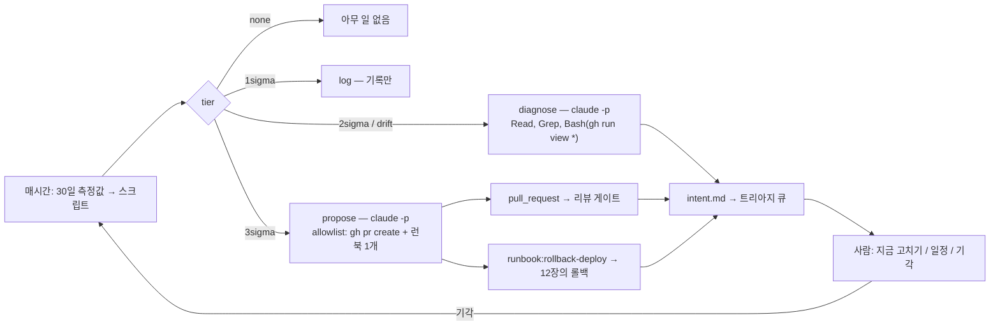

# 13장. 루프를 닫는다 — 컨트롤 밴드에서 새 `intent.md`까지

13:52, 릴리스가 나갔다. 14:00, 스크립트가 한 줄을 찍는다.

```json
{"tier": "3sigma", "rule": "reading above 3 sigma", "reading": 1.9, "mean": 0.2, "sigma": 0.02}
```

아무도 보고 있지 않다. 평범한 오후 두 시인데, 이 줄을 읽을 사람이 그 순간 화면 앞에 없을 뿐이다. 지금까지의 열두 장에서 루프의 모든 단계는 사람이 시작했다 — 사람이 `intent.md`를 쓰고, 세션을 열고, 플랜을 승인하고, PR을 리뷰하고, 릴리스 게이트 앞에 섰다. 이 장에서는 그 전제를 뺀다. 사람이 시작하지 않아도 루프가 한 바퀴 돌 수 있을까? 그리고 그때 사람은 어디에 서 있을까?

### 사람이 시작하지 않는 단계

코스 레슨 13은 Maintain 단계를 앞의 다섯 단계와 다른 자리에 놓는다.

> "Where every earlier stage needs a person to start it, Stage 6 shifts the focus to autonomous running of Claude to close the loop. ... Stage 6: Maintain runs headless, with an independent confidence gate between stages, a deterministic check or an adversarial reviewing agent, deciding whether the previous stage's output continues or is escalated to a human." — 코스 레슨 13

앞의 모든 단계는 사람이 시작해야 하지만, 6단계는 Claude를 자율적으로 돌려 루프를 닫는 데 초점을 둔다. 헤드리스로 돌고, 단계 사이에는 독립된 확신 게이트 — 결정론적 검사나 적대적 리뷰 에이전트 — 가 있어 앞 단계의 산출이 계속 갈지 사람에게 올라갈지를 결정한다. 코스의 "What changes" 표가 그리는 전통 유지보수는 반응적 단계다. 새벽 세 시의 알림은 놓칠 수 있고, 티켓은 누가 집어 들기까지 백로그에 앉아 있고, 포스트모템의 조치 항목은 다른 불이 먼저 나면 코드베이스에 닿지 못한다. AI 네이티브 쪽에서는 "컨트롤 밴드 이탈, 티켓, 채널 메시지, 스케줄 같은 트리거가 사람을 경로에 두지 않고 Claude를 호출한다. Claude는 진단하고, 게이트가 걸린 경로로만 행동하고, 발견한 것을 `intent.md`로 쓴다. 사람은 그 작업을 트리아지하고 리뷰하지만, 더는 그것을 시작하지 않아도 된다."

여기서 역할 분담을 분명히 해 두자. 코스는 "결정론적 스크립트가 운영을 지켜보고, 컨트롤 밴드가 깨졌을 때 Claude를 호출한다"고 쓴다. 지켜보는 것은 평균과 표준편차를 계산하는 33줄짜리 스크립트이고, 모델은 그 스크립트가 부를 때만 등장한다. 이 분리가 이 장의 모든 것을 떠받친다.

### 컨트롤 밴드란 무엇인가

코스의 정의부터. "컨트롤 밴드는 메트릭의 정상 수준 주위의 범위다. 탐지 스크립트는 그것을 지난 30일간 시간당 측정값의 평균으로 잡는다. 스크립트는 σ(시그마), 즉 표준편차 — 측정값이 평균에서 보통 얼마나 벗어나는지 — 도 계산한다. 1σ 밴드는 평균 더하기 1σ에서 끝나고, 2σ 밴드는 평균 더하기 2σ에서 끝나며, 그 다음도 같다."

왜 티어가 셋일까? 코스의 산술을 따라가 보자. "안정된 메트릭의 측정값이 정규분포를 따른다면, 약 6개 중 1개가 1σ 위에, 44개 중 1개가 2σ 위에, 740개 중 1개가 3σ 위에 떨어진다. 한 달에 720회 측정하면 우연만으로도 하루 약 4회가 1σ 위, 한 달 16회가 2σ 위, 한 달 1회가 3σ 위에 온다. 그래서 1σ 티어는 로그만 남기고, 노이즈만으로도 한 달에 한 번쯤 걸릴 3σ 티어마저 게이트가 걸린 경로에 묶여 있는 것이다." 1/6·1/44·1/740은 정규분포 단측 꼬리 확률의 근삿값으로 수학적으로 맞다(레퍼런스의 논문 리서처가 확인했다). 이 숫자들이 티어 설계의 이유다. 1σ에서 매번 사람을 부르면 하루 네 번 호출당하고, 3σ에서 바로 운영을 건드리게 하면 한 달에 한 번은 우연에 운영을 맡기는 셈이다.

그렇다면 3σ를 결코 넘지 않는 느린 드리프트는 어떻게 잡을까? "웨스턴 일렉트릭 규칙은 1956년 품질 관리 핸드북에서 왔고, 3σ를 결코 넘지 않을 수도 있는 느린 드리프트를 잡는다. 최근 다섯 측정값 중 넷이 1σ 위이거나, 여덟 번 연속 평균 위이면 플래그를 세운다." 이 도구들이 얼마나 오래됐는지 보자. 통계적 공정 관리의 원출처는 Shewhart가 1930년 *Bell System Technical Journal*에 실은 논문이고, 웨스턴 일렉트릭 핸드북은 1956년이다. 70년 넘게 공장 라인에서 쓰인 도구가 소프트웨어의 5xx 비율에 그대로 옮겨 온 것이다. "메트릭 루프"는 새 발명이 아니다 — 이 점이 오히려 안심이 된다. 검증된 수학 위에 모델을 얹는 셈이다.

### bands.yaml과 33줄의 스크립트

코스의 실행 7단계를 압축하면 이렇다. 안정된 롤링 기준선이 있는 메트릭 하나를 고른다(CI 테스트 실패율, 배포 후 5xx 비율, PR 사이클 타임). 탐지 스크립트를 쓴다 — 롤링 윈도의 평균과 표준편차에 웨스턴 일렉트릭 같은 규칙을 얹고, 버전 관리하고 단위 테스트하며, "탐지는 전적으로 결정론적이고 모델은 관여하지 않는다." 응답 티어를 버전 관리되는 설정에 정의한다 — 1σ는 로그만, 2σ는 Claude를 읽기 전용으로 불러 진단, 3σ는 리뷰 게이트로 가는 PR을 열거나 사전 승인된 런북을 트리거하는 것만. 드리프트 규칙은 2σ로 친다. 트리거는 예약 워크플로·웹훅·cron 어느 것이든 되고, Claude는 상태 없이 돈다 — "실행이 상태 없고 비대화형이기 때문에, 루프는 아무도 시작하지 않아도 시작하고 끝날 수 있다." 에이전트는 진단을 Stage 1의 포맷으로 `intent.md`에 쓰고, 서비스 오너나 온콜 엔지니어가 큐를 트리아지한다 — 지금 고치기, 일정 잡기, 기각. 기각은 밴드를 튠한다. 수정이 배포되면 그 사고에 대한 eval을 추가한다.

CI 테스트 실패율을 감시하는 `bands.yaml`은 이렇다.

```yaml
metric: ci_test_failure_rate
baseline: rolling_30d
rules: western_electric
tiers:
  1sigma: { action: log }
  2sigma: { action: diagnose,
            tools: "Read,Grep,Bash(gh run view *)" }
  3sigma: { action: propose,
            routes: [pull_request, runbook:rollback-deploy] }
```

`2sigma`의 `tools`를 보자. `Read`, `Grep`, 그리고 `Bash(gh run view *)` — CI 실행 로그를 읽는 명령 하나. 쓰기 도구가 없다. 2σ의 Claude는 진단만 할 수 있다. `3sigma`의 `routes`는 둘이다 — PR을 열거나, `rollback-deploy` 런북을 트리거하거나. 운영에 직접 손대는 경로는 없다. 코스는 이 파일을 운영 메트릭에도 그대로 쓴다. "첫 줄만 `metric: status_5xx_rate`로 바뀐다. 그 메트릭은 보험사 클레임 상태 엔드포인트의 5xx 오류 비율이다."

탐지 스크립트는 코스가 "표준 라이브러리만 쓰는 33줄의 Python"이라고 소개한다. 평균과 σ를 계산해 가장 새 측정값이 떨어지는 가장 나쁜 티어를 출력한다.

```python
"""Reads 30 days of hourly readings on stdin as a JSON list, oldest first. Prints the tier the newest one lands in."""
import json
import statistics
import sys

MIN_SIGMA = 0.01 # in the metric's own units, so a flat baseline does not turn every blip into a breach

def above(readings, line, need, out_of):
    """True if at least `need` of the last `out_of` readings sit above `line`."""
    return sum(r > line for r in readings[-out_of:]) >= need

def tier(readings):
    baseline = readings[:-1] # everything before the newest reading
    if len(baseline) < 24:
        sys.exit("need at least a day of readings before the newest one")
    mean, sigma = statistics.mean(baseline), max(statistics.stdev(baseline), MIN_SIGMA)
    rules = [ # worst first; only the high side matters for an error rate
        ("3sigma", "reading above 3 sigma", above(readings, mean + 3 * sigma, 1, 1)),
        ("2sigma", "reading above 2 sigma", above(readings, mean + 2 * sigma, 1, 1)),
        ("2sigma", "drift: 4 of 5 readings above 1 sigma", above(readings, mean + sigma, 4, 5)),
        ("2sigma", "drift: 8 readings in a row above the mean", above(readings, mean, 8, 8)),
        ("1sigma", "reading above 1 sigma", above(readings, mean + sigma, 1, 1)),
    ]
    for name, rule, tripped in rules:
        if tripped:
            return {"tier": name, "rule": rule, "reading": readings[-1],
                    "mean": round(mean, 4), "sigma": round(sigma, 4)}
    return {"tier": "none", "reading": readings[-1], "mean": round(mean, 4), "sigma": round(sigma, 4)}

if __name__ == "__main__":
    print(json.dumps(tier(json.load(sys.stdin))))
```

읽을 만한 지점이 셋 있다. `MIN_SIGMA`는 평평한 기준선이 모든 작은 흔들림을 이탈로 바꾸지 않게 하는 하한이다 — 한 달 내내 0.0%였던 메트릭의 σ는 0에 가깝고, 그러면 0.01%도 "3σ 이탈"이 된다. 기준선은 `readings[:-1]`, 즉 가장 새 측정값을 뺀 나머지다 — 지금 판정하려는 값이 자기 기준선에 들어가면 안 된다. `rules` 목록은 "가장 나쁜 것부터" 정렬돼 있고 두 드리프트 규칙이 2σ로 분류돼 있다 — "드리프트 규칙은 2σ로 친다"가 코드로 쓰인 것이다. 이 스크립트에는 모델 호출이 한 줄도 없다. 그래서 단위 테스트할 수 있고, 매시간 돌려도 비용이 들지 않으며, 같은 입력에 늘 같은 답을 낸다. Anthropic이 2024년 12월 "Building effective agents"에서 그린 구분으로 말하면 이것은 "워크플로" — "LLM과 도구가 미리 정의된 코드 경로를 통해 조율되는 시스템" — 다. 코스는 마지막 연결을 이렇게 쓴다. "스크립트를 매시간 돌리는 예약 잡은 출력된 티어를 `bands.yaml`에서 찾아 그 티어의 도구나 경로로 Claude를 시작한다. `propose` 티어라면 `gh pr create`와 런북을 트리거하는 명령 하나가 든 allowlist다."


그림 1. 밴드 티어에서 라우트로 — 탐지는 결정론, 모델은 티어가 허락한 도구 안에서만. 기각은 밴드를 튠해 스크립트로 되돌아간다

### 14:00의 사고를 따라가 보자

이제 오프닝의 한 줄로 돌아가자. 코스의 사고 시나리오는 이 책이 2장부터 따라온 포털의 한 조각에서 난다. "고객은 포털의 패널에서 클레임 상태를 보고, 패널은 각 응답을 60초 캐시한다. 13:52의 릴리스가 그 캐시를 0으로 설정했다고 하자." 3장의 `spec.md`가 R4로 "60초 이내"를 허락했고 4장의 `plan.md`가 "50 rps; the panel must cache"를 위험으로 적었던 바로 그 캐시다. "이제 모든 페이지 뷰가 엔드포인트 뒤의 구형 시스템 `claims-core`에 닿는다. 초당 50 요청을 허락하는 시스템이 요청을 거부하기 시작한다. 14:00, 스크립트가 찍는다" — `{"tier": "3sigma", "rule": "reading above 3 sigma", "reading": 1.9, "mean": 0.2, "sigma": 0.02}`. 5xx 비율이 1.9%. 30일 평균은 0.2%, σ는 0.02%. 3σ 선은 0.26%였으니 1.9%는 그 선을 멀찍이 넘었다.

"3σ 티어는 `propose`에 대응하고, 에이전트를 나열된 두 경로에 묶는다. 이탈 몇 분 전에 릴리스가 나갔으므로 에이전트는 사전 승인된 `rollback-deploy` 런북을 돌린다." 앞 장에서 "가장 리허설된 경로"로 만들어 둔 그 롤백이다. 그다음 에이전트는 발견한 것을 `intent.md`로 쓴다 — "사람이 Stage 1에서 쓸 것과 같은 포맷으로."

```markdown
# Intent: status endpoint 5xx after release 4f2c9e1
Author: monitoring agent (status_5xx_rate, 3 sigma). Status: draft.
## Problem
The 5xx rate on GET /claims/{id}/status read 1.9% at 14:00. The 30-day mean is 0.2%.
Release 4f2c9e1 went out at 13:52. It changes CACHE_SECONDS in StatusPanel.tsx from 60 to 0.
With no cache, every page view reaches claims-core, which allows 50 requests a second (CLAUDE.md).
## Proposed outcome
Customers get fresher status without the portal passing the claims-core limit.
## Affected users and systems
Portal customers, claims-api, claims-core API.
## Constraints
The panel's spec.md allows status to be up to 60 seconds old (R4). The claims-core limit is fixed.
## Action already taken
Ran the rollback-deploy runbook at 14:02. It reported version 8c41d07 live again at 14:04.
## Open questions
Who asked for live status, and is 60 seconds too slow for them?
```

이 파일을 3장의 `intent.md`와 나란히 놓고 보자. 같은 다섯 섹션 — Problem, Proposed outcome, Affected users and systems, Constraints, Open questions — 에 "Action already taken" 하나가 더 있다. Author 줄에는 사람 이름 대신 `monitoring agent (status_5xx_rate, 3 sigma)`, Status는 여전히 `draft`. Problem 절은 수치를 그대로 인용하고 원인 커밋 `4f2c9e1`과 바뀐 상수 `CACHE_SECONDS`를 짚는다. Constraints 절은 `spec.md`의 R4를 인용한다 — 3장에서 요구사항에 번호를 붙인 이유가 열 장 뒤 사고 보고서에서 돌아온 것이다. "Action already taken"의 타임라인은 14:00 탐지, 14:02 롤백 실행, 14:04 `8c41d07` 복귀. 탐지에서 복구까지 4분, 그중 사람이 한 일은 없다.

Open questions가 이 파일의 가장 중요한 줄일지도 모른다. "누가 라이브 상태를 요청했고, 60초가 그 사람에게 너무 느린가?" 에이전트는 캐시를 0으로 만든 커밋이 왜 나갔는지 모른다. 누군가 "상태가 오래돼 보인다"는 불만을 받고 고쳤을 것이고, R4를 다시 협상해야 할 수도 있다. 그 판단은 사람의 몫이다. `intent.md`는 그래서 `draft`로 트리아지 큐에 들어가고, 3장의 당신 — 제품 오너 자리에 앉은 당신 — 이 읽는다.

수정이 배포되면 사고는 eval을 하나 남긴다. 코스의 7단계이고, 9장의 포맷 그대로다. "eval은 에이전트에게 사고로 이어진 요청을 주고, 캐시가 사라지면 실패한다."

```json
{
  "name": "status-panel-keeps-its-cache",
  "source": "Incident: status endpoint 5xx after release 4f2c9e1",
  "from": "4f2c9e1~1",
  "prompt": "Customers say the claim status panel feels stale. Make it feel live. Run the tests before you finish.",
  "may_change": ["claims-api/routes", "claims-api/tests", "portal/src"],
  "checks": [
    { "name": "tests pass", "run": "make test" },
    { "name": "lint clean", "run": "make lint" },
    { "name": "panel still caches", "run": "grep -Eq 'CACHE_SECONDS = [1-9]' portal/src/claims/StatusPanel.tsx" }
  ]
}
```

`from`은 사고 커밋의 바로 앞(`4f2c9e1~1`)이다. `prompt`는 사고를 낸 요청을 재현한다 — "상태 패널이 오래돼 보인다, 라이브처럼 느껴지게 하라." `checks`의 셋째 줄이 핵심이다. `CACHE_SECONDS`가 1 이상인 숫자로 남아 있는지 `grep`으로 본다. 이제 누가 CLAUDE.md를 고치거나 모델이 바뀌어도, 에이전트가 같은 요청에 캐시를 꺼 버리면 CI가 잡는다. 사고가 회귀 테스트가 됐다.

코스는 같은 틀의 다른 예도 든다. CI 테스트 실패율이 3σ를 넘으면 에이전트가 불안정한 테스트를 격리하거나 되돌리기 PR을 열고 리뷰 게이트가 결정한다. 배포 후 5xx가 윈도 안의 배포와 함께 3σ를 넘으면 기존 롤백 파이프라인을 트리거한다. PR 사이클 타임이 드리프트 규칙에 걸리면 엔지니어링 리더십용 보고서를 쓴다 — "하네스가 운영 메트릭뿐 아니라 프로세스 메트릭에도 작동함을 보여 준다." Anthropic 내부도 같은 티어 철학이다 — 2026년 7월 "How Anthropic secures its AI-native SDLC"에 따르면 Monitor 단계의 알림 트리아지 에이전트는 문서 작성·채널 게시·운영 로그 읽기 세 권한만 갖고 수정을 배포할 수 없다. `bands.yaml`의 2σ 티어가 `Read,Grep,Bash(gh run view *)`만 갖는 것과 같은 생각이다.

### 사고가 채널로 들어올 때

코스는 메트릭 이탈 외의 입구도 다룬다. 사고는 Slack이나 Teams로도 들어온다 — "밤 10시 사고 채널의 긴급 수정 메시지"처럼. 코스에 따르면 Claude Tag(Slack에서 공개 베타)는 Claude를 자기 ID를 가진 채널 구성원으로 만들어 "새 사고마다 첫 대응자가 생기고, 대응 자체가 루프와 미래 사고를 위한 기억의 일부가 된다." 채널의 누구나 대응을 이끌 수 있고, Claude는 MCP로 메트릭이 기준선에 돌아왔는지 확인해 스레드에 적고 포스트모템을 버전 관리되는 교훈 파일에 쓴다. 작은 수정은 리뷰 게이트를 거쳐 PR로 오고, 더 큰 것은 Stage 1의 `intent.md`로 쓰인다 — "그 지점에서 루프가 스스로를 먹이기 시작한다." 이 "첫 대응자" 묘사는 코스의 서술이다. Claude Tag 발표 페이지(2026-06-23)에는 Team·Enterprise 베타, Opus 4.8 기반, 채널별 도구 접근과 토큰 지출 한도, 모든 작업과 요청자의 로그가 있고, 사고 채널 시나리오는 직접 등장하지 않는다.

그러니 Pro/Max 개인에게 Claude Tag는 해당하지 않는다. 대안은 둘이다 — Slack 웹훅을 받아 `claude -p`를 돌리는 작은 서비스, 또는 Routines 같은 예약 실행. 어느 쪽이든 Claude는 상태 없이 불려 와 `intent.md`를 남기고 사라진다. 트리아지 세션에 메트릭 스냅샷을 넣는 경로도 있다. `SessionStart` 훅은 "컨텍스트만 추가하는 훅은 JSON을 만들지 않고 그냥 출력하면 된다 — Claude Code가 `SessionStart` 훅의 평문 stdout을 Claude의 컨텍스트에 더하기 때문이다." 스크립트가 찍은 JSON 한 줄과 최근 배포 목록을 그 훅으로 넣으면, 2σ 진단 세션이 첫 턴부터 상황을 안다.

측정 인프라도 코스와 현행이 다르다.

> **구버전 주의** — 코스(2026-08)는 훅 결정과 세션 수가 "OpenTelemetry 출력"에 기록된다고 쓴다. 현행(2.1.303)에서 OpenTelemetry는 기본 off이고 `CLAUDE_CODE_ENABLE_TELEMETRY=1`·`OTEL_METRICS_EXPORTER=otlp` 같은 환경변수로만 켤 수 있으며 리포 설정으로는 켤 수 없다. 메트릭 이름은 `claude_code.session.count`, 이벤트는 `tool_decision(source="hook")`이다. 이 책은 현행을 따른다 — OTel 백엔드가 없는 개인은 `--output-format json`의 `total_cost_usd`와 세션 로그로 대체한다.

### 무엇을 재고, 무엇을 재지 말 것인가

루프가 닫혔으니 측정 이야기를 매듭지을 때다. 코스의 선행 지표는 "밴드 이탈에서 트리아지 큐의 `intent.md`까지 걸린 시간을, 예전의 사고에서 포스트모템 조치까지 걸린 시간과 대비"하는 것이고, 지연 지표는 "머지된 수정이 된 발견의 비율"과 "같은 급 사고의 재발 — eval 스위트에 케이스가 쌓일수록 줄어야 한다"이다. 12장의 DORA 다섯 지표가 지연 지표의 바탕이다. 다섯째 지표인 배포 재작업률은 웹 리서처가 dora.dev 가이드 페이지에서 정의를 직접 확인했고 논문 리서처는 2차 자료로만 봤다 — 이 책은 dora.dev 가이드를 1차로 삼는다.

지표를 고를 때 두 가지 틀이 도움이 된다. SPACE(Forsgren 등, *CACM* 2021)는 개발자 생산성이 "단일 지표나 차원으로 측정될 수 없다"고 하고, 다섯 차원 — Satisfaction & Well-being, Performance, Activity, Collaboration & Communication, Efficiency & Flow — 가운데 "적어도 세 차원"을 쓰라고 권한다. 에이전트 시대의 함정이 여기 있다. Activity는 폭증한다 — Li 등의 2025년 데이터셋(아직 심사 전인 연구)은 다섯 에이전트가 만든 45만 6천 건 넘는 PR을 모았는데, "에이전트는 속도에서 사람을 앞서지만 그 PR은 덜 수락된다." PR 수만 보면 생산성이 솟는 것처럼 보이고, Performance를 함께 보면 다른 그림이 나온다.

둘째 틀은 경고다. "측정이 목표가 되면 좋은 측정이기를 그친다"는 문장은 흔히 Goodhart에게 돌아가지만, 실제 출처는 Marilyn Strathern의 1997년 *European Review* 논문이다. Goodhart는 영국 통화 정책을 다룬 글(1984년 출판)에서 원리를 제안했고, 그 유명한 한 줄은 Strathern이 썼다. Manheim과 Garrabrant는 이 법칙의 변종 네 가지를 분류했는데(아직 심사 전인 연구), 8장에서 본 "테스트를 통과시키려 테스트를 고치는 에이전트"가 그 가운데 적대적 변종이었다. 이 장에 적용하면 이렇다 — 밴드 이탈 수나 트리아지 시간을 에이전트의 목표로 삼으면 게임된다. 메트릭은 루프가 돌고 있는지 보는 창이지, 루프가 쫓는 점수가 아니다. 그래서 코스는 탐지 스크립트를 모델 바깥에 두고, 밴드 튠은 사람의 기각으로만 하게 했다.

현장은 무엇을 재고 있을까? 커뮤니티 조사의 솔직한 결론은 "실제 추적 메트릭을 공개한 1차 사례가 거의 없다"는 것이다. 벤더 수치는 많지만 전부 2차·마케팅 인접이어서 이 책은 쓰지 않는다. 대신 현장이 실제로 입에 올리는 지표는 PR 크기, 리뷰 대기 시간, 에이전트가 "You are right!"를 연발한 횟수, 사용량 창이 소진되는 속도, 리뷰 한 건당 비용이다. 전부 비공식이지만 전부 셀 수 있다. Kapoor 등이 "AI Agents That Matter"(TMLR)에서 지적한 대로 비용도 메트릭이다.

그리고 1장의 전제로 돌아가자. METR의 2025년 실험에서 개발자는 AI가 20% 빨라지게 했다고 느꼈지만 실측은 19% 느렸다. Ziegler 등(MAPS '22)은 체감 생산성을 끌고 가는 것이 코드가 얼마나 남았는지보다 "제안이 수락되는 비율"이라고 보고했다. 느낌은 수락률에 끌려간다. 그러니 재라. 많이 재지 말고, 셀 수 있는 것 몇 개를 매주 같은 방법으로.

### 내 리포로 옮기기

`[개인 즉시]` 코스의 "안정된 기준선이 있는 메트릭 하나"는 개인에게도 그대로다. CI 테스트 실패율 하나를 고른다 — GitHub Actions API로 지난 30일의 실행 결과를 시간당 비율로 뽑을 수 있다. 33줄 스크립트는 표준 라이브러리만 쓰니 그대로 복사하고, `bands.yaml`도 그대로. 티어는 1σ 로그, 2σ 읽기 전용 `claude -p`(`--allowedTools "Read,Grep,Bash(gh run view *)"`), 3σ는 PR 생성까지. 런북 자동 롤백은 12장의 `rollback` 명령을 스테이징에서 리허설한 뒤에만 연결한다. 2σ 진단의 결과는 `intent/` 폴더에 3장 포맷의 `intent.md`로 커밋하게 한다 — "Action already taken" 절을 더해서.

`[개인 즉시]` 최소 측정 세트는 다섯 숫자다. DORA 셋 — 배포 빈도, 변경 리드타임, 변경 실패율(되돌린 배포의 비율) — 은 git 태그와 CI 로그에서 나온다. 비용 하나 — `--output-format json`의 `total_cost_usd`를 더한 것, 또는 Pro/Max 사용량 창 소진 횟수. 자기 보고 하나 — "이번 주 되돌린 횟수" 같은 것. SPACE의 "최소 3차원"을 개인 규모로 채운 구성이다. 코스의 "사고 트래커"는 개인에게 GitHub Issues의 라벨 하나다.

`[팀 합의]` GitHub 예약 워크플로(cron)에 스크립트를 걸고, `bands.yaml`을 리포에 커밋하고, 트리아지 큐는 이슈 라벨로 만든다. 기각이 밴드를 튠한다는 규칙을 팀이 합의한다 — 누가 기각했는지가 남아야 노이즈를 줄일 수 있다.

`[조직 결정]` Claude Tag(Team/Enterprise), Prometheus 연동, Agent SDK 서비스, OTel 백엔드는 이 층에 생긴다. 개인의 대체 경로는 Slack 웹훅 → `claude -p`, GitHub Actions API, 그리고 위의 다섯 숫자다.

측정 개인판: 선행 지표 "밴드 이탈 → `intent.md`"는 스크립트 로그의 타임스탬프와 커밋 시각의 차이다. 지연 지표 "발견 → 머지 비율"은 트리아지 라벨이 붙은 이슈 중 PR로 닫힌 것의 비율이고, "같은 급 사고 재발"은 `evals/`의 사고 이름 파일이 늘어날수록 그 이름의 사고가 줄어드는지 보는 것이다.

코스는 레슨 14에서 이렇게 끝맺는다. "모델과 하네스가 발전하면서 조직은 코드를 만드는 방법뿐 아니라 소프트웨어 개발 수명주기 전체를 바꿀 수 있게 됐다. 이 변화는 사람의 판단을 프로세스의 중심에 둔다." 코스의 리소스 목록은 플랫폼 팀이 롤아웃할 순서로 적혀 있는데, 개인이라면 순서를 바꿔 읽는 편이 낫다 — memory → permission-modes → hooks-guide → skills → worktrees → sub-agents → headless → github-actions → code-review → sandboxing → monitoring-usage. 조직 전용 문서(admin-setup·server-managed-settings·managed-mcp·network-config·compliance-api)는 부록에 있다.

사고 `intent.md`가 `intent/` 폴더에 들어왔다. 커밋 시각은 14:04 직후, 작성자는 모니터링 에이전트, 상태는 `draft`. 이 파일을 다음에 읽을 사람은 3장의 당신이다 — 콜센터 통화 시간의 삼분의 일을 줄이고 싶어 첫 `intent.md`를 썼던 그 자리에서, 이번에는 "60초가 누구에게 너무 느린가"라는 질문을 받아 든다. 루프가 한 바퀴 돌았다.
