# Cloudflare를 나의 클라우드로 — 정적 사이트부터 Spring 백엔드까지, 무료로 시작해 안전하게 운영하기

## 저자
Toby-AI

**판본:** v1.0.0 · 2026-10-03

---

## 판권

**Cloudflare를 나의 클라우드로 — 정적 사이트부터 Spring 백엔드까지, 무료로 시작해 안전하게 운영하기**
**판본:** v1.0.0
**발행일:** 2026-10-03
**저자:** Toby-AI
**식별자:** urn:uuid:7ae484e4-06ae-4ec0-8308-d14c91014f75

### 라이선스

이 책은 **CC BY-NC-SA 4.0** 라이선스로 배포된다 — [Creative Commons 저작자표시-비영리-동일조건변경허락 4.0 국제](https://creativecommons.org/licenses/by-nc-sa/4.0/).

- **저작자 표시(BY):** 출처를 밝혀야 한다.
- **비상업적 이용(NC):** 상업적 목적으로 이용할 수 없다.
- **동일조건 변경허락(SA):** 변경·재배포 시 동일한 라이선스를 적용해야 한다.

### 출처

이 책은 [book-writer](https://github.com/tobyilee/book-writer) 하네스 v2.0.0로 자동 생성되었다.

---

## 서문

Cloudflare 계정을 하나쯤 가진 개발자는 많다. 도메인을 사서 네임서버를 옮기고, 주황색 구름 아이콘이 켜진 것을 확인한 뒤로는 좀처럼 다시 열어보지 않는 계정이다. 그런데 그 계정 안에는 생각보다 많은 것이 들어 있다. 코드를 실행하는 Workers, 관계형 데이터베이스 D1과 객체 저장소 R2, 상태를 가진 Durable Objects, 큐와 워크플로, 컨테이너, 집에 있는 서버를 포트 하나 열지 않고 세상에 내놓는 Tunnel, 팀의 내부 도구를 지키는 Cloudflare One까지. 이 책은 그 계정을 "내가 만든 앱과 서비스를 배포하고 운영하는 클라우드"로 쓰는 이야기다.

이 책은 세 가지 질문에서 출발했다.

첫째, 어디에 무엇을 둘까? Cloudflare의 개발자 제품은 수십 개이고, 같은 문제를 푸는 방법이 여럿 있다. 제품 이름을 하나씩 외우는 것으로는 부족하다. 정말 필요한 것은 "이 데이터는 어디에 둘까", "이 작업은 isolate로 충분한가, 컨테이너가 필요한가", "이것은 Cloudflare 안에 둘까, 밖에 둘까"를 스스로 판단하는 기준이다.

둘째, 내 Spring 서버는 어떻게 할까? Workers에는 JVM이 없다. Java·Kotlin으로 서비스를 만들어온 개발자에게 진짜 질문은 "Spring을 Workers로 옮기는 법"이 아니라 "Spring을 어디에 두고 Workers와 어떻게 잇는가"다. 그래서 이 책은 Spring 서버를 버리지 않는다. 책의 후반부 내내 Spring Boot 서버가 서비스의 한 축으로 함께 간다.

셋째, 청구서는 괜찮을까? 무료라는 말에 끌리면서도 어느 날 큰 청구서가 날아올까 불안한 마음, 이 책을 펼친 많은 독자가 품고 있을 것이다. 정직하게 먼저 말해두자. 2026년 10월 현재 Cloudflare에는 계정 전체의 지출 상한(하드캡)이 없다. 이 책은 그 사실을 감추지 않는다. 대신 무료 티어를 "언젠가 넘어설 맛보기"가 아니라 설계할 수 있는 전략으로 쓰는 법, 그리고 유료 계정에서 여러 장치를 겹쳐 비용 사고의 반경을 줄이는 법을 따로 다룬다. 부제의 "안전하게"는 바로 그 겹겹의 장치를 가리킨다. "청구서 걱정 없이" 같은 약속은 이 책이 지킬 수 없기에 하지 않는다.

### 누구를 위한 책인가

Java·Kotlin(Spring Boot)이나 JS/TS·React·Next.js·Node.js로 웹 서비스를 한 번 이상 만들어 실제로 굴려본 개발자를 떠올리며 썼다. 사이드 프로젝트, 사내 도구, 작은 SaaS를 직접 배포하고 운영하려는 사람이다. AWS 같은 클라우드를 깊이 알 필요는 없다. Cloudflare는 "DNS와 CDN을 무료로 주는 곳" 정도로만 알아도 충분하다.

이 책을 다 읽고 나면 정적 사이트에서 시작해 API, 데이터, 풀스택 앱, 기존 Spring 백엔드 연결, 외부 서비스 통합, 보안과 제로 트러스트, 캐싱, 비용 방어까지 직접 구성해 하나의 서비스를 출시할 수 있기를 바란다. 그리고 무엇을 Cloudflare 안에 두고 무엇을 밖에 둘지, 그 판단의 이유를 설명할 수 있기를 바란다.

### 어떻게 읽으면 좋을까

이 책은 `moim`이라는 개발자 밋업 신청 서비스를 처음부터 끝까지 함께 키운다. 행사 소개 페이지 하나로 시작한 `moim`은 장마다 필요한 것이 하나씩 생기며 자라고, 그 순서가 곧 이 책의 순서다. 책은 네 개의 부로 흐른다.

- **1부 올리기(1~5장):** 플랫폼의 지도를 펼치고, 정적 사이트와 API를 올리고, 데이터를 둘 곳을 고르고, 프런트를 Next.js로 키운다. 1부가 끝나면 Cloudflare 안에서만 돌아가는 완결된 서비스가 생긴다.
- **2부 잇기(6~8장):** Cloudflare 밖으로 손을 뻗는다. Tunnel로 Spring 서버를 공개하고, JVM 백엔드가 살 자리를 고르고, 결제·메일·외부 DB·AI·IaC를 붙인다.
- **3부 지키기(9~10장):** 누구나 들어오는 공개 표면을 막고, 운영자 화면과 내부 서버는 Cloudflare One으로 닫는다.
- **4부 운영하기(11~14장):** 캐싱, 무료 티어 전략, 유료 계정의 비용 방어를 다루고, 출시 점검으로 전 과정을 되짚는다.

부록 A는 가격·한도를 한눈에 보는 치트시트, 부록 B는 출시 전에 한 줄씩 지우는 과금 안전 체크리스트, 부록 C는 2026년에 바뀐 제품 이름과 이 책이 기준으로 삼은 도구 버전이다.

처음 읽는다면 차례대로 읽기를 권한다. 뒤 장은 앞 장에서 만든 `moim`의 상태를 전제로 설명하기 때문이다. 그래도 급한 질문이 따로 있다면 이렇게 골라 읽어도 좋다. Spring 서버의 자리가 가장 궁금하다면 1·3장을 읽고 6·7·10장으로 건너가자. 비용이 가장 걱정이라면 1장의 "돈의 지도", 4·7장의 최소 안전장치 박스, 12·13장, 그리고 부록 A·B를 먼저 보자. 이미 Pages나 OpenNext로 운영 중이라면 2장과 5장이 출발점이다.

### 읽기 전에 알아둘 약속

- **시점:** 이 책의 가격·한도·버전·제품 상태는 모두 2026년 10월 3일 기준이다. 수치 뒤에는 기준이 된 문서와 날짜를 붙였고, 금액은 USD로 적었다. 이 플랫폼은 몇 주 단위로 바뀐다. 14장의 베타 지도와 부록 A·C를 공식 문서와 대조하는 습관을 들이자.
- **예제:** `moim`의 코드는 완전한 저장소가 아니라 설명에 필요한 부분을 잘라낸 발췌다. 예제 도메인 `example.com`은 자기 도메인으로 바꿔 읽으면 된다. Worker 설정은 모두 `wrangler.jsonc`로 쓰고, 호환성 날짜는 `"2026-09-01"`로 통일했다. CLI는 Wrangler v4를 기본으로 쓰고, 베타인 새 CLI `cf`는 전망 박스에서만 다룬다. Spring 예제는 Java와 Spring Boot 4.1.1·Spring Security 7.1.1을 기준으로 했다. 공식 예제가 없어 직접 작성한 코드(Containers 위의 Spring Boot, Spring Security의 Access JWT 검증, 서킷 브레이커 `moim-guard` 등)는 본문에서 "저자 작성 예제"라고 밝혔다. 운영에 쓰기 전에 자기 환경에서 꼭 검증하자.
- **박스:** 장 전체가 비용 이야기인 12장을 뺀 모든 장에 그 장 기능의 무료 범위와 과금 단위를 정리한 `비용 메모`를 두었다. 처음 결제가 걸리는 4장과 7장에는 `최소 안전장치`, `moim`에 어울리지 않는 제품은 `다른 쓰임`, 베타 제품은 `전망`(빠르게 바뀔 수 있다는 뜻이다), 현장 의견이 갈리는 주제는 `논쟁` 박스로 양쪽을 나란히 놓았다. 개념 밀도가 높은 3·4·7·10·11·13장 끝에는 `이 장의 핵심`으로 요점을 모았다.
- **용어:** 제품 이름은 영문 공식 표기를, 일반 개념은 한국어를 쓴다. 플랫폼은 "Workers", 배포 단위 하나는 "Worker"라고 부른다. Workers 요금제 이름은 Free와 Workers Paid로 고정했고, 이것이 도메인(존) 요금제인 Free·Pro·Business와 별개라는 점은 1장에서 짚는다. Worker Previews와 그 주소는 "프리뷰", Cloudflare의 변경 공지는 "changelog"라고 적는다. 2026년에 이름이 바뀐 제품(Cloudflare One Client, Mesh node, Browser Run 등)은 장마다 처음 나올 때 옛 이름을 괄호로 함께 적었고, 전체 대조표는 부록 C에 있다.
- **인용:** 커뮤니티의 목소리는 영어 원문을 그대로 옮긴 뒤 우리말로 풀었다. 원문에 오타가 있으면 고치지 않고 "(원문 그대로)"라고 적었다. Cloudflare 엔지니어나 경쟁 서비스 운영자처럼 이해관계가 있는 사람의 발언은 그렇다고 밝혔고, 한 사람의 경험담은 일화로, 문서의 수치는 수치로 구분해 적었다.

`moim`과 함께 걷는 길은 꽤 길다. 그래도 한 장씩 따라오다 보면, 처음에는 낯선 제품 이름의 목록이던 Cloudflare가 어느새 각 조각이 어디에 살지 스스로 판단할 수 있는 나의 클라우드가 되어 있을 것이다. 그럼 지도부터 펼쳐보자.

## 목차

- 서문
- **1부 올리기**
  - 1장. Cloudflare를 나의 클라우드로 — 지도부터 펼치기
  - 2장. 첫 배포 — 정적 사이트와 SPA를 Workers에 올리기
  - 3장. Workers 런타임 — JVM 개발자의 멘탈 모델 바꾸기
  - 4장. 데이터와 상태 — D1·KV·Durable Objects·R2·Queues·Workflows 고르기
  - 5장. 풀스택 앱 — React와 Next.js를 Workers에서
- **2부 잇기**
  - 6장. Cloudflare Tunnel — 포트를 열지 않고 서버를 세상에 내놓기
  - 7장. Spring Boot의 자리 — JVM 백엔드를 어디에 두고 어떻게 잇는가
  - 8장. Cloudflare 밖과 함께 — DB·결제·메일·AI·IaC 통합 전략
- **3부 지키기**
  - 9장. 공개 앱 지키기 — Turnstile·WAF·레이트 리미팅·시크릿
  - 10장. Cloudflare One — 작은 팀을 위한 제로 트러스트
- **4부 운영하기**
  - 11장. 캐싱 — 세 가지 캐시 경로와 무효화
  - 12장. 무료로 어디까지 — 무료 티어를 설계 전략으로
  - 13장. 유료 계정에서 안전하게 — 하드캡 없는 세상의 다층 방어
  - 14장. 출시, 그리고 그 너머
- 부록 A. 가격·한도 치트시트 (2026-10-03 기준)
- 부록 B. 출시 전 과금 안전 체크리스트
- 부록 C. 명칭 변경 대조표와 도구 버전 (2026-10 기준)
- 참고문헌

---

# 1장. Cloudflare를 나의 클라우드로 — 지도부터 펼치기

Cloudflare가 무슨 회사냐고 물으면 개발자 대부분이 비슷하게 답한다. "DNS를 옮겨두면 CDN이랑 SSL을 공짜로 주는 회사." 틀린 말은 아니다. 많은 사람이 도메인을 사고 네임서버를 Cloudflare로 돌려놓은 뒤, 주황색 구름 아이콘이 켜진 것을 확인하고는 그 계정을 다시 들여다보지 않는다. 그동안 그 계정 안에 무엇이 쌓여왔는지 모르는 채로 말이다.

그런데 2026년 10월의 Cloudflare 개발자 문서를 펼쳐보면 그림이 꽤 다르다. 코드를 실행하는 Workers가 있고, 그 옆에 관계형 데이터베이스 D1, 키-값 저장소 KV, 상태를 가진 객체 Durable Objects, S3와 호환되는 객체 저장소 R2, 큐와 워크플로가 있다. 컨테이너를 돌리는 Containers가 2026년 4월 13일 GA가 됐고, 집에 있는 서버를 포트 하나 열지 않고 세상에 내놓는 Tunnel과 팀의 내부 도구를 지키는 Cloudflare One(Zero Trust)까지 있다. 이쯤 되면 CDN은 이 회사가 가진 여러 층 가운데 맨 바깥 껍질에 가깝다. Cloudflare를 정확히 부르자면 "콘텐츠를 나르는 회사"보다는 "전 세계 데이터센터에 흩어진 하나의 거대한 컴퓨터를 빌려주는 회사"라는 쪽이 사실에 더 가깝다.

이 책은 그 컴퓨터를 나의 클라우드로 쓰는 이야기다. 사이드 프로젝트의 소개 페이지 하나에서 시작해 API와 데이터베이스를 붙이고, 이미 돌아가고 있는 Spring Boot 서버까지 연결해서, 하나의 서비스를 출시하고 오래 운영하는 데까지 함께 가보자. 출발하기 전에 할 일이 하나 있다. 지도를 펼치는 일이다. 낯선 도시에서 헤매는 이유는 골목 하나를 몰라서라기보다 동서남북을 몰라서인 경우가 많다.

## 플랫폼 지도 — 무엇이 어디에 있나

### 컴퓨트·저장·네트워크, 세 개의 층

Cloudflare의 개발자 제품은 수십 개다. 이름을 줄줄이 늘어놓으면 머리만 아프니, 세 개의 층으로 나눠 생각해보자.

첫째는 코드를 실행하는 컴퓨트 층이다. 중심에는 Workers가 있다. Worker 하나는 요청을 받아 응답을 돌려주는 작은 프로그램이고, Cloudflare 데이터센터 어디에서든 실행된다. Workers가 1급으로 지원하는 언어는 JavaScript, TypeScript, Python, Rust 네 가지이고(Workers 언어 문서 2026-07-03 기준), Python Workers는 2026년 9월 21일 GA가 됐다. 그 밖의 언어는 WebAssembly를 거쳐야 한다. Workers에 담을 수 없는 프로그램, 이를테면 임의의 리눅스 바이너리는 Containers가 받는다. Containers는 Workers Paid 요금제에서만 쓸 수 있다.

둘째는 데이터를 담는 저장 층이다. 선택지가 많다. 관계형 데이터는 SQLite 기반의 D1에, 드물게 바뀌는 설정은 최종 일관성을 가진 KV에, 강한 일관성이 필요한 상태는 Durable Objects에, 파일은 R2에 담는다. 비동기 작업은 Queues가, 여러 단계로 이어지는 긴 작업은 Workflows가 맡는다. Cloudflare 밖에 있는 Postgres나 MySQL에 붙어야 한다면 Hyperdrive가 연결 풀링과 캐시를 대신 해준다. 처음 보면 "같은 문제를 푸는 방법이 왜 이렇게 많지?" 싶을 것이다. 그 물음은 4장에서 정면으로 다룬다.

셋째는 네트워크와 보안 층이다. 원래 Cloudflare가 가장 잘하던 영역이다. 존 캐시와 WAF, 레이트 리미팅, 봇을 걸러내는 Turnstile이 공개된 앱의 앞을 지킨다. Tunnel(`cloudflared`)은 내 서버 쪽에서 바깥으로 연결을 맺어 서버를 공개하고, Cloudflare One은 Access·Gateway, 그리고 Mesh node(구 WARP Connector)로 대표되는 Cloudflare Mesh로 운영자와 내부 시스템을 지킨다.

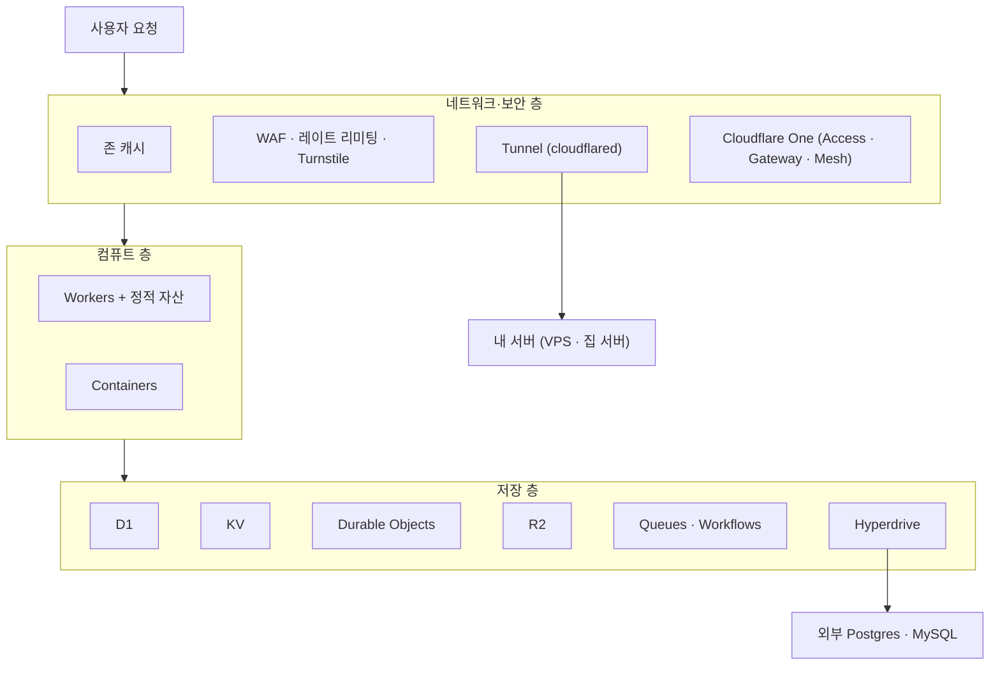
그림 1. Cloudflare 개발자 플랫폼의 세 층

그림에서 한 가지가 눈에 띈다. 세 층이 모두 같은 네트워크 위에 있다는 점이다. 요청은 사용자와 가까운 데이터센터에 도착하고, 그 자리에서 보안 규칙을 지나고, 캐시를 확인하고, Worker를 실행하고, 필요하면 저장소에 다녀온다. 다른 클라우드였다면 CDN과 방화벽, 함수 실행 환경, 데이터베이스를 각각 따로 설정하고 리전을 고르고 권한 체계로 엮어야 했을 일이, 여기서는 하나의 계정과 하나의 설정 파일 안에서 끝난다. 이 편리함이 Cloudflare를 클라우드로 쓰는 가장 큰 이유다.

물론 편리함에는 대가가 따른다. 그 대가가 무엇인지는 코드가 실제로 어떻게 실행되는지를 들여다봐야 보인다.

## 격리 스펙트럼 — isolate, microVM, VM

### isolate — 한 프로세스 안의 여러 앱

클라우드가 남의 코드를 내 코드 옆에서 안전하게 돌리는 방법은 크게 세 갈래다. 가장 무거운 쪽에 VM이 있다. 운영체제를 통째로 하나 더 띄우니 격리는 단단하지만, 부팅에 시간이 걸리고 메모리도 많이 든다. 반대편 끝에는 isolate가 있다. V8 자바스크립트 엔진은 한 프로세스 안에 서로의 메모리를 볼 수 없는 실행 공간을 여러 개 만들 수 있는데, 이 공간을 isolate라고 부른다. 크롬 브라우저가 탭마다 자바스크립트를 나눠 돌리는 바로 그 기술이다. Workers는 이 isolate 위에서 돈다.

isolate 모델이 주는 이점은 무엇일까? 새 앱을 시작하는 데 운영체제도, 언어 런타임도 새로 띄울 필요가 없다. 이미 떠 있는 프로세스 안에 새 공간 하나만 만들면 된다. 2026년에 발표된 한 연구는 AWS Lambda, Google Cloud Run Functions, Cloudflare Workers, Deno Deploy, Fastly Compute 등 7개 서버리스 플랫폼을 3,800만 회 넘게 호출해 측정한 뒤, 그 결과를 이렇게 요약했다.

> "While first-generation platforms are based on containerized, centralized execution, the new generation leverages lightweight isolates and edge deployment. This evolution reduces warm request latency from approximately 40ms to around 10ms and reduces cold starts to an afterthought, but limits the execution environment."
> — Schirmer et al., "New Kids: An Architecture and Performance Investigation of Second-Generation Serverless Platforms", arXiv:2604.15916 (2026), 초록

1세대 서버리스는 컨테이너를 중앙 리전에서 돌렸고, 2세대는 가벼운 isolate를 엣지에 퍼뜨렸다. 그 결과 데워진 요청의 지연이 약 40ms에서 약 10ms로 줄고, 콜드 스타트는 부차적인 문제가 됐다는 것이다. 그런데 문장의 마지막 구절을 놓치지 말자. "but limits the execution environment." 실행 환경이 제한된다는 말이다. 이 한 구절이 이 책에서 몇 번이고 다시 마주칠 대가다. 마음대로 쓰는 파일 시스템도, 스레드도, 오래 붙잡고 있는 프로세스도 기대하기 어렵다. 그 구체적인 모습은 3장에서 하나씩 짚어보자.

### microVM과 VM — 무엇을 내주고 무엇을 얻나

isolate와 VM 사이에는 microVM이 있다. AWS Lambda와 Fargate가 쓰는 Firecracker가 대표적이다. 운영체제 커널을 따로 띄우는 진짜 가상 머신이지만, 꼭 필요한 장치만 남기고 나머지를 덜어냈다. Firecracker 논문(Agache et al., NSDI '20)에 따르면 microVM 하나의 메모리 오버헤드는 5MB 미만이고, 애플리케이션 코드까지 부팅하는 데 125ms가 채 걸리지 않으며, 호스트 하나에서 초당 최대 150개의 microVM을 만들 수 있다.

흥미롭게도 AWS 역시 isolate라는 선택지를 저울질했다. 논문은 V8 isolate 같은 언어 수준 격리를 검토했다고 밝히고, 그 길을 택하지 않은 이유를 이렇게 적는다.

> "Language-specific isolation techniques were not suitable for Lambda or Fargate, given our need to support arbitrary binaries." (§2.1.2)

임의의 바이너리를 돌려야 하는 플랫폼에는 isolate가 맞지 않았다는 얘기다. Cloudflare는 Workers에서 정반대의 선택을 했다. 임의의 바이너리를 포기하는 대신 밀도와 시작 속도를 얻었다. 그렇다고 Cloudflare에서 바이너리를 아예 못 돌리는 것은 아니다. 그 몫을 Containers가 맡는다. Cloudflare가 2026년 9월 24일 공개한 Containers 보안 사고 사후 분석은 그 구조를 이렇게 설명한다. "Each container lives inside a dedicated virtual machine powered by the Firecracker virtual machine monitor." 컨테이너 하나하나가 Firecracker로 띄운 전용 VM 안에 산다는 것이다. 결국 Cloudflare 안에도 스펙트럼의 양쪽 칸이 모두 있는 셈이다.

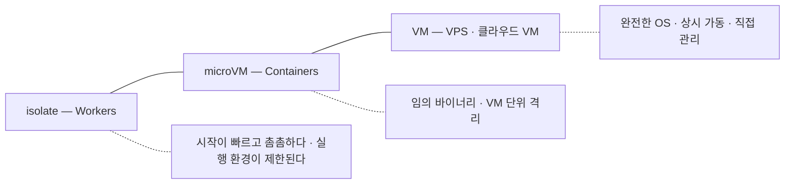
그림 2. 격리 스펙트럼 — 왼쪽으로 갈수록 가볍고, 오른쪽으로 갈수록 자유롭다

이 스펙트럼을 기억해두자. 앞으로 "이 작업은 어디에서 돌릴까?"라는 질문이 나올 때마다 답은 이 선 위의 한 점을 고르는 일이 된다. 가볍고 빠르지만 제약이 많은 왼쪽과, 무엇이든 돌릴 수 있지만 시작이 느리고 비용이 큰 오른쪽 사이에서 말이다.

JVM 개발자라면 여기서 묘한 기시감이 들 수도 있다. 하나의 JVM에 여러 애플리케이션을 올리고 security manager로 서로를 막던 시절을 기억하는 사람도 있을 것이다. Firecracker 논문도 "V8's isolates and the JVM's security managers"를 같은 범주로 묶고, 이런 방식이 기능·호환성과 Spectre 같은 부채널 공격 저항성 사이에 상당한 트레이드오프를 낳는다고 지적한다. isolate가 이 문제에 어떻게 대응하는지는 3장의 박스에서 다시 이야기하자.

### 드물게 불리는 앱들

그렇다면 콜드 스타트는 왜 이렇게까지 중요할까? 내 서비스는 트래픽이 많지도 않은데 말이다. 역설적이게도 트래픽이 적기 때문에 중요하다.

Microsoft Azure의 서버리스 워크로드 전체를 처음으로 공개 분석한 연구(Shahrad et al., "Serverless in the Wild", USENIX ATC '20)가 있다. 이 연구가 찾아낸 숫자는 이렇다.

> "45% of the applications are invoked once per hour or less on average, and 81% of the applications are invoked once per minute or less on average." (§3)

애플리케이션의 45%가 평균 한 시간에 한 번 이하로 호출된다. 사이드 프로젝트, 사내 도구, 동아리 행사 신청 페이지를 떠올려보자. 대부분 이 45% 안에 들어간다. 이런 앱은 다음 요청이 올 때까지 데워둔 채로 기다리기엔 너무 오래 쉬고, 그렇다고 매번 차갑게 시작하면 첫 사용자가 한참을 기다린다. 컨테이너나 VM 기반 플랫폼은 이 사이에서 "얼마나 오래 데워둘까"를 추측하는 휴리스틱에 기댈 수밖에 없다. 시작 비용 자체가 작은 isolate는 이 고민을 구조적으로 덜어준다.

같은 연구는 호출 빈도의 폭이 얼마나 넓은지도 보여준다. 초록의 표현을 빌리면 "most functions are invoked very infrequently, but there is an 8-order-of-magnitude range of invocation frequencies." 대부분의 함수는 아주 드물게 불리지만, 호출 빈도의 범위는 10의 8제곱 배에 걸친다. 애플리케이션 20% 미만이 전체 호출의 99.6%를 차지한다는 분석도 함께 실렸다. 소수의 인기 서비스가 트래픽 대부분을 만들고, 나머지 대다수는 조용히 기다린다는 뜻이다. 우리 서비스 대부분은 그 "나머지" 쪽에 서 있다.

이 대목이 이 책이 상정한 독자의 서비스와 Workers가 잘 맞물리는 지점이다. 드물게 불리는 앱을 거의 비용 없이 대기시켜두는 일, 바로 거기서 Cloudflare의 무료 티어가 힘을 쓴다.

## 무엇이 되고, 무엇이 안 되는가

### 돈의 지도, 첫 스케치

무료라는 말에 끌려 이 책을 펼쳤다면 마음 한편에 이런 불안도 있을 것이다. "그러다 어느 날 큰 청구서가 날아오면?" 이 질문에 정직하게 답하려면 요금 구조의 큰 틀부터 잡아야 한다.

먼저 헷갈리기 쉬운 점 하나. Cloudflare에는 요금 축이 두 개 있다. 하나는 존(zone), 곧 도메인 단위의 설정 공간에 붙는 요금제다. Free·Pro·Business 같은 이름이 여기에 속하고, 캐시 규칙 개수나 WAF 기능 범위가 이 요금제를 따라 달라진다. 다른 하나는 계정에 붙는 Workers 요금제로, Free와 Workers Paid가 있다. 둘은 서로 별개다. Workers 가격 문서는 이 점을 이렇게 못 박아둔다.

> "Workers Paid plan is separate from any other Cloudflare plan (Free, Professional, Business) you may have." — Workers Pricing (2026-10-02 기준)

그러니 존을 Pro로 올린다고 Workers 한도가 늘지 않고, Workers Paid로 바꾼다고 존의 WAF 규칙이 늘지 않는다. Workers Paid는 계정당 월 최소 $5다(Workers Pricing 2026-10-02 기준).

두 번째로 알아둘 점은 Free 플랜의 성격이다. Free에서 한도를 넘으면 대부분의 제품은 청구서를 만드는 대신 에러를 낸다. Workers는 하루 100,000 요청을 넘으면 Error 1027을 돌려주고, KV나 D1도 한도를 넘긴 연산은 실패시킨다. 돈이 나가지 않는 대신 서비스가 멈추는 구조다. 예외도 있다. R2는 결제수단을 등록한 구독 위에서 동작하고, 매달 무료 포함량을 넘는 사용분은 그대로 청구된다(R2 문서 2026-10 기준). 이 예외는 4장에서 처음으로 결제수단을 등록할 때 다시 짚는다.

세 번째가 가장 무거운 사실이다. 2026년 10월 현재, Cloudflare에는 계정 전체의 지출 상한(하드캡)을 거는 기능이 없다. 그래서 이 책은 유료 계정에서 여러 장치를 겹쳐 비용 사고의 반경을 줄이는 방법을 13장에서 따로 다룬다. 비용 이야기를 한 장에 몰아넣지 않고 장마다 "비용 메모"를 둔 것도 같은 이유에서다. 비용이 터지는 지점은 대개 제품 하나하나의 구석에 숨어 있다.

> **비용 메모**
> Workers Free는 요청 100,000/일(00:00 UTC 리셋), 호출당 CPU 10 ms까지이고 넘으면 Error 1027이다. Workers Paid는 계정당 월 최소 $5에 요청 월 1,000만 건이 포함되고, 초과분은 100만 건당 $0.30이다. 정적 자산 요청은 Free·Paid 모두 무료·무제한이다. (Workers Pricing 2026-10-02 기준)

### JVM 개발자에게 미리 하는 정직한 말

Spring Boot로 서비스를 만들어온 독자에게는 지금 말해두는 편이 낫겠다. Workers에는 JVM이 없다. 앞서 본 1급 지원 언어 목록에 Java도 Kotlin도 없다. WebAssembly를 거치는 길이 있긴 하지만, Workers는 스레드를 허용하지 않고 WASI 지원도 아직 실험적이라서 Spring 애플리케이션을 그대로 옮기는 길은 현실적이지 않다. 이 얘기는 3장에서 조금 더 구체적으로 하자.

그렇다면 이 책은 Spring 개발자에게 "Node로 다시 짜라"고 말하려는 걸까? 그렇지 않다. 이미 돌아가는 Spring 서버는 대개 회원, 결제, 정산처럼 서비스에서 가장 무거운 책임을 지고 있다. 그것을 버릴 이유는 없다. 이 책은 Spring 서버를 Cloudflare 옆에 두고 둘을 잇는 방법을 다룬다. 6장에서는 Tunnel로 포트를 열지 않고 Spring 서버를 공개한다. 7장에서는 그 서버가 살 곳을 세 가지 착지점으로 비교하고, Containers로 정산 배치를 돌리고, Workers와 같은 Postgres를 공유한다. 10장에서는 Spring Security로 Access가 발급한 JWT를 검증한다. Spring 서버는 책의 후반부 내내 서비스의 한 축으로 등장한다.

## `moim`, 그리고 네 개의 부

### 하나의 서비스가 자라는 길

추상적인 지도만 들고 걸으면 금방 지친다. 그래서 이 책은 하나의 예제 서비스를 처음부터 끝까지 함께 키운다. 이름은 `moim`, 개발자 밋업 신청 서비스다.

`moim`이 하는 일은 단순하다. 행사를 소개하고, 참가 신청을 받고, 선착순으로 좌석을 배정하고, 발표자가 자료를 올리게 하고, 유료 티켓을 팔고, 운영자가 신청 현황을 관리하게 한다. 그런데 이 단순한 서비스가 요구하는 것을 하나씩 뜯어보면 앞의 지도를 거의 다 지나간다. 소개 페이지는 정적 자산이고, 신청 폼은 봇을 막아야 하고, 선착순 좌석은 강한 일관성이 필요하다. 발표 자료는 객체 저장소에, 확인 메일은 큐에 들어간다. 유료 티켓은 외부 결제와 웹훅을, 운영자 화면은 제로 트러스트를, 사람이 몰리는 행사 페이지는 캐싱을 요구한다. 여기에 기존 회원·정산 시스템이 이미 Spring Boot 서버 `moim-core`로 돌아가고 있다고 해보자. 많은 독자의 현실과 크게 다르지 않을 것이다.

예제의 도메인은 `example.com`이다. 이 자리에 자기 도메인을 넣어 읽으면 된다. `moim`은 `moim.example.com`에서 서비스되고, API는 `/api/*` 아래에, 운영자 화면은 `/admin/*` 아래에 놓인다.

책은 네 부로 흐른다. 1부 "올리기"(1~5장)에서는 Cloudflare 안에서만 돌아가는 서비스를 완성한다. 2장에서 정적 페이지와 React SPA를 올리고, 3장에서 API를 만들며 Workers 런타임에 익숙해지고, 4장에서 데이터를 둘 곳을 고르고, 5장에서 프런트를 Next.js로 키운다. 2부 "잇기"(6~8장)에서는 Cloudflare 밖으로 손을 뻗어 Spring 서버와 외부 서비스를 연결한다. 3부 "지키기"(9~10장)에서는 공개된 앱과 내부 시스템을 차례로 보호한다. 4부 "운영하기"(11~14장)에서는 캐싱과 무료 티어 전략, 유료 계정의 비용 방어, 그리고 출시 점검을 다룬다.

이 순서에는 이유가 있다. 무엇을 Cloudflare 밖에 둘지는 안쪽의 모델을 알아야 판단할 수 있고, 무엇을 지킬지는 무엇을 만들고 이었는지 알아야 정할 수 있다. 제품 이름을 하나씩 외우는 것보다 "다음에 무엇이 필요해지는가"의 순서로 제품을 만나는 편이 훨씬 오래 남는다. 게다가 최근 몇 년 사이 Pages가 Workers로 수렴했고, 2026년 한 해에만 WARP Client가 Cloudflare One Client로, Browser Rendering이 Browser Run으로 이름을 바꿨다. 제품 목록은 빨리 낡지만 "이 데이터는 어디에 둘까" 같은 질문은 쉽게 낡지 않는다.

이제 지도는 펼쳐졌다. 세 개의 층, 하나의 격리 스펙트럼, 두 개의 요금 축. 마지막으로 하나만 물어보자. 지금 여러분 머릿속에 있는 그 서비스, 몇 달째 미뤄둔 사이드 프로젝트일 수도 있고 팀이 함께 쓰는 작은 사내 도구일 수도 있는 그것은 이 지도의 어디에 놓일까? 어느 부분이 isolate로 충분하고, 어느 부분이 스펙트럼의 오른쪽 칸을 필요로 할까? 무엇이 Free의 에러 안에서 안전하고, 무엇이 청구서로 이어질까? 답을 지금 낼 필요는 없다. 이 질문을 손에 쥔 채로 첫 배포를 해보자.

# 2장. 첫 배포 — 정적 사이트와 SPA를 Workers에 올리기

2026년 3월 무렵, Reddit의 r/CloudFlare 게시판에 이런 제목의 글이 올라왔다. "Help me understand Workers vs Pages in Cloudflare (I'm confused!)" Workers와 Pages가 뭐가 다른지 좀 알려달라, 헷갈려 죽겠다는 하소연이다. 가장 많은 추천(28점)을 받은 답글은 한 줄로 상황을 요약했다.

> "Cloudflare added backend functions to Pages and static hosting to Workers."

Pages에는 백엔드 함수가 붙었고, Workers에는 정적 호스팅이 붙었다. 원래 Pages는 정적 사이트용, Workers는 코드 실행용이었는데, 둘이 서로의 영역으로 기능을 넓히다 보니 결국 같은 일을 하는 두 제품이 나란히 서게 됐다는 얘기다. 답글을 단 사람은 앞으로를 생각하면 Workers를 쓰라고 조언했다. 같은 시기 비슷한 질문 글에는 Cloudflare가 "moving away from Pages", 그러니까 Pages에서 멀어지는 중이니 Workers를 쓰라는 답도 달렸다.

이 하소연이 낯설지 않은 독자가 많을 것이다. Cloudflare에 소개 페이지 하나 올려보려고 검색하면, 어떤 글은 Pages로 하라고 하고 어떤 글은 Workers로 하라고 하고, 몇 년 전 글은 Workers Sites라는 세 번째 이름을 꺼낸다. 첫 배포부터 길이 세 갈래로 갈라지는 셈이다. 난감한 출발이다. 이 혼란을 먼저 정리하고, `moim`의 첫 화면을 내 도메인에 올려보자.

## Pages인가 Workers인가

### 같은 일을 하는 두 제품

왜 이런 혼란이 생겼을까? 역사를 조금 거슬러 올라가면 이해가 쉽다. Pages는 Git 저장소를 연결하면 정적 사이트를 빌드해 올려주는 제품으로 출발했다. 그러다 동적인 처리가 필요해지자 `functions/` 폴더에 코드를 넣으면 실행해주는 Pages Functions가 생겼다. 반대편의 Workers는 코드를 실행하는 제품으로 출발했는데, HTML·CSS·이미지 같은 파일도 함께 서빙하고 싶다는 요구가 쌓이자 정적 자산(static assets)을 Worker에 묶어 올리는 기능이 생겼다. 두 제품이 각자 상대의 영역으로 걸어 들어오다 한가운데서 만난 것이다.

여기에 Workers Sites라는 더 오래된 방식도 남아 있다. KV에 파일을 올려두고 Worker 코드가 그것을 꺼내 응답하는 방식이다. 오래된 튜토리얼을 따라 하다 보면 이 방식을 만나게 되는데, 지금 시작하는 프로젝트라면 그 튜토리얼은 덮어두는 편이 낫다. 이유는 바로 다음 절에서 볼 공식 문서에 있다.

그렇다면 익숙한 이름인 Pages로 일단 시작하고, 나중에 필요하면 옮기면 되지 않을까? 처음엔 그게 가장 안전해 보인다. Pages는 대시보드에서 Git 저장소를 연결하는 것만으로 배포가 끝나니 진입 장벽도 낮다. 하지만 그 선택에는 찜찜한 구석이 있다. 지금 편한 길이 1년 뒤에도 투자가 이어지는 길이라는 보장이 없다는 점이다. 이 책처럼 정적 사이트에서 시작해 API, 데이터베이스, 큐, 상태 있는 객체까지 키워갈 서비스라면 더욱 그렇다. Pages Functions로 시작한 코드는 나중에 Durable Objects나 Cron Triggers가 필요해지는 순간 다시 짜야 한다. 설정 파일 형식도, 헤더를 관리하는 방식도, 배포 명령도 달라진다. 처음 몇 시간을 아끼려다 몇 주 뒤에 이사를 하게 된다. 나중에 옮기는 비용은 생각보다 크다. 그 비용이 어느 정도인지는 이 장 뒷부분에서 실제로 옮겨본 사람의 이야기로 확인해보자.

### 공식 답은 이미 나와 있다

다행히 이 질문에는 Cloudflare가 직접 답을 내놓았다. Pages 문서 첫머리에는 이런 문장이 있다(Pages 문서 2026-08-25 기준).

> "Start new projects with Workers."

새 프로젝트는 Workers로 시작하라는 말이다. Pages가 사라지는 것은 아니다. Cloudflare는 Pages를 계속 지원하겠다고 밝혔지만, 개발자 Bryce Wray가 블로그에 옮겨 적은 Cloudflare의 입장에는 이런 단서가 붙어 있다.

> "Cloudflare Pages will continue to be supported, but, going forward, all of our investment, optimizations, and feature work will be dedicated to improving Workers."

지원은 계속하되 투자와 최적화, 새 기능은 전부 Workers로 간다는 것이다. Workers Sites는 더 분명하다. 문서는 Workers Sites가 Wrangler v4에서 폐기(deprecated)됐고 Cloudflare Vite 플러그인도 이를 지원하지 않는다고 적은 뒤, "Do not use Workers Sites for new projects."라고 못 박는다(Workers Sites 문서 2026-04-23 기준).

그래서 이 책의 기준은 단순하다. 새 사이트는 **Workers + 정적 자산**으로 만든다. Pages는 이미 쓰고 있는 사람을 위한 경로로만 다루고, Workers Sites는 쓰지 않는다.

Workers로 가면 무엇을 얻을까? Pages에서 Workers로 옮기는 공식 가이드는 비용 구조가 비슷하다고 안심시키면서도, Workers 쪽 기능 폭이 넓다는 점을 분명히 한다.

> "Unlike Pages, Workers has a distinctly broader set of features available to it, (including Durable Objects, Cron Triggers, and more comprehensive Observability)."

Durable Objects와 Cron Triggers, 더 풍부한 관측성. 4장에서 선착순 좌석을 Durable Objects로 만들고, 3장에서 로그를 켜는 `moim`에게는 처음부터 Workers 위에 서는 편이 자연스럽다.

## `moim-web` 첫 배포

### 정적 페이지 하나부터

가장 작은 것부터 시작하자. `moim`의 행사 소개 페이지 하나를 올리는 것이 목표다. 새 프로젝트는 C3(`create-cloudflare`)로 만든다. 문서의 표현대로 "`npm create cloudflare`, powered by the `create-cloudflare` package"다(2026-10-02 기준 최신 `create-cloudflare` 2.73.2).

```bash
npm create cloudflare@latest moim-web
cd moim-web
npm run dev        # 로컬 개발 서버
npx wrangler deploy
```

C3는 대화형으로 몇 가지를 묻는다. 프로젝트 종류와 언어, Git 초기화 여부 같은 것들이다. 정적 소개 페이지만 올릴 때는 가장 단순한 템플릿을 고르면 된다. 만들어진 폴더에서 눈여겨볼 파일은 `wrangler.jsonc` 하나다. Cloudflare는 새 프로젝트에 JSON 설정 파일을 권장하고, 일부 새 기능은 JSON 설정에서만 쓸 수 있다고 밝힌다("Cloudflare recommends using `wrangler.jsonc` for new projects, and some newer Wrangler features will only be available to projects using a JSON config file."). 이 책도 TOML 대신 `wrangler.jsonc`만 쓴다.

```jsonc
// moim-web/wrangler.jsonc — 정적 페이지만 있는 첫 버전
{
  "name": "moim-web",
  "compatibility_date": "2026-09-01",
  "assets": {
    "directory": "./public"
  }
}
```

`public/` 폴더에 `index.html`과 스타일시트를 넣고 배포하면 끝이다. Worker 코드는 한 줄도 없다. 정적 자산만 있는 Worker도 엄연한 Worker다.

설정에서 한 줄을 더 짚고 가자. `compatibility_date`, 곧 호환성 날짜(compatibility date)다. Workers 런타임은 계속 바뀌는데, 어떤 변경은 기존 코드의 동작을 바꿀 수 있다. 호환성 날짜는 "이 Worker는 이 날짜 시점의 런타임 동작을 기대한다"는 선언이다. 날짜를 올리기 전까지는 그 뒤에 들어온 동작 변경이 내 Worker에 적용되지 않는다. 이 책은 모든 예제의 호환성 날짜를 `"2026-09-01"`로 통일한다. 이 날짜가 왜 중요한지는 Node.js 호환성과 얽혀 있어서 3장에서 다시 다룬다.

설정 파일이 아예 없는 프로젝트라면 어떨까? Wrangler 4.68.0부터는 `wrangler deploy`가 프레임워크를 감지해 필요한 어댑터를 설치하고 설정까지 알아서 해준다. 문서는 이렇게 설명한다. "Starting with Wrangler 4.68.0, running `wrangler deploy` automatically configures your project by detecting your framework, installing required adapters, and deploying it"(Changelog 2026-02-25). 기존 프로젝트를 빠르게 올려볼 때 편리하다. 다만 자동으로 만들어진 설정도 결국 `wrangler.jsonc`로 남으니, 한 번은 열어서 무엇이 들어갔는지 확인해두자.

배포가 끝나면 Wrangler가 `moim-web.{계정 서브도메인}.workers.dev` 형태의 주소를 알려준다. 브라우저로 열어 소개 페이지가 보이면 첫 배포 성공이다. 이 `workers.dev` 주소는 잠시 뒤 내 도메인을 붙이고 나면 꺼둘 것이다.

### React SPA와 무료 라우팅

소개 페이지 하나로는 서비스라 부르기 어렵다. 행사 목록과 상세 화면, 신청 폼을 오가는 React SPA로 키워보자. 빌드 도구는 Vite, 그리고 Cloudflare의 `@cloudflare/vite-plugin`을 쓴다(2026-10-02 기준 1.62.5). 이 플러그인의 장점은 로컬 개발 서버에서도 Worker 코드가 실제 런타임과 같은 환경에서 돈다는 점이다. 문서는 "Your Worker code runs inside workerd, matching the production behavior"라고 설명한다. `workerd`는 Workers의 오픈소스 런타임이다. 로컬에서는 되는데 배포하면 깨지는 일이 그만큼 줄어든다.

```ts
// moim-web/vite.config.ts
import { defineConfig } from "vite";
import react from "@vitejs/plugin-react";
import { cloudflare } from "@cloudflare/vite-plugin";

export default defineConfig({
  plugins: [react(), cloudflare()],
});
```

```jsonc
// moim-web/wrangler.jsonc — React SPA
{
  "name": "moim-web",
  "compatibility_date": "2026-09-01",
  "assets": {
    "not_found_handling": "single-page-application"
  }
}
```

Vite 플러그인을 쓰면 빌드 산출물의 위치는 플러그인이 채워준다. 문서 표현으로는 "The `assets.directory` field in this file is automatically populated with the path to your `client` build output."이니, 설정에 `directory`를 적지 않아도 된다(Vite 플러그인 문서 2026-08-18 기준).

여기서 핵심은 `"not_found_handling": "single-page-application"` 한 줄이다. SPA는 `/events/42` 같은 주소를 브라우저 안의 라우터가 처리한다. 그런데 사용자가 그 주소에서 새로고침을 누르면 서버는 `/events/42`라는 파일을 찾다가 없으니 404를 돌려주기 쉽다. SPA를 처음 배포해본 사람이면 한 번쯤 겪는 문제다. 이 설정은 일치하는 파일이 없는 경로에 `index.html`을 돌려줘서 React 라우터가 화면을 이어받게 한다.

비용 측면에서도 이 한 줄이 중요하다. Cloudflare React 가이드는 이렇게 설명한다.

> "`assets.not_found_handling` is set to `single-page-application`, which means that routes that are handled by your React SPA do not go to the Worker, and are thus free."

SPA가 처리하는 경로는 Worker로 가지 않으니 무료라는 것이다. 정적 자산 요청은 애초에 과금 대상이 아니다. Static Assets 과금 문서의 표현을 그대로 옮기면 "Requests to static assets are free and unlimited"다(2026-04-23 기준).

반대로 Worker 코드를 먼저 실행하도록 지정한 경로는 사정이 다르다. `run_worker_first`에 적은 경로로 들어온 요청은 정적 파일이 있더라도 Worker 호출로 계산된다. Free 플랜에서 Worker 요청 한도를 넘기면 이 경로는 429를 돌려준다(Static Assets Billing 2026-04-23, Workers Limits 2026-09-05 기준). 인증 확인처럼 정말로 Worker가 먼저 봐야 하는 경로에만 쓰자.

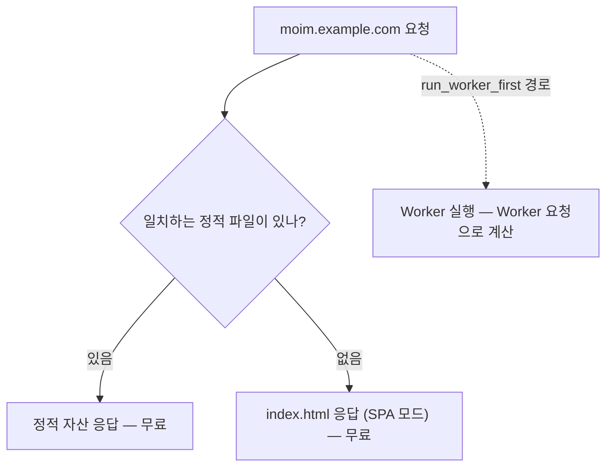
그림 1. 요청이 정적 자산과 Worker로 갈라지는 경로

그림에서 Worker로 가는 화살표가 점선인 이유가 있다. `moim-web`은 지금 Worker 코드가 거의 필요 없는 상태이고, 그래서 거의 모든 요청이 왼쪽 두 갈래로 빠진다. API는 3장에서 별도의 Worker `moim-api`로 만든다. 프런트와 API를 처음부터 나눠두면, 프런트의 정적 요청은 계속 무료로 남고 비용은 API 쪽에서만 세면 된다.

### 로컬에서 먼저, 배포는 그다음

배포 버튼을 누르기 전에 로컬에서 충분히 확인하는 습관을 들이자. Workers 개발 도구는 생각보다 로컬 환경을 잘 맞춰준다.

먼저 Wrangler 자체에 대해 알아둘 점이 있다. Wrangler는 전역 도구로 깔아 쓰기보다 프로젝트마다 설치하는 도구다. 문서도 "Wrangler is installed locally into each of your projects."라고 적는다. C3로 만든 프로젝트라면 이미 `devDependencies`에 들어 있으니 `npx wrangler`로 그 버전을 쓰면 된다. 프로젝트마다 Wrangler 버전이 고정되니, 팀원마다 다른 버전으로 배포하는 일도 줄어든다. 이 책은 Wrangler v4(2026-10-02 기준 최신 4.147.0)를 기준으로 한다. Node.js는 현재(Current)·활성(Active)·유지보수(Maintenance) 버전을 지원한다고 문서에 적혀 있다.

React SPA를 Vite로 개발할 때는 `npm run dev` 하나면 된다. Vite 개발 서버가 뜨고, Cloudflare Vite 플러그인이 Worker 코드를 `workerd` 안에서 돌린다. 정적 자산과 SPA 라우팅도 배포 환경과 같은 규칙으로 동작한다. `/events/42`에서 새로고침을 눌러보면 SPA 모드가 제대로 걸렸는지 바로 확인할 수 있다.

참고로 2025년 12월부터는 Vite 플러그인을 쓸 때 Wrangler 설정 파일이 선택 사항이 됐다("Wrangler config is optional when using Vite plugin", Changelog 2025-12-08). 그래도 이 책은 `wrangler.jsonc`를 계속 둔다. 3장부터 바인딩이 하나둘 늘어나고, 13장에서는 Worker마다 비용 상한을 거는 설정을 넣는다. 그 설정을 한 파일에서 읽을 수 있어야 나중에 덜 헤맨다.

이 플러그인은 정적 SPA만을 위한 도구도 아니다. 문서는 TanStack Start와 React Router v8의 서버 사이드 렌더링을 공식 지원한다고 밝힌다("Official support for TanStack Start and React Router v8 with server-side rendering"). `moim-web`이 5장에서 서버 렌더링이 필요한 앱으로 자랄 때 이 선택지를 다시 만나게 된다. 또 플러그인이 만드는 빌드 결과물은 2026년 9월 베타로 공개된 새 CLI `cf`의 `cf build`·`cf deploy`에서도 쓸 수 있는 표준 형식이라고 한다. `cf`는 아직 베타라서 이 책은 Wrangler를 기본으로 쓰고, `cf`는 3장의 전망 박스에서만 짧게 소개한다.

### 내 도메인 붙이기

이제 `moim`을 `moim.example.com`에 올려보자. 먼저 도메인의 DNS를 Cloudflare로 옮긴다. 도메인을 산 등록 기관에서 네임서버를 Cloudflare가 알려주는 두 개의 주소로 바꾸면, 그 도메인은 Cloudflare 안에서 하나의 존이 된다. 존은 도메인 단위의 설정 공간이다. 캐시 규칙, WAF, DNS 레코드가 모두 존에 붙는다. 1장에서 본 Free·Pro·Business 요금제도 바로 이 존의 요금제다. 개인 프로젝트라면 존은 Free로 충분하다.

네임서버를 옮길 때 가장 신경 쓰이는 것은 기존 레코드다. 메일 서버를 가리키는 MX 레코드나 다른 서비스에 연결해둔 CNAME이 이사 중에 빠지면 메일이 끊기거나 엉뚱한 곳이 다운된다. Cloudflare는 존을 추가할 때 기존 DNS 레코드를 읽어와 목록으로 보여주니, 네임서버를 바꾸기 전에 그 목록이 원래 등록 기관의 레코드와 같은지 한 줄씩 대조해두자. 이 확인을 건너뛰면 나중에 원인을 찾느라 한참을 헤매게 된다. 네임서버 변경이 전 세계에 반영되기까지는 시간이 걸릴 수 있으니, 행사 공지를 내기 직전보다는 여유가 있을 때 옮기는 편이 낫다.

존이 활성화되면 Worker에 커스텀 도메인을 연결한다. 대시보드에서 해도 되지만, 설정을 코드로 남겨두는 편이 낫다.

```jsonc
// moim-web/wrangler.jsonc — 커스텀 도메인 연결
{
  "name": "moim-web",
  "compatibility_date": "2026-09-01",
  "assets": {
    "not_found_handling": "single-page-application"
  },
  "routes": [
    { "pattern": "moim.example.com", "custom_domain": true }
  ],
  "workers_dev": false
}
```

커스텀 도메인으로 연결하면 Cloudflare가 DNS 레코드와 인증서를 함께 만들어준다. 이 책이 서브도메인을 `moim.example.com`처럼 한 단계만 쓰는 데도 이유가 있다. 무료로 발급되는 기본 인증서(Universal SSL)는 루트 도메인과 한 단계 서브도메인까지만 덮는다(Universal SSL 문서 2026-04-30 기준). 커스텀 도메인은 `api.moim.example.com` 같은 여러 단계 서브도메인에도 인증서(Advanced Certificate)를 자동으로 만들어주지만, 3장의 라우트나 6장의 Tunnel처럼 일반 DNS 레코드 위에 서는 호스트는 Universal SSL 범위에 기댄다. 그래서 API도 별도 호스트 대신 같은 호스트 아래 `/api/*` 경로로 둔다.

마지막 줄 `"workers_dev": false`를 보자. 커스텀 도메인을 붙였으니 `workers.dev` 주소는 끈다. 지금은 사소해 보여도, 내 도메인에 건 WAF와 레이트 리미팅 규칙을 우회하는 뒷문이 될 수 있는 주소다. 왜 그런지, 실제로 어떤 일이 벌어졌는지는 9장에서 자세히 살펴본다. 지금은 이 한 줄을 기본값처럼 넣어두는 습관만 들이자.

## 무료로 남는 구성

### Pages에서 옮겨오는 독자에게

이미 Pages로 사이트를 운영하고 있다면 당장 옮겨야 할까? 서두를 필요는 없다. Pages는 계속 지원되고, 정적 자산 요청은 Pages에서도 무료다. 마이그레이션 가이드도 비용 걱정은 크게 하지 않아도 된다고 말한다.

> "Like Pages, requests for static assets on Workers are free, and Pages Functions invocations are charged at the same rate as Workers, so you can expect a similar cost structure"

다만 옮기는 일이 가이드 한 장을 따라 하면 끝나는 수준은 아니다. 2025년 5월 Pages에서 Workers로 사이트를 옮긴 개발자 Bryce Wray는 공식 가이드에 대해 이렇게 적었다.

> "following it is no walk in the park."

결코 쉬운 산책이 아니었다는 말이다. 그는 Pages Functions를 단일 파일로 합쳐야 했고, CSP 헤더와 정적 자산 장기 캐시 전략을 다시 짜야 했다. Hacker News에도 비슷한 목소리가 있다. 한 사용자(aperture147, 2025-10-15)는 Pages가 저무는 분위기에서 Workers Assets로 옮기는 일이 고통스럽고, Wrangler 3에서 쓰던 설정이 Wrangler 4로 깔끔하게 넘어오지 않았다고 털어놓았다("Configs that worked in Wrangler 3 didn't carry over cleanly to Wrangler 4").

> **Pages → Workers 이전 요점**
> - `functions/` 폴더는 `npx wrangler pages functions build --outdir=./dist/worker/`로 하나의 Worker로 컴파일할 수 있다(마이그레이션 가이드 기준).
> - `_headers`로 관리하던 CSP·캐시 헤더는 옮긴 뒤 실제 응답 헤더로 다시 확인하자.
> - 새 기능(Durable Objects, Cron Triggers, 더 넓은 관측성)이 필요해지는 시점이 옮길 시점이다. 그 전까지는 Pages도 지원되는 경로다.

옮기기 전에 내 Pages 프로젝트가 어느 쪽인지부터 따져보자. `functions/` 폴더가 없는 순수 정적 사이트라면 이사는 비교적 가볍다. 빌드 결과물 폴더를 정적 자산으로 지정하고, 커스텀 도메인을 Worker로 옮기면 대부분 끝난다. 반대로 Pages Functions에 미들웨어와 여러 라우트가 얽혀 있다면, 그 코드를 하나의 Worker로 합치는 과정에서 테스트를 다시 돌려야 한다. 어느 쪽이든 새 Worker를 먼저 `workers.dev` 주소에서 띄워 기존 사이트와 응답을 나란히 비교한 다음, 도메인을 넘기는 순서가 안전하다.

정리하면 이렇다. 새로 시작한다면 처음부터 Workers로, 이미 Pages에 있다면 Workers에서만 되는 기능이 필요해질 때 계획을 세워 옮긴다. 옮길 때는 헤더와 캐시 설정을 가장 꼼꼼히 확인하자.

### 무료를 지키는 세 가지 원칙

`moim-web`은 지금 거의 공짜로 돈다. 이 상태를 오래 지키려면 세 가지 원칙을 기억해두면 된다.

첫째, 정적인 것은 정적 자산으로 둔다. HTML, 자바스크립트 번들, 이미지, 폰트는 Worker 코드로 응답하지 말고 정적 자산으로 올린다. 같은 파일을 Worker가 꺼내 돌려주는 순간 그 요청은 Worker 요청이 된다.

둘째, Worker는 꼭 필요한 경로에만 세운다. SPA 모드로 프런트 라우팅을 무료로 처리하고, `run_worker_first`는 정말 Worker가 먼저 봐야 하는 경로에만 쓴다. API는 별도 Worker로 분리한다.

셋째, 캐시 설정을 바꾸기 전에 과금 구조부터 확인한다. 2026년 9월 문서에 Worker 앞단에서 응답을 캐시하는 Workers Cache라는 기능이 새로 올라왔는데, 이것을 켜면 평소 무료이던 정적 자산 요청까지 요청 단가로 과금된다. "캐시는 켜면 싸진다"는 직관과 반대로 움직이는 함정이라, 11장에서 세 가지 캐시 경로를 비교하며 자세히 다룬다.

> **비용 메모**
> 정적 자산 요청은 Free·Paid 모두 무료·무제한이다. 대신 파일 수에 한도가 있다. Worker 버전당 Free 20,000개, Paid 100,000개(Paid의 10만 개는 Wrangler 4.34.0 이상 필요), 파일당 25 MiB다. `run_worker_first` 경로는 Worker 요청으로 계산되고, Free에서 요청 한도를 넘기면 429를 돌려준다. Workers Cache를 켜면 정적 자산 요청도 과금된다(11장 참조). (Static Assets Billing 2026-04-23, Workers Limits 2026-09-05, Workers Cache 2026-09-22 기준)

한국어 후기에도 같은 결론이 보인다. 2026년 8월 한 블로그(잡가이버)는 "도메인만 구입하고 Cloudflare 무료 플랜을 활용하면 호스팅비 없이 DB가 연결된 개인 홈페이지나 소형 블로그를 운영할 수 있습니다."라고 정리했다. DB 연결은 4장의 몫이지만, 도메인값 말고는 돈이 들지 않는 출발선에는 이미 서 있는 셈이다.

이제 직접 해볼 차례다. 여러분의 사이트 하나를 지금 Workers에 올려보고, 다음 세 가지를 확인해보자. 하나, SPA의 깊은 경로(예를 들어 `/events/42`)에서 새로고침했을 때 404 없이 화면이 이어지는가. 둘, `workers.dev` 주소로 접속했을 때 사이트가 열리지 않는가. 셋, 대시보드의 Worker 지표에서 페이지를 여러 번 오간 뒤에도 Worker 요청 수가 거의 늘지 않는가. 세 가지가 모두 기대대로라면, 여러분의 첫 화면은 무료로, 그리고 내 도메인 위에서 돌고 있다.

# 3장. Workers 런타임 — JVM 개발자의 멘탈 모델 바꾸기

10년 가까이 Spring Boot로 백엔드를 만들어온 개발자가 `moim`의 API를 Workers로 만들게 됐다고 해보자. 손에 익은 대로 설계를 시작한다. 행사 목록은 자주 바뀌지 않으니 메모리에 캐시해두면 좋겠다. 클래스 맨 위에 `static final Map<Long, Event> cache`를 두던 습관대로, TypeScript 모듈 최상위에 `const cache = new Map()`을 선언한다. 참가 신청이 들어오면 확인 메일 발송은 응답과 상관없으니 `@Async`처럼 별도 스레드로 넘기고 싶다. 스레드 풀 크기는 넉넉히 열 개쯤. DB 커넥션 풀도 처음에 스무 개쯤 열어두면 되겠다.

코드는 컴파일되고, 로컬에서도 잘 돈다. 그런데 배포하고 나면 이상한 일이 벌어진다. 어떤 요청은 캐시를 보고 어떤 요청은 못 본다. 방금 신청한 사람이 새로고침하면 신청 내역이 사라졌다가 다시 나타난다. 스레드를 만드는 코드는 아예 쓸 데가 없다. 왜 이런 일이 생길까?

답은 Workers가 Spring 서버와도, Node 서버와도 다른 방식으로 코드를 실행하는 데 있다. 1장에서 본 격리 스펙트럼의 가장 왼쪽 칸, isolate 위에서 산다는 것이 무슨 뜻인지 하나씩 파헤쳐보자. 이 감각을 먼저 몸에 익혀야 `moim-api`를 안전하게 설계할 수 있다.

## isolate 위에서 산다는 것

### 요청이 오면 깨어나는 코드

Spring Boot 서버는 한 번 뜨면 오래 산다. `main`이 실행되고, 스프링 컨테이너가 빈을 만들고, 톰캣이 포트를 열고, 그다음부터는 몇 주씩 같은 프로세스가 요청을 받는다. 그래서 `static` 필드에 캐시를 두면 그 캐시는 모든 요청이 함께 본다. 서버가 한 대라면 말이다.

Workers는 출발점이 다르다. 내가 만든 Worker는 어느 한 서버에서 상주하지 않는다. 요청이 사용자와 가까운 데이터센터에 도착하면, 그곳에서 내 코드를 담은 isolate가 준비되고 요청을 처리한다. 이미 준비된 isolate가 있으면 그것을 다시 쓰고, 없으면 새로 만든다. 서울 사용자와 도쿄 사용자의 요청은 서로 다른 데이터센터의 서로 다른 isolate가 처리할 가능성이 높다. 같은 데이터센터 안에서도 isolate가 하나라는 보장은 없다.

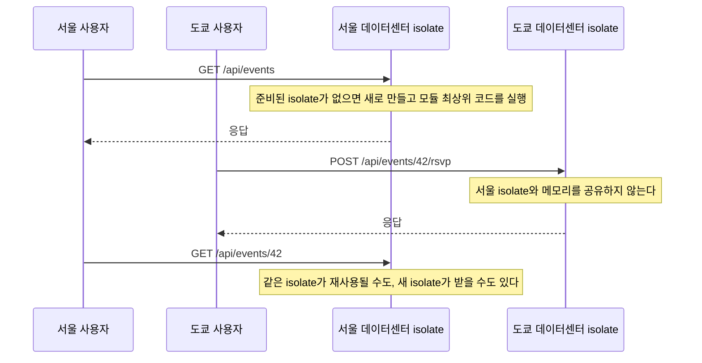
그림 1. 요청과 isolate의 수명 주기

그림이 말해주는 것은 단순하다. 모듈 최상위에 둔 `cache` 맵은 그 isolate 하나의 메모리일 뿐이다. 서울의 isolate가 채운 캐시를 도쿄의 isolate는 보지 못한다. 같은 isolate가 연속으로 요청을 받으면 캐시가 살아 있는 것처럼 보이지만, 그 isolate가 언제까지 살아 있을지는 내가 정할 수 없다. 앞의 Spring 개발자가 본 "보였다 안 보였다 하는 신청 내역"이 바로 이 현상이다.

그렇다고 전역 변수를 아예 쓰지 말라는 말은 아니다. 파싱해둔 설정이나 재사용 가능한 클라이언트 객체처럼 "있으면 좋고 없으면 다시 만들면 되는 것"은 전역에 둬도 괜찮다. 문제는 전역 변수를 진실의 원천으로 믿는 순간이다. 여러 요청이 함께 봐야 하는 상태, 사라지면 안 되는 상태는 isolate 밖에 둬야 한다. 그 자리가 4장에서 고를 D1, KV, Durable Objects 같은 저장소다. 이 원칙을 기억해두자. Workers에서 전역 상태는 캐시일 수는 있어도 데이터베이스일 수는 없다.

### 스레드가 없는 세계

두 번째 습관인 스레드 풀은 더 일찍 막힌다. Workers 문서는 짧고 분명하게 적는다.

> "Threading is not possible in Workers. Each Worker runs in a single thread, and the Web Worker API is not supported."

스레드를 만들 수 없고, 각 Worker는 단일 스레드에서 돈다. 그렇다면 동시에 들어오는 요청은 어떻게 처리할까? 자바스크립트의 비동기 모델로 처리한다. 한 요청이 DB나 외부 API의 응답을 기다리는 동안, 같은 isolate는 다른 요청의 코드를 실행할 수 있다. 블로킹 대신 `await`로 기다리는 방식이라 스레드 없이도 여러 요청이 겹쳐 흐른다. 대신 그 요청들은 메모리를 나눠 쓴다. isolate 하나의 메모리는 128 MB이고, 그 isolate 안의 동시 요청이 이를 함께 쓴다(Workers Pricing 2026-10-02 기준). 요청마다 커다란 배열을 만드는 코드가 동시에 몰리면 생각보다 빨리 한도에 닿는다.

JVM 개발자가 특히 헷갈리는 것이 CPU 시간이다. Free 플랜의 호출당 CPU 한도는 10 ms다. 처음 들으면 "10 ms 안에 DB 조회까지 끝내야 한다고?" 하고 놀라기 쉽다. 하지만 이 10 ms는 벽시계 시간이 아니라 CPU가 실제로 내 코드를 실행한 시간이다. 외부 응답을 기다리는 동안은 CPU 시간이 흐르지 않는다. 가격 문서는 Duration, 곧 실행 경과 시간에 대해 "No charge or limit for duration"이라고 적는다(Workers Pricing 2026-10-02 기준). JSON을 만들고 요청을 검증하는 정도의 API라면 10 ms는 생각보다 넉넉하다. 반대로 이미지 변환이나 큰 데이터 정렬처럼 CPU를 오래 쓰는 일은 Workers Paid로 가야 한다.

마지막으로 `@Async`처럼 응답 뒤에 일을 남기는 습관이 있다. Workers에서 응답을 돌려준 뒤에도 작업을 이어가려면 핸들러가 받는 실행 컨텍스트의 `ctx.waitUntil()`에 그 작업의 Promise를 넘긴다. 다만 이것은 응답 뒤에 잠깐 더 일할 시간을 주는 장치일 뿐(HTTP 요청이라면 응답을 보낸 뒤 최대 30초, Context 문서 2026-09-28 기준), 백그라운드 작업자를 대신하지 못한다. 실패하면 다시 시도해야 하는 일, 오래 걸리는 일은 4장의 Queues로 넘기는 편이 낫다. `moim`의 확인 메일도 그렇게 처리한다.

> **isolate는 안전한가**
> 남의 코드와 한 프로세스를 나눠 쓴다는 말에 불안해지는 것은 당연하다. 실제로 이 질문은 학계에서도 진지하게 다뤄졌다. AWS의 Firecracker 논문(NSDI '20)은 "Some language VMs (such as V8's isolates and the JVM's security managers) aim to run multiple workloads within a single process, an approach which introduces significant tradeoffs between functionality (and compatibility) and resistance to side channel attacks such as Spectre"라고 지적한다. 같은 프로세스 격리는 Spectre 같은 부채널 공격 저항성과 트레이드오프가 있다는 말이다.
> 반대편 연구도 있다. Schwarzl, Borrello, Kogler, Varda, Schuster, Schwarz, Gruss의 ESORICS 2022 논문 "Robust and Scalable Process Isolation Against Spectre in the Cloud"는 Cloudflare Workers 환경에서 원격 Spectre 공격을 실제로 시연했고(분당 2비트 누출), 하드웨어 성능 카운터로 의심스러운 Worker를 찾아 별도 프로세스로 옮기는 DyPrIs를 제안했다. 초록은 "With a false-positive rate of only 0.61%, we demonstrate that DyPrIs outperforms strict process isolation while statistically maintaining its security guarantees"라고 적는다. 저자 가운데 Kenton Varda는 Cloudflare 엔지니어다.
> Cloudflare 쪽 설명도 있다. 이 연구를 소개한 Kenton Varda의 Cloudflare 블로그 글(2021-10-12)은 Workers 런타임이 Worker가 자기 실행 시간을 잴 수 없도록 설계됐고, 타이머 대신 쓰일 수 있는 멀티스레딩 같은 비결정적 동작도 막는다고 설명한다. 스레드가 없는 세계는 불편함이면서 동시에 보안 설계의 결과다.

## 웹 표준 위의 Node.js

### Node 서버가 아닌데 Node 패키지가 돈다

Workers 코드는 무엇을 기준으로 쓰는 코드일까? Node.js 코드라고 생각하기 쉽지만, 출발점은 웹 표준 API다. `fetch`, `Request`, `Response`, `URL`, `crypto.subtle`처럼 브라우저에서 쓰던 API가 기본이다. 서버 측 자바스크립트 런타임들이 공통으로 지원할 웹 API의 최소 집합을 정한 표준도 있다. WinterTC(Ecma TC55)가 만든 ECMA-429 "Minimum Common Web API"로, 2025년 12월에 1판이 나왔다. 웹 표준 API로 짠 코드는 Workers뿐 아니라 다른 런타임으로도 옮기기 쉽다. 이 성질은 14장에서 출구 전략을 이야기할 때 다시 쓸모가 생긴다.

그렇다고 npm의 방대한 Node 패키지를 포기해야 하는 것은 아니다. Workers는 Node.js 호환 계층을 제공하고, 2026년 8월부터는 이것이 기본으로 켜진다. 문서의 표현은 이렇다.

> "For compatibility dates of `2026-08-04` or later, Workers enables both `nodejs_compat` and `nodejs_compat_v2` by default."
> — Node.js 문서 (2026-08-12 기준)

2장에서 이 책의 모든 예제가 호환성 날짜를 `"2026-09-01"`로 통일한다고 했다. 그 날짜가 `2026-08-04` 이후이니, 우리 Worker들은 따로 플래그를 넣지 않아도 Node.js 호환이 켜진 상태다. 오래된 글이나 예제에서 `"compatibility_flags": ["nodejs_compat"]`를 꼭 넣으라고 하는 것은 호환성 날짜가 `2024-09-23`부터 `2026-08-03` 사이였던 시절의 이야기다. 반대로 호환 계층을 일부러 끄고 싶다면 `"compatibility_flags": ["no_nodejs_compat", "no_nodejs_compat_v2"]`를 넣는다. `node:crypto`, `node:buffer`, `node:stream`, `node:fs` 같은 모듈에 기대는 npm 패키지는 추가 설정 없이 동작한다고 문서는 설명한다.

여기에 함정이 하나 숨어 있다. 모든 Node 모듈이 진짜로 구현돼 있는 것은 아니다. 일부 모듈은 문서 표현대로 "polyfill shim implementations that Wrangler adds to your Worker's code, allowing it to import the module, but calling API methods will throw errors"다. import는 되는데, 메서드를 부르면 에러가 난다. 빌드도 통과하고 배포도 되는데 특정 기능을 쓰는 순간 터지는 것이다. 이런 버그는 찾기가 정말 난감하다. 새 npm 패키지를 들일 때는 로컬에서 그 패키지의 핵심 경로를 실제로 한 번 실행해보는 습관을 들이자. 테스트가 그 역할을 해주면 더 좋다.

이 변화 덕분에 "npm 패키지가 Workers에서 안 돈다"는 2024년 무렵의 불만은 상당 부분 해소됐다. 대신 프레임워크가 Node 내부 동작을 깊이 건드리는 지점에서 새 문제가 생기곤 하는데, 그 사례는 5장에서 Next.js를 올리며 만난다.

## `moim-api` 만들기

### Hono로 뼈대 세우기

이제 `moim-api`를 만들어보자. 프레임워크는 Hono를 쓴다. Cloudflare 문서에 Hono 가이드가 따로 있을 만큼 Workers와 궁합이 좋고, 웹 표준 `Request`/`Response` 위에서 동작해서 앞에서 본 원칙과도 잘 맞는다. Spring MVC의 `@RestController`에 익숙하다면 라우팅 코드는 금방 읽힌다.

```ts
// moim-api/src/index.ts
import { Hono } from "hono";

type Event = { id: number; title: string; capacity: number };
type Rsvp = { eventId: number; name: string; email: string };

// ⚠ 메모리 목업 — isolate마다 따로 존재한다. 4장에서 D1·Durable Objects로 바꾼다.
const events: Event[] = [
  { id: 42, title: "Cloudflare로 서비스 운영하기", capacity: 50 },
];
const rsvps: Rsvp[] = [];

const app = new Hono();

app.get("/api/events", (c) => c.json(events));

app.post("/api/events/:id/rsvp", async (c) => {
  const eventId = Number(c.req.param("id"));
  if (!events.some((e) => e.id === eventId)) {
    return c.json({ error: "행사를 찾을 수 없다" }, 404);
  }
  const body = await c.req.json<Partial<Rsvp>>().catch(() => ({}));
  if (!body.name || !body.email?.includes("@")) {
    return c.json({ error: "이름과 이메일을 확인하자" }, 400);
  }
  rsvps.push({ eventId, name: body.name, email: body.email });
  return c.json({ ok: true }, 201);
});

export default app;
```

마지막 줄 `export default app`을 눈여겨보자. Spring에서는 `DispatcherServlet`이 요청을 받아 컨트롤러로 나눠주고, 그 서블릿을 톰캣이 품는다. Workers에는 톰캣도, 서블릿 컨테이너도 없다. 모듈이 내보내는 객체 하나가 곧 요청 처리기이고, Hono 앱이 그 역할을 맡는다. 서버를 띄우는 코드, 포트를 여는 코드가 한 줄도 없다는 점이 낯설면서도 시원하다. 서버를 띄우고 유지하는 일은 플랫폼의 몫이고, 우리 코드는 요청 하나를 받아 응답 하나를 돌려주는 함수에 가깝다. 신청 요청의 본문을 검증하는 부분은 일부러 단순하게 썼다. 실무라면 스키마 검증 라이브러리를 붙이겠지만, 여기서 보여주고 싶은 것은 다른 데 있다. `rsvps` 배열이다. 앞 절에서 본 그대로, 이 배열은 isolate 하나의 메모리에 산다. 로컬에서 몇 번 신청해보면 잘 쌓인다. 하지만 배포한 뒤에는 데이터센터마다, isolate마다 다른 배열이 생긴다. 이 목업이 왜 위험한지 이제는 보일 것이다. 4장에서 이 자리를 진짜 저장소로 바꾼다.

```jsonc
// moim-api/wrangler.jsonc
{
  "name": "moim-api",
  "main": "src/index.ts",
  "compatibility_date": "2026-09-01",
  "routes": [
    { "pattern": "moim.example.com/api/*", "zone_name": "example.com" }
  ],
  "workers_dev": false,
  "observability": { "enabled": true }
}
```

`moim-api`는 `moim.example.com/api/*` 경로에 라우트로 붙는다. 2장에서 `moim-web`을 같은 호스트에 커스텀 도메인으로 연결했는데, 둘은 부딪히지 않는다. Workers 문서에 따르면 커스텀 도메인에 붙은 Worker는 오리진처럼 취급되고, 같은 호스트의 라우트에 붙은 Worker가 그 앞에서 먼저 실행된다("A Worker running on a Custom Domain is treated as an origin. Any Workers running on routes before your Custom Domain can optionally call the Worker registered on your Custom Domain by issuing `fetch(request)`.", Custom Domains 문서 2026-09-29 기준). 그래서 `/api/*` 요청은 `moim-api`가 받아 응답하고, 나머지 경로는 그대로 `moim-web`으로 간다. 배포한 뒤에는 `/api/events`가 API 응답을 돌려주는지 한 번 확인해두자.

Worker를 둘로 나눴으니 둘이 서로 부를 일도 생긴다. 여기서 한 가지 제약을 미리 알아두자. Workers 한도 문서에는 이런 문장이 있다.

> "Using global `fetch()` to call another Worker on the same zone without service bindings fails."

같은 존에 있는 다른 Worker를 전역 `fetch()`로 부르면 실패한다. Spring 서버끼리 HTTP로 부르던 습관대로 `fetch("https://moim.example.com/api/events")`를 `moim-web`의 Worker 코드에 넣으면 동작하지 않는다는 뜻이다. 그 대신 Service binding을 쓴다. Service binding은 한 Worker가 다른 Worker를 바인딩으로 직접 부르는 방법이고, 문서 표현대로 "without configuration pain, performance overhead or need to learn RPC protocols" 마이크로서비스의 분리 효과를 준다. 게다가 Service binding으로 다른 Worker를 부르는 요청에는 추가 요청 요금이 붙지 않는다(Workers Pricing 2026-10-02 기준). `moim-web`이 서버 렌더링을 하며 `moim-api`를 부르게 되는 5장에서 실제로 연결해보자.

### 한도와 에러

Spring 서버는 메모리와 CPU를 내가 고른 서버 사양만큼 쓴다. Workers는 사양을 고르는 대신 한도 안에서 산다. 그 한도를 미리 알아두면 에러 화면을 보고 당황할 일이 줄어든다. 주요 한도를 한 번에 정리해보자(별도 표기가 없으면 Workers Pricing 2026-10-02, Workers Limits 2026-09-05 기준).

| 항목 | Free | Workers Paid |
|---|---|---|
| 호출당 CPU 시간 | 10 ms | 기본 30초, `limits.cpu_ms`로 최대 5분 |
| isolate 메모리 | 128 MB (동시 요청이 공유) | 128 MB (동시 요청이 공유) |
| 호출당 서브리퀘스트 | 외부 50, 내부 서비스 1,000 | 기본 10,000, `limits.subrequests`로 최대 1,000만 |
| 응답 헤더를 기다리는 동시 연결 | 6개 | 6개 |
| Worker 시작 시간 | 1초 | 1초 |
| Worker 크기 | 비압축 64 MiB | 비압축 64 MiB |
| 요청 수 | 100,000/일 | 월 1,000만 포함, 초과분 과금 |

CPU 한도를 넘으면 Error 1102, "Worker exceeded resource limits"를 만난다. Free에서 이 에러를 자주 본다면 코드가 CPU를 오래 쓰는 일을 하고 있다는 신호다. 무거운 일을 Queues로 빼거나 Workers Paid로 옮길 시점이다. 표의 마지막 줄, Free의 하루 100,000 요청을 넘기면 만나는 에러는 성격이 다르다. 사용량이 만든 에러이고, 그것을 어떻게 설계에 활용할지는 12장에서 다룬다.

동시 연결 6개 한도는 커넥션 풀 감각과 부딪히는 지점이다. 2026년 4월 완화된 규칙은 이렇다. "Each Worker invocation can have up to six connections simultaneously waiting for response headers." 그리고 "Once response headers arrive for a connection, it no longer counts toward the six-connection limit."(Changelog 2026-04-09) 응답 헤더를 기다리는 연결만 세고, 헤더가 도착하면 숫자에서 빠진다. 외부 API를 한 요청에서 수십 개씩 동시에 부르는 코드라면 이 한도를 의식해야 한다. 외부 DB에 연결할 때의 풀링 문제는 7장의 Hyperdrive가 맡는다.

Worker 시작 시간 한도는 2025년 10월 400 ms에서 1초로 늘었다. 모듈 최상위 코드가 무거우면, 예컨대 큰 데이터를 파싱하거나 수많은 모듈을 초기화하면 이 한도에 걸린다. 크기 한도는 더 크게 바뀌었다. 2026년 9월 4일부터 Free·Paid 모두 비압축 64 MiB다. 인터넷에 남은 "Free 3 MB, Paid 10 MB"나 "15 MB" 같은 숫자는 그 이전의 낡은 값이니, 옛 글을 보고 번들을 줄이느라 애쓸 필요는 없다.

이 한도들의 비용 측면, 곧 `limits.cpu_ms`와 `limits.subrequests`를 일부러 낮게 걸어 폭주를 막는 방법은 13장에서 다룬다. 여기서는 이 숫자들이 런타임의 성격을 보여준다는 점만 짚어두자. 짧게 실행되고, 적게 기다리고, 가볍게 시작하는 코드가 Workers에 맞는 코드다.

> **비용 메모**
> Workers Free는 하루 요청 100,000회(00:00 UTC 리셋)와 호출당 CPU 10 ms까지다. 요청 한도를 넘기면 Error 1027, CPU 한도를 넘기면 Error 1102를 만난다. Workers Paid는 계정당 월 최소 $5에 요청 월 1,000만 건과 CPU 3,000만 ms가 포함되고, 초과분은 요청 100만 건당 $0.30, CPU 100만 ms당 $0.02다. 실행 경과 시간(Duration)에는 과금하지 않고, Service binding으로 다른 Worker를 부르는 요청에는 추가 요청 요금이 없다. (Workers Pricing 2026-10-02 기준)

### 개발 루프 — 로컬, 테스트, 로그

코드를 고칠 때마다 배포해서 확인할 수는 없다. 로컬 개발부터 보자. Wrangler v4의 로컬 개발 서버는 `workerd` 위에서 Worker를 돌린다(2026-10-02 기준 최신 4.147.0).

```bash
npx wrangler dev          # 로컬에서 moim-api 실행
npx wrangler types --check # 바인딩 타입 정의가 설정과 맞는지 확인
npx wrangler deploy
```

`wrangler types --check`는 2026년 1월에 추가됐는데, 설정 파일의 바인딩과 생성된 타입 정의가 어긋나지 않았는지 CI에서 확인할 때 유용하다. 4장에서 바인딩이 여섯 개로 늘어나면 고마움을 느낄 것이다.

로컬에서 실제 Cloudflare 리소스에 붙어야 할 때도 있다. 운영 DB의 데이터 모양을 보며 디버깅하고 싶을 때가 그렇다. 2025년 9월 GA가 된 remote bindings를 쓰면 바인딩마다 `"remote": true`를 붙여 그 바인딩만 실제 리소스로 연결할 수 있다. 문서 표현은 "add `"remote" : true` to each binding that you want to rely on a remote resource running on Cloudflare"다. 편리한 만큼 운영 데이터를 로컬 코드로 건드리게 되니, 쓰기 작업에는 신중하자.

테스트는 Vitest와 `@cloudflare/vitest-plugin`으로 쓴다(2026-10-02 기준 1.3.6). 이 패키지는 2026년 8월 이름이 바뀌었다. 문서는 "Version 1 of the Workers Vitest integration is published as `@cloudflare/vitest-plugin`. The package was formerly named `@cloudflare/vitest-pool-workers`."라고 적는다. 예전 이름으로 된 글을 보고 설정했다면 `npx @cloudflare/codemods vitest:pool-workers-to-vitest-plugin`으로 자동 전환할 수 있다. 바깥으로 나가는 요청을 흉내 낼 때는 `@msw/cloudflare` 통합을 쓰라고 권한다. 설정 파일은 패키지 이름이 바뀐 만큼 예전 글을 그대로 옮기지 말고 v1 문서의 시작 가이드를 따르자.

```ts
// moim-api/test/events.test.ts
import { exports } from "cloudflare:workers";
import { describe, expect, it } from "vitest";

describe("moim-api", () => {
  it("행사 목록을 돌려준다", async () => {
    const res = await exports.default.fetch("https://moim.example.com/api/events");
    expect(res.status).toBe(200);
  });

  it("이메일이 없으면 신청을 거절한다", async () => {
    const res = await exports.default.fetch("https://moim.example.com/api/events/42/rsvp", {
      method: "POST",
      body: JSON.stringify({ name: "토비" }),
    });
    expect(res.status).toBe(400);
  });
});
```

예전 글에서는 `cloudflare:test` 모듈의 `SELF`로 Worker를 부르는데, v1 문서는 이를 deprecated로 두고 `cloudflare:workers`의 `exports`를 쓰라고 안내한다. `SELF`도 아직 동작하지만, 문서 표현대로 이 변경은 "recommended rather than required"다. 한 가지 차이는 `exports.default.fetch()`가 정적 자산(Assets)을 거치지 않는다는 점이다. 자산까지 테스트하려면 `env.ASSETS` 바인딩을 쓴다(Vitest 통합 문서 2026-08-20 기준). 테스트가 `workerd` 위에서 실행되니, 앞에서 말한 폴리필 함정도 여기서 걸러낼 수 있다. Spring의 MockMvc 테스트처럼 HTTP 요청 단위로 Worker를 두드리는 감각이다. 한 가지 주의하자. Miniflare v5가 2026년 9월에 나왔지만 GitHub상 5.x는 아직 알파 프리릴리스이고, 공식 문서도 대부분의 프로젝트는 Miniflare에 직접 의존하지 말고 Wrangler·Vite 플러그인·Vitest 통합을 쓰라고 권한다.

마지막은 로그다. 앞의 `wrangler.jsonc`에 넣은 `"observability": { "enabled": true }` 한 줄이 Workers Logs를 켠다. 대시보드에서 요청별 로그와 `console.log` 출력을 볼 수 있다. Free에서도 켤 수 있고, 2026년 12월 1일부터는 로그와 트레이스를 묶은 Cloudflare Observability 가격으로 바뀐다고 2026년 10월 공지됐다. 운영 관점의 관측성은 14장에서, 비용 관점은 13장에서 다시 본다.

> **비용 메모**
> Workers Logs(현행 가격, 2026-11-30까지)는 Free 하루 20만 이벤트·보존 3일, Workers Paid 월 2,000만 이벤트·보존 7일이 포함되고 초과분은 100만 이벤트당 $0.60이다. 2026년 12월 1일부터는 Cloudflare Observability 통합 가격으로 바뀌며, 2026-10 공지 기준 Free는 하루 수집 한도에 닿으면 수집이 멈추고 Paid는 포함량을 넘어도 자동으로 계속 과금된다. (Workers Pricing·Observability Pricing 2026-10-02 기준)

## Spring을 Workers로 옮길 수 있을까

### Wasm 경로의 현실

이쯤 되면 JVM 개발자에게는 마지막 질문이 남는다. 그래도 내 Spring 코드를 어떻게든 Workers에서 돌릴 방법은 없을까?

이론상 경로는 WebAssembly다. Workers 문서는 Wasm을 통해 "C, C++, Kotlin, Go and more"로도 Worker를 쓸 수 있다고 소개한다. 하지만 현실은 녹록지 않다. 먼저 Kotlin/Wasm은 JetBrains 공식 문서 기준으로 아직 Beta다(kotlinlang.org 2026-09-01 수정). 일부 요약 글이 "stable"이라고 적은 것과 다르니 1차 문서를 따르자. 게다가 Kotlin/Wasm은 백엔드 애플리케이션에 WASI를 쓰는데, Workers의 WASI 지원은 문서 표현으로 "experimental on Cloudflare Workers, with only some syscalls implemented"다.

Java 쪽 실험도 있다. 2024년 8월 한 개발자가 TeaVM으로 Java를 Wasm으로 컴파일해 Workers에서 돌려본 글을 남겼다. 그런데 그 글에도 "`java.util.concurrent` and other threading operations are not included and will result in a compilation error."라는 문장이 있다. 스레드가 없는 세계의 규칙은 언어를 바꿔도 그대로다. 스레드와 리플렉션, 동적 클래스 로딩에 깊이 기대는 Spring 같은 프레임워크는 애초에 대상이 아니다. 참고로 그 글이 말하는 크기 제한은 앞서 본 2026년 9월 변경 이전의 값이다.

그렇다면 결론은 분명하다. Spring을 Workers로 옮기는 길은 주력 경로가 아니다. Workers 쪽 API는 TypeScript로 새로 짜고, Spring 서버는 Spring 서버대로 살 곳을 찾아주는 편이 낫다. 그 살 곳을 찾는 일이 2부의 주제다. 6장에서 Tunnel로 Spring 서버를 공개하고, 7장에서 VM과 Containers 가운데 어디가 맞는지 비교한다. 반가운 소식도 하나 있다. Python 개발자라면 사정이 다르다. Python Workers는 2026년 9월 21일 GA가 됐고, 같은 달 Django·Flask 같은 WSGI 프레임워크 지원도 추가됐다.

> **전망: `cf` CLI (베타, 2026-10-03 기준)**
> 2026년 9월 28일 Cloudflare는 새 CLI `cf`를 베타로 공개했다. 문서는 둘의 관계를 이렇게 설명한다. "Wrangler is the CLI for Workers projects configured with `wrangler.jsonc` or `wrangler.toml`. `cf` covers the public Cloudflare API and uses `cloudflare.config.ts` for Workers projects." Wrangler가 약 280개 작업만 다루는 데 비해 `cf`는 Cloudflare API 전체를 덮는 것이 목표다. Wrangler 프로젝트에서 `cf`를 쓰려면 먼저 `cf migrate`로 변환해야 한다. 이 책은 GA인 Wrangler v4를 기본으로 쓴다. 다만 5장에서 볼 vinext 1.0은 초기화할 때 `cf`를 기본으로 쓰니 그곳에서 한 번 더 만난다. 베타 제품이라 빠르게 바뀔 수 있으니 공식 문서를 함께 확인하자.

이제 앞의 Spring 개발자에게 돌아가보자. 그가 처음 세운 설계는 하나하나가 Workers에서는 다른 모양이 된다. 그 대응을 한 장의 표로 묶어두자.

| JVM에서의 습관 | Workers에서의 습관 |
|---|---|
| `static` 맵에 캐시를 둔다 | 전역 변수는 재사용될 수도 있는 캐시로만 쓰고, 공유 상태는 KV·D1·Durable Objects에 둔다 (4장) |
| 스레드 풀과 `@Async`로 일을 나눈다 | 스레드는 없다. I/O는 `await`로 겹치고, 오래 걸리거나 재시도가 필요한 일은 Queues로 보낸다 (4장) |
| 서버 사양을 골라 CPU·메모리를 산다 | 호출당 CPU 시간과 isolate 메모리 128 MB 한도 안에서 짧게 실행한다 |
| 커넥션 풀을 넉넉히 연다 | 응답 헤더를 기다리는 동시 연결은 6개. 외부 DB는 Hyperdrive로 잇는다 (7장) |
| 서버끼리 HTTP로 부른다 | 같은 존의 Worker는 Service binding으로 부른다 (5장) |
| 거대한 fat JAR를 띄운다 | 비압축 64 MiB, 시작 1초 안에 뜨는 가벼운 모듈을 만든다 |
| JUnit과 MockMvc로 테스트한다 | Vitest와 `@cloudflare/vitest-plugin`으로 `workerd` 위에서 테스트한다 |
| Spring 서버를 통째로 옮기려 한다 | Spring은 Spring대로 살 곳을 찾아주고, 둘을 잇는다 (6·7장) |

### 이 장의 핵심

- Worker의 요청은 그 요청이 도착한 데이터센터의 isolate가 처리하고, 전역 변수는 isolate 하나의 메모리일 뿐이다. 공유 상태는 저장소에 둔다.
- Workers에는 스레드가 없다. CPU 한도(Free 10 ms)는 실제 실행 시간 기준이라 I/O 대기는 세지 않으며, isolate 메모리 128 MB는 동시 요청이 함께 쓴다.
- 호환성 날짜 `"2026-09-01"`(2026-08-04 이후)에서는 Node.js 호환이 기본으로 켜진다. 단, 일부 모듈은 import만 되고 호출하면 에러가 나는 폴리필이다.
- 같은 존의 Worker를 전역 `fetch()`로 부르면 실패한다. Worker 간 호출은 Service binding으로 한다.
- Spring을 Wasm으로 Workers에 옮기는 길은 주력 경로가 아니다. Kotlin/Wasm은 Beta이고 WASI 지원은 실험적이다.

# 4장. 데이터와 상태 — D1·KV·Durable Objects·R2·Queues·Workflows 고르기

에러는 한 건도 없었다. 에러율을 지켜보는 모니터링은 조용했다. 그런데 레이트 리미터는 제 일을 하지 못하고 있었다. 한도를 넘긴 API 키의 요청이 그대로 통과하고 있었던 것이다.

2026년 7월 Oleksandr Kuryzhev가 Dev.to에 남긴 회고 "Cloudflare Workers Rate Limiting: 3 KV Mistakes We Made"의 줄거리다. 그의 팀은 API 키별 요청 횟수를 Workers KV에 세고 있었다. 회고가 꼽은 실수는 세 가지다. KV를 강한 일관성 저장소처럼 썼고(그의 설명으로는 변경 전파에 최대 60초가 걸렸다), 키 하나에 초당 한 번만 쓸 수 있다는 제한을 무시했고, API 키를 그대로 KV 키로 썼다. 바쁜 API 키 하나에 여러 지역의 요청이 거의 동시에 몰리면 각 데이터센터는 서로 다른 카운터 값을 보게 된다. 그는 이렇게 적었다.

> "A single busy API key gets hit from many edge locations near-simultaneously, which is exactly the scenario that makes the propagation delay...worse."

가장 아찔한 대목은 실패의 모양이다. 카운터가 틀린 값을 돌려줄 뿐 예외는 하나도 던지지 않았으니, 에러율만 보는 대시보드에는 아무것도 잡히지 않았다. 회고의 교훈은 이 한 문장에 담겨 있다.

> "If your rate limiter can fail in a way that produces zero errors, you need a metric specifically watching for that — not just error rate."

그 팀은 카운팅을 사용자별 Durable Object로 옮기고 KV는 느리게 바뀌는 설정에만 남겼다. 비용도 약 40% 줄었다고 한다(작성자 본인의 주장이다). 저장소를 잘못 고른 대가가 아무도 눈치채지 못하는 오동작으로 돌아온 것이다.

3장에서 `moim-api`의 신청 내역을 isolate 메모리에 담아두고, 이 자리를 진짜 저장소로 바꾸겠다고 했다. 그런데 Cloudflare에는 저장소가 여섯 가지나 있다. 어떤 데이터를 어디에 둬야 할까? 하나씩 비교해보자.

## 데이터의 성격부터 묻자

### "DB 하나에 스키마 하나"를 내려놓기

Spring과 JPA로 서비스를 만들어왔다면 출발점은 거의 같다. Postgres나 MySQL 하나를 띄우고, 스키마 하나에 테이블을 만들고, 엔티티를 매핑한다. 회원도, 주문도, 설정값도, 세션도 일단은 그 DB에 들어간다. 정말 빨라야 하는 것만 Redis에 올린다. 익숙하고, 대부분의 경우 충분히 잘 동작하는 방식이다.

Cloudflare의 저장소는 이 전제와 맞지 않는다. 데이터센터 수백 곳에 흩어진 isolate가 같은 데이터를 봐야 하는 환경에서는 "모든 것을 담는 DB 하나"가 공짜로 주어지지 않는다. 대신 성격이 다른 저장소가 여럿 있고, 각각 잘하는 일이 분명하다. 그러니 질문의 순서를 바꿔야 한다. "어느 DB에 넣을까?"를 묻기 전에 "이 데이터는 어떤 성격인가?"를 먼저 묻자. 기준은 네 가지면 충분하다.

첫째, 일관성. 여러 요청이 동시에 같은 값을 고칠 때 즉시 정확해야 하는가, 아니면 잠깐 옛 값이 보여도 괜찮은가? 둘째, 쓰기 빈도. 하루에 몇 번 바뀌는가, 초당 몇 번 바뀌는가? 셋째, 모양과 크기. 관계형 레코드인가, 파일인가, 작은 설정값인가? 넷째, 시간. 지금 바로 처리해야 하는가, 나중에 해도 되는가, 여러 단계에 걸쳐 기다려야 하는가?

`moim`의 데이터를 이 기준으로 나눠보면 이렇게 된다. 행사와 신청 내역은 관계형 레코드다. 신청 접수 여부나 공지 배너 같은 설정은 드물게 바뀌지만 모든 요청이 읽는다. 선착순 좌석은 수많은 사람이 동시에 하나의 숫자를 고치는데 한 자리도 틀리면 안 된다. 발표 자료는 파일이다. 확인 메일은 지금 안 보내도 되지만 언젠가는 꼭 보내야 하고, 행사 전날 리마인더는 며칠을 기다렸다가 여러 단계로 처리해야 한다. 이 여섯 가지가 이 장에서 고를 여섯 가지 저장소와 정확히 맞물린다.

먼저 이 장이 끝났을 때 `moim-api`의 설정이 어떤 모습이 될지 보고 시작하자.

```jsonc
// moim-api/wrangler.jsonc — 4장 종료 시점 (routes·workers_dev·observability는 3장과 동일)
{
  "name": "moim-api",
  "main": "src/index.ts",
  "compatibility_date": "2026-09-01",
  "d1_databases": [
    { "binding": "DB", "database_name": "moim-db", "database_id": "<wrangler d1 create 결과>" }
  ],
  "kv_namespaces": [
    { "binding": "CONFIG", "id": "<wrangler kv namespace create 결과>" }
  ],
  "durable_objects": {
    "bindings": [{ "name": "SEATS", "class_name": "EventSeats" }]
  },
  "exports": {
    "EventSeats": { "type": "durable-object", "storage": "sqlite" }
  },
  "r2_buckets": [{ "binding": "UPLOADS", "bucket_name": "moim-uploads" }],
  "queues": {
    "producers": [{ "binding": "MAIL_QUEUE", "queue": "moim-mail" }],
    "consumers": [{ "queue": "moim-mail" }]
  },
  "workflows": [
    { "name": "moim-reminder", "binding": "REMINDER", "class_name": "ReminderWorkflow" }
  ]
}
```

바인딩은 Worker 코드가 저장소에 접근하는 손잡이다. 코드에서는 `c.env.DB`, `c.env.SEATS`처럼 환경 객체의 속성으로 나타난다. 접속 문자열이나 비밀번호를 코드에 넣을 필요가 없다는 점이 Spring의 `DataSource` 설정과 가장 다른 부분이다. 2025년 10월부터는 Wrangler가 KV·R2·D1 리소스를 자동으로 만들어주는 기능도 생겼다. 바인딩을 추가했다면 3장에서 본 `npx wrangler types`로 타입 정의를 다시 만들어두자.

## 여섯 가지 저장소

### D1 — 행사와 신청 내역

행사와 신청 내역은 관계형 데이터이니 D1에 둔다. D1은 SQLite 기반의 관계형 데이터베이스다. 왜 하필 SQLite일까? SQLite는 서버 프로세스 없이 파일 하나로 동작하는 임베디드 데이터베이스이고, 2022년 PVLDB 논문의 표현을 빌리면 "SQLite has become the most widely deployed database engine in existence."다. 작고 독립적인 데이터베이스를 잘게 많이 만드는 설계와 잘 어울리는 엔진이다.

```sql
-- moim-api/migrations/0001_init.sql
CREATE TABLE events (
  id         INTEGER PRIMARY KEY,
  title      TEXT    NOT NULL,
  starts_at  TEXT    NOT NULL,
  capacity   INTEGER NOT NULL
);

CREATE TABLE rsvps (
  id          INTEGER PRIMARY KEY AUTOINCREMENT,
  event_id    INTEGER NOT NULL REFERENCES events(id),
  name        TEXT    NOT NULL,
  email       TEXT    NOT NULL,
  created_at  TEXT    NOT NULL DEFAULT (datetime('now')),
  UNIQUE (event_id, email)
);

CREATE INDEX idx_rsvps_event ON rsvps(event_id);
```

```ts
// moim-api/src/index.ts (발췌)
const app = new Hono<{ Bindings: Env }>();

app.get("/api/events", async (c) => {
  const { results } = await c.env.DB
    .prepare("SELECT id, title, starts_at, capacity FROM events ORDER BY starts_at")
    .all();
  return c.json(results);
});

// 신청 내역 기록 — 같은 사람이 두 번 눌러도 한 줄만 남는다
async function saveRsvp(env: Env, eventId: number, name: string, email: string) {
  await env.DB
    .prepare(
      "INSERT INTO rsvps (event_id, name, email) VALUES (?1, ?2, ?3) " +
      "ON CONFLICT (event_id, email) DO NOTHING"
    )
    .bind(eventId, name, email)
    .run();
}
```

마이그레이션 파일은 기본 위치인 `migrations/` 폴더에 두고 `npx wrangler d1 migrations apply moim-db`로 적용한다. 로컬 개발용 DB에는 `--local`, Cloudflare의 실제 DB에는 `--remote`를 붙여 대상을 분명히 하자. `ON CONFLICT ... DO NOTHING`과 인덱스는 사소해 보여도 비용과 직결된다. D1은 읽은 행과 쓴 행의 수로 과금하는데, 인덱스 없이 테이블을 훑으면 결과가 몇 줄이든 훑은 행 전부가 "읽은 행"으로 잡힌다. 같은 신청이 재시도로 여러 번 들어오면 그만큼 쓰기가 늘어난다. 이 두 줄을 빠뜨린 코드가 실제로 어떤 청구서를 만들었는지는 13장에서 사례로 본다.

성능에 대한 의문도 있었다. 2025년 4월 Hacker News에서 한 개발자(fastball)는 "I evaluated D1 for a project a few months ago, and found that global performance was pretty terrible."이라고 적었다. D1은 2025년에 읽기 복제(read replication)를 공개했으니 지금은 사정이 다를 수 있다. 사용자가 여러 대륙에 흩어진 서비스라면 자기 데이터로 지연을 직접 재보는 편이 낫다. `moim`처럼 한 나라 안의 밋업을 다루는 서비스도 배포 후 한 번은 지연을 재보고 판단하자.

D1의 한도와 가격은 이렇다(Workers Pricing 2026-10-02, D1 Limits 2026-04-21 기준). Free는 하루에 읽은 행 500만, 쓴 행 10만, 저장 총 5 GB, 데이터베이스당 500 MB, 데이터베이스 10개까지다. Workers Paid는 월 읽은 행 250억, 쓴 행 5,000만, 저장 5 GB가 포함되고, 데이터베이스 하나는 최대 10 GB이며 이 한도는 올릴 수 없다. 2026년 9월 1일부터는 Free의 일일 한도가 실제로 강제돼, 넘기면 쿼리가 실패하고 이메일이 온다.

JVM 개발자가 가장 먼저 부딪히는 벽은 트랜잭션이다. `@Transactional`을 붙인 메서드 안에서 조회하고, 로직을 돌리고, 쓰는 흐름에 익숙하다면 D1이 답답할 것이다. 한 개발자는 Hacker News에서 이렇게 정리했다. "a transaction cannot span multiple D1 requests, so you can't select from the database, execute application logic, and then write to the database in an atomic way."(kpozin, 2025-04) 여러 요청에 걸친 트랜잭션은 안 된다는 것이다. 여러 문장을 한 번에 보내는 batch는 있지만, 중간에 애플리케이션 로직을 끼워 넣을 수는 없다. 선착순 좌석처럼 "읽고 판단하고 쓰는" 일이 원자적이어야 한다면 D1보다 다음에 볼 Durable Objects가 맞는 자리다.

10 GB 한도를 두고는 논쟁도 있다. 2026년 4월 Hacker News에서 한 사용자(keeda)는 "The 10GB limit per DB is unsuitable for even trivial use-cases."라고 비판했다. 이 글에 단 답글에서 Cloudflare Workers 리드 엔지니어인 kentonv는 설계 의도를 설명했다. 그가 예로 든 것은 Durable Objects로 SQLite 데이터베이스를 수백만 개 만드는 방식이었지만, 생각의 뼈대는 D1에도 그대로 통한다. "The 10GB limit applies to one database, but the idea is you design your system to split data into many small databases, e.g. one per user, or even one per document." D1 문서도 "D1 is designed for horizontal scale out across multiple, smaller (10 GB) databases"라고 적는다. 어느 쪽 말이 맞을까? 둘 다 맞다. 사용자나 테넌트별로 데이터가 자연스럽게 나뉘는 서비스라면 작은 DB 여러 개는 훌륭한 설계다. 반대로 전체를 가로지르는 조인과 집계가 많은 서비스라면 10 GB는 금방 벽이 된다. kentonv도 같은 글에서 정말 큰 DB 하나가 필요하면 Hyperdrive로 일반 Postgres나 MySQL을 쓰라고 덧붙였다. `moim`은 행사·신청 내역을 D1에 두고, 회원과 정산 데이터는 7장에서 Hyperdrive와 외부 Postgres로 다룬다.

### KV — 드물게 바뀌는 설정만

신청 접수를 열고 닫는 플래그, 메인 화면의 공지 배너, 기능 플래그. 이런 값은 하루에 몇 번 바뀔까 말까 하지만 거의 모든 요청이 읽는다. KV는 바로 이런 데이터를 위한 저장소다.

```ts
// 기능 플래그 읽기 — 드물게 바뀌는 설정만 KV에
app.post("/api/events/:id/rsvp", async (c) => {
  const flags = await c.env.CONFIG.get<{ rsvpOpen: boolean }>("flags", "json");
  if (!flags?.rsvpOpen) {
    return c.json({ error: "지금은 신청을 받지 않는다" }, 503);
  }
  // ...좌석 예약(SEATS)과 기록(DB)은 아래에서
});
```

KV의 핵심 성질은 최종 일관성이다. 어딘가에서 값을 쓰면 그 변경이 전 세계 데이터센터로 퍼지는 데 시간이 걸리고, 그동안은 데이터센터마다 다른 값을 볼 수 있다. 얼마나 걸릴까? 2026년 10월 Cloudflare 블로그가 공개한 측정치에 따르면 기존 KV(classic 모드)의 쓰기 복제는 중앙값과 p95가 1초 미만, p99가 4.38초였다. 이것이 전형적인 값이다. 그렇다면 커뮤니티 회고들이 말하는 "최대 60초"는 어디서 온 숫자일까? KV 문서에 그 출처가 있다. "Changes may take up to 60 seconds or more to be visible in other global network locations as their cached versions of the data time out."(KV 문서 2026-04-21 기준) 60초 "또는 그 이상"이니, 60초조차 보장된 상한은 아니다. 키가 없다는 조회 결과도 캐시되기 때문에, 새로 만든 값이 보이기까지도 같은 지연이 생긴다. 어느 쪽이든 결론은 같다. 몇 초에서 1분 넘게까지 옛 값이 보일 수 있다고 가정하고 설계해야 한다.

최종 일관성이라는 개념은 오래된 연구 주제다. 2012년 PVLDB의 PBS 논문은 부분 쿼럼으로 운영되는 복제 저장소가 "provide only basic eventual consistency guarantees, with no limit to the recency of data returned"라고 정리했다. 돌려받는 데이터가 얼마나 최신인지 상한이 없다는 것이다. 다만 그 논문의 수치는 데이터센터 내부의 복제 이야기이니 KV의 전파 시간과 직접 비교하지는 말자. 가져갈 것은 성질 하나다. 최종 일관성 저장소는 대개 빠르게 수렴하지만, 수렴을 약속하지는 않는다.

여기에 쓰기 제한이 더해진다. 같은 키에는 초당 한 번만 쓸 수 있다. 서두의 레이트 리미터가 무너진 지점이 바로 여기다. 카운터는 같은 키를 초당 여러 번 고치는 데이터라 KV와 정면으로 어긋난다. 카운터·락·재고처럼 즉시 정확해야 하는 값은 KV에 두지 말자. 레이트 리미팅이 목적이라면 9장에서 볼 Workers의 `ratelimit` 바인딩이 따로 있다.

가격도 이 성격을 반영한다(Workers Pricing 2026-10-02, KV Limits 2026-04-21 기준). Free는 하루 읽기 100,000회, 쓰기·삭제·list 각 1,000회, 저장 1 GB다. 읽기 한도는 넉넉하고 쓰기 한도는 빠듯하다. Workers Paid에서는 월 읽기 1,000만, 쓰기·삭제·list 각 100만이 포함되고, 초과분은 읽기 100만 건당 $0.50, 쓰기 100만 건당 $5.00이다. Free에서 한도를 넘기면 문서 표현대로 "further operations of that type will fail with an error." 쓰기가 많은 데이터를 KV에 두면 Free에서는 금방 에러가, Paid에서는 읽기의 열 배 단가가 기다린다.

> **전망: KV Instant (비공개 베타, 2026-10-03 기준)**
> 2026년 10월 1일 Cloudflare는 KV에 "Instant" 모드를 추가했다(비공개 베타). 기존(classic) KV의 최종 일관성 동작은 그대로이며, Instant는 1 MB·1만 키 이하의 드물게 바뀌는 설정용이다. 발표 블로그에 따르면 p99 읽기가 2 ms 미만이고 쓰기의 99%가 약 250 ms 안에 전 엣지로 복제된다. 네임스페이스를 만들 때 Instant 모드를 지정해야 하고(`"mode": "instant"`), 쓰기는 네임스페이스당 초당 한 번으로 제한된다.
> 가격을 꼭 보자. 읽기는 100만 건당 $0.20이지만, 쓰기·삭제·list는 100만 건당이 아니라 **건당 $0.10**이고, 저장은 MB당 월 $100이다. classic KV 감각으로 쓰기를 남발하면 단가가 수만 배로 뛴다. 공지 배너나 기능 플래그처럼 정말 드물게 바뀌는 작은 설정에만 어울린다. 베타라서 가격과 한도가 빠르게 바뀔 수 있으니 공식 문서를 함께 확인하자.

### Durable Objects — 선착순 좌석

이제 `moim`에서 가장 까다로운 데이터, 선착순 좌석이다. 정원 50명인 행사에 신청이 몰린다고 해보자. 서울과 부산과 도쿄에서 동시에 "신청" 버튼이 눌린다. 마지막 한 자리를 두 사람이 동시에 가져가면 안 된다. KV는 각 데이터센터가 다른 숫자를 볼 수 있으니 탈락이다. D1은 "남은 좌석을 읽고, 판단하고, 기록하는" 흐름을 하나의 트랜잭션으로 묶기 어렵다. 이런 자리에 Durable Objects(DO)가 있다.

DO는 상태를 가진 객체다. ID 하나에 대응하는 객체 인스턴스가 하나 있고, 그 ID로 보내는 요청은 모두 그 인스턴스 하나에 모인다. 객체는 자기만의 SQLite 저장소를 갖는다. 행사마다 ID를 하나씩 주면, 행사 42번의 좌석 요청은 전 세계 어디서 오든 "행사 42번 객체" 한 곳으로 모여 차례로 처리된다. 숫자를 세는 주체가 하나이니 숫자가 갈라질 일이 없다.

Java·Kotlin 개발자라면 액터 모델이 떠오를 것이다. 실제로 Microsoft Research의 Orleans가 제안한 가상 액터(virtual actor)는 DO와 유사한 모델이다. Orleans 기술 보고서는 "The actor model makes it natural to build a stateful middle tier and achieve the required performance."라고 적는다. ID로 부르면 런타임이 어딘가에 하나를 살려 두고, 개발자는 위치나 수명을 신경 쓰지 않는다는 점이 닮았다. Akka를 써봤다면 감이 빨리 올 것이다.

```ts
// moim-api/src/seats.ts
import { DurableObject } from "cloudflare:workers";

export class EventSeats extends DurableObject<Env> {
  constructor(ctx: DurableObjectState, env: Env) {
    super(ctx, env);
    ctx.storage.sql.exec("CREATE TABLE IF NOT EXISTS seats (email TEXT PRIMARY KEY)");
  }

  // RPC로 호출된다. 사이에 await가 없어서 읽기·판단·쓰기가 끊기지 않는다
  reserve(email: string, capacity: number): "ok" | "duplicate" | "full" {
    const sql = this.ctx.storage.sql;
    if (sql.exec("SELECT 1 FROM seats WHERE email = ?", email).toArray().length > 0) {
      return "duplicate";
    }
    const taken = sql.exec("SELECT COUNT(*) AS n FROM seats").one().n as number;
    if (taken >= capacity) return "full";
    sql.exec("INSERT INTO seats (email) VALUES (?)", email);
    return "ok";
  }
}
```

```ts
// moim-api/src/index.ts (발췌) — 신청 처리
const seats = c.env.SEATS.get(c.env.SEATS.idFromName(`event-${eventId}`));
const result = await seats.reserve(email, event.capacity);
if (result === "full") return c.json({ error: "좌석이 마감됐다" }, 409);
if (result === "ok") await saveRsvp(c.env, eventId, name, email);
```

왜 `reserve` 중간에 다른 요청이 끼어들지 않을까? DO는 객체마다 단일 스레드로 돌고, 입력 게이트(input gate)가 동기 코드가 실행되는 동안 새 요청을 막는다. 문서 표현으로는 "Input gates block new events (incoming requests, fetch responses) while synchronous JavaScript execution is in progress."다. 요청이 끼어들 수 있는 지점은 `await`로 비동기 작업을 기다릴 때뿐이다. DO의 SQL API는 동기식이라 `reserve`에는 `await`가 하나도 없고, 그래서 읽기·판단·쓰기가 끊기지 않는다. `await` 없이 이어진 여러 쓰기는 하나의 원자적 트랜잭션으로 묶이기도 한다. 클래스의 public 메서드는 자동으로 RPC 메서드가 되니, 호출하는 쪽에서는 `seats.reserve(...)`처럼 부르고 결과를 `await`로 받는다(Rules of Durable Objects 2026-08-20 기준).

설정에서 본 `exports`의 `"storage": "sqlite"`는 이 클래스가 SQLite 저장소를 쓴다는 선언이다. 예전 글에는 `"migrations": [{ "tag": "v1", "new_sqlite_classes": ["EventSeats"] }]`처럼 태그를 붙인 마이그레이션 목록이 나오는데, 2026년 7월 선언형 `exports` 필드가 GA가 되면서 Wrangler 설정 문서는 `migrations`를 레거시로 분류하고 새 Worker에는 `exports`를 권한다. 기존 `migrations` 방식도 계속 동작하지만 한 Worker에서 둘을 섞어 쓸 수는 없고, 한 번 `exports`로 배포한 Worker는 `migrations`로 돌아갈 수 없다(Wrangler 설정 문서 2026-10-02, DO migrations 문서 2026-09-28 기준). 2026년 7월 9일부터 새로 만드는 DO 네임스페이스는 SQLite 백엔드만 쓸 수 있으니, 예전 글에 나오는 KV 백엔드 DO는 신경 쓰지 않아도 된다.

DO의 비용 구조는 다른 저장소와 다르다(Workers Pricing 2026-10-02 기준). 요청 수와 읽고 쓴 행 수에 더해 Duration, 곧 객체가 깨어 있는 시간에도 과금한다. 문서 표현은 이렇다. "Duration billing charges for the 128 MB of memory your Durable Object is allocated, regardless of actual usage." 실제로 메모리를 얼마나 쓰든 128 MB 기준으로 센다는 뜻이다. Free는 하루 요청 100,000회와 Duration 13,000 GB-초를 주고, Workers Paid는 월 요청 100만 회와 40만 GB-초를 포함하며 초과분은 요청 100만 건당 $0.15, Duration 100만 GB-초당 $12.50이다. 여기서 주의할 함정이 있다. WebSocket 연결을 받아둔 DO는 연결이 열려 있는 내내 깨어 있는 것으로 계산된다. 실시간 기능을 만든다면 WebSocket Hibernation API를 써서 유휴 시간의 과금을 멈추자("billing pauses while the Durable Object is hibernated", Optimize costs 2026-05-04). SQLite 기반 DO의 저장 용량 과금은 2026년 1월부터 시작하겠다고 예고됐다(목표일 2026-01-07, Free는 과금 없음). 실제 개시 여부는 공식 문서로 확인하자.

DO에는 정해진 시각에 객체를 깨우는 alarm도 있다. `moim`에서는 신청 마감 시각에 좌석 객체를 깨워 마감 처리를 하는 데 쓴다. 이 기능은 편리한 만큼 조심해서 다뤄야 한다. 객체가 깨어날 때마다 무조건 alarm을 다시 거는 코드는 스스로를 계속 깨우는 루프가 될 수 있다. 규칙은 하나다. alarm은 이미 걸려 있는지 확인하고 건다.

```ts
// EventSeats 안 — alarm은 "이미 있는지" 확인한 뒤에만 건다
async ensureCloseAlarm(closesAt: number) {
  const existing = await this.ctx.storage.getAlarm();
  if (!existing) await this.ctx.storage.setAlarm(closesAt);
}

async alarm() {
  await this.ctx.storage.put("closed", true);
}
```

`getAlarm()`으로 확인하고 없을 때만 `setAlarm()`을 부른다. 단 두 줄이지만, 이 확인이 빠진 코드가 프리뷰 배포와 겹쳐 어떤 청구서를 만들었는지 13장에서 자세히 본다. 그때 이 코드로 다시 돌아오게 될 것이다.

### R2 — 발표 자료

발표자가 올리는 슬라이드 PDF와 영상은 파일이니 객체 저장소에 둔다. R2는 S3와 호환되는 객체 저장소이고, 가장 큰 특징은 이그레스(외부로 내보내는 트래픽)가 무료라는 점이다. 파일을 많이 내려받게 하는 서비스일수록 이 차이가 커진다. Worker에서는 바인딩으로 파일을 넣고 꺼낸다.

```ts
// 발표 자료 업로드 — 발표자만 올릴 수 있게 인증을 붙이기 전까지는 공개 배포하지 않는다
app.put("/api/events/:id/slides/:name", async (c) => {
  const key = `events/${c.req.param("id")}/${c.req.param("name")}`;
  await c.env.UPLOADS.put(key, c.req.raw.body, {
    httpMetadata: { contentType: c.req.header("content-type") ?? "application/octet-stream" },
  });
  return c.json({ key }, 201);
});
```

Worker를 거쳐 올리는 방식에는 한계가 하나 있다. Free 존에서 요청 본문의 최대 크기는 100 MB이고, 넘으면 413을 돌려준다(Workers Limits 2026-09-05 기준). 긴 발표 영상이라면 Worker를 거치지 않고 브라우저가 R2로 바로 올리게 해야 한다. 그 방법이 presigned URL이고, Cloudflare의 비용 최적화 문서도 "Use presigned URLs for direct client access instead of proxying through Workers"를 권한다. presigned URL은 S3 호환 SDK로 만든다. Java 쪽 `S3Presigner` 구성은 7장에서, Worker를 거치지 않는 업로드 경로가 왜 비용을 줄이는지는 8장에서 다시 본다.

S3와 호환된다는 말은 Worker 바깥의 프로그램도 S3용 SDK로 R2에 접근할 수 있다는 뜻이다. 7장에서는 Spring 서버 `moim-core`가 AWS SDK for Java v2로 같은 버킷의 파일을 읽는다. 업계에서 사실상 표준이 된 S3 API로 묶여 있으니, 언젠가 다른 저장소로 옮겨야 할 때도 길이 열려 있다. 이그레스가 무료라는 점도 `moim`에 잘 맞는다. 발표 자료는 행사가 끝난 뒤 참가자들이 여러 번 내려받는 파일이다. 객체 저장소에 따라서는 이 전송량이 청구서의 큰 몫이 되기도 하는데, R2에서는 전송량 대신 요청 횟수와 저장 용량만 센다.

R2의 가격은 이렇다(R2 Pricing 2026-10-01 기준). Standard 저장소 기준으로 매달 10 GB-월, 쓰기류(Class A) 100만 건, 읽기류(Class B) 1,000만 건이 무료로 포함되고, 넘으면 저장 GB-월당 $0.015, Class A 100만 건당 $4.50, Class B 100만 건당 $0.36이다. 무료 포함량은 Standard에만 적용되고 Infrequent Access 저장소에는 적용되지 않는다.

그런데 R2를 처음 켜려고 하면 다른 제품과 다른 화면을 만난다. R2 시작 문서는 이렇게 적는다. "You need a Cloudflare account with an R2 subscription." 그리고 "Complete the checkout flow to add an R2 subscription to your account." R2를 쓰려면 대시보드에서 R2 구독 체크아웃을 마쳐야 하고, 계정 상태에 따라 결제수단 등록을 요구받는다. 이 책에서 처음으로 결제가 걸리는 지점이다. 2026년 3월 무렵 Reddit에는 "I was thrilled to use Cloudflare Pages+D1 until saw R2 need Credit Card"라며 카드 등록이 꺼림칙해 VPS로 돌아갔다는 글도 올라왔다. 그 불안은 이해할 만하다. 그렇다면 카드를 등록하기 전에 무엇을 알고, 무엇을 해둬야 할까?

> **최소 안전장치**
> R2는 결제수단을 등록한 구독 위에서 동작하고, 매달 무료 포함량을 넘는 사용분은 그대로 청구된다(R2 문서 2026-10 기준). Free 플랜의 다른 제품처럼 에러로 멈추지 않는다는 뜻이다. 사용량은 청구 단위로 올림된다("If you have performed one million and one operations, you will be billed for two million operations."). 반대로 권한 없는 요청(HTTP 401)에는 과금하지 않고, 삭제류 연산도 무료다.
> 지금 할 일은 세 가지다.
> 1. **예산 알림 확인.** 대시보드의 Billable Usage와 예산 알림(Budget alerts) 화면을 열어 알림이 있는지 보고, 자기 예산에 맞는 금액으로 하나 만들어두자. 2026년 7월부터 적격 Pay-as-you-go 계정에 $10 알림이 기본으로 켜지기 시작했다(순차 적용). 단, 예산 알림은 정보 전용이라 사용을 멈추지 않고, 전날 사용량을 하루 한 번 처리하므로 하루 늦게 온다.
> 2. **버킷 공개 범위 점검.** 버킷을 공개 읽기로 열지 말고 Worker 바인딩으로만 접근하자. 이그레스는 무료지만 읽기 요청(Class B)에는 요금이 붙는다. 누군가 내 파일을 반복해서 내려받으면 그 횟수가 그대로 쌓인다.
> 3. **presigned URL은 짧게.** 브라우저가 직접 올리거나 내려받게 해야 할 때는 만료 시간이 짧은 presigned URL을 쓰자(7·8장).
> 이것은 최소한의 장치일 뿐이다. 2026년 10월 현재 Cloudflare에는 계정 전체의 지출 상한이 없다. 여러 장치를 겹쳐 전체 방어선을 세우는 일은 13장에서 한다.

### Queues와 Workflows — 나중에, 그리고 여러 단계로

신청이 끝나면 확인 메일을 보내야 한다. 그런데 메일 발송을 신청 요청 안에서 처리하면 어떻게 될까? 메일 서버가 느리면 신청 응답도 느려지고, 메일 서버가 잠깐 죽으면 신청까지 실패한다. 신청과 메일은 떼어놓는 편이 낫다. Spring이라면 메시지 브로커에 이벤트를 던지고 별도 리스너가 처리했을 일이다. Cloudflare에서는 Queues가 그 역할을 한다.

행사 전날 리마인더는 성격이 또 다르다. 신청을 받은 뒤 며칠을 기다렸다가, 신청자 목록을 조회하고, 메일 작업을 큐에 넣는 여러 단계를 거친다. 중간에 실패하면 실패한 단계부터 다시 하고 싶다. 이런 "오래 기다리는 여러 단계의 작업"은 Workflows가 맡는다.

```ts
// moim-api/src/jobs.ts (발췌)
import { WorkflowEntrypoint, type WorkflowEvent, type WorkflowStep } from "cloudflare:workers";

type MailJob = { eventId: number; email: string; kind: "confirm" | "reminder" };

// 큐 소비자 — 4장에서는 아직 메일을 보내지 않고 로그만 남긴다 (실제 발송은 8장의 EMAIL)
export async function consumeMail(batch: MessageBatch<MailJob>) {
  for (const msg of batch.messages) {
    console.log("메일 작업", msg.body.kind, msg.body.eventId, msg.body.email);
    msg.ack();
  }
}

type ReminderParams = { eventId: number; startsAt: string };

export class ReminderWorkflow extends WorkflowEntrypoint<Env, ReminderParams> {
  async run(event: WorkflowEvent<ReminderParams>, step: WorkflowStep) {
    const remindAt = new Date(Date.parse(event.payload.startsAt) - 24 * 60 * 60 * 1000);
    await step.sleepUntil("행사 전날까지 기다리기", remindAt);

    const emails = await step.do("신청자 목록 조회", async () => {
      const { results } = await this.env.DB
        .prepare("SELECT email FROM rsvps WHERE event_id = ?1")
        .bind(event.payload.eventId)
        .all<{ email: string }>();
      return results.map((r) => r.email);
    });

    await step.do("리마인더 작업 넣기", async () => {
      for (const email of emails) {
        await this.env.MAIL_QUEUE.send({ eventId: event.payload.eventId, email, kind: "reminder" });
      }
    });
  }
}
```

```ts
// 신청 처리 끝에서 — 확인 메일은 큐로
await c.env.MAIL_QUEUE.send({ eventId, email, kind: "confirm" });

// 행사를 만들 때 — 리마인더 워크플로 시작
await c.env.REMINDER.create({ id: `reminder-${eventId}`, params: { eventId, startsAt } });
```

소비자 함수는 Worker의 `queue` 핸들러에서 부르면 된다. 클래스와 핸들러를 바인딩이 찾을 수 있도록 `main` 모듈에서 함께 내보내는 것도 잊지 말자.

```ts
// moim-api/src/index.ts 끝부분 — 3장의 `export default app`을 바꾼다
export { EventSeats } from "./seats";
export { ReminderWorkflow } from "./jobs";
export default { fetch: app.fetch, queue: consumeMail };
```

지금은 메일을 실제로 보내지 않고 로그만 남긴다는 점을 기억해두자. 실제 발송은 8장에서 `EMAIL` 바인딩으로 붙인다. Workflows의 각 단계는 `step.do`로 감싼다. 이렇게 감싼 단계의 결과는 저장되기 때문에, 세 번째 단계가 실패해 다시 실행돼도 앞 단계의 조회를 반복하지 않는다.

Queues는 2026년 2월부터 Free 플랜에 포함됐다. 비용은 연산(operation) 단위로 세는데, 문서 표현대로 "In most cases, it takes 3 operations to deliver a message: 1 write, 1 read, and 1 delete." 메시지 하나에 대개 3회이고, 64 KB를 넘는 메시지는 64 KB마다 1회로 더 센다. Free는 하루 10,000 연산에 보존 24시간 고정, Workers Paid는 월 100만 연산이 포함되고 초과분은 100만 건당 $0.40이며 보존은 기본 4일·최대 14일이다(Workers Pricing 2026-10-02 기준). 하루 10,000 연산이면 대략 3,000통 남짓의 메일 작업이다. 배치 크기와 재시도 횟수만큼 연산이 늘어난다는 점도 함께 기억해두자. 소비자 한 번의 실행 시간 한도는 문서마다 표기가 엇갈린다. 이 책은 보수적으로 CPU 5분(설정)·벽시계 15분으로 보고, 출간 시점에 다시 확인할 것을 권한다.

Workflows의 가격은 요청과 CPU, 저장, 그리고 단계(step) 수로 구성된다(Workflows Pricing 2026-09-21 기준). Free는 하루 요청 100,000회(Workers와 공유), 단계 3,000회, 저장 1 GB-월이고, Workers Paid는 월 단계 50만 회와 저장 1 GB-월이 포함되며 초과분은 단계 10만 회당 $0.80, 저장 GB-월당 $0.20이다. 단계·저장 과금은 2026년 8월 10일 이후 시작한다고 예고됐다("no earlier than August 10, 2026", Changelog 2026-07-07). 저장 비용과 관련해 알아둘 것이 하나 더 있다. 끝난 워크플로 인스턴스의 상태가 보존되는 기간이다. 2026년 9월 changelog에 따르면 Workers Paid에서 새로 만든 Workflow의 기본 보존 기간은 7일이고, `default_retention` 설정으로 조정할 수 있다. Workflows 한도 문서에 남은 3 MB/10 MB 스크립트 크기는 2026년 9월 변경 전 값이니, Workers 공통인 비압축 64 MiB를 따르면 된다.

> **비용 메모**
> Free 한도를 넘었을 때 D1(2026-09-01부터 쿼리 실패)과 KV(해당 연산 실패)는 에러로 멈추고, Workflows도 Free 저장 한도에 닿으면 에러를 던진다. 반면 R2는 무료 포함량을 넘는 사용분을 그대로 청구한다. 제품별로 Free 한도를 넘으면 무엇이 일어나는지는 12장에서 한 장의 표로 정리한다. 비용이 조용히 불어나기 쉬운 지점은 세 곳이다. 인덱스 없는 D1 쿼리(훑은 행 전부가 읽은 행), 깨어 있는 Durable Object(128 MB 기준 Duration), 재시도가 잦은 큐(메시지당 연산이 늘어남). (Workers Pricing 2026-10-02, R2 Pricing 2026-10-01 기준)

## 어디에 둘까

여섯 가지를 다 살펴봤다. 처음의 네 가지 질문, 곧 일관성·쓰기 빈도·모양·시간을 다시 꺼내 하나의 흐름으로 묶어보자.

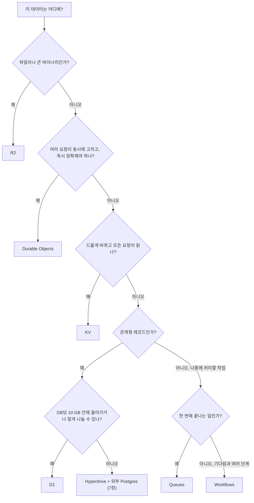
그림 1. "이 데이터는 어디에?" 결정 플로차트

`moim`의 데이터를 이 그림에 흘려보면 앞에서 고른 자리가 그대로 나온다. 발표 자료는 R2로, 선착순 좌석은 Durable Objects로, 신청 접수 플래그는 KV로, 행사와 신청 내역은 D1으로, 확인 메일은 Queues로, 행사 전날 리마인더는 Workflows로 간다. 서두의 레이트 리미터를 이 그림에 넣어봐도 답은 분명하다. 여러 요청이 동시에 고치고 즉시 정확해야 하는 카운터이니, 두 번째 갈림길에서 Durable Objects로 빠진다. 그 팀이 결국 도착한 곳과 같다.

그림에서 한 가지 오해만 바로잡고 가자. "DB는 하나여야 한다"는 감각으로 보면 저장소 여섯 개는 복잡함의 증거처럼 보인다. 하지만 Spring 서비스도 사실은 Postgres와 Redis와 메시지 브로커와 S3를 함께 써왔다. 다른 점은 Cloudflare에서는 그 조합이 처음부터 드러나 있고, 바인딩 한 줄로 붙는다는 것뿐이다. 이 플로차트는 여러분의 서비스에도 그대로 쓸 수 있다. 다음에 새 데이터가 생기면 맨 위 질문부터 다시 따라 내려가보자.

### 이 장의 핵심

- 저장소를 고르기 전에 데이터의 성격을 먼저 묻는다. 일관성, 쓰기 빈도, 모양과 크기, 처리 시점이 기준이다.
- D1은 관계형 레코드용이다. DB당 10 GB(Paid, 상향 불가)이고 여러 요청에 걸친 트랜잭션은 없다. 인덱스와 `ON CONFLICT`가 비용을 지킨다.
- KV는 최종 일관성이라 드물게 바뀌는 설정에만 쓴다. 카운터·락·재고는 Durable Objects로 옮긴다. KV Instant(비공개 베타)는 쓰기가 건당 $0.10이다.
- Durable Objects는 ID 하나에 객체 하나로 요청을 모아 강한 일관성을 준다. Duration은 128 MB 기준으로 과금되며, alarm은 `getAlarm()`으로 확인한 뒤에만 건다.
- R2는 이 책에서 처음 결제수단을 요구한다. Free 범위를 넘는 사용분은 그대로 청구되니 예산 알림·공개 범위·presigned URL을 먼저 점검한다.

# 5장. 풀스택 앱 — React와 Next.js를 Workers에서

Next.js를 Vercel이 아닌 곳에 올리면 무엇을 잃을까?

이 질문은 생각보다 자주 미뤄진다. 처음에는 잃을 것이 없어 보인다. Next.js는 오픈 소스이고, `next build`가 만든 결과물은 어디서든 돌 것 같다. 실제로 노드 서버 하나에 올리면 대체로 잘 돈다. 그런데 그 노드 서버를 Workers 같은 다른 런타임으로 바꾸는 순간 사정이 달라진다. Next.js는 자기 빌드 결과물이 어떤 런타임에서 어떻게 실행될지를 Vercel의 실행 환경에 맞춰 진화시켜 왔고, 다른 플랫폼은 그 결과물을 자기 런타임에 맞게 "번역"해야 한다. 그 번역기를 보통 어댑터라고 부른다.

`moim`도 이제 이 갈림길에 섰다. 4장까지 `moim-api`가 D1과 Durable Objects를 갖추며 자라는 동안, 2장에서 만든 `moim-web`은 여전히 Vite로 빌드한 React SPA에 머물러 있다. 정적 자산으로만 서빙되니 무료이고 빠르다. 그런데 행사 상세 페이지를 메신저에 공유하면 미리보기가 텅 빈다. 검색 엔진도 빈 HTML만 본다. 행사 제목과 남은 좌석 수가 박힌 HTML을 서버에서 그려 보내고 싶다. 서버 렌더링(SSR)이 필요해진 것이다.

SSR을 하려면 프레임워크를 골라야 하고, 많은 독자에게 첫 후보는 Next.js다. 그렇다면 Workers 위의 Next.js는 실제로 어떤 일을 겪어왔을까? 사례부터 살펴보자.

## 어댑터가 프레임워크를 쫓아가는 구조

### 깨진 업그레이드들

OpenNext의 Cloudflare 어댑터(`@opennextjs/cloudflare`) 저장소를 열어 반응이 많은 이슈를 정렬해보면 묘한 패턴이 보인다. 상위 이슈 대부분이 "Next.js 새 버전을 지원해 달라"는 내용이다.

2025년 11월 4일에 열린 #972의 제목은 그냥 "Next16 support"다. Next.js 16이 나왔는데 어댑터가 아직 따라오지 못했다는 뜻이고, 39개의 댓글이 달린 끝에 닫혔다. 2025년 12월 19일의 #1049는 더 구체적이다. Next.js 16.1.0으로 올리자 Workers에서 Error 1101과 함께 `setImmediate`라는 읽기 전용 속성에 값을 넣을 수 없다는 에러로 앱이 죽었다. 이 이슈에서 가장 실용적이었던 답은 고친 방법이 아니라 되돌린 방법이었다.

> "Downgrading to 16.0.10 fixed it immediately."

16.0.10으로 내렸더니 바로 해결됐다는 말이다. 이 이슈는 2026년 1월 16일에야 닫혔다. 거의 한 달 동안 16.1을 쓰고 싶은 사람은 기다리거나 버전을 고정하는 수밖에 없었다.

2026년 3월 18일의 #1157도 비슷하다. Next.js 16.2.0이 빌드 결과물에 새 매니페스트 파일(`prefetch-hints.json`)을 추가했고, 어댑터는 그 파일을 몰라 실행 중에 멈췄다. 성능 쪽 이슈도 있다. 2025년 5월 8일의 #653은 제목부터 "Performance is unusably slow"였다. 응답 첫 바이트까지 1.2~3초가 걸린다는 보고에 33개의 댓글이 붙었다. 이후 Cloudflare가 V8 가비지 컬렉션 튜닝과 스트림 버퍼 개선을 반영하면서 일부 해소된 것으로 보이지만, 완전히 풀렸다고 단정할 근거는 아직 없다. 2026년 4월 20일에 열린 #1214는 Hyperdrive와 `node-postgres`를 함께 쓸 때 번들링이 실패하는 문제인데, 2026년 10월 기준으로 여전히 열려 있다(이 문제의 우회책은 8장에서 다룬다).

이 다섯 개의 이슈를 한 줄로 묶으면 무엇이 될까? Next.js가 움직일 때마다 어댑터가 한 번씩 넘어졌다는 것이다.

### 왜 어댑터는 늘 한 박자 늦을까

원인은 구조에 있다. OpenNext 같은 어댑터는 Next.js가 내놓은 빌드 결과물을 받아 Workers에서 돌 수 있는 형태로 다시 조립한다. 문제는 그 빌드 결과물의 내부 형식이 공개된 약속이 아니라는 점이다. 매니페스트 파일이 하나 늘거나, 서버 코드가 Node.js 내부 객체를 조금 다르게 건드리기만 해도 어댑터는 그 사실을 사후에 알게 된다. #1049가 정확히 그런 경우였다. Workers의 Node.js 호환성은 2025년 이후 크게 나아졌지만, 프레임워크가 런타임 내부를 직접 만지는 지점에서는 여전히 새 문제가 생긴다.

현장 개발자들도 이 구조를 피곤해한다. HN의 한 댓글은 짧고 솔직하다.

> "its really annoying that nextjs has to be forked and/or patched to work on cloudflare."

Next.js를 Cloudflare에서 돌리려면 포크하거나 패치해야 한다는 사실 자체가 짜증스럽다는 얘기다. 빌드 산출물 크기도 문제가 됐다. 이전 어댑터였던 next-on-pages가 폐기된 뒤 Next 16에서 함수당 산출물이 5~10KB에서 약 500KB로 커졌다는 r/nextjs의 경험담도 있다(2025년 12월 무렵, 미러 경유).

여기서 얻을 수 있는 원리는 단순하다. 프레임워크의 내부 형식에 기대는 어댑터는 그 프레임워크의 릴리스 속도를 결코 앞지를 수 없다. 어댑터 팀이 아무리 성실해도, 새 버전이 나온 날과 그 버전이 다른 플랫폼에서 안전하게 도는 날 사이에는 틈이 생긴다. 이 틈은 개발자에게 두 가지 선택을 강요한다. 최신 버전을 포기하고 버전을 고정하거나, 업그레이드할 때마다 프로덕션을 걸고 시험하거나. 어느 쪽도 마음 편한 선택은 아니다.

그렇다면 Cloudflare는 이 틈을 어떻게 메우려 했을까?

## vinext — 공식 권장 기본값, 그리고 1.0이 바꾼 것

### vinext는 어디까지 왔나

Cloudflare의 답은 번역기를 버리고 Next.js의 API 표면을 다시 구현하는 것이었다. 공식 문서는 vinext를 이렇게 소개한다.

> "vinext is a Vite plugin that reimplements the Next.js API surface."

vinext는 Next.js의 빌드 결과물을 해석하지 않는다. 대신 App Router, 서버 컴포넌트, Server Actions, 미들웨어 같은 Next.js의 API를 Vite 플러그인 위에서 직접 구현한다. 그러면 Next.js 내부 형식이 바뀌어도 그 변화에 휘둘릴 여지가 줄어든다. 2026년 8월 25일에 갱신된 Cloudflare의 Next.js 가이드는 이 길을 기본값으로 못 박았다.

> "Cloudflare recommends vinext as the default way to run Next.js applications on Cloudflare Workers."

OpenNext 가이드(2026-08-25 기준)도 새 앱에는 vinext를 권하고, 자신은 기존 OpenNext 앱을 유지하는 용도라고 적는다. 2026년 9월 28일에는 vinext 1.0.0이 나왔고, 10월 1일에 1.0.1이 이어졌다. 발표 글에 따르면 Next.js 테스트 호환성이 캐시 컴포넌트를 제외하고 99%를 넘었고, Next.js의 종단 간 테스트 스위트를 매일 밤 vinext에 돌린다.

물론 1.0이라는 숫자만 보고 안심하기는 이르다. 정직하게 짚어둘 것이 세 가지 있다. 첫째, Cloudflare 공식 가이드는 2026년 10월 현재 아직 "vinext is in beta"라고 적혀 있다. 1.0 출시 이후 갱신되지 않은 것이다. 둘째, vinext README는 1.0 이후에도 "모든 애플리케이션이나 프로덕션 워크로드를 그대로 대체하지는 못한다"는 문구를 유지하고, 특히 새 App Router 기능에서 호환성 틈을 예상하라고 말한다. 셋째, `"use cache"` 지원이 부분적이다. 파일 수준과 함수 수준의 `"use cache"`는 동작하지만, 그 위에 올라가는 Cache Components 전체 동작은 아직 미완이다. 이미지 최적화도 요청 시점 최적화만 되고 Next.js의 빌드 시점 이미지 파이프라인은 재현하지 않는다(vinext README 2026-09-28 기준).

그래서 판단 기준이 필요하다. 새로 시작하는 앱이나 비교적 단순한 App Router 앱이라면 vinext가 자연스러운 출발점이다. 반대로 `"use cache"`와 Cache Components에 깊이 기대는 앱은 당분간 OpenNext를 유지하는 편이 합리적일 수 있다. Cloudflare의 OpenNext 지원표는 `"use cache"`(Composable Caching)와 PPR을 "Supported"로 적고 있기 때문이다(표에는 Next.js의 실험 기능이라는 단서가 붙어 있다, 2026-08-25 기준). 어느 쪽이든 기존 앱이라면 먼저 `npx vinext check`로 호환성 문제를 훑어보는 습관을 들이자.

vinext를 둘러싼 현장의 온도도 함께 알아두는 게 좋다. 2026년 2월 처음 공개됐을 때 vinext는 "AI로 일주일 만에 다시 만든 Next.js"라는 이야기와 함께 등장했고, 반응은 기대와 경계로 갈렸다. 성능과 Vite 생태계에 기대를 거는 목소리가 있었던 반면, 의문도 컸다. 한 사람은 "I am not touching an AI version without waiting for a while."라고 했고, AI가 만든 버전은 한동안 지켜본 뒤에 쓰겠다는 뜻이다. 다른 사람은 "does it actually handle the edge cases or does it just pass the tests."라고 물었다. 테스트만 통과하는 것인지 엣지 케이스까지 정말 처리하는 것인지 묻는 말이다. Vercel 측에서 vinext의 취약점을 공개한 일도 있었다. 다만 이것은 경쟁 관계에 있는 이해관계자의 공개라는 점을 함께 기억해두자. 1.0 이후의 실사용 후기는 2026년 10월 초 기준으로 아직 거의 없다.

### `cf`가 기본이 된 init, 그리고 이 책이 레거시 플래그를 쓰는 이유

vinext 1.0에는 이 책의 설정 방식과 정면으로 부딪히는 변화가 하나 들어 있다. README의 문장을 그대로 옮겨보자.

> "Cloudflare init uses `cf` and `cloudflare.config.ts` by default. Both `vinext init` and `create-vinext-app` accept `--legacy-wrangler-cloudflare-init` to retain the legacy Wrangler setup. Existing Wrangler configs are not automatically migrated."

1.0부터 `vinext init`과 `create-vinext-app`은 `wrangler.jsonc`를 만들지 않는다. 대신 2026년 9월 28일 베타로 공개된 새 CLI인 `cf`와, 타입이 있는 TypeScript 설정 파일 `cloudflare.config.ts`를 만든다. 이 기본값은 1.0 직전인 2026년 9월 27일에 병합된 PR #3504에서 바뀌었고, Wrangler 경로는 "레거시" 플래그 뒤로 물러났다. 레거시 경로를 고르면 Cloudflare Vite 플러그인도 v2가 아닌 v1을 쓴다.

여기서 실습 중에 만날 함정도 하나 짚고 가자. 이미 `wrangler.jsonc`가 있는 프로젝트에서 플래그 없이 `vinext init`을 돌리면 init이 멈춘다. OpenNext로 운영하던 Next.js 앱은 거의 다 `wrangler.jsonc`를 갖고 있으니, OpenNext에서 vinext로 옮기려는 독자는 이 메시지를 높은 확률로 만나게 된다.

괄호 안의 파일명은 원문 메시지에서 실제 파일 이름으로 채워지는 자리다.

```text
Cloudflare init cannot replace an existing Wrangler config (wrangler.jsonc).
Migrate its bindings to cloudflare.config.ts first, or use
--legacy-wrangler-cloudflare-init to keep the Wrangler setup.
```

그렇다면 이 책은 어느 쪽을 택할까? `moim-web`은 레거시 플래그를 써서 `wrangler.jsonc`와 Wrangler v4 경로에 그대로 둔다. 이유는 세 가지다. 첫째, `moim`의 다른 Worker들이 모두 `wrangler.jsonc`로 설정돼 있고, 13장에서 Worker마다 거는 `limits.*` 비용 브레이크와 8장의 GitHub Actions 배포가 모두 `wrangler.jsonc`와 Wrangler를 기준으로 짜여 있다. 한 Worker만 다른 설정 체계에 두면 운영 점검표가 둘로 갈라진다. 둘째, 2026년 10월 기준 Wrangler는 GA이고 `cf`는 베타다. 셋째, Cloudflare 공식 Next.js 가이드 자체가 아직 "바인딩을 Wrangler 설정에 정의하고 `wrangler types`로 타입을 만들라"고 안내한다. 1.0의 기본값과 공식 가이드가 서로 어긋나 있는 셈이다.

물론 이 선택에도 위험이 있다. 이름에 "legacy"가 붙은 플래그는 대개 언젠가 사라질 길이라는 신호다. 언제 사라질지는 공지된 바 없지만, vinext의 새 기능이 `cf` 경로에 먼저 붙을 가능성은 충분하다. 그러니 두 설정 파일이 어떻게 대응하는지를 지금 익혀두면 나중에 옮길 때 훨씬 덜 난감하다. 아래는 vinext init이 만드는 `cloudflare.config.ts`의 골격을 init 소스의 템플릿에서 재구성한 것이다(원문 그대로는 아니다).

```ts
// cloudflare.config.ts — vinext 1.0 기본 경로가 만드는 파일의 골격 (재구성)
import { bindings, defineConfig, defineWorker } from "cf/config";

export default defineConfig({
  worker: defineWorker({
    name: "moim-web",
    entrypoint: "vinext/server/fetch-handler",
    compatibilityDate: "2026-09-01",
    compatibilityFlags: ["nodejs_compat"],
    assets: { notFoundHandling: "none" },
    env: {
      ASSETS: bindings.assets(),
      // D1을 붙인다면: DB: bindings.d1({ name: "moim-db" }),
    },
  }),
});
```

| `cloudflare.config.ts` (`cf`) | `wrangler.jsonc` (Wrangler) |
|---|---|
| `name` | `"name"` |
| `entrypoint` | `"main"` |
| `compatibilityDate` | `"compatibility_date"` |
| `env: { ASSETS: bindings.assets() }` | `"assets": { "binding": "ASSETS", ... }` |
| `env: { DB: bindings.d1({ name }) }` | `"d1_databases": [ ... ]` |
| 타입 생성 `cf workers types` | 타입 생성 `wrangler types` |

생성된 골격에 `compatibilityFlags: ["nodejs_compat"]`가 들어 있는 점도 눈여겨보자. 레거시 init이 만드는 `wrangler.jsonc`에도 같은 플래그가 들어간다. 다만 이 책의 규약대로 호환성 날짜를 2026-08-04 이후로 두면 `nodejs_compat`은 기본으로 켜지므로, 이 책의 Wrangler 설정 예제에서는 생략한다.

> **전망: vinext와 `cf` 경로 (베타, 2026-10-03 기준)**
> `cf`가 무엇이고 Wrangler와 어떻게 나뉘는지는 3장의 전망 박스에서 봤다. 기존 Wrangler 프로젝트는 `cf migrate`로 변환한 뒤에 `cf dev`·`cf build`·`cf deploy`를 쓸 수 있다. 레거시 플래그 없이 만든 vinext 프로젝트는 `npx @vinext/cloudflare deploy`로 배포하고, 이 명령은 빌드 결과물을 `cf`로 올린다. vinext 1.0이 이미 `cf`를 기본으로 삼았으니 방향은 분명해 보이지만, 베타 제품이라 명령과 설정 형식이 빠르게 바뀔 수 있다. 옮길 때는 공식 문서를 함께 확인하자.

## `moim-web`을 Next.js로

### 프로젝트를 만들고 옮기기

`moim-web`은 Vite로 만든 SPA라서 기존 Next.js 앱을 옮기는 `vinext init`의 대상이 되지 못한다. 새 Next.js(App Router) 프로젝트를 만들고 기존 React 컴포넌트를 옮겨 심는 편이 깔끔하다. `create-vinext-app`은 TypeScript App Router 프로젝트를 만든 뒤 기존 앱용 init과 같은 설정 과정을 돌려준다. 여기에 레거시 플래그를 붙이자.

```bash
# 새 vinext 프로젝트 — Wrangler(레거시) 경로로 생성
pnpm create vinext-app@latest moim-web-next --legacy-wrangler-cloudflare-init

# (참고) 기존 Next.js 앱을 옮긴다면
npx vinext check                                   # 호환성 사전 점검
npx vinext init --legacy-wrangler-cloudflare-init  # Wrangler 설정 유지
```

생성된 프로젝트에 2장의 SPA 컴포넌트를 옮긴다. 행사 목록처럼 브라우저 상호작용이 많은 화면은 `"use client"`를 붙인 클라이언트 컴포넌트로 그대로 가져오고, 행사 상세처럼 서버에서 그릴 화면만 서버 컴포넌트로 새로 쓴다. 한꺼번에 다 바꾸려 하지 말고 SSR이 필요한 페이지부터 하나씩 옮기는 편이 낫다.

다음은 `wrangler.jsonc`다. Worker 이름은 2장과 같은 `moim-web`으로 바꿔서 기존 Worker를 그대로 이어받게 하고, 2장에서 정한 커스텀 도메인과 `"workers_dev": false`도 유지한다. 새로 추가하는 것은 `moim-api`로 가는 Service binding 하나다.

```jsonc
// moim-web/wrangler.jsonc
{
  "$schema": "./node_modules/wrangler/config-schema.json",
  "name": "moim-web",
  // "main"·"assets"는 vinext init(레거시 경로)이 만든 값 그대로
  "main": "vinext/server/fetch-handler",
  "assets": { "directory": "dist/client", "not_found_handling": "none", "binding": "ASSETS" },
  "compatibility_date": "2026-09-01",
  "workers_dev": false,
  // 커스텀 도메인(moim.example.com) 설정은 2장과 동일
  "services": [
    { "binding": "API", "service": "moim-api" }
  ],
  "observability": { "enabled": true }
}
```

배포는 Vite 빌드 뒤에 Wrangler로 올리는 흐름이다. `create-vinext-app`이 만든 프로젝트는 스크립트 이름이 `build`·`deploy`다. vinext init 소스(2026-10-03 조회)를 보면 레거시 경로의 `build`는 `vite build`, `deploy`는 `vinext-cloudflare deploy --config dist/server/wrangler.json`이다. `deploy`는 Vite 빌드를 직접 돌린 뒤, 빌드가 만든 `dist/server/wrangler.json`을 설정으로 삼아 Wrangler로 배포한다. 루트의 `wrangler.jsonc`에 대고 `npx wrangler deploy`를 바로 치는 것이 아니라는 점을 기억해두자.

```bash
npm run build    # vite build — vinext 빌드, dist/server/wrangler.json 생성
npm run deploy   # vinext-cloudflare deploy --config dist/server/wrangler.json (빌드 + Wrangler 배포)
```

로컬 개발은 어떨까? `npm run dev`가 vinext 개발 서버를 띄운다. vinext는 Cloudflare Vite 플러그인 위에서 돌고, 이 플러그인은 Worker 코드를 실제 런타임과 같은 workerd 안에서 실행한다. 3장에서 `moim-api`를 로컬에서 돌릴 때와 같은 감각으로, SSR 코드도 운영과 같은 런타임 위에서 확인할 수 있다는 뜻이다. "로컬 Node에서는 됐는데 Workers에 올리니 깨졌다"는 류의 놀람이 줄어든다.

### 행사 상세 SSR과 Service binding

이제 핵심인 행사 상세 페이지를 서버에서 그려보자. 그 전에 `moim-api`에 단건 조회 라우트 `GET /api/events/:id`를 하나 더 붙였다고 하자. 4장에서 만든 D1 조회를 그대로 쓰면 된다.

```ts
// moim-api/src/index.ts (추가분)
app.get("/api/events/:id", async (c) => {
  // ...4장의 D1 조회와 동일 — 없으면 404
});
```

`moim-web` 쪽 서버 컴포넌트는 다음과 같다. vinext는 바인딩에 접근할 때 `cloudflare:workers` 모듈의 `env`를 쓰라고 권한다. 별도 엔트리 파일이나 개발용 프록시가 필요 없다.

```tsx
// moim-web/app/events/[id]/page.tsx
import { env } from "cloudflare:workers";
import { notFound } from "next/navigation";

type MoimEvent = { id: string; title: string; startsAt: string; seatsLeft: number };

export default async function EventPage({ params }: { params: Promise<{ id: string }> }) {
  const { id } = await params;

  // 같은 존의 다른 Worker를 부를 때는 전역 fetch()가 아니라 Service binding으로
  const res = await env.API.fetch(`https://moim.example.com/api/events/${id}`);
  if (res.status === 404) notFound();
  const event = (await res.json()) as MoimEvent;

  return (
    <main>
      <h1>{event.title}</h1>
      <p>{new Date(event.startsAt).toLocaleString("ko-KR")}</p>
      <p>남은 좌석 {event.seatsLeft}석</p>
    </main>
  );
}
```

여기서 3장의 제약이 다시 등장한다. `moim-web`과 `moim-api`는 같은 존 `moim.example.com` 위에 있다. 같은 존의 다른 Worker를 Service binding 없이 전역 `fetch()`로 부르면 요청이 실패한다. SSR 코드에서 무심코 `fetch("https://moim.example.com/api/...")`를 쓰면 로컬에서는 될 것 같다가 배포 후에 깨지는, 꽤 난감한 상황을 만나게 된다. Service binding은 이 제약을 피하는 공식 경로이고, 덤으로 비용도 아낀다. Service binding으로 다른 Worker를 부르면 추가 요청 요금이 붙지 않는다(CPU 시간은 합산된다, Workers Pricing 2026-10-02 기준).

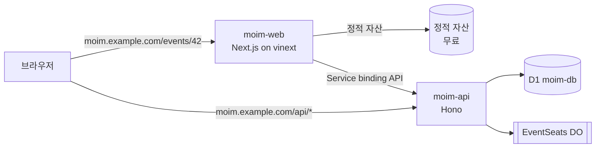
그림 1. `moim-web`(Next.js)과 `moim-api`를 잇는 Service binding 구조

행사 상세는 자주 바뀌지 않으니 매 요청마다 그릴 필요는 없다. 그래서 ISR(정해진 주기로 페이지를 다시 생성하는 방식)을 떠올리게 되는데, 여기서 한 가지를 짚어두자. vinext README는 ISR을 지원한다고 적으면서도, 기본 캐시 핸들러인 `MemoryCacheHandler`는 "그대로 동작하지만 프로덕션에서는 자기 백엔드로 바꾸라"고 권한다. 3장에서 봤듯 isolate의 메모리는 요청과 데이터센터를 넘어 공유되지 않는다. 메모리 캐시는 개발할 때나 믿을 만한 것이다. `@vinext/cloudflare`는 KV에 데이터 캐시를 두는 `kvDataAdapter()`와 페이지 수준 ISR을 Workers Cache에서 서빙하는 `workersCacheCdnAdapter()` 같은 어댑터를 제공한다. 다만 Workers Cache를 켜는 순간 과금 구조가 바뀐다는 점을 먼저 알아야 한다. 어떤 캐시 경로를 고를지는 11장에서 세 경로를 나란히 놓고 다시 판단하자. 지금은 행사 상세를 매 요청 SSR로 두고 넘어간다.

Next.js가 꼭 필요한 게 아니라면 다른 길도 있다. `@cloudflare/vite-plugin`은 2026년 9월 30일 기준으로 React Router v8과 TanStack Start의 SSR을 공식 지원한다. Next.js 생태계에 묶일 이유가 없는 팀이라면, 어댑터나 재구현 없이 Vite 플러그인 위에서 바로 도는 이쪽 프레임워크가 오히려 마음 편할 수 있다. r/nextjs에서 Next 16 빌드 산출물 문제로 고생하던 개발자에게 "build with a better tool like react router or tanstack start"라는 답글이 달렸던 것도 같은 맥락이다. React Router나 TanStack Start 같은 더 나은 도구로 빌드하라는 조언이다.

> **비용 메모**
> 행사 상세 SSR 요청은 Worker 요청으로 계산된다. Free는 하루 100,000건(00:00 UTC 리셋), Workers Paid는 월 1,000만 건 포함에 100만 건당 $0.30이다. 반면 이미지·CSS·JS 같은 정적 자산 요청은 무료·무제한이다(Workers Pricing·Static Assets Billing 2026-10 기준). 그러니 SSR은 정말 서버에서 그려야 하는 페이지에만 쓰자. `moim-web`이 `moim-api`를 Service binding으로 부르는 것은 추가 요청 요금이 없다. 다만 Workers Cache를 켜면 평소 무료인 정적 자산과 Worker 간 호출까지 과금되는 함정이 있다. 자세한 이야기는 11장에서 한다.

## 배포한 다음의 일

### 패치와 위치 — WAF는 패치를 대체하지 않는다

SSR을 시작하면 서버 쪽 공격 표면도 함께 생긴다. 2026년 5월에 React 서버 컴포넌트와 Next.js에서 여러 취약점이 공개됐다. Cloudflare changelog(2026-05-07)는 패치 버전을 이렇게 정리했다. React의 `react-server-dom-webpack`·`react-server-dom-parcel`·`react-server-dom-turbopack`은 19.0.6, 19.1.7, 19.2.6이고, Next.js는 15.5.16과 16.2.5다. 같은 글에는 vinext의 최신 릴리스는 공개된 CVE 어느 것에도 취약하지 않다는 문장도 있다. 그런데 그보다 더 중요한 문장이 있다.

> "Several of the disclosed vulnerabilities are not possible to block in WAF. We strongly recommend updating your applications so they are not purely reliant on WAF mitigations."

공개된 취약점 가운데 몇 가지는 WAF로 막을 수 없으니 WAF에만 기대지 말고 앱을 업데이트하라는 얘기다. Cloudflare 위에 올렸으니 앞단의 WAF가 알아서 지켜주리라 생각하기 쉽다. 하지만 WAF는 알려진 공격 패턴을 걸러내는 그물이지 취약한 코드를 고쳐주는 도구가 아니다. 의존성 업데이트를 미루는 습관은 Cloudflare 위에서도 그대로 위험하다. WAF 설정 자체는 9장에서 다룬다.

성능 쪽에서 알아둘 장치는 Smart Placement다. Worker는 보통 사용자와 가까운 데이터센터에서 실행되는데, Worker가 멀리 있는 백엔드와 여러 번 왕복해야 한다면 차라리 백엔드 가까이에서 실행하는 편이 전체 응답이 빠를 수 있다. Smart Placement는 이 판단을 자동으로 해준다. 2026년 10월 기준 모든 Workers 플랜에서 쓸 수 있고, 배포 후 Worker를 분석하는 데 최대 15분이 걸릴 수 있다. 켜는 설정은 `wrangler.jsonc`의 `"placement": { "mode": "smart" }`다.

한국 개발자 커뮤니티 다모앙에는 이와 관련한 경험담이 있다(2025년 12월 13일, 개인 일화). 무료 플랜에서 응답이 1~2초씩 걸려 확인해보니 요청이 LA 쪽으로 라우팅되고 있었다고 한다. 유료 플랜으로 바꾸고 Smart Placement를 켜자 "체감상 아주 조금, 한 10~20% 정도는 빨라진 느낌"이었고, 도메인당 월 $5인 Argo Smart Routing을 더하자 "눈에 띄게 빨라졌다"는 것이 글쓴이의 평가다. 측정이 아닌 체감이고 한 사람의 사례이니 일반화는 조심하자. 다만 "엣지에 올렸으니 무조건 가깝다"는 기대가 늘 맞지는 않는다는 점은 기억해둘 만하다. 백엔드가 Cloudflare 밖에 있을 때 Worker의 위치를 직접 지정하는 Placement Hints는 7장에서 본다.

### Workers Builds와 PR별 Preview

이제 배포를 사람 손에서 떼어내자. Workers Builds는 GitHub이나 GitLab 저장소를 Worker에 연결해, 푸시할 때마다 Cloudflare가 직접 빌드하고 배포하는 기능이다. 대시보드에서 `moim-web` Worker의 설정으로 들어가 저장소를 연결하고, 빌드 명령(`npm run build`)과 배포 명령(앞에서 본 `npm run deploy`)을 적으면 된다. 빌드 환경의 기본 Node.js는 2026년 7월 30일부터 24.18.0이다.

여기서 알아둘 동작이 하나 있다. 운영 브랜치에서는 배포 명령(기본값은 `wrangler deploy`)이 돌아 실제로 배포되지만, 운영이 아닌 브랜치의 빌드는 기본적으로 `wrangler versions upload`를 실행한다. 새 버전을 올려두기만 하고 운영 트래픽에는 내보내지 않는 것이다. 브랜치에 푸시했는데 운영 사이트가 바뀌지 않았다고 당황하지 말자. 의도된 동작이다.

2026년 9월 22일에는 여기에 PR별 Worker Preview가 더해졌다. 공식 블로그는 이렇게 설명한다.

> "Each Git branch gets a production-like place to run, with its own code, configuration, URL, observability, and state."

브랜치마다 코드·설정·URL·관측성·상태까지 운영과 비슷한 독립 환경이 생긴다는 뜻이다. 로컬에서는 Wrangler 4.135.0 이상에서 `npx wrangler preview`로 격리된 프리뷰를 직접 띄울 수 있다. 리뷰어가 PR에 달린 URL을 열어 행사 상세 페이지를 직접 눌러볼 수 있으니, 리뷰의 질이 눈에 띄게 달라진다.

그런데 "상태까지 독립"이라는 말에는 한 가지 단서가 붙는다.

> "For Durable Objects and Containers, Cloudflare automatically provisions separate namespaces, storage, apps, and instances for every Preview."

Durable Objects와 Containers는 프리뷰마다 네임스페이스와 저장소, 인스턴스가 따로 만들어진다는 것이다(Containers 쪽은 Containers FAQ와 서술이 엇갈려 7장에서 다시 짚는다). `moim-web`에는 DO가 없지만, `moim-api`에는 4장의 `EventSeats`가 있다. `moim-api`에도 프리뷰를 켜면 PR이 열릴 때마다 좌석 카운터 DO가 새로 생긴다는 뜻이다. 테스트 격리라는 점에서는 고마운 동작이다. 하지만 그 DO에 스스로를 깨우는 코드가 있다면 어떻게 될까? 프리뷰 하나하나가 각자 독립된 비용원이 된다. 이 문장이 실제로 어떤 청구서로 이어졌는지는 13장에서 다시 만난다. 지금은 프리뷰를 켜기 전에 "이 Worker에 DO가 붙어 있는가?"를 한 번 묻는 습관만 들여두자. GitHub Actions로 배포하는 다른 길(`wrangler-action`)은 8장에서 다룬다.

---

`moim-web`은 이제 Next.js 위에서 행사 상세를 서버에서 그리고, `moim-api`와 요금 없이 대화하며, PR마다 프리뷰 URL을 얻는다. 그 사이 우리가 확인한 것은 Next.js의 버전 숫자도, vinext의 1.0이라는 숫자도 아니었다. 프레임워크는 바뀌고, 어댑터는 늦는다.

# 6장. Cloudflare Tunnel — 포트를 열지 않고 서버를 세상에 내놓기

금요일 저녁 여섯 시라고 해보자. 일곱 시에 `moim`을 함께 운영할지 고민 중인 커뮤니티 운영진과 화상 회의가 잡혀 있다. 5장까지 Cloudflare 안에서만 도는 `moim`을 완성했지만, 오늘 보여줄 것은 그 바깥에 있는 `moim-core`다. 회원 관리와 결제 정산을 맡은 Spring Boot 서버이고, 지금은 집 책상 밑 미니 PC에서 `localhost:8080`으로 돌고 있다. 화면 공유로 보여줘도 되지만, 운영진이 각자 브라우저로 직접 눌러보게 하고 싶다. 남은 시간은 한 시간이다.

검색창에 "집 서버 외부 접속"을 쳐보면 가장 먼저 나오는 답은 대개 공유기 포트 포워딩이다. 공유기 관리 화면에 들어가 바깥의 8080 포트를 미니 PC의 8080으로 넘기고, 공인 IP를 알려주면 끝이라는 설명이다. 정말 그걸로 충분할까?

## 포트를 여는 대신

### 공유기 포트를 여는 일이 찜찜한 이유

포트 포워딩이 동작하지 않는 것은 아니다. 문제는 그 대가다. 하나씩 짚어보자.

먼저 주소가 불안정하다. 가정용 회선의 공인 IP는 대개 바뀐다. 오늘 알려준 주소가 다음 주에도 맞는다는 보장이 없고, 그래서 DDNS 같은 도구를 하나 더 붙이게 된다. 통신사나 건물 망 구조에 따라서는 공인 IP가 아예 내 공유기에 할당되지 않아 포워딩 자체가 안 되는 경우도 있다.

다음은 HTTPS다. `http://공인IP:8080`을 운영진에게 보내면 브라우저가 경고부터 띄운다. 인증서를 붙이려면 도메인을 연결하고 인증서를 발급받고 갱신까지 챙겨야 한다. 한 시간 안에 하기에는 손이 너무 많이 간다.

가장 마음에 걸리는 것은 열린 포트 자체다. 인터넷에는 열린 포트를 쉬지 않고 훑는 스캐너가 돌아다닌다. 포트를 여는 순간 `moim-core`는 운영진뿐 아니라 그 스캐너들에게도 보인다. 앞단에 어떤 방어도 없이 Spring Boot가 바로 인터넷을 마주하게 된다. 회의가 끝난 뒤 포워딩 규칙을 지우는 것을 잊어버린다면? 그다음 일은 생각만 해도 아찔하다.

그렇다면 ngrok 같은 터널 서비스는 어떨까? 방향은 맞다. 다만 그 길을 택하면 결국 "이 터널을 운영 환경에서도 쓸 것인가"라는 질문으로 돌아오게 되고, 그때는 도메인·인증·방어를 다시 따로 붙여야 한다. 기왕이면 데모에서 운영까지 같은 도구로 이어지는 길을 찾아보자.

Cloudflare Tunnel은 이 질문을 거꾸로 뒤집는다. 바깥에서 안으로 들어올 구멍을 여는 대신, 안에서 바깥으로 연결을 먼저 맺는다. 서버 쪽에서 보면 들어오는 포트는 하나도 열려 있지 않다. 그 원리는 잠시 뒤에 보고, 우선 금요일 저녁의 급한 불부터 끄자.

### 30초 데모 — Quick Tunnel과 Protected Quick Tunnel

미니 PC에 `cloudflared`를 설치했다면 명령 한 줄이면 된다.

```bash
cloudflared tunnel --url http://localhost:8080
```

잠시 후 터미널에 `https://<임의의-이름>.trycloudflare.com` 형태의 주소가 찍힌다. 이 주소를 운영진에게 보내면 끝이다. Cloudflare 계정도, 도메인도 필요 없다. 이것이 Quick Tunnel이다.

종종 Quick Tunnel을 2026년의 새 기능으로 소개하는 글이 보이는데, 사실이 아니다. 2026년 9월 HN에서 844점을 받은 "Cloudflare Quick Tunnels" 스레드에서도 한 댓글이 2021년 웹 아카이브를 근거로 5년 넘은 기능이라고 지적했다. 정말 새로 생긴 것은 따로 있다. 바로 다음에 볼 보호 모드다.

Quick Tunnel은 테스트와 개발용이다. 공식 문서(Quick Tunnels 2026-09-30 기준)가 밝힌 한계를 보면 이유가 분명하다. 터널 하나가 동시에 처리하는 요청은 200개까지이고, 그 이상은 429 응답을 받는다. Server-Sent Events(SSE)는 지원하지 않는다. 운영 환경이라면 정식 Cloudflare Tunnel을 만들라는 것이 문서의 권고다.

그런데 데모 주소를 메신저에 붙여 넣는 순간 조금 불안해진다. 주소만 알면 누구나 들어올 수 있기 때문이다. 2026년 10월 2일 추가된 Protected Quick Tunnel이 이 지점을 메운다.

```bash
cloudflared tunnel --url http://localhost:8080 --allowed-mail '*@example.com'
```

`--allowed-mail` 플래그를 붙이면 방문자는 이메일로 받은 일회용 PIN으로 인증해야 들어올 수 있다. 위 예처럼 도메인 단위 와일드카드를 쓰면 운영진의 회사 메일 주소만 통과시킬 수 있다. 공식 changelog도 이 기능을 로컬 개발 서버, 웹훅 수신기, 데모를 공유하는 용도로 소개한다. 8장에서 Stripe 웹훅을 로컬에서 받아볼 때, 이 보호 모드가 사람이 아닌 호출자 앞에서 어디까지 통하는지 다시 따져본다.

Workers 쪽 개발 중이라면 `cloudflared`를 따로 깔 필요도 없다. Wrangler에는 `wrangler tunnel quick-start` 명령이 있고, Wrangler가 `cloudflared` 바이너리를 알아서 내려받아 관리한다. 개발 서버가 떠 있는 상태에서 Wrangler 화면에서는 `t`, Vite에서는 `t`와 Enter를 누르면 터널이 열린다. `moim-web`의 작업 중인 화면을 누군가에게 잠깐 보여줄 때 요긴하다.

금요일 데모는 이걸로 무사히 넘겼다고 하자. 그렇다면 월요일부터는 어떻게 할까? 이제 정식으로 열어보자.

## 바깥으로 맺는 연결

### Tunnel은 어떻게 동작하는가

정식 Tunnel의 구성 요소는 둘이다. 서버 옆에서 도는 작은 데몬 `cloudflared`와, Cloudflare 쪽에 저장된 터널 설정이다. 공식 문서(Tunnel 2026-09-11 기준)의 설명은 간결하다. 공인 IP를 노출하는 대신 서버에 `cloudflared`라는 가벼운 데몬을 설치하고, 이 데몬이 두 Cloudflare 데이터센터로 오래 유지되는 연결 네 개를 맺어 자체 이중화를 갖춘다.

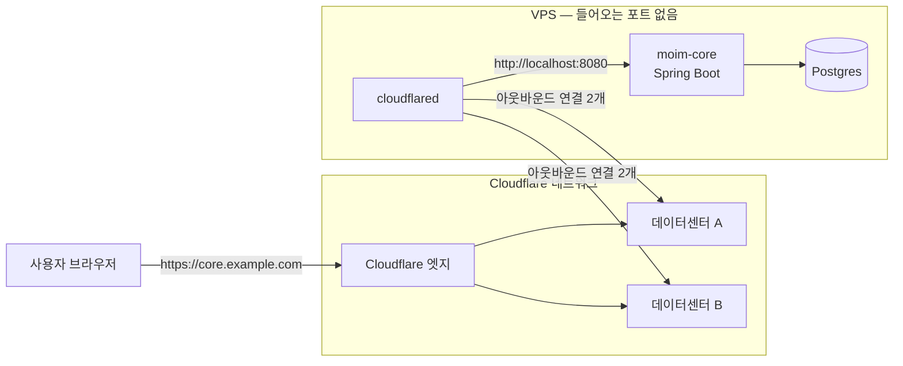
그림 1. `cloudflared`가 바깥으로 맺는 연결과 요청이 오리진에 닿는 경로

요청의 흐름을 따라가보자. 사용자가 `core.example.com`에 접속하면 요청은 가장 가까운 Cloudflare 엣지로 간다. 엣지는 이 호스트명이 어떤 터널에 연결돼 있는지 알고, `cloudflared`가 미리 열어둔 연결을 타고 요청을 서버 안으로 들여보낸다. `cloudflared`는 그 요청을 `localhost:8080`의 Spring Boot에 넘기고 응답을 같은 길로 돌려보낸다. 서버의 방화벽은 들어오는 연결을 전부 막아도 된다. 연결은 늘 안에서 밖으로만 맺어지기 때문이다.

이 구조 덕분에 앞에서 본 포트 포워딩의 문제들이 한꺼번에 사라진다. 바깥으로 나가는 연결은 공유기 뒤에서도, 공인 IP가 내 공유기에 할당되지 않는 망에서도 대개 그냥 된다. 집의 공인 IP가 바뀌어도 상관없다. `cloudflared`가 다시 연결을 맺으면 그만이고, 사용자는 언제나 `core.example.com`이라는 같은 이름으로 들어온다. 그래서 금요일 데모에 썼던 집 미니 PC든, 월 몇 달러짜리 VPS든, 회사 사무실 구석의 서버든 같은 방식으로 내놓을 수 있다.

반대로 생각해볼 점도 있다. 연결이 하나의 데몬에 달려 있다는 것은, 그 데몬이 멈추면 서비스도 멈춘다는 뜻이다. `cloudflared`가 죽거나 서버가 꺼지면 엣지는 요청을 넘길 곳을 잃고 사용자는 Cloudflare의 오류 화면을 보게 된다. Spring Boot만 재시작 중이어도 마찬가지다. 그래서 `cloudflared`를 시스템 서비스로 등록하고, 필요하면 replica를 두는 이야기가 뒤따른다. 서버 자체가 꺼지는 경우는 Tunnel이 풀어줄 수 없는 문제이고, 그 질문은 7장에서 정면으로 다룬다.

도메인이 Cloudflare에 있으니 HTTPS 인증서는 엣지가 처리하고, 이 요청은 Cloudflare의 CDN과 보안 기능을 그대로 거친다. 요금은 어떨까? Tunnel은 모든 플랜에서 쓸 수 있다(Tunnel 2026-09-11 기준). 존 요금제가 Free여도, Workers Paid가 아니어도 된다.

### 원격 관리 터널로 `moim-core` 공개하기

이제 `moim-core`를 VPS로 옮겼다고 하자. Postgres도 아직 같은 VPS에 있다(7장에서 밖으로 옮긴다). 터널을 만드는 방식은 두 가지다. 설정을 Cloudflare에 저장하는 원격 관리 터널과, 서버의 설정 파일로 관리하는 로컬 관리 터널이다. Cloudflare는 대부분의 경우 원격 관리 터널을 권한다. 대시보드·API·Terraform 어디서든 터널을 관리할 수 있기 때문이다. 로컬 관리 터널은 로컬 개발이나 테스트, 기존 구성을 유지하는 특수한 경우를 위한 것으로 정리돼 있다.

대시보드에서 **Networking > Tunnels**로 들어가 **Create Tunnel**을 누르자. 이름을 `moim-core`로 정하면 대시보드가 이 터널 전용 토큰이 들어간 설치 명령을 보여준다. 이어서 라우트로 "Published application"을 추가하고, 호스트명에 `core.example.com`, 서비스에 `http://localhost:8080`을 적는다. API로 같은 일을 하려면 `POST /accounts/$ACCOUNT_ID/cfd_tunnel`에 `"config_src": "cloudflare"`를 넣어 만들면 된다. Tunnel은 2026년부터 독립 제품 문서(`/tunnel/`)와 독립 메뉴로 자리를 옮겼다. 예전 글에서 "Zero Trust 메뉴 안의 Tunnel"을 찾으라는 안내를 보더라도 당황하지 말자.

여기서 하나 꼭 기억해두자. 원격 관리 터널은 토큰만 있으면 실행된다. 토큰을 가진 사람은 누구든 그 터널을 자기 기계에서 띄울 수 있다는 뜻이다. 토큰은 비밀번호처럼 다뤄야 한다.

VPS에서는 `cloudflared`를 시스템 서비스로 등록한다. 대시보드가 보여주는 대로 `sudo cloudflared service install <토큰>`을 실행하면 systemd 유닛이 만들어지는데, 그 파일을 열어보면 `ExecStart` 줄에 토큰이 그대로 박혀 있다. 명령줄 인자는 같은 서버의 다른 사용자에게 프로세스 목록으로 보일 수 있으니, 토큰을 파일로 빼고 `--token-file`로 읽게 바꾸는 편이 낫다.

```ini
# /etc/systemd/system/cloudflared.service (발췌)
[Service]
ExecStart=/usr/local/bin/cloudflared tunnel run --token-file /etc/cloudflared/moim-core.token
Restart=on-failure
```

```bash
sudo install -m 600 -o root moim-core.token /etc/cloudflared/moim-core.token
sudo systemctl daemon-reload
sudo systemctl enable --now cloudflared
```

`--token-file`은 환경 변수 `TUNNEL_TOKEN_FILE`로도 줄 수 있다(`--token`은 `TUNNEL_TOKEN`). 컨테이너 환경에서는 이쪽이 더 편하다.

로컬 관리 터널도 알아두면 기존 글을 읽을 때 도움이 된다. 흐름은 `cloudflared tunnel login`으로 인증하고, `cloudflared tunnel create moim-core`로 터널을 만든 뒤, `~/.cloudflared/config.yml`에 ingress 규칙을 쓰고, `cloudflared tunnel route dns`로 호스트명을 연결해 `cloudflared tunnel run`으로 띄우는 순서다.

```yaml
# ~/.cloudflared/config.yml — 로컬 관리 터널
tunnel: <Tunnel-UUID>
credentials-file: /root/.cloudflared/<Tunnel-UUID>.json
ingress:
  - hostname: core.example.com
    service: http://localhost:8080
  - service: http_status:404   # 마지막 규칙은 반드시 모든 요청을 받는 catch-all이어야 한다
```

이 방식에서는 호스트명이 `{터널 UUID}.cfargotunnel.com`을 가리키는 CNAME 레코드로 연결된다. 이 구조를 두고 HN에는 "It boggles my mind that Cloudflare ever considered this acceptable for production"이라는 댓글도 있었다. Cloudflare가 이걸 운영 환경에 적합하다고 여겼다는 게 놀랍다는 말이니, 취향이 갈리는 지점이라는 정도만 알아두자. 이 책은 원격 관리 터널을 기본으로 쓴다.

## Spring Boot와 함께 운영하기

### Spring Boot 쪽에서 챙길 것

Tunnel을 붙였다고 Spring Boot 설정을 손대지 않아도 되는 것은 아니다. 몇 가지를 살펴보자.

첫째, 프록시 뒤에 있다는 사실을 Spring에 알려야 한다. `moim-core` 입장에서 요청은 언제나 `localhost`의 `cloudflared`에서 평문 HTTP로 들어온다. 그대로 두면 Spring이 리다이렉트 URL을 `http://`로 만들거나, 모든 요청의 클라이언트 IP를 `127.0.0.1`로 기록하는 일이 생긴다. 프록시가 붙여 보내는 전달 헤더(`X-Forwarded-Proto` 등)를 신뢰하도록 설정하자. Spring Boot에서는 `server.forward-headers-strategy` 속성이 이 역할을 한다. 지원되는 클라우드 플랫폼이 아니면 기본값이 `NONE`이니, `X-Forwarded-For`와 `X-Forwarded-Proto`를 처리하도록 `server.forward-headers-strategy=native`로 직접 켜자(Spring Boot 4.1.1 문서 기준). 원래 사용자 IP를 알고 싶다면 Cloudflare가 오리진으로 보내는 `CF-Connecting-IP` 헤더를 읽으면 된다. 이 헤더들은 반드시 Cloudflare를 거쳐 온 요청에서만 믿어야 한다. 그래서 다음 항목이 중요하다.

둘째, Spring Boot가 바깥 인터페이스에서 듣지 않게 하자. VPS에 `cloudflared`와 Spring Boot를 함께 띄운다면 Spring은 `127.0.0.1`에만 바인딩하고(`server.address=127.0.0.1`), 방화벽은 들어오는 연결을 모두 막는다. 그러면 `moim-core`에 닿는 길은 터널 하나뿐이다. 누군가 VPS의 IP를 알아내 8080으로 직접 두드려도 아무것도 응답하지 않는다.

셋째, 지금 이 문이 어떤 상태인지 정확히 알아두자. `core.example.com`은 이제 인터넷 어디서든 접속할 수 있다. `moim-core`에는 원래 쓰던 Spring의 로그인 기능이 있으니 활짝 열린 문은 아니다. 다만 Cloudflare가 아직 앞에서 지켜주지 않는 문이다. 누가 들어오려 하는지 Cloudflare 단계에서 묻지 않고, 로그인 화면까지는 누구에게나 보인다. 이 문 앞에 Access를 세워 사람과 기기를 먼저 확인하게 하고, Spring Security가 그 결과를 검증하게 만드는 일은 10장에서 한다.

넷째, 업로드 크기다. 존 요금제가 Free라면 Cloudflare를 지나는 요청 본문은 최대 100 MB이고, 넘으면 413 응답을 받는다(Workers Limits 2026-09-05 기준). Immich 같은 사진·동영상 서버를 Tunnel 뒤에 둔 HN 사용자가 "Only issue is the 100MB upload size for videos."라고 적은 것도 이 때문이다. 동영상 업로드의 100MB 제한이 유일한 문제였다는 말이다. `moim`의 발표 자료 업로드는 R2로 가니 영향이 없지만, Spring 쪽에 파일 업로드 API가 있다면 이 한도를 설계에 넣어두자.

다섯째, gRPC다. Spring으로 gRPC 서비스를 만드는 독자라면 주의가 필요하다. `cloudflared` 저장소의 gRPC 지원 이슈 #491은 2021년 10월에 열려 2026년 9월 30일 현재까지 66개의 댓글을 달고 열려 있다. 커뮤니티에는 `--protocol http2 --http2-origin --no-tls-verify` 조합에 HTTPS 앱·HTTP2·청크 인코딩 비활성화를 더해 우회했다는 보고(2026-09-30)와, 대시보드의 "Match SNI To Host" 옵션을 켜면 응답 트레일러가 깨진다는 경고(2026-09-06)가 있다. 둘 다 개인 경험담이니 그대로 따르기보다 실험 출발점으로 삼자. Containers로 들어오는 인바운드 gRPC는 다른 경로인데, 아직 비공개 베타라 7장에서 전망으로만 다룬다.

### Docker·Kubernetes와 replica

`moim-core`를 Docker Compose로 띄운다면 `cloudflared`를 옆 컨테이너로 두는 편이 깔끔하다. 공식 이미지는 `cloudflare/cloudflared`다.

```yaml
# docker-compose.yml (발췌)
services:
  moim-core:
    image: moim-core:latest
    # ports: 항목을 두지 않는다 — 호스트에 포트를 열지 않는다
  cloudflared:
    image: cloudflare/cloudflared
    command: tunnel --no-autoupdate run
    environment:
      TUNNEL_TOKEN_FILE: /run/secrets/tunnel_token
    secrets: [tunnel_token]
    restart: unless-stopped
secrets:
  tunnel_token:
    file: ./moim-core.token
```

이 경우 대시보드의 서비스 주소는 Compose 네트워크 안의 이름을 써서 `http://moim-core:8080`으로 바꾼다. `moim-core`에 `ports:`를 두지 않았으니 호스트 바깥에서는 Spring Boot에 직접 닿을 방법이 없다.

Kubernetes에서는 `cloudflared`를 Deployment로 띄운다. 공식 예시는 `replicas: 2`로 두 개를 띄우고 `cloudflared tunnel --no-autoupdate --loglevel info --metrics 0.0.0.0:2000 run`을 실행한다.

여기서 replica를 오해하기 쉽다. replica는 같은 터널을 가리키는 `cloudflared` 인스턴스를 하나 더 띄우는 것이고, 각 replica가 연결 네 개를 새로 맺는다. 터널 하나에 replica를 25개(연결 100개)까지 붙일 수 있다. 문서는 트래픽이 지리적으로 가장 가까운 replica로 간다고 설명하면서도, 동시에 이렇게 못 박는다.

> "We do not recommend using `cloudflared` in autoscaling setups because downscaling (removing replicas) will break existing user connections to that replica. Additionally, `cloudflared` does not load balance across replicas; replicas are strictly for high availability."

정리하면 replica는 HA용이지 LB용이 아니다. 가까운 replica로 요청이 가긴 하지만, 그 목적은 한 대가 죽어도 터널이 살아 있게 하는 데 있다. 그래서 replica 수를 부하에 따라 늘렸다 줄였다 하는 오토스케일링도 권하지 않는다. 줄이는 순간 그 replica에 붙어 있던 사용자 연결이 끊긴다. 부하 분산이 필요하다면 터널 뒤쪽, 즉 Spring Boot 인스턴스 앞에서 해결하자.

> **비용 메모**
> Cloudflare Tunnel은 모든 플랜에서 무료로 쓸 수 있고, Quick Tunnel은 계정조차 필요 없다(Tunnel 2026-09-11, Quick Tunnels 2026-09-30 기준). 비용 대신 걸리는 것은 약관과 한도다. Free·Pro·Business 플랜에서 Tunnel 공개 호스트명으로 동영상 같은 대용량 파일을 서빙하는 것은 서비스별 약관상 별도 유료 서비스가 필요하다. 공식 FAQ의 문장은 이렇다. "On Free, Pro, and Business plans, the service-specific terms require you to use a specific paid service to serve video and other large files." Free 존의 요청 본문 한도 100 MB도 함께 기억해두자.

## 한계와 대안

### Tunnel, Tailscale, ngrok — 무엇을 어디에 쓸까

Tunnel이 늘 정답일까? 현장의 의견은 꽤 갈린다. 세 관점을 나란히 놓아보자.

Tunnel을 좋아하는 쪽은 편리함을 꼽는다. 포트를 열지 않고, TLS 인증서와 도메인, 나중에는 Access 인증까지 한 번에 해결된다. 2026년 4월의 한 HN 댓글은 이렇게 표현했다. "It's a magical invention that lets us host websites while keeping our server firewalls closed!" 서버 방화벽을 닫아둔 채로 웹사이트를 호스팅하게 해주는 마법 같은 발명이라는 것이다.

Tailscale을 선호하는 쪽의 핵심 논거는 TLS가 어디서 끝나느냐다.

> "it acts as a termination point for TLS, whereas Tailscale does not. … that's a pretty big privacy downgrade for tunneling from the Internet."

Tunnel에서는 사용자와의 TLS가 Cloudflare 엣지에서 끝난다. 즉 Cloudflare가 요청 내용을 볼 수 있는 위치에 있다. Tailscale은 기기끼리 직접 암호화된 연결을 맺으므로 중간 사업자가 내용을 보지 않는다. 그 밖에 P2P 연결이 없다는 점과 벤더 종속도 지적된다. Java Champion인 Nicolas Fränkel은 2026년 1월 Cloudflare Zero Trust에서 Tailscale로 옮긴 경험을 글로 남겼다. 사용자 기기가 사설망 안에 있지 않아 서비스마다 공개 엔드포인트를 만들어야 했고, SSH가 불편했으며, 인증서 투명성 로그 때문에 서브도메인과 홈 서버가 드러났다는 이유였다. 그의 결론은 "Migrating to Tailscale was a leap of faith, but I'm very happy I did it."이었다. Tailscale로 옮긴 것은 믿음의 도약이었지만 아주 만족한다는 뜻이다.

세 번째 관점은 계정 없는 익명 터널 자체를 비판한다. ngrok 창업자는 HN Quick Tunnels 스레드(2026-09-18)에서 익명 사용이 자사 제품 악용의 가장 큰 원천이었기 때문에 오래전에 없앴다며, 계정 없는 터널 서비스는 인터넷 보안에 순손실이라고 주장했다. 경쟁 사업자의 발언이라는 점을 감안해야 하지만, 무료 프록시 주소가 결국 차단 목록에 오르기 쉽다는 다른 사용자의 지적과 함께 생각해볼 만한 이야기다. 우리가 Quick Tunnel을 데모에만 쓰고, 그것도 가능하면 `--allowed-mail`로 보호한 이유이기도 하다.

그렇다면 어떻게 나눠 쓰는 게 좋을까? 현장에서 반복되는 합의는 이렇다. 누구나 접속해야 하는 공개 서비스는 Tunnel로 내놓고 Access를 앞에 세운다. 나와 팀원만 쓰는 사설 접근, 예컨대 SSH나 파일 동기화, 개인 미디어 서버는 Tailscale 같은 사설망 도구로 간다. `moim-core`는 운영진뿐 아니라 `moim-api`도 부르는 서버이고, 10장에서 Access로 닫을 예정이니 Tunnel 쪽이 맞다. 팀원의 SSH는 10장에서 `cloudflared access ssh`로 다시 다룬다. Tunnel을 사설망·VPN 대체로 쓰는 이야기는 Cloudflare One의 Tunnel 문서 쪽 주제이고, 그 역시 10장의 몫이다.

### 오래 굴리기 위한 운영 수칙

터널은 한번 띄우면 잊고 지내기 쉽다. 그래서 오히려 운영 수칙을 정해두는 편이 낫다.

먼저 네트워크다. `cloudflared`는 7844 포트로 바깥에 연결한다. UDP(QUIC)와 TCP(HTTP/2) 둘 다 쓰므로, 회사망이나 클라우드 보안 그룹에서 아웃바운드 7844가 막혀 있으면 터널이 뜨지 않는다. 2026.5.2 버전부터는 `cloudflared`가 시작할 때 DNS와 7844 포트 연결을 스스로 점검하고, DNS를 풀지 못하거나 UDP와 TCP가 둘 다 실패하면 원인을 알려주며 일찍 종료한다(2026-05-27 기준). 커뮤니티에 보고된 QUIC 타임아웃 문제도 상당수는 UDP 7844가 막힌 환경에서 HTTP/2로 넘어가거나 버전을 올려 해결됐다.

다음은 버전이다. Cloudflare는 최신 릴리스로부터 1년 이내의 `cloudflared`만 지원한다. 2026년 10월 기준 최신은 2026.9.3(2026-09-24)이다. Windows에서는 `cloudflared`가 자동으로 업데이트되지 않으니 직접 챙겨야 한다. 오래된 글에 나오는 `cloudflared proxy-dns` 명령은 2026년 2월 2일 이후 릴리스에서 제거됐고, 그 역할은 Cloudflare One Client(구 WARP Client)와 Mesh node(구 WARP Connector)로 넘어갔다. 2027년에는 32비트 Windows와 Intel macOS용 빌드 제공이 중단될 예정이다(2026-09-18 공지).

마지막으로 토큰이다. 토큰이 새어 나갔다고 의심되면 대시보드에서 토큰을 교체하고 파일을 바꿔 서비스를 다시 띄우자. 토큰 파일 권한(`600`)과 소유자도 정기 점검 목록에 넣어두는 게 좋다.

금요일 저녁의 데모는 명령 한 줄로 끝났고, 월요일의 운영은 몇 개의 설정으로 자리를 잡았다. 그 뒤로 남는 것은 결국 세 줄이다.

```bash
sudo systemctl enable --now cloudflared   # 재부팅해도 터널이 다시 뜨게 서비스로 등록
sudo journalctl -u cloudflared -n 50      # 시작 시 7844 사전 점검과 연결 상태 확인
cloudflared --version                     # 최신 릴리스 1년 이내인지 확인
```

# 7장. Spring Boot의 자리 — JVM 백엔드를 어디에 두고 어떻게 잇는가

앞 장에서 우리는 포트 하나 열지 않고 `moim-core`를 `core.example.com`으로 꺼냈다. VPS 안의 Spring Boot는 이제 Cloudflare 엣지를 거쳐 세상과 이어져 있다. 그런데 그 VPS의 전원이 꺼지면 어떻게 될까?

Tunnel은 길을 놓아줄 뿐, 길 끝의 서버를 대신 살려주지는 않는다. VPS가 재부팅되는 몇 분, 디스크가 가득 차 Postgres가 멈춘 한 시간 동안 `moim-core`는 그냥 없다. 게다가 이 VPS에는 Spring Boot와 Postgres가 함께 살고 있다. 서버 한 대가 API와 데이터와 매달 한 번 도는 정산 배치까지 전부 떠안은 구조다. 3장에서 확인했듯 Workers에는 JVM이 없고, Kotlin/Wasm은 2026년 10월 기준 아직 Beta이니 Spring을 Workers로 옮기는 길도 주력 경로가 될 수 없다.

그렇다면 Java·Kotlin 백엔드는 Cloudflare 옆에서 어디에 살아야 할까? 하나의 답을 고르기 전에, 갈 수 있는 길부터 나란히 놓아보자.

## 세 착지점

### 세 갈래 길

JVM 백엔드가 Cloudflare와 함께 살 수 있는 자리는 크게 셋이다.

첫째는 6장의 길이다. **(A) Tunnel 뒤의 VM이나 집 서버**에 Spring Boot를 상시 띄워두고, `cloudflared`로 엣지와 잇는다. 익숙하고 단순하며, 서버 한 대 값만 내면 된다. 대신 서버의 생사와 OS 업데이트, 디스크 관리는 전부 내 몫이다.

둘째는 **(B) Cloudflare Containers**다. 2026년 4월 13일 GA가 된 제품으로, 공식 문서의 소개는 이렇다.

> "Run code written in any programming language, built for any runtime, as part of apps built on Workers."

어떤 언어, 어떤 런타임으로 만든 코드든 Workers 앱의 일부로 실행한다는 뜻이다. JVM도 예외가 아니다. 다만 Containers는 Workers Paid 플랜에서만 쓸 수 있다. 이 책에서 계정이 처음으로 Workers Paid로 넘어가는 지점이 바로 여기다.

셋째는 **(C) 이미 쓰고 있는 클라우드에 그대로 두고 잇는 것**이다. AWS나 GCP에 Spring Boot와 데이터베이스가 이미 있다면, Worker를 그 리전 근처에서 실행하도록 Placement Hints로 지정할 수 있다. `"placement": { "region": "aws:us-east-1" }`처럼 AWS·GCP·Azure의 리전 식별자를 쓴다(2026-01-22 기준). 공인 인터넷에 노출되지 않은 사설 API에 Worker가 직접 닿게 해주는 Workers VPC도 이 길에 속하지만, 2026년 10월 현재 베타라서 아래 전망 박스로만 다룬다.

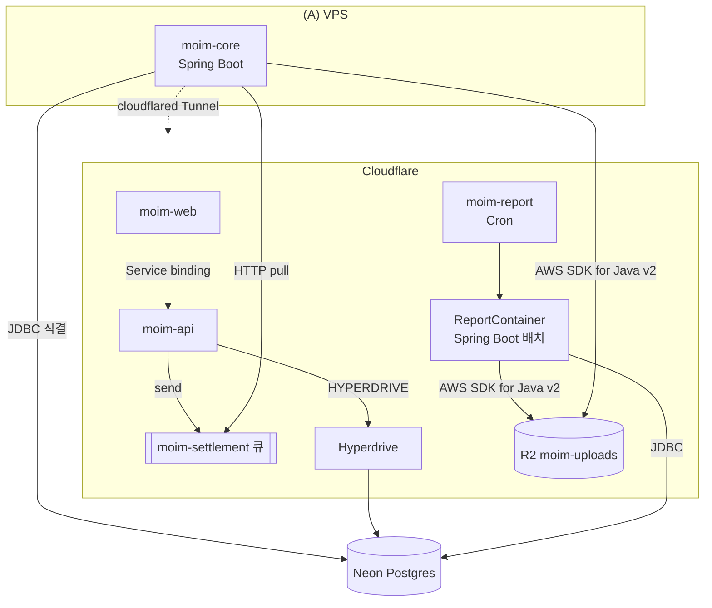
그림 1. `moim-core`의 세 착지점과 이 장에서 놓는 연결선(Tunnel·Hyperdrive·Queues·Containers)

`moim`은 이 셋을 하나만 고르지 않고 역할에 따라 나눈다. 요청에 늘 응답해야 하는 회원·정산 API는 (A)에 그대로 둔다. 매달 한 번 몰아서 도는 정산 리포트 배치는 (B)의 Containers로 뺀다. 그리고 VPS 안에 갇혀 있던 Postgres를 Neon으로 옮겨 `moim-core`와 `moim-api`가 같은 데이터를 보게 하고, 둘 사이의 작업 전달은 큐에 맡긴다. 서버 한 대가 전부 떠안던 구조를 풀어내는 것이다. 각 연결을 하나씩 만들어보자.

## Containers — 가끔, 몰아서 도는 JVM

### Containers는 어떤 물건인가

Containers의 생김새부터 보자. 컨테이너 인스턴스마다 Durable Object가 하나씩 붙고, Worker 코드가 그 DO를 통해 컨테이너를 켜고 끈다. 이미지는 `linux/amd64` 아키텍처에서 돌 수 있어야 하며, 공식 문서는 "그것 말고는 제약이 거의 없다"고 적는다. 인스턴스 타입은 다음과 같다(Containers Limits 2026-09-30 기준).

| 타입 | vCPU | 메모리 | 디스크 |
|---|---|---|---|
| lite | 1/16 | 256 MiB | 2 GB |
| basic | 1/4 | 1 GiB | 4 GB |
| standard-1 | 1/2 | 4 GiB | 8 GB |
| standard-2 | 1 | 6 GiB | 12 GB |
| standard-3 | 2 | 8 GiB | 16 GB |
| standard-4 | 4 | 12 GiB | 20 GB |

과금 방식은 따로 짚어둘 만하다. 공식 FAQ의 문장이다.

> "Memory and disk usage are based on the *provisioned resources* for the instance type you select, while CPU usage is based on *active usage* only."

메모리와 디스크는 고른 인스턴스 타입이 프로비저닝한 양 그대로, CPU는 실제로 쓴 만큼만 과금된다. JVM처럼 메모리를 넉넉히 잡아야 하는 런타임에게는 메모리가 비용의 대부분을 차지한다는 뜻이다. 단가는 메모리 GiB-초당 $0.0000025, CPU vCPU-초당 $0.000020, 디스크 GB-초당 $0.00000007이고, Workers Paid에 메모리 25 GiB-시간·CPU 375 vCPU-분·디스크 200 GB-시간이 매달 포함된다(Containers Pricing 2026-08-28 기준). 이그레스 단가는 지역마다 다르다. 북미·유럽은 GB당 $0.025(1 TB 포함)인데, 한국은 오세아니아·대만과 함께 GB당 $0.05(500 GB 포함)로 두 배다.

콜드 스타트는 어떨까? 공식 FAQ는 "대개 1~3초 범위일 수 있지만 이미지 크기와 코드 실행 시간 등에 따라 달라진다"고 적는다. 2026년 9월 30일 Cloudflare 블로그는 새 `durable_object` 스케줄링 정책(2026-10 기준 베타)으로 컨테이너를 "6배 이상 빠르게" 시작한다고 발표했지만, 이것은 블로그의 주장이고 문서의 보장 수치는 위의 1~3초다. 여기에 JVM이라면 Spring Boot 자체의 기동 시간이 더해진다. 그 시간은 앱마다 다르니 자기 이미지로 직접 재보는 수밖에 없다. 그리고 2026년 10월 기준 무상태 앱을 위한 내장 오토스케일링은 아직 없다. Cloudflare는 향후 추가할 계획이라고만 밝혔다.

현장의 평가는 극명하게 갈린다. 긍정하는 쪽은 쓰임새를 정확히 짚는다.

> "This is the perfect use of cloudflare containers. Rare, bursty workloads that fit around regular use of Workers. … not even noticeable in billing."

드물고 몰아서 오는 작업을 Workers 옆에 붙여 쓰기에 딱 맞고, 청구서에서 눈에 띄지도 않는다는 평이다. "Cloudflare Containers is literally 'pay for usage', while AWS is pay for capacity."라는 비교도 있었다. Containers는 쓴 만큼 내고 AWS는 잡아둔 용량만큼 낸다는 말이다. 반대쪽 경험도 무시할 수 없다. 2026년 5월 walla.my의 개발자는 이렇게 적었다.

> "We also tried Cloudflare Containers, but they weren't as reliable as just spinning up a small VM. 1vCPU and 1GB RAM were enough to synchronize about 3,000 users."

Containers도 써봤지만 작은 VM 하나 띄우는 것만큼 안정적이지 않았고, vCPU 1개와 1GB 메모리로 3,000명 정도의 동기화를 감당했다는 것이다. "가장 비싼 제품 같다(Feels like it is the nost expensive product they have.)"는 반응도 있다(원문 오타 그대로). 2026년 9월에는 같은 호스트에서 다른 고객이 쓰던 디스크 블록을 Workers Paid 계정이 복구할 수 있었던 교차 테넌트 취약점이 보고됐고, Cloudflare는 수정을 마쳤으며 악용 증거는 없다고 밝혔다. 제품이 아직 빠르게 다듬어지는 중이라는 신호로 읽어두자.

이 평가들을 모으면 하나의 선이 그어진다. Containers는 "가끔, 몰아서" 도는 작업에 강하고, 상시 실시간으로 응답해야 하는 서버는 작은 VM이 더 무난했다는 경험이 쌓여 있다. `moim`이 정산 리포트 배치만 Containers로 보내는 이유가 여기에 있다.

> **최소 안전장치**
> Containers를 쓰려고 Workers Paid로 전환하는 순간, 계정의 성격이 바뀐다. Free에서는 대부분의 제품이 한도에 닿으면 에러를 내고 멈췄다. Workers Paid에서는 포함량을 넘은 사용분이 과금된 채로 계속 돈다. 2026년 10월 현재 계정 전체에 지출 상한을 거는 기능은 없다. 그러니 전환하는 날 다음 세 가지를 해두자.
> 1. **모든 Worker에 호출 단위 상한을 건다.** `wrangler.jsonc`에 `"limits": { "cpu_ms": 1000, "subrequests": 10 }`처럼 Worker가 실제로 쓰는 만큼만 넉넉히 잡는다(값은 Worker마다 조정, Workers Pricing 2026-10-02 기준 `cpu_ms` 기본 30,000·최대 300,000). 이 상한은 호출 한 번의 폭주를 막을 뿐 호출 횟수 자체는 막지 못한다는 점도 기억해두자.
> 2. **컨테이너 인스턴스 수를 묶는다.** `containers` 설정의 `max_instances`를 작업에 필요한 만큼만 둔다. `moim`의 정산 배치는 1이면 충분하다.
> 3. **예산 알림 임계치를 내 예산에 맞춘다.** 2026년 7월부터 적격 Pay-as-you-go 계정에는 $10 알림이 기본으로 켜지기 시작했다(순차 적용). 예산 알림은 정보 제공용이라 사용을 멈추지 않고, 하루 늦게 오며, Workers Paid 월 기본료는 계산에서 빠진다.
>
> 알림과 차단을 겹겹이 쌓는 전체 방어선은 13장에서 세운다.

### ReportContainer 만들기 — 저자 작성 예제

여기서부터의 코드는 공식 예제가 없어서 직접 작성한 예제다. 2026년 10월 기준 Containers 공식 문서와 예제 저장소에는 Go·Node·Python 예제만 있고 Java나 Spring Boot 예제는 한 건도 없다. 문서 전반에 "Spring"이라는 단어조차 나오지 않는다. Containers 위의 Spring Boot 실사용기도 찾지 못했다. 아래 구성은 문서화된 사실을 조합한 것이니, 운영에 쓰기 전에 자기 이미지로 꼭 검증하자.

정산 리포트는 `moim-core`와 같은 코드베이스에서 리포트 기능만 켠 프로필(`report`)로 돌린다. Spring Boot는 2026년 8월 20일 GA인 4.1.1을 기준으로 하며, Java 17 이상이 필요하다. 컨테이너 안의 Spring은 두 개의 엔드포인트만 연다. 준비 상태를 알리는 `/healthz`와, 한 달 치 정산을 집계해 R2에 CSV로 남기는 `/reports/{month}`다.

```java
@RestController
@Profile("report")
class ReportController {

    private final SettlementReportService reports;

    ReportController(SettlementReportService reports) {
        this.reports = reports;
    }

    @GetMapping("/healthz")
    String health() {
        return "ok";
    }

    @PostMapping("/reports/{month}")
    ReportResult run(@PathVariable String month) {
        // Neon에서 집계하고 R2에 reports/{month}.csv로 저장 (R2 코드는 뒤에서)
        return reports.generate(YearMonth.parse(month));
    }
}
```

이미지는 평범한 JRE 이미지에 jar를 얹는다. 베이스 이미지(Eclipse Temurin)와 힙 설정은 저자의 선택이다.

```dockerfile
# moim-report/Dockerfile — 저자 작성 예제
FROM --platform=linux/amd64 eclipse-temurin:21-jre
WORKDIR /app
COPY build/libs/moim-core.jar app.jar
# 컨테이너 메모리의 75%까지만 힙으로 쓴다 — 스왑이 없으니 여유를 남긴다
ENV JAVA_TOOL_OPTIONS="-XX:MaxRAMPercentage=75"
EXPOSE 8080
ENTRYPOINT ["java", "-jar", "/app/app.jar"]
```

`--platform=linux/amd64`를 박아둔 이유는 Apple Silicon 맥에서 빌드해도 amd64 이미지가 나오게 하려는 것이다. 힙을 메모리의 75%로 묶은 데도 이유가 있다. 컨테이너는 스왑을 쓰지 않고, 메모리가 바닥나면 Out of Memory 에러와 함께 인스턴스가 재시작된다. JVM은 힙 말고도 메타스페이스와 스레드 스택 등에 메모리를 쓰니 여유를 남겨야 한다. 종료 신호도 맞춰두자. 컨테이너를 내릴 때 Cloudflare는 메인 프로세스에 `SIGTERM`을 보내고 최대 15분을 기다린 뒤 `SIGKILL`을 보낸다. Spring Boot 4.1에서는 `server.shutdown`의 기본값이 이미 `graceful`이라, `SIGTERM`을 받으면 진행 중인 요청을 마무리하고 내려가려 한다. 다만 그 마무리 대기 시간(`spring.lifecycle.timeout-per-shutdown-phase`)의 기본값이 30초이니, 몇 분씩 걸리는 리포트라면 이 값을 작업 시간에 맞춰 늘려두자(Spring Boot 4.1.1 문서 기준, 이 조합은 저자 판단이다).

이 배치를 담을 Worker는 `moim-report`로 따로 둔다. Containers 비용과 수명 주기를 `moim-api`와 섞지 않으려는 것이다.

```jsonc
// moim-report/wrangler.jsonc — 저자 작성 예제
{
  "$schema": "./node_modules/wrangler/config-schema.json",
  "name": "moim-report",
  "main": "src/index.ts",
  "compatibility_date": "2026-09-01",
  "workers_dev": false,
  "triggers": { "crons": ["0 1 1 * *"] },        // 매월 1일 01:00 UTC
  "containers": [
    {
      "class_name": "ReportContainer",
      "image": "./Dockerfile",
      "max_instances": 1,
      "instance_type": "standard-1"              // 생략하면 "lite"(256 MiB)
    }
  ],
  "durable_objects": {
    "bindings": [{ "name": "REPORT", "class_name": "ReportContainer" }]
  },
  "exports": {
    "ReportContainer": { "type": "durable-object", "storage": "sqlite" }
  },
  "limits": { "cpu_ms": 1000 },
  "observability": { "enabled": true }
}
```

인스턴스 타입을 설정 파일에 적은 데는 사정이 있다. 2026년 9월 29일 갱신된 Containers API 문서는 신규 앱에 Durable Object Container API(`ctx.container`)를 권하고, 기존 `Container` 클래스는 "기존 애플리케이션을 위해 문서를 유지한다"고 적는다. 그런데 이 API의 `start()`에 인스턴스 크기를 넘기는 옵션은 `durable_object` 스케줄링 정책 전용이다. 이 정책은 2026년 10월 기준 베타이고, 이미지를 digest로 고정된 Cloudflare 관리 레지스트리 참조(또는 Wrangler가 빌드해 올려주는 이름 붙은 이미지)로만 받으며, 설정 파일의 `image`·`instance_type`·`max_instances` 항목을 거부한다. 앞의 최소 안전장치에서 건 `max_instances`를 쓸 수 없게 되는 셈이다. 그래서 이 예제는 기본 정책을 택해 이미지(`./Dockerfile`)와 인스턴스 타입, `max_instances`를 설정 파일에서 지정했다. 기본 정책에서는 `start()`가 이미지와 인스턴스 크기를 설정 파일에서 가져온다. 무엇을 택하든 기억할 것은 하나다. 지정하지 않으면 기본 인스턴스는 `lite`, 즉 256 MiB다(설정 파일의 `instance_type`도, `durable_object` 정책의 `start()`도 기본값이 `lite`다). JVM을 거기 올리면 뜨기도 전에 메모리가 바닥난다. DO 클래스는 4장의 `EventSeats`처럼 선언형 `exports`로 적었다. Containers 설정 문서의 최소 구성도 같은 형식을 쓴다(Containers Wrangler 설정 2026-09-29 기준).

이제 Worker와 DO 코드다. DO Container API로 컨테이너를 시작했다고 포트가 준비된 것은 아니다. 문서도 이 점을 분명히 적는다. JVM은 기동이 느리니, 준비될 때까지 기다리는 로직을 직접 넣어야 한다.

```ts
// moim-report/src/index.ts — 저자 작성 예제
import { DurableObject } from "cloudflare:workers";

export class ReportContainer extends DurableObject<Env> {
  async run(month: string): Promise<string> {
    const container = this.ctx.container!;
    if (!container.running) {                    // running은 "떠 있음"일 뿐 "준비됨"이 아니다
      container.start({
        // 기본 정책: 이미지·인스턴스 크기는 wrangler.jsonc에서 온다
        // 옵션 객체를 넘길 때는 enableInternet이 필수 — Neon·R2에 나가야 하니 true
        enableInternet: true,
        // 값은 wrangler secret put으로 등록해둔 시크릿에서 읽는다
        env: {
          SPRING_PROFILES_ACTIVE: "report",
          SPRING_DATASOURCE_URL: this.env.NEON_JDBC_URL,
          R2_ACCESS_KEY_ID: this.env.R2_ACCESS_KEY_ID,
          R2_SECRET_ACCESS_KEY: this.env.R2_SECRET_ACCESS_KEY,
        },
      });
    }
    // 활동이 없으면 5분 뒤 정지 (0 초과, 최대 6시간)
    await container.setInactivityTimeout(5 * 60 * 1000);

    await this.waitForSpring();
    const res = await container
      .getTcpPort(8080)
      .fetch(`http://report/reports/${month}`, { method: "POST" });
    return res.text();
  }

  private async waitForSpring(tries = 60): Promise<void> {
    for (let i = 0; i < tries; i++) {
      try {
        const res = await this.ctx.container!.getTcpPort(8080).fetch("http://report/healthz");
        if (res.ok) return;
      } catch {
        // 아직 포트가 열리지 않았다 — JVM이 뜨는 중
      }
      await new Promise((r) => setTimeout(r, 1000));
    }
    throw new Error("Spring Boot가 제때 준비되지 않았다");
  }
}

export default {
  async scheduled(controller, env, ctx) {
    // previousMonth는 "2026-09" 형식의 지난달 문자열을 돌려주는 헬퍼 (생략)
    const month = previousMonth(new Date(controller.scheduledTime));
    const stub = env.REPORT.get(env.REPORT.idFromName(month));
    ctx.waitUntil(stub.run(month).then((r) => console.log("report done", r)));
  },
} satisfies ExportedHandler<Env>;
```

`setInactivityTimeout()`을 빼먹으면 DO가 비활성 상태가 되자마자 컨테이너도 곧 멈춘다는 점에 주의해야 한다. 월 단위 리포트를 같은 달 이름의 DO에 맡겼으니, 같은 달 리포트를 실수로 두 번 돌려도 인스턴스가 하나 더 생기지는 않는다. 기존 `Container` 클래스(`@cloudflare/containers`)를 쓰면 `defaultPort = 8080`, `sleepAfter` 같은 속성과 포트 준비를 기다려주는 `startAndWaitForPorts()`가 있어 코드가 더 짧아진다. 다만 신규 앱의 권장 경로는 위의 DO API다.

기동 시간을 더 줄이고 싶다면 JVM 쪽 선택지도 있다. 실행 중인 JVM 상태를 체크포인트로 떠두는 CRaC나, 미리 네이티브 바이너리로 컴파일하는 GraalVM 네이티브 이미지다. 둘 다 빌드와 호환성 검증이 만만치 않으니, 한 달에 한 번 도는 배치라면 몇 초의 기동 시간을 그냥 받아들이는 편이 대개 합리적이다.

배포에도 한 가지 함정이 있다. Workers Builds를 쓴다면, 운영 브랜치에서는 `wrangler deploy`가 돌아야 이미지와 컨테이너 인스턴스가 갱신된다. 운영이 아닌 브랜치의 기본 동작인 `wrangler versions upload`는 이미지를 갱신하지 않는다. 또 Containers를 쓰는 Worker는 DO를 구현하므로 Workers Builds가 버전마다 만드는 프리뷰 URL이 생성되지 않는다(Containers FAQ 2026-10-02 기준). 5장에서 본 브랜치별 Worker Preview는 이와 별개 기능으로, 프리뷰마다 Containers 인스턴스를 따로 만든다고 발표됐다(2026-09-22). 두 문서가 같은 시점에 나란히 있으니, 프리뷰를 켜기 전에 자기 Worker에서 어떻게 동작하는지 직접 확인하자.

### 상시 가동하면 얼마일까 — 저자 계산

그렇다면 `moim-core`의 API까지 Containers에 상시 띄우면 어떨까? 공식 단가로 직접 계산해보자. `standard-1`(vCPU 1/2, 메모리 4 GiB, 디스크 8 GB) 한 대를 30일 내내 켜두는 경우다. 30일은 2,592,000초다. 인스턴스가 떠 있는 시간만 과금된다고 가정했고, 앞단 Worker·DO 사용량과 이그레스는 따로 셈한다.

| 항목 | 계산 (Containers Pricing 2026-08-28 기준) | 월 금액 |
|---|---|---|
| 메모리 | 4 GiB × 2,592,000초 = 10,368,000 GiB-초 − 포함 90,000(25 GiB-시간) = 10,278,000 × $0.0000025 | 약 $25.70 |
| 디스크 | 8 GB × 2,592,000초 = 20,736,000 GB-초 − 포함 720,000(200 GB-시간) = 20,016,000 × $0.00000007 | 약 $1.40 |
| CPU (평균 사용률 10% 가정) | 0.5 vCPU × 10% × 2,592,000초 = 129,600 vCPU-초 − 포함 22,500(375분) = 107,100 × $0.000020 | 약 $2.14 |
| CPU (사용률 100% 가정) | 0.5 vCPU × 2,592,000초 = 1,296,000 − 22,500 = 1,273,500 × $0.000020 | 약 $25.47 |
| Workers Paid 기본료 | 계정당 월 최소 | $5.00 |
| **합계** | 10% 가정: 25.70 + 1.40 + 2.14 + 5.00 / 100% 가정: 25.70 + 1.40 + 25.47 + 5.00 | **약 $34.24 / 약 $57.57** |

예상대로 메모리가 지배적이다. CPU를 거의 쓰지 않아도 메모리 4 GiB를 켜둔 값만 월 $25 남짓이다. 경쟁 PaaS의 공동창업자가 쓴 글에서는 상시 standard(4 GiB) 인스턴스를 월 약 $82.44로 계산하며 일반 PaaS의 5~10배라고 주장했다. 이해관계자의 수치이고 계산 시점과 가정이 이 표와 다르니 그대로 비교하기는 어렵다. 그래도 어느 계산이든 "JVM을 상시 켜두는 용도"가 Containers의 강점은 아니라는 결론은 같다. 같은 돈으로 쓸 수 있는 VPS의 사양은 독자가 쓰는 업체의 가격표와 직접 대조해보자.

이번에는 정산 배치로 계산해보자. 리포트 작업이 10분 걸리고 비활성 타이머 5분 뒤 꺼진다면, 한 번에 15분(900초)이다. 메모리는 4 GiB × 900초 = 3,600 GiB-초로, 매달 포함된 90,000 GiB-초의 4%에 불과하다. 매일 돌려도 한 달 108,000 GiB-초이니 초과분 18,000 GiB-초에 대해 약 $0.05가 붙는 정도다. 같은 인스턴스가 상시 가동이면 월 수십 달러, 배치면 사실상 포함량 안이다. 숫자가 Containers의 쓰임새를 대신 말해준다.

> **비용 메모**
> Containers는 Free에서 쓸 수 없고 Workers Paid(월 최소 $5)가 필요하다. 메모리·디스크는 프로비저닝 기준, CPU는 활성 사용 기준이며, 한국 이그레스는 GB당 $0.05(500 GB 포함)로 북미·유럽의 두 배다(Containers Pricing 2026-08-28 기준). 컨테이너 앞단의 Worker와 Durable Object 사용량은 별도로 과금된다. 비활성 타이머를 길게 잡을수록 놀고 있는 메모리 값이 쌓인다는 점도 잊지 말자.

## 데이터와 메시지로 잇기

### Hyperdrive로 Postgres 공유하기

다음은 데이터다. VPS 안의 Postgres를 Neon으로 옮기자. `pg_dump`로 뜬 덤프를 Neon에 복원하고, `moim-core`의 데이터소스 URL을 Neon이 안내하는 JDBC 연결 문자열로 바꾸면 Spring 쪽 이전은 끝난다. VPS가 꺼져도 데이터는 남고, 6장의 Tunnel은 이제 API 서버만 지키면 된다.

그런데 `moim-api`도 이 데이터를 봐야 한다. 행사 신청 내역은 D1에 있지만, 회원 등급이나 정산 상태는 `moim-core`가 관리하는 Postgres에 있기 때문이다. Worker가 외부 Postgres에 직접 붙으면 무엇이 문제일까? Worker는 요청마다 짧게 깨어나는 실행 단위다. 요청마다 멀리 있는 DB와 TCP 연결을 맺고 TLS와 인증을 다시 치르면, 쿼리보다 연결 준비가 더 오래 걸리는 난감한 상황이 된다. Hyperdrive가 이 문제를 맡는다. Cloudflare Workers 리드 엔지니어인 kentonv는 Hyperdrive를 "Hyperdrive, which provides connection management and caching over plain old Postgres, MySQL, etc."라고 설명했다. 평범한 Postgres나 MySQL 위에 연결 관리와 캐싱을 얹어준다는 뜻이다. 연결 풀을 DB 가까이에 유지해두고 Worker는 그 풀을 빌려 쓰는 구조다.

```bash
npx wrangler hyperdrive create moim-neon \
  --connection-string="postgres://user:password@<neon-host>:5432/moim"
```

```jsonc
// moim-api/wrangler.jsonc (추가분)
{
  // ...4장과 동일
  "hyperdrive": [{ "binding": "HYPERDRIVE", "id": "<hyperdrive-id>" }],
  "placement": { "region": "aws:us-east-1" } // Neon 프로젝트가 있는 리전으로
}
```

```ts
// moim-api — 회원 등급 조회
import { Client } from "pg";

app.get("/api/members/:id/tier", async (c) => {
  const client = new Client({ connectionString: c.env.HYPERDRIVE.connectionString });
  await client.connect();
  try {
    const { rows } = await client.query("SELECT tier FROM member WHERE id = $1", [c.req.param("id")]);
    return rows.length ? c.json(rows[0]) : c.notFound();
  } finally {
    c.executionCtx.waitUntil(client.end());
  }
});
```

Neon 전용 서버리스 드라이버 대신 `pg`를 쓴 이유와 공급자별 주의점은 8장에서 정리한다. `placement.region`은 앞에서 본 Placement Hints다. `moim-api`가 Neon과 여러 번 왕복한다면 Worker를 DB 리전 가까이에서 돌리는 편이 응답이 빠르다.

여기서 중요한 사실이 하나 있다. Hyperdrive는 Worker의 바인딩이다. `moim-core`는 상시 떠 있는 서버이니 지금처럼 자기 커넥션 풀로 Neon에 직접 붙으면 된다. 같은 DB를 두 경로로 공유하는 셈이다. 그래서 두 가지를 챙겨야 한다. 하나는 연결 수 예산이다. Hyperdrive가 원본 DB에 여는 연결은 Free에서 약 20개, Paid에서 약 100개까지이고(Hyperdrive Limits 2026-06-09 기준), 여기에 Spring 커넥션 풀의 크기를 더한 값이 Neon 플랜의 연결 한도 안에 들어와야 한다. 다른 하나는 풀링 방식이다. Hyperdrive는 트랜잭션 모드로 풀링한다. 트랜잭션이 끝나면 연결이 풀로 돌아가며 `RESET`되므로, 세션에 `SET`한 값은 다음 쿼리에 이어지지 않는다. advisory lock이나 `LISTEN`/`NOTIFY`, SQL 수준의 `PREPARE` 같은 기능도 지원하지 않는다(2026-09-30 기준). 이런 기능이 필요하면 Hyperdrive를 거치지 않는 직접 연결을 따로 쓰라는 것이 문서의 권고다. 우리 구조에서는 Spring 쪽이 그 직접 연결이니, 세션에 기대는 작업은 `moim-core`에 두자.

한도도 확인해두자. Hyperdrive 자체에는 추가 요금이 없다. Free는 하루 쿼리 10만 건과 설정 10개, Workers Paid는 쿼리 무제한에 설정 25개다. Free에서 쿼리 한도를 넘으면 과금되지 않고 에러가 난다. 쿼리 하나는 최대 60초까지 돈다(Hyperdrive Pricing 2026-06-18, Limits 2026-06-09 기준).

### Queues HTTP pull — Spring이 큐를 당겨 가기

이제 `moim-api`와 `moim-core` 사이의 작업 전달이다. 신청이 확정되거나 취소될 때마다 `moim-api`가 정산 대상 이벤트를 만들어 `moim-core`에 알려야 한다. Tunnel 너머의 `moim-core`를 HTTP로 바로 부르면 되지 않을까? 그러면 VPS가 재부팅되는 몇 분 동안 생긴 이벤트는 그대로 사라진다. 이 장의 첫 질문으로 다시 돌아온 셈이다. 큐를 사이에 두면 `moim-core`가 잠시 꺼져 있어도 이벤트는 큐에 남아 기다린다.

보내는 쪽은 4장에서 `MAIL_QUEUE`를 쓸 때와 같다. `moim-settlement` 큐를 만들고 `moim-api`에 `SETTLEMENT_QUEUE` 프로듀서 바인딩을 추가한 뒤 메시지를 넣는다.

```ts
// moim-api — 신청 확정 시
await c.env.SETTLEMENT_QUEUE.send(
  { type: "rsvp.confirmed", eventId, memberId, at: Date.now() },
  { contentType: "json" } // 기본값이지만 명시 — pull 소비자는 Workers 전용 "v8" 형식을 풀지 못한다
);
```

받는 쪽이 달라진다. Worker 소비자 대신 HTTP pull 소비자를 붙인다. 외부 프로그램이 Cloudflare API로 메시지를 당겨 가는 방식이다. 대시보드나 `npx wrangler queues consumer http add moim-settlement`로 큐에 HTTP pull 소비자를 켜고(이미 Worker 소비자가 붙어 있다면 먼저 떼어야 한다), `com.cloudflare.api.account.queues_read`와 `com.cloudflare.api.account.queues_write` 권한을 가진 API 토큰을 만든다. 이 토큰은 `moim-core`의 환경 변수로만 넣자.

Spring 쪽은 주기적으로 메시지를 당기고, 처리한 메시지를 확인(ack)한다. 아래 코드는 저자 작성 예제다.

```java
@Component
class SettlementPuller {

    private final RestClient cf;
    private final SettlementService settlements;
    private final String queuePath; // /accounts/{account_id}/queues/{queue_id}

    SettlementPuller(RestClient.Builder builder, SettlementService settlements,
                     @Value("${moim.cf.account-id}") String accountId,
                     @Value("${moim.cf.queue-id}") String queueId,
                     @Value("${moim.cf.queues-token}") String token) {
        this.cf = builder.baseUrl("https://api.cloudflare.com/client/v4")
                .defaultHeader("Authorization", "Bearer " + token)
                .build();
        this.settlements = settlements;
        this.queuePath = "/accounts/" + accountId + "/queues/" + queueId;
    }

    @Scheduled(fixedDelay = 5_000)
    void pull() {
        PullResponse res = cf.post()
                .uri(queuePath + "/messages/pull")
                .body(Map.of("visibility_timeout_ms", 30_000, "batch_size", 10))
                .retrieve()
                .body(PullResponse.class);

        List<Map<String, String>> acks = new ArrayList<>();
        for (QueueMessage m : res.result().messages()) {
            // json 형식으로 보낸 본문은 pull 응답에서 base64로 인코딩돼 온다
            String json = new String(Base64.getDecoder().decode(m.body()), StandardCharsets.UTF_8);
            settlements.apply(json);  // 본문의 업무 키로 멱등 처리 — 같은 메시지가 다시 와도 안전하게
            acks.add(Map.of("lease_id", m.leaseId()));
        }
        if (!acks.isEmpty()) {
            cf.post().uri(queuePath + "/messages/ack")
                    .body(Map.of("acks", acks))
                    .retrieve()
                    .toBodilessEntity();
        }
    }

    // 응답 형태: { "result": { "messages": [ { "id", "body", "lease_id", ... } ] } }
    record PullResponse(PullResult result) {}
    record PullResult(List<QueueMessage> messages) {}
    record QueueMessage(String id, String body,
                        @JsonProperty("lease_id") String leaseId) {}
}
```

`@Scheduled`를 쓰려면 설정 클래스에 `@EnableScheduling`을 붙여야 한다. Kotlin이라면 같은 구조를 코루틴 루프로 써도 되지만, Spring의 스케줄러를 그대로 쓰는 편이 운영에서 다루기 쉽다.

여기서 `visibility_timeout_ms`의 의미를 짚고 가자. 당겨 간 메시지는 이 시간 동안 다른 소비자에게 보이지 않는다. 그 안에 ack하지 않으면 메시지는 다시 보이게 되고, 다음 pull에서 또 온다. 정산 처리 도중 `moim-core`가 죽어도 이벤트가 유실되지 않는 이유가 이것이다. 대신 같은 메시지가 두 번 처리될 수 있으니, `settlements.apply()`는 이미 처리한 것인지 확인하는 멱등 처리가 필요하다. 멱등 키로는 본문에 담긴 업무 값(이벤트 종류·행사·회원·시각)을 쓰자. pull 응답의 `id`는 문서가 "일시적(ephemeral)" 식별자라고 적고 있어 재전달 사이에 같은 값이라는 보장을 기대하기 어렵다(Pull consumers 2026-07-01 기준). 이 점은 꼭 기억해두자. 가시성 타임아웃은 최대 12시간까지 늘릴 수 있다.

비용도 살펴보자. 메시지 하나를 전달하는 데는 대개 쓰기·읽기·삭제 세 번의 operation이 든다. Free는 하루 10,000 operations, Workers Paid는 월 100만 operations가 포함되고 넘으면 100만 건당 $0.40이다(Workers Pricing 2026-10-02 기준). 메시지가 64 KB를 넘으면 64 KB 단위로 operation이 늘어난다. operation은 배치가 아니라 메시지 단위로 센다. 메시지가 없을 때의 pull은 빈 응답이 바로 돌아오는데(long polling 없음), 이 빈 응답을 따로 과금하는지는 가격 문서에 적혀 있지 않다(Queues Pricing·Pull consumers 2026-10 조회 기준). 폴링 주기를 정하기 전에 대시보드의 사용량으로 직접 확인해두자.

### R2를 AWS SDK for Java v2로

마지막은 파일이다. 정산 리포트 컨테이너는 CSV를 R2에 남기고, `moim-core`는 그 파일과 발표 자료를 읽는다. R2는 S3 호환 API를 제공하니 Java 쪽에서는 익숙한 AWS SDK for Java v2를 그대로 쓰면 된다. 다만 설정 세 가지가 S3와 다르다.

```java
@Configuration
class R2Config {

    @Bean
    S3Client r2(@Value("${moim.r2.account-id}") String accountId,
                @Value("${moim.r2.access-key-id}") String accessKeyId,
                @Value("${moim.r2.secret-access-key}") String secret) {
        S3Configuration serviceConfiguration = S3Configuration.builder()
                .pathStyleAccessEnabled(true)
                .chunkedEncodingEnabled(false) // 없으면 putObject가 403
                .build();
        return S3Client.builder()
                .endpointOverride(URI.create("https://" + accountId + ".r2.cloudflarestorage.com"))
                .credentialsProvider(StaticCredentialsProvider.create(
                        AwsBasicCredentials.create(accessKeyId, secret)))
                .region(Region.of("auto")) // SDK가 요구하지만 R2는 쓰지 않는다
                .serviceConfiguration(serviceConfiguration)
                .build();
    }
}
```

```java
// 리포트 저장
r2.putObject(b -> b.bucket("moim-uploads").key("reports/" + month + ".csv").contentType("text/csv"),
             RequestBody.fromString(csv));
```

엔드포인트는 계정 ID가 들어간 R2 주소이고, 리전은 `auto`다. R2 문서에 따르면 리전을 지정할 수 없는 도구를 위해 빈 값이나 `us-east-1`도 `auto`의 별칭으로 받아준다. 가장 많이 걸려 넘어지는 지점은 `chunkedEncodingEnabled(false)`다. R2 문서(2026-04-21 기준)의 문장을 그대로 보자.

> "You must set `chunkedEncodingEnabled(false)` in the `S3Configuration` when building your client. The AWS SDK for Java v2 uses chunked transfer encoding by default for `putObject` requests, which causes a signature mismatch error (HTTP 403) with R2."

SDK가 업로드에 기본으로 쓰는 청크 전송 인코딩이 R2와 서명 불일치를 일으켜 403이 난다는 것이다. 이 한 줄을 빼먹으면 읽기는 잘 되는데 쓰기만 403으로 실패하니, 원인을 찾기까지 꽤 찜찜한 시간을 보내게 된다.

하나 더 알아둘 것이 있다. AWS SDK for Java 2.x는 2.30.0부터 업로드에 CRC32 체크섬을 기본으로 계산한다. R2 문서는 이 기본값과의 상호작용을 따로 적지 않았고, AWS 문서도 R2를 언급하지 않는다(2026-10 기준). 위 설정으로도 서명 오류나 체크섬 오류가 계속된다면 클라이언트 빌더에 `requestChecksumCalculation(RequestChecksumCalculation.WHEN_REQUIRED)`를 주는 것을 시도해볼 만하다. 이것은 양쪽 1차 문서로 확인된 처방이 아니니, 자기 SDK 버전으로 직접 확인하자.

비용 쪽으로는 4장에서 본 R2의 원칙이 그대로 적용된다. 이그레스는 무료지만 읽기·쓰기 요청은 Class A·B operation으로 과금되고, 무료 포함량을 넘은 사용분은 차단되지 않고 청구된다. 사용자에게 파일을 내려줄 때는 Spring이 중계하지 말고 presigned URL로 직접 받게 하는 편이 낫다. Java SDK에도 같은 엔드포인트와 `Region.of("auto")`, `pathStyleAccessEnabled(true)`로 구성하는 `S3Presigner`가 있다. JS 쪽 presigned URL과 다른 저장소에서 R2로 옮기는 이야기는 8장에서 다룬다.

> **전망: Workers VPC (베타, 2026-10-03 기준)**
> Workers VPC는 공인 인터넷에 노출되지 않은 외부 클라우드(AWS·Azure·GCP·온프레미스 등)의 사설 API와 서비스, 데이터베이스에 Worker를 연결해준다. 베타 기간에는 모든 Workers 플랜에서 무료다. 2026년 4월 29일부터는 공개되지 않은 사설 DB에 Hyperdrive를 붙일 때 Workers VPC 서비스를 거치는 것이 권장 방식이 됐다. (C) 착지점, 즉 기존 클라우드의 사설망 안에 Spring을 둔 팀에게는 Tunnel 없이 Worker에서 바로 닿는 길이 될 수 있다. 베타 제품이라 기능과 가격이 빠르게 바뀔 수 있으니, 도입 전에 공식 문서를 함께 확인하자.

> **전망: 인바운드 TCP·gRPC (비공개 베타, 2026-10-03 기준)**
> 2026년 8월 3일 Cloudflare는 Spectrum이 넘겨주는 인바운드 TCP 소켓을 Worker가 직접 받는 `connect(socket)` 핸들러와, Worker가 그 소켓을 컨테이너 안의 gRPC 서버로 넘겨 양방향 gRPC를 처리하는 기능을 비공개 베타로 발표했다. 6장에서 본 `cloudflared`의 gRPC 이슈를 겪는 Spring gRPC 서비스에게는 반가운 소식이지만, 아직 비공개 베타라 언제 어떤 형태로 열릴지 알 수 없다. 빠르게 바뀔 수 있는 영역이다.

이렇게 `moim-core`의 자리가 정해졌다. 다만 `core.example.com`은 여전히 Cloudflare가 앞에서 사람을 확인해주지 않는 문이다. 그 문을 Access로 닫는 일은 10장에서 한다.

세 착지점을 상황별로 다시 놓으면 이렇다.

| 상황 | (A) Tunnel 뒤 VM·집 서버 | (B) Containers | (C) 기존 클라우드 + Placement Hints |
|---|---|---|---|
| 요청에 늘 응답하는 API | 가장 무난하다 | 상시 가동이면 메모리 비용이 쌓인다 | 이미 있다면 그대로 둔다 |
| 가끔 몰아서 도는 배치·변환 | 서버를 내내 켜둬야 한다 | 가장 잘 맞는다 | 가능하지만 상시 자원이 남는다 |
| 이미 AWS·GCP에 인프라와 DB가 있다 | 옮길 이유가 적다 | 일부 배치만 떼어낼 때 | 가장 자연스럽다 |
| Free 계정으로 버티고 싶다 | 가능하다(Tunnel 무료) | 불가능하다(Workers Paid 전용) | 가능하다 |
| 서버를 직접 돌보기 싫다 | 직접 관리해야 한다 | 실행은 Cloudflare가 관리한다 | 클라우드의 관리형 서비스에 맡긴다 |
| 서버가 꺼져도 작업이 유실되면 안 된다 | 큐(HTTP pull)를 앞에 둔다 | 큐·Cron으로 다시 깨운다 | 큐를 앞에 둔다 |

### 이 장의 핵심

- Workers에는 JVM이 없다. JVM 백엔드의 착지점은 (A) Tunnel 뒤의 VM·집 서버, (B) Containers(Workers Paid 전용), (C) 기존 클라우드 + Placement Hints(·Workers VPC 베타) 셋이며, 역할별로 나눠 써도 된다.
- Containers는 메모리를 프로비저닝 기준으로 과금한다. `standard-1` 상시 가동은 월 수십 달러 수준이지만 배치는 대개 포함량 안에 든다. "가끔, 몰아서" 도는 작업에 쓰자.
- JVM을 Containers에 올릴 때는 인스턴스 타입을 명시하고(기본 `lite`는 256 MiB), 포트 준비 대기와 힙 상한을 직접 챙긴다.
- Hyperdrive는 Worker 쪽 연결 풀이다. Spring은 같은 DB에 직접 붙고, 두 경로의 연결 수 합과 트랜잭션 모드 풀링의 제약을 설계에 넣는다.
- Spring과 Workers 사이의 작업 전달은 Queues HTTP pull로 하고 멱등하게 처리한다. R2는 AWS SDK for Java v2에 `chunkedEncodingEnabled(false)`를 잊지 않는다.

# 8장. Cloudflare 밖과 함께 — DB·결제·메일·AI·IaC 통합 전략

2026년 8월 15일, 해커 뉴스에 "Cloudflare's AI Psychosis"라는 글이 올라와 120점을 받았다. 글쓴이는 Cloudflare의 저장소 제품군을 두고 이렇게 적었다.

> "Too many ways to do the same thing, none of them great"

같은 일을 하는 방법이 너무 많고, 그중 어느 것도 썩 훌륭하지 않다는 불평이다. 댓글에서 hasyimibhar가 곧바로 반박했다. 제품마다 쓰임새를 한 줄로 정리할 수 있다는 것이다. 4장에서 D1·KV·Durable Objects·R2를 하나씩 나눠 본 우리라면 반박 쪽에 손을 들어주고 싶어진다. 실제로 "이 데이터는 어디에?"라는 질문에 답할 기준만 있으면 선택지가 많다는 것은 오히려 장점이다.

그런데 이 불평이 정말 아프게 들어맞는 곳은 Cloudflare 안이 아니다. 안과 밖의 경계선이다. 7장을 마친 `moim`을 떠올려보자. 계정은 Workers Paid로 바뀌었고, Postgres는 Neon으로 옮겨 `moim-core`(Spring Boot)와 `moim-api`가 Hyperdrive를 통해 함께 쓴다. 정산 큐 `moim-settlement`는 Spring이 HTTP pull로 당겨 가고, 정산 리포트는 `ReportContainer`가 몰아서 만든다. 이제 남은 일은 유료 티켓을 팔고, 확인 메일을 실제로 보내고, 이 모든 리소스를 손이 아닌 코드로 관리하는 것이다.

일감마다 같은 질문이 따라붙는다. 안에서 할까, 밖에서 할까? Cloudflare는 거의 모든 칸에 자기 제품을 준비해두었다. DB에는 D1이 있고, 메일에는 Email Sending이, AI에는 Workers AI가 있다. 반면 결제처럼 Cloudflare에 아예 해당 제품이 없는 칸도 있다. 같은 일을 하는 방법이 안에도 있고 밖에도 있으니, 앞의 불평은 경계선에서 두 배로 커진다. 이 장에서는 `moim`이 실제로 만나는 통합 사례 다섯 가지를 따라가면서, 매번 무엇을 기준으로 판단했는지를 함께 뽑아보자.

## 경계선에서 던지는 질문

### 세 가지 질문 — 데이터의 무게, 표준 프로토콜, 빠져나갈 길

사례로 들어가기 전에 판단의 틀부터 세워두자. 외부 서비스를 하나 붙일 때마다 세 가지를 묻는 편이 낫다.

첫째는 데이터의 무게다. 이 데이터는 어디에 오래 남고, 누가 읽는가? `moim`의 회원·결제·정산 내역은 몇 년을 남아야 하고, Spring과 Worker가 함께 읽는다. 이런 데이터는 무겁다. 무거운 데이터는 양쪽이 모두 손을 뻗을 수 있는 자리에 두는 편이 낫다. 7장에서 Postgres를 Neon에 두고 Hyperdrive로 Worker를 연결한 이유가 여기에 있다. 반대로 선착순 좌석 카운터나 행사 설정 플래그처럼 Worker만 읽고 쓰는 가벼운 데이터는 Durable Objects나 KV에 두어도 아무 문제가 없다.

둘째는 표준 프로토콜이다. 외부 서비스와 무엇으로 이어지는가? Postgres 와이어 프로토콜, S3 API, SMTP, OIDC 같은 표준으로 이어진다면 한쪽을 바꿔도 다른 쪽 코드는 거의 그대로다. `moim-core`는 R2를 AWS SDK for Java v2로 읽는다(7장). 내일 R2를 다른 S3 호환 저장소로 바꿔도 엔드포인트와 자격 증명만 고치면 된다. 반대로 특정 벤더 전용 API에 깊이 묶이면 그만큼 떠나기가 어려워진다.

셋째는 빠져나갈 길이다. Cloudflare가 멈추거나 가격이 바뀌면 이 연결은 어떻게 되는가? 2025년 11월과 12월, 2026년 2월에 Cloudflare의 큰 장애가 있었고 2026년 8월 8일에는 R2 장애가 있었다. 단일 벤더 의존이 얼마나 위험한지는 14장에서 양쪽 관점을 함께 놓고 따져보겠다. 여기서는 원칙 하나만 챙기자. 표준 프로토콜로 이어둔 것은 나중에 옮길 수 있다. 이 원칙이 앞의 두 질문과 맞물려 이 장의 결론이 된다.

세 질문을 머리에 넣고 `moim`이 Cloudflare 밖과 만나는 지점을 한 장의 그림으로 먼저 보자.

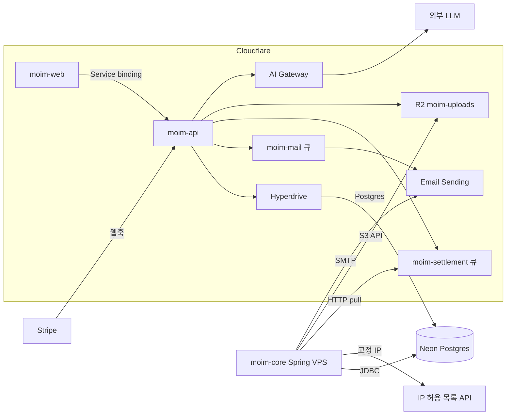
그림 1. `moim`과 외부 서비스의 연결도

화살표 하나하나에 붙은 이름을 보자. Postgres, S3 API, SMTP, HTTP. 대부분이 표준이다. 이 그림을 기준으로 사례를 하나씩 살펴보자.

## 다섯 가지 통합 사례

### 외부 DB — Hyperdrive와 공급자별 주의점

Hyperdrive의 기본 설정과 Spring과의 DB 공유는 7장에서 다뤘다. 여기서는 Postgres를 어느 공급자에 두느냐에 따라 달라지는 지점만 짚어보자. 공식 문서는 범위를 넓게 잡는다.

> "Hyperdrive supports any Postgres or MySQL database, including those hosted on AWS, Google Cloud, Azure, Neon and PlanetScale. Hyperdrive also supports Postgres-compatible databases like CockroachDB and Timescale."

어디든 붙는다는 말이다. 그런데 붙는다는 것과 제대로 붙는다는 것은 다르다. 공급자마다 하나씩 함정이 있다.

Neon부터 보자. Neon은 자체 serverless 드라이버를 제공하는데, Hyperdrive 문서는 그 드라이버 대신 일반 TCP 드라이버를 쓰라고 한다. "you should use a driver like node-postgres (pg) or Postgres.js to connect directly to the underlying database instead of the Neon serverless driver." Neon 쪽 FAQ도 같은 이야기를 한다. serverless 드라이버는 WebSocket으로 붙기 때문에 Hyperdrive의 연결 풀을 그냥 지나쳐버린다. 풀링을 맡기려고 Hyperdrive를 붙였는데 풀을 우회하면 아무 의미가 없다.

Supabase에는 반대 방향의 함정이 있다. Supabase는 자체 커넥션 풀러를 두고, 대시보드의 연결 화면에서 풀러를 거치는 연결 문자열도 함께 보여준다. Hyperdrive의 Supabase 문서(Hyperdrive 2026-04-21 기준)는 이렇게 적는다. "you should use the Direct connection connection string rather than the pooled connection strings. Hyperdrive will perform pooling of connections to ensure optimal access from Workers." 풀러 뒤에 풀러를 또 세우면 이중 풀링이 된다. Hyperdrive가 이미 풀링을 하니 Supabase 쪽은 직접 연결로 두자. 그런데 Supabase 문서(2026년 10월 3일 확인)를 보면 직접 연결에는 네트워크 조건이 하나 붙는다. 직접 연결은 기본적으로 IPv6로만 열리고, IPv4로 열려면 유료 IPv4 애드온이 필요하다. 반대로 Supabase의 공유 풀러는 IPv4 전용이고, 세션 모드(5432 포트)와 트랜잭션 모드(6543 포트)로 나뉜다. 트랜잭션 모드는 prepared statement를 지원하지 않는다. Hyperdrive의 Supabase 문서는 IPv6 이야기를 따로 하지 않으니, IPv4 애드온이 없는 프로젝트라면 도입 전에 Hyperdrive 설정을 만들어 직접 연결이 실제로 붙는지부터 확인해두자.

AWS RDS나 Aurora라면 네트워크부터 열어야 한다. 문서는 데이터베이스의 공개 접근을 켜고, Hyperdrive가 쓰는 IP 대역(또는 전체 대역)을 허용하라고 안내한다. 공개 접근이 마음에 걸린다면 대안이 있다. 2026년 4월 29일부터 Workers VPC를 거쳐 사설 DB에 붙는 경로가 Hyperdrive의 권장 방식이 됐다. Workers VPC는 2026년 10월 기준 베타이고 베타 동안은 무료다(7장 전망 박스). PlanetScale을 쓴다면 청구가 편해진다. 2026년 6월 18일부터 PlanetScale 사용료가 Cloudflare 청구서에 함께 실린다.

MySQL은 2026년 8월 7일 정식 지원(GA)이 됐고, 가격은 Postgres와 같다. 단 `mysql2` 드라이버를 쓴다면 3.13.0 이상 버전을 쓰고, 설정 하나를 꼭 챙기자(Hyperdrive mysql2 문서 2026-04-21 기준).

```ts
import { createConnection } from "mysql2/promise";

const conn = await createConnection({
  host: env.HYPERDRIVE.host,
  user: env.HYPERDRIVE.user,
  password: env.HYPERDRIVE.password,
  database: env.HYPERDRIVE.database,
  port: env.HYPERDRIVE.port,
  disableEval: true,                 // Workers에서는 eval 기반 파서를 끈다
});
```

Workers 런타임은 보안상의 이유로 문자열을 코드로 평가하는 `eval()`과 `new Function`을 허용하지 않는다(Workers Web standards 2026-04-23 기준). `mysql2`는 성능을 위해 결과 파서를 코드로 생성해 실행하는데, 그 경로를 꺼주는 옵션이 `disableEval`이다.

공급자와 상관없이 알아둘 성질도 있다. Hyperdrive의 풀러는 트랜잭션 모드로 동작한다(Hyperdrive 2026-08-20 기준). 트랜잭션 하나가 끝나면 연결은 풀로 돌아가고, 이때 `RESET`이 걸려 앞에서 실행한 `SET` 명령은 다음 쿼리에 남지 않는다. 이름 붙은 prepared statement는 `postgres.js`와 `node-postgres`가 구현한 방식만 지원한다. SQL 수준의 `PREPARE`·`EXECUTE`, advisory lock, `LISTEN`/`NOTIFY`는 지원하지 않는다. 이런 기능이 꼭 필요하면 Hyperdrive를 거치지 않는 두 번째 직접 연결을 따로 두라는 것이 Hyperdrive 팀의 권고다. 다행히 `moim`에서는 크게 걱정할 일이 없다. 스키마 마이그레이션 같은 무거운 작업은 `moim-core`가 JDBC로 Neon에 직접 붙어 처리하고, Hyperdrive를 거치는 쪽은 Worker의 짧은 쿼리뿐이다.

한도도 확인해두자. 쿼리 하나는 최대 60초, 캐시되는 응답은 50 MB까지다. 원본 DB로 여는 연결은 Free가 약 20개, Workers Paid가 약 100개다(Hyperdrive Limits 2026-06-09 기준). 혹시 Next.js를 vinext가 아닌 OpenNext로 돌리고 있다면 하나 더 있다. OpenNext 이슈 #1214에서 `node-postgres`의 `pg-cloudflare` 모듈을 찾지 못하는 번들링 문제가 보고됐고, 2026년 9월 18일에도 같은 증상이 다시 올라왔다. 알려진 우회는 `next build --webpack`이나 `outputFileTracingIncludes`에 `pg-cloudflare`를 넣는 것이다.

### 결제 — Stripe 웹훅을 Worker에서 받기

`moim`에 유료 티켓이 생겼다. 결제는 Cloudflare에 해당 제품이 없으니 고민할 것도 없이 밖에 둔다. Stripe를 쓴다고 해보자. 사용자가 결제를 마치면 Stripe가 우리 서버로 이벤트를 보낸다. 이것이 웹훅이다. 우리는 `moim-api`에 `POST /api/webhooks/stripe`를 열고 이 이벤트를 받는다.

먼저 정직하게 밝혀둘 것이 있다. Cloudflare 문서에는 Stripe 전용 가이드가 없다. 2026년 10월 3일에 Workers 문서 전문을 확인했을 때 Stripe가 언급된 곳은 vinext 관련 한 줄뿐이었다. 그래서 이 절의 근거는 Stripe 공식 문서, stripe-node 라이브러리의 소스와 예제, Hono의 Stripe 웹훅 예제다. 모두 Cloudflare 바깥의 문서라는 점을 기억해두자.

웹훅에서 가장 중요한 일은 이 요청이 정말 Stripe가 보낸 것인지 확인하는 것이다. Stripe는 요청마다 `Stripe-Signature` 헤더에 서명을 담는다. 타임스탬프와 원본 본문을 이어 붙인 문자열에 HMAC-SHA256을 씌운 값이다. 그렇다면 우리가 할 일은 같은 계산을 해서 비교하는 것이다. 여기서 많은 사람이 걸려 넘어진다. Stripe 문서는 이렇게 경고한다.

> "Stripe requires the raw body of the request to perform signature verification. If you're using a framework, make sure it doesn't manipulate the raw body."

프레임워크가 본문을 JSON으로 먼저 파싱하고, 우리가 그 객체를 다시 문자열로 만들면 어떻게 될까? 공백 하나, 키 순서 하나만 달라져도 바이트가 바뀌고 서명은 맞지 않는다. 그래서 본문은 `.text()`로 원본 그대로 받아야 한다.

두 번째 함정은 Workers 런타임과 관련이 있다. stripe-node v23.0.0(2026-10-01 릴리스)의 `package.json`에는 `workerd` 조건이 있어서, Workers에서 import하면 웹 표준용 빌드가 선택된다. 이 빌드는 HTTP 클라이언트로 `fetch`를, 암호 연산으로 Web Crypto의 SubtleCrypto를 쓴다. 문제는 SubtleCrypto가 비동기 전용이라는 점이다. Node 예제에서 흔히 보는 동기 메서드 `constructEvent`를 그대로 부르면 "SubtleCryptoProvider cannot be used in a synchronous context."라는 에러가 난다. Workers에서는 `constructEventAsync`를 쓰자.

```ts
import { Hono } from "hono";
import Stripe from "stripe";

type Env = {
  STRIPE_SECRET_KEY: string;      // 9장에서 시크릿으로 등록
  STRIPE_WEBHOOK_SECRET: string;
  DB: D1Database;
  SETTLEMENT_QUEUE: Queue;
};

const app = new Hono<{ Bindings: Env }>();

app.post("/api/webhooks/stripe", async (c) => {
  const signature = c.req.header("stripe-signature");
  if (!signature) return c.text("missing signature", 400);

  const stripe = new Stripe(c.env.STRIPE_SECRET_KEY);
  const body = await c.req.text(); // 파싱하지 않은 원본 본문

  let event: Stripe.Event;
  try {
    event = await stripe.webhooks.constructEventAsync(
      body,
      signature,
      c.env.STRIPE_WEBHOOK_SECRET,
    );
  } catch {
    return c.text("invalid signature", 400);
  }

  // 같은 이벤트가 두 번 와도 한 번만 처리한다
  const result = await c.env.DB
    .prepare("INSERT INTO stripe_events (id, type) VALUES (?, ?) ON CONFLICT(id) DO NOTHING")
    .bind(event.id, event.type)
    .run();
  if (result.meta.changes === 0) return c.json({ received: true });

  if (
    event.type === "checkout.session.completed" ||
    event.type === "checkout.session.async_payment_succeeded"
  ) {
    // completed라도 payment_status가 unpaid면 아직 돈이 들어오지 않았다 — 소비자에서 확인
    // 무거운 처리는 큐로 넘기고 바로 2xx를 돌려준다
    await c.env.SETTLEMENT_QUEUE.send({ stripeEventId: event.id });
  }
  return c.json({ received: true });
});

export default app;
```

코드에 담긴 판단을 하나씩 짚어보자. 서명을 확인한 다음, 이벤트 ID를 D1에 `ON CONFLICT(id) DO NOTHING`으로 기록한다. Stripe 문서는 같은 이벤트가 두 번 이상 올 수 있다고 분명히 적는다. "Webhook endpoints might occasionally receive the same event more than once." 처리한 이벤트 ID를 기록해두면 중복을 걸러낼 수 있다. `ON CONFLICT` 한 줄이 빠지면 무슨 일이 생기는지는 13장의 $4,868 청구서 사례가 보여준다. 이벤트 이름도 결제 수단에 따라 달라진다. Stripe Checkout을 쓰면 결제가 끝날 때 `checkout.session.completed`가 온다. 그런데 계좌 이체처럼 확정이 늦은 결제 수단은 이 시점에 아직 돈이 들어오지 않았고, 나중에 `checkout.session.async_payment_succeeded`(실패하면 `checkout.session.async_payment_failed`)로 확정된다. Stripe 문서는 세션의 `payment_status`를 확인해 처리 여부를 정하라고 안내한다(docs.stripe.com 2026-10-03 확인). 코드가 두 이벤트를 함께 받는 이유다.

다음은 응답 속도다. Stripe는 복잡한 로직을 돌리기 전에 2xx부터 빨리 돌려주라고 권하고, 들어온 이벤트를 비동기 큐로 처리하라고까지 적는다. 우리에게는 이미 큐가 있다. 정산은 7장에서 만든 `moim-settlement` 큐에 넣고, `moim-core`가 HTTP pull로 당겨서 처리한다. 결제를 받는 일은 엣지의 Worker가, 돈을 맞춰보는 일은 Spring이 맡는 구조다. 7장에서 만든 연결선이 이렇게 제 몫을 한다.

재시도와 순서도 기억해두자. 라이브 모드에서 Stripe는 실패한 이벤트를 지수 백오프로 최대 3일 동안 다시 보낸다. 그리고 이벤트가 생성된 순서대로 도착한다는 보장이 없다. 처리 코드는 순서를 가정하지 말고, 같은 이벤트를 여러 번 받아도 결과가 같도록 짜자. 리다이렉트 응답도 실패로 친다는 점이 중요하다. "We consider redirect responses to webhook requests as failures." 10장에서 Access로 `/admin/*`을 닫을 때 웹훅 경로까지 Access 뒤로 들어가면, Stripe는 로그인 페이지로 가는 302를 받고 실패로 기록한다. 웹훅 경로는 Access 범위 밖에 두고, 서명 검증으로 지키자.

라이브러리 선택에도 주의가 필요하다. 서드파티 패키지 `@worker-tools/stripe-webhook`은 `constructEvent`가 서명 헤더를 제대로 검증하지 않는 취약점이 공지된 적이 있다. 검증 코드는 공식 stripe-node에 맡기자.

로컬에서 웹훅을 받아보려면 6장의 Quick Tunnel로 로컬 `moim-api`를 잠시 공개하면 된다. 2026년 10월 2일 나온 Protected Quick Tunnel은 방문자에게 이메일 일회용 PIN을 요구한다. changelog는 공유 대상으로 "webhook receiver"를 들지만, Quick Tunnels 문서(2026-09-30 기준)는 한계를 분명히 적는다. "Email authentication requires an interactive browser session. It does not support non-interactive clients." 브라우저 없이 호출하는 Stripe 서버는 이메일 PIN 인증을 통과할 수 없다. 사람에게 화면을 보여줄 때는 보호 모드를, Stripe의 호출을 받을 때는 일반 Quick Tunnel과 서명 검증을 쓰는 편이 안전하다.

### 메일 — 받는 메일과 보내는 메일

4장에서 `moim-mail` 큐의 소비자는 로그만 남기거나 검증된 내 주소로만 메일을 보냈다. 이제 진짜로 보낼 차례다. Cloudflare의 메일 기능은 두 갈래다. 받는 메일을 다른 주소로 넘기는 Email Routing과, 앱에서 메일을 보내는 Email Sending이다. 둘을 합쳐 Cloudflare Email Service라 부른다.

Email Routing은 무료이고 무제한이다. `support@example.com`으로 온 문의를 운영자 개인 메일함으로 넘기는 일은 여기서 끝난다. 2026년 9월 4일부터는 라우팅 규칙을 Wrangler로도 관리할 수 있다.

보내는 쪽은 사정이 다르다. Email Sending은 2026년 4월 16일 공개 베타로 나왔고, 2026년 10월 기준 아직 베타다. 베타 제품은 동작과 가격이 빠르게 바뀔 수 있으니 공식 문서를 함께 확인하자. Workers Paid에는 월 3,000통이 포함되고, 넘으면 1,000통당 $0.35다. Free에서는 검증된 자기 주소로 보내는 것만 된다(Email Service Pricing 2026-06-09 기준). `moim`은 7장에서 이미 Workers Paid로 옮겼으니 바로 쓸 수 있다. Worker에서는 `EMAIL` 바인딩의 `send()`를 부른다.

```ts
// moim-mail 큐 소비자 (MAIL_QUEUE의 consumer)
export default {
  async queue(batch: MessageBatch<{ to: string; eventTitle: string }>, env: Env) {
    for (const msg of batch.messages) {
      await env.EMAIL.send({
        from: "moim@example.com",
        to: msg.body.to,
        subject: `[moim] ${msg.body.eventTitle} 신청이 확정됐습니다`,
        text: "행사 당일 이 메일을 보여주세요.",
      });
      msg.ack();
    }
  },
};
```

`send()`는 `to`·`from`·`subject`와 `text` 또는 `html`을 받고, 성공하면 `messageId`를 돌려준다. 실패하면 `code` 속성을 가진 에러를 던진다. 바인딩은 `wrangler.jsonc`의 `send_email` 키로 선언한다(Email Sending Workers API 2026-09-16 기준).

```jsonc
// moim-api/wrangler.jsonc 에 추가
"send_email": [{ "name": "EMAIL" }]
```

보내는 주소의 도메인은 Email Sending에 먼저 등록해 검증받아야 한다. 검증하지 않은 발신 도메인으로 보내면 `E_SENDER_NOT_VERIFIED` 에러가 난다.

한도도 미리 알아두자. 메시지 하나는 첨부 포함 5 MiB, 수신자는 메일당 50명까지다(Email Limits 2026-09-25 기준). 그리고 신규 계정은 보수적인 일일 할당량에서 시작해, 발송 이력에 따라 점차 늘어난다. 행사 공지를 첫날 수천 명에게 한꺼번에 보내려 하면 할당량에 걸릴 수 있다. 큐에 넣고 소비자가 천천히 보내게 하면 이런 상황을 자연스럽게 흡수할 수 있다. 발송 결과 이벤트를 Queues로 구독하는 기능(2026-07-15)도 있으니, 반송 처리가 필요해지면 살펴보자.

Spring 쪽은 어떨까? `moim-core`도 정산 완료 메일을 보내야 한다. Email Sending은 2026년 6월 8일부터 SMTP를 베타로 지원한다. 호스트는 `smtp.mx.cloudflare.net`, 포트는 465, 사용자명은 `api_token`, 비밀번호는 "Email Sending: Edit" 권한을 가진 API 토큰이다. SMTP는 표준이니 Spring Boot의 `JavaMailSender`로도 보낼 수 있을 것이다. 다만 이것은 SMTP 표준에 기댄 추론이고, Cloudflare가 Spring 예제를 낸 것은 아니다.

```yaml
spring:
  mail:
    host: smtp.mx.cloudflare.net
    port: 465
    username: api_token
    password: ${CF_EMAIL_SENDING_TOKEN}
    properties:
      mail.smtp.auth: true
      mail.smtp.ssl.enable: true   # 465는 처음부터 TLS로 연결하는 포트
```

이미 다른 메일 서비스를 쓰고 있다면 굳이 옮기지 않아도 된다. 그 서비스의 HTTP API를 Worker에서 `fetch()`로 부르면 그만이다. Email Sending의 장점은 바인딩 하나로 끝나고 청구서가 하나로 모인다는 데 있다. 그 편의와 베타라는 불확실성을 저울에 올려 고르자.

> **비용 메모**
> Email Routing(수신)은 무료·무제한이다. Email Sending(발신, 공개 베타)은 Workers Paid에 월 3,000통이 포함되고 초과분은 1,000통당 $0.35다. Free에서는 검증된 자기 주소로만 보낼 수 있다(Email Service Pricing 2026-06-09 기준). Stripe 수수료는 Stripe가 따로 청구한다.

### 객체 저장과 AI — R2로 옮기고, AI Gateway로 감싸기

R2를 Java에서 쓰는 법(`chunkedEncodingEnabled(false)`를 빼먹으면 403이 나는 함정)은 7장의 몫이었으니, 이번에는 기존 저장소에서 R2로 옮기는 이야기를 하자. R2는 S3 호환 API를 제공하고, 리전은 `auto`다. 리전을 비워 둘 수 없는 도구라면 빈 값이나 `us-east-1`을 넣어도 `auto`로 처리된다(R2 S3 API 2026-07-31 기준). 그래서 Node나 브라우저 쪽 코드도 AWS SDK for JavaScript를 그대로 쓰고, 엔드포인트만 `https://<ACCOUNT_ID>.r2.cloudflarestorage.com`으로 바꾸면 된다.

이미 S3에 쌓인 발표 자료가 많다면 어떨까? 한 번에 다 복사하면 시간도 비용도 든다. Sippy는 요청이 들어올 때 기존 버킷의 객체를 R2로 복사해 담는 점진적 이전 도구다. 요청한 객체가 R2에 있으면 R2에서 내주고, 없으면 원본 버킷에서 응답하면서 동시에 R2로 복사한다(Sippy 문서 2026-09-18 기준). 어차피 내야 할 이그레스 안에서 이전이 일어나니, 이전만을 위한 이그레스 비용을 따로 치르지 않아도 된다. 2026년 7월 24일부터는 Azure Blob과 S3 호환 저장소도 원본으로 쓸 수 있다.

업로드 경로도 다시 보자. 사용자가 올린 파일을 Worker가 받아서 R2에 넣는 구조는 단순하지만, 파일마다 Worker 요청과 CPU 시간이 든다. Cloudflare의 비용 최적화 문서는 "Use presigned URLs for direct client access instead of proxying through Workers"라고 권한다(2026-05-04 기준). Worker는 짧은 유효 기간의 presigned URL만 발급하고, 브라우저가 R2로 직접 올리게 하자. 4장에서 본 기본 패턴을 비용 관점에서 한 번 더 확인하는 셈이다. R2는 이그레스가 무료일 뿐 읽기·쓰기 연산에는 요금이 붙는다는 점, 그리고 무료 포함량을 넘으면 차단되지 않고 그대로 청구된다는 점(R2 문서 2026-10 기준)도 잊지 말자.

AI는 어떨까? 운영자가 발표 초록을 요약하는 기능을 외부 LLM에 맡긴다고 해보자. Worker에서 LLM 공급자의 API를 바로 불러도 되지만, 그 사이에 AI Gateway를 끼워두자. AI Gateway의 분석·캐싱·레이트 리미팅 같은 핵심 기능은 무료다. 같은 질문이 반복되면 캐시가 응답하고, 호출이 몰리면 레이트 리미팅이 막는다. 2026년 9월 24일 이후의 신규 로그는 Workers Logs 가격으로 과금되고, Unified Billing으로 크레딧을 충전해 쓰면 5% 수수료가 붙는다(AI Gateway Pricing 2026-09-24 기준). 무엇보다 AI Gateway에는 달러 기준 지출 상한(spend limits, 2026-06-05)이 있다. 예산을 넘으면 실제로 요청을 막는다. 단 AI Gateway를 지나는 트래픽에만 적용되고 계정 전체 상한은 아니다. 13장에서 이 장치를 다른 방어선과 함께 배치하겠다.

> **다른 쓰임: Workers AI**
> LLM을 Cloudflare 안에서 돌리고 싶다면 Workers AI가 있다. Free와 Workers Paid 모두 하루 10,000 Neurons가 포함되고, 넘으면 1,000 Neurons당 $0.011이다. Free에서 한도를 넘으면 에러로 멈춘다. 2026년 7월 28일부터 일부 대형 모델은 Free에서 403/5035로 막힌다(Workers AI Pricing 2026-10-01 기준). 모델별 단가는 자주 바뀌니 공식 가격표를 함께 확인하자.

### 고정 출구 IP — 허용 목록을 요구하는 상대

어느 날 제휴 PG사나 사내 정산 API 담당자가 이렇게 말한다고 해보자. "호출하는 서버의 IP를 알려주세요. 허용 목록에 넣어야 합니다." VM에서라면 쉬운 질문이다. Worker에서라면 난감해진다.

먼저 사실부터 정리하자. 계정 전용 고정 출구 IP는 Cloudflare에서 Enterprise 제품이다. Smart Shield의 Dedicated CDN Egress IPs가 그렇고(2026-04-16 기준), Zero Trust 쪽 dedicated egress IP도 "Only available as an add-on to Zero Trust Enterprise plans."다(2026-09-04 기준). Enterprise에서 전용 IP를 써도 Worker의 `connect()`로 여는 TCP 연결에는 적용되지 않는다. Workers의 기본 `fetch()`가 어떤 IP로 나가는지를 직접 적은 1차 문장은 이 책의 리서치에서 찾지 못했다. 그러니 이렇게 정리하는 편이 정확하다. 계정 전용 고정 출구 IP는 Enterprise 제품이고, 그 밖의 플랜에서 허용 목록이 필요하면 고정 IP를 가진 자기 서버를 거쳐 나가게 한다.

그 "자기 서버를 거쳐 나가는" 방법으로 Cloudflare가 문서화한 것이 Tunnel 호스트명 라우팅이다. 2025년 9월 18일 changelog는 특정 공개 호스트명으로 가는 트래픽을 지정한 Tunnel로 보내 출발 IP를 고정할 수 있다고 소개하며, 이것이 서드파티 허용 목록 문제를 푼다고 적었다. 이 기능은 Cloudflare One 고객이면 무료다. `cloudflared`가 설치된 서버의 IP가 곧 출구 IP가 된다. 이 경로는 10장의 사설 라우팅과 같은 기능 위에 서 있다.

그런데 `moim`에는 더 단순한 답이 있다. `moim-core`는 이미 고정 IP를 가진 VPS에서 돈다. 허용 목록이 필요한 API는 Spring이 부르게 하면 된다. Worker가 직접 부를 이유가 없다면 굳이 경로를 꼬지 말자. 2026년 6월 5일부터 VPC Network 바인딩(`network_id: "cf1:network"`)을 쓴 Worker가 Gateway를 거쳐 공용 인터넷으로 나가는 경로도 생겼다. 다만 Gateway의 전용 IP 역시 Enterprise 애드온이므로, 그 밖의 플랜에서는 공유 IP로 나간다고 보는 편이 안전하다. 두 1차 문장을 조합한 추론이다.

## 리소스를 코드로 묶어두기

### IaC와 CI — Terraform, Pulumi, wrangler-action

여기까지 오면서 `moim`의 리소스는 꽤 늘었다. D1 하나, KV 하나, R2 버킷 하나, 큐 둘, Hyperdrive 설정, Tunnel, 그리고 10장에서 만들 Access 앱까지. 대시보드에서 클릭해 만들었다면 지금쯤 어떤 설정을 왜 바꿨는지 기억하기 어려울 것이다. 스테이징 계정에 같은 구성을 다시 만들어야 한다면? 상상만 해도 번거롭다.

인프라를 코드로 관리하는 도구는 둘이다. Terraform의 Cloudflare provider는 v5 계열이고, 2026년 10월 3일 기준 최신은 v5.27.0이다. 2025년 10월 9일부터는 정적 자산을 포함한 풀스택 Worker와 Workflows까지 Terraform으로 배포할 수 있다. Access의 IdP 같은 Cloudflare One 설정도 `cloudflare_zero_trust_access_identity_provider` 같은 리소스로 다룰 수 있고, 원격 관리 Tunnel도 Terraform으로 관리할 수 있다.

Java 팀이라면 Pulumi가 반갑다. Pulumi는 "Use TypeScript, JavaScript, Python, Go, .Net, Java, or YAML to write Pulumi programs."라고 밝힌다. Spring 개발자가 익숙한 언어로 인프라를 정의할 수 있다는 뜻이다. 아래는 `moim`의 오래 사는 리소스를 Pulumi Java로 적어본 골격이다.

```java
// Pulumi Java 골격 — Pulumi Cloudflare provider 6.x 기준(2026-10)
import com.pulumi.Pulumi;
import com.pulumi.cloudflare.D1Database;
import com.pulumi.cloudflare.D1DatabaseArgs;
import com.pulumi.cloudflare.R2Bucket;
import com.pulumi.cloudflare.R2BucketArgs;

public class App {
    public static void main(String[] args) {
        Pulumi.run(ctx -> {
            var accountId = ctx.config().require("accountId");

            new R2Bucket("moim-uploads", R2BucketArgs.builder()
                .accountId(accountId)
                .name("moim-uploads")
                .build());

            new D1Database("moim-db", D1DatabaseArgs.builder()
                .accountId(accountId)
                .name("moim-db")
                .build());
        });
    }
}
```

어디까지 IaC로 묶을지 선을 긋는 편이 좋다. 오래 살고 여러 Worker가 함께 쓰는 리소스(D1, R2, 큐, Hyperdrive 설정, Tunnel, Access 앱)는 IaC로 정의한다. 자주 바뀌는 Worker 코드의 배포는 Wrangler에 맡긴다. 둘을 같은 도구로 모두 하려 들면 배포 한 번에 인프라 계획까지 다시 도는 일이 생긴다.

코드 배포는 5장에서 Workers Builds로 자동화했다. 그런데 이미 GitHub Actions로 테스트와 배포를 돌리는 팀이라면 파이프라인을 둘로 나누기 싫을 것이다. 그럴 때는 `cloudflare/wrangler-action@v4`를 쓴다. 2026년 9월 24일 기준 최신은 v4.1.3이다.

```yaml
# .github/workflows/deploy.yml
jobs:
  deploy:
    runs-on: ubuntu-latest
    steps:
      - uses: actions/checkout@v6
      - uses: cloudflare/wrangler-action@v4
        with:
          apiToken: ${{ secrets.CLOUDFLARE_API_TOKEN }}
          accountId: ${{ secrets.CLOUDFLARE_ACCOUNT_ID }}
          command: deploy
```

`apiToken`·`accountId`·`command`는 wrangler-action이 받는 입력 이름 그대로이고, Cloudflare 문서의 예제(2026-09-18 기준)도 같은 형태다. 한 가지 예외가 있다. `moim-web`은 5장에서 본 대로 vinext 레거시 경로라 `wrangler deploy`가 아니라 `npm run deploy`로 배포한다. 그 Worker의 작업에는 `command: deploy` 대신 같은 스크립트를 실행하는 단계를 두자. API 토큰은 "Edit Cloudflare Workers" 템플릿에서 출발해, 필요한 권한만 남기는 편이 낫다. 토큰 권한을 어디까지 좁힐지는 9장에서 시크릿과 함께 다시 정리한다. Workers Builds와 GitHub Actions 중 하나를 고르고, 둘이 같은 브랜치를 동시에 배포하지 않게 하자. 배포가 두 번 일어나면 어느 쪽 결과가 남았는지 헷갈리기 쉽다.

> **다른 쓰임: Browser Run**
> Browser Run(구 Browser Rendering)은 2026년에 이름이 바뀐 헤드리스 브라우저 서비스다. 행사 페이지의 OG 이미지를 스크린숏으로 만들 때처럼 브라우저가 필요한 작업에 쓴다. Free는 하루 10분·동시 3개, Workers Paid는 월 10시간·동시 10개가 포함되고, 초과분은 시간당 $0.09, 추가 동시 브라우저당 $2.00다(Browser Run Pricing 2026-04-21 기준).

> **다른 쓰임: Images**
> 이미지 리사이즈·변환이 필요하다면 Images가 있다. Free에서 월 5,000건의 고유 변환을 넘으면 새 변환은 9422 에러로 멈추고, 문서는 "You will not be charged for exceeding the limits in the Free plan."이라고 적는다(Images Pricing 2026-07-08 기준).

이제 `moim`은 돈을 받고, 메일을 보내고, 자기 리소스를 코드로 기억한다. 다섯 가지 사례를 지나며 던진 질문은 매번 같았다. 데이터가 어디에 오래 남는가, 무엇으로 잇는가, 떠날 길이 있는가. Neon과는 Postgres로, R2와는 S3 API로, 메일은 SMTP로 이었고, 다음 장들에서 사람의 신원은 OIDC와 JWT로 잇게 된다. 그 대가로 `moim`은 공격자에게도 더 흥미로운 대상이 됐다. 결제 버튼과 신청 폼이 있는 공개 앱이니까. 이 장의 판단을 한 줄로 줄이면 이렇다.

밖에 둘 것은 표준 프로토콜로 잇는다.

# 9장. 공개 앱 지키기 — Turnstile·WAF·레이트 리미팅·시크릿

2026년 2월 25일, 해커 뉴스에 "GPT Bot Ignoring Robots.txt on my cloudflare worker"라는 글이 올라왔다. 글쓴이 white_viel은 자기 Worker를 커스텀 도메인에 붙이고, 그 도메인에 WAF 규칙을 걸어 특정 봇을 막아두었다. 그런데 봇은 여전히 들어오고 있었다. 로그를 따라가 보니 이유는 허무할 만큼 단순했다.

> "the bot was bypassing the route on the domain and using the worker.dev domain … interesting that GPT was accessing the worker directly to bypass the WAF rule son Cloudflare"

("rule son"은 원문 그대로다.) 봇은 도메인의 라우트를 건너뛰고 `workers.dev` 주소로 Worker를 직접 부르고 있었다. WAF 규칙은 커스텀 도메인이라는 문에만 달려 있었고, 같은 Worker로 통하는 두 번째 문에는 아무것도 없었다. 정문에 경비를 세워두었는데 옆문이 활짝 열려 있었던 셈이다.

Cloudflare Workers의 리드 엔지니어인 kentonv가 같은 날 댓글을 달았다. Cloudflare 내부 사람의 답변이라는 점을 감안하고 읽자.

> "workers.dev domains can be a liability sometimes … you can disable the workers.dev zone by putting `"workers_dev": false,` in wranlger.jsonc. You can also enable Cloudflare Access on your workers.dev zone to require login … But of course you have to remember to do those things..."

(`wranlger`는 원문 그대로다.) 마지막 문장이 이 장의 출발점이다. 해야 할 일을 기억해야 한다. `moim`은 이제 누구나 들어올 수 있는 신청 폼과 결제 웹훅을 가진 공개 앱이다. 8장에서 돈이 오가기 시작했으니 노리는 쪽도 생긴다. 공개 표면을 지키는 장치를 하나씩 세워보자. 그 전에 뒷문부터 닫아야 한다.

## 뒷문부터 닫자

### `workers.dev`와 커스텀 도메인 — 같은 Worker, 두 개의 문

Worker를 만들면 Cloudflare는 기본으로 `<이름>.<계정 서브도메인>.workers.dev` 주소를 붙여준다. 처음 배포할 때는 이 주소가 고맙다. 도메인이 없어도 바로 결과를 볼 수 있으니까. 하지만 커스텀 도메인을 붙이는 순간 이 주소는 뒷문이 된다. 존(도메인 단위의 설정 공간)에 건 WAF 규칙, Rate limiting rule, 캐시 규칙은 모두 그 존을 지나는 요청에만 적용된다. `workers.dev`로 들어온 요청은 우리 존을 지나지 않는다.

2장에서 `moim-web`을 배포할 때 `"workers_dev": false` 한 줄을 넣고 "이유는 9장에서"라고 미뤄두었다. 이제 그 이유를 알았다. `moim-api`에는 3장에서 라우트를 붙이며 같은 줄을 넣어두었다. 그렇다면 계정의 다른 Worker들은 어떨까? Worker가 늘어날수록 한 곳쯤은 빠지기 쉽다. 계정의 모든 Worker를 하나씩 열어 같은 줄이 있는지 확인하자.

```jsonc
// moim-api/wrangler.jsonc
{
  "name": "moim-api",
  "main": "src/index.ts",
  "compatibility_date": "2026-09-01",
  "workers_dev": false,
  "routes": [
    { "pattern": "moim.example.com/api/*", "zone_name": "example.com" }
  ]
  // ...4~8장의 바인딩은 앞 장과 동일
}
```

커스텀 도메인으로만 서비스하는 Worker라면 `workers.dev`를 끈다. 이것을 우리의 기본값으로 삼자. Wrangler 설정 문서(2026-10-02 기준)에 따르면 설정에 `routes`가 있으면 `workers_dev`의 기본값도 `false`이지만, 예전에 배포했거나 설정 파일 밖에서 도메인을 붙인 Worker는 이 규칙만 믿기 어렵다. 의도를 드러내도록 명시해두는 편이 안전하다. 미리보기용 `workers.dev` 주소는 `preview_urls`라는 별도 설정이 다루니, 이것도 함께 확인하자. 큐 소비자처럼 외부 요청을 받을 일이 없는 Worker도 마찬가지로 닫아두는 편이 낫다. 열어둘 이유가 없는 문은 닫혀 있어야 한다.

kentonv가 말한 두 번째 방법, 즉 `workers.dev` 앞에 Access를 거는 길도 있다. 개발 중에 팀원끼리만 `workers.dev` 주소로 결과를 보고 싶을 때 쓸 만하다. 2026년 8월 14일부터는 계정의 모든 Worker를 기본 비공개로 만들어 로그인 없이는 아무도 닿지 못하게 하는 옵션도 생겼다. Access는 10장의 주제이니 자세한 구성은 그때 보자.

이 한 줄이 왜 이토록 중요할까? 이 장에서 세울 방어선은 모두 "Worker 앞"에 선다. WAF가 막고, Rate limiting rule이 걸러낸 요청만 Worker에 닿는다. 뒷문이 열려 있으면 이 모든 전제가 무너진다. 보안만의 문제도 아니다. 13장에서 다룰 비용 방어 역시 "Worker 앞에서 걸러낸다"는 같은 전제 위에 서 있다. 공격자가 뒷문으로 Worker를 직접 두드리면, 그 요청은 하나하나 Worker 요청으로 계산된다.

### 문 목록부터 만들자 — `moim`의 공개 표면

뒷문을 닫았다면 이제 정문이 몇 개인지 세어볼 차례다. 방어 장치를 고르기 전에 "누가, 어느 경로로, 무엇을 하러 들어오는가"를 경로별로 적어보면 생각이 훨씬 정리된다. `moim.example.com`을 경로 단위로 나눠보자.

가장 바깥에는 정적 자산이 있다. 행사 소개 페이지의 이미지·스크립트·스타일시트는 2장에서 본 대로 Worker를 거치지 않고 무료로 나간다. 여기에 공격자가 할 수 있는 일은 많지 않다. 다음은 행사 목록과 상세처럼 읽기만 하는 경로다. `GET /api/events`가 대표적이다. 누구나 읽어도 되는 데이터이니 막을 이유는 없지만, 같은 요청을 퍼부으면 Worker 요청과 D1 읽기가 쌓인다. 이 경로는 11장의 캐싱이 가장 좋은 방어가 된다.

진짜 지켜야 할 곳은 상태를 바꾸는 경로다. 신청 폼 `POST /api/events/:id/rsvp`는 사람이 브라우저로 누르는 버튼이다. 사람인지 확인하고, 너무 자주 누르지 못하게 해야 한다. 결제 웹훅 `POST /api/webhooks/stripe`는 성격이 전혀 다르다. 이 문을 두드리는 것은 사람이 아니라 Stripe 서버다. 사람 확인 장치를 붙이면 오히려 정상 호출이 막힌다. 8장에서 본 서명 검증이 이 문의 자물쇠다. 마지막으로 `/admin/*`은 운영자 몇 명만 들어와야 하는 문이고, 이 문은 10장의 Access가 맡는다.

이렇게 적어놓고 보면 "공개 앱에 보안 장치를 붙인다"는 말이 얼마나 뭉뚱그린 표현이었는지 드러난다. 문마다 들어오는 주체가 다르고, 그래서 맞는 자물쇠도 다르다. 사람이 누르는 문에는 Turnstile과 레이트 리미팅을, 기계가 두드리는 문에는 서명 검증을, 내부 사람만 쓰는 문에는 신원 확인을 건다. 그리고 모든 문 앞에는 WAF가 공통으로 선다. 이 지도를 손에 들고 방어선을 하나씩 세워보자.

## 네 겹의 방어선

뒷문을 닫았으니 정문 앞에 무엇을 세울지 정해보자. 요청이 거치는 순서대로 그림을 그리면 이렇다.

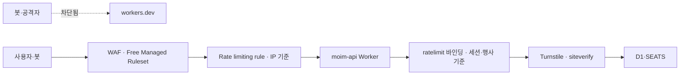
그림 1. 요청이 거치는 방어 층

앞의 두 층(WAF, Rate limiting rule)은 존에서, 즉 Worker가 실행되기 전에 작동한다. 뒤의 두 층(`ratelimit` 바인딩, Turnstile 검증)은 Worker 코드 안에서 작동한다. 앞의 층은 싸고 거칠고, 뒤의 층은 정교하지만 Worker가 한 번은 실행돼야 한다. 이 차이를 머리에 두고 층마다 살펴보자.

### WAF — Free Managed Ruleset과 패치

WAF는 요청 내용을 보고 알려진 공격 패턴을 막는다. Free 플랜에서도 쓸 수 있는 것이 Cloudflare Free Managed Ruleset이다. 문서는 이 규칙 묶음이 모든 플랜에서 제공되고 "Provides protection against high-impact and widely exploited vulnerabilities."라고 설명한다. Pro 이상 플랜의 Cloudflare Managed Ruleset에서 일부를 떼어낸 것이다. 반가운 점은 Free 플랜에 기본으로 배포된다는 사실이다. 우리가 따로 켤 필요는 없지만, 대시보드의 보안 메뉴에서 `example.com` 존에 실제로 적용돼 있는지 한 번 확인해두자. 남이 만들어준 기본값일수록 눈으로 확인해두는 편이 마음 편하다.

그렇다면 WAF만 있으면 안심해도 될까? 5장에서 본 2026년 5월의 React·Next.js 취약점을 떠올려보자. 그때 Cloudflare changelog(2026-05-07)는 이렇게 적었다.

> "Several of the disclosed vulnerabilities are not possible to block in WAF. We strongly recommend updating your applications so they are not purely reliant on WAF mitigations."

WAF는 시간을 벌어줄 뿐 구멍을 메우지는 못한다. 프레임워크와 라이브러리의 보안 패치는 WAF와 별개로 챙겨야 한다. `moim-web`의 의존성 업데이트를 미루지 말자.

실무에서는 이 원칙을 습관으로 만들어두는 편이 좋다. 5장에서 붙인 Workers Builds나 8장의 GitHub Actions 파이프라인에 의존성 점검 단계를 넣고, 보안 공지가 나오면 그 주 안에 패치 버전을 배포하는 흐름을 정해두자. 특히 Next.js처럼 어댑터(vinext, OpenNext)를 한 겹 더 거치는 프레임워크는 패치가 두 군데서 나온다. 프레임워크 본체의 패치와 어댑터의 대응을 함께 확인해야 한다. 2026년 5월 사례에서 Cloudflare는 "Vinext's latest release is not vulnerable"이라고 따로 밝혔다. 어댑터 쪽 공지까지 확인하는 습관이 있으면 이런 문장을 놓치지 않는다. Spring 쪽도 다르지 않다. `moim-core`는 6장부터 Tunnel 뒤에 있으니 포트가 열려 있지 않지만, Tunnel을 지나 들어온 요청은 결국 Spring 애플리케이션이 처리한다. Spring Boot와 의존 라이브러리의 패치 역시 같은 주기로 챙기자.

### 레이트 리미팅 두 층 — Rate limiting rule과 `ratelimit` 바인딩

신청 폼 `POST /api/events/:id/rsvp`를 누군가 스크립트로 초당 수백 번 두드린다고 해보자. 선착순 좌석은 순식간에 가짜 신청으로 찬다. 레이트 리미팅이 필요한 순간이다. Cloudflare에는 레이트 리미팅을 거는 자리가 두 군데 있다. 어디에서 무엇을 세느냐가 다르다.

첫째는 WAF의 Rate limiting rule이다. 존에서 동작하므로 걸러진 요청은 Worker까지 오지 않는다. Free 플랜에는 규칙이 1개 주어지고, 카운팅 기간은 10초, 차단(완화) 기간도 10초다(2026년 10월 기준). 조건에 쓸 수 있는 필드는 Path와 Verified Bot이고, 세는 기준은 IP다. Pro는 2개, Business는 5개, Enterprise는 100개까지 쓸 수 있다. 예전의 종량 과금형 레이트 리미팅은 이제 제공되지 않는다. `moim`의 하나뿐인 규칙은 신청 경로에 쓰자. 경로가 `/api/events/`로 시작하는 요청을 IP당 10초에 일정 횟수 넘게 보내면 10초 동안 막는 식이다.

그런데 IP 기준에는 함정이 있다. 밋업 행사장을 떠올려보자. 참가자 백 명이 같은 와이파이에 붙어 현장에서 신청 확인 페이지를 연다. 바깥에서 보면 모두 같은 IP다. IP 기준 규칙을 빡빡하게 걸면 정상 참가자들이 한꺼번에 막힌다. 그래서 IP 규칙은 명백한 폭주만 걸러내도록 넉넉하게 두고, 정교한 판단은 다음 층에 맡기는 편이 낫다.

둘째가 Workers의 `ratelimit` 바인딩이다. 2025년 9월 19일 GA가 됐고, changelog는 "The `ratelimit` binding is now stable and recommended for all production workloads."라고 적었다. Worker 코드 안에서 동작하므로 키를 마음대로 정할 수 있다. 행사 ID와 세션을 묶어 "이 세션은 이 행사에 1분에 5번까지"처럼 셀 수 있다.

```jsonc
// moim-api/wrangler.jsonc 에 추가 — period는 10 또는 60(초)만 허용
"ratelimits": [
  {
    "name": "RATE_LIMITER",
    "namespace_id": "1001",
    "simple": { "limit": 5, "period": 60 }
  }
]
```

```ts
app.post("/api/events/:id/rsvp", async (c) => {
  const sessionId = getSessionId(c); // 앱의 세션 식별자
  const { success } = await c.env.RATE_LIMITER.limit({
    key: `${c.req.param("id")}:${sessionId}`,
  });
  if (!success) return c.text("잠시 후 다시 시도해주세요", 429);
  // ...Turnstile 검증, 좌석 확보(4장의 SEATS)
});
```

`namespace_id`는 계정 안에서 이 레이트 리미터를 구분하는 정수 값을 문자열로 적은 것이다. 같은 `namespace_id`를 쓰는 바인딩은 Worker가 달라도 같은 카운터를 공유한다. 이 카운트는 전역에서 정확히 세는 값이 아니다. 문서는 한도가 Worker가 실행되는 Cloudflare 위치(데이터센터)마다 따로 적용된다고 적고, 이 API가 "permissive, eventually consistent, and intentionally designed to not be used as an accurate accounting system"이라고 못 박는다(Rate Limiting 2026-04-23 기준). 서울에서 다섯 번, 도쿄에서 다섯 번이 따로 세어질 수 있다는 뜻이다. 정확한 상한이 필요한 곳, 예를 들어 좌석 수 그 자체는 4장의 `EventSeats` Durable Object가 지킨다. 레이트 리미팅은 남용을 줄이는 장치이지 정확한 회계 장부가 될 수는 없다.

여기서 4장의 실패담을 다시 꺼내보자. KV로 레이트 리미터를 만들었다가 에러 하나 없이 조용히 실패한 사례였다. KV는 최종 일관성이고 키당 초당 한 번만 쓸 수 있으니, 여러 엣지에서 동시에 들어오는 요청을 세는 일에는 맞지 않는다. 카운터가 필요하면 KV 대신 `ratelimit` 바인딩이나 Durable Objects를 쓰자.

### Turnstile — 위젯과 siteverify, 두 쪽이 다 있어야 한다

레이트 리미팅은 "너무 자주"를 막는다. 그런데 천천히, 사람처럼 신청하는 스크립트는 어떻게 할까? 여기서 Turnstile이 등장한다. 사용자를 귀찮게 하는 퍼즐 없이 브라우저 신호로 봇 여부를 판단하는 Cloudflare의 CAPTCHA 대체재다.

Turnstile을 처음 붙일 때 가장 흔한 실수가 있다. 문서는 이를 아예 첫머리에 적어두었다.

> "Turnstile setup has two parts: embed the widget in your frontend, then call siteverify from your backend. Without the second part, the widget appears on the page but does not protect the request."

위젯만 붙이면 화면에는 그럴듯한 체크 표시가 뜬다. 그런데 서버가 그 결과를 확인하지 않으면 봇은 위젯을 무시하고 API를 바로 부르면 그만이다. 보기에는 지켜지는 것 같은데 실제로는 아무것도 막지 않으니 아찔한 일이다. 얼마나 흔한 실수였는지, Turnstile 대시보드는 siteverify 호출이 없는 위젯에 따로 표시를 해준다.

`moim-web`의 신청 폼에 위젯을 넣자.

```html
<!-- api.js는 이 주소에서 그대로 불러야 한다. 프록시·캐시하면 업데이트 때 깨진다 -->
<script src="https://challenges.cloudflare.com/turnstile/v0/api.js" async defer></script>
<form method="post" action="/api/events/42/rsvp">
  <input name="email" type="email" required />
  <div class="cf-turnstile" data-sitekey="<사이트 키>"></div>
  <button type="submit">신청하기</button>
</form>
```

위젯은 검증을 마치면 `cf-turnstile-response`라는 숨은 필드에 토큰을 넣어 폼과 함께 보낸다. `moim-api`는 그 토큰을 Cloudflare에 물어본다. 토큰은 발급 후 300초 동안만 유효하고, 한 번만 검증할 수 있다(Turnstile 문서 2026-09-16 기준).

```ts
// 공식 예제와 같은 FormData 방식. JSON 본문으로 보내도 되고, 응답은 항상 JSON이다
async function verifyTurnstile(token: string, secret: string): Promise<boolean> {
  const form = new FormData();
  form.append("secret", secret);
  form.append("response", token);
  const res = await fetch(
    "https://challenges.cloudflare.com/turnstile/v0/siteverify",
    { method: "POST", body: form },
  );
  const data = await res.json<{ success: boolean }>();
  return data.success;
}
```

신청 핸들러에서 레이트 리미팅을 통과한 요청에 이 함수를 부르고, `false`면 403으로 돌려보내자. 검증 순서를 이렇게 둔 데는 이유가 있다. siteverify는 외부 호출이다. 레이트 리미팅으로 폭주를 먼저 걸러야 Cloudflare에 묻는 호출 수도 줄어든다. 비밀 키 `TURNSTILE_SECRET_KEY`는 사이트 키와 달리 브라우저로 내려가서는 안 되는 값이다. 뒤에서 볼 시크릿으로 관리하자.

Turnstile이 무엇을 증명하는지도 정확히 알아두자. Turnstile이 통과시켰다는 것은 "이 요청은 실제 브라우저에서 사람이 보낸 것으로 보인다"는 뜻이다. 그 사람이 정당한 참가자인지, 같은 사람이 이메일을 바꿔가며 열 번 신청하는지는 Turnstile의 관심사가 아니다. 그런 판단은 앱의 규칙이 맡는다. 같은 이메일로 같은 행사에 중복 신청하지 못하게 D1에 유일 제약을 걸고, 좌석은 `EventSeats`가 원자적으로 센다. Turnstile은 대량 자동화의 문턱을 높이는 장치이고, 업무 규칙을 대신하지는 않는다. 앞의 공개 표면 지도에서 Turnstile을 신청 폼에만 붙이고 결제 웹훅에는 붙이지 않은 것도 같은 이유다. 사람이 누르지 않는 문에 사람 확인 장치를 달면 정상 호출만 막힌다.

Turnstile은 무료로 넉넉하다. Free 플랜에서 위젯 20개, 위젯당 호스트명 10개까지 쓸 수 있고 챌린지 수는 무제한이며, 분석 데이터는 7일 보관된다(Turnstile Plans 2026-08-14 기준). 다른 Cloudflare 서비스 없이 단독으로도 쓸 수 있으니, Cloudflare 밖에서 운영하는 다른 서비스의 폼에도 붙일 수 있다. 2026년 8월 10일 GA가 된 Turnstile Spin은 대시보드나 Wrangler에서 siteverify 연결까지 한 번에 구성해주는 도구다. 처음이라면 이 도구로 뼈대를 잡고 코드를 읽어보는 것도 방법이다.

### 시크릿 — 코드 밖에, 그러나 잊히지 않게

8장과 이 장을 지나며 비밀 값이 꽤 쌓였다. Stripe 비밀 키와 웹훅 서명 비밀, Turnstile 비밀 키, Email Sending용 API 토큰, `moim-core`가 큐를 당길 때 쓰는 API 토큰. 이 값들이 `wrangler.jsonc`의 `vars`나 소스 코드에 들어가면 저장소를 볼 수 있는 모든 사람이 보게 된다. 실수로 공개 저장소에 올라가기라도 하면 끔찍한 일이다.

Worker의 비밀 값은 `wrangler secret`으로 따로 넣는다. 값은 Cloudflare에 암호화돼 저장되고, 코드에서는 `env.STRIPE_SECRET_KEY`처럼 바인딩으로 읽는다.

```bash
npx wrangler secret put STRIPE_SECRET_KEY
npx wrangler secret put STRIPE_WEBHOOK_SECRET
npx wrangler secret put TURNSTILE_SECRET_KEY
```

로컬 개발에서는 Wrangler 설정 파일과 같은 폴더의 `.dev.vars` 파일에 같은 이름으로 테스트용 값을 넣는다. 이 파일은 `.gitignore`에 넣어 저장소에 올라가지 않게 하자.

그런데 시크릿에는 고질적인 약점이 있다. 코드 밖에 있으니 잊히기 쉽다. 새 환경에 배포하면서 시크릿 하나를 빠뜨리면, 배포는 성공하고 첫 결제 웹훅에서야 서명 검증이 터진다. 2026년 3월 25일부터 Wrangler 설정의 `secrets` 속성에 필요한 시크릿 이름을 선언해둘 수 있다. 선언해두면 `wrangler deploy`와 `wrangler versions upload`가 빠진 시크릿이 있을 때 그 이름을 나열하며 실패한다. 배포가 성공하고 첫 웹훅에서 터지는 대신, 배포 단계에서 멈추는 것이다. 로컬 개발에서는 `.dev.vars`에서 여기 적힌 이름만 읽고, 빠진 이름은 경고로 알려준다(Wrangler 설정 문서 2026-10-02 기준). 목록에 없는 시크릿은 로컬에서 읽히지 않으니, 이 Worker가 쓰는 시크릿은 빠짐없이 적어두자.

```jsonc
// moim-api/wrangler.jsonc
"secrets": {
  "required": ["STRIPE_SECRET_KEY", "STRIPE_WEBHOOK_SECRET", "TURNSTILE_SECRET_KEY"]
}
```

Wrangler 자체의 인증 정보도 시크릿이다. 2026년 6월 3일부터 Wrangler는 로그인 자격 증명을 OS 키체인에 저장한다. 7월 2일에는 여러 계정을 오가는 인증 프로필이, 8월 4일에는 브라우저 없는 환경을 위한 디바이스 플로 로그인이 추가됐다. 개인 계정과 회사 계정을 한 노트북에서 오간다면 프로필을 나눠두자. 엉뚱한 계정에 배포하는 사고를 줄여준다.

마지막은 API 토큰의 범위다. 토큰은 쓰임마다 따로 만들고 권한을 그 쓰임에만 맞추자. CI 배포 토큰은 "Edit Cloudflare Workers" 템플릿에서 출발해 필요 없는 권한을 덜어낸다. Email Sending SMTP 토큰은 "Email Sending: Edit"만, `moim-core`의 큐 소비 토큰은 7장에서 본 Queues 읽기·쓰기 권한만 갖게 한다. 토큰 하나가 새어도 피해가 그 토큰의 일 하나로 끝나게 하는 것, 그것이 최소 권한의 의미다.

`moim-core` 쪽 비밀 값도 같은 원칙으로 정리하자. Neon 접속 정보, R2 접근 키, 큐 소비용 API 토큰, SMTP 토큰은 `application.yml`에 값으로 적지 말고 `${...}` 자리표시자로 두고, 실제 값은 VPS의 환경 변수나 권한을 좁힌 별도 파일에서 주입한다. 6장에서 `cloudflared`의 터널 토큰을 `--token-file`로 분리했던 것과 같은 발상이다. 마지막으로 교체 계획을 세워두자. 키가 샜다는 의심이 들면 어떤 순서로 바꿀지 미리 적어두면 당황할 일이 줄어든다. Stripe 키를 새로 발급하고, `wrangler secret put`으로 덮어쓰고, 옛 키를 폐기한다. 10장에서 만들 서비스 토큰은 교체 유예 기간을 지원하니 그때 함께 살펴보겠다.

> **비용 메모**
> 이 장의 방어선은 대부분 무료 범위에 있다. Turnstile은 Free에서 위젯 20개·챌린지 무제한이고(Turnstile Plans 2026-08-14 기준), Free Managed Ruleset은 모든 플랜에 제공되며 Free에는 기본 배포된다. WAF Rate limiting rule은 Free 1개, Pro 2개, Business 5개, Enterprise 100개다(2026년 10월 기준). 반면 API Shield는 Enterprise 전용 유료 애드온이다. Worker 앞에서 걸러진 요청은 Worker까지 오지 않는다는 점에서, 이 장치들은 보안 장치이면서 비용 장치이기도 하다(13장).

## 방어선 바깥의 이야기

### mTLS·API Shield, 그리고 DDoS는 내 일인가

보안 문서를 읽다 보면 mTLS와 API Shield라는 이름을 만난다. mTLS는 클라이언트도 인증서로 자기를 증명하게 하는 방식이다. 서버 인증서만 확인하는 보통의 TLS에서 한 걸음 더 나간 셈이다. 모바일 앱이나 IoT 기기가 API를 부를 때 쓸 만하다. 문서에 따르면 Cloudflare가 관리하는 인증 기관으로는 누구나 mTLS를 설정할 수 있고, 존마다 기본 100개의 활성 클라이언트 인증서를 쓸 수 있다(2026-09-08 기준). 2026년 3월 27일부터는 Worker에서 RFC 9440 형식의 클라이언트 인증서 필드를 읽을 수 있다. 반면 자기 인증 기관을 가져오는 BYOCA는 Enterprise 계정 전용이고, API Shield는 "Enterprise-only paid add-on"이다. 브라우저로 쓰는 `moim`에는 해당 사항이 없다. 개인·소규모 팀이라면 이 경계만 알아두고 넘어가도 충분하다.

DDoS는 어떨까? "내 작은 사이드 프로젝트를 누가 공격하겠어"라고 생각하기 쉽다. 2017년 IMC 학회에 실린 Jonker 등의 연구는 다른 그림을 보여준다. 2년간 관측한 결과, 활성 /24 네트워크의 약 3분의 1이 적어도 한 번 공격을 받았고, .com·.net·.org 웹사이트의 약 3%가 하루 평균으로 공격에 연루됐다. 2017년 데이터라는 점을 감안해도, 공격 대상이 유명 서비스에 한정되지 않는다는 점은 분명하다. 유료 계정의 Worker라면 이야기가 하나 더 붙는다. Worker까지 도달한 요청은 하나하나 요청 수로 청구된다. 그래서 앞에서 세운 WAF와 Rate limiting rule이 보안 장치이면서 동시에 비용 장치가 된다. 이 관점은 13장에서 다시 이어 받겠다.

### 고객 로그인과 Access의 경계

공개 앱을 지키다 보면 자연스럽게 다음 질문이 나온다. 로그인은 어디서 처리할까? 여기서 두 종류의 사용자를 구분해두자.

하나는 `moim`의 고객, 즉 밋업 참가자다. 누구나 가입할 수 있고 몇 명이 될지 모른다. 이들의 로그인은 앱의 몫이다. `moim-core`의 기존 Spring 로그인을 그대로 쓰거나, Auth0·Clerk 같은 외부 인증 서비스를 OIDC로 붙이면 된다. Cloudflare 문서에서 이런 서비스와의 연동 전용 가이드는 확인하지 못했지만, 모두 OpenID Connect 같은 표준 위에 서 있으니 8장의 원칙대로 표준으로 이으면 된다.

다른 하나는 운영자와 내부 시스템이다. `/admin/*` 화면에 들어오는 몇 명의 팀원, `moim-api`가 `moim-core`를 부르는 기계 간 호출, 팀원의 서버 SSH 접속. 이들은 수가 정해져 있고, 들어와야 할 사람이 누구인지 우리가 안다. 이쪽이 Cloudflare Access의 자리다. 고객 수천 명을 Access 좌석으로 받는 구조는 맞지 않고, 운영자 몇 명을 위해 앱에 관리자 로그인을 따로 짜는 것도 낭비다.

이제 공격자의 눈으로 `moim`을 한 바퀴 걸어보자. `workers.dev` 주소로 Worker를 직접 두드린다. 문이 없다. 신청 경로를 한 IP에서 퍼붓는다. Rate limiting rule이 10초씩 끊어낸다. IP를 바꿔가며 천천히 보낸다. `ratelimit` 바인딩이 세션과 행사 단위로 센다. 브라우저 없이 API만 부른다. Turnstile 토큰이 없으니 siteverify에서 막힌다. 알려진 프레임워크 취약점을 찌른다. Managed Ruleset이 일부를 막고, 나머지는 우리가 제때 올린 패치가 막는다. 공개 저장소를 뒤져 키를 찾는다. 키는 저장소에 없고, 어딘가에서 새더라도 그 키는 한 가지 일만 할 수 있다. 그렇다면 공격자에게 남은 문은 어디일까? `/admin/*`이다. 지금 그 문을 지키는 것은 앱의 로그인 화면 하나뿐이다. 그 문을 Cloudflare 앞단에서 닫는 일이 다음 차례다.

# 10장. Cloudflare One — 작은 팀을 위한 제로 트러스트

"사내망 안에 있으면 안전하다." 오랫동안 회사 보안은 이 문장 위에 서 있었다. 방화벽으로 성벽을 쌓고, 성 안으로 들어오는 길은 VPN 하나로 좁힌다. 일단 VPN에 붙으면 사내 위키도, 관리자 화면도, 데이터베이스도 손이 닿는다. 성 안에 들어온 사람은 믿을 만한 사람이라는 전제다.

2020년 8월 미국 국립표준기술연구소(NIST)가 낸 SP 800-207 「Zero Trust Architecture」는 바로 이 전제를 뒤집는 문장으로 제로 트러스트를 정의한다.

> "Zero trust assumes there is no implicit trust granted to assets or user accounts based solely on their physical or network location (i.e., local area networks versus the internet) or based on asset ownership (enterprise or personally owned)."

물리적 위치나 네트워크 위치만으로, 즉 사내 LAN에 있느냐 인터넷에 있느냐만으로 주어지는 암묵적 신뢰는 없다는 것이다. 같은 문서는 이어서 이렇게 적는다.

> "Authentication and authorization (both subject and device) are discrete functions performed before a session to an enterprise resource is established."

사용자와 기기 모두의 인증과 인가가 세션이 열리기 전에 매번 따로 수행된다는 말이다. 2014년 12월 구글도 사내 보안 모델 BeyondCorp를 소개하며 "We are removing the requirement for a privileged intranet and moving our corporate applications to the Internet."라고 썼다. 제로 트러스트의 질문은 "어디에서 왔는가"에서 "누구이고, 어떤 기기인가"로 바뀐다. 사내망이라는 "안"이 사라진 자리에 매 요청의 신원 확인이 들어선다.

이 생각을 `moim`에 대어보자. 9장 끝에서 공격자에게 남은 문은 앱 로그인 하나로만 지켜지는 `/admin/*`이었다. 6장에서 Tunnel로 공개한 `core.example.com`도 인터넷 어디서든 Spring의 로그인 화면까지는 닿는다. 팀원이 VPS에 SSH로 들어가려면 22번 포트가 어딘가 열려 있어야 한다. VPN을 새로 깔아 이 셋을 성 안에 넣을 수도 있다. 하지만 서너 명짜리 팀이 VPN 서버를 운영하는 일은 생각만 해도 번거롭다. Cloudflare One(Zero Trust)은 이 셋을 VPN 없이 닫는 도구다. 하나씩 닫아보자.

## 작은 팀의 언어로 본 제로 트러스트

### 위치 대신 신원과 기기 — Cloudflare One의 구성

Cloudflare One은 제품 하나가 아니라 여러 부품의 묶음이다. 이름이 많아 처음에는 헷갈리니 `moim`에 필요한 순서대로 자리를 잡아두자.

가장 먼저 쓸 것은 Access다. Access는 애플리케이션 앞에 서서 요청마다 "누구인가"를 묻는다. 로그인하지 않은 사람은 Access의 로그인 화면에서 멈추고, 정책을 통과한 요청만 오리진까지 간다. 오리진에 도착한 요청에는 Access가 서명한 JWT가 실려 있다. 이 JWT를 오리진이 검증하는 것이 이 장의 중심 실습이다.

두 번째는 Cloudflare One Client(구 WARP Client)다. 팀원의 노트북에 까는 에이전트로, 기기의 상태(posture)를 Access 정책에 알려주고 기기의 트래픽을 Cloudflare로 보낸다. NIST가 말한 "subject and device"에서 device 쪽을 맡는 부품이다. 세 번째는 Gateway로, Client를 통해 들어온 트래픽에 DNS·HTTP 필터링 정책을 건다. 네 번째는 Cloudflare Mesh다. Mesh node(구 WARP Connector)를 서버에 두면 팀원 기기와 서버가 하나의 사설망으로 묶인다. 마지막으로 6장의 Tunnel이 이 모든 것의 연결선이다. 공개 호스트명을 오리진에 잇는 것도, 사설 호스트명을 내부 서버에 잇는 것도 Tunnel이다.

작은 팀이라면 이 다섯을 한꺼번에 들일 필요가 없다. Access와 Tunnel만으로 운영자 화면, 내부 API, SSH를 닫을 수 있다. 기기 상태까지 따지고 싶어질 때 Client를 더하고, 스테이징 환경을 통째로 사설망에 넣고 싶을 때 Mesh를 더하면 된다. 이 장도 그 순서를 따른다.

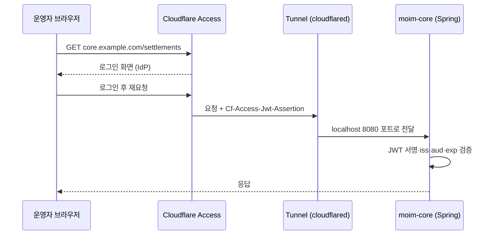
그림 1. Access 인증 흐름 — JWT 검증은 오리진(Spring)에서 한 번 더

### 좌석과 플랜 — 50명까지 $0, 그다음은

돈 이야기부터 정확히 해두자. Cloudflare의 Access 제품 페이지(페이지에 날짜 표기가 없어 2026년 10월 3일 확인 기준)에는 세 가지 플랜이 있다. Free 플랜은 "$0 forever"이고 "Best for teams under 50 users"라는 설명과 함께 사용량 행에 "50 user limit"가 적혀 있다. Pay-as-you-go는 "$7 per user/month (paid annually)"이고 사용자 수 제한이 없다. 그 위로 가격을 따로 정하는 Contract 플랜이 있다. $7에는 "연간 결제"라는 조건이 붙어 있다는 점을 놓치지 말자. 연간 결제 기준 사용자당 월 $7이고, 월 단위 결제 단가는 확인하지 못했다. 50석 무료 구조는 2020년 10월 Teams 무료 플랜 발표 때부터 이어져 온 것이다.

혼동하기 쉬운 숫자가 하나 있다. 2026년 4월 Mesh 발표 글에는 "50 nodes and 50 users free"라는 문구가 나온다. 이것은 Mesh라는 별개 제품에 대한 문구다. Access 좌석의 근거로 섞어 쓰지 말자.

좌석이 어떻게 소비되는지가 더 중요하다. 좌석 관리 문서(2026-05-01 기준)에 따르면 사용자는 인증 이벤트가 한 번만 일어나도 좌석을 차지한다. 그리고 "A user who authenticates will hold their seat until you remove the user from your account. By default, inactive users will not be automatically removed"라고 적혀 있다. 한 번 로그인한 사람은 우리가 지울 때까지 좌석을 붙들고 있고, 활동하지 않는 사용자도 기본으로는 자동 정리되지 않는다는 뜻이다. 행사 때 한 번 들어와 본 자원봉사자 스무 명이 그대로 좌석을 차지하면 50석은 금세 찬다. 분기마다 사용자 목록을 정리하자. 서비스 토큰은 좌석을 쓰지 않으니, 기계 간 호출을 사람 계정으로 처리하지 말아야 할 이유가 하나 더 생긴다.

운영 한도도 작은 팀에게는 넉넉하다. 계정당 Access 앱 500개, IdP 50개, 서비스 토큰 50개, 규칙당 이메일 1,000개, Gateway DNS·HTTP·Network 정책 각 500개다(Cloudflare One Account limits 2026-09-04 기준).

> **비용 메모**
> Access Free 플랜은 50명까지 $0이고, 넘으면 Pay-as-you-go로 연간 결제 기준 사용자당 월 $7이다(Access 제품 페이지, 2026-10-03 확인). 한 번 인증한 사용자는 지울 때까지 좌석을 차지하고, 서비스 토큰은 좌석을 쓰지 않는다. Mesh는 노드 50개·사용자 50명까지 무료(2026-04-14 발표 기준)이고, Tunnel의 호스트명 기반 사설 라우팅은 Cloudflare One 고객이면 무료다. 원격 브라우저 격리와 전용 출구 IP는 유료 애드온이다.

## `moim`의 문을 Access로 닫기

### Access 앱 만들기 — `/admin/*`과 `core.example.com`

Cloudflare One을 처음 열면 팀 이름을 정한다. 이 이름이 `https://<팀 이름>.cloudflareaccess.com`이라는 팀 도메인이 되고, 뒤에서 JWT를 검증할 때 발급자(`iss`)와 공개 키 주소의 기준이 된다.

다음은 로그인 수단(IdP)이다. 2026년 6월 18일 이후 새로 만든 조직은 Cloudflare 자체 IdP가 기본이고, 그 전에는 이메일 일회용 PIN(OTP)이 기본이었다. OTP는 지금도 설정 없이 바로 쓸 수 있으니 서너 명짜리 팀이라면 이것으로 시작해도 된다. GitHub나 Google 같은 소셜 IdP도 붙일 수 있고, OIDC나 OAuth를 지원하는 서비스라면 generic OIDC를 고른다. Auth0·Clerk 전용 연동 가이드는 확인하지 못했으니 generic OIDC로 붙이고 동작을 직접 확인하자.

이제 Access 애플리케이션을 두 개 만든다. 첫째는 `moim.example.com`의 운영자 경로다. 화면 `/admin/*`과 그 화면이 부르는 `/api/admin/*`을 같은 정책으로 보호한다. Access 앱은 호스트명 전체가 아니라 경로 단위로도 만들 수 있다. 앱의 공개 호스트명을 정할 때 도메인 뒤에 경로를 적으면 되고, 경로에는 `*` 와일드카드를 쓸 수 있다. 주의할 점이 하나 있다. `moim.example.com/admin/*`은 `/admin/users` 같은 하위 경로는 덮지만 `/admin` 자체는 덮지 않는다(Application paths 2026-04-17 기준). `/admin`도 함께 넣어두자. 같은 루트 경로에 규칙이 여럿이면 더 구체적인 경로의 규칙이 우선한다. 정책은 단순하게 시작하자. 팀원의 이메일 주소를 나열하거나, 회사 도메인 이메일 전체를 허용한다. 여기서 8장의 경고를 떠올리자. 결제 웹훅 `/api/webhooks/stripe`가 이 앱의 범위에 들어가면 Stripe는 로그인 화면으로 가는 302를 받고, Stripe는 리다이렉트를 실패로 처리한다. 운영자 경로만 정확히 감싸고 웹훅 경로는 범위 밖에 두자.

둘째는 `core.example.com` 전체다. 6장에서 Tunnel로 공개한 `moim-core`를 통째로 Access 뒤에 둔다. 이 앱에는 정책이 둘 필요하다. 운영자가 정산 화면을 보러 들어오는 사람용 정책과, `moim-api`가 정산 데이터를 가져가는 기계용 정책이다. 기계용 정책은 뒤에서 서비스 토큰으로 만든다.

실수로 내부 도구를 노출하는 일을 막는 안전장치도 있다. 2026년 1월 22일에 나온 Require Access protection은 "When enabled, traffic to any hostname that does not have a matching Access application is automatically blocked."라고 설명된다. 대응하는 Access 앱이 없는 호스트명으로 가는 트래픽을 자동으로 막는, 기본 거부 방식이다. 새 내부 호스트명을 만들고 Access 앱을 깜빡해도 문이 열리지 않는다. 다만 적용 범위가 넓다는 점을 알고 켜야 한다. 이 설정의 실제 이름은 "Block traffic to all domains in this account"이고, 말 그대로 계정의 모든 호스트명에 걸린다. Access 앱이 없는 호스트명으로 들어온 요청은 `Error 1050` 차단 페이지를 받는다. 그러니 `moim.example.com`처럼 누구나 들어와야 하는 호스트명은 미리 열어둬야 한다. 방법은 둘이다. 설정의 "Hostnames to Exempt"에 그 호스트명을 넣거나, 그 호스트명에 Bypass 정책을 가진 Access 앱을 만든다(Require Access protection 문서 2026-04-21 기준). 문서는 켜기 전에 공개 호스트명마다 이 준비가 끝났는지 확인하라고 경고한다. `/admin/*` 같은 경로 단위 앱만 있는 호스트명의 나머지 경로가 어떻게 처리되는지는 문서에 따로 적혀 있지 않다. 게다가 문서는 예외 목록을 공개 콘텐츠만 있는 호스트명으로 제한하라고 권하는데, `moim.example.com`에는 `/admin`도 있다. 어느 방법을 고르든 켠 뒤에 공개 페이지와 웹훅 경로는 열리고 `/admin`은 막히는지 직접 확인하자.

Worker 쪽에는 2026년 8월 14일 추가된 옵션이 있다. "Make all Workers private by default"를 켜면 기존 Worker와 새로 만드는 Worker 모두 로그인 없이는 닿을 수 없게 된다. 9장에서 본 `workers.dev` 뒷문을 계정 단위로 닫는 또 하나의 방법이다. 다만 `moim-web`처럼 공개해야 하는 Worker는 Worker 단위 bypass로 다시 열어야 하고, Worker 단위 규칙은 그 Worker의 라우트·커스텀 도메인·`workers.dev`·프리뷰 주소에 함께 적용된다(Workers Cloudflare Access 문서 2026-08-18 기준). 공개 Worker의 뒷문은 결국 9장의 `"workers_dev": false`로 닫는 편이 단순하다. 프리뷰만 보호하는 "Previews only" 선택지도 있다.

### Access JWT 검증 ① — Workers와 Node

Access가 앞에서 막아주는데 오리진에서 또 검증해야 할까? 해야 한다. Access는 Access를 지나온 요청만 확인한다. 누군가 다른 길로 오리진에 닿으면, 예를 들어 9장의 `workers.dev`가 열려 있거나 Tunnel 설정이 잘못되어 Access 앱이 없는 호스트명이 생기면, 오리진은 그 요청이 Access를 거쳤는지 알 수 없다. Cloudflare도 2025년 10월 changelog에서 "To fully secure your application, it is important that you validate the JWT that Cloudflare Access adds to the `Cf-Access-Jwt-Assertion` header on the incoming request."라고 적었다.

검증할 대상은 `Cf-Access-Jwt-Assertion` 요청 헤더다. 브라우저 요청에는 `CF_Authorization` 쿠키로도 같은 토큰이 오지만, 문서는 쿠키가 항상 전달된다는 보장이 없으니 헤더를 검증하라고 권한다(Validate JWTs 2026-05-06 기준).

Worker가 오리진이라면 더 쉬운 길이 있다. 2026년 8월에 문서화된 `ctx.access`다. Worker는 로그인한 사용자의 신원을 `ctx.access`로 읽을 수 있고, 문서는 "No extra configuration or JWT parsing is required."라고 말한다. Access가 인증하지 않은 요청이면 `ctx.access`는 `undefined`다. 신원 정보는 `ctx.access.getIdentity()`를 `await`해서 얻고, 앱의 AUD 태그는 `ctx.access.aud`로 읽는다(Workers Cloudflare Access 문서 2026-08-18 기준).

```ts
// moim-api — /api/admin/* 핸들러
export default {
  async fetch(request: Request, env: Env, ctx: ExecutionContext) {
    if (!ctx.access) {
      return new Response("unauthorized", { status: 401 });
    }
    // 신원은 getIdentity()로 읽는다 — email, groups, 기기 상태 등
    const identity = await ctx.access.getIdentity();
    return handleAdmin(request, env, identity?.email ?? "unknown");
  },
};
```

그런데 `moim`의 구조에서는 이 편리함에 두 군데 구멍이 있다. 문서가 직접 밝힌 제약이다. 첫째, "Workers with Static Assets execute behind an internal router Worker. Access still protects the application and its assets. However, the router does not pass `ctx.access` to the user Worker." `moim-web`은 정적 자산을 가진 Worker다. Access는 `/admin/*`을 여전히 지켜주지만, `moim-web`의 코드에서는 `ctx.access`를 읽을 수 없다. 둘째, "Cloudflare Access does not propagate `ctx.access` through Service Binding HTTP requests or remote procedure call (RPC) invocations." 5장에서 `moim-web`이 `moim-api`를 Service binding으로 부르게 했으니, 관리자 화면이 SSR 중에 `moim-api`를 부르면 그 호출에도 `ctx.access`가 없다.

그렇다면 어떻게 할까? `moim-web`의 운영자 화면은 `ctx.access` 대신 `Cf-Access-Jwt-Assertion` 헤더를 직접 검증하자. Service binding으로 `moim-api`를 부를 때는 그 헤더를 그대로 실어 보내고, `moim-api`도 같은 방식으로 다시 검증한다. 신원을 "이미 확인했다"는 내부 표시로 넘기는 대신 서명된 토큰 자체를 넘기면, 받는 쪽은 아무도 믿지 않고 스스로 확인할 수 있다. 제로 트러스트를 Worker 사이에도 적용하는 셈이다. 검증 코드는 Cloudflare 공식 예제와 같은 `jose` 패키지로 쓴다. Node.js 오리진에서도 그대로 쓸 수 있다.

```ts
import { createRemoteJWKSet, jwtVerify } from "jose";

type AccessEnv = { TEAM_DOMAIN: string; POLICY_AUD: string };
// TEAM_DOMAIN 예: "https://moim-team.cloudflareaccess.com"

let jwks: ReturnType<typeof createRemoteJWKSet> | undefined;

export async function verifyAccess(request: Request, env: AccessEnv) {
  const token = request.headers.get("Cf-Access-Jwt-Assertion");
  if (!token) return null;

  jwks ??= createRemoteJWKSet(new URL(`${env.TEAM_DOMAIN}/cdn-cgi/access/certs`));
  try {
    const { payload } = await jwtVerify(token, jwks, {
      issuer: env.TEAM_DOMAIN,
      audience: env.POLICY_AUD,
    });
    return payload; // email, sub 등
  } catch {
    return null;
  }
}
```

`POLICY_AUD`는 Access 앱마다 붙는 AUD 태그로, 앱 설정의 Additional settings에서 확인하며 앱을 다시 만들지 않는 한 바뀌지 않는다. 모듈 수준 변수 `jwks`는 3장에서 본 대로 isolate가 재사용될 때만 살아남는 캐시이니, 사라져도 다시 만들면 그만이다. 로컬 개발에서는 `wrangler.jsonc`에 `"access": { "dev": { "aud": "...", "identity": { ... } } }`를 두면 가짜 신원으로 `ctx.access` 경로를 시험할 수 있다.

### Access JWT 검증 ② — Spring Security로 (저자 작성 예제)

이제 `moim-core`의 차례다. 먼저 밝혀둘 것이 있다. Cloudflare의 JWT 검증 문서는 Workers, Go, Python, Node.js 예제를 제공하지만 Java나 Kotlin 예제는 없다. 아래 Spring Security 설정은 공식 예제가 없어 직접 작성한 예제다. 기준 버전은 Spring Boot 4.1.1과 Spring Security 7.1.1(둘 다 2026-08-20 GA, Java 17 이상)이다.

검증에 필요한 사실부터 모아보자. 공개 키는 `https://<팀 이름>.cloudflareaccess.com/cdn-cgi/access/certs`에 있고, 응답의 `keys` 배열이 표준 JWKS 형식(RSA, RS256)이다. 토큰의 `iss`는 팀 도메인, `aud`는 앱의 AUD 태그를 담은 배열이다. Spring Security Resource Server로 이 세 가지(서명, `iss`, `aud`)와 만료(`exp`)를 검증하면 된다.

여기에 함정이 두 개 있다. 첫째는 토큰을 꺼내는 위치다. Resource Server의 기본 `DefaultBearerTokenResolver`는 `Authorization` 헤더에서 `Bearer `로 시작하는 값을 찾는다. 헤더 이름은 `setBearerTokenHeaderName`으로 바꿀 수 있지만, Spring Security 7.1.1 소스를 보면 값이 `Bearer `로 시작하지 않으면 무시한다. Access는 `Cf-Access-Jwt-Assertion`에 접두어 없이 JWT만 넣는다. 그래서 헤더 이름만 바꾸면 토큰을 영영 찾지 못한다. 문서가 "provider is using both a custom header and value"인 경우를 위해 안내하는 `HeaderBearerTokenResolver`를 쓰자. 헤더 값을 그대로 돌려주는 리졸버다.

둘째는 `issuer-uri`다. Spring Boot에서 `issuer-uri`만 적으면 애플리케이션은 그 주소의 OIDC 디스커버리 엔드포인트를 조회해 공개 키 위치를 알아내려 한다. 그런데 Access 팀 도메인에 디스커버리 엔드포인트가 있는지는 이 책의 리서치로 확인하지 못했다. 그러니 `jwk-set-uri`를 명시하자. Spring Security 문서도 이 조합을 설명한다. "jwk-set-uri can be supplied as well … Resource Server will not ping the authorization server at startup", 그리고 "We still specify the issuer-uri so that Resource Server still validates the iss claim on incoming JWTs."

```yaml
# moim-core application.yml — 저자 작성 예제
spring:
  security:
    oauth2:
      resourceserver:
        jwt:
          jwk-set-uri: https://moim-team.cloudflareaccess.com/cdn-cgi/access/certs
          issuer-uri: https://moim-team.cloudflareaccess.com   # iss 검증용
          audiences: ${CF_ACCESS_AUD}                          # 앱의 AUD 태그
```

```java
// moim-core SecurityConfig — 저자 작성 예제 (Spring Security 7.1.1 기준)
@Configuration
@EnableWebSecurity
class SecurityConfig {

    @Bean
    SecurityFilterChain accessProtected(HttpSecurity http) throws Exception {
        http
            .authorizeHttpRequests(auth -> auth
                .requestMatchers("/internal/**").hasAuthority("ROLE_SERVICE")
                .anyRequest().authenticated())
            .oauth2ResourceServer(oauth -> oauth
                .bearerTokenResolver(new HeaderBearerTokenResolver("Cf-Access-Jwt-Assertion"))
                .jwt(jwt -> jwt.jwtAuthenticationConverter(new AccessJwtConverter())));
        return http.build();
    }
}
```

`AccessJwtConverter`는 뒤의 서비스 토큰 절에서 채운다. 서명 알고리즘은 Boot의 기본값 RS256이 Access와 맞고, 시계 오차는 Resource Server 기본값인 60초를 허용한다. 검증 항목을 코드로 드러내고 싶다면 Spring Security 레퍼런스의 방식대로 `NimbusJwtDecoder.withJwkSetUri(...)`에 `JwtValidators.createDefaultWithIssuer(...)`와 `JwtClaimValidator<List<String>>`(aud 검사)를 `DelegatingOAuth2TokenValidator`로 묶어 등록해도 된다. Kotlin이라면 같은 빈을 Kotlin 문법으로 옮기면 되고 설정 값은 같다. 기존 Spring 로그인 체인이 남아 있다면 `securityMatcher`로 경로별 체인을 나눠두자.

마지막은 키 회전이다. 문서는 "By default, Access rotates the signing key every 6 weeks."라고 적고, 이전 키는 회전 뒤 7일 동안 유효하다고 덧붙인다. API로 수동 회전도 할 수 있다. 그래서 certs 응답에는 키가 둘 들어 있고, 토큰 헤더의 `kid`로 맞는 키를 골라야 한다. 응답에 있는 `public_cert`(현재 키 하나)를 그대로 읽어 쓰지 말라는 경고도 있다. 오래된 캐시에서 만료된 값을 읽을 수 있기 때문이다. 공개 키를 애플리케이션 설정에 하드코딩하면 6주 뒤 어느 날 모든 요청이 401로 바뀐다. 아찔한 장면이다. JWKS 주소를 설정하면 Spring이 키를 받아 캐시한다. Spring Security 7.1.1과 그 안에서 쓰는 Nimbus JOSE+JWT 10.9.1의 소스를 보면, 따로 캐시를 지정하지 않을 때 JWKS를 5분 동안 캐시하고, 토큰의 `kid`에 맞는 키가 캐시에 없으면 그 자리에서 한 번 다시 받아온다. 키가 회전해도 재시작 없이 따라간다는 뜻이다. 다만 이것은 소스를 읽은 결과이지 실행으로 확인한 것은 아니다. 스테이징에서 API로 키를 수동 회전한 뒤, 애플리케이션을 재시작하지 않고도 새 토큰이 통과하는지 확인해두자. 7일의 유예가 있으니 5분 캐시는 문제되지 않지만, 확인해두면 마음이 편하다.

## 사람이 아닌 호출자, 그리고 팀원의 기기

### 서비스 토큰 — `moim-api`가 `moim-core`를 부를 때

`core.example.com`이 Access 뒤로 들어가면 `moim-api`는 어떻게 들어갈까? Worker는 로그인 화면에서 이메일 PIN을 입력할 수 없다. 기계 간 호출에는 서비스 토큰을 쓴다. Cloudflare One에서 서비스 토큰을 만들면 Client ID와 Client Secret 한 쌍이 나온다. 호출하는 쪽은 이 둘을 헤더에 실어 보내고, `core.example.com` 앱에는 이 토큰을 허용하는 Service Auth 정책을 둔다.

```ts
// moim-api → moim-core (두 값은 9장의 wrangler secret으로 관리)
const res = await fetch("https://core.example.com/internal/settlements/summary", {
  headers: {
    "CF-Access-Client-Id": env.CORE_ACCESS_CLIENT_ID,
    "CF-Access-Client-Secret": env.CORE_ACCESS_CLIENT_SECRET,
  },
});
```

헤더를 하나밖에 보낼 수 없는 SaaS라면 `Authorization` 헤더에 두 값을 JSON으로 담는 대안도 있다. 7장에서 `moim-core`가 큐를 당길 때 쓴 API 토큰과 헷갈리지 말자. API 토큰은 Cloudflare API를 부르는 열쇠이고, 서비스 토큰은 Access가 지키는 우리 앱에 들어가는 열쇠다.

2026년 10월 2일 changelog는 서비스 토큰 인증의 strict 모드를 알렸다. 이 모드에서는 인증이나 인가가 실패하면 Access가 로그인 페이지로 302 리다이렉트하지 않고 항상 401이나 403을 돌려준다. 또 Service Auth 정책만 요청을 허가할 수 있다. 그리고 "Zero Trust organizations created on or after October 5, 2026 have strict service token authentication turned on by default and cannot turn it off." 2026년 10월 5일 이후 만든 조직은 strict 모드가 기본이고 끌 수도 없다. 기계 입장에서는 반가운 변화다. 토큰이 틀렸을 때 로그인 페이지 HTML을 받아 들고 파싱 에러를 내는 대신, 401을 받고 곧바로 원인을 알 수 있다.

Spring 쪽에서는 어떻게 보일까? 서비스 토큰으로 통과한 요청에도 `Cf-Access-Jwt-Assertion`이 실려 오고, 앞의 설정으로 그대로 검증된다. 토큰 내용은 다르다. 애플리케이션 토큰 문서(2026-06-25 기준)에 따르면 서비스 토큰으로 인증한 경우 `sub`는 "Contains an empty string"이고, `common_name`에 서비스 토큰의 Client ID가 들어간다. Spring의 기본 principal은 `sub`를 쓰므로, 아무 처리 없이 두면 서비스 호출의 사용자 이름이 빈 문자열이 된다. 로그에 이름 없는 호출이 찍히는 것은 찜찜하다. 변환기에서 둘을 구분해 권한을 붙이자.

```java
// 저자 작성 예제 — sub가 비어 있으면 서비스 토큰 호출로 본다
class AccessJwtConverter implements Converter<Jwt, AbstractAuthenticationToken> {
    private static final String MOIM_API_CLIENT_ID = System.getenv("MOIM_API_CLIENT_ID");

    @Override
    public AbstractAuthenticationToken convert(Jwt jwt) {
        String sub = jwt.getSubject();
        if (sub == null || sub.isEmpty()) {
            String clientId = jwt.getClaimAsString("common_name");
            List<GrantedAuthority> authorities = clientId != null && clientId.equals(MOIM_API_CLIENT_ID)
                ? List.of(new SimpleGrantedAuthority("ROLE_SERVICE"))
                : List.of();
            return new JwtAuthenticationToken(jwt, authorities, "service:" + clientId);
        }
        String email = jwt.getClaimAsString("email");
        return new JwtAuthenticationToken(jwt,
            List.of(new SimpleGrantedAuthority("ROLE_OPERATOR")), email);
    }
}
```

이렇게 하면 `/internal/**`은 `moim-api`의 서비스 토큰만 통과하고, 운영자는 이메일 이름으로 로그에 남는다. 권한 판단에 Access JWT의 커스텀 클레임을 쓰려는 유혹이 생길 수 있다. 문서는 직렬화한 커스텀 클레임이 약 1 KB를 넘으면 잘라낸다고 경고한다. 자라날 수 있는 값은 권한 판단에 쓰지 말자.

서비스 토큰은 계정당 50개까지 만들 수 있다. 2026년 8월 25일부터 교체 유예 기간과 일시 비활성화가, 8월 26일부터는 유출 스캐너가 알아볼 수 있는 시크릿 형식이, 9월 22일부터는 오래 쓰지 않은 토큰의 자동 관리가 추가됐다. 9장에서 세운 교체 계획에 서비스 토큰도 넣어두자.

### 팀원의 기기와 사설망 — Cloudflare One Client, Gateway, Mesh, SSH

Access만으로도 문은 닫혔다. 그런데 팀이 자라면 질문이 하나 더 생긴다. 로그인한 사람의 노트북은 믿을 만한가? 회사 노트북이 아닌 PC방 컴퓨터에서 운영자 화면에 들어오는 것까지 허용할까? 기기를 따지려면 기기에 무언가를 깔아야 한다. 그것이 Cloudflare One Client다. Client가 깔린 기기의 상태를 Access 정책 조건으로 쓸 수 있고, Workers의 `ctx.access`에도 기기 상태 필드가 실린다. 다만 Client 배포와 설정이 작은 팀에게 쉬운 일은 아니다. 2026년 9월 HN의 한 사용자는 "between the broken dashboard side of Zero Trust and nightmare of Warp… it was basically impossible to setup."이라고 썼다. 대시보드와 Client 설정에 막혀 포기했다는 일화다. 그러니 Access만으로 시작하고, 기기 조건이 꼭 필요해질 때 Client를 들이자.

Client를 깔면 Gateway의 DNS 필터링도 쓸 수 있다. 팀원 기기의 DNS 질의를 Cloudflare가 받아 악성 도메인 같은 범주를 막는다. 2020년 무료 플랜 발표 글은 DNS 필터링을 50명까지 무료로 포함한다고 밝혔다. 아쉬운 점은 Free 플랜이 로그를 오래 남기지 않는다는 것이다. Zero Trust 로그 문서(2026-04-17 기준)에 따르면 Free 플랜은 DNS·HTTP·Network 로그와 Access 로그를 24시간만 보관하고(유료 Standard는 30일), 관리자 로그만 18개월 보관한다. 어제 무슨 일이 있었는지 다음 주에 찾아보려 하면 이미 늦다. 오래 남겨야 할 로그가 있다면 보관 기간이 긴 유료 플랜을 검토하자.

사설망이 필요하면 Mesh가 있다. 대시보드의 Networking > Mesh에서 시작하고, 2026년 4월 발표 기준 노드 50개·사용자 50명까지 무료다. 스테이징 서버에 Mesh node를 두면 Client를 깐 팀원 노트북과 하나의 사설망으로 묶여, 공개 호스트명 없이 스테이징 DB에 닿는다. Tunnel에도 호스트명 기준 사설 라우팅이 있다(2025-09-18, "free for all Cloudflare One customers"). 2026년 8월 11일 GA를 알리는 글이 올라왔고(changelog 제목으로만 확인), 8장에서 고정 출구 IP 문제를 풀 때 쓴 바로 그 기능이다. 6장의 현장 합의처럼 사설 접근은 Tailscale에 맡기는 선택도 여전히 유효하다.

마지막 문은 SSH다. `moim-core`가 도는 VPS에 22번 포트를 열어두지 말고, SSH도 Tunnel과 Access 뒤로 넣자. Tunnel에 `ssh.example.com` 같은 호스트명을 하나 더 만들어 VPS의 SSH 서비스로 잇는다. 대시보드에서는 Tunnel의 Routes 탭에서 Published application을 추가하고, Service 유형을 SSH로 고른 뒤 `localhost:22`를 적는다. 로컬 관리 Tunnel의 설정 파일이라면 `service: ssh://localhost:22`다. 그리고 그 호스트명에 팀원만 허용하는 Access 앱을 건다. 팀원은 자기 컴퓨터에도 `cloudflared`를 설치하고, SSH 설정에 `cloudflared`를 ProxyCommand로 지정한다. 아래는 Cloudflare 문서(SSH with cloudflared 2026-04-17 기준)의 설정을 `moim`에 맞춘 것이다. 2026년 4월 HN에서도 한 사용자가 같은 방식을 공유했다.

```
# ~/.ssh/config — cloudflared 경로는 설치 방법에 따라 다르다
Host ssh.example.com
  ProxyCommand cloudflared access ssh --hostname %h
```

이제 `ssh <사용자명>@ssh.example.com`을 치면 브라우저에서 Access 로그인이 뜨고, 통과하면 SSH 세션이 열린다. 팀원이 떠날 때 할 일도 단순해진다. 서버마다 돌아다니며 공개 키를 지우는 대신 Access 정책에서 그 사람을 빼고 사용자 목록에서 지우면 된다. 좌석도 함께 돌아온다.

## 어디까지가 무료이고, 무엇을 믿는가

작은 팀에 필요한 것은 대부분 무료 범위에 있지만 경계도 알아두자. 원격 브라우저 격리는 Zero Trust Pay-as-you-go와 Enterprise 플랜의 애드온이고, 전용 출구 IP는 Zero Trust Enterprise 플랜의 애드온이다(8장). CASB 같은 기능의 무료 범위는 확인하지 못했다. 표준도 하나 짚어두자. "OAuth 2.1"이라는 이름을 자주 보게 될 텐데, 2026년 10월 기준 OAuth 2.1은 IETF 초안(draft-ietf-oauth-v2-1-16, 2026-09-03)이고 RFC로 발행되지 않았다.

이 구조가 기대는 믿음도 짚어두자. HN의 jorams는 Tunnel과 Zero Trust를 두고 "You've also in the process converted your entire security model to Cloudflare's idea of 'Zero Trust' which involves 100% trusting Cloudflare."라고 썼다. 위치에 대한 신뢰를 걷어낸 자리에 Cloudflare라는 사업자에 대한 신뢰가 들어선 것은 사실이다. 오리진에서 JWT를 직접 검증하는 이유도 여기에 있다. 그 검증이 표준 JWT 위에 서 있으니, 앞단을 바꾸더라도 Spring의 코드는 키 주소와 발급자만 바꾸면 된다. 8장의 원칙이 신원에서도 통한다.

여기까지 왔다면 우리 팀에 무엇이 필요한지 스스로 물어볼 차례다. 세 가지 질문을 남긴다.

첫째, 우리 시스템에서 "사내망 안이니까 괜찮다"는 이유로 열어둔 문은 몇 개인가? 관리자 화면, 내부 API, SSH, 스테이징 DB를 하나씩 세어보자. 그 문마다 Access 앱이 있는가?

둘째, 오리진은 Access를 믿는가, 아니면 스스로 확인하는가? Spring이든 Node든 Worker든, `Cf-Access-Jwt-Assertion`의 서명과 `iss`와 `aud`를 검증하고 있는가? 키가 회전하는 날에도 그 검증은 살아남는가?

셋째, 사람과 기계를 구분하고 있는가? 기계 간 호출을 누군가의 개인 계정으로 처리하고 있지는 않은가? 서비스 토큰은 몇 개이고, 마지막으로 교체한 것은 언제인가?

### 이 장의 핵심

- 제로 트러스트는 네트워크 위치 대신 사용자와 기기의 신원을 매 요청 확인한다. 작은 팀은 Access와 Tunnel만으로 운영자 화면·내부 API·SSH를 VPN 없이 닫을 수 있다.
- Access Free 플랜은 50명까지 $0이고, 넘으면 연간 결제 기준 사용자당 월 $7이다(2026-10 기준). 한 번 인증한 사용자는 지울 때까지 좌석을 차지하고, 서비스 토큰은 좌석을 쓰지 않는다.
- 오리진은 `Cf-Access-Jwt-Assertion`의 서명·`iss`·`aud`·`exp`를 직접 검증한다. 정적 자산 Worker와 Service binding에서는 `ctx.access`가 전달되지 않으니 헤더를 검증한다.
- Spring Security에서는 `HeaderBearerTokenResolver("Cf-Access-Jwt-Assertion")`와 명시적 `jwk-set-uri`가 필요하다. 서명 키는 6주마다 회전하고 이전 키는 7일간 유효하다.
- 기계 간 호출은 서비스 토큰으로 하고, 서비스 토큰 JWT는 `sub`가 비어 있고 `common_name`에 Client ID가 담긴다. 2026-10-05 이후 생성 조직은 strict 모드가 기본이다.

# 11장. 캐싱 — 세 가지 캐시 경로와 무효화

2026년 4월, Hacker News의 한 스레드에 이런 고백이 올라왔다.

> "CDN edge caching served stale HTML after a deploy, and the service worker cached the bad response. Took a CDN purge from the dashboard to fix. The debugging experience when things go wrong at the edge is painful, you're always guessing which cache layer is the problem." (HN Manchitsanan, 2026-04-07)

배포를 마쳤는데 엣지가 옛 HTML을 내보냈고, 브라우저의 서비스 워커가 그 잘못된 응답을 다시 붙잡아 두었다. 결국 대시보드에서 CDN 퍼지를 하고 나서야 풀렸다. 마지막 문장이 특히 아프다. 엣지에서 뭔가 틀어지면 어느 캐시 층이 범인인지 늘 짐작으로 찾아야 한다는 것이다. 같은 스레드의 다른 개발자는 다른 CDN을 쓰면서 "Every time I purge the pull zone cache, I do it twice, cause once from my CI isn't enough."라고 덧붙였다. 한 번 지우는 것으로는 믿음이 안 가서 두 번 지운다는 이야기다. 웃고 넘기기엔 너무 익숙한 장면이다.

왜 이런 일이 생길까? 캐시가 하나가 아니기 때문이다. 브라우저 캐시, 서비스 워커, 엣지의 존 캐시, 그리고 Workers 위에서는 그 사이에 몇 겹이 더 끼어든다. 각 층이 언제 무엇을 붙잡고 언제 놓아주는지 모르면, 캐시는 빠르게 만드는 도구가 아니라 원인을 알 수 없는 버그 공장이 된다.

만들고, 잇고, 지키는 일을 마쳤으니 이제 서비스를 오래 굴리는 4부로 들어선다. 그 첫 주제가 캐시다. 지금까지 `moim`은 캐시를 거의 의식하지 않고 자랐다. 2장에서 정적 자산이 무료·무제한이라는 사실을 확인했고, 5장에서 행사 상세 페이지를 SSR로 바꿨다. 그런데 12장에서 다룰 "커뮤니티 1면에 오른 날"이 오면, 매 요청마다 Worker가 D1과 Durable Objects를 두드리며 같은 HTML을 수만 번 다시 그리게 된다. 이제 캐시를 제대로 들여다볼 때다. 이 장은 Cloudflare 위의 캐시 경로들을 나란히 놓고 비교한다. 어느 경로가 어디서 일하는지, 무엇을 공짜로 주고 무엇을 청구하는지, 바뀐 콘텐츠는 어떻게 내리는지를 차례로 살펴보자.

## 캐시는 어디에 있는가

### 아무것도 하지 않았을 때의 출발점

먼저 기본값부터 확인하자. 도메인을 Cloudflare로 옮기고 프록시를 켰다고 해서 모든 응답이 캐시되지는 않는다. 특히 HTML은 별다른 설정이 없으면 응답의 `cf-cache-status` 헤더에 `DYNAMIC`이 찍힌다. 캐시 대상이 아니라는 뜻이다. 사용자마다 다를 수 있는 HTML을 함부로 캐시했다가 남의 장바구니를 보여주는 사고를 막기 위한 보수적인 기본값이다.

HTML까지 캐시하고 싶다면 예전에는 Page Rules의 "Cache Everything"을 썼다. 지금 Page Rules는 폐기(deprecated) 상태이고, 같은 일을 Cache Rules 같은 Rules 제품이 넘겨받는 중이다. 이관 일정은 개인 블로그마다 말이 달라 여기서는 날짜를 적지 않겠다. 새로 설정한다면 처음부터 Cache Rules로 시작하는 편이 낫다. Free 존에서도 Cache Rules를 10개까지 만들 수 있다(Cache Rules 문서, 2026-10-03 기준).

존 캐시에는 무료로 딸려 오는 장치가 하나 더 있다. Tiered Cache와 Smart Topology는 Free 플랜에도 포함된다. 엣지 데이터센터가 캐시를 놓치면 곧장 오리진으로 가지 않고 상위 계층 데이터센터를 먼저 들르게 해서 오리진이 받는 요청을 줄이는 구조다. 토폴로지를 직접 고르는 Generic Global·Regional·Custom 방식만 Enterprise 전용이다(Tiered Cache 문서, 2026-10-03 기준).

여기까지는 전통적인 CDN의 이야기다. 오리진 서버가 있고, Cloudflare가 그 앞에서 응답을 붙잡아 둔다. 그런데 `moim`의 구성을 떠올려보자. `moim.example.com`에 들어오는 요청을 처음 받는 것은 오리진이 아니라 Worker다. 여기서부터 이야기가 달라진다.

### Workers는 캐시 앞에서 실행된다

Workers 가격 문서의 작은 글씨에는 이런 문장이 있다.

> "Since Cloudflare Workers runs before the Cloudflare cache, the caching of a request still incurs costs." (Workers Pricing, 2026-10-02 기준)

Worker는 캐시보다 앞에서 실행된다. 그러니 요청을 캐시하더라도 그 요청에 대한 Worker 비용은 나간다는 뜻이다. 이 한 문장이 이 장 전체의 열쇠다. 요청이 들어오는 순서를 그려보면 이렇다. 사용자의 요청이 엣지에 닿으면 정적 자산이면 정적 자산 라우터가 바로 응답하고, Worker 경로면 Worker가 먼저 깨어난다. Worker가 `fetch()`로 오리진에 서브요청을 보낼 때, 그 서브요청이 비로소 존 캐시를 지난다.

이 순서에서 두 가지 결론이 따라 나온다. 첫째, Worker가 만들어 돌려주는 응답 자체는 존 캐시를 거치지 않는다. Cache Rules에 "행사 상세 페이지를 캐시하라"고 적어도, 그 페이지를 Worker가 SSR로 그린다면 규칙은 할 일이 없다. 둘째, Cache Rules와 존 캐시가 일하는 곳은 Cloudflare 프록시 뒤의 진짜 오리진으로 가는 트래픽이다. `moim`으로 치면 6장에서 Tunnel로 공개한 `core.example.com`의 Spring 서버, 혹은 Worker가 `fetch()`로 부르는 외부 오리진이다.

이 사실을 모르고 Cache Rules를 열심히 만들었다가 `cf-cache-status`가 끝내 바뀌지 않아 난감해하는 경우가 많다. 규칙이 틀린 게 아니라, 규칙이 닿지 않는 곳을 캐시하려 한 것이다.

그렇다면 Worker가 그리는 HTML은 영영 캐시할 수 없을까? 그렇지 않다. Workers에는 Worker 자신을 위한 캐시 경로가 따로 있다. 그것도 셋이나 된다. 하나씩 살펴보자.

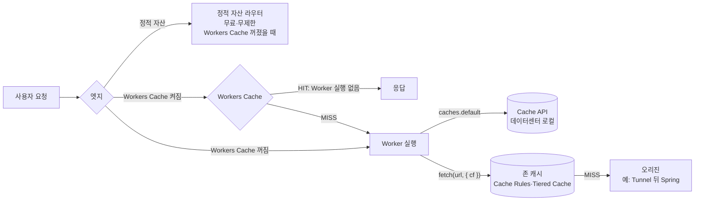
그림 1. 요청이 세 캐시 경로와 존 캐시를 지나는 흐름

## 세 가지 캐시 경로 비교하기

### Workers Cache — Worker를 깨우지 않는 캐시

가장 새로운 경로부터 보자. Workers Cache는 Worker 설정에 한 줄을 넣으면 켜진다.

```jsonc
// moim-web/wrangler.jsonc (발췌)
{
  "name": "moim-web",
  "compatibility_date": "2026-09-01",
  // ...앞 장과 동일
  "cache": { "enabled": true }
}
```

이름 그대로 Worker 앞에 놓이는 캐시다. 공식 문서는 이렇게 설명한다.

> "Workers Cache lets Cloudflare return cached HTTP responses from your Worker without executing your Worker code." (Workers Cache, 2026-09-22 기준)

캐시에 맞는 응답이 있으면 Worker 코드를 아예 실행하지 않고 돌려준다. 무엇을 얼마나 캐시할지는 Worker가 응답에 붙이는 `Cache-Control` 헤더로 정하고, Cloudflare는 이를 RFC 9111(HTTP 캐싱 표준)에 따라 해석한다. 문서는 다른 성질도 몇 가지 분명히 적어두었다. 기본으로 계층형(tiered)이라 한 데이터센터가 놓쳐도 상위 계층에서 찾는다. 같은 URL에 요청이 몰리면 Worker를 한 번만 실행하고 그 결과를 기다리던 모든 요청에 나눠준다("Cloudflare runs your Worker once and serves the resulting response to every waiting request"). 태그 단위 퍼지도 `ctx.cache.purge({ tags: [...] })`로 지원한다.

요청 병합은 12장의 "1면에 오른 날"에 특히 반갑다. 막 마감 임박 공지가 뜬 행사 페이지에 수천 명이 동시에 들어와도, 캐시가 비어 있는 첫 순간에도 Worker는 데이터센터마다 한 번씩만 깨어난다. 오리진 보호 측면에서 이만한 장치가 없다.

그런데 주의할 문장이 하나 있다. "No zone configuration for caching applies to Workers Caching." 존에 만들어 둔 Cache Rules는 Workers Cache에 적용되지 않는다. 캐시 동작을 바꾸고 싶다면 대시보드가 아니라 Worker의 응답 헤더를 고쳐야 한다. 그리고 가장 중요한 문장은 아래 비용 메모에 옮겨 두었다.

> **비용 메모**
> Workers Cache를 켜면 Worker로 들어오는 **모든 요청**이 표준 Workers 요청 단가로 계산된다. 캐시 HIT도, 평소 무료인 정적 자산 요청도, Worker 간 호출도 포함이다. 원문: "When caching is enabled, every request to your Worker is charged at the standard Workers request rate, including requests that are normally free: static asset requests and worker-to-worker invocations" (Workers Cache, 2026-09-22 기준). Workers Paid 기준 월 1,000만 요청까지 포함, 초과분은 100만 건당 $0.30이다(Workers Pricing, 2026-10-02 기준). 2장에서 지킨 "정적 자산은 무료" 원칙이 이 한 줄로 깨진다는 점을 기억해두자.

캐시를 켰더니 청구서의 요청 수가 늘어난다. 직관과 정반대다. 이 함정은 이 장의 마지막에서 다시 다루겠다.

### Cache API — 데이터센터 하나짜리 캐시

두 번째 경로는 Worker 코드 안에서 직접 다루는 Cache API(`caches.default`)다. 서비스 워커의 Cache API와 생김새가 같아서 프런트엔드 개발자에게 익숙하다.

```ts
// moim-api: 행사 목록을 30초 동안 데이터센터 로컬 캐시에 담는 예
app.get("/api/events", async (c) => {
  const cache = caches.default;
  const hit = await cache.match(c.req.raw);
  if (hit) return hit;

  const { results } = await c.env.DB
    .prepare("SELECT id, title, starts_at FROM events WHERE published = 1")
    .all();
  const res = Response.json(results, {
    headers: { "Cache-Control": "public, max-age=30" },
  });
  c.executionCtx.waitUntil(cache.put(c.req.raw, res.clone()));
  return res;
});
```

손에 쥐는 맛은 좋다. 무엇을 넣고 언제 꺼낼지 코드로 정확히 정할 수 있다. 하지만 공식 문서가 밝힌 한계를 같이 읽어야 한다.

> "the contents of the cache do not replicate outside of the originating data center." / "The `cache.put` method is not compatible with tiered caching." / "the Cache API does not collapse concurrent requests, so a burst of traffic to a fresh URL invokes your Worker once per request." / "The `stale-while-revalidate` and `stale-if-error` directives are not supported when using the `cache.put` or `cache.match` methods." (Cache API·Workers Cache 문서, 2026-10-03 확인)

정리하면 이렇다. 캐시는 그 데이터센터 안에만 머문다. 서울에서 담은 응답을 도쿄는 모른다. 계층형 캐시도, 요청 병합도 없다. 막 비워진 URL로 트래픽이 몰리면 요청마다 Worker가 깨어난다. `stale-while-revalidate`(재검증하는 동안 옛 응답을 내보내기)와 `stale-if-error`(오리진이 실패하면 옛 응답으로 버티기)도 `cache.put`/`cache.match`에서는 동작하지 않는다.

무효화도 까다롭다. `cache.delete()`는 지금 코드가 실행되는 데이터센터의 항목만 지운다. 전 세계에 흩어진 사본을 한 번에 내릴 방법이 마땅치 않으니, Cache API에 담는 데이터는 짧은 TTL로 스스로 만료되게 두는 편이 낫다. 위 예제가 30초를 고른 이유다. 행사 목록이 30초 늦게 바뀌어도 아무도 다치지 않는다. 반대로 좌석 잔여 수처럼 틀리면 안 되는 값은 Cache API에 넣지 말자. 4장에서 그 값의 진실은 `EventSeats` Durable Object에 두기로 했다.

### `fetch()`의 `cf` 옵션 — 미들웨어형 Worker의 캐시

세 번째 경로는 Worker가 오리진 앞의 미들웨어로 일할 때 쓴다. 공식 문서의 권고는 분명하다.

> "For requests where Workers are behaving as middleware (that is, Workers are sending a subrequest via `fetch`) it is recommended to use `fetch`." (How the cache works, 2026-10-03 기준)

Worker가 오리진으로 `fetch()`를 보낼 때 `cf` 옵션을 붙이면, 그 서브요청의 응답이 존 캐시에 담긴다. 앞에서 본 "Workers는 캐시 앞에서 실행된다"는 그림에서, Worker 뒤쪽에 있는 존 캐시를 이용하는 방법이다. 쓸 수 있는 옵션은 `cacheEverything`, `cacheKey`, `cacheTags`, `cacheTtl`, `cacheTtlByStatus`이고, 2026-06-28부터 `cf.vary`도 지원한다.

```ts
// 오리진 앞에서 일하는 미들웨어 Worker의 예 (moim 밖의 일반 예제)
export default {
  async fetch(request: Request): Promise<Response> {
    const url = new URL(request.url);
    const originUrl = `https://origin.example.com${url.pathname}`;
    return fetch(originUrl, {
      cf: {
        cacheEverything: true,
        cacheTtlByStatus: { "200-299": 86400, "404": 60, "500-599": 0 },
        cacheTags: ["public-pages"],
      },
    });
  },
} satisfies ExportedHandler;
```

이 경로의 장점은 존 캐시의 모든 혜택을 그대로 누린다는 것이다. Tiered Cache가 적용되고, 태그로 퍼지할 수 있고, Cloudflare의 일반 퍼지·무효화 도구가 그대로 통한다. 상태 코드별로 TTL을 다르게 주는 `cacheTtlByStatus`는 특히 쓸모가 많다. 오리진이 500을 뱉을 때 그 에러 페이지를 하루 동안 캐시해버리는 끔찍한 일을 막아준다.

`moim`에서 이 경로가 맞는 곳은 생각보다 좁다. `moim-web`과 `moim-api`는 응답을 직접 만드는 Worker이고, 오리진인 `moim-core`는 10장에서 Access 뒤로 들어갔다. 하지만 독자의 서비스가 이미 Spring이나 다른 서버로 공개 페이지를 내놓고 있고 그 앞에 Worker를 얹어 인증·리다이렉트·A/B 분기 같은 일을 시킨다면, 이 경로가 주인공이다.

### `moim`에는 무엇을 쓸까

세 경로를 한 표에 놓고 보자.

| 경로 | 캐시 위치 | 계층형 | 요청 병합 | 무효화 | 비용 관점 |
|---|---|---|---|---|---|
| Workers Cache | Worker 앞 | 기본 tiered | 있음 | `ctx.cache.purge({ tags })` | HIT·정적 자산까지 요청 과금 |
| Cache API | 데이터센터 로컬 | 불가 | 없음 | 로컬 `delete`, 사실상 TTL | Worker 요청·CPU는 그대로 |
| `fetch()` + `cf` | 존 캐시(오리진 앞) | Tiered Cache | 존 캐시 동작 | 존 퍼지·invalidate | Worker 요청은 그대로, 오리진 부하 감소 |

표 1. 세 캐시 경로 비교 (Workers Cache 2026-09-22, Cache API·How the cache works 문서 2026-10-03 기준)

이제 `moim`의 콘텐츠를 하나씩 대어보자. JS·CSS·이미지 같은 정적 자산은 아무것도 하지 않는 것이 정답이다. 이미 무료·무제한이고, 빌드 도구가 파일 이름에 해시를 붙여주니 브라우저 캐시도 길게 잡힌다. 좌석 잔여 수는 캐시하지 않는다. 행사 목록 API는 위에서 본 대로 Cache API에 30초. 남은 것은 행사 상세 페이지다. 5장에서 vinext로 SSR하게 만든 바로 그 페이지다.

행사 상세 HTML은 Worker가 그린다. 그러니 존 캐시와 Cache Rules는 닿지 않는다. Cache API를 쓰면 데이터센터마다 따로 놀고, 몰리는 순간의 요청 병합도 없다. 남는 후보는 Workers Cache다. 1면에 오른 날의 폭주를 요청 병합과 계층형 캐시로 받아내기에 가장 잘 맞는다. 문제는 비용 메모에서 본 함정이다.

계산을 해보자. 행사 상세 페이지 하나가 HTML 1개와 정적 파일 12개를 불러온다고 가정하자. Workers Cache를 끄면 페이지뷰 하나당 과금 요청은 SSR 1건이다. 켜면 브라우저 캐시가 비어 있는 첫 방문 기준으로 13건이 된다. 평소 하루 1,500 페이지뷰라면 한 달 45,000 페이지뷰, 과금 요청은 45,000건에서 최대 585,000건으로 뛴다. 숫자만 보면 열 배가 넘게 뛰지만, `moim`은 7장에서 Workers Paid로 올라왔고 월 1,000만 요청이 포함돼 있다(Workers Pricing, 2026-10-02 기준). 둘 다 추가 요금은 $0다. 재방문자는 해시 붙은 정적 파일을 브라우저 캐시에서 꺼내 쓰니 실제 증가분은 이보다 적다.

그래서 `moim`은 `moim-web`에 Workers Cache를 켠다. 다만 이유를 정확히 적어두자. 싸지기 때문이 아니다. 몰리는 순간 D1과 `EventSeats`를 두드리는 SSR 실행을 줄이고, 첫 바이트를 빠르게 하기 위해서다. 그리고 `moim-api`에는 켜지 않는다. `moim-web`이 Service binding으로 `moim-api`를 부르는 호출은 원래 추가 요청 요금이 없는데, `moim-api`에 Workers Cache를 켜는 순간 그 호출까지 과금 대상이 되기 때문이다.

한 가지 더. 이 결정은 Workers Paid 계정이라서 성립한다. Free 계정에서 같은 설정을 하면 평소 일일 한도와 무관하던 정적 자산 요청이 Worker 요청으로 잡힐 수 있다. 일일 10만 요청 한도에 어떻게 반영되는지는 문서에 없으니(2026-10-03 확인), Free 계정이라면 켜지 않는 편이 안전하다.

## 헤더로 캐시에게 말하기

### 표준이 정한 언어: `Cache-Control`과 `CDN-Cache-Control`

캐시는 결국 HTTP 헤더로 대화한다. 기준은 RFC 9111 "HTTP Caching"(2022년 6월, Internet Standard)이다. 공유 캐시와 개인 캐시를 구분하고, 신선도를 계산하고, 재검증하는 규칙을 정한다. 여기에 RFC 9213 "Targeted HTTP Cache Control"(2022년 6월)이 CDN 전용 `CDN-Cache-Control` 응답 헤더를 더해 브라우저 캐시와 CDN 캐시의 수명을 따로 줄 수 있게 했다. RFC 5861(2010년 5월)은 재검증하는 동안 옛 응답을 내보내는 `stale-while-revalidate`와, 오리진이 5xx를 낼 때 옛 응답으로 버티는 `stale-if-error`를 정의한다.

이 셋을 조합하면 실무에서 자주 원하는 정책이 나온다. "브라우저엔 짧게, 엣지엔 길게." 브라우저가 붙잡은 옛 HTML은 사용자 기기 안에 있어서 퍼지로도 고칠 수 없다. 반면 엣지 캐시는 우리가 언제든 지울 수 있다. 그러니 브라우저에는 짧은 수명을, 엣지에는 긴 수명을 주고, 바뀌면 엣지를 지우는 것이 정석이다.

Java 독자를 위해 Spring 쪽 코드로 옮겨보자. 6장에서 Tunnel로 공개한 Spring 서버가 공개 페이지를 내놓는 경우다. HTML이니 Cache Rules로 캐시 대상에 넣어 뒀다고 하자.

```java
// Spring MVC 컨트롤러 예: 브라우저엔 60초, 엣지엔 1시간
@GetMapping("/public/notice")
public ResponseEntity<String> notice() {
    String html = renderNotice();
    return ResponseEntity.ok()
        .cacheControl(CacheControl.maxAge(Duration.ofSeconds(60))
            .cachePublic()
            .staleWhileRevalidate(Duration.ofSeconds(30)))
        .header("CDN-Cache-Control", "max-age=3600")
        .contentType(MediaType.TEXT_HTML)
        .body(html);
}
```

물론 표준이 정했다고 벤더가 모두 그대로 구현하는 것은 아니다. Cloudflare 존 캐시는 `CDN-Cache-Control`을 지원한다. 이 헤더가 오면 엣지의 캐싱 판단은 이것으로 하고, Cache Rules의 Edge Cache TTL이 있으면 그쪽이 이긴다(2026-04-16 문서 기준). 존 캐시의 `stale-while-revalidate`는 2026-02-26부터 완전히 비동기로 동작하고, Free·Pro·Business 존 모두에 적용됐다("Cloudflare's `stale-while-revalidate` support is now fully asynchronous."). 반대로 앞에서 본 것처럼 Cache API의 `cache.put`/`cache.match`에서는 SWR과 SIE가 동작하지 않는다. 같은 회사, 같은 엣지인데도 경로마다 지원 범위가 다르다. 헤더를 적기 전에 어느 경로가 그 헤더를 읽는지부터 묻는 습관을 들이자.

Spring 오리진이라면 하나 더 챙길 것이 있다. 공개 페이지 응답에 세션 쿠키(`Set-Cookie: JSESSIONID=...`)가 섞여 나가면 캐시가 그 응답을 거부하거나, 더 나쁘게는 쿠키째 다른 사용자에게 퍼뜨릴 위험이 생긴다. 2026-03-24에 나온 Cache Response Rules가 이 문제를 오리진을 고치지 않고 풀어준다. "Cache Response Rules let you modify `Cache-Control` directives, manage cache tags, and strip headers like `Set-Cookie` from origin responses *before* they reach Cloudflare's cache." 캐시에 들어가기 전에 `Set-Cookie`를 떼어낼 수 있다. 물론 근본 처방은 공개 페이지에서 세션을 만들지 않도록 Spring 설정을 고치는 것이다.

### 캐시 키와 HIT율: 한 번만 불리는 객체들

캐시를 켰는데 HIT율이 생각보다 낮다. 왜 그럴까? 학계에는 이 질문에 대한 오래된 답이 있다. Akamai의 Maggs와 Sitaraman은 실제 CDN 로그를 분석해 이렇게 보고했다.

> "On a typical CDN server cluster serving web traffic over two days, 74% of the roughly 400 million objects in cache were accessed only once and 90% were accessed less than four times." (Maggs & Sitaraman, SIGCOMM CCR 45(3), 2015)

캐시에 들어간 객체의 74%가 이틀 동안 단 한 번만 불렸다. 이런 객체를 one-hit-wonder라고 부른다. 그들은 이런 객체로 디스크를 낭비하지 않으려고 "두 번째 요청 때 캐시한다"는 규칙을 썼다고 설명한다. 다른 연구도 같은 방향을 가리킨다. Yang 등의 SOSP '23 논문은 편향된 워크로드에서 대부분의 객체가 짧은 시간 창 안에 한 번만 접근되므로 일찍 내보내는 것이 중요하다고 정리했다. 엣지 캐시가 교과서의 LRU처럼 동작하지 않는다는 것은 엣지 캐시 연구의 일반적인 결과다. 특정 벤더가 어떤 알고리즘을 쓰는지는 이 논문들이 말해주지 않는다는 점도 함께 짚어두자.

이 연구가 우리에게 주는 실무 교훈은 단순하다. 캐시 키를 쪼갤수록 one-hit-wonder가 늘어난다. 행사 페이지 링크가 SNS로 퍼지면 `?utm_source=x`, `?utm_source=threads&utm_medium=...`, `?fbclid=...` 같은 꼬리가 붙은 URL이 수십 가지로 들어온다. 쿼리스트링이 캐시 키에 들어가면 이 URL들은 모두 다른 객체다. 똑같은 HTML이 수십 벌로 캐시되고, 각각은 몇 번 불리지도 못한 채 밀려난다. HIT율이 낮게 나오는 이유가 여기에 있다.

처방은 캐시 키에서 의미 없는 쿼리를 걷어내는 것이다. `fetch()` 경로라면 `cf.cacheKey`로 키를 직접 정할 수 있다. Workers Cache라면 Worker가 응답을 만들 때 마케팅 파라미터를 무시하도록 정규화한 URL로 리다이렉트하는 방법도 있다. 존 캐시의 Cache Rules로 쿼리 파라미터를 골라 넣고 빼는 캐시 키 설정은 Enterprise 전용이다(Cache Rules 설정 문서, 2026-09-16 기준). 그리고 롱테일 객체가 많은 서비스일수록 Tiered Cache가 효과를 낸다. 엣지 하나에서는 한 번 불린 객체라도 상위 계층에서 모으면 여러 번 불린 객체가 되기 때문이다.

## 바뀐 것을 내리는 법

### invalidate와 purge, 그리고 `moim`의 신청 마감

캐시 설계의 절반은 넣는 일이고, 나머지 절반은 내리는 일이다. Cloudflare 존 캐시에는 2026-09-28부터 내리는 방법이 두 가지가 됐다.

새로 생긴 invalidate는 콘텐츠를 지우지 않고 "오래됨" 표시만 한다.

> "Invalidation marks matching content as stale. On the next request, Cloudflare revalidates the content with your origin. If your origin responds with `304 Not Modified`, Cloudflare reuses the cached content" (Changelog, 2026-09-28)

다음 요청이 오면 오리진에 재검증을 묻고, 오리진이 `304 Not Modified`로 답하면 캐시된 내용을 그대로 다시 쓴다. 바뀐 것만 새로 받아오니 오리진의 부담이 적다. 엔드포인트는 `POST /zones/$ZONE_ID/invalidate_cache`, 본문은 퍼지와 같은 형식(`{"tags":[...]}` 등)이다. 존 캐시 전용이라 Workers Cache에는 닿지 않는다. 오리진이 `ETag`나 `Last-Modified`로 재검증에 응답할 수 있어야 효과가 난다는 점도 잊지 말자.

전통적인 purge는 말 그대로 지운다. Free 존에서도 URL·호스트명·태그·프리픽스·전체(Purge Everything) 방식을 모두 쓸 수 있다. 한도는 알아두자. 호스트명·태그·프리픽스·전체 퍼지는 Free 기준 분당 5회, 단일 URL 퍼지는 초당 800개 URL까지다(Purge cache 문서, 2026-10-03 기준). CI에서 배포할 때마다 전체 퍼지를 연달아 부르는 파이프라인이라면 분당 5회는 금방 찬다.

그렇다면 `moim`의 신청 마감은 어떻게 반영할까? 행사 상세 페이지는 Workers Cache에 있으니 `ctx.cache.purge`를 쓴다. 운영자가 `/admin/*` 화면에서 "신청 마감"을 누르면, `moim-web`이 `moim-api`에 마감을 기록하고 이어서 그 행사의 캐시 태그를 지운다. Worker 진입점 수준으로 줄여 쓰면 다음과 같다.

```ts
// moim-web: 운영자 마감 처리 (Worker 진입점 수준으로 단순화한 예)
async function closeEvent(eventId: string, env: Env, ctx: ExecutionContext) {
  // 1) 진실의 원천에 마감을 기록한다 (Service binding, 추가 요청 요금 없음)
  //    API는 5장에서 만든 moim-web → moim-api Service binding
  const res = await env.API.fetch(
    `https://moim-api/api/admin/events/${eventId}/close`,
    { method: "POST" },
  );
  if (!res.ok) throw new Error(`close failed: ${res.status}`);

  // 2) 행사 상세 페이지 캐시를 태그로 지운다
  ctx.waitUntil(ctx.cache.purge({ tags: [`event-${eventId}`] }));
}
```

태그는 응답에 `Cache-Tag: event-42`처럼 헤더로 붙인다(여러 개면 쉼표로 구분, 2026-08 문서 기준). vinext 같은 프레임워크 안에서 `ctx`를 꺼내는 방법도 프레임워크마다 다르니, 여기서는 원리만 가져가면 된다.

좌석이 다 차서 자동으로 마감되는 경우는 어떻게 할까? 좌석은 `EventSeats`가 세고, 페이지의 잔여 좌석 숫자는 클라이언트가 캐시하지 않는 API로 따로 받아온다. 행사 상세 HTML에는 "마감되었습니다" 같은 상태 문구만 남는데, 이 HTML의 `max-age`를 60초 정도로 짧게 두면 최악의 경우에도 1분 안에 바뀐다. 신청 버튼을 눌러도 `EventSeats`가 마지막 판정을 내리니 초과 신청은 일어나지 않는다. 캐시가 조금 늦어도 데이터가 틀리지 않는 구조. 캐시를 안전하게 쓰는 핵심이 여기에 있다.

### Next.js 쪽 캐시와 배포 후 stale HTML 디버깅

5장에서 미뤄둔 이야기를 회수하자. Next.js에는 프레임워크 자체의 캐시가 있다. ISR(증분 정적 재생성)과 `"use cache"` 지시어다. vinext 1.0 기준으로 ISR은 지원되지만 `"use cache"`는 일부만 구현돼 있다. vinext README의 Known gaps는 이렇게 적는다. "`"use cache"` is partially implemented, but full `cacheComponents` behavior is still incomplete." 1.0 발표 블로그도 "limited support for the "use cache" directive"라고 밝혔다(2026-09-28). 이 기능에 기대는 앱이라면 5장에서 말했듯 당분간 OpenNext를 유지하는 판단이 합리적일 수 있다.

더 흥미로운 것은 vinext가 이 캐시를 어디에 저장하느냐다. `@vinext/cloudflare`는 저장소 어댑터를 고르게 한다. `kvDataAdapter()`는 `"use cache"` 데이터 캐시를 Workers KV에 담고, `workersCacheCdnAdapter()`는 페이지 단위 ISR을 Workers Cache(`ctx.cache`)에서 서빙한다. 기본값인 `MemoryCacheHandler`에 대해서는 README가 "Swap in your own backend for production."이라고 권한다.

이 어댑터 이름들을 앞 장들과 겹쳐 읽어보자. 메모리 캐시는 isolate마다 따로 존재하니 3장에서 본 대로 요청마다 다른 isolate가 다른 캐시를 볼 수 있다. KV 어댑터는 4장의 최종 일관성을 그대로 물려받는다. 태그로 재검증해도 전 세계에 반영되기까지 시간이 걸린다. 그리고 Workers Cache 어댑터는 이 장의 비용 메모를 물려받는다. "ISR을 켠다"는 결정이 곧 "Workers Cache 과금 구조를 받아들인다"는 결정이 된다. 프레임워크 설정 한 줄 뒤에 숨은 인프라를 알아야 하는 이유다.

이제 이 장을 연 장면으로 돌아가자. 배포했는데 옛 HTML이 보인다면 어디부터 볼까? 캐시 층을 바깥에서 안쪽으로, 순서대로 의심하자.

1. **HTML 응답부터.** `curl -I https://moim.example.com/events/42`로 응답 헤더를 본다. 존 캐시를 거친 응답이라면 `cf-cache-status`와 `age`가 무엇을 말하는지 확인한다. 엣지가 옛 것을 들고 있다면 여기서 드러난다.
2. **브라우저와 서비스 워커.** curl로는 새 HTML인데 브라우저에서만 옛 화면이라면 범인은 사용자 기기 안에 있다. 시크릿 창으로 열어보고, 개발자 도구에서 서비스 워커를 해제해본다. 서비스 워커가 HTML을 캐시하는 전략이었다면 배포 절차에 서비스 워커 갱신을 넣어야 한다.
3. **CDN 층 정리.** 엣지가 범인이면 태그나 URL로 지운다. 지운 뒤에는 다시 1번으로 돌아가 헤더로 확인한다. 두 번 지우는 대신 한 번 지우고 확인하는 편이 낫다.

이 순서를 지키면 "어느 캐시 층이 문제인지 늘 짐작한다"는 상황을 상당 부분 벗어날 수 있다.

> **비용 메모**
> Cache Reserve는 롱테일 객체를 R2 기반 저장소에 오래 붙잡아 두는 유료 기능이다. Free에서는 쓸 수 없고("A paid Cache Reserve plan is required."), 저장 GB-월당 $0.015, Class A 100만 건당 $4.50, Class B 100만 건당 $0.36이다. 문서는 "In most cases, a Cache Reserve miss will result in both one class A and one class B operation"이라고 적는다. 2026-09-28부터는 퍼지하면 Cache Reserve의 콘텐츠도 강제로 MISS가 된다(Cache Reserve 문서, 2026-10-03 기준). 대용량 파일을 많이 서빙하는 서비스가 아니라면 `moim` 규모에서는 필요 없다.

### "캐시를 켜면 싸진다"는 오해

캐시라는 말을 들으면 많은 개발자가 반사적으로 "비용 절감"을 떠올린다. 오리진 서버의 부하가 줄고, DB 조회가 줄고, 이그레스가 줄어드니 당연히 싸진다고 여기기 쉽다. 전통적인 CDN 앞에 VM 오리진이 있는 구조라면 대체로 맞는 말이다.

Workers 위에서는 이 등식이 깨진다. Worker는 캐시 앞에서 실행되니 존 캐시가 HIT를 내도 Worker 요청은 과금된다. Workers Cache는 Worker 실행을 건너뛰지만, 대신 HIT와 평소 무료인 정적 자산 요청까지 요청 단가로 센다. Cache API는 D1 조회를 줄여주지만 Worker 요청과 CPU는 그대로다. 세 경로 어디에서도 "켰더니 요청 청구가 줄었다"는 결과는 자동으로 따라오지 않는다.

그렇다면 Workers 위에서 캐시는 무엇을 사는 걸까? 지연 시간을 산다. 몰리는 순간의 오리진과 데이터 계층 보호를 산다. D1 행 읽기, Durable Objects 요청, CPU 시간 같은 하위 비용을 줄인다. 이것들은 분명 값진 것들이다. 다만 청구서의 맨 윗줄인 요청 수는 오히려 늘 수 있다는 사실을 알고 켜자. 캐시를 켜기 전에 "이 캐시가 줄이는 비용은 어느 줄이고, 늘리는 비용은 어느 줄인가"를 한 번만 물어보면 된다. 그 질문에 답할 수 있다면, 무료 한도와 유료 청구서를 숫자로 따져볼 준비도 이미 된 셈이다.

### 이 장의 핵심

- Worker는 캐시 앞에서 실행된다. Worker가 만든 응답은 존 캐시·Cache Rules가 닿지 않고, 존 캐시는 Worker가 `fetch()`로 부르는 오리진 쪽에서 일한다.
- Workers 위의 캐시 경로는 셋이다. Workers Cache(Worker 실행 생략·tiered·요청 병합·태그 퍼지), Cache API(데이터센터 로컬·병합 없음·SWR/SIE 미지원), `fetch()`의 `cf` 옵션(존 캐시 활용).
- Workers Cache를 켜면 HIT·정적 자산·Worker 간 호출까지 요청 단가로 과금된다(2026-09-22 문서 기준). vinext의 ISR 어댑터도 이 경로를 쓴다.
- 캐시 키를 쪼개면 한 번만 불리는 객체가 늘어 HIT율이 떨어진다. 의미 없는 쿼리스트링은 키에서 걷어내자.
- 무효화는 invalidate(재검증, 2026-09-28)와 purge(삭제, Free 분당 5회)를 구분하고, 배포 후 이상하면 HTML 응답 → 브라우저·서비스 워커 → CDN 순으로 확인한다.

# 12장. 무료로 어디까지 — 무료 티어를 설계 전략으로

어느 화요일 아침, `moim`에 올린 밋업 공지가 국내 개발자 커뮤니티 1면에 올랐다고 해보자. 발표자 라인업이 좋았고, 마침 그 주제를 다들 궁금해하던 참이었다. 평소 하루 1,500번쯤 열리던 페이지가 점심 무렵부터 분당 수백 번씩 열린다. 신청 알림 메일이 쉬지 않고 쌓이고, 운영자 단톡방에는 축하 이모티콘이 올라온다.

이제 조건 하나를 바꿔보자. 7장에서 우리는 Containers를 쓰기 위해 계정을 Workers Paid로 올렸다. 그 결정을 잠시 되돌려서, `moim`이 처음부터 끝까지 Free 계정에 머물렀다고 가정하자. Containers로 돌리던 정산 배치와 8장의 Email Sending처럼 Free에서 쓸 수 없는 부분은 이 가정에서 빼둔다. 그러면 질문은 하나다. 그날 오후, 무엇이 가장 먼저 멈출까?

Free 계정에서는 대부분의 제품이 한도를 넘으면 돈을 청구하는 대신 에러를 낸다. 그러니 이 질문은 "얼마가 나올까"가 아니라 "사용자가 언제부터 에러 화면을 보게 될까"라는 질문이 된다. 무료 티어를 운영 전략으로 쓰려면 바로 이 질문에 숫자로 답할 수 있어야 한다. 그날 하루를 따라가며 분석해보자.

## 그날 무엇이 먼저 바닥나는가

### 1면에 오른 하루를 숫자로 옮기기

분석을 하려면 가정을 숫자로 적어야 한다. 아래 숫자는 공식 통계가 아니라 저자가 세운 시나리오다. 독자의 서비스라면 자기 Analytics 숫자로 바꿔 넣으면 된다.

평소에는 하루 1,500 페이지뷰에 신청 30건이 들어온다. 1면에 오른 날에는 하루 60,000 페이지뷰에 신청 1,800건이 들어온다고 하자. 페이지뷰 하나가 만드는 요청은 이렇게 잡는다. 행사 상세 페이지는 5장에서 SSR로 바꿨으니 `moim-web`에 Worker 요청이 1건 생긴다. 브라우저가 잔여 좌석을 보려고 `moim-api`에 요청을 1건 더 보낸다. 페이지뷰 하나에 Worker 요청 2건이다. JS·CSS·이미지 같은 정적 자산 요청은 무료·무제한이니 세지 않는다. 11장에서 `moim-web`에 켰던 Workers Cache는 이 가정에서 끈다. Free 계정이라면 켜지 않는 편이 낫다고 11장에서 이야기했다.

`moim-web`이 SSR 중에 Service binding으로 `moim-api`를 부르는 호출은 추가 요청 요금이 없다. 가격 문서는 이런 호출을 처음 불린 Worker의 요청 1건으로 센다고 적는다(Workers Pricing, 2026-10-02 기준). 다만 Free의 일일 요청 한도도 같은 방식으로 세는지는 문서에 따로 적혀 있지 않으니, 여기서는 브라우저에서 들어오는 요청만 센다.

데이터 쪽은 이렇다. 행사 상세 SSR은 D1에서 행사와 발표자 정보를 읽는데, `event_id`에 인덱스가 있으니 한 번에 10행쯤 읽는다. 잔여 좌석 요청은 `EventSeats` Durable Object에 1번 묻는다. `moim-api`는 요청마다 KV `CONFIG`에서 기능 플래그를 1번 읽는다. 신청 1건은 D1에 1행을 쓰고, `EventSeats`에 1번 묻고, `moim-mail` 큐에 메시지 1개를 넣는다.

### 한도와 하나씩 대조하기

이제 Free 한도와 맞춰보자. 한도는 모두 Workers 가격·한도 문서의 2026-10-03 기준 값이다.

먼저 Workers 요청이다. Free는 하루 100,000건이고, 매일 00:00 UTC에 리셋된다. 1면에 오른 날 우리의 Worker 요청은 60,000 × 2 = 120,000건에 신청 요청 1,800건을 더해 121,800건이다. 한도를 넘는다. 계산해보면 50,000번째 페이지뷰 무렵 100,000건에 닿는다. 그 순간부터 Worker 요청은 Error 1027로 거절된다.

여기서 시계를 한 번 보자. 00:00 UTC는 한국 시간으로 오전 9시다. 국내 커뮤니티 트래픽은 낮과 저녁에 몰리니, 오후 서너 시쯤 한도에 닿았다면 다음 날 오전 9시까지 에러가 이어진다. 가장 많은 사람이 들어오는 시간대에 가장 긴 공백이 생긴다. 생각만 해도 난감한 그림이다.

나머지는 어떨까? D1의 읽은 행은 Free 기준 하루 500만 행이다. 인덱스가 있으니 60,000 × 10 = 600,000행으로 넉넉하다. 쓴 행도 1,800행이라 하루 10만 행 한도와 거리가 멀다. Durable Objects 요청은 잔여 좌석 60,000건과 신청 1,800건을 합쳐 61,800건으로, 하루 100,000건 안이다. KV 읽기도 61,800건으로 하루 100,000건 안이다. Queues는 신청 1,800건이 메시지 1,800개를 만들고, 공식 문서가 "In most cases, it takes 3 operations to deliver a message: 1 write, 1 read, and 1 delete."라고 하니 약 5,400 operations다. 하루 10,000 operations 안이다.

그렇다면 이 시나리오의 답은 Workers 요청이다. 다른 자원들이 아직 여유가 있는데 요청 수가 먼저 바닥난다.

그런데 숫자 하나만 바꿔도 순위가 뒤집힌다. 개발자가 잔여 좌석을 `EventSeats` 대신 D1의 `SELECT COUNT(*) FROM rsvps WHERE event_id = ?`로 세고, `rsvps.event_id`에 인덱스를 깜빡했다고 해보자. 신청 내역이 20,000행 쌓여 있다면 이 쿼리는 매번 20,000행을 훑는다. D1은 스캔한 행 전부를 "rows read"로 센다. 돌려받은 행이 몇 개든 상관없다. 그러면 평범한 날조차 1,500 × 20,000 = 3,000만 행이다. 하루 500만 행 한도는 250번째 페이지뷰 근처에서 바닥난다. 2026-09-01부터 Free의 D1은 일일 한도를 넘으면 실제로 쿼리를 실패시키고 이메일을 보낸다(D1 Changelog 2026-09-01). 1면에 오르기도 전에, 평범한 화요일 아침에 서비스가 멈추는 것이다.

KV도 비슷한 함정이 있다. `moim-web`의 SSR까지 요청마다 KV를 읽게 만들면 KV 읽기가 121,800건으로 늘어 하루 100,000건을 넘는다. 요청 하나에 붙은 작은 읽기 하나가 트래픽에 곱해진다는 사실을 잊지 말자.

트래픽과 상관없이 걸리는 한도도 하나 있다. Free 계정의 Worker는 호출 한 번에 CPU 시간을 10 ms까지만 쓸 수 있다. 넘으면 Error 1102 "Worker exceeded resource limits"가 난다(Workers Pricing, 2026-10-02 기준). 순수 CPU 시간만 세므로 D1이나 Durable Objects를 기다리는 동안은 빠지지만, 프레임워크가 큰 React 트리를 문자열로 그리는 SSR은 CPU를 꽤 쓴다. 행사 상세 페이지의 SSR 한 번이 10 ms 안에 끝나는지는 여기서 숫자로 답할 수 없다. 3장에서 켠 Workers Logs로 자기 페이지의 CPU 시간을 직접 재보자. 넘는다면 그 페이지는 1면에 오르기 전부터 간헐적으로 실패하고 있었을 것이다.

이 사례가 알려주는 것은 이것이다. 무료 한도는 제품마다 따로 걸린 여러 개의 상한이다. 그리고 그중 어느 것에 먼저 닿을지는 트래픽 규모보다 설계가 정한다.

## "청구 대신 에러"라는 모델

### 제품별로 멈추는 방식

Free 계정의 한도를 넘으면 정확히 무슨 일이 생길까? 제품마다 다르다. 문서로 확인된 동작을 한 표로 모았다.

| 제품 | Free 한도 | 한도를 넘으면 | 기준 문서 |
|---|---|---|---|
| Workers 요청 | 100,000/일 (00:00 UTC 리셋) | Error 1027 | Workers Pricing 2026-10-02, Limits 2026-09-05 |
| Workers CPU | 10 ms/호출 | Error 1102 "Worker exceeded resource limits" | 위와 같음 |
| 정적 자산 중 `run_worker_first` 경로 | Worker 호출로 계산 | 429 | Static Assets Billing 2026-04-23 |
| Workers KV | 읽기 100,000/일, 쓰기·삭제·list 각 1,000/일 | 그 종류의 연산이 에러로 실패 | KV Limits 2026-04-21 |
| D1 | 읽은 행 500만/일, 쓴 행 10만/일 | 쿼리 실패 + 이메일 (2026-09-01~) | D1 Changelog 2026-09-01 |
| Hyperdrive | 쿼리 100,000/일 | 그 종류의 연산이 에러로 실패 | Hyperdrive Limits 2026-06-09 |
| Workers AI | 10,000 Neurons/일 | 에러로 실패, 일부 대형 모델은 Free에서 403/5035 | Workers AI Pricing 2026-10-01 |
| Images | 고유 변환 5,000/월 | 신규 변환 9422, 과금 없음 | Images Pricing 2026-07-08 |
| Workflows | 저장 1 GB-월 | 저장 한도 도달 시 에러 | Workflows Pricing 2026-09-21 |
| Observability (2026-12-01~) | 수집 0.5 GB/일 | 수집 중단 | Observability Pricing 2026-10-02 |
| **R2** | 10 GB-월, Class A 100만/월, Class B 1,000만/월 | **초과분 과금** | R2 Pricing 2026-10-01 |

표 1. Free 계정의 "청구 대신 에러" 동작 (2026-10-03 기준)

표의 대부분은 같은 방향을 가리킨다. 넘으면 멈춘다. D1은 멈출 때 이유도 알려준다. 쿼리가 "Your account has exceeded D1's free tier daily row read limit..."로 시작하는 에러를 돌려주고, 계정 이메일로도 알린다. 이 에러 문구를 로그 알림의 검색어로 걸어두면 한도에 닿은 순간을 놓치지 않는다. KV 문서의 문장이 이 모델을 잘 요약한다. "If you exceed any one of these limits, further operations of that type will fail with an error." Images 문서는 아예 "You will not be charged for exceeding the limits in the Free plan."이라고 못 박았다. 관측성도 2026년 12월 1일부터 통합 가격으로 바뀌면서 Free는 일 한도에 닿으면 수집을 멈춘다("Cloudflare stops ingesting new data when the account reaches its daily limit", 2026-10 공지).

마지막 줄의 예외를 꼭 기억해두자. R2는 이 모델에 들지 않는다. R2는 결제수단을 등록한 구독 위에서 동작하고, 매달 무료 포함량을 넘는 사용분은 그대로 청구된다(R2 문서, 2026-10 기준). 4장에서 R2 구독 체크아웃이 이 책에서 처음 결제수단을 요구하는 지점이라고 했던 이유가 여기에 있다. "Free 계정이니 무엇을 해도 청구서는 안 온다"는 믿음은 R2 앞에서 깨진다. 다행히 단서도 있다. 권한 없는 요청으로 401이 난 연산은 과금하지 않고, 삭제류 연산은 무료다. 그래도 공개 버킷의 읽기 트래픽이 폭주하면 Class B 연산이 쌓인다는 점은 남는다.

### 가용성이라는 대가

"청구 대신 에러"는 지갑을 지킨다. 그 대가는 누가 치를까? 사용자다.

2026년 1월 무렵 dev.to에 올라온 eliasoliedev의 글은 이 동전의 뒷면을 정직하게 보여준다. 자기 앱을 Reddit·TabNews·DEV.to에 소개하며 "망가뜨려보라"고 했더니 트래픽이 몰려 Workers 무료 할당량을 다 써버렸고, 사용자들은 Error 1101 계열의 화면을 봤다. 같은 날 Railway 쪽 서비스는 하드 지출 한도가 걸려 멈췄다. 그가 남긴 문장은 이렇다.

> "Sometimes the bottleneck isn't code, it's the budget configuration."

병목이 코드가 아니라 예산 설정일 때가 있다는 말이다. 무료 한도도 일종의 예산 설정이다. 다만 그 예산이 $0으로 고정돼 있을 뿐이다.

그렇다면 한도에 닿았을 때 사용자에게 무엇을 보여줄지라도 고를 수 있을까? Workers는 라우트(route)로 붙인 Worker에 한해, 한도를 넘었을 때 Worker를 건너뛰고 원래 오리진으로 요청을 흘려보낼지(fail open) 에러를 낼지(fail closed)를 라우트별로 고르게 한다. 오리진이 따로 있는 구성이라면 fail open이 쓸모 있다. Worker가 하던 부가 기능(헤더 조작, A/B 분기 같은 것)만 잠시 빠지고 서비스 자체는 계속 돈다. 반대로 `moim`처럼 Worker가 곧 서비스이고 그 뒤에 오리진이 없는 구성이라면 열어둘 곳이 마땅치 않다. 문서가 말하는 fail open은 "Requests behave as if no Worker is configured.", 곧 Worker가 없는 것처럼 요청을 흘려보내는 것이라, 받아줄 오리진이 없으면 사용자를 구해주지 못한다(Workers Limits, 2026-09-05 기준). 이때는 에러를 피할 수 없으니, 에러에 닿는 시점을 늦추는 설계가 유일한 방어다.

한도에 닿는 순간을 알아차리는 일도 생각보다 어렵다. 관측 도구에도 무료 한도가 있기 때문이다. 지금의 Workers Logs는 Free에서 하루 20만 이벤트, 보존 3일이다. 요청 하나에 로그를 두세 줄씩 남기는 코드라면 1면에 오른 날 로그 한도부터 찬다. 2026년 12월 1일부터 적용되는 통합 Observability 가격에서는 Free가 하루 0.5 GB를 수집하면 그날 수집을 멈춘다(Observability Pricing, 2026-10-02 기준). 하필 무슨 일이 벌어지는지 가장 알고 싶은 날 눈을 가리는 셈이다. 찜찜하다면 대비책은 단순하다. 요청마다 남기는 로그를 줄이고, 에러와 한도 관련 로그만 확실히 남기자. 대시보드의 제품 사이드바 사용량 위젯도 도움이 된다. 이 위젯은 Free 계정에서 그날의 사용량을 보여준다("aligns to your billing cycle (or the current day on Free plans)", Changelog 2026-06-04). 1면에 오른 날이라면 점심 무렵 한 번 열어보는 것만으로도 오후의 1027을 예고받을 수 있다.

## 무료 티어를 설계하기

### 공짜로 주는 것과 주지 않는 것

설계를 하려면 먼저 재료를 알아야 한다. Free 계정이 아낌없이 주는 것부터 보자(모두 2026-10-03 기준).

가장 큰 선물은 정적 자산이다. "Requests to static assets are free and unlimited." 버전당 파일 20,000개, 파일당 25 MiB 범위 안에서 요청 수에 제한이 없다. 보안 쪽으로는 Turnstile(위젯 20개, "Unlimited challenges"), WAF Free Managed Ruleset 기본 배포, Rate limiting rule 1개가 있다. 연결 쪽으로는 Tunnel이 "Available on all plans"이고, Access는 50명까지 $0이다. 데이터 쪽으로는 Queues가 2026-02-04부터 Free에 포함돼 하루 10,000 operations를 쓸 수 있고, Hyperdrive는 하루 100,000 쿼리, Cron Trigger는 계정당 5개다. 메일 수신인 Email Routing은 무제한이다. Analytics Engine은 조금 특별하다. 가격표는 공개돼 있지만 문서에는 "Currently, you will not be billed for your use of Workers Analytics Engine."이라고 적혀 있다(2026-04-23 기준). 언제 과금이 시작될지는 정해지지 않았으니, 무료라고 단정하기보다 "지금은 과금하지 않는다"로 이해해두자.

주지 않는 것도 분명하다. Containers는 Free에서 쓸 수 없다. Email Sending은 검증된 자기 주소로 보내는 것만 무료이고 다른 수신자에게 보내려면 Workers Paid가 필요하다. 일부 대형 Workers AI 모델, Cache Reserve, Workers Trace Events Logpush도 Free에서는 쓸 수 없다. `moim`으로 치면 `ReportContainer`와 `EMAIL` 바인딩이 여기에 걸린다. 우리 시나리오에서 이 둘을 뺀 이유다.

### 무료 티어가 잘 맞는 서비스의 모양

무료 티어는 어떤 서비스에 잘 맞을까? 1장에서 본 학계의 관찰이 여기서 다시 실마리가 된다. Shahrad 등의 USENIX ATC '20 논문 "Serverless in the Wild"에 따르면 애플리케이션의 45%가 평균 한 시간에 한 번 이하로, 81%가 1분에 한 번 이하로 불린다. 같은 논문은 20%도 안 되는 애플리케이션이 전체 호출의 99.6%를 차지한다고 적었다. 대부분의 애플리케이션은 드물게 불리고, 소수가 트래픽을 독차지한다. 사이드 프로젝트, 사내 도구, 작은 커뮤니티 서비스는 대개 앞쪽 다수에 속한다. 하루 10만 요청은 이들에게 넉넉한 정도가 아니라 남아도는 양이다.

그렇다면 `moim`처럼 가끔 1면에 오르는 서비스는 어떻게 해야 할까? 한도에 닿는 시점을 늦추는 설계를 하자. 앞의 분석에서 지렛대가 세 개 보인다.

첫째, Worker 요청을 정적 자산으로 옮긴다. 행사 상세 페이지의 본문은 행사 정보가 바뀔 때만 달라진다. 이 페이지를 배포 시점에 정적 HTML로 미리 만들어 정적 자산으로 내보내고, 잔여 좌석만 API로 받으면 페이지뷰당 Worker 요청이 2건에서 1건으로 준다. 같은 한도로 버티는 페이지뷰가 두 배가 된다. 2장에서 확인한 "정적 자산은 무료·무제한"이 여기서 가장 강력한 무기가 된다.

둘째, 요청에 곱해지는 작은 읽기를 줄인다. 요청마다 KV를 읽는 기능 플래그는 배포 시점에 코드로 굽거나, 정말 필요한 경로에서만 읽는다. D1 쿼리는 인덱스를 먼저 확인한다. 4장에서 말한 대로 인덱스 없는 풀 스캔은 스캔한 행 전부가 "rows read"다.

셋째, 비싼 일은 미뤄서 몰아 한다. 신청 확인 메일은 큐로 보내고, 리마인더는 행사 단위 Workflow 하나로 묶는다. 신청 한 건마다 Workflow를 하나씩 띄우면 하루 3,000 steps 한도가 훨씬 빨리 찬다.

### 계정을 나누는 전략

한 걸음 더 나간 전략도 있다. 계정을 나누는 것이다. Simon Willison은 2026년 6월 HN에서 이렇게 말했다.

> "The safest way to use Workers is on the free tier, which will shut off after 100,000 requests/day" (HN simonw, 2026-06-20)

Workers를 쓰는 가장 안전한 방법은 하루 10만 요청에서 꺼지는 Free 티어라는 것이다. 이 말을 운영 전략으로 옮기면 이렇다. 누구나 두드릴 수 있는 공개 API나 실험 프로젝트는 Free 계정에 둔다. 거기서는 버그나 공격이 무엇을 하든 최악의 결과가 에러다. 결제수단이 걸린 Workers Paid 계정에는 검증을 마친 운영 서비스만 둔다. 2022년의 오래된 사례지만 지금도 유효한 교훈이 있다. 한 개발자가 무료로 공개한 API가 한 달에 1억 634만 요청을 받아 $48가 청구됐고, 그가 택한 대응 중 하나가 바로 공개 API를 Free 플랜으로 내리는 것이었다(helloacm, 2022-08-25).

물론 공짜 점심은 없다. 계정이 둘이면 로그인, API 토큰, 결제 정보, 도메인 배치를 따로 관리해야 한다. 한 계정 안에서 누리던 Service binding으로 두 계정을 묶을 수도 없다. 바인딩할 Worker는 "must be on your Cloudflare account"여야 한다(Service bindings 문서, 2026-08-18 기준). 그리고 Free 계정에 둔 서비스는 앞에서 본 가용성의 대가를 그대로 진다. 그러니 이 전략은 "멈춰도 괜찮은 것"과 "멈추면 안 되는 것"을 가를 수 있을 때 가장 잘 맞는다. `moim`이라면 실험 중인 추천 API는 Free 계정에, 신청과 결제는 Paid 계정에 두는 식이다. 유료 계정 쪽에 무엇을 더 겹쳐야 하는지는 13장에서 따로 세운다.

> **논쟁: 무료 티어는 선의인가 미끼인가**
> 선의라고 보는 쪽은 이렇게 말한다. simonw는 무료 티어를 DNS 이전이라는 가장 큰 온보딩 장벽을 미리 넘게 해주는 퍼널로 해석했고, Shakahs는 "most of the bandwidth is from peering, so it essentially costs them nothing"이라고 했다. Cloudflare도 공식 블로그 "Cloudflare's commitment to free"로 입장을 밝혀 왔다.
> 미끼라고 보는 쪽의 대표 증언은 neya의 글이다(HN 2025-01-15). "It's not really free. One day, you get a call from their sales team saying 'you're straining our network'. … we were asked to upgrade to a $2000+ per month plan. From a $200/mo plan." kugelblitz는 "I don't like free offerings, because what if they decide to charge someday?"라고 했다(HN 2026-04-07).
> 판단에 앞서 두 가지를 짚자. 자주 함께 인용되는 "$120k 엔터프라이즈 선결제" 이야기(2024-05)는 지역별 미러 도메인을 돌리던 온라인 카지노의 사례라 일반 개발자의 경우로 일반화하기 어렵다. 그리고 "unmetered"는 대역폭을 과금하지 않는다는 뜻이지, 트래픽 유형이나 규모와 상관없이 영원히 무료라는 보장은 아니라는 해석이 현장의 중론이다. 이 책의 대상 독자에게 그런 전화가 올 확률은 낮다. 다만 무료 티어 위에 사업을 올린다면 "언젠가 조건이 바뀔 수 있다"를 출구 전략에 넣어두자. 14장에서 다시 이야기한다.

### 계산: `moim`의 한 달

이제 처음 질문에 숫자로 답할 차례다. 앞에서 세운 가정 그대로, `moim`이 Free 계정에 있었다면 평범한 하루와 1면에 오른 하루가 각 한도에 어떻게 닿는지 한 표로 정리하자.

| 항목 | 평범한 하루 | 1면에 오른 하루 | Free 한도 (2026-10-03 기준) | 판정 |
|---|---|---|---|---|
| Workers 요청 (페이지뷰당 2건 + 신청) | 3,030 | 121,800 | 100,000/일 | 1면 날 약 50,000 페이지뷰에서 1027 |
| Workers 요청 (본문 정적화 후 1건 + 신청) | 1,530 | 61,800 | 100,000/일 | 버팀 |
| D1 읽은 행 (인덱스 있음) | 15,000 | 600,000 | 500만/일 | 버팀 |
| D1 읽은 행 (인덱스 없는 COUNT) | 3,000만 | 12억 | 500만/일 | 평범한 날에도 실패 |
| D1 쓴 행 | 30 | 1,800 | 10만/일 | 버팀 |
| Durable Objects 요청 | 1,530 | 61,800 | 100,000/일 | 버팀 |
| KV 읽기 (`moim-api`만) | 1,530 | 61,800 | 100,000/일 | 버팀 (SSR까지 읽으면 초과) |
| Queues operations (메시지당 약 3) | 90 | 5,400 | 10,000/일 | 버팀 (신청 3,300건 무렵 한도) |
| R2 (월 저장 1 GB, 다운로드 월 3,000회) | — | — | 10 GB-월, Class B 1,000만/월 | 포함량 안. 넘으면 과금 |
| Containers·Email Sending | — | — | 사용 불가 | Paid 계정에 둔다 |

표 2. `moim` 사용량 시뮬레이션 — 숫자는 저자 가정, 한도는 Workers·D1·Queues·R2 가격·한도 문서 2026-10-03 기준

표가 말해주는 것은 세 가지다. 평범한 날의 `moim`은 Free 한도의 몇 퍼센트도 쓰지 않는다. 1면에 오른 날 먼저 멈추는 것은 Workers 요청이고, 본문을 정적 자산으로 옮기면 같은 날을 버틴다. 그리고 인덱스 하나를 빠뜨리면 트래픽과 상관없이 평범한 날에 먼저 멈춘다.

마지막으로 같은 하루를 Workers Paid 계정에 놓아보자. 월 1,000만 요청, D1 읽은 행 월 250억, Durable Objects 요청 월 100만, Queues 월 100만 operations가 포함된다(Workers Pricing 2026-10-02 기준). 평범한 한 달에 1면 날 하루를 더해도 모두 포함량 안이다. 추가 요금은 없고, 월 $5 최소 요금만 나간다. 결국 `moim`이 Free에 머문다는 것은 월 $5를 아끼는 대신 가장 바쁜 날 오후부터 다음 날 오전 9시까지 에러 화면을 감수한다는 뜻이다. 그 거래가 합리적인지는 서비스마다 다르다. 다만 이제 우리는 그 거래를 숫자로 볼 수 있다.

# 13장. 유료 계정에서 안전하게 — 하드캡 없는 세상의 다층 방어

$34,895.

2026년 4월 16일, Hacker News에 한 개발자가 이 금액이 적힌 청구서 이야기를 올렸다. 아직 서비스를 출시하지도 않은 1인 사업자였다. 그가 남긴 타임라인은 짧고 건조하다.

> "April 4-5: peaked at ~930 billion row reads/day … April 15: $34,895 invoice due with no billing response yet" (HN thewillmoss, 2026-04-16)

하루 행 읽기가 약 9,300억 건까지 치솟았고, 열흘 뒤 3만 4천 달러가 넘는 청구서의 납부일이 다가왔는데 청구 담당 쪽의 답은 아직 없었다. 이 청구서가 결국 어떻게 처리됐는지는 확인되지 않았다. 이 책은 그 결말을 모른다. 확실한 것은 청구서가 나왔다는 사실, 그리고 그가 쓴 다음 문장이다.

> "I'm a pre-launch sole proprietor who put all my personal savings into this startup. This bill would financially destroy me for usage that generated zero business value."

개인 저축을 모두 넣은 출시 전 스타트업에, 사업적 가치가 전혀 없는 사용량으로 이 청구서가 왔다. 7장에서 `moim`을 Workers Paid로 올린 우리에게 남의 일이 아니다. Free 계정은 (R2를 빼면) 한도에서 멈추지만, 유료 계정은 한도를 넘으면 청구하며 계속 돈다. 그렇다면 유료 계정에서는 무엇이 우리를 멈춰줄까? 이 장은 그 질문에 정직하게 답하고, 답이 마음에 들지 않을 때 직접 쌓을 수 있는 방어선을 함께 만든다.

## 두 장의 청구서

### $34,895 — 스스로 깨어나는 루프

원인부터 보자. 글쓴이는 이렇게 설명했다.

> "My DO agent's onStart() handler called this.ctx.storage.setAlarm() on every wake-up without checking whether an alarm was already scheduled. Combined with 60+ preview Worker deployments each creating independent DO instances, this created a runaway self-health-check loop."

Durable Object가 깨어날 때마다 호출되는 `onStart()`에서, 이미 예약된 alarm이 있는지 확인하지 않고 `setAlarm()`을 불렀다. 여기에 60개가 넘는 프리뷰 배포가 각자 독립된 DO 인스턴스를 만들었다. 그 결과 스스로를 점검하는 루프가 폭주했다. 원문 설명을 코드로 옮기면 대략 이런 모양이다.

```ts
// 원문 설명을 바탕으로 재구성한 패턴 — 깨어날 때마다 호출되는 훅
async onStart() {
  // 이미 예약된 alarm이 있는지 묻지 않는다
  await this.ctx.storage.setAlarm(Date.now() + 60_000);
}
```

이 코드를 본 순간 찜찜하다는 느낌이 들지 않는가? 깨어날 때마다 다음 깨어남을 예약하는 객체는 구조상 스스로를 계속 깨우는 루프다. 누가 요청하지 않아도 돈다. 4장에서 `EventSeats`의 마감 alarm을 걸 때 쓴 규칙을 떠올리자. alarm은 이미 걸려 있는지 확인하고 건다. 그 규칙을 이 코드에 옮기면 이렇다.

```ts
// 4장의 ensureCloseAlarm과 같은 규칙: alarm이 이미 있으면 다시 걸지 않는다
async onStart() {
  const existing = await this.ctx.storage.getAlarm();
  if (!existing) await this.ctx.storage.setAlarm(Date.now() + 60_000);
}
```

같은 스레드의 jacobmei는 더 근본적인 대안을 제시했다. 쓰기가 외부에서 들어온 요청에서만 일어나게 설계하면, 루프가 생길 여지 자체가 사라진다는 것이다. "No alarms means no self-triggering loop is even possible." 스스로 깨어나는 구조가 꼭 필요하지 않다면 만들지 않는 편이 가장 안전하다.

프리뷰 배포 쪽도 짚어두자. 5장에서 PR마다 Worker Preview를 띄웠다. 2026년 9월 발표된 Worker Previews는 "For Durable Objects and Containers, Cloudflare automatically provisions separate namespaces, storage, apps, and instances for every Preview."라고 적는다(Cloudflare 블로그, 2026-09-22). 프리뷰마다 DO와 Containers가 따로 생긴다는 뜻이다. 테스트 환경을 격리해준다는 점에서는 고마운 기능이지만, 루프를 가진 코드가 프리뷰 60개에 퍼지면 루프도 60배가 된다. 글쓴이 스스로가 남긴 처방 첫 줄이 "Strip DO bindings from preview environments entirely"였던 이유다.

마지막으로 그가 남긴 이 문장은 시점과 함께 읽어야 한다.

> "Cloudflare's Workers Usage Notifications only monitors CPU time. Not Durable Object row reads or writes. There is also no hard spending cap for DO operations available in the dashboard or Wrangler config. Nothing would have fired an alert during this runaway. I found out when the bill showed up."

사용량 알림이 CPU 시간만 감시해서 DO의 행 읽기·쓰기에는 아무 알림도 울리지 않았고, 청구서를 받고서야 알았다는 증언이다. 이것은 2026년 4월 초의 이야기다. 계정 단위의 Billable Usage 대시보드와 예산 알림은 그 직후인 2026-04-21에 도입됐다. 지금 같은 사고가 난다면, 예산 알림이 걸려 있는 계정에는 적어도 하루 늦게라도 알림이 온다. 하지만 아래에서 보겠지만, 알림이 왔다고 루프가 멈추지는 않는다.

### $4,868 — `ON CONFLICT` 하나

두 번째 청구서는 더 평범한 버그에서 나왔다. Little Bear Apps의 Nathan Schram은 2026년 1월의 사고를 3월에 블로그로 정리했다. D1에 48.3억 건의 쓰기가 일어났다. 원인은 버그 두 개, 중복 제거 누락과 `ON CONFLICT` 누락이었다. 월 $5짜리 계정에 $4,868이 청구됐고, 가장 많이 나온 날은 하루 $1,411.40이었다.

계산해보면 숫자가 맞아떨어진다. D1 쓰기는 100만 행당 $1.00이다(Workers Pricing, 2026-10-02 기준). 48.3억 행이면 그것만으로 약 $4,830이다. 읽기 단가가 100만 행당 $0.001이니 쓰기는 읽기보다 천 배 비싸다. 같은 데이터를 거듭 써넣는 버그가 무서운 이유가 여기에 있다.

`moim`의 신청 처리에 이 교훈을 옮겨보자. 네트워크가 흔들려 클라이언트가 같은 신청을 재시도해도 행이 한 번만 남도록, 유일성 제약과 `ON CONFLICT`로 쓰기를 멱등하게 만든다.

```sql
-- moim-db: 같은 회원이 같은 행사에 두 번 신청해도 한 행만 남는다
CREATE UNIQUE INDEX IF NOT EXISTS rsvps_event_member
  ON rsvps (event_id, member_id);

INSERT INTO rsvps (event_id, member_id, created_at)
VALUES (?1, ?2, ?3)
ON CONFLICT (event_id, member_id) DO NOTHING;
```

이 사고의 결말은 알려져 있다. 18일 만에 $4,586.64가 면제됐고 계정도 복구됐다. 그런데 그 18일 사이에 그는 이런 글을 남겼다. "Support said my $4.8k billing dispute was on hold, but the automated system just suspended me anyway."(r/CloudFlare, 2026-02-18, 블로그 인용 경유) 분쟁이 보류 중인데도 자동화된 시스템이 계정을 정지시켰다는 것이다. 면제를 받긴 했지만 그 과정은 끔찍했다. 이 장의 태도는 여기서 정해진다. 면제를 기대하지 말고 사전에 차단하자.

블로그에서 그는 자기 처지를 이렇게 요약했다. "I don't have a billing department. I have a credit card and a vague hope that nothing goes catastrophically wrong." 청구 부서도 없이 신용카드 한 장과 막연한 희망만 가진 개발자. 이 책의 독자 대부분이 같은 처지일 것이다. 한국 커뮤니티에도 로깅 설정을 실수로 켰다가 큰 청구를 받았다는 경험담이 있다. 사고의 원인을 따라가 보면 대개 우리 자신의 코드에 닿는다. 그러니 방어선도 우리 손으로 세울 수 있다.

## 정직한 결론부터

### 2026년 10월 현재, 하드캡은 없다

먼저 가장 듣고 싶지 않은 사실을 확인하자. 2026년 10월 현재, Cloudflare에는 계정 전체의 지출 상한을 거는 기능, 즉 계정 단위 지출 상한(하드캡)이 없다. Workers·Durable Objects·D1·R2 전체를 덮는 "이 금액을 넘으면 모든 것을 멈춰라" 스위치는 1차 문서 어디에도 없다. 웹 문서 조사와 커뮤니티 조사가 따로 같은 결론에 이르렀다(검색 시점 2026-10-03). 출간 직전에 다시 확인할 항목이지만, 이 장은 하드캡이 없다는 전제 위에서 쓴다.

커뮤니티는 이 상황을 한 문장으로 정리한다. Free 계정은 하루 한도에서 멈추는 사실상의 하드캡이고, 유료로 올리면 그 브레이크가 사라진다. woodylondon의 말이 그 불안을 그대로 담고 있다. "once you're on the paid plan, you're exposed to unlimited risk if your worker goes crazy due to a stupid code bug or if you're hacked."(HN 2026-04-16)

그 대신 우리 손에는 여러 장치가 있다. 문제는 이 장치들이 하는 일이 서로 다르다는 데 있다. 어떤 장치는 알려줄 뿐 멈추지 않는다. 어떤 장치는 실제로 멈추지만 정해진 범위 안에서만 멈춘다. 어떤 장치는 사고가 나기 전에 설계로 막는다. 이 구분을 흐리면 "알림을 걸어뒀으니 안전하다"는 착각에 빠진다. 장치를 다섯 층으로 나눠 하나씩 쌓아보자.

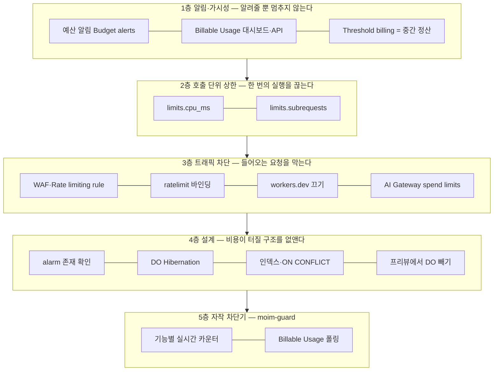
그림 1. 하드캡 없는 계정의 다층 방어

## 1층 알림과 가시성 — 알려줄 뿐 멈추지 않는다

### 예산 알림, Billable Usage, 그리고 Threshold billing

가장 먼저 손에 잡히는 장치는 예산 알림(Budget alerts)이다. 2026-04-21에 Billable Usage 대시보드와 함께 도입됐고, 2026년 7월부터는 적격 Pay-as-you-go 계정에 $10 계정 단위 알림이 기본으로 켜지기 시작했다. 다음 결제 주기부터, 코호트별로 순차 적용되는 방식이라 내 계정에 이미 켜졌는지는 직접 확인해야 한다(Changelog "Budget alerts now on by default", 2026-07-20 게시). Enterprise 계약 계정은 대상이 아니다.

이 알림의 성격은 문서가 분명히 적어두었다.

> "Budget alerts are informational only. They do not pause or cap usage. Your monthly invoice remains the authoritative source for billing." (Budget alerts, 2026-05-29 기준)
> "Usage is processed once per day for the prior day's activity, so budget alerts fire the day after the threshold is reached rather than in real time."
> "Budget alerts only consider spend on usage-based products. Recurring subscription fees, such as the Workers Paid plan fee or other monthly plan charges, are not included in the threshold calculation."

세 가지를 기억해두자. 정보 제공용이라 사용량을 멈추거나 제한하지 않는다. 사용량을 하루 한 번 처리하므로 임계치에 닿은 다음 날 울린다. Workers Paid 월 기본료 같은 정기 요금은 임계치 계산에서 빠진다. $34,895 사고의 기울기를 떠올려보면 하루의 지연이 얼마나 긴지 실감이 난다. 하루 행 읽기가 수천억 건인 루프라면 알림이 울릴 무렵 이미 하루치 청구가 쌓여 있다.

그래도 켜둘 가치는 충분하다. 기본 $10 알림 하나로 끝내지 말고, 자기 예산에 맞춰 임계치를 몇 개 더 걸자. 예를 들어 월 예산이 $30이라면 $15, $30, $60처럼 단계를 둔다. 마지막 단계는 "이 알림을 받으면 무엇을 할지"까지 미리 정해두는 편이 낫다.

가시성 도구도 두 가지가 있다. Billable Usage 대시보드는 "The data comes from the same system that generates your monthly invoice, so the figures match your bill."이라고 소개된다(Changelog 2026-04-21). 청구서와 같은 시스템에서 나온 숫자라 믿을 만하다. 2026-08-03에는 같은 데이터를 프로그램으로 읽는 Billable Usage API가 나왔다. 단 발표 블로그는 "Today, usage and cost data are updated daily while we work towards providing more real time data."라고 적었다. 하루 단위 갱신이다. 발표 스레드의 반응 한 줄이 이 장치의 위치를 정확히 짚는다. "Translated: Close, but still not hard cost cap at Cloudflare."(HN mathoff, 2026-08-03)

Pro 이상 존이라면 제품별 사용량 이메일 알림도 켤 수 있는데, 이것도 "The email notifications are for informational purposes only."다(Usage-based billing, 2026-05-29 기준).

마지막으로 이름 때문에 오해받기 쉬운 장치가 하나 있다. Threshold billing이다. 이름만 보면 "임계치에서 멈추는" 기능 같지만 실제로는 중간 정산이다.

> "When your combined usage charges across all usage-based products reach a certain level during a billing cycle, Cloudflare generates a mid-cycle invoice and charges your payment method on file." / "The threshold is automatically set by Cloudflare and cannot be modified." (Threshold billing, 2026-06-16 기준)

사용 요금이 일정 수준에 닿으면 결제 주기 중간에 청구서를 발행해 등록된 결제수단으로 결제한다. 임계치는 Cloudflare가 정하고 우리가 바꿀 수 없다. 사용을 멈추는 장치가 아니라, 큰 금액이 월말에 한꺼번에 몰리지 않게 나눠 받는 장치다. 카드 명세서에서 예상하지 못한 중간 결제를 발견했다면 이것일 가능성이 높다.

## 2층과 3층 — 실제로 멈추는 장치들

### 호출 단위 브레이크: `limits.cpu_ms`와 `limits.subrequests`

이제 실제로 멈추는 장치다. 가장 가까운 것은 Worker 설정 안에 있다. Workers 가격 문서는 `limits.cpu_ms`를 이렇게 소개한다.

> "To prevent accidental runaway bills or denial-of-wallet attacks, configure the maximum amount of CPU time that can be used per invocation" (Workers Pricing, 2026-10-02 기준)

폭주하는 청구서와 지갑을 노린 공격(denial-of-wallet)을 막기 위해 호출 한 번이 쓸 수 있는 CPU 시간의 상한을 정하라는 것이다. Workers Paid의 기본값은 30,000 ms(30초), 최대 300,000 ms(5분)다. 2026-02-11 changelog는 서브요청 수에도 같은 장치를 더했다. "To protect against runaway code or unexpected costs, you can also set a lower limit for both subrequests and CPU usage." Paid 기본값은 호출당 서브요청 10,000건이다.

`moim`의 Worker들에 걸어보자. 숫자는 Workers Logs로 각 Worker의 정상 최댓값을 잰 뒤 넉넉히 몇 배를 준 값이 좋다. 아래는 예시다.

```jsonc
// moim-api/wrangler.jsonc (발췌)
{
  "name": "moim-api",
  "compatibility_date": "2026-09-01",
  // ...앞 장과 동일
  "limits": {
    "cpu_ms": 1000,      // 기본 30,000 → API 요청 하나에 1초면 충분하다
    "subrequests": 50    // 기본 10,000 → 정상 경로의 최댓값 × 여유
  }
}
```

`moim-web`, `moim-mail` 소비자, 이 장 뒤에서 만들 `moim-guard`에도 같은 방식으로 건다. `moim-web`은 5장에서 본 대로 `npm run deploy`가 빌드가 만든 `dist/server/wrangler.json`을 설정으로 삼아 배포하니, 배포한 뒤 그 파일에 `limits`가 그대로 실렸는지 한 번 확인해두자. 상한에 걸린 호출은 종료되니, 정상 요청이 잘리지 않는지 프리뷰에서 먼저 확인하자. 런타임 한도 자체의 의미는 3장에서 다뤘다.

이 브레이크가 막지 못하는 것도 분명히 알아두자. 이 상한은 호출 한 번 단위다. 무한 루프에 빠진 요청 하나가 30초 동안 CPU를 태우는 일은 막아주지만, 정상적인 요청이 초당 수만 번 들어오는 일은 막지 못한다. $34,895 사고처럼 각 호출은 짧고 정상인데 호출 횟수가 폭주하는 경우에는 이 층만으로 부족하다. 그래서 다음 층이 필요하다.

### 트래픽 앞단의 차단과 AI Gateway spend limits

호출 횟수 자체를 줄이는 장치는 Worker보다 앞에 둔다. 9장에서 만든 것들이다. WAF Free Managed Ruleset, Rate limiting rule(Free 존 1개, 10초 기간), Worker 안의 `ratelimit` 바인딩이 비정상적인 요청 폭주를 Worker에 닿기 전이나 비싼 작업 전에 끊는다. 여기에 체크리스트 한 줄을 더하자. 커스텀 도메인을 붙였다면 `"workers_dev": false`로 `workers.dev`를 꺼두었는지 확인한다. `workers.dev`로 들어오는 요청은 존의 WAF를 우회한다. 자세한 이유는 9장에서 봤다.

AI를 쓰는 서비스라면 한 가지 장치가 더 있다. AI Gateway spend limits다. 2026-06-05에 나온 이 기능은 달러 기준 예산을 넘으면 요청을 실제로 차단한다(Changelog 2026-06-05). Cloudflare가 제공하는 장치 가운데 "금액 기준으로 멈추는" 거의 유일한 것이다. 하지만 범위를 정확히 읽자. AI Gateway를 지나는 트래픽에만 적용된다. 계정 전체 상한도, Workers·D1·DO의 상한도 아니다. 8장에서 외부 LLM 호출을 AI Gateway로 보내도록 구성했다면, 그 게이트웨이에 월 예산을 걸어두자. 프롬프트 루프 하나가 LLM 청구서를 키우는 일은 이것으로 막을 수 있다.

> **비용 메모**
> 3층의 장치들은 대부분 Free 범위 안에 있다. WAF Free Managed Ruleset과 Rate limiting rule 1개는 Free 존에서 쓸 수 있고, `ratelimit` 바인딩은 GA다(2025-09-19). AI Gateway의 분석·캐싱·레이트 리미팅은 핵심 기능으로 무료이고, 2026-09-24 이후 신규 로그는 Workers Logs 가격을 따른다(AI Gateway Pricing, 2026-09-24 기준). 방어선을 세우는 데 큰돈이 들지 않는다는 뜻이다.

## 4층 설계 — 비용이 터질 구조를 없앤다

### 사고 사례에서 거꾸로 읽은 설계 규칙

가장 싼 방어는 처음부터 터질 구조를 만들지 않는 것이다. 앞의 두 사례와 지금까지의 장들을 거꾸로 읽으면 설계 규칙이 나온다.

Durable Objects부터 보자. alarm은 존재를 확인하고 건다. 스스로 깨어나는 구조가 꼭 필요한지부터 묻는다. 그리고 DO의 Duration 과금은 실제 사용량과 무관하게 할당된 128 MB 기준이라는 점을 기억하자("Duration billing charges for the 128 MB of memory your Durable Object is allocated, regardless of actual usage."). WebSocket을 `accept()`해 두면 연결 내내 Duration이 쌓인다. WebSocket Hibernation API를 쓰면 "billing pauses while the Durable Object is hibernated"다(Optimize costs, 2026-05-04 기준). 스토리지 쪽은 SQLite 백엔드 DO의 스토리지 과금이 2026년 1월부터 시작될 예정으로 공지됐다(목표일 2026-01-07, Free는 과금 없음). 실제 개시 여부는 출간 전에 다시 확인할 항목이다.

프리뷰 환경에서는 DO 바인딩을 뺀다. 프리뷰는 운영 설정을 물려받지 않고 `wrangler.jsonc`의 `previews` 블록에 적은 것만 쓴다. DO 클래스 선언은 최상위에 두고, `previews.durable_objects.bindings`를 적지 않으면 프리뷰의 `env`에는 DO 바인딩이 없다(Worker Previews 설정 문서, 2026-09-22 기준). Containers도 프리뷰마다 따로 생긴다고 발표됐으니(7장에서 봤듯 Containers FAQ와는 서술이 엇갈린다) 같은 원칙을 적용한다. 그리고 7장의 `moim-report` 설정에서 `max_instances`로 `ReportContainer`의 인스턴스 수를 묶어둔 것처럼, Containers를 쓰는 모든 Worker에 인스턴스 수의 상한이 걸려 있는지 확인하자(7장에서 봤듯 베타인 `durable_object` 스케줄링 정책은 이 항목을 받지 않는다). Containers에는 내장 오토스케일링이 없으니, 이 숫자가 곧 동시에 과금될 수 있는 인스턴스의 최댓값이다.

D1은 두 가지다. 쓰기 경로는 `ON CONFLICT`와 유일성 제약으로 멱등하게 만들고, 읽기 경로는 인덱스를 확인한다. 인덱스 없는 풀 스캔은 반환 행이 적어도 스캔한 행 전부가 "rows read"다. Queues는 배치와 재시도마다 메시지별로 operation이 과금되고, 64 KB를 넘는 메시지는 여러 operation으로 센다. 재시도 횟수와 데드레터 큐 설정이 곧 비용 설정이다. Workflows는 step 과금이 "no earlier than August 10, 2026"으로 예고됐다(Changelog 2026-07-07). 단가는 10만 step당 $0.80이고, `default_retention`으로 보존 기간을 줄이면 저장 과금도 준다.

이 밖에 다른 장에서 본 함정들이 있다. 캐시를 켜면 오히려 요청 과금이 느는 Workers Cache는 11장을 참조하자. 2026년 12월 1일부터 Paid 계정의 Observability는 포함량을 넘으면 "Paid usage continues automatically after an allowance is exhausted."다(Observability Pricing, 2026-10-02 기준). 로그를 아낌없이 남기는 습관이 그대로 청구서가 된다. Containers의 이그레스는 한국이 GB당 $0.05로 북미·유럽($0.025)의 두 배이고, 포함량도 500 GB로 북미·유럽의 1 TB보다 적다(Containers Pricing, 2026-08-28 기준). 4장에서 전망으로 소개한 KV Instant는 쓰기·삭제·list가 "$0.10 per operation"이다. 100만 건당이 아니라 건당이다. 기존 KV 감각으로 쓰면 수만 배 비싸다.

이 규칙들은 무언가를 알려주거나 막는 장치와 성격이 다르다. 사고가 일어날 구조 자체를 지우는 예방이다. 부록 B의 체크리스트에서 이 항목들에 따로 "설계" 표시를 붙인 이유다.

## 5층 자작 차단기 — `moim-guard`

### 왜 직접 만드는가

여기까지 쌓아도 빈 곳이 하나 남는다. 계정 전체, 혹은 기능 하나가 정해진 금액을 넘었을 때 그 기능을 멈추는 장치다. Cloudflare가 주지 않으니 직접 만들어야 한다. 커뮤니티에서도 같은 결론에 이른 사람들이 있다. Show HN에 "A usage circuit breaker for Cloudflare Workers"를 올린 3mins.news 운영자는 Cron Trigger 10개 이상이 몇 분마다 도는 구조라 직접 차단기를 만들었다(HN 2026-03-10). 댓글의 photobombastic은 한 마디로 요약했다. "Prevention over detection."

참고할 만한 설계는 $4,868 사고를 겪은 Little Bear Apps의 3단 서킷 브레이커다. 기능별 예산, 프로젝트 합산, 전역 비상 정지의 세 단계를 두고, 70%에서 경고, 90%에서 위험, 100%에서 자동 비활성화한다. 비활성화는 KV의 TTL로 1시간 뒤 자동 해제되고, 탐지 지연은 약 30초라고 한다(Little Bear Apps 블로그, 2026-03-18).

`moim-guard`는 이 구조를 빌리되 신호를 두 갈래로 나눈다. 왜 그럴까? Billable Usage API는 청구서와 같은 정확한 숫자를 주지만 하루 단위로 갱신된다. 하루 지연으로는 $34,895 같은 기울기를 잡을 수 없다. 그래서 정확하지만 느린 신호와, 거칠지만 빠른 신호를 함께 쓴다.

- **빠른 신호:** `moim-api`가 비싼 작업(D1 쓰기, R2 업로드, 메일 발송)을 할 때마다 기능별 카운터를 올린다. 카운터는 Durable Object `UsageMeter`에 둔다. 4장에서 봤듯 카운터를 KV에 두면 최종 일관성 때문에 조용히 틀린다. 기능 × 날짜마다 인스턴스 하나다.
- **느린 신호:** `moim-guard`의 Cron이 한 시간마다 Billable Usage API를 읽어 이번 달 누적 비용을 월 예산과 비교한다. 예산을 넘으면 KV `CONFIG`에 계정 전체 정지 플래그를 TTL과 함께 쓴다. 드물게 바뀌는 플래그라 KV에 맞는 데이터다.

먼저 밝혀둘 것이 있다. 아래 코드는 공식 예제가 없어 직접 작성한 예제이고, Cloudflare가 문서화한 패턴이 아니다. Billable Usage API의 엔드포인트(`GET /accounts/{account_id}/billable-usage`), 토큰 권한(Billing Read), 응답 필드(`ContractedCost` 등 FOCUS 호환 이름)는 발표 블로그(2026-08-03) 기준이니, 배포 전에 API 문서로 다시 확인하자.

### `moim-guard` 구현

`moim-guard`의 설정부터 보자. `UsageMeter` 클래스는 `moim-guard`에 두고, `moim-api`는 `script_name`으로 그 클래스를 바인딩한다.

```jsonc
// moim-guard/wrangler.jsonc
{
  "name": "moim-guard",
  "main": "src/index.ts",
  "compatibility_date": "2026-09-01",
  "workers_dev": false,
  "triggers": { "crons": ["0 * * * *"] },          // 한 시간마다
  "kv_namespaces": [{ "binding": "CONFIG", "id": "<moim-config의 id>" }],
  "durable_objects": {
    "bindings": [{ "name": "METER", "class_name": "UsageMeter" }]
  },
  "exports": {
    "UsageMeter": { "type": "durable-object", "storage": "sqlite" }
  },
  "vars": {
    "MONTHLY_BUDGET_USD": "30",
    "BILLABLE_USAGE_URL": "https://api.cloudflare.com/client/v4/accounts/<ACCOUNT_ID>/billable-usage"
  },
  "limits": { "cpu_ms": 1000, "subrequests": 10 }
  // BILLING_API_TOKEN은 시크릿으로 둔다 (9장 참조)
}
```

```ts
// moim-guard/src/index.ts — 저자 작성 예제
import { DurableObject } from "cloudflare:workers";

// 기능별 하루 예산: 그 기능이 만드는 과금 연산의 수 (moim 기준 예시)
export const DAILY_BUDGET: Record<string, number> = {
  "rsvp.write": 50_000,   // D1 쓴 행
  "upload.put": 2_000,    // R2 Class A
  "mail.send": 3_000,     // 확인 메일
};

// 기능 하나 × 하루 하나. 카운터는 강한 일관성이 필요하니 DO에 둔다
export class UsageMeter extends DurableObject {
  async add(feature: string, n: number): Promise<{ used: number; open: boolean }> {
    const used = ((await this.ctx.storage.get<number>("used")) ?? 0) + n;
    await this.ctx.storage.put("used", used);
    const budget = DAILY_BUDGET[feature] ?? Infinity;
    if (used >= budget * 0.9) console.warn(JSON.stringify({ guard: feature, used, budget }));
    return { used, open: used >= budget }; // open = 회로가 열림(차단)
  }
}

// Billable Usage API에서 이번 달 누적 비용을 읽는다
// 쿼리 없이 부르면 이번 청구 기간을 상품·기간별 행으로 돌려준다 (블로그 2026-08-03 기준)
// 행이 기간별 누적이면 CumulatedContractedCost를 쓴다 — 응답 모양은 API 문서로 확인
async function monthToDateCost(env: Env): Promise<number> {
  const res = await fetch(env.BILLABLE_USAGE_URL, {
    headers: { Authorization: `Bearer ${env.BILLING_API_TOKEN}` },
  });
  if (!res.ok) throw new Error(`billable usage ${res.status}`);
  const body = await res.json<{ result: Array<{ ContractedCost: number }> }>();
  return body.result.reduce((sum, row) => sum + row.ContractedCost, 0);
}

export default {
  async scheduled(_controller, env, _ctx) {
    let cost: number;
    try {
      cost = await monthToDateCost(env);
    } catch (err) {
      // 차단기 자신이 서비스를 멈추지 않도록, 조회 실패는 정지 사유로 삼지 않는다
      console.error(JSON.stringify({ guard: "account", error: String(err) }));
      return;
    }
    const ratio = cost / Number(env.MONTHLY_BUDGET_USD);
    const level =
      ratio >= 1 ? "stop" : ratio >= 0.9 ? "danger" : ratio >= 0.7 ? "warn" : "ok";
    if (level === "stop") {
      // 2시간 TTL: 다음 Cron이 다시 확인해 연장하거나, 저절로 풀린다
      await env.CONFIG.put("guard:all", "stop", { expirationTtl: 7200 });
    }
    console.log(JSON.stringify({ guard: "account", cost, ratio, level }));
  },
} satisfies ExportedHandler<Env>;
```

`moim-api` 쪽은 비싼 작업 앞에 한 줄을 넣는다. 읽기 위주의 `GET` 경로에는 넣지 않는다. 차단기를 확인하는 비용까지 모든 요청에 곱할 필요는 없다.

```ts
// moim-api/src/guard.ts — 저자 작성 예제
import { HTTPException } from "hono/http-exception";

export async function guard(env: Env, feature: string, cost = 1) {
  // 1) 계정 전체 정지 플래그 (느린 신호, KV)
  if ((await env.CONFIG.get("guard:all")) === "stop") {
    throw new HTTPException(503, { message: "잠시 신청을 받을 수 없습니다" });
  }
  // 2) 기능별 오늘 카운터 (빠른 신호, DO)
  const day = new Date().toISOString().slice(0, 10); // UTC 기준 날짜
  const meter = env.METER.get(env.METER.idFromName(`${feature}:${day}`));
  const { open } = await meter.add(feature, cost);
  if (open) {
    throw new HTTPException(503, { message: "오늘 처리량을 넘었습니다" });
  }
}

// 사용하는 곳
app.post("/api/events/:id/rsvp", async (c) => {
  await guard(c.env, "rsvp.write");
  // ...4장과 동일
});
```

```jsonc
// moim-api/wrangler.jsonc (추가분)
{
  "durable_objects": {
    "bindings": [
      // ...EventSeats(SEATS)는 4장과 동일
      // 다른 Worker(moim-guard)에 정의된 DO 클래스는 script_name으로 바인딩하고 RPC로 부른다
      { "name": "METER", "class_name": "UsageMeter", "script_name": "moim-guard" }
    ]
  }
}
```

몇 가지 설계 판단을 짚어두자. 기능별 카운터는 날짜가 이름에 들어가 있어서 UTC 자정이 지나면 새 인스턴스가 0부터 센다. 따로 해제할 필요가 없다. 계정 전체 정지는 TTL로 저절로 풀리게 했다. 사람이 해제를 깜빡해서 서비스가 며칠씩 멈추는 사고를 막기 위해서다. Billable Usage API 조회가 실패하면 정지하지 않는다. 차단기가 스스로 장애의 원인이 되면 곤란하다. 그 대신 에러 로그를 남기고, 경고 단계의 알림은 8장의 `EMAIL` 바인딩이나 쓰고 있는 메신저 웹훅으로 보내면 된다.

한계도 정직하게 적어두자. 첫째, 이 차단기는 비싼 하위 작업을 멈출 뿐 Worker 요청 자체를 멈추지는 못한다. 정지 상태에서도 `moim-api`로 들어오는 요청은 계속 과금된다(포함량을 넘으면 100만 건당 $0.30). 요청까지 끊으려면 라우트를 해제하거나 WAF 차단 규칙을 켜야 한다. 둘 다 Cloudflare API가 있다. 라우트 삭제는 `DELETE /zones/{zone_id}/workers/routes/{route_id}`, 규칙 켜기는 Rulesets API의 `PATCH .../rulesets/{ruleset_id}/rules/{rule_id}`다. 다만 Cloudflare가 이를 자동 차단 패턴으로 문서화한 것은 아니니, 처음에는 운영 문서의 수동 절차로 적어두자. 둘째, 차단기도 공짜가 아니다. 보호하는 작업 하나마다 DO 요청 1건과 저장 쓰기 1건이 더해진다. `moim` 규모에서는 무시할 만하지만, 모든 요청에 붙이면 차단기가 비용을 만든다. 셋째, 예산 숫자는 결국 우리가 정한다. 하루 50,000건의 신청 쓰기가 정상인 날이 오면 차단기가 정상 트래픽을 막는다. 숫자를 서비스의 성장에 맞춰 고치는 일도 운영의 일부다.

그래도 이 차단기는 $34,895 같은 사고의 모양을 바꾼다. 루프가 하루 수천억 건의 연산을 만들기 전에, 기능별 카운터가 몇 분 안에 그 기능을 503으로 돌린다. 사용자 몇 명이 "잠시 신청을 받을 수 없습니다"를 보는 대가로 청구서의 자릿수가 바뀐다.

> **논쟁: 알림이면 충분한가, 하드캡이 필요한가**
> 현행 장치로 충분하다는 쪽은 기본 $10 예산 알림, Billable Usage API, `limits.*`, AI Gateway spend limits를 겹쳐 쓰면 된다고 본다.
> 하드캡이 필요하다는 쪽의 목소리도 크다. simonw는 이렇게 썼다. "I want to set a cap of $100/month and know, for sure, that if something untoward happens my apps will all stop serving traffic rather than me getting hit with a bill for $1000s."(HN 2026-06-20) jacobmei는 "per-binding spend caps would have caught this"라며 바인딩 단위 상한을 제안했다(HN 2026-04-27). woodylondon은 "I am using Supabase at the moment, and see they have a hard cap now. and so does Vercel …"이라며 타사와 비교했는데, 타사 기능에 대한 이용자의 주장이며 이 책에서 검증하지 않았다.
> 이 책의 입장은 이렇다. 하드캡이 생기면 반갑게 쓰자. 그 전까지는 이 장의 다섯 층을 겹쳐 쓰고, 출간 이후 변화는 공식 changelog로 확인하자.

### 오늘 밤 할 일 다섯 가지

긴 장이었다. 전부를 한 번에 할 필요는 없다. 유료 계정을 쓰고 있다면 오늘 밤 이 다섯 가지만 먼저 하자.

첫째, 예산 알림을 열어 기본 $10 알림이 켜져 있는지 확인하고, 자기 예산에 맞춘 임계치를 두세 개 더 건다. 이 알림은 다음 날 울린다는 점을 기억하면서.

둘째, 모든 Worker의 `wrangler.jsonc`에 `limits.cpu_ms`와 `limits.subrequests`를 넣는다. 기본값 30초와 10,000건은 우리 앱에 너무 넉넉하다.

셋째, 커스텀 도메인을 붙인 Worker의 `workers.dev`가 꺼져 있는지, Rate limiting rule이 신청 경로에 걸려 있는지 확인한다.

넷째, 코드에서 `setAlarm`을 검색해 모든 호출 앞에 `getAlarm()` 확인이 있는지 보고, D1 쓰기 경로에 `ON CONFLICT`가 있는지 본다. 프리뷰 배포에 DO 바인딩이 따라가는지도 확인한다.

다섯째, AI Gateway를 쓴다면 spend limit을 건다. 그리고 `moim-guard` 같은 차단기를 이번 주 안에 배포할 계획을 잡는다.

나머지 항목은 부록 B "출시 전 과금 안전 체크리스트"에 담당 장 번호와 함께, 각 장치가 알림인지 차단인지 설계인지 표시해 두었다. 출시 전에 한 줄씩 지워나가자. 하드캡이 없는 세상에서 우리가 가진 가장 확실한 상한은, 이 목록을 끝까지 지운 우리 자신이다.

### 이 장의 핵심

- 2026년 10월 현재 Cloudflare에는 계정 단위 지출 상한(하드캡)이 없다. 장치들을 겹쳐 쓰는 수밖에 없다.
- 예산 알림·Billable Usage·Threshold billing은 알려주거나 나눠 청구할 뿐 멈추지 않는다. 예산 알림은 하루 늦게 오고 Workers Paid 기본료를 빼고 계산한다.
- 실제로 멈추는 장치는 범위가 정해져 있다. `limits.*`는 호출 한 번, WAF·`ratelimit`은 들어오는 트래픽, AI Gateway spend limits는 AI Gateway 트래픽만 막는다.
- 사고 대부분은 자기 코드에서 시작한다. alarm 존재 확인, 프리뷰에서 DO 빼기, `ON CONFLICT`와 인덱스가 가장 싼 방어다.
- 남은 빈자리는 기능별 실시간 카운터와 Billable Usage 폴링을 합친 자작 차단기로 메운다. 면제를 기대하지 말고 사전에 차단하자.

# 14장. 출시, 그리고 그 너머

2025년 11월 18일, Cloudflare에 큰 장애가 났다. 그날의 사후 분석 글이 GeekNews에 올라오자 한 개발자가 이런 댓글을 남겼다.

> "Cloudflare가 안되어서 온갖 서비스가 중단되니 지옥이더군요.." (GeekNews princox, "Cloudflare 2025년 11월 18일 장애 사후 분석" 댓글)

같은 사후 분석을 다룬 Hacker News 스레드는 1,465점에 댓글 916개가 달렸다. 한 사용자는 "28M 500 errors/sec for several hours from a single provider. Must be a new record."라고 적었다. 한 회사에서 초당 2,800만 건의 500 에러가 몇 시간 동안 나왔으니 신기록일 거라는 자조였다.

책의 마지막 장을 장애 이야기로 여는 이유가 있다. 우리는 지금 `moim`의 출시 버튼 앞에 서 있다. 열세 장에 걸쳐 정적 사이트 하나로 시작한 서비스를 API와 데이터, 풀스택 프런트, Spring 백엔드, 외부 결제와 메일, 보안과 제로 트러스트, 캐시와 비용 방어까지 키웠다. 그리고 그 대부분을 한 회사의 플랫폼 위에 올렸다. 출시를 앞두고 던져야 할 질문은 두 가지다. 지금 만든 것을 내보내도 되는가? 그리고 이 플랫폼에 기대는 서비스를 오래 운영하려면 무엇을 마음에 둬야 하는가? 지금까지의 여정을 돌아보며 두 질문에 차례로 답해보자.

## 지금까지의 여정

### `moim`의 최종 모습

먼저 우리가 만든 것을 한 장의 그림으로 보자.

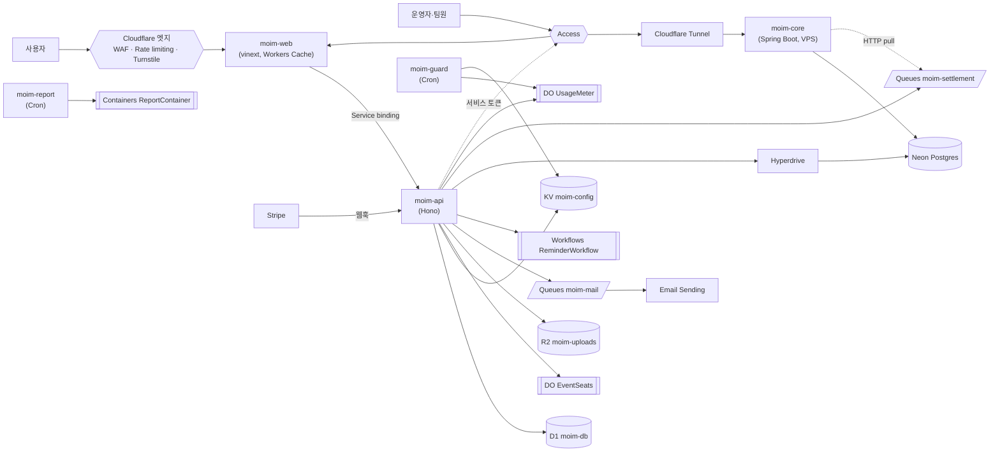
그림 1. `moim` 최종 아키텍처

복잡해 보이지만 한 줄씩 따라가면 각 선이 어느 장에서 그어졌는지 떠오를 것이다. 이 그림을 네 개의 동사로 다시 읽어보자.

올리기. 1장에서 Cloudflare를 CDN 회사가 아니라 isolate부터 VM까지 이어지는 실행 환경의 스펙트럼으로 다시 봤다. 2장은 정적 자산이 무료·무제한이라는 사실 위에 `moim-web`을 올렸고, 3장은 Workers의 실행 모델이 Node 서버나 Spring 서버와 어떻게 다른지 몸으로 익히게 했다. 전역 상태를 믿지 않고, 스레드 대신 요청 단위로 생각하는 습관이다. 4장에서는 "DB 하나에 스키마 하나"라는 오래된 전제가 깨졌다. 행사와 신청은 D1에, 드물게 바뀌는 설정은 KV에, 틀리면 안 되는 좌석 수는 Durable Objects에, 발표 자료는 R2에 두었다. 5장은 Next.js를 vinext로 올리며 어댑터가 프레임워크를 따라가는 구조의 위험을 배웠다.

잇기. 6장의 Tunnel은 포트를 하나도 열지 않고 집 서버의 Spring을 세상에 내놓았다. 7장은 JVM 백엔드가 살 자리를 세 갈래로 나눠, 상시 API는 Tunnel 뒤 VM에, 가끔 몰아서 도는 정산 배치는 Containers에 두고, Postgres는 Hyperdrive로 Workers와 함께 썼다. 8장은 결제·메일·DB·AI를 붙이며 "밖에 둘 것은 표준 프로토콜로 잇는다"는 원칙을 세웠다.

지키기. 9장은 공개 표면을 겹겹이 막았다. Turnstile과 siteverify, WAF, 두 층의 레이트 리미팅, 그리고 잊기 쉬운 `workers.dev` 뒷문까지. 10장은 운영자 화면과 Spring 서버를 Access로 닫고, Spring Security로 Access JWT를 직접 검증했다.

운영하기. 11장은 Worker가 캐시 앞에서 실행된다는 사실에서 출발해 세 캐시 경로를 골랐다. 12장은 무료 티어를 숫자로 따져 "청구 대신 에러"의 대가를 봤고, 13장은 하드캡이 없는 유료 계정에 다섯 층의 방어선을 쌓았다.

이 넷은 순서대로 맞물린다. 올린 것을 알아야 무엇을 밖에 둘지 판단할 수 있었고, 이은 것이 있어야 지킬 경계가 생겼고, 지킨 서비스여야 오래 운영할 의미가 있었다. 그리고 비용은 처음부터 끝까지 따라다녔다. 4장의 R2 구독, 7장의 Workers Paid 전환, 11장의 Workers Cache 함정이 12·13장에서 하나의 전략으로 묶였다.

### 출시 전 마지막 점검

이제 출시 버튼 앞에서 마지막으로 점검하자. 장별로 흩어진 확인 항목을 네 묶음으로 모았다.

보안부터 보자. 신청 폼의 Turnstile은 위젯만 붙이고 끝내지 않았는지 다시 확인한다. 공식 문서의 말대로 "Without the second part, the widget appears on the page but does not protect the request." 백엔드의 siteverify가 없으면 보호도 없다. 커스텀 도메인을 붙인 모든 Worker에서 `workers.dev`가 꺼졌는지, Rate limiting rule이 신청 경로에 걸렸는지 본다. `/admin/*`과 `core.example.com`이 Access 뒤에 있는지, Spring 쪽 JWT 검증이 `aud`와 만료를 확인하는지, 서비스 토큰이 시크릿으로만 존재하는지 본다. 그리고 의존성 패치를 확인한다. 5장에서 말했듯 WAF는 패치를 대체하지 않는다.

캐시는 11장의 결정을 다시 읽는다. 좌석 잔여 수처럼 틀리면 안 되는 값이 캐시에 들어가지 않았는지, 신청 마감 시 태그 퍼지가 실제로 동작하는지 프리뷰에서 한 번 눌러본다. Workers Cache를 켠 Worker는 정적 자산 요청까지 과금된다는 사실을 팀 전체가 알고 있는지도 확인하자.

비용은 부록 B의 체크리스트를 위에서부터 지운다. 13장의 "오늘 밤 할 일 다섯 가지"를 했다면 절반은 끝났다.

마지막은 관측이다. 3장에서 `"observability": { "enabled": true }`로 Workers Logs를 켰다. 출시하면 로그의 양이 달라진다. Workers 트레이싱은 OpenTelemetry 표준을 따르고("Workers tracing follows OpenTelemetry (OTel) standards"), 외부 도구로 내보낼 수 있다. Cloudflare 대시보드에 저장하지 않고 내보내기만 하는 `persist: false` 옵션도 있다. 2026-10-02에는 보안 규칙·캐시 결정·라우팅·Workers·오리진 처리를 요청 단위로 보여주는 Cloudflare Traces가 오픈 베타로 나왔다. 11장의 "어느 캐시 층이 범인인가"라는 질문에 답하는 도구가 될 수 있다.

관측에는 가격 변화가 하나 예고돼 있다. 2026년 12월 1일부터 Workers Logs·Traces·Containers 로그가 통합된 Cloudflare Observability 가격으로 바뀐다(2026-10 공지). 출시 첫 주에 로그를 넉넉히 남기는 것은 좋은 습관이지만, 첫 주가 지나면 샘플링 비율(`head_sampling_rate`, 기본 1)을 낮추는 계획도 같이 세우자.

> **비용 메모**
> 2026-12-01부터의 Cloudflare Observability 가격: Free는 하루 0.5 GB 수집, 7일 보존이고 한도에 닿으면 수집을 멈춘다. Workers Paid는 주기당 수집 50 GB와 저장 12 GB-월이 포함되고, 넘으면 수집 GB당 $0.25, 저장 GB-월당 $0.10이 자동으로 계속 청구된다("Paid usage continues automatically after an allowance is exhausted.", Observability Pricing 2026-10-02 기준). 출간 시점이 12월 이후라면 이미 적용된 가격이다.

## 한 회사에 기댄다는 것

### 장애와 단일 벤더 리스크

이 장을 연 장애로 돌아가자. 2025-11-18의 장애는 Bot Management의 feature file에서, 2025-12-05의 장애는 WAF 규칙의 전역 설정에서, 2026-02-20의 장애는 BYOIP API 버그에서 시작됐다. 원인은 매번 달랐지만 영향 반경이 전역이었다는 점은 같았다. 2026-08-08에는 R2에도 장애가 있었다. 오래 R2를 써 온 한 사용자는 "Please don't make me have to figure out how to move services again, I am tired folks."라고 썼다. 그 장애가 데이터에 어떤 영향을 남겼는지는 커뮤니티의 말이 엇갈려 이 책에서 판단하지 않는다.

이 사건들을 두고 개발자들의 생각은 크게 둘로 갈린다.

한쪽은 중앙집중이 인터넷을 더 약하게 만든다고 본다. "Homogeneous systems like Cloudflare will continue to cause global outages. Rust won't help, people will always make mistakes, also in Rust."(HN mixedbit, 2025-12-05) 같은 시스템이 모두를 떠받치면 실수 하나가 모두를 쓰러뜨린다는 것이다. 업무에서는 전역으로 무너지지 않는 분산 인프라가 필요하니 추천할 수 없다는 목소리도 있다. 2025-12-05의 장애 뒤에는 "Cloudflare is now below 99.9% uptime, for anyone keeping track."이라는 계산도 나왔다(HN lionkor).

다른 쪽은 중앙집중이 오히려 더 견고하고, 다만 눈에 잘 띌 뿐이라고 본다. "Centralized services don't decrease redundancy. They're usually far more redundant than whatever homegrown solution you can come up with. The difference between centralized and homegrown is mostly psychological."(HN miki123211, 2025-11-24) 직접 꾸린 인프라는 장애가 덜 요란할 뿐 더 자주 아프다는 지적도 있다. vasco는 작은 업체들의 문제를 "'chronic' vs 'acute' pains"라고 표현했다. 만성 통증과 급성 통증의 차이라는 것이다.

사후 분석을 읽은 개발자들이 남긴 반응에는 우리 자신의 운영에 가져올 교훈도 섞여 있다. otterley는 재발 방지 목록을 보고 "Absent from this list are canary deployments and incremental or wave-based deployment of configuration files (which are often as dangerous as code changes)"라고 지적했다. 설정 파일 배포도 코드 배포만큼 위험한데 카나리나 단계적 배포가 빠져 있다는 것이다. 이 말은 `moim`에도 그대로 적용된다. 13장에서 `wrangler.jsonc`에 넣은 `limits` 값 하나를 잘못 고치면 정상 요청이 잘린다. 설정 변경도 5장의 프리뷰에서 먼저 돌려보고 내보내자. 한편 SerCe는 "kudos for releasing a post mortem in less than 24 hours after the outage"라며 하루도 안 돼 사후 분석을 공개한 점을 높이 샀다. 장애가 없는 플랫폼은 없으니, 장애를 얼마나 투명하게 설명하는지도 벤더를 고르는 기준이 된다.

어느 쪽이 맞을까? 둘 다 맞는 이야기를 하고 있다. `moim` 같은 서비스가 직접 꾸린 VPS 하나보다 Cloudflare 위에서 더 자주 멈출 가능성은 낮다. 하지만 Cloudflare가 멈추는 날에는 우리 서비스뿐 아니라 우리가 장애를 확인하려고 여는 다른 서비스들까지 함께 멈춘다. 확률은 낮고 반경은 넓다. 그렇다면 우리가 할 수 있는 일은 반경을 줄이는 것이다.

### 출구는 표준 프로토콜에 있다

8장에서 세운 원칙이 여기서 빛을 낸다. 밖에 둘 것은 표준 프로토콜로 잇는다. `moim`을 다시 보면, 표준으로 이은 부분은 생각보다 많다.

데이터의 무게중심인 Postgres는 Neon에 있고, Spring은 JDBC로, Workers는 Hyperdrive를 거쳐 Postgres 프로토콜로 붙는다. Cloudflare가 사라져도 Spring은 그대로 같은 DB를 본다. 발표 자료는 R2에 있지만 7장에서 AWS SDK for Java v2로 읽었듯 S3 API로 접근한다. S3 호환 저장소라면 어디로든 옮길 수 있다. 메일은 SMTP로 보낼 수 있고, 인증은 OIDC와 JWT(RFC 7519)라는 표준 위에 있다. `moim-core`는 Spring Boot 그대로라 Tunnel을 걷어내면 리버스 프록시 뒤 어디서든 돈다. `moim-api`의 요청 처리도 3장에서 본 웹 표준 `Request`/`Response` 위에 짰으니, 바인딩에 기댄 부분을 걷어내면 다른 런타임으로 옮길 여지가 크다. 프런트도 마찬가지다. vinext 1.0 발표 글은 "Vinext lets you take any Next.js application, whether it was built for the Pages or App Router, and make it portable to be deployed to any web platform, including the Cloudflare Workers free plan, Netlify, or AWS Lambda."라고 적었다(2026-09-28).

반대로 Cloudflare 고유의 부분도 정직하게 세어보자. Durable Objects로 만든 `EventSeats`와 `UsageMeter`는 1:1로 옮겨갈 곳이 마땅치 않다. Orleans 같은 가상 액터 모델과 닮았지만 같은 것은 아니다. Queues와 Workflows, KV도 다른 플랫폼의 비슷한 제품으로 옮기려면 코드를 고쳐야 한다. 출구 전략은 이 목록을 아는 데서 시작한다. 고유 기능은 써도 좋다. 다만 쓸 때 "이걸 옮겨야 한다면 무엇을 다시 써야 하는가"를 한 줄 적어두자.

그 밖에 지금 할 수 있는 대비도 있다. Cloudflare가 멈췄을 때 사용자에게 보여줄 정적 안내 페이지를 다른 곳에 하나 두고, 장애를 알릴 채널을 Cloudflare 바깥에 마련하자. 그리고 12장의 논쟁에서 본 것처럼 무료 조건이나 가격은 바뀔 수 있다. 출구 목록은 장애 대비이자 가격 변화 대비이기도 하다.

## 이 책이 멈춘 시점

### 2026년 10월의 베타 지도

이 책은 2026년 10월 3일을 기준으로 쓰였다. 이 플랫폼은 빠르게 변한다. 2026년에만 WARP Client가 Cloudflare One Client로, Browser Rendering이 Browser Run으로 이름을 바꿨고, Pages 문서는 새 프로젝트를 Workers로 시작하라고 안내한다. 그러니 이 책에서 베타나 예고 상태로 다룬 것들의 지도를 남겨두자. 출간 이후 바뀌었을 수 있다. 공식 문서와 changelog로 다시 확인하자.

| 항목 | 2026-10-03 기준 상태 | 다룬 장 |
|---|---|---|
| vinext | 1.0 출시(2026-09-28), 공식 가이드는 아직 beta 표기 | 5 |
| `cf` CLI | 2026-09-28 베타 공개, GA 미정 | 3, 5 |
| Workers VPC | 오픈 베타, 베타 기간 무료 | 7 |
| KV Instant | 2026-10-01 비공개 베타, 가격·한도 변경 가능 | 4, 13 |
| Workers 인바운드 TCP(Spectrum)·Containers gRPC | 2026-08-03 비공개 베타 | 7 |
| Email Sending | 2026-04-16 공개 베타 | 8 |
| Cloudflare Traces | 2026-10-02 오픈 베타 | 14 |
| DO SQLite 스토리지 과금 | 2026년 1월 과금 예정으로 공지(목표일 2026-01-07), 개시 확정 공지 미확인 | 4, 13 |
| Workflows step·storage 과금 | "no earlier than August 10, 2026"로 예고 | 4, 13 |
| Cloudflare Observability 가격 | 2026-12-01부터 통합 가격 | 13, 14 |
| Access strict 서비스 토큰 | 2026-10-05 이후 생성 조직은 기본 켜짐·해제 불가 | 10 |
| 계정 단위 하드캡 | 없음 | 12, 13 |
| Analytics Engine | 가격표 공개, "Currently, you will not be billed" | 12 |
| OAuth 2.1 | 초안(draft-16, 2026-09-03), RFC 미발행 | 10 |
| `cloudflared` 32-bit Windows·Intel macOS 빌드 | 2027년 폐기 예정 | 6 |
| 도구 버전 전체(Wrangler·vinext·`cloudflared` 등) | 2026-10-02 기준 | 부록 C |

표 1. 2026-10-03 기준 베타·예고 상태 지도

이 표에서 가장 먼저 확인할 줄은 "계정 단위 하드캡: 없음"이다. 이 줄이 바뀌었다면 13장의 방어선 가운데 일부는 더 간단해질 것이다. 바뀌지 않았다면 13장은 그대로 유효하다.

확인하는 방법도 정해두자. 가격과 한도는 각 제품 문서의 가격·한도 페이지가, 상태 변화는 개발자 문서의 changelog가 1차 출처다. 이 책이 날짜를 붙여 적은 숫자는 모두 이 두 곳에서 왔다. 블로그 글이나 커뮤니티 요약에 적힌 한도는 쓰인 날짜부터 확인하자. 이 책을 쓰는 동안에도 Worker 크기 한도가 3 MB·10 MB·15 MB로 제각각 적힌 글들을 만났는데, 2026-09-04 이후의 1차 문서는 Free와 Paid 모두 비압축 64 MiB였다. 한 분기에 한 번쯤 부록 A의 표를 공식 가격 페이지와 나란히 놓고 대조해보는 것만으로도 낡은 숫자로 설계하는 일을 피할 수 있다.

### 새 기능을 붙일 때 묻는 다섯 질문

책을 덮은 뒤에도 `moim`은 자랄 것이다. 행사가 끝나면 발표 영상 다시보기를 붙이고 싶어질 수도 있다. 그럴 때마다 이 책을 처음부터 다시 읽을 수는 없으니, 14장에 걸친 판단을 다섯 개의 질문으로 압축해두자.

첫째, 어디에 둘까? 이 기능의 실행과 데이터는 isolate에 맞는가, 컨테이너가 필요한가, 원래 서버에 두는 편이 나은가. 데이터는 최종 일관성으로 충분한가, 강한 일관성이 필요한가. 1·3·4·7장의 질문이다. 둘째, 무엇으로 이을까? 밖에 있는 것과는 표준 프로토콜로 잇고, 안에 있는 것끼리는 Service binding과 바인딩으로 잇는다. 6·7·8장의 질문이다. 셋째, 누가 들어올까? 누구나 들어오는 공개 표면인지, 운영자와 기계만 들어오는 내부 경계인지에 따라 9장의 방어선과 10장의 Access를 고른다. 넷째, 얼마가 들까? 무료 한도 중 무엇에 먼저 닿고, 유료라면 어느 줄이 늘어나는지, 캐시를 켜면 줄어드는 줄과 늘어나는 줄은 무엇인지를 11·12·13장의 방식으로 계산한다. 다섯째, 멈추면 어떻게 될까? 한도에 닿아 멈출 때, 차단기가 열려 멈출 때, 플랫폼이 멈출 때 사용자는 무엇을 보는가. 그리고 그 기능을 옮겨야 한다면 무엇을 다시 써야 하는가.

영상 다시보기에 대어보자. 영상 파일은 R2에 둘 수 있고 이그레스는 무료지만 저장과 읽기 연산은 과금된다. 6장에서 본 Tunnel FAQ의 문장도 떠올려야 한다. "On Free, Pro, and Business plans, the service-specific terms require you to use a specific paid service to serve video and other large files." Tunnel 뒤 서버에서 영상을 직접 내보내는 길은 약관부터 확인해야 한다. 누가 볼지에 따라 공개 링크로 둘지 Access 뒤에 둘지가 갈리고, 멈추면 어떻게 될지에는 2026년 8월의 R2 장애가 답의 재료가 된다. 다섯 질문을 거치고 나면, 결론이 무엇이든 그 이유를 설명할 수 있게 된다.

## 닫으며

### 나의 클라우드라는 말의 뜻

이 책의 제목은 "Cloudflare를 나의 클라우드로"였다. 여정을 마친 지금 이 말을 다시 읽어보자.

처음 이 제목을 봤을 때 떠올린 그림은 아마 모든 것을 Cloudflare 위에 올리는 모습이었을 것이다. 실제로 우리가 만든 `moim`은 그렇지 않다. 정적 자산과 API, 상태와 큐는 Cloudflare 안에 있지만, 데이터의 무게중심인 Postgres는 Neon에, 회원과 정산을 맡은 Spring 서버는 VPS에, 결제는 Stripe에 있다. Cloudflare는 그 모두를 세상과 잇고, 앞에서 지키고, 가까운 곳에서 실행하는 자리를 맡았다. 나의 클라우드란 한 회사의 제품 목록을 모두 쓰는 것이 아니라, 각 조각이 어디에 살지 내가 판단하고 그 판단의 이유를 아는 상태다.

부제의 두 구절도 다시 읽어보자. "무료로 시작해"는 12장에서 숫자가 됐다. 무료 티어는 설계할 수 있는 전략이고, 그 대가는 가용성이라는 사실까지 포함해서다. "안전하게 운영하기"는 13장에서 정직한 문장이 됐다. 2026년 10월 현재 하드캡은 없고, 안전은 겹겹이 쌓은 장치에서 나온다. 이 책이 제목으로 지킬 수 없는 약속을 하지 않으려 했던 이유가 거기에 있다.

`moim`을 따라 여기까지 온 독자라면 이제 자기 서비스를 같은 눈으로 볼 수 있을 것이다. 무엇을 안에 두고 무엇을 밖에 둘지, 무엇을 열고 무엇을 닫을지, 무엇이 공짜이고 무엇이 청구서가 되는지, 그리고 멈추는 날에는 무엇이 남는지. 플랫폼은 계속 바뀔 것이다. 이름이 바뀌고, 베타가 GA가 되고, 가격표가 고쳐질 것이다. 하지만 이 다섯 가지를 묻는 습관은 바뀌지 않는다. 그 습관을 가진 개발자에게 클라우드는 빌려 쓰는 남의 데이터센터가 아니라, 스스로 설계하고 책임지는 자기 서비스의 터전이 된다. 이제 출시 버튼을 누르자.

# 부록 A. 가격·한도 치트시트 (2026-10-03 기준)

> 가격은 자주 바뀐다. 이 표를 설계의 출발점으로 쓰되, 결정하기 전에는 공식 가격·한도 페이지를 함께 확인하자.

본문의 장마다 흩어져 있던 비용 메모를 한곳에 모았다. 모든 금액은 USD이고, 행마다 근거가 된 문서와 그 문서의 날짜를 적었다. 문서에 날짜 표기가 없는 경우에는 조회한 날(2026-10-03)을 "검색 시점"으로 적었다.

먼저 표를 읽는 데 필요한 세 가지를 짚고 가자.

첫째, 요금 축이 두 개다. 이 표의 개발자 플랫폼 제품은 계정에 붙는 Workers 요금제(Free와 Workers Paid)를 따른다. Workers Paid는 계정당 월 최소 $5이고, Workers·Pages Functions·Workers KV·Hyperdrive·Durable Objects 사용량을 함께 포함한다(Workers Pricing 2026-10-02 기준). 도메인(존)에 붙는 Free·Pro·Business 요금제는 이와 별개이며, WAF·캐시 규칙 같은 항목이 그쪽을 따른다(1장).

둘째, "Free 초과 시" 열은 Free 계정에서 한도를 넘었을 때 무슨 일이 생기는지를 적은 칸이다. **차단**은 청구 대신 에러를 내며 멈춘다는 뜻이고, **과금**은 멈추지 않고 사용분이 청구된다는 뜻이다. 근거 문서에 동작이 적혀 있지 않은 칸은 짐작으로 채우지 않고 "문서 미확인"으로 남겼다. "—"는 해당 사항이 없다는 뜻이다. Workers Paid 계정에서는 포함량을 넘은 사용분이 "초과 단가" 열의 값으로 계속 청구된다. 그리고 2026년 10월 현재 계정 전체에 지출 상한(하드캡)을 거는 기능은 없다(13장).

셋째, 표 안에 ①②③으로 표시한 세 곳은 직관과 반대로 움직이는 함정이다. 표 아래 주석을 꼭 함께 읽자.

### A-1. Workers 실행과 요청

| 제품 | Free 한도 | Workers Paid 포함량 | 초과 단가 (Paid) | Free 초과 시 | 기준 문서·날짜 |
|---|---|---|---|---|---|
| Workers 요청 | 100,000/일 (00:00 UTC 리셋) | 1,000만/월 | 100만 건당 $0.30 | 차단 — Error 1027 (라우트별 fail open/closed 선택) | Workers Pricing 2026-10-02, Workers Limits 2026-09-05 |
| Workers CPU | 호출당 10 ms | 3,000만 CPU-ms/월 (호출당 기본 30초, 최대 5분) | 100만 CPU-ms당 $0.02 | 차단 — Error 1102 | Workers Pricing 2026-10-02 |
| Workers Duration | 과금 없음 | 과금 없음 ("No charge or limit for duration") | — | — | Workers Pricing 2026-10-02 |
| `limits.cpu_ms` | — | 기본 30,000, 최대 300,000 | — | — (설정치를 넘은 호출은 종료) | Workers Pricing 2026-10-02 |
| `limits.subrequests` | 호출당 외부 50, 내부 서비스 1,000 | 호출당 기본 10,000, 최대 1,000만 | 서브리퀘스트는 과금하지 않음 | — | Workers Pricing 2026-10-02, Changelog 2026-02-11 |
| Worker 크기 | 비압축 64 MiB | 비압축 64 MiB | — | — | Changelog 2026-09-04 |
| Worker 시작 시간 | 1초 | 1초 | — | — | Changelog 2025-10-10 |
| 정적 자산 | 무료·무제한 (버전당 파일 20,000개, 파일당 25 MiB) | 무료·무제한 (파일 100,000개, Wrangler 4.34.0 이상) | $0 | `run_worker_first` 경로는 Worker 호출로 계산 → 차단 — 429 | Static Assets Billing 2026-04-23, Workers Limits 2026-09-05 |
| Workers Cache ① | 별도 가격 없음 | 별도 가격 없음 | 켜면 캐시 HIT·정적 자산·Worker 간 호출까지 표준 요청 단가 | 문서 미확인 | Workers Cache 2026-09-22 |
| Service bindings | — | 추가 요청 요금 없음 (CPU는 합산) | — | — | Workers Pricing 2026-10-02 |
| Cron Triggers | 계정당 5개 | 계정당 250개 | Workers 요청·CPU로 과금 | 문서 미확인 | Workers Limits 2026-09-05 |
| Containers | 사용 불가 | 메모리 25 GiB-시간, vCPU 375분, 디스크 200 GB-시간 /월 | 메모리 GiB-초당 $0.0000025, CPU vCPU-초당 $0.000020(활성 사용분), 디스크 GB-초당 $0.00000007. 이그레스: 북미·유럽 GB당 $0.025(1 TB 포함), 오세아니아·한국·대만 GB당 $0.05(500 GB 포함), 기타 GB당 $0.04(500 GB 포함) | Free 불가 | Containers Pricing 2026-08-28 |

### A-2. 데이터와 저장소

| 제품 | Free 한도 | Workers Paid 포함량 | 초과 단가 (Paid) | Free 초과 시 | 기준 문서·날짜 |
|---|---|---|---|---|---|
| Workers KV | 읽기 100,000/일, 쓰기·삭제·list 각 1,000/일, 저장 1 GB | 읽기 1,000만/월, 쓰기·삭제·list 각 100만/월, 저장 1 GB | 읽기 100만 건당 $0.50, 쓰기·삭제·list 100만 건당 $5.00, 저장 GB-월당 $0.50 | 차단 — 그 종류의 연산이 에러로 실패 | Workers Pricing 2026-10-02, KV Limits 2026-04-21 |
| KV Instant ② (비공개 베타) | 미공지 | 미공지 | 읽기 100만 건당 $0.20, 쓰기·삭제·list **건당 $0.10**, 저장 MB-월당 $100 | 미공지 | KV Instant 발표 블로그 2026-10-01 |
| D1 | 읽은 행 500만/일, 쓴 행 10만/일, 저장 총 5 GB (DB당 500 MB, DB 10개) | 읽은 행 250억/월, 쓴 행 5,000만/월, 저장 5 GB (DB당 최대 10 GB, 상향 불가) | 읽기 100만 행당 $0.001, 쓰기 100만 행당 $1.00, 저장 GB-월당 $0.75 | 차단 — 쿼리 실패 + 이메일 (2026-09-01부터) | Workers Pricing 2026-10-02, D1 Limits 2026-04-21, Changelog 2026-09-01 |
| Durable Objects (SQLite) | 요청 100,000/일, Duration 13,000 GB-초/일, 읽은 행 500만/일, 쓴 행 10만/일, 저장 5 GB | 요청 100만/월, Duration 40만 GB-초/월, 읽은 행 250억·쓴 행 5,000만/월, 저장 5 GB-월 | 요청 100만 건당 $0.15, Duration 100만 GB-초당 $12.50 (128 MB 기준), 행 단가는 D1과 같음, 저장 GB-월당 $0.20 (스토리지 과금은 목표일 2026-01-07로 예고, 개시 확정 공지 미확인) | 문서 미확인 (Free는 SQLite 백엔드만) | Workers Pricing 2026-10-02 |
| R2 Standard ③ | 저장 10 GB-월, Class A 100만/월, Class B 1,000만/월 | 같은 구조 | 저장 GB-월당 $0.015, Class A 100만 건당 $4.50, Class B 100만 건당 $0.36 (이그레스 무료) | **과금** — 무료 포함량을 넘은 사용분이 청구됨 | R2 Pricing 2026-10-01, R2 Get started 2026-04-21 |
| R2 Infrequent Access | 무료 포함량 없음 | — | 저장 GB-월당 $0.01, Class A 100만 건당 $9.00, Class B 100만 건당 $0.90, 조회 GB당 $0.01 | 과금 | R2 Pricing 2026-10-01 |
| Hyperdrive | 쿼리 100,000/일, 설정 10개, 원본 연결 약 20 | 쿼리 무제한, 설정 25개, 원본 연결 약 100 | 추가 요금 없음 | 차단 — 에러로 실패 | Hyperdrive Pricing 2026-06-18, Hyperdrive Limits 2026-06-09 |

### A-3. 메시지·워크플로·AI·그 밖의 서비스

| 제품 | Free 한도 | Workers Paid 포함량 | 초과 단가 (Paid) | Free 초과 시 | 기준 문서·날짜 |
|---|---|---|---|---|---|
| Queues | 10,000 operations/일, 보존 24시간 고정 | 100만 operations/월, 보존 기본 4일·최대 14일 | 100만 operations당 $0.40 (메시지당 대개 3 operations, 64 KB마다 1 operation) | 문서 미확인 | Workers Pricing 2026-10-02, Changelog 2026-02-04 |
| Workflows | 요청 100,000/일(Workers와 공유), CPU 10 ms, 저장 1 GB-월, steps 3,000/일 | 요청 1,000만/월, CPU 3,000만 ms, 저장 1 GB-월, steps 50만/월 | 요청 100만 건당 $0.30, CPU 100만 ms당 $0.02, 저장 GB-월당 $0.20, steps 10만 회당 $0.80 (step·storage 과금은 "no earlier than August 10, 2026"으로 예고) | 차단 — 저장 한도에 닿으면 에러 | Workflows Pricing 2026-09-21, Changelog 2026-07-07 |
| Workers AI | 10,000 Neurons/일 | 10,000 Neurons/일 | 1,000 Neurons당 $0.011 | 차단 — 에러로 실패, 일부 대형 모델은 Free에서 403/5035 | Workers AI Pricing 2026-10-01, Changelog 2026-07-28 |
| AI Gateway | 핵심 기능(분석·캐싱·레이트 리미팅) 무료 | — | 2026-09-24 이후 신규 로그는 Workers Logs 가격, Unified Billing 크레딧 5% 수수료 | — (spend limits를 걸면 달러 기준으로 실제 차단, AI Gateway 트래픽 한정) | AI Gateway Pricing 2026-09-24, Changelog 2026-06-05 |
| Browser Run (구 Browser Rendering) | 브라우저 10분/일, 동시 3 | 10시간/월, 동시 10(월평균) | 시간당 $0.09, 추가 동시 브라우저당 $2.00 | 문서 미확인 | Browser Run Pricing 2026-04-21 |
| Images | 고유 변환 5,000/월 | 5,000 포함 | 변환 1,000건당 $0.50, 저장 10만 장당 $5, 전송 10만 장당 $1 | 차단 — 신규 변환 9422, 과금 없음 | Images Pricing 2026-07-08 |
| Email Routing (수신) | 무제한 | 무제한 | — | — | Email Service Pricing 2026-06-09 |
| Email Sending (발신, 공개 베타) | 검증된 자기 주소로의 발송만 | 3,000통/월 | 1,000통당 $0.35 | Free 불가 (자기 주소 외) | Email Service Pricing 2026-06-09 |
| Analytics Engine | 데이터포인트 100,000/일, 읽기 쿼리 10,000/일 | 1,000만 포인트/월, 100만 쿼리/월 | 100만 포인트당 $0.25, 100만 쿼리당 $1.00 (문서: "Currently, you will not be billed") | 문서 미확인 | Analytics Engine Pricing 2026-04-23 |
| Workers VPC (오픈 베타) | 베타 동안 무료 (Workers 요금만) | 같음 | — | — | Workers VPC Pricing 2026-09-16 |

### A-4. 관측성

| 제품 | Free 한도 | Workers Paid 포함량 | 초과 단가 (Paid) | Free 초과 시 | 기준 문서·날짜 |
|---|---|---|---|---|---|
| Workers Logs (현행, 2026-11-30까지) | 20만 이벤트/일, 보존 3일 | 2,000만 이벤트/월, 보존 7일 | 100만 이벤트당 $0.60 | 문서 미확인 | Workers Pricing 2026-10-02 |
| Cloudflare Observability (2026-12-01부터, Logs·Traces·Containers 로그 통합) | 수집 0.5 GB/일, 보존 7일 | 수집 50 GB/주기, 저장 12 GB-월/주기 | 수집 GB당 $0.25, 저장 GB-월당 $0.10 (포함량 소진 뒤 자동으로 계속 과금) | 차단 — 일 한도에 닿으면 수집 중단 | Observability Pricing 2026-10-02 |
| Workers Trace Events Logpush | 사용 불가 | 1,000만 요청/월 | 100만 건당 $0.05 | Free 불가 | Workers Pricing 2026-10-02 |

### A-5. 보안·네트워크·캐시

이 묶음은 사용량 과금보다 플랜별 제공 범위가 핵심이라 열을 줄였다.

| 제품 | Free | 유료 | 기준 문서·날짜 |
|---|---|---|---|
| Turnstile | 무료, 위젯 20개, 챌린지 무제한, 위젯당 호스트명 10개, 분석 7일 보관. 다른 Cloudflare 서비스 없이 단독 사용 가능 | Enterprise(문의) | Turnstile Plans 2026-08-14 |
| Cloudflare Tunnel | 모든 플랜에서 사용 가능 (터널당 replica 최대 25개, 연결 100개) | — | Tunnel 2026-09-11 |
| Quick Tunnel | 계정 불필요·무료, 터널당 동시 요청 200개(넘으면 429), SSE 미지원 | — | Quick Tunnels 2026-09-30 |
| Access 좌석 | Free 플랜 $0, 50 user limit | Pay-as-you-go 연간 결제 기준 사용자당 월 $7, 사용자 수 제한 없음 / Contract는 별도 가격 | Access 제품 페이지 (날짜 표기 없음, 검색 시점 2026-10-03) |
| Access 계정 한도 | 앱 500, 서비스 토큰 50, IdP 50, 규칙당 이메일 1,000 | — | Cloudflare One Account limits 2026-09-04 |
| WAF Free Managed Ruleset | 모든 플랜 제공, Free에는 기본 배포 | Pro 이상은 Cloudflare Managed Ruleset | WAF 문서 (검색 시점 2026-10-03) |
| Rate limiting rule (WAF) | 규칙 1개, 기간 10초, 완화 10초, 필드 Path·Verified Bot, IP 기준 | Pro 2개 / Business 5개 / Enterprise 100개 | WAF 문서 (검색 시점 2026-10-03) |
| `ratelimit` 바인딩 (Workers) | GA | — | Changelog 2025-09-19 |
| Cache Rules | 10개 | Pro 25개 / Business 50개 / Enterprise 300개 | Cache Rules 문서 (검색 시점 2026-10-03) |
| Tiered Cache·Smart Topology | Free 포함 | 같음 (Generic Global·Regional·Custom 토폴로지는 Enterprise) | Tiered Cache 문서 (검색 시점 2026-10-03) |
| Cache Reserve | 사용 불가 ("A paid Cache Reserve plan is required.") | 저장 GB-월당 $0.015, Class A 100만 건당 $4.50, Class B 100만 건당 $0.36 | Cache Reserve 문서 (검색 시점 2026-10-03) |
| 요청 본문 최대 크기 (존 요금제) | 100 MB (넘으면 413) | Pro 100 MB / Business 200 MB / Enterprise 최대 5 GB | Workers Limits 2026-09-05 |
| 계정 전용 고정 출구 IP | 없음 | Enterprise 전용 제품 (Smart Shield의 Dedicated CDN Egress IPs, Zero Trust Enterprise 애드온 dedicated egress IPs) | Smart Shield 2026-04-16, Cloudflare One Dedicated egress IPs 2026-09-04 |

### 표 안의 함정 세 가지

① **Workers Cache를 켜면 요청 청구가 는다.** 문서의 문장은 이렇다. "When caching is enabled, every request to your Worker is charged at the standard Workers request rate, including requests that are normally free: static asset requests and worker-to-worker invocations" (Workers Cache 2026-09-22 기준). 평소 무료인 정적 자산 요청과 Service binding 호출까지 요청 단가로 센다는 뜻이다. 캐시는 지연과 하위 비용을 줄여주지만 청구서의 요청 수는 늘 수 있다. 자세한 판단은 11장에 있다.

② **KV Instant의 쓰기는 100만 건당이 아니라 건당 $0.10이다.** classic KV의 쓰기가 100만 건당 $5.00이니, 같은 감각으로 쓰기를 남발하면 단가가 수만 배로 뛴다. 비공개 베타라 가격과 한도가 바뀔 수 있다. 공지 배너나 기능 플래그처럼 정말 드물게 바뀌는 작은 설정에만 어울린다(4장, 13장).

③ **R2는 "청구 대신 에러" 모델의 예외다.** R2는 결제수단을 등록한 구독 위에서 동작하고, 매달 무료 포함량을 넘는 사용분은 그대로 청구된다(R2 문서 2026-10 기준). 사용량은 청구 단위로 올림된다("If you have performed one million and one operations, you will be billed for two million operations."). 반대로 권한 없는 요청(HTTP 401)에는 과금하지 않고, 삭제류 연산도 무료다. 무료 포함량은 Standard 저장소에만 적용된다. 이 책에서 처음 결제수단을 요구하는 지점이 R2인 이유다(4장, 12장).

이 책에서 다루지 않은 Pages(신규 비권장), Vectorize, 일반 Logpush 같은 항목은 표에서 뺐다. 표에 적힌 숫자는 2026년 10월 3일의 스냅샷이다. 한 분기에 한 번쯤 이 표를 공식 가격 페이지와 나란히 놓고 대조해보자. 바뀐 숫자가 보이면, 그 숫자를 근거로 삼은 장의 판단도 함께 다시 따져볼 때다.

# 부록 B. 출시 전 과금 안전 체크리스트

이 체크리스트는 12장과 13장의 내용을 출시 전에 한 줄씩 지울 수 있는 형태로 모은 것이다. 2026년 10월 3일 기준으로 작성했고, 각 항목 끝에 자세한 설명이 있는 장 번호를 적었다.

시작하기 전에 한 가지를 다시 확인하자. 2026년 10월 현재 Cloudflare에는 계정 전체의 지출 상한(하드캡)이 없다. 그래서 이 목록에는 "이것 하나만 켜면 안전하다"는 항목이 없다. 대신 성격이 다른 장치들을 겹쳐 쓴다. 각 항목이 어떤 성격인지 아래 세 가지 표시로 구분했다.

- `[알림]` 알려줄 뿐 멈추지 않는다. 사용량은 계속 쌓이고 청구도 계속된다.
- `[차단]` 실제로 멈춘다. 다만 멈추는 범위가 정해져 있으니 괄호 안의 범위를 함께 읽자.
- `[설계]` 무언가를 감지하거나 막는 장치가 아니다. 비용이 터질 구조를 처음부터 만들지 않는 예방이다.

13장에서 말했듯 사고의 원인을 따라가 보면 대개 자기 코드에 닿는다. 그래서 [설계] 항목이 가장 많고, 가장 싸게 효과를 낸다. 시간이 없다면 13장 끝의 "오늘 밤 할 일 다섯 가지"부터 하고, 나머지는 출시 전까지 채우자.

## 계정과 알림

출시 전에 계정 화면부터 열어보자. 알림은 사고를 막지 못하지만, 사고를 하루라도 일찍 알게 해준다.

- [ ] **예산 알림 확인과 임계치 추가** — 2026년 7월부터 적격 Pay-as-you-go 계정에 $10 계정 단위 알림이 순차적으로 기본 적용된다. 내 계정에 켜졌는지 확인하고, 월 예산의 50%·100%·200%처럼 임계치를 몇 개 더 건다. 하루 늦게 울리고 Workers Paid 기본료는 계산에서 빠진다는 점을 기억하자. (13장) `[알림]`
- [ ] **Billable Usage 대시보드 보는 습관** — 청구서와 같은 시스템에서 나온 숫자다. 출시 첫 주에는 매일, 이후에는 주 1회 확인한다. 데이터는 하루 단위로 갱신된다. (13장) `[알림]`
- [ ] **제품별 사용량 이메일 알림(Pro 이상 존)** — 존이 Pro 이상이라면 켠다. 이것도 정보 제공용이다. (13장) `[알림]`
- [ ] **Threshold billing 이해하기** — 사용 요금이 일정 수준에 닿으면 결제 주기 중간에 청구하는 중간 정산이다. 상한이 아니고, 임계치는 바꿀 수 없다. 카드 명세서의 중간 결제에 놀라지 않도록 팀에 공유한다. (13장) `[알림]`
- [ ] **실험·공개 API를 Free 계정으로 분리** — 멈춰도 되는 것은 하루 한도에서 에러로 멈추는 Free 계정에 둔다. R2는 Free 계정에서도 무료 포함량을 넘으면 과금된다는 예외를 잊지 말자. (12장) `[차단]` (Free 계정에 둔 서비스만, R2 제외)

## Worker 설정

모든 Worker의 `wrangler.jsonc`를 한 번씩 열어보자. Worker가 하나 늘 때마다 이 묶음을 다시 확인한다.

- [ ] **`limits.cpu_ms` 설정** — Workers Paid 기본값은 호출당 30초, 최대 5분이다. 정상 최댓값을 Workers Logs로 재고 여유를 둔 값으로 낮춘다. (3장, 13장) `[차단]` (호출 한 번 단위, 호출 횟수는 못 막음)
- [ ] **`limits.subrequests` 설정** — Paid 기본값은 호출당 10,000건이다. 정상 경로의 최댓값에 여유를 둔 값으로 낮춘다. (13장) `[차단]` (호출 한 번 단위)
- [ ] **Workers Cache를 켠 Worker 목록과 이유** — 켜면 HIT와 평소 무료인 정적 자산 요청, Worker 간 호출까지 요청 단가로 과금된다. 켠 Worker마다 "왜 켰는지"를 한 줄로 적어둔다. Free 계정이라면 켜지 않는다. (11장) `[설계]`
- [ ] **로그 양과 샘플링 비율** — 2026년 12월 1일부터 Paid 계정의 Observability는 포함량을 넘으면 자동으로 계속 과금된다. 요청마다 남기는 로그를 줄이고, 출시 첫 주가 지나면 `head_sampling_rate`를 낮출 계획을 세운다. (3장, 13장, 14장) `[설계]`

## 트래픽 앞단

호출 횟수 자체를 줄이는 장치는 Worker보다 앞에 둔다. 2층의 호출 단위 상한이 막지 못하는 "정상 요청의 폭주"를 여기서 막는다.

- [ ] **`workers.dev` 끄기** — 커스텀 도메인을 붙인 Worker는 `"workers_dev": false`로 끈다. 켜져 있으면 존의 WAF와 Rate limiting rule을 우회하는 뒷문이 된다. (9장) `[차단]` (우회 경로 제거)
- [ ] **Rate limiting rule 1개** — Free 존에서도 1개를 쓸 수 있다(10초 기간·10초 완화). 신청·업로드처럼 비싼 경로에 건다. (9장) `[차단]` (존으로 들어오는 요청)
- [ ] **`ratelimit` 바인딩** — Worker 안에서 사용자·키 단위로 센다. 비싼 작업 직전에 둔다. KV 카운터로 대신하지 않는다. (4장, 9장) `[차단]` (바인딩을 확인한 코드 경로)
- [ ] **Turnstile과 siteverify** — 위젯만 붙이고 백엔드 검증을 빠뜨리면 보호가 없다. 봇이 만든 신청이 메일·큐·D1 쓰기를 부르는 일을 막는다. (9장) `[차단]` (검증한 폼)
- [ ] **AI Gateway spend limits** — 외부 LLM 호출을 AI Gateway로 보낸다면 월 예산을 건다. 달러 기준으로 실제 차단하지만 AI Gateway를 지나는 트래픽에만 적용된다. (8장, 13장) `[차단]` (AI Gateway 트래픽만)

## 데이터와 상태

두 건의 실제 청구서 사고가 모두 이 묶음에서 나왔다. Durable Objects의 alarm 루프와 D1의 중복 쓰기다.

- [ ] **alarm은 존재를 확인하고 건다** — 코드에서 `setAlarm`을 검색해 모든 호출 앞에 `getAlarm()` 확인이 있는지 본다. 스스로 깨어나는 구조가 꼭 필요한지부터 묻는다. (4장, 13장) `[설계]`
- [ ] **WebSocket은 Hibernation으로** — DO의 Duration은 실제 사용량과 무관하게 128 MB 기준으로 과금되고, `accept()`한 WebSocket은 연결 내내 쌓인다. Hibernation 중에는 과금이 멈춘다. (4장, 13장) `[설계]`
- [ ] **D1 인덱스 점검** — 인덱스 없는 풀 스캔은 스캔한 행 전부가 rows read다. 자주 부르는 쿼리의 실행 계획을 확인한다. (4장, 12장) `[설계]`
- [ ] **D1 쓰기를 멱등하게** — 유일성 제약과 `ON CONFLICT`로 재시도해도 행이 한 번만 남게 한다. 쓰기는 100만 행당 $1.00으로 읽기보다 천 배 비싸다. (13장) `[설계]`
- [ ] **KV의 용도 확인** — KV에는 드물게 바뀌는 설정만 둔다. 카운터·락은 Durable Objects로. KV Instant(비공개 베타)는 쓰기·삭제·list가 건당 $0.10이니 classic KV 감각으로 쓰지 않는다. (4장, 13장) `[설계]`
- [ ] **Queues 재시도와 메시지 크기** — 배치·재시도마다 메시지별로 operation이 과금되고, 64 KB를 넘는 메시지는 여러 operation으로 센다. 재시도 횟수와 데드레터 설정을 확인한다. (4장, 13장) `[설계]`
- [ ] **Workflows 보존 기간** — step 과금은 "no earlier than August 10, 2026"으로 예고됐다. `default_retention`으로 보존 기간을 필요한 만큼만 둔다. (4장, 13장) `[설계]`
- [ ] **R2 공개 범위와 접근 경로** — R2는 무료 포함량을 넘으면 차단 없이 과금되고 단위는 올림이다. 버킷 공개 범위를 확인하고, 큰 파일은 presigned URL로 Worker를 거치지 않게 한다. 권한 없는 요청(401)은 과금되지 않는다. (4장, 8장, 12장) `[설계]`
- [ ] **Containers 이그레스와 인스턴스 수** — 한국 이그레스는 GB당 $0.05(포함 500 GB)로 북미·유럽의 두 배다. 7장의 `moim-report`처럼 `max_instances`로 인스턴스 수를 묶어둔다(기본 스케줄링 정책 기준, 베타 `durable_object` 정책은 이 항목을 받지 않는다). (7장, 13장) `[설계]`

## 배포와 환경

- [ ] **프리뷰에서 DO·Containers 바인딩 빼기** — Worker Previews는 프리뷰마다 DO를 따로 만들고, 발표에 따르면 Containers도 그렇다(7장에서 본 대로 Containers FAQ와 서술이 엇갈린다). 루프를 가진 코드가 프리뷰마다 복제되지 않도록, 운영 설정을 물려받지 않는 `previews` 블록에 DO 바인딩을 넣지 않는다. 구체 설정은 13장을 따른다. (5장, 13장) `[설계]`
- [ ] **설정 변경도 프리뷰에서 먼저** — `limits` 값 하나를 잘못 고치면 정상 요청이 잘린다. 설정 변경도 코드 변경처럼 프리뷰를 거쳐 내보낸다. (14장) `[설계]`

## 자작 차단기와 비상 대응

Cloudflare가 주지 않는 "금액 기준 정지"는 직접 만든다. 13장의 `moim-guard`는 공식 예제가 없어 직접 작성한 예제이고, Cloudflare가 문서화한 패턴이 아니다.

- [ ] **기능별 실시간 카운터** — 비싼 작업마다 Durable Object 카운터를 올리고, 하루 예산을 넘으면 그 기능을 503으로 돌린다. 몇 분 안에 반응하는 빠른 신호다. (13장) `[차단]` (보호한 기능만, Worker 요청 자체는 계속 과금)
- [ ] **Billable Usage 폴링 Cron** — 이번 달 누적 비용을 월 예산과 비교해 계정 전체 정지 플래그를 TTL과 함께 쓴다. 데이터가 하루 단위라 느린 신호다. (13장) `[차단]` (하루 지연, 플래그를 확인한 경로만)
- [ ] **차단기 자신의 동작 점검** — 정지 플래그가 TTL로 풀리는지, 조회 실패 시 서비스를 멈추지 않는지, 예산 숫자가 지금 트래픽에 맞는지 확인한다. (13장) `[설계]`
- [ ] **수동 정지 절차(runbook)** — 차단기로도 멈추지 않는 요청 폭주에 대비해, 대시보드에서 라우트를 해제하거나 WAF 차단 규칙을 켜는 순서를 문서로 적어두고 담당자를 정한다. (13장) `[차단]` (수동, 사람이 실행할 때만)
- [ ] **청구 분쟁에 대한 태도 공유** — $4,868 사고는 18일 만에 $4,586.64가 면제됐지만 그 사이 계정이 자동 정지됐다. 면제를 기대하지 말고 사전에 차단한다는 원칙을 팀이 함께 알고 있는지 확인한다. (13장)

이 목록을 모두 지웠다고 해서 청구서 사고의 가능성이 0이 되지는 않는다. 다만 사고가 나더라도 하루 안에 알게 되고, 몇 분 안에 비싼 기능이 멈추고, 처음부터 터질 구조가 줄어든다. 하드캡이 생기는 날이 오면 이 목록의 일부는 짧아질 것이다. 그날까지는 출시 전마다, 그리고 Worker가 하나 늘 때마다 이 목록을 다시 펼치자. 가격과 한도는 자주 바뀌니 각 수치는 공식 가격 페이지와 changelog로 함께 확인하자.

# 부록 C. 명칭 변경 대조표와 도구 버전 (2026-10 기준)

Cloudflare 개발자 플랫폼은 이름이 자주 바뀐다. 2026년 한 해에만 WARP Client가 Cloudflare One Client로, Browser Rendering이 Browser Run으로 이름을 바꿨고, Pages는 새 프로젝트를 Workers로 시작하라고 안내하기 시작했다. 검색해서 찾은 글이 예전 이름이나 예전 방식을 쓰고 있다면, 그 글이 틀렸다기보다 쓰인 시점이 다를 가능성이 크다. 아래 표는 이 책을 쓰는 동안 만난 "예전 표현"과 2026년 10월 3일 기준의 표현을 나란히 놓은 것이다. 낯선 이름을 만나면 여기서 먼저 찾아보자.

### C-1. 명칭·상태 변경 대조표

| 예전 표현 | 2026-10-03 기준 표현 | 근거·시점 | 다룬 장 |
|---|---|---|---|
| WARP Client | **Cloudflare One Client** | Cloudflare Mesh 발표 블로그 2026-04-14 ("WARP Client (now called Cloudflare One Client)") | 6, 10 |
| WARP Connector | **Cloudflare Mesh node** | 같은 글 ("WARP Connector (now called a Cloudflare Mesh node)") | 1, 6, 10 |
| Browser Rendering | **Browser Run** (문서 경로 `/browser-run/`) | Browser Run Pricing 2026-04-21 기준. 개명 공지 원문은 확보하지 못해 개명 월은 단정하지 않는다 | 1, 8 |
| Zero Trust 메뉴 안의 Tunnel | **독립 제품 문서 `/tunnel/`**, 대시보드 **Networking > Tunnels**. 사설망·VPN 대체 용도는 Cloudflare One의 Tunnel 문서 | Tunnel 2026-09-11, Changelog 2026-02-20 | 6 |
| Next.js on Cloudflare = OpenNext | **공식 권장 기본은 vinext**(1.0.0 출시 2026-09-28, 공식 가이드는 아직 beta 표기). OpenNext는 기존 앱을 유지하는 경로 | Next.js 프레임워크 가이드 2026-08-25, vinext 릴리스 2026-09-28 | 5 |
| 새 정적 사이트는 Pages로 | **새 프로젝트는 Workers + 정적 자산** ("Start new projects with Workers."). Pages는 계속 지원되지만 투자는 Workers로 | Pages 문서 2026-08-25 | 2 |
| Workers Sites | **폐기(deprecated)** — "Do not use Workers Sites for new projects." | Workers Sites 문서 2026-04-23 | 2 |
| `@cloudflare/vitest-pool-workers` | **`@cloudflare/vitest-plugin`**(v1) | Changelog 2026-08-19 | 3 |
| `cloudflare:test`의 `SELF` | **`cloudflare:workers`의 `exports.default.fetch()`** 권장. `SELF`는 deprecated지만 아직 동작한다 | Vitest 통합 문서 2026-08-20 | 3 |
| `cloudflared proxy-dns` | 2026-02-02 이후 릴리스에서 **제거** → Cloudflare One Client·Mesh node로 이전 | Changelog 2025-11-11 | 6 |
| Worker 크기 한도 3 MB(Free)·10 MB(Paid), 또는 15 MB | **비압축 64 MiB, Free·Paid 동일** (2026-09-04 변경) | Changelog 2026-09-04 | 3, 14 |
| 새 DO 네임스페이스를 KV 백엔드로 | 2026-07-09부터 **신규 네임스페이스는 SQLite 백엔드만** | Changelog 2026-07-09 | 4 |
| DO 클래스를 `migrations`(`new_sqlite_classes`)로 선언 | 새 Worker는 **선언형 `exports`** 권장. `migrations`는 레거시로 계속 동작하지만 둘을 섞을 수 없고, `exports`로 배포한 Worker는 되돌아갈 수 없다 | Wrangler 설정 문서 2026-10-02, DO migrations 문서 2026-09-28 | 4, 7, 13 |
| Kotlin/Wasm stable | **Beta** (kotlinlang.org 1차 표기) | Kotlin/Wasm 문서 2026-09-01 | 3 |
| `nodejs_compat` 플래그는 필수 | 호환성 날짜 **`2026-08-04` 이상이면 기본 켜짐**(`nodejs_compat`·`nodejs_compat_v2`) | Changelog 2026-08-04 | 3 |
| Workers CLI는 Wrangler 하나 | **Wrangler v4(GA)** + 새 CLI **`cf`**(2026-09-28 베타, `cloudflare.config.ts` 사용). vinext 1.0의 init은 `cf`를 기본으로 쓴다. 이 책은 Wrangler를 기본으로 쓰고 `cf`는 전망으로만 다룬다 | cf CLI 문서 2026-09-28, vinext README 2026-09-28 | 3, 5 |

### C-2. 이 책이 기준으로 삼은 도구 버전

아래 버전은 2026년 10월 2일 기준 각 프로젝트의 릴리스 페이지에서 확인한 값이다(검색 시점 2026-10-03, Spring 계열은 GA 릴리스 기준). 책의 예제는 이 버전을 전제로 썼다. 이 도구들은 몇 주 간격으로 새 버전을 내니, 예제가 다르게 동작한다면 먼저 버전부터 대조해보자.

| 도구 | 버전 | 릴리스 | 비고 |
|---|---|---|---|
| `wrangler` | 4.147.0 | 2026-10-02 | 메이저는 v4. 정적 자산 10만 파일은 4.34.0+, 자동 구성은 4.68.0+, Worker Previews는 4.135.0+ |
| `@cloudflare/vite-plugin` | 1.62.5 | 2026-10-02 | |
| `@cloudflare/vitest-plugin` | 1.3.6 | 2026-10-02 | 구 `@cloudflare/vitest-pool-workers` |
| `create-cloudflare` (C3) | 2.73.2 | 2026-10-02 | |
| `miniflare` | 5.x 알파 프리릴리스 (예: `5.20261001.0-alpha`) | 2026-10-01 | 직접 의존하지 말라는 것이 공식 권고 |
| `cloudflared` | 2026.9.3 | 2026-09-24 | 2026.5.2부터 연결 사전 점검 내장. 최신 릴리스로부터 1년 이내 버전만 지원 |
| `@opennextjs/cloudflare` | 1.20.8 | 2026-10-02 | 기존 앱 유지 경로 |
| `vinext` / `@vinext/cloudflare` | 1.0.1 (1.0.0은 2026-09-28) | 2026-10-01 | 공식 가이드는 beta 표기 |
| `cloudflare/wrangler-action` | v4.1.3 (v4.0.0은 2026-05-12) | 2026-09-24 | 문서 예시는 `@v4` |
| Terraform provider `cloudflare` | v5.27.0 | 2026-10-03 | |
| `cf` CLI | 베타 | 2026-09-28 출시 | 버전 번호는 수집하지 못했다 |
| Workers Builds 기본 Node.js | 24.18.0 | 2026-07-30 | |
| 호환성 날짜 기준선 | `2026-08-04` 이상 → `nodejs_compat` 기본 켜짐 | — | 이 책의 예제는 `"2026-09-01"`로 통일 |
| Spring Boot | 4.1.1 | 2026-08-20 | Java 17 이상 필요, Spring Framework 7.0.9 이상 요구 |
| Spring Security | 7.1.1 | 2026-08-20 | 10장의 Access JWT 검증 예제 기준 |
| Spring Framework | 7.0.9 | 2026-08-20 | |

Spring 계열은 Maven Central의 최신 표시가 마일스톤(4.2.0-M2, 7.2.0-M2)을 가리킬 때가 있다. GA 버전은 각 프로젝트의 GitHub 릴리스나 spring.io 프로젝트 페이지에서 확인하자.

이 표가 출간 이후 낡는 것은 피할 수 없다. 다만 무엇을 어디서 다시 확인할지는 바뀌지 않는다. 버전은 각 도구의 GitHub 릴리스 페이지가, 제품 이름과 상태 변화는 Cloudflare 개발자 문서의 changelog가 1차 출처다.

# 참고문헌

이 목록은 이 책의 리서치 원장에서 그대로 옮겼다. 서지 정보와 날짜는 원장에 적힌 값이며, 날짜는 문서의 마지막 갱신일 또는 게시일이다(날짜 표기가 없는 페이지는 검색 시점을 적었다). 분류 안의 순서도 원장의 순서를 따른다. developers.cloudflare.com 문서는 본문 각 항목에 문서 이름과 날짜를 붙여 인용했고, 아래는 그 가운데 주요 출처를 모은 대표 목록이다.

표시의 뜻은 이렇다. `[갭필]`은 저술 단계에서 공백을 메우려고 1차 출처를 직접 다시 조회한 항목이다. 논문·표준의 `[원문]`은 본문을 확인한 것, `[초록]`은 초록만 확인한 것, `[요약]`은 2차 요약을 거친 것으로, 뒤로 갈수록 인용 범위가 좁다는 뜻이다. 커뮤니티 항목은 Hacker News(HN) 스레드 번호, GitHub 이슈 번호, 게시판 글 번호로 적었다.

## 1차 문서·공식 블로그

- Cloudflare. Workers Pricing. https://developers.cloudflare.com/workers/platform/pricing/ , 2026-10-02.
- Cloudflare. Workers Limits. https://developers.cloudflare.com/workers/platform/limits/ , 2026-09-05.
- Cloudflare. Workers Cache. https://developers.cloudflare.com/workers/cache/ , 2026-09-22.
- Cloudflare. Static Assets — Billing and limitations. https://developers.cloudflare.com/workers/static-assets/billing-and-limitations/ , 2026-04-23.
- Cloudflare. Next.js framework guide. https://developers.cloudflare.com/workers/framework-guides/web-apps/nextjs/ , 2026-08-25.
- Cloudflare. R2 Pricing. https://developers.cloudflare.com/r2/pricing/ , 2026-10-01.
- Cloudflare. R2 Get started. https://developers.cloudflare.com/r2/get-started/ , 2026-04-21. [갭필]
- Cloudflare. Budget alerts. https://developers.cloudflare.com/billing/manage/budget-alerts/ , 2026-05-29.
- Cloudflare. Changelog: Budget alerts now on by default. https://developers.cloudflare.com/changelog/post/2026-06-15-budget-alerts-default-on/ , 2026-07-20.
- Cloudflare. Changelog: AI Gateway spend limits. https://developers.cloudflare.com/changelog/post/2026-06-05-spend-limits/ , 2026-06-05.
- Cloudflare. Threshold billing. https://developers.cloudflare.com/billing/threshold-billing/ , 2026-06-16.
- Cloudflare. Observability Pricing. https://developers.cloudflare.com/observability/pricing/ , 2026-10-02.
- Cloudflare. Containers (overview·limits·FAQ·pricing). https://developers.cloudflare.com/containers/ , 2026-09-30 / FAQ 2026-10-02 / Pricing 2026-08-28.
- Cloudflare. Cloudflare Tunnel. https://developers.cloudflare.com/tunnel/ , 2026-09-11.
- Cloudflare. Quick Tunnels. https://developers.cloudflare.com/tunnel/get-started/quick-tunnels/ , 2026-09-30.
- Cloudflare. Cloudflare One Tunnels FAQ. https://developers.cloudflare.com/cloudflare-one/faq/cloudflare-tunnels-faq/ , 검색 시점 2026-10-03.
- Cloudflare. Validate Access JWT. https://developers.cloudflare.com/cloudflare-one/access-controls/applications/http-apps/authorization-cookie/validating-json/ , 2026-05-06.
- Cloudflare. Workers — Cloudflare Access. https://developers.cloudflare.com/workers/configuration/cloudflare-access/ , 2026-08-18.
- Cloudflare. Seat management. https://developers.cloudflare.com/cloudflare-one/team-and-resources/users/seat-management/ , 2026-05-01.
- Cloudflare. Cloudflare One account limits. https://developers.cloudflare.com/cloudflare-one/account-limits/ , 2026-09-04.
- Cloudflare. Cloudflare Access product page (plans). https://www.cloudflare.com/sase/products/access/ , 날짜 표기 없음(검색 시점 2026-10-03). [갭필]
- Cloudflare. Smart Shield — Dedicated egress IPs. https://developers.cloudflare.com/smart-shield/configuration/dedicated-egress-ips/ , 2026-04-16. [갭필]
- Cloudflare. Smart Shield — Use with other Cloudflare products. https://developers.cloudflare.com/smart-shield/configuration/dedicated-egress-ips/other-products/ , 2026-05-07. [갭필]
- Cloudflare. Cloudflare One — Dedicated egress IPs. https://developers.cloudflare.com/cloudflare-one/traffic-policies/egress-policies/dedicated-egress-ips/ , 2026-09-04. [갭필]
- Cloudflare. Protect your origin server. https://developers.cloudflare.com/fundamentals/security/protect-your-origin-server/ , 2026-10-02. [갭필]
- Cloudflare. Hyperdrive. https://developers.cloudflare.com/hyperdrive/ ; Pricing 2026-06-18, Limits 2026-06-09.
- Cloudflare. R2 — AWS SDK for Java. https://developers.cloudflare.com/r2/examples/aws/aws-sdk-java/ , 2026-04-21.
- Cloudflare. Workers Vitest integration. https://developers.cloudflare.com/workers/testing/vitest-integration/ , 2026-08-20.
- Cloudflare. cf CLI. https://developers.cloudflare.com/cf/ , 2026-09-28.
- Cloudflare Blog. Mesh (Agents Week 2026). https://blog.cloudflare.com/mesh/ , 2026-04-14.
- Cloudflare Blog. Billable Usage API. https://blog.cloudflare.com/billable-usage-api/ , 2026-08-03.
- James Anderson, Matt "TK" Taylor. Vinext 1.0. https://blog.cloudflare.com/vinext-nextjs-on-vite/ , 2026-09-28.
- Rob Sutter. Introducing Workers KV Instant — powered by Quicksilver. https://blog.cloudflare.com/workers-kv-instant/ , 2026-10-01. [갭필]
- Cloudflare Blog. How small businesses can start using Cloudflare One today. https://blog.cloudflare.com/zero-trust-week-setting-up-cloudflare-one-as-a-small-business/ , 2020-10-15. [갭필]
- Mar Witek, Thomas Rubini. gRPC & inbound TCP for Workers. https://blog.cloudflare.com/grpc-workers/ , 2026-08-03.
- Cloudflare Blog. Containers cross-tenant vulnerability. https://blog.cloudflare.com/containers-cross-tenant-vulnerability/ , 2026-09-24.
- Cloudflare Blog. Faster agent sandboxes (Containers rebuilt). https://blog.cloudflare.com/faster-agent-sandboxes/ , 2026-09-30.
- Cloudflare Blog. Protected Quick Tunnels. https://blog.cloudflare.com/protected-quick-tunnels/ , 2026-10-02.
- Yomna Shousha 외. Worker Previews. https://blog.cloudflare.com/worker-previews/ , 2026-09-22.
- Cloudflare Blog. One observability platform. https://blog.cloudflare.com/one-observability-platform/ , 2026-10-02.
- Cloudflare Blog. Python Workers GA. https://blog.cloudflare.com/python-workers-ga/ , 2026-09-21.
- Cloudflare Blog. cf CLI launch. https://blog.cloudflare.com/cloudflare-cf-cli-launch/ , 2026-09-28 (한국어판 https://blog.cloudflare.com/ko-kr/cloudflare-cf-cli-launch/).
- Kenton Varda. Spectre research with TU Graz. https://blog.cloudflare.com/spectre-research-with-tu-graz/ , 2021-10-12.
- JetBrains. Kotlin/Wasm overview. https://kotlinlang.org/docs/wasm-overview.html , 2026-09-01.

## 보강 조사 — 1차 문서·소스

저술 단계의 보강 조사(vinext 1.0, Spring Boot·Spring Security, Containers, Hyperdrive·Stripe·R2 Java)와 사실 검증에서 대조한 1차 출처다.

- cloudflare/vinext. README. https://github.com/cloudflare/vinext , 2026-09-28.
- cloudflare/vinext. Releases. https://github.com/cloudflare/vinext/releases , 2026-10-01.
- cloudflare/vinext. PR #3504 "feat(init): default Cloudflare projects to cf". https://github.com/cloudflare/vinext/pull/3504 , 2026-09-27.
- cloudflare/vinext. init-cloudflare.ts. https://github.com/cloudflare/vinext/blob/main/packages/vinext/src/init-cloudflare.ts , 검색 시점 2026-10-03.
- Cloudflare. Containers API. https://developers.cloudflare.com/containers/api/ , 2026-09-29.
- Cloudflare. Containers — Wrangler configuration. https://developers.cloudflare.com/containers/configuration/wrangler/ , 2026-09-29.
- Cloudflare. Containers — Durable Object Container API. https://developers.cloudflare.com/containers/api/durable-object-container/ , 2026-09-30.
- Cloudflare. Access — Application token. https://developers.cloudflare.com/cloudflare-one/access-controls/applications/http-apps/authorization-cookie/application-token/ , 2026-06-25.
- Cloudflare. Hyperdrive — Supabase. https://developers.cloudflare.com/hyperdrive/examples/connect-to-postgres/postgres-database-providers/supabase/ , 2026-04-21.
- Cloudflare. Hyperdrive — AWS RDS and Aurora. https://developers.cloudflare.com/hyperdrive/examples/connect-to-postgres/postgres-database-providers/aws-rds-aurora/ , 2026-04-21.
- Cloudflare. Hyperdrive — Connection pooling. https://developers.cloudflare.com/hyperdrive/concepts/connection-pooling/ , 2026-08-20.
- Cloudflare. R2 — S3 API compatibility. https://developers.cloudflare.com/r2/api/s3/api/ , 2026-07-31.
- Cloudflare. Wrangler configuration. https://developers.cloudflare.com/workers/wrangler/configuration/ , 2026-10-02.
- Cloudflare. Worker Previews — Configuration. https://developers.cloudflare.com/workers/previews/configuration/ , 2026-09-22.
- Spring. Spring Boot releases (4.1.1). https://github.com/spring-projects/spring-boot/releases , 2026-08-20.
- Spring. Spring Security releases (7.1.1). https://github.com/spring-projects/spring-security/releases , 2026-08-20.
- Spring. Spring Boot System Requirements. https://docs.spring.io/spring-boot/system-requirements.html , 검색 시점 2026-10-03.
- Spring. Spring Security Reference — OAuth 2.0 Resource Server JWT. https://docs.spring.io/spring-security/reference/servlet/oauth2/resource-server/jwt.html , 7.1.1 기준.
- Spring. Spring Security Reference — Bearer Tokens. https://docs.spring.io/spring-security/reference/servlet/oauth2/resource-server/bearer-tokens.html , 7.1.1 기준.
- Stripe. Webhooks. https://docs.stripe.com/webhooks , 검색 시점 2026-10-03.
- Stripe. stripe-node package.json (v23.0.0). https://github.com/stripe/stripe-node/blob/master/package.json , 2026-10-01.
- Supabase. Connecting to Postgres. https://supabase.com/docs/guides/database/connecting-to-postgres , 검색 시점 2026-10-03.
- AWS. AWS SDK for Java 2.x — S3 checksums. https://docs.aws.amazon.com/sdk-for-java/latest/developer-guide/s3-checksums.html , 검색 시점 2026-10-03.

## 3자 웹

- Gregory Mitchell. Java on Cloudflare Workers. https://dev.to/gmitch215/java-on-cloudflare-workers-2njh , 2024-08-31.
- 잡가이버. (Workers + D1 개인 홈페이지). https://jab-guyver.co.kr/7280 , 2026-08-07.
- Nathan Schram (Little Bear Apps). D1 billing disaster & circuit breakers. https://littlebearapps.com/blog/d1-billing-disaster-circuit-breakers/ , 2026-03-18.
- Bryce Wray. From Pages to Workers (again). https://brycewray.com/posts/2025/05/pages-workers-again/ , 2025-05-27.
- Nicolas Fränkel. From Cloudflare zero-trust to Tailscale. https://blog.frankel.ch/cloudflare-zero-trust-tailscale/ , 2026-01-11.
- Oleksandr Kuryzhev. Cloudflare Workers Rate Limiting: 3 KV Mistakes We Made. https://dev.to/oleksandr_kuryzhev_42873f/cloudflare-workers-rate-limiting-3-kv-mistakes-we-made-4m9n , 2026-07-01.
- Jonas Scholz (sliplane, 이해관계자). Cloudflare Containers in 2026. https://sliplane.io/blog/cloudflare-released-containers-everything-you-need-to-know .
- Wire. Why we're moving Wire off Cloudflare Durable Objects. https://usewire.io/engineering/why-were-moving-wire-off-cloudflare-durable-objects/ , 2026-07-07.
- helloacm. Unexpected high usage of API requests. https://helloacm.com/cloudflare-unexpected-high-usage-of-api-requests-how-to-avoid-surprising-billing/ , 2022-08-25.
- robindev. Cloudflare took down our website. https://robindev.substack.com/p/cloudflare-took-down-our-website , 2024-05.
- Hono. Stripe webhook example. https://hono.dev/examples/stripe-webhook ; Stripe. Webhook signatures. https://docs.stripe.com/webhooks/signature.md ; Neon. Hyperdrive FAQ. https://neon.com/blog/hyperdrive-neon-faq .

## 커뮤니티 (주요 스레드)

- HN 47787042 ($34,895, 2026-04-16) · 48611258 (simonw, 2026-06-20) · 49158930 (Billable Usage API, 2026-08-03) · 47322794 (circuit breaker, 2026-03-10) · 45973709 (2025-11-18 장애, 1465점) · 46162656 (2025-12-05 장애) · 47103649 (2026-02-20 장애) · 49224478 (R2 장애, 2026-08-08) · 49754785 (Quick Tunnels, 844점, 2026-09-18) · 45946865 (Zero Trust tunnels, 2025-11-16) · 47142156 (vinext, 2026-02-24) · 45584281 (CPU 벤치, 2025-10-14) · 47696317/47696640 (D1 10GB, 2026-04-08) · 47153800/47156303 (workers.dev, 2026-02-25) · 42712433 (Pages 대역폭, 2025-01-15) · 40481808 (2024-05-26) · 46029908 (중앙집중 논쟁, 2025-11-24)
- GitHub: opennextjs-cloudflare #972 · #1049 · #1157 · #653 · #1214; cloudflared #491 · #1158 · #1379; workers-sdk #2733
- GeekNews 24471 · 24848 · 18754 · 26988; 다모앙 development/2488
- Reddit(미러 스냅샷 경유): r/CloudFlare 1s40651 · 1s4bdml · 1r7skeq(원문 미열람) · 1u085uo; r/nextjs 1pex20t

## 논문·표준

- Jonas, E. et al. Cloud Programming Simplified: A Berkeley View on Serverless Computing. arXiv:1902.03383, 2019. [초록]
- Agache, A. et al. Firecracker: Lightweight Virtualization for Serverless Applications. NSDI '20, pp. 419–434, 2020. https://www.usenix.org/conference/nsdi20/presentation/agache [원문]
- Shahrad, M. et al. Serverless in the Wild. USENIX ATC '20. arXiv:2003.03423. [원문]
- Schwarzl, M., Borrello, P., Kogler, A., Varda, K., Schuster, T., Schwarz, M., Gruss, D. Robust and Scalable Process Isolation Against Spectre in the Cloud. ESORICS 2022, LNCS 13555, pp. 167–186. DOI 10.1007/978-3-031-17146-8_9. [초록]
- Schirmer, T. et al. New Kids: An Architecture and Performance Investigation of Second-Generation Serverless Platforms. arXiv:2604.15916, 2026 (ACM TOIT 게재 승인). [초록 + 일부 요약]
- Ward, R., Beyer, B. BeyondCorp: A New Approach to Enterprise Security. ;login: 39(6), pp. 6–11, 2014-12. [초록]
- Rose, S., Borchert, O., Mitchell, S., Connelly, S. Zero Trust Architecture. NIST SP 800-207, 2020-08. DOI 10.6028/NIST.SP.800-207. [초록]
- Maggs, B. M., Sitaraman, R. K. Algorithmic Nuggets in Content Delivery. ACM SIGCOMM CCR 45(3), pp. 52–66, 2015. DOI 10.1145/2805789.2805800. [원문]
- Yang, J. et al. FIFO queues are all you need for cache eviction. SOSP '23, pp. 130–149. DOI 10.1145/3600006.3613147. [초록]
- Calder, M. et al. Analyzing the Performance of an Anycast CDN. IMC '15, pp. 531–537. DOI 10.1145/2815675.2815717. [초록]
- Koch, T. et al. Anycast In Context: A Tale of Two Systems. SIGCOMM 2021, pp. 398–417. DOI 10.1145/3452296.3472891. [초록]
- Bailis, P. et al. Probabilistically Bounded Staleness for Practical Partial Quorums. PVLDB 5(8), pp. 776–787, 2012. arXiv:1204.6082. [초록]
- Bernstein, P. A. et al. Orleans: Distributed Virtual Actors for Programmability and Scalability. MSR-TR-2014-41, 2014. [초록] (관련: Bykov et al., SoCC '11, DOI 10.1145/2038916.2038932)
- Gaffney, K. P. et al. SQLite: Past, Present, and Future. PVLDB 15(12), pp. 3535–3547, 2022. DOI 10.14778/3554821.3554842. [초록]
- Jonker, M. et al. Millions of Targets Under Attack. IMC '17, pp. 100–113. DOI 10.1145/3131365.3131383. [초록]
- RFC 9111 (DOI 10.17487/RFC9111), RFC 9213 (10.17487/RFC9213), RFC 5861, RFC 9000, RFC 9114, RFC 7519 (10.17487/RFC7519). [초록]
- Hardt, D., Parecki, A., Lodderstedt, T. The OAuth 2.1 Authorization Framework. draft-ietf-oauth-v2-1-16, 2026-09-03 (Internet-Draft). [요약]
- Sakimura, N. et al. OpenID Connect Core 1.0 incorporating errata set 2. OpenID Foundation, 2023-12-15. [초록]
- Ecma International. ECMA-429 Minimum common web API, 1st edition, 2025-12. [요약]
