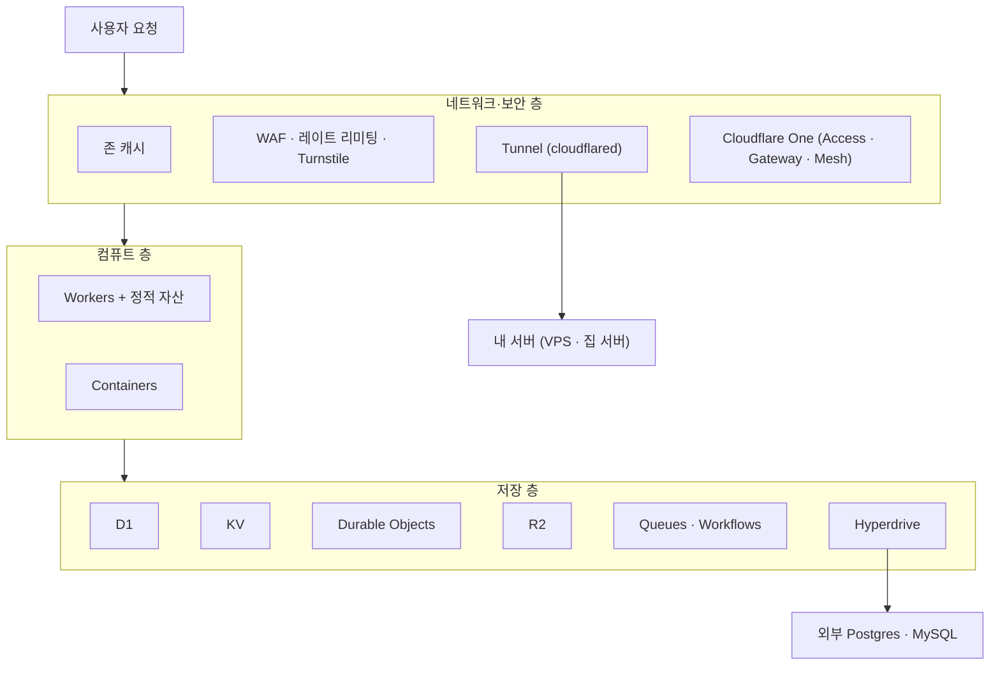
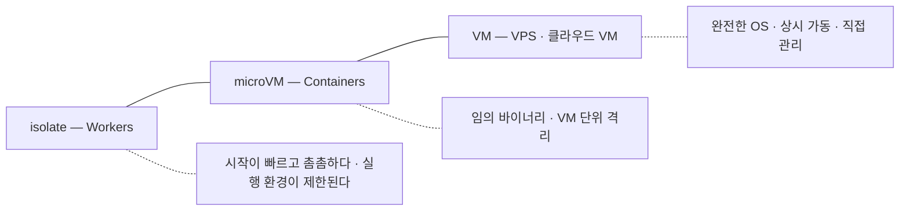

# 1장. Cloudflare를 나의 클라우드로 — 지도부터 펼치기

Cloudflare가 무슨 회사냐고 물으면 개발자 대부분이 비슷하게 답한다. "DNS를 옮겨두면 CDN이랑 SSL을 공짜로 주는 회사." 틀린 말은 아니다. 많은 사람이 도메인을 사고 네임서버를 Cloudflare로 돌려놓은 뒤, 주황색 구름 아이콘이 켜진 것을 확인하고는 그 계정을 다시 들여다보지 않는다. 그동안 그 계정 안에 무엇이 쌓여왔는지 모르는 채로 말이다.

그런데 2026년 10월의 Cloudflare 개발자 문서를 펼쳐보면 그림이 꽤 다르다. 코드를 실행하는 Workers가 있고, 그 옆에 관계형 데이터베이스 D1, 키-값 저장소 KV, 상태를 가진 객체 Durable Objects, S3와 호환되는 객체 저장소 R2, 큐와 워크플로가 있다. 컨테이너를 돌리는 Containers가 2026년 4월 13일 GA가 됐고, 집에 있는 서버를 포트 하나 열지 않고 세상에 내놓는 Tunnel과 팀의 내부 도구를 지키는 Cloudflare One(Zero Trust)까지 있다. 이쯤 되면 CDN은 이 회사가 가진 여러 층 가운데 맨 바깥 껍질에 가깝다. Cloudflare를 정확히 부르자면 "콘텐츠를 나르는 회사"보다는 "전 세계 데이터센터에 흩어진 하나의 거대한 컴퓨터를 빌려주는 회사"라는 쪽이 사실에 더 가깝다.

이 책은 그 컴퓨터를 나의 클라우드로 쓰는 이야기다. 사이드 프로젝트의 소개 페이지 하나에서 시작해 API와 데이터베이스를 붙이고, 이미 돌아가고 있는 Spring Boot 서버까지 연결해서, 하나의 서비스를 출시하고 오래 운영하는 데까지 함께 가보자. 출발하기 전에 할 일이 하나 있다. 지도를 펼치는 일이다. 낯선 도시에서 헤매는 이유는 골목 하나를 몰라서라기보다 동서남북을 몰라서인 경우가 많다.

## 플랫폼 지도 — 무엇이 어디에 있나

### 컴퓨트·저장·네트워크, 세 개의 층

Cloudflare의 개발자 제품은 수십 개다. 이름을 줄줄이 늘어놓으면 머리만 아프니, 세 개의 층으로 나눠 생각해보자.

첫째는 코드를 실행하는 컴퓨트 층이다. 중심에는 Workers가 있다. Worker 하나는 요청을 받아 응답을 돌려주는 작은 프로그램이고, Cloudflare 데이터센터 어디에서든 실행된다. Workers가 1급으로 지원하는 언어는 JavaScript, TypeScript, Python, Rust 네 가지이고(Workers 언어 문서 2026-07-03 기준), Python Workers는 2026년 9월 21일 GA가 됐다. 그 밖의 언어는 WebAssembly를 거쳐야 한다. Workers에 담을 수 없는 프로그램, 이를테면 임의의 리눅스 바이너리는 Containers가 받는다. Containers는 Workers Paid 요금제에서만 쓸 수 있다.

둘째는 데이터를 담는 저장 층이다. 선택지가 많다. 관계형 데이터는 SQLite 기반의 D1에, 드물게 바뀌는 설정은 최종 일관성을 가진 KV에, 강한 일관성이 필요한 상태는 Durable Objects에, 파일은 R2에 담는다. 비동기 작업은 Queues가, 여러 단계로 이어지는 긴 작업은 Workflows가 맡는다. Cloudflare 밖에 있는 Postgres나 MySQL에 붙어야 한다면 Hyperdrive가 연결 풀링과 캐시를 대신 해준다. 처음 보면 "같은 문제를 푸는 방법이 왜 이렇게 많지?" 싶을 것이다. 그 물음은 4장에서 정면으로 다룬다.

셋째는 네트워크와 보안 층이다. 원래 Cloudflare가 가장 잘하던 영역이다. 존 캐시와 WAF, 레이트 리미팅, 봇을 걸러내는 Turnstile이 공개된 앱의 앞을 지킨다. Tunnel(`cloudflared`)은 내 서버 쪽에서 바깥으로 연결을 맺어 서버를 공개하고, Cloudflare One은 Access·Gateway, 그리고 Mesh node(구 WARP Connector)로 대표되는 Cloudflare Mesh로 운영자와 내부 시스템을 지킨다.

그림 1. Cloudflare 개발자 플랫폼의 세 층

그림에서 한 가지가 눈에 띈다. 세 층이 모두 같은 네트워크 위에 있다는 점이다. 요청은 사용자와 가까운 데이터센터에 도착하고, 그 자리에서 보안 규칙을 지나고, 캐시를 확인하고, Worker를 실행하고, 필요하면 저장소에 다녀온다. 다른 클라우드였다면 CDN과 방화벽, 함수 실행 환경, 데이터베이스를 각각 따로 설정하고 리전을 고르고 권한 체계로 엮어야 했을 일이, 여기서는 하나의 계정과 하나의 설정 파일 안에서 끝난다. 이 편리함이 Cloudflare를 클라우드로 쓰는 가장 큰 이유다.

물론 편리함에는 대가가 따른다. 그 대가가 무엇인지는 코드가 실제로 어떻게 실행되는지를 들여다봐야 보인다.

## 격리 스펙트럼 — isolate, microVM, VM

### isolate — 한 프로세스 안의 여러 앱

클라우드가 남의 코드를 내 코드 옆에서 안전하게 돌리는 방법은 크게 세 갈래다. 가장 무거운 쪽에 VM이 있다. 운영체제를 통째로 하나 더 띄우니 격리는 단단하지만, 부팅에 시간이 걸리고 메모리도 많이 든다. 반대편 끝에는 isolate가 있다. V8 자바스크립트 엔진은 한 프로세스 안에 서로의 메모리를 볼 수 없는 실행 공간을 여러 개 만들 수 있는데, 이 공간을 isolate라고 부른다. 크롬 브라우저가 탭마다 자바스크립트를 나눠 돌리는 바로 그 기술이다. Workers는 이 isolate 위에서 돈다.

isolate 모델이 주는 이점은 무엇일까? 새 앱을 시작하는 데 운영체제도, 언어 런타임도 새로 띄울 필요가 없다. 이미 떠 있는 프로세스 안에 새 공간 하나만 만들면 된다. 2026년에 발표된 한 연구는 AWS Lambda, Google Cloud Run Functions, Cloudflare Workers, Deno Deploy, Fastly Compute 등 7개 서버리스 플랫폼을 3,800만 회 넘게 호출해 측정한 뒤, 그 결과를 이렇게 요약했다.

> "While first-generation platforms are based on containerized, centralized execution, the new generation leverages lightweight isolates and edge deployment. This evolution reduces warm request latency from approximately 40ms to around 10ms and reduces cold starts to an afterthought, but limits the execution environment."
> — Schirmer et al., "New Kids: An Architecture and Performance Investigation of Second-Generation Serverless Platforms", arXiv:2604.15916 (2026), 초록

1세대 서버리스는 컨테이너를 중앙 리전에서 돌렸고, 2세대는 가벼운 isolate를 엣지에 퍼뜨렸다. 그 결과 데워진 요청의 지연이 약 40ms에서 약 10ms로 줄고, 콜드 스타트는 부차적인 문제가 됐다는 것이다. 그런데 문장의 마지막 구절을 놓치지 말자. "but limits the execution environment." 실행 환경이 제한된다는 말이다. 이 한 구절이 이 책에서 몇 번이고 다시 마주칠 대가다. 마음대로 쓰는 파일 시스템도, 스레드도, 오래 붙잡고 있는 프로세스도 기대하기 어렵다. 그 구체적인 모습은 3장에서 하나씩 짚어보자.

### microVM과 VM — 무엇을 내주고 무엇을 얻나

isolate와 VM 사이에는 microVM이 있다. AWS Lambda와 Fargate가 쓰는 Firecracker가 대표적이다. 운영체제 커널을 따로 띄우는 진짜 가상 머신이지만, 꼭 필요한 장치만 남기고 나머지를 덜어냈다. Firecracker 논문(Agache et al., NSDI '20)에 따르면 microVM 하나의 메모리 오버헤드는 5MB 미만이고, 애플리케이션 코드까지 부팅하는 데 125ms가 채 걸리지 않으며, 호스트 하나에서 초당 최대 150개의 microVM을 만들 수 있다.

흥미롭게도 AWS 역시 isolate라는 선택지를 저울질했다. 논문은 V8 isolate 같은 언어 수준 격리를 검토했다고 밝히고, 그 길을 택하지 않은 이유를 이렇게 적는다.

> "Language-specific isolation techniques were not suitable for Lambda or Fargate, given our need to support arbitrary binaries." (§2.1.2)

임의의 바이너리를 돌려야 하는 플랫폼에는 isolate가 맞지 않았다는 얘기다. Cloudflare는 Workers에서 정반대의 선택을 했다. 임의의 바이너리를 포기하는 대신 밀도와 시작 속도를 얻었다. 그렇다고 Cloudflare에서 바이너리를 아예 못 돌리는 것은 아니다. 그 몫을 Containers가 맡는다. Cloudflare가 2026년 9월 24일 공개한 Containers 보안 사고 사후 분석은 그 구조를 이렇게 설명한다. "Each container lives inside a dedicated virtual machine powered by the Firecracker virtual machine monitor." 컨테이너 하나하나가 Firecracker로 띄운 전용 VM 안에 산다는 것이다. 결국 Cloudflare 안에도 스펙트럼의 양쪽 칸이 모두 있는 셈이다.

그림 2. 격리 스펙트럼 — 왼쪽으로 갈수록 가볍고, 오른쪽으로 갈수록 자유롭다

이 스펙트럼을 기억해두자. 앞으로 "이 작업은 어디에서 돌릴까?"라는 질문이 나올 때마다 답은 이 선 위의 한 점을 고르는 일이 된다. 가볍고 빠르지만 제약이 많은 왼쪽과, 무엇이든 돌릴 수 있지만 시작이 느리고 비용이 큰 오른쪽 사이에서 말이다.

JVM 개발자라면 여기서 묘한 기시감이 들 수도 있다. 하나의 JVM에 여러 애플리케이션을 올리고 security manager로 서로를 막던 시절을 기억하는 사람도 있을 것이다. Firecracker 논문도 "V8's isolates and the JVM's security managers"를 같은 범주로 묶고, 이런 방식이 기능·호환성과 Spectre 같은 부채널 공격 저항성 사이에 상당한 트레이드오프를 낳는다고 지적한다. isolate가 이 문제에 어떻게 대응하는지는 3장의 박스에서 다시 이야기하자.

### 드물게 불리는 앱들

그렇다면 콜드 스타트는 왜 이렇게까지 중요할까? 내 서비스는 트래픽이 많지도 않은데 말이다. 역설적이게도 트래픽이 적기 때문에 중요하다.

Microsoft Azure의 서버리스 워크로드 전체를 처음으로 공개 분석한 연구(Shahrad et al., "Serverless in the Wild", USENIX ATC '20)가 있다. 이 연구가 찾아낸 숫자는 이렇다.

> "45% of the applications are invoked once per hour or less on average, and 81% of the applications are invoked once per minute or less on average." (§3)

애플리케이션의 45%가 평균 한 시간에 한 번 이하로 호출된다. 사이드 프로젝트, 사내 도구, 동아리 행사 신청 페이지를 떠올려보자. 대부분 이 45% 안에 들어간다. 이런 앱은 다음 요청이 올 때까지 데워둔 채로 기다리기엔 너무 오래 쉬고, 그렇다고 매번 차갑게 시작하면 첫 사용자가 한참을 기다린다. 컨테이너나 VM 기반 플랫폼은 이 사이에서 "얼마나 오래 데워둘까"를 추측하는 휴리스틱에 기댈 수밖에 없다. 시작 비용 자체가 작은 isolate는 이 고민을 구조적으로 덜어준다.

같은 연구는 호출 빈도의 폭이 얼마나 넓은지도 보여준다. 초록의 표현을 빌리면 "most functions are invoked very infrequently, but there is an 8-order-of-magnitude range of invocation frequencies." 대부분의 함수는 아주 드물게 불리지만, 호출 빈도의 범위는 10의 8제곱 배에 걸친다. 애플리케이션 20% 미만이 전체 호출의 99.6%를 차지한다는 분석도 함께 실렸다. 소수의 인기 서비스가 트래픽 대부분을 만들고, 나머지 대다수는 조용히 기다린다는 뜻이다. 우리 서비스 대부분은 그 "나머지" 쪽에 서 있다.

이 대목이 이 책이 상정한 독자의 서비스와 Workers가 잘 맞물리는 지점이다. 드물게 불리는 앱을 거의 비용 없이 대기시켜두는 일, 바로 거기서 Cloudflare의 무료 티어가 힘을 쓴다.

## 무엇이 되고, 무엇이 안 되는가

### 돈의 지도, 첫 스케치

무료라는 말에 끌려 이 책을 펼쳤다면 마음 한편에 이런 불안도 있을 것이다. "그러다 어느 날 큰 청구서가 날아오면?" 이 질문에 정직하게 답하려면 요금 구조의 큰 틀부터 잡아야 한다.

먼저 헷갈리기 쉬운 점 하나. Cloudflare에는 요금 축이 두 개 있다. 하나는 존(zone), 곧 도메인 단위의 설정 공간에 붙는 요금제다. Free·Pro·Business 같은 이름이 여기에 속하고, 캐시 규칙 개수나 WAF 기능 범위가 이 요금제를 따라 달라진다. 다른 하나는 계정에 붙는 Workers 요금제로, Free와 Workers Paid가 있다. 둘은 서로 별개다. Workers 가격 문서는 이 점을 이렇게 못 박아둔다.

> "Workers Paid plan is separate from any other Cloudflare plan (Free, Professional, Business) you may have." — Workers Pricing (2026-10-02 기준)

그러니 존을 Pro로 올린다고 Workers 한도가 늘지 않고, Workers Paid로 바꾼다고 존의 WAF 규칙이 늘지 않는다. Workers Paid는 계정당 월 최소 $5다(Workers Pricing 2026-10-02 기준).

두 번째로 알아둘 점은 Free 플랜의 성격이다. Free에서 한도를 넘으면 대부분의 제품은 청구서를 만드는 대신 에러를 낸다. Workers는 하루 100,000 요청을 넘으면 Error 1027을 돌려주고, KV나 D1도 한도를 넘긴 연산은 실패시킨다. 돈이 나가지 않는 대신 서비스가 멈추는 구조다. 예외도 있다. R2는 결제수단을 등록한 구독 위에서 동작하고, 매달 무료 포함량을 넘는 사용분은 그대로 청구된다(R2 문서 2026-10 기준). 이 예외는 4장에서 처음으로 결제수단을 등록할 때 다시 짚는다.

세 번째가 가장 무거운 사실이다. 2026년 10월 현재, Cloudflare에는 계정 전체의 지출 상한(하드캡)을 거는 기능이 없다. 그래서 이 책은 유료 계정에서 여러 장치를 겹쳐 비용 사고의 반경을 줄이는 방법을 13장에서 따로 다룬다. 비용 이야기를 한 장에 몰아넣지 않고 장마다 "비용 메모"를 둔 것도 같은 이유에서다. 비용이 터지는 지점은 대개 제품 하나하나의 구석에 숨어 있다.

> **비용 메모**
> Workers Free는 요청 100,000/일(00:00 UTC 리셋), 호출당 CPU 10 ms까지이고 넘으면 Error 1027이다. Workers Paid는 계정당 월 최소 $5에 요청 월 1,000만 건이 포함되고, 초과분은 100만 건당 $0.30이다. 정적 자산 요청은 Free·Paid 모두 무료·무제한이다. (Workers Pricing 2026-10-02 기준)

### JVM 개발자에게 미리 하는 정직한 말

Spring Boot로 서비스를 만들어온 독자에게는 지금 말해두는 편이 낫겠다. Workers에는 JVM이 없다. 앞서 본 1급 지원 언어 목록에 Java도 Kotlin도 없다. WebAssembly를 거치는 길이 있긴 하지만, Workers는 스레드를 허용하지 않고 WASI 지원도 아직 실험적이라서 Spring 애플리케이션을 그대로 옮기는 길은 현실적이지 않다. 이 얘기는 3장에서 조금 더 구체적으로 하자.

그렇다면 이 책은 Spring 개발자에게 "Node로 다시 짜라"고 말하려는 걸까? 그렇지 않다. 이미 돌아가는 Spring 서버는 대개 회원, 결제, 정산처럼 서비스에서 가장 무거운 책임을 지고 있다. 그것을 버릴 이유는 없다. 이 책은 Spring 서버를 Cloudflare 옆에 두고 둘을 잇는 방법을 다룬다. 6장에서는 Tunnel로 포트를 열지 않고 Spring 서버를 공개한다. 7장에서는 그 서버가 살 곳을 세 가지 착지점으로 비교하고, Containers로 정산 배치를 돌리고, Workers와 같은 Postgres를 공유한다. 10장에서는 Spring Security로 Access가 발급한 JWT를 검증한다. Spring 서버는 책의 후반부 내내 서비스의 한 축으로 등장한다.

## `moim`, 그리고 네 개의 부

### 하나의 서비스가 자라는 길

추상적인 지도만 들고 걸으면 금방 지친다. 그래서 이 책은 하나의 예제 서비스를 처음부터 끝까지 함께 키운다. 이름은 `moim`, 개발자 밋업 신청 서비스다.

`moim`이 하는 일은 단순하다. 행사를 소개하고, 참가 신청을 받고, 선착순으로 좌석을 배정하고, 발표자가 자료를 올리게 하고, 유료 티켓을 팔고, 운영자가 신청 현황을 관리하게 한다. 그런데 이 단순한 서비스가 요구하는 것을 하나씩 뜯어보면 앞의 지도를 거의 다 지나간다. 소개 페이지는 정적 자산이고, 신청 폼은 봇을 막아야 하고, 선착순 좌석은 강한 일관성이 필요하다. 발표 자료는 객체 저장소에, 확인 메일은 큐에 들어간다. 유료 티켓은 외부 결제와 웹훅을, 운영자 화면은 제로 트러스트를, 사람이 몰리는 행사 페이지는 캐싱을 요구한다. 여기에 기존 회원·정산 시스템이 이미 Spring Boot 서버 `moim-core`로 돌아가고 있다고 해보자. 많은 독자의 현실과 크게 다르지 않을 것이다.

예제의 도메인은 `example.com`이다. 이 자리에 자기 도메인을 넣어 읽으면 된다. `moim`은 `moim.example.com`에서 서비스되고, API는 `/api/*` 아래에, 운영자 화면은 `/admin/*` 아래에 놓인다.

책은 네 부로 흐른다. 1부 "올리기"(1~5장)에서는 Cloudflare 안에서만 돌아가는 서비스를 완성한다. 2장에서 정적 페이지와 React SPA를 올리고, 3장에서 API를 만들며 Workers 런타임에 익숙해지고, 4장에서 데이터를 둘 곳을 고르고, 5장에서 프런트를 Next.js로 키운다. 2부 "잇기"(6~8장)에서는 Cloudflare 밖으로 손을 뻗어 Spring 서버와 외부 서비스를 연결한다. 3부 "지키기"(9~10장)에서는 공개된 앱과 내부 시스템을 차례로 보호한다. 4부 "운영하기"(11~14장)에서는 캐싱과 무료 티어 전략, 유료 계정의 비용 방어, 그리고 출시 점검을 다룬다.

이 순서에는 이유가 있다. 무엇을 Cloudflare 밖에 둘지는 안쪽의 모델을 알아야 판단할 수 있고, 무엇을 지킬지는 무엇을 만들고 이었는지 알아야 정할 수 있다. 제품 이름을 하나씩 외우는 것보다 "다음에 무엇이 필요해지는가"의 순서로 제품을 만나는 편이 훨씬 오래 남는다. 게다가 최근 몇 년 사이 Pages가 Workers로 수렴했고, 2026년 한 해에만 WARP Client가 Cloudflare One Client로, Browser Rendering이 Browser Run으로 이름을 바꿨다. 제품 목록은 빨리 낡지만 "이 데이터는 어디에 둘까" 같은 질문은 쉽게 낡지 않는다.

이제 지도는 펼쳐졌다. 세 개의 층, 하나의 격리 스펙트럼, 두 개의 요금 축. 마지막으로 하나만 물어보자. 지금 여러분 머릿속에 있는 그 서비스, 몇 달째 미뤄둔 사이드 프로젝트일 수도 있고 팀이 함께 쓰는 작은 사내 도구일 수도 있는 그것은 이 지도의 어디에 놓일까? 어느 부분이 isolate로 충분하고, 어느 부분이 스펙트럼의 오른쪽 칸을 필요로 할까? 무엇이 Free의 에러 안에서 안전하고, 무엇이 청구서로 이어질까? 답을 지금 낼 필요는 없다. 이 질문을 손에 쥔 채로 첫 배포를 해보자.
