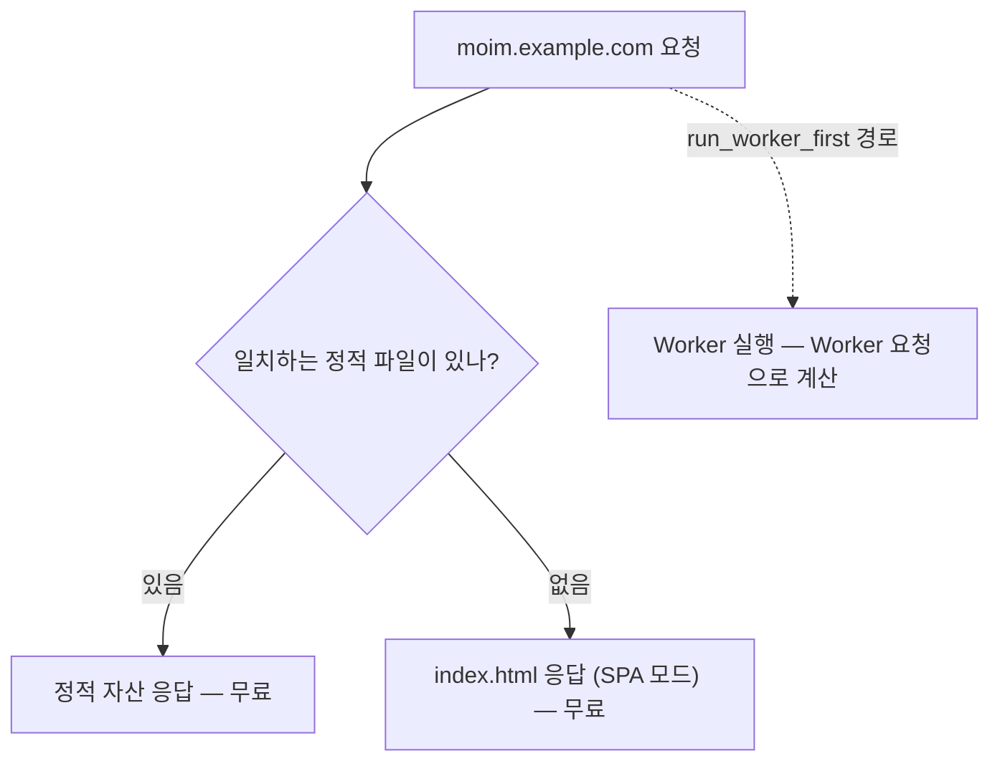

# 2장. 첫 배포 — 정적 사이트와 SPA를 Workers에 올리기

2026년 3월 무렵, Reddit의 r/CloudFlare 게시판에 이런 제목의 글이 올라왔다. "Help me understand Workers vs Pages in Cloudflare (I'm confused!)" Workers와 Pages가 뭐가 다른지 좀 알려달라, 헷갈려 죽겠다는 하소연이다. 가장 많은 추천(28점)을 받은 답글은 한 줄로 상황을 요약했다.

> "Cloudflare added backend functions to Pages and static hosting to Workers."

Pages에는 백엔드 함수가 붙었고, Workers에는 정적 호스팅이 붙었다. 원래 Pages는 정적 사이트용, Workers는 코드 실행용이었는데, 둘이 서로의 영역으로 기능을 넓히다 보니 결국 같은 일을 하는 두 제품이 나란히 서게 됐다는 얘기다. 답글을 단 사람은 앞으로를 생각하면 Workers를 쓰라고 조언했다. 같은 시기 비슷한 질문 글에는 Cloudflare가 "moving away from Pages", 그러니까 Pages에서 멀어지는 중이니 Workers를 쓰라는 답도 달렸다.

이 하소연이 낯설지 않은 독자가 많을 것이다. Cloudflare에 소개 페이지 하나 올려보려고 검색하면, 어떤 글은 Pages로 하라고 하고 어떤 글은 Workers로 하라고 하고, 몇 년 전 글은 Workers Sites라는 세 번째 이름을 꺼낸다. 첫 배포부터 길이 세 갈래로 갈라지는 셈이다. 난감한 출발이다. 이 혼란을 먼저 정리하고, `moim`의 첫 화면을 내 도메인에 올려보자.

## Pages인가 Workers인가

### 같은 일을 하는 두 제품

왜 이런 혼란이 생겼을까? 역사를 조금 거슬러 올라가면 이해가 쉽다. Pages는 Git 저장소를 연결하면 정적 사이트를 빌드해 올려주는 제품으로 출발했다. 그러다 동적인 처리가 필요해지자 `functions/` 폴더에 코드를 넣으면 실행해주는 Pages Functions가 생겼다. 반대편의 Workers는 코드를 실행하는 제품으로 출발했는데, HTML·CSS·이미지 같은 파일도 함께 서빙하고 싶다는 요구가 쌓이자 정적 자산(static assets)을 Worker에 묶어 올리는 기능이 생겼다. 두 제품이 각자 상대의 영역으로 걸어 들어오다 한가운데서 만난 셈이다.

여기에 Workers Sites라는 더 오래된 방식도 남아 있다. KV에 파일을 올려두고 Worker 코드가 그것을 꺼내 응답하는 방식이다. 오래된 튜토리얼을 따라 하다 보면 이 방식을 만나게 되는데, 지금 시작하는 프로젝트라면 그 튜토리얼은 덮어두는 편이 낫다. 이유는 바로 다음 절에서 볼 공식 문서에 있다.

그렇다면 익숙한 이름인 Pages로 일단 시작하고, 나중에 필요하면 옮기면 되지 않을까? 처음엔 그게 가장 안전해 보인다. Pages는 대시보드에서 Git 저장소를 연결하는 것만으로 배포가 끝나니 진입 장벽도 낮다. 하지만 그 선택에는 찜찜한 구석이 있다. 지금 편한 길이 1년 뒤에도 투자가 이어지는 길이라는 보장이 없다는 점이다. 이 책처럼 정적 사이트에서 시작해 API, 데이터베이스, 큐, 상태 있는 객체까지 키워갈 서비스라면 더욱 그렇다. Pages Functions로 시작한 코드는 나중에 Durable Objects나 Cron Triggers가 필요해지는 순간 다시 짜야 한다. 설정 파일 형식도, 헤더를 관리하는 방식도, 배포 명령도 달라진다. 처음 몇 시간을 아끼려다 몇 주 뒤에 이사를 하게 되는 셈이다. 나중에 옮기는 비용은 생각보다 크다. 그 비용이 어느 정도인지는 이 장 뒷부분에서 실제로 옮겨본 사람의 이야기로 확인해보자.

### 공식 답은 이미 나와 있다

다행히 이 질문에는 Cloudflare가 직접 답을 내놓았다. Pages 문서 첫머리에는 이런 문장이 있다(Pages 문서 2026-08-25 기준).

> "Start new projects with Workers."

새 프로젝트는 Workers로 시작하라는 말이다. Pages가 사라지는 것은 아니다. Cloudflare는 Pages를 계속 지원하겠다고 밝혔지만, 같은 공식 입장에 이런 단서가 붙어 있다.

> "Cloudflare Pages will continue to be supported, but, going forward, all of our investment, optimizations, and feature work will be dedicated to improving Workers."

지원은 계속하되 투자와 최적화, 새 기능은 전부 Workers로 간다는 것이다. Workers Sites는 더 분명하다. 문서는 Workers Sites가 Wrangler v4에서 폐기(deprecated)됐고 Cloudflare Vite 플러그인도 이를 지원하지 않는다고 적은 뒤, "Do not use Workers Sites for new projects."라고 못 박는다(Workers Sites 문서 2026-04-23 기준).

그래서 이 책의 기준은 단순하다. 새 사이트는 **Workers + 정적 자산**으로 만든다. Pages는 이미 쓰고 있는 사람을 위한 경로로만 다루고, Workers Sites는 쓰지 않는다.

Workers로 가면 무엇을 얻을까? Pages에서 Workers로 옮기는 공식 가이드는 비용 구조가 비슷하다고 안심시키면서도, Workers 쪽 기능 폭이 넓다는 점을 분명히 한다.

> "Unlike Pages, Workers has a distinctly broader set of features available to it, (including Durable Objects, Cron Triggers, and more comprehensive Observability)."

Durable Objects와 Cron Triggers, 더 풍부한 관측성. 4장에서 선착순 좌석을 Durable Objects로 만들고, 3장에서 로그를 켜는 `moim`에게는 처음부터 Workers 위에 서는 편이 자연스럽다.

## `moim-web` 첫 배포

### 정적 페이지 하나부터

가장 작은 것부터 시작하자. `moim`의 행사 소개 페이지 하나를 올리는 것이 목표다. 새 프로젝트는 C3(`create-cloudflare`)로 만든다. 문서의 표현대로 "`npm create cloudflare`, powered by the `create-cloudflare` package"다(2026-10-02 기준 최신 `create-cloudflare` 2.73.2).

```bash
npm create cloudflare@latest moim-web
cd moim-web
npm run dev        # 로컬 개발 서버
npx wrangler deploy
```

C3는 대화형으로 몇 가지를 묻는다. 프로젝트 종류와 언어, Git 초기화 여부 같은 것들이다. 정적 소개 페이지만 올릴 때는 가장 단순한 템플릿을 고르면 된다. 만들어진 폴더에서 눈여겨볼 파일은 `wrangler.jsonc` 하나다. Cloudflare는 새 프로젝트에 JSON 설정 파일을 권장하고, 일부 새 기능은 JSON 설정에서만 쓸 수 있다고 밝힌다("Cloudflare recommends using `wrangler.jsonc` for new projects, and some newer Wrangler features will only be available to projects using a JSON config file."). 이 책도 TOML 대신 `wrangler.jsonc`만 쓴다.

```jsonc
// moim-web/wrangler.jsonc — 정적 페이지만 있는 첫 버전
{
  "name": "moim-web",
  "compatibility_date": "2026-09-01",
  "assets": {
    "directory": "./public"
  }
}
```

`assets.directory`의 키 이름은 Wrangler 설정 문서 기준이다(사실 확인 필요). `public/` 폴더에 `index.html`과 스타일시트를 넣고 배포하면 끝이다. Worker 코드는 한 줄도 없다. 정적 자산만 있는 Worker도 엄연한 Worker다.

설정에서 한 줄을 더 짚고 가자. `compatibility_date`, 곧 호환성 날짜(compatibility date)다. Workers 런타임은 계속 바뀌는데, 어떤 변경은 기존 코드의 동작을 바꿀 수 있다. 호환성 날짜는 "이 Worker는 이 날짜 시점의 런타임 동작을 기대한다"는 선언이다. 날짜를 올리기 전까지는 그 뒤에 들어온 동작 변경이 내 Worker에 적용되지 않는다. 이 책은 모든 예제의 호환성 날짜를 `"2026-09-01"`로 통일한다. 이 날짜가 왜 중요한지는 Node.js 호환성과 얽혀 있어서 3장에서 다시 다룬다.

설정 파일이 아예 없는 프로젝트라면 어떨까? Wrangler 4.68.0부터는 `wrangler deploy`가 프레임워크를 감지해 필요한 어댑터를 설치하고 설정까지 알아서 해준다. 문서는 이렇게 설명한다. "Starting with Wrangler 4.68.0, running `wrangler deploy` automatically configures your project by detecting your framework, installing required adapters, and deploying it"(Changelog 2026-02-25). 기존 프로젝트를 빠르게 올려볼 때 편리하다. 다만 자동으로 만들어진 설정도 결국 `wrangler.jsonc`로 남으니, 한 번은 열어서 무엇이 들어갔는지 확인해두자.

배포가 끝나면 Wrangler가 `moim-web.{계정 서브도메인}.workers.dev` 형태의 주소를 알려준다. 브라우저로 열어 소개 페이지가 보이면 첫 배포 성공이다. 이 `workers.dev` 주소는 잠시 뒤 내 도메인을 붙이고 나면 꺼둘 것이다.

### React SPA와 무료 라우팅

소개 페이지 하나로는 서비스라 부르기 어렵다. 행사 목록과 상세 화면, 신청 폼을 오가는 React SPA로 키워보자. 빌드 도구는 Vite, 그리고 Cloudflare의 `@cloudflare/vite-plugin`을 쓴다(2026-10-02 기준 1.62.5). 이 플러그인의 장점은 로컬 개발 서버에서도 Worker 코드가 실제 런타임과 같은 환경에서 돈다는 점이다. 문서는 "Your Worker code runs inside workerd, matching the production behavior"라고 설명한다. `workerd`는 Workers의 오픈소스 런타임이다. 로컬에서는 되는데 배포하면 깨지는 일이 그만큼 줄어든다.

```ts
// moim-web/vite.config.ts
import { defineConfig } from "vite";
import react from "@vitejs/plugin-react";
import { cloudflare } from "@cloudflare/vite-plugin";

export default defineConfig({
  plugins: [react(), cloudflare()],
});
```

```jsonc
// moim-web/wrangler.jsonc — React SPA
{
  "name": "moim-web",
  "compatibility_date": "2026-09-01",
  "assets": {
    "not_found_handling": "single-page-application"
  }
}
```

Vite 플러그인을 쓰면 빌드 산출물의 위치는 플러그인이 채워준다. 플러그인 import 이름과 이 연동 방식은 Vite 플러그인 문서 기준이다(사실 확인 필요).

여기서 핵심은 `"not_found_handling": "single-page-application"` 한 줄이다. SPA는 `/events/42` 같은 주소를 브라우저 안의 라우터가 처리한다. 그런데 사용자가 그 주소에서 새로고침을 누르면 서버는 `/events/42`라는 파일을 찾다가 없으니 404를 돌려주기 쉽다. SPA를 처음 배포해본 사람이면 한 번쯤 겪는 문제다. 이 설정은 일치하는 파일이 없는 경로에 `index.html`을 돌려줘서 React 라우터가 화면을 이어받게 한다.

비용 측면에서도 이 한 줄이 중요하다. Cloudflare React 가이드는 이렇게 설명한다.

> "`assets.not_found_handling` is set to `single-page-application`, which means that routes that are handled by your React SPA do not go to the Worker, and are thus free."

SPA가 처리하는 경로는 Worker로 가지 않으니 무료라는 것이다. 정적 자산 요청은 애초에 과금 대상이 아니다. Static Assets 과금 문서의 표현을 그대로 옮기면 "Requests to static assets are free and unlimited"다(2026-04-23 기준).

반대로 Worker 코드를 먼저 실행하도록 지정한 경로는 사정이 다르다. `run_worker_first`에 적은 경로로 들어온 요청은 정적 파일이 있더라도 Worker 호출로 계산된다. Free 플랜에서 Worker 요청 한도를 넘기면 이 경로는 429를 돌려준다(Static Assets Billing 2026-04-23, Workers Limits 2026-09-05 기준). 인증 확인처럼 정말로 Worker가 먼저 봐야 하는 경로에만 쓰자.


그림 1. 요청이 정적 자산과 Worker로 갈라지는 경로

그림에서 Worker로 가는 화살표가 점선인 이유가 있다. `moim-web`은 지금 Worker 코드가 거의 필요 없는 상태이고, 그래서 거의 모든 요청이 왼쪽 두 갈래로 빠진다. API는 3장에서 별도의 Worker `moim-api`로 만든다. 프런트와 API를 처음부터 나눠두면, 프런트의 정적 요청은 계속 무료로 남고 비용은 API 쪽에서만 세면 된다.

### 로컬에서 먼저, 배포는 그다음

배포 버튼을 누르기 전에 로컬에서 충분히 확인하는 습관을 들이자. Workers 개발 도구는 생각보다 로컬 환경을 잘 맞춰준다.

먼저 Wrangler 자체에 대해 알아둘 점이 있다. Wrangler는 전역 도구로 깔아 쓰기보다 프로젝트마다 설치하는 도구다. 문서도 "Wrangler is installed locally into each of your projects."라고 적는다. C3로 만든 프로젝트라면 이미 `devDependencies`에 들어 있으니 `npx wrangler`로 그 버전을 쓰면 된다. 프로젝트마다 Wrangler 버전이 고정되니, 팀원마다 다른 버전으로 배포하는 일도 줄어든다. 이 책은 Wrangler v4(2026-10-02 기준 최신 4.147.0)를 기준으로 한다. Node.js는 현재(Current)·활성(Active)·유지보수(Maintenance) 버전을 지원한다고 문서에 적혀 있다.

React SPA를 Vite로 개발할 때는 `npm run dev` 하나면 된다. Vite 개발 서버가 뜨고, Cloudflare Vite 플러그인이 Worker 코드를 `workerd` 안에서 돌린다. 정적 자산과 SPA 라우팅도 배포 환경과 같은 규칙으로 동작한다. `/events/42`에서 새로고침을 눌러보면 SPA 모드가 제대로 걸렸는지 바로 확인할 수 있다.

참고로 2025년 12월부터는 Vite 플러그인을 쓸 때 Wrangler 설정 파일이 선택 사항이 됐다("Wrangler config is optional when using Vite plugin", Changelog 2025-12-08). 그래도 이 책은 `wrangler.jsonc`를 계속 둔다. 3장부터 바인딩이 하나둘 늘어나고, 13장에서는 Worker마다 비용 상한을 거는 설정을 넣는다. 그 설정을 한 파일에서 읽을 수 있어야 나중에 덜 헤맨다.

이 플러그인은 정적 SPA만을 위한 도구도 아니다. 문서는 TanStack Start와 React Router v8의 서버 사이드 렌더링을 공식 지원한다고 밝힌다("Official support for TanStack Start and React Router v8 with server-side rendering"). `moim-web`이 5장에서 서버 렌더링이 필요한 앱으로 자랄 때 이 선택지를 다시 만나게 된다. 또 플러그인이 만드는 빌드 결과물은 2026년 9월 베타로 공개된 새 CLI `cf`의 `cf build`·`cf deploy`에서도 쓸 수 있는 표준 형식이라고 한다. `cf`는 아직 베타라서 이 책은 Wrangler를 기본으로 쓰고, `cf`는 3장의 전망 박스에서만 짧게 소개한다.

### 내 도메인 붙이기

이제 `moim`을 `moim.example.com`에 올려보자. 먼저 도메인의 DNS를 Cloudflare로 옮긴다. 도메인을 산 등록 기관에서 네임서버를 Cloudflare가 알려주는 두 개의 주소로 바꾸면, 그 도메인은 Cloudflare 안에서 하나의 존이 된다. 존은 도메인 단위의 설정 공간이다. 캐시 규칙, WAF, DNS 레코드가 모두 존에 붙는다. 1장에서 본 Free·Pro·Business 요금제도 바로 이 존의 요금제다. 개인 프로젝트라면 존은 Free로 충분하다.

네임서버를 옮길 때 가장 신경 쓰이는 것은 기존 레코드다. 메일 서버를 가리키는 MX 레코드나 다른 서비스에 연결해둔 CNAME이 이사 중에 빠지면 메일이 끊기거나 엉뚱한 곳이 다운된다. Cloudflare는 존을 추가할 때 기존 DNS 레코드를 읽어와 목록으로 보여주니, 네임서버를 바꾸기 전에 그 목록이 원래 등록 기관의 레코드와 같은지 한 줄씩 대조해두자. 이 확인을 건너뛰면 나중에 원인을 찾느라 한참을 헤매게 된다. 네임서버 변경이 전 세계에 반영되기까지는 시간이 걸릴 수 있으니, 행사 공지를 내기 직전보다는 여유가 있을 때 옮기는 편이 낫다.

존이 활성화되면 Worker에 커스텀 도메인을 연결한다. 대시보드에서 해도 되지만, 설정을 코드로 남겨두는 편이 낫다.

```jsonc
// moim-web/wrangler.jsonc — 커스텀 도메인 연결
{
  "name": "moim-web",
  "compatibility_date": "2026-09-01",
  "assets": {
    "not_found_handling": "single-page-application"
  },
  "routes": [
    { "pattern": "moim.example.com", "custom_domain": true }
  ],
  "workers_dev": false
}
```

`routes`와 `custom_domain` 키의 형식은 Wrangler 설정 문서 기준이다(사실 확인 필요). 커스텀 도메인으로 연결하면 Cloudflare가 DNS 레코드와 인증서를 함께 만들어준다. 이 책이 서브도메인을 `moim.example.com`처럼 한 단계만 쓰는 데도 이유가 있다. 무료로 발급되는 기본 인증서(Universal SSL)는 루트 도메인과 한 단계 서브도메인까지를 덮기 때문이다(사실 확인 필요). `api.moim.example.com`처럼 두 단계로 내려가면 별도 인증서가 필요해질 수 있으니, API는 같은 호스트 아래 `/api/*` 경로로 둔다.

마지막 줄 `"workers_dev": false`를 보자. 커스텀 도메인을 붙였으니 `workers.dev` 주소는 끈다. 지금은 사소해 보여도, 내 도메인에 건 WAF와 레이트 리미팅 규칙을 우회하는 뒷문이 될 수 있는 주소다. 왜 그런지, 실제로 어떤 일이 벌어졌는지는 9장에서 자세히 살펴본다. 지금은 이 한 줄을 기본값처럼 넣어두는 습관만 들이자.

## 무료로 남는 구성

### Pages에서 옮겨오는 독자에게

이미 Pages로 사이트를 운영하고 있다면 당장 옮겨야 할까? 서두를 필요는 없다. Pages는 계속 지원되고, 정적 자산 요청은 Pages에서도 무료다. 마이그레이션 가이드도 비용 걱정은 크게 하지 않아도 된다고 말한다.

> "Like Pages, requests for static assets on Workers are free, and Pages Functions invocations are charged at the same rate as Workers, so you can expect a similar cost structure"

다만 옮기는 일이 가이드 한 장을 따라 하면 끝나는 수준은 아니다. 2025년 5월 Pages에서 Workers로 사이트를 옮긴 개발자 Bryce Wray는 공식 가이드에 대해 이렇게 적었다.

> "following it is no walk in the park."

결코 쉬운 산책이 아니었다는 말이다. 그는 Pages Functions를 단일 파일로 합쳐야 했고, CSP 헤더와 정적 자산 장기 캐시 전략을 다시 짜야 했다. Hacker News에도 비슷한 목소리가 있다. 한 사용자(aperture147, 2025-10-15)는 Pages가 저무는 분위기에서 Workers Assets로 옮기는 일이 고통스럽고, Wrangler 3에서 쓰던 설정이 Wrangler 4로 깔끔하게 넘어오지 않았다고 털어놓았다("Configs that worked in Wrangler 3 didn't carry over cleanly to Wrangler 4").

> **Pages에서 옮겨오는 독자에게**
> - `functions/` 폴더는 `npx wrangler pages functions build --outdir=./dist/worker/`로 하나의 Worker로 컴파일할 수 있다(마이그레이션 가이드 기준).
> - `_headers`로 관리하던 CSP·캐시 헤더는 옮긴 뒤 실제 응답 헤더로 다시 확인하자.
> - 새 기능(Durable Objects, Cron Triggers, 더 넓은 관측성)이 필요해지는 시점이 옮길 시점이다. 그 전까지는 Pages도 지원되는 경로다.

옮기기 전에 내 Pages 프로젝트가 어느 쪽인지부터 따져보자. `functions/` 폴더가 없는 순수 정적 사이트라면 이사는 비교적 가볍다. 빌드 결과물 폴더를 정적 자산으로 지정하고, 커스텀 도메인을 Worker로 옮기면 대부분 끝난다. 반대로 Pages Functions에 미들웨어와 여러 라우트가 얽혀 있다면, 그 코드를 하나의 Worker로 합치는 과정에서 테스트를 다시 돌려야 한다. 어느 쪽이든 새 Worker를 먼저 `workers.dev` 주소에서 띄워 기존 사이트와 응답을 나란히 비교한 다음, 도메인을 넘기는 순서가 안전하다.

정리하면 이렇다. 새로 시작한다면 처음부터 Workers로, 이미 Pages에 있다면 Workers에서만 되는 기능이 필요해질 때 계획을 세워 옮긴다. 옮길 때는 헤더와 캐시 설정을 가장 꼼꼼히 확인하자.

### 무료를 지키는 세 가지 원칙

`moim-web`은 지금 거의 공짜로 돈다. 이 상태를 오래 지키려면 세 가지 원칙을 기억해두면 된다.

첫째, 정적인 것은 정적 자산으로 둔다. HTML, 자바스크립트 번들, 이미지, 폰트는 Worker 코드로 응답하지 말고 정적 자산으로 올린다. 같은 파일을 Worker가 꺼내 돌려주는 순간 그 요청은 Worker 요청이 된다.

둘째, Worker는 꼭 필요한 경로에만 세운다. SPA 모드로 프런트 라우팅을 무료로 처리하고, `run_worker_first`는 정말 Worker가 먼저 봐야 하는 경로에만 쓴다. API는 별도 Worker로 분리한다.

셋째, 캐시 설정을 바꾸기 전에 과금 구조부터 확인한다. 2026년 9월 문서에 Worker 앞단에서 응답을 캐시하는 Workers Cache라는 기능이 새로 올라왔는데, 이것을 켜면 평소 무료이던 정적 자산 요청까지 요청 단가로 과금된다. "캐시는 켜면 싸진다"는 직관과 반대로 움직이는 함정이라, 11장에서 세 가지 캐시 경로를 비교하며 자세히 다룬다.

> **비용 메모**
> 정적 자산 요청은 Free·Paid 모두 무료·무제한이다. 대신 파일 수에 한도가 있다. Worker 버전당 Free 20,000개, Paid 100,000개(Paid의 10만 개는 Wrangler 4.34.0 이상 필요), 파일당 25 MiB다. `run_worker_first` 경로는 Worker 요청으로 계산되고, Free에서 요청 한도를 넘기면 429를 돌려준다. Workers Cache를 켜면 정적 자산 요청도 과금된다(11장 참조). (Static Assets Billing 2026-04-23, Workers Limits 2026-09-05, Workers Cache 2026-09-22 기준)

한국어 후기에도 같은 결론이 보인다. 2026년 8월 한 블로그(잡가이버)는 "도메인만 구입하고 Cloudflare 무료 플랜을 활용하면 호스팅비 없이 DB가 연결된 개인 홈페이지나 소형 블로그를 운영할 수 있습니다."라고 정리했다. DB 연결은 4장의 몫이지만, 도메인값 말고는 돈이 들지 않는 출발선에는 이미 서 있는 셈이다.

이제 직접 해볼 차례다. 여러분의 사이트 하나를 지금 Workers에 올려보고, 다음 세 가지를 확인해보자. 하나, SPA의 깊은 경로(예를 들어 `/events/42`)에서 새로고침했을 때 404 없이 화면이 이어지는가. 둘, `workers.dev` 주소로 접속했을 때 사이트가 열리지 않는가. 셋, 대시보드의 Worker 지표에서 페이지를 여러 번 오간 뒤에도 Worker 요청 수가 거의 늘지 않는가. 세 가지가 모두 기대대로라면, 여러분의 첫 화면은 무료로, 그리고 내 도메인 위에서 돌고 있다.
