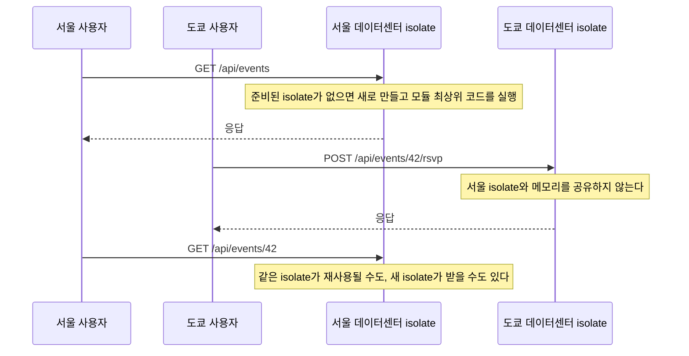

# 3장. Workers 런타임 — JVM 개발자의 멘탈 모델 바꾸기

10년 가까이 Spring Boot로 백엔드를 만들어온 개발자가 `moim`의 API를 Workers로 만들게 됐다고 해보자. 손에 익은 대로 설계를 시작한다. 행사 목록은 자주 바뀌지 않으니 메모리에 캐시해두면 좋겠다. 클래스 맨 위에 `static final Map<Long, Event> cache`를 두던 습관대로, TypeScript 모듈 최상위에 `const cache = new Map()`을 선언한다. 참가 신청이 들어오면 확인 메일 발송은 응답과 상관없으니 `@Async`처럼 별도 스레드로 넘기고 싶다. 스레드 풀 크기는 넉넉히 열 개쯤. DB 커넥션 풀도 처음에 스무 개쯤 열어두면 되겠다.

코드는 컴파일되고, 로컬에서도 잘 돈다. 그런데 배포하고 나면 이상한 일이 벌어진다. 어떤 요청은 캐시를 보고 어떤 요청은 못 본다. 방금 신청한 사람이 새로고침하면 신청 내역이 사라졌다가 다시 나타난다. 스레드를 만드는 코드는 아예 쓸 데가 없다. 왜 이런 일이 생길까?

답은 Workers가 Spring 서버와도, Node 서버와도 다른 방식으로 코드를 실행하는 데 있다. 1장에서 본 격리 스펙트럼의 가장 왼쪽 칸, isolate 위에서 산다는 것이 무슨 뜻인지 하나씩 파헤쳐보자. 이 감각을 먼저 몸에 익혀야 `moim-api`를 안전하게 설계할 수 있다.

## isolate 위에서 산다는 것

### 요청이 오면 깨어나는 코드

Spring Boot 서버는 한 번 뜨면 오래 산다. `main`이 실행되고, 스프링 컨테이너가 빈을 만들고, 톰캣이 포트를 열고, 그다음부터는 몇 주씩 같은 프로세스가 요청을 받는다. 그래서 `static` 필드에 캐시를 두면 그 캐시는 모든 요청이 함께 본다. 서버가 한 대라면 말이다.

Workers는 출발점이 다르다. 내가 만든 Worker는 어느 한 서버에서 상주하지 않는다. 요청이 사용자와 가까운 데이터센터에 도착하면, 그곳에서 내 코드를 담은 isolate가 준비되고 요청을 처리한다. 이미 준비된 isolate가 있으면 그것을 다시 쓰고, 없으면 새로 만든다. 서울 사용자와 도쿄 사용자의 요청은 서로 다른 데이터센터의 서로 다른 isolate가 처리할 가능성이 높다. 같은 데이터센터 안에서도 isolate가 하나라는 보장은 없다.


그림 1. 요청과 isolate의 수명 주기

그림이 말해주는 것은 단순하다. 모듈 최상위에 둔 `cache` 맵은 그 isolate 하나의 메모리일 뿐이다. 서울의 isolate가 채운 캐시를 도쿄의 isolate는 보지 못한다. 같은 isolate가 연속으로 요청을 받으면 캐시가 살아 있는 것처럼 보이지만, 그 isolate가 언제까지 살아 있을지는 내가 정할 수 없다. 앞의 Spring 개발자가 본 "보였다 안 보였다 하는 신청 내역"이 바로 이 현상이다.

그렇다고 전역 변수를 아예 쓰지 말라는 말은 아니다. 파싱해둔 설정이나 재사용 가능한 클라이언트 객체처럼 "있으면 좋고 없으면 다시 만들면 되는 것"은 전역에 둬도 괜찮다. 문제는 전역 변수를 진실의 원천으로 믿는 순간이다. 여러 요청이 함께 봐야 하는 상태, 사라지면 안 되는 상태는 isolate 밖에 둬야 한다. 그 자리가 4장에서 고를 D1, KV, Durable Objects 같은 저장소다. 이 원칙을 기억해두자. Workers에서 전역 상태는 캐시일 수는 있어도 데이터베이스일 수는 없다.

### 스레드가 없는 세계

두 번째 습관인 스레드 풀은 더 일찍 막힌다. Workers 문서는 짧고 분명하게 적는다.

> "Threading is not possible in Workers. Each Worker runs in a single thread, and the Web Worker API is not supported."

스레드를 만들 수 없고, 각 Worker는 단일 스레드에서 돈다. 그렇다면 동시에 들어오는 요청은 어떻게 처리할까? 자바스크립트의 비동기 모델로 처리한다. 한 요청이 DB나 외부 API의 응답을 기다리는 동안, 같은 isolate는 다른 요청의 코드를 실행할 수 있다. 블로킹 대신 `await`로 기다리는 방식이라 스레드 없이도 여러 요청이 겹쳐 흐른다. 대신 그 요청들은 메모리를 나눠 쓴다. isolate 하나의 메모리는 128 MB이고, 그 isolate 안의 동시 요청이 이를 함께 쓴다(Workers Pricing 2026-10-02 기준). 요청마다 커다란 배열을 만드는 코드가 동시에 몰리면 생각보다 빨리 한도에 닿는다.

JVM 개발자가 특히 헷갈리는 것이 CPU 시간이다. Free 플랜의 호출당 CPU 한도는 10 ms다. 처음 들으면 "10 ms 안에 DB 조회까지 끝내야 한다고?" 하고 놀라기 쉽다. 하지만 이 10 ms는 벽시계 시간이 아니라 CPU가 실제로 내 코드를 실행한 시간이다. 외부 응답을 기다리는 동안은 CPU 시간이 흐르지 않는다. 가격 문서는 Duration, 곧 실행 경과 시간에 대해 "No charge or limit for duration"이라고 적는다(Workers Pricing 2026-10-02 기준). JSON을 만들고 요청을 검증하는 정도의 API라면 10 ms는 생각보다 넉넉하다. 반대로 이미지 변환이나 큰 데이터 정렬처럼 CPU를 오래 쓰는 일은 Workers Paid로 가야 한다.

마지막으로 `@Async`처럼 응답 뒤에 일을 남기는 습관이 있다. Workers에서 응답을 돌려준 뒤에도 작업을 이어가려면 핸들러가 받는 실행 컨텍스트의 `ctx.waitUntil()`에 그 작업의 Promise를 넘긴다(사실 확인 필요). 다만 이것은 응답 뒤에 잠깐 더 일할 시간을 주는 장치일 뿐, 백그라운드 작업자를 대신하지 못한다. 실패하면 다시 시도해야 하는 일, 오래 걸리는 일은 4장의 Queues로 넘기는 편이 낫다. `moim`의 확인 메일도 그렇게 처리한다.

> **isolate는 안전한가**
> 남의 코드와 한 프로세스를 나눠 쓴다는 말에 불안해지는 것은 당연하다. 실제로 이 질문은 학계에서도 진지하게 다뤄졌다. AWS의 Firecracker 논문(NSDI '20)은 "Some language VMs (such as V8's isolates and the JVM's security managers) aim to run multiple workloads within a single process, an approach which introduces significant tradeoffs between functionality (and compatibility) and resistance to side channel attacks such as Spectre"라고 지적한다. 같은 프로세스 격리는 Spectre 같은 부채널 공격 저항성과 트레이드오프가 있다는 말이다.
> 반대편 연구도 있다. Schwarzl, Borrello, Kogler, Varda, Schuster, Schwarz, Gruss의 ESORICS 2022 논문 "Robust and Scalable Process Isolation Against Spectre in the Cloud"는 Cloudflare Workers 환경에서 원격 Spectre 공격을 실제로 시연했고(분당 2비트 누출), 하드웨어 성능 카운터로 의심스러운 Worker를 찾아 별도 프로세스로 옮기는 DyPrIs를 제안했다. 초록은 "With a false-positive rate of only 0.61%, we demonstrate that DyPrIs outperforms strict process isolation while statistically maintaining its security guarantees"라고 적는다. 저자 가운데 Kenton Varda는 Cloudflare 엔지니어다.
> Workers가 실행 중 시간 측정 능력을 제한하고 멀티스레딩을 막는 것도 이런 방어의 일부로 설명된다(사실 확인 필요). 스레드가 없는 세계는 불편함이면서 동시에 보안 설계의 결과다.

## 웹 표준 위의 Node.js

### Node 서버가 아닌데 Node 패키지가 돈다

Workers 코드는 무엇을 기준으로 쓰는 코드일까? Node.js 코드라고 생각하기 쉽지만, 출발점은 웹 표준 API다. `fetch`, `Request`, `Response`, `URL`, `crypto.subtle`처럼 브라우저에서 쓰던 API가 기본이다. 서버 측 자바스크립트 런타임들이 공통으로 지원할 웹 API의 최소 집합을 정한 표준도 있다. WinterTC(Ecma TC55)가 만든 ECMA-429 "Minimum Common Web API"로, 2025년 12월에 1판이 나왔다. 웹 표준 API로 짠 코드는 Workers뿐 아니라 다른 런타임으로도 옮기기 쉽다. 이 성질은 14장에서 출구 전략을 이야기할 때 다시 쓸모가 생긴다.

그렇다고 npm의 방대한 Node 패키지를 포기해야 하는 것은 아니다. Workers는 Node.js 호환 계층을 제공하고, 2026년 8월부터는 이것이 기본으로 켜진다. 문서의 표현은 이렇다.

> "For compatibility dates of `2026-08-04` or later, Workers enables both `nodejs_compat` and `nodejs_compat_v2` by default."
> — Node.js 문서 (2026-08-12 기준)

2장에서 이 책의 모든 예제가 호환성 날짜를 `"2026-09-01"`로 통일한다고 했다. 그 날짜가 `2026-08-04` 이후이니, 우리 Worker들은 따로 플래그를 넣지 않아도 Node.js 호환이 켜진 상태다. 오래된 글이나 예제에서 `"compatibility_flags": ["nodejs_compat"]`를 꼭 넣으라고 하는 것은 호환성 날짜가 `2024-09-23`부터 `2026-08-03` 사이였던 시절의 이야기다. 반대로 호환 계층을 일부러 끄고 싶다면 `"compatibility_flags": ["no_nodejs_compat", "no_nodejs_compat_v2"]`를 넣는다. `node:crypto`, `node:buffer`, `node:stream`, `node:fs` 같은 모듈에 기대는 npm 패키지는 추가 설정 없이 동작한다고 문서는 설명한다.

여기에 함정이 하나 숨어 있다. 모든 Node 모듈이 진짜로 구현돼 있는 것은 아니다. 일부 모듈은 문서 표현대로 "polyfill shim implementations that Wrangler adds to your Worker's code, allowing it to import the module, but calling API methods will throw errors"다. import는 되는데, 메서드를 부르면 에러가 난다. 빌드도 통과하고 배포도 되는데 특정 기능을 쓰는 순간 터지는 것이다. 이런 버그는 찾기가 정말 난감하다. 새 npm 패키지를 들일 때는 로컬에서 그 패키지의 핵심 경로를 실제로 한 번 실행해보는 습관을 들이자. 테스트가 그 역할을 해주면 더 좋다.

이 변화 덕분에 "npm 패키지가 Workers에서 안 돈다"는 2024년 무렵의 불만은 상당 부분 해소됐다. 대신 프레임워크가 Node 내부 동작을 깊이 건드리는 지점에서 새 문제가 생기곤 하는데, 그 사례는 5장에서 Next.js를 올리며 만난다.

## `moim-api` 만들기

### Hono로 뼈대 세우기

이제 `moim-api`를 만들어보자. 프레임워크는 Hono를 쓴다. Cloudflare 문서에 Hono 가이드가 따로 있을 만큼 Workers와 궁합이 좋고, 웹 표준 `Request`/`Response` 위에서 동작해서 앞에서 본 원칙과도 잘 맞는다. Spring MVC의 `@RestController`에 익숙하다면 라우팅 코드는 금방 읽힌다.

```ts
// moim-api/src/index.ts
import { Hono } from "hono";

type Event = { id: number; title: string; capacity: number };
type Rsvp = { eventId: number; name: string; email: string };

// ⚠ 메모리 목업 — isolate마다 따로 존재한다. 4장에서 D1·Durable Objects로 바꾼다.
const events: Event[] = [
  { id: 42, title: "Cloudflare로 서비스 운영하기", capacity: 50 },
];
const rsvps: Rsvp[] = [];

const app = new Hono();

app.get("/api/events", (c) => c.json(events));

app.post("/api/events/:id/rsvp", async (c) => {
  const eventId = Number(c.req.param("id"));
  if (!events.some((e) => e.id === eventId)) {
    return c.json({ error: "행사를 찾을 수 없다" }, 404);
  }
  const body = await c.req.json<Partial<Rsvp>>().catch(() => ({}));
  if (!body.name || !body.email?.includes("@")) {
    return c.json({ error: "이름과 이메일을 확인하자" }, 400);
  }
  rsvps.push({ eventId, name: body.name, email: body.email });
  return c.json({ ok: true }, 201);
});

export default app;
```

Hono API의 세부 시그니처는 Hono 문서 기준이다(사실 확인 필요). 마지막 줄 `export default app`을 눈여겨보자. Spring에서는 `DispatcherServlet`이 요청을 받아 컨트롤러로 나눠주고, 그 서블릿을 톰캣이 품는다. Workers에는 톰캣도, 서블릿 컨테이너도 없다. 모듈이 내보내는 객체 하나가 곧 요청 처리기이고, Hono 앱이 그 역할을 맡는다. 서버를 띄우는 코드, 포트를 여는 코드가 한 줄도 없다는 점이 낯설면서도 시원하다. 서버를 띄우고 유지하는 일은 플랫폼의 몫이고, 우리 코드는 요청 하나를 받아 응답 하나를 돌려주는 함수에 가깝다. 신청 요청의 본문을 검증하는 부분은 일부러 단순하게 썼다. 실무라면 스키마 검증 라이브러리를 붙이겠지만, 여기서 보여주고 싶은 것은 다른 데 있다. `rsvps` 배열이다. 앞 절에서 본 그대로, 이 배열은 isolate 하나의 메모리에 산다. 로컬에서 몇 번 신청해보면 잘 쌓인다. 하지만 배포한 뒤에는 데이터센터마다, isolate마다 다른 배열이 생긴다. 이 목업이 왜 위험한지 이제는 보일 것이다. 4장에서 이 자리를 진짜 저장소로 바꾼다.

```jsonc
// moim-api/wrangler.jsonc
{
  "name": "moim-api",
  "main": "src/index.ts",
  "compatibility_date": "2026-09-01",
  "routes": [
    { "pattern": "moim.example.com/api/*", "zone_name": "example.com" }
  ],
  "workers_dev": false,
  "observability": { "enabled": true }
}
```

`main`과 `routes`의 `zone_name` 키 형식은 Wrangler 설정 문서 기준이다(사실 확인 필요). `moim-api`는 `moim.example.com/api/*` 경로에 라우트로 붙는다. 2장에서 `moim-web`을 같은 호스트에 커스텀 도메인으로 연결했으니, `/api/*` 요청이 라우트 쪽 Worker로 가는지는 배포 후 반드시 확인해두자. 커스텀 도메인과 라우트가 같은 호스트에서 겹칠 때 어느 쪽이 우선하는지는 공식 문서로 확인이 필요하다(사실 확인 필요).

Worker를 둘로 나눴으니 둘이 서로 부를 일도 생긴다. 여기서 한 가지 제약을 미리 알아두자. Workers 한도 문서에는 이런 문장이 있다.

> "Using global `fetch()` to call another Worker on the same zone without service bindings fails."

같은 존에 있는 다른 Worker를 전역 `fetch()`로 부르면 실패한다. Spring 서버끼리 HTTP로 부르던 습관대로 `fetch("https://moim.example.com/api/events")`를 `moim-web`의 Worker 코드에 넣으면 동작하지 않는다는 뜻이다. 그 대신 Service binding을 쓴다. Service binding은 한 Worker가 다른 Worker를 바인딩으로 직접 부르는 방법이고, 문서 표현대로 "without configuration pain, performance overhead or need to learn RPC protocols" 마이크로서비스의 분리 효과를 준다. 게다가 Service binding으로 다른 Worker를 부르는 요청에는 추가 요청 요금이 붙지 않는다(Workers Pricing 2026-10-02 기준). `moim-web`이 서버 렌더링을 하며 `moim-api`를 부르게 되는 5장에서 실제로 연결해보자.

### 한도와 에러

Spring 서버는 메모리와 CPU를 내가 고른 서버 사양만큼 쓴다. Workers는 사양을 고르는 대신 한도 안에서 산다. 그 한도를 미리 알아두면 에러 화면을 보고 당황할 일이 줄어든다. 주요 한도를 한 번에 정리해보자(별도 표기가 없으면 Workers Pricing 2026-10-02, Workers Limits 2026-09-05 기준).

| 항목 | Free | Workers Paid |
|---|---|---|
| 호출당 CPU 시간 | 10 ms | 기본 30초, `limits.cpu_ms`로 최대 5분 |
| isolate 메모리 | 128 MB (동시 요청이 공유) | 128 MB (동시 요청이 공유) |
| 호출당 서브리퀘스트 | 외부 50, 내부 서비스 1,000 | 기본 10,000, `limits.subrequests`로 최대 1,000만 |
| 응답 헤더를 기다리는 동시 연결 | 6개 | 6개 |
| Worker 시작 시간 | 1초 | 1초 |
| Worker 크기 | 비압축 64 MiB | 비압축 64 MiB |
| 요청 수 | 100,000/일 | 월 1,000만 포함, 초과분 과금 |

CPU 한도를 넘으면 Error 1102, "Worker exceeded resource limits"를 만난다. Free에서 이 에러를 자주 본다면 코드가 CPU를 오래 쓰는 일을 하고 있다는 신호다. 무거운 일을 Queues로 빼거나 Workers Paid로 옮길 시점이다. 표의 마지막 줄, Free의 하루 100,000 요청을 넘기면 만나는 에러는 성격이 다르다. 사용량이 만든 에러이고, 그것을 어떻게 설계에 활용할지는 12장에서 다룬다.

동시 연결 6개 한도는 커넥션 풀 감각과 부딪히는 지점이다. 2026년 4월 완화된 규칙은 이렇다. "Each Worker invocation can have up to six connections simultaneously waiting for response headers." 그리고 "Once response headers arrive for a connection, it no longer counts toward the six-connection limit."(Changelog 2026-04-09) 응답 헤더를 기다리는 연결만 세고, 헤더가 도착하면 숫자에서 빠진다. 외부 API를 한 요청에서 수십 개씩 동시에 부르는 코드라면 이 한도를 의식해야 한다. 외부 DB에 연결할 때의 풀링 문제는 7장의 Hyperdrive가 맡는다.

Worker 시작 시간 한도는 2025년 10월 400 ms에서 1초로 늘었다. 모듈 최상위 코드가 무거우면, 예컨대 큰 데이터를 파싱하거나 수많은 모듈을 초기화하면 이 한도에 걸린다. 크기 한도는 더 크게 바뀌었다. 2026년 9월 4일부터 Free·Paid 모두 비압축 64 MiB다. 인터넷에 남은 "Free 3 MB, Paid 10 MB"나 "15 MB" 같은 숫자는 그 이전의 낡은 값이니, 옛 글을 보고 번들을 줄이느라 애쓸 필요는 없다.

이 한도들의 비용 측면, 곧 `limits.cpu_ms`와 `limits.subrequests`를 일부러 낮게 걸어 폭주를 막는 방법은 13장에서 다룬다. 여기서는 이 숫자들이 런타임의 성격을 보여준다는 점만 짚어두자. 짧게 실행되고, 적게 기다리고, 가볍게 시작하는 코드가 Workers에 맞는 코드다.

> **비용 메모**
> Workers Free는 하루 요청 100,000회(00:00 UTC 리셋)와 호출당 CPU 10 ms까지다. 요청 한도를 넘기면 Error 1027, CPU 한도를 넘기면 Error 1102를 만난다. Workers Paid는 계정당 월 최소 $5에 요청 월 1,000만 건과 CPU 3,000만 ms가 포함되고, 초과분은 요청 100만 건당 $0.30, CPU 100만 ms당 $0.02다. 실행 경과 시간(Duration)에는 과금하지 않고, Service binding으로 다른 Worker를 부르는 요청에는 추가 요청 요금이 없다. (Workers Pricing 2026-10-02 기준)

### 개발 루프 — 로컬, 테스트, 로그

코드를 고칠 때마다 배포해서 확인할 수는 없다. 로컬 개발부터 보자. Wrangler v4의 로컬 개발 서버는 `workerd` 위에서 Worker를 돌린다(2026-10-02 기준 최신 4.147.0).

```bash
npx wrangler dev          # 로컬에서 moim-api 실행
npx wrangler types --check # 바인딩 타입 정의가 설정과 맞는지 확인
npx wrangler deploy
```

`wrangler dev` 명령은 Wrangler 문서 기준이다(사실 확인 필요). `wrangler types --check`는 2026년 1월에 추가됐는데, 설정 파일의 바인딩과 생성된 타입 정의가 어긋나지 않았는지 CI에서 확인할 때 유용하다. 4장에서 바인딩이 여섯 개로 늘어나면 고마움을 느낄 것이다.

로컬에서 실제 Cloudflare 리소스에 붙어야 할 때도 있다. 운영 DB의 데이터 모양을 보며 디버깅하고 싶을 때가 그렇다. 2025년 9월 GA가 된 remote bindings를 쓰면 바인딩마다 `"remote": true`를 붙여 그 바인딩만 실제 리소스로 연결할 수 있다. 문서 표현은 "add `"remote" : true` to each binding that you want to rely on a remote resource running on Cloudflare"다. 편리한 만큼 운영 데이터를 로컬 코드로 건드리게 되니, 쓰기 작업에는 신중하자.

테스트는 Vitest와 `@cloudflare/vitest-plugin`으로 쓴다(2026-10-02 기준 1.3.6). 이 패키지는 2026년 8월 이름이 바뀌었다. 문서는 "Version 1 of the Workers Vitest integration is published as `@cloudflare/vitest-plugin`. The package was formerly named `@cloudflare/vitest-pool-workers`."라고 적는다. 예전 이름으로 된 글을 보고 설정했다면 `npx @cloudflare/codemods vitest:pool-workers-to-vitest-plugin`으로 자동 전환할 수 있다. 바깥으로 나가는 요청을 흉내 낼 때는 `@msw/cloudflare` 통합을 쓰라고 권한다. 설정 파일은 패키지 이름이 바뀐 만큼 예전 글을 그대로 옮기지 말고 v1 문서의 시작 가이드를 따르자.

```ts
// moim-api/test/events.test.ts
import { SELF } from "cloudflare:test";
import { describe, expect, it } from "vitest";

describe("moim-api", () => {
  it("행사 목록을 돌려준다", async () => {
    const res = await SELF.fetch("https://moim.example.com/api/events");
    expect(res.status).toBe(200);
  });

  it("이메일이 없으면 신청을 거절한다", async () => {
    const res = await SELF.fetch("https://moim.example.com/api/events/42/rsvp", {
      method: "POST",
      body: JSON.stringify({ name: "토비" }),
    });
    expect(res.status).toBe(400);
  });
});
```

테스트 헬퍼 `SELF`와 `cloudflare:test` 모듈 이름이 v1에서도 같은지는 확인이 필요하다(사실 확인 필요). 테스트가 `workerd` 위에서 실행되니, 앞에서 말한 폴리필 함정도 여기서 걸러낼 수 있다. Spring의 MockMvc 테스트처럼 HTTP 요청 단위로 Worker를 두드리는 감각이다. 한 가지 주의하자. Miniflare v5가 2026년 9월에 나왔지만 GitHub상 5.x는 아직 알파 프리릴리스이고, 공식 문서도 대부분의 프로젝트는 Miniflare에 직접 의존하지 말고 Wrangler·Vite 플러그인·Vitest 통합을 쓰라고 권한다.

마지막은 로그다. 앞의 `wrangler.jsonc`에 넣은 `"observability": { "enabled": true }` 한 줄이 Workers Logs를 켠다. 대시보드에서 요청별 로그와 `console.log` 출력을 볼 수 있다. Free에서도 켤 수 있고, 2026년 12월 1일부터는 로그와 트레이스를 묶은 Cloudflare Observability 가격으로 바뀐다고 2026년 10월 공지됐다. 운영 관점의 관측성은 14장에서, 비용 관점은 13장에서 다시 본다.

> **비용 메모**
> Workers Logs(현행 가격, 2026-11-30까지)는 Free 하루 20만 이벤트·보존 3일, Workers Paid 월 2,000만 이벤트·보존 7일이 포함되고 초과분은 100만 이벤트당 $0.60이다. 2026년 12월 1일부터는 Cloudflare Observability 통합 가격으로 바뀌며, 2026-10 공지 기준 Free는 하루 수집 한도에 닿으면 수집이 멈추고 Paid는 포함량을 넘어도 자동으로 계속 과금된다. (Workers Pricing·Observability Pricing 2026-10-02 기준)

## Spring을 Workers로 옮길 수 있을까

### Wasm 경로의 현실

이쯤 되면 JVM 개발자에게는 마지막 질문이 남는다. 그래도 내 Spring 코드를 어떻게든 Workers에서 돌릴 방법은 없을까?

이론상 경로는 WebAssembly다. Workers 문서는 Wasm을 통해 "C, C++, Kotlin, Go and more"로도 Worker를 쓸 수 있다고 소개한다. 하지만 현실은 녹록지 않다. 먼저 Kotlin/Wasm은 JetBrains 공식 문서 기준으로 아직 Beta다(kotlinlang.org 2026-09-01 수정). 일부 요약 글이 "stable"이라고 적은 것과 다르니 1차 문서를 따르자. 게다가 Kotlin/Wasm은 백엔드 애플리케이션에 WASI를 쓰는데, Workers의 WASI 지원은 문서 표현으로 "experimental on Cloudflare Workers, with only some syscalls implemented"다.

Java 쪽 실험도 있다. 2024년 8월 한 개발자가 TeaVM으로 Java를 Wasm으로 컴파일해 Workers에서 돌려본 글을 남겼다. 그런데 그 글에도 "`java.util.concurrent` and other threading operations are not included and will result in a compilation error."라는 문장이 있다. 스레드가 없는 세계의 규칙은 언어를 바꿔도 그대로다. 스레드와 리플렉션, 동적 클래스 로딩에 깊이 기대는 Spring 같은 프레임워크는 애초에 대상이 아니다. 참고로 그 글이 말하는 크기 제한은 앞서 본 2026년 9월 변경 이전의 값이다.

그렇다면 결론은 분명하다. Spring을 Workers로 옮기는 길은 주력 경로가 아니다. Workers 쪽 API는 TypeScript로 새로 짜고, Spring 서버는 Spring 서버대로 살 곳을 찾아주는 편이 낫다. 그 살 곳을 찾는 일이 2부의 주제다. 6장에서 Tunnel로 Spring 서버를 공개하고, 7장에서 VM과 Containers 가운데 어디가 맞는지 비교한다. 반가운 소식도 하나 있다. Python 개발자라면 사정이 다르다. Python Workers는 2026년 9월 21일 GA가 됐고, 같은 달 Django·Flask 같은 WSGI 프레임워크 지원도 추가됐다.

> **전망: `cf` CLI (베타, 2026-10-03 기준)**
> 2026년 9월 28일 Cloudflare는 새 CLI `cf`를 베타로 공개했다. 문서는 둘의 관계를 이렇게 설명한다. "Wrangler is the CLI for Workers projects configured with `wrangler.jsonc` or `wrangler.toml`. `cf` covers the public Cloudflare API and uses `cloudflare.config.ts` for Workers projects." Wrangler가 약 280개 작업만 다루는 데 비해 `cf`는 Cloudflare API 전체를 덮는 것이 목표다. Wrangler 프로젝트에서 `cf`를 쓰려면 먼저 `cf migrate`로 변환해야 한다. 이 책은 GA인 Wrangler v4를 기본으로 쓴다. 다만 5장에서 볼 vinext 1.0은 초기화할 때 `cf`를 기본으로 쓰니 그곳에서 한 번 더 만난다. 베타 제품이라 빠르게 바뀔 수 있으니 공식 문서를 함께 확인하자.

이제 앞의 Spring 개발자에게 돌아가보자. 그가 처음 세운 설계는 하나하나가 Workers에서는 다른 모양이 된다. 그 대응을 한 장의 표로 묶어두자.

| JVM에서의 습관 | Workers에서의 습관 |
|---|---|
| `static` 맵에 캐시를 둔다 | 전역 변수는 재사용될 수도 있는 캐시로만 쓰고, 공유 상태는 KV·D1·Durable Objects에 둔다 (4장) |
| 스레드 풀과 `@Async`로 일을 나눈다 | 스레드는 없다. I/O는 `await`로 겹치고, 오래 걸리거나 재시도가 필요한 일은 Queues로 보낸다 (4장) |
| 서버 사양을 골라 CPU·메모리를 산다 | 호출당 CPU 시간과 isolate 메모리 128 MB 한도 안에서 짧게 실행한다 |
| 커넥션 풀을 넉넉히 연다 | 응답 헤더를 기다리는 동시 연결은 6개. 외부 DB는 Hyperdrive로 잇는다 (7장) |
| 서버끼리 HTTP로 부른다 | 같은 존의 Worker는 Service binding으로 부른다 (5장) |
| 거대한 fat JAR를 띄운다 | 비압축 64 MiB, 시작 1초 안에 뜨는 가벼운 모듈을 만든다 |
| JUnit과 MockMvc로 테스트한다 | Vitest와 `@cloudflare/vitest-plugin`으로 `workerd` 위에서 테스트한다 |
| Spring 서버를 통째로 옮기려 한다 | Spring은 Spring대로 살 곳을 찾아주고, 둘을 잇는다 (6·7장) |

### 이 장의 핵심

- Worker의 요청은 그 요청이 도착한 데이터센터의 isolate가 처리하고, 전역 변수는 isolate 하나의 메모리일 뿐이다. 공유 상태는 저장소에 둔다.
- Workers에는 스레드가 없다. CPU 한도(Free 10 ms)는 실제 실행 시간 기준이라 I/O 대기는 세지 않으며, isolate 메모리 128 MB는 동시 요청이 함께 쓴다.
- 호환성 날짜 `"2026-09-01"`(2026-08-04 이후)에서는 Node.js 호환이 기본으로 켜진다. 단, 일부 모듈은 import만 되고 호출하면 에러가 나는 폴리필이다.
- 같은 존의 Worker를 전역 `fetch()`로 부르면 실패한다. Worker 간 호출은 Service binding으로 한다.
- Spring을 Wasm으로 Workers에 옮기는 길은 주력 경로가 아니다. Kotlin/Wasm은 Beta이고 WASI 지원은 실험적이다.
