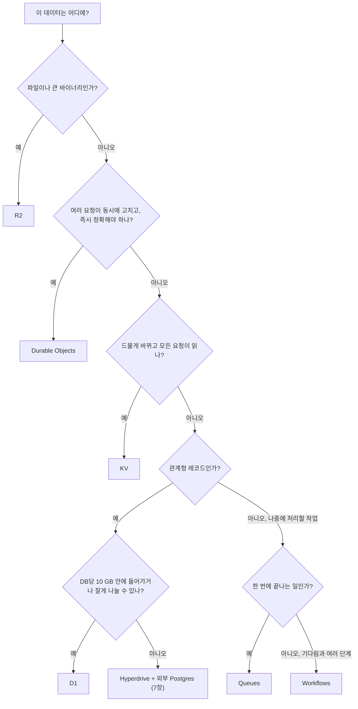

# 4장. 데이터와 상태 — D1·KV·Durable Objects·R2·Queues·Workflows 고르기

에러는 한 건도 없었다. 에러율을 지켜보는 모니터링은 조용했다. 그런데 레이트 리미터는 제 일을 하지 못하고 있었다. 한도를 넘긴 API 키의 요청이 그대로 통과하고 있었던 것이다.

2026년 7월 Oleksandr Kuryzhev가 Dev.to에 남긴 회고 "Cloudflare Workers Rate Limiting: 3 KV Mistakes We Made"의 줄거리다. 그의 팀은 API 키별 요청 횟수를 Workers KV에 세고 있었다. 회고가 꼽은 실수는 세 가지다. KV를 강한 일관성 저장소처럼 썼고(그의 설명으로는 변경 전파에 최대 60초가 걸렸다), 키 하나에 초당 한 번만 쓸 수 있다는 제한을 무시했고, API 키를 그대로 KV 키로 썼다. 바쁜 API 키 하나에 여러 지역의 요청이 거의 동시에 몰리면 각 데이터센터는 서로 다른 카운터 값을 보게 된다. 그는 이렇게 적었다.

> "A single busy API key gets hit from many edge locations near-simultaneously, which is exactly the scenario that makes the propagation delay...worse."

가장 아찔한 대목은 실패의 모양이다. 카운터가 틀린 값을 돌려줄 뿐 예외는 하나도 던지지 않았으니, 에러율만 보는 대시보드에는 아무것도 잡히지 않았다. 회고의 교훈은 이 한 문장에 담겨 있다.

> "If your rate limiter can fail in a way that produces zero errors, you need a metric specifically watching for that — not just error rate."

그 팀은 카운팅을 사용자별 Durable Object로 옮기고 KV는 느리게 바뀌는 설정에만 남겼다. 비용도 약 40% 줄었다고 한다(작성자 본인의 주장이다). 저장소를 잘못 고른 대가가 아무도 눈치채지 못하는 오동작으로 돌아온 것이다.

3장에서 `moim-api`의 신청 내역을 isolate 메모리에 담아두고, 이 자리를 진짜 저장소로 바꾸겠다고 했다. 그런데 Cloudflare에는 저장소가 여섯 가지나 있다. 어떤 데이터를 어디에 둬야 할까? 하나씩 비교해보자.

## 데이터의 성격부터 묻자

### "DB 하나에 스키마 하나"를 내려놓기

Spring과 JPA로 서비스를 만들어왔다면 출발점은 거의 같다. Postgres나 MySQL 하나를 띄우고, 스키마 하나에 테이블을 만들고, 엔티티를 매핑한다. 회원도, 주문도, 설정값도, 세션도 일단은 그 DB에 들어간다. 정말 빨라야 하는 것만 Redis에 올린다. 익숙하고, 대부분의 경우 충분히 잘 동작하는 방식이다.

Cloudflare의 저장소는 이 전제와 맞지 않는다. 데이터센터 수백 곳에 흩어진 isolate가 같은 데이터를 봐야 하는 환경에서는 "모든 것을 담는 DB 하나"가 공짜로 주어지지 않는다. 대신 성격이 다른 저장소가 여럿 있고, 각각 잘하는 일이 분명하다. 그러니 질문의 순서를 바꿔야 한다. "어느 DB에 넣을까?"를 묻기 전에 "이 데이터는 어떤 성격인가?"를 먼저 묻자. 기준은 네 가지면 충분하다.

첫째, 일관성. 여러 요청이 동시에 같은 값을 고칠 때 즉시 정확해야 하는가, 아니면 잠깐 옛 값이 보여도 괜찮은가? 둘째, 쓰기 빈도. 하루에 몇 번 바뀌는가, 초당 몇 번 바뀌는가? 셋째, 모양과 크기. 관계형 레코드인가, 파일인가, 작은 설정값인가? 넷째, 시간. 지금 바로 처리해야 하는가, 나중에 해도 되는가, 여러 단계에 걸쳐 기다려야 하는가?

`moim`의 데이터를 이 기준으로 나눠보면 이렇게 된다. 행사와 신청 내역은 관계형 레코드다. 신청 접수 여부나 공지 배너 같은 설정은 드물게 바뀌지만 모든 요청이 읽는다. 선착순 좌석은 수많은 사람이 동시에 하나의 숫자를 고치는데 한 자리도 틀리면 안 된다. 발표 자료는 파일이다. 확인 메일은 지금 안 보내도 되지만 언젠가는 꼭 보내야 하고, 행사 전날 리마인더는 며칠을 기다렸다가 여러 단계로 처리해야 한다. 이 여섯 가지가 이 장에서 고를 여섯 가지 저장소와 정확히 맞물린다.

먼저 이 장이 끝났을 때 `moim-api`의 설정이 어떤 모습이 될지 보고 시작하자.

```jsonc
// moim-api/wrangler.jsonc — 4장 종료 시점 (routes·workers_dev·observability는 3장과 동일)
{
  "name": "moim-api",
  "main": "src/index.ts",
  "compatibility_date": "2026-09-01",
  "d1_databases": [
    { "binding": "DB", "database_name": "moim-db", "database_id": "<wrangler d1 create 결과>" }
  ],
  "kv_namespaces": [
    { "binding": "CONFIG", "id": "<wrangler kv namespace create 결과>" }
  ],
  "durable_objects": {
    "bindings": [{ "name": "SEATS", "class_name": "EventSeats" }]
  },
  "exports": {
    "EventSeats": { "type": "durable-object", "storage": "sqlite" }
  },
  "r2_buckets": [{ "binding": "UPLOADS", "bucket_name": "moim-uploads" }],
  "queues": {
    "producers": [{ "binding": "MAIL_QUEUE", "queue": "moim-mail" }],
    "consumers": [{ "queue": "moim-mail" }]
  },
  "workflows": [
    { "name": "moim-reminder", "binding": "REMINDER", "class_name": "ReminderWorkflow" }
  ]
}
```

바인딩은 Worker 코드가 저장소에 접근하는 손잡이다. 코드에서는 `c.env.DB`, `c.env.SEATS`처럼 환경 객체의 속성으로 나타난다. 접속 문자열이나 비밀번호를 코드에 넣을 필요가 없다는 점이 Spring의 `DataSource` 설정과 가장 다른 부분이다. 2025년 10월부터는 Wrangler가 KV·R2·D1 리소스를 자동으로 만들어주는 기능도 생겼다. 바인딩을 추가했다면 3장에서 본 `npx wrangler types`로 타입 정의를 다시 만들어두자.

## 여섯 가지 저장소

### D1 — 행사와 신청 내역

행사와 신청 내역은 관계형 데이터이니 D1에 둔다. D1은 SQLite 기반의 관계형 데이터베이스다. 왜 하필 SQLite일까? SQLite는 서버 프로세스 없이 파일 하나로 동작하는 임베디드 데이터베이스이고, 2022년 PVLDB 논문의 표현을 빌리면 "SQLite has become the most widely deployed database engine in existence."다. 작고 독립적인 데이터베이스를 잘게 많이 만드는 설계와 잘 어울리는 엔진이다.

```sql
-- moim-api/migrations/0001_init.sql
CREATE TABLE events (
  id         INTEGER PRIMARY KEY,
  title      TEXT    NOT NULL,
  starts_at  TEXT    NOT NULL,
  capacity   INTEGER NOT NULL
);

CREATE TABLE rsvps (
  id          INTEGER PRIMARY KEY AUTOINCREMENT,
  event_id    INTEGER NOT NULL REFERENCES events(id),
  name        TEXT    NOT NULL,
  email       TEXT    NOT NULL,
  created_at  TEXT    NOT NULL DEFAULT (datetime('now')),
  UNIQUE (event_id, email)
);

CREATE INDEX idx_rsvps_event ON rsvps(event_id);
```

```ts
// moim-api/src/index.ts (발췌)
const app = new Hono<{ Bindings: Env }>();

app.get("/api/events", async (c) => {
  const { results } = await c.env.DB
    .prepare("SELECT id, title, starts_at, capacity FROM events ORDER BY starts_at")
    .all();
  return c.json(results);
});

// 신청 내역 기록 — 같은 사람이 두 번 눌러도 한 줄만 남는다
async function saveRsvp(env: Env, eventId: number, name: string, email: string) {
  await env.DB
    .prepare(
      "INSERT INTO rsvps (event_id, name, email) VALUES (?1, ?2, ?3) " +
      "ON CONFLICT (event_id, email) DO NOTHING"
    )
    .bind(eventId, name, email)
    .run();
}
```

마이그레이션 파일은 기본 위치인 `migrations/` 폴더에 두고 `npx wrangler d1 migrations apply moim-db`로 적용한다. 로컬 개발용 DB에는 `--local`, Cloudflare의 실제 DB에는 `--remote`를 붙여 대상을 분명히 하자. `ON CONFLICT ... DO NOTHING`과 인덱스는 사소해 보여도 비용과 직결된다. D1은 읽은 행과 쓴 행의 수로 과금하는데, 인덱스 없이 테이블을 훑으면 결과가 몇 줄이든 훑은 행 전부가 "읽은 행"으로 잡힌다. 같은 신청이 재시도로 여러 번 들어오면 그만큼 쓰기가 늘어난다. 이 두 줄을 빠뜨린 코드가 실제로 어떤 청구서를 만들었는지는 13장에서 사례로 본다.

성능에 대한 의문도 있었다. 2025년 4월 Hacker News에서 한 개발자(fastball)는 "I evaluated D1 for a project a few months ago, and found that global performance was pretty terrible."이라고 적었다. D1은 2025년에 읽기 복제(read replication)를 공개했으니 지금은 사정이 다를 수 있다. 사용자가 여러 대륙에 흩어진 서비스라면 자기 데이터로 지연을 직접 재보는 편이 낫다. `moim`처럼 한 나라 안의 밋업을 다루는 서비스도 배포 후 한 번은 지연을 재보고 판단하자.

D1의 한도와 가격은 이렇다(Workers Pricing 2026-10-02, D1 Limits 2026-04-21 기준). Free는 하루에 읽은 행 500만, 쓴 행 10만, 저장 총 5 GB, 데이터베이스당 500 MB, 데이터베이스 10개까지다. Workers Paid는 월 읽은 행 250억, 쓴 행 5,000만, 저장 5 GB가 포함되고, 데이터베이스 하나는 최대 10 GB이며 이 한도는 올릴 수 없다. 2026년 9월 1일부터는 Free의 일일 한도가 실제로 강제돼, 넘기면 쿼리가 실패하고 이메일이 온다.

JVM 개발자가 가장 먼저 부딪히는 벽은 트랜잭션이다. `@Transactional`을 붙인 메서드 안에서 조회하고, 로직을 돌리고, 쓰는 흐름에 익숙하다면 D1이 답답할 것이다. 한 개발자는 Hacker News에서 이렇게 정리했다. "a transaction cannot span multiple D1 requests, so you can't select from the database, execute application logic, and then write to the database in an atomic way."(kpozin, 2025-04) 여러 요청에 걸친 트랜잭션은 안 된다는 것이다. 여러 문장을 한 번에 보내는 batch는 있지만, 중간에 애플리케이션 로직을 끼워 넣을 수는 없다. 선착순 좌석처럼 "읽고 판단하고 쓰는" 일이 원자적이어야 한다면 D1보다 다음에 볼 Durable Objects가 맞는 자리다.

10 GB 한도를 두고는 논쟁도 있다. 2026년 4월 Hacker News에서 한 사용자(keeda)는 "The 10GB limit per DB is unsuitable for even trivial use-cases."라고 비판했다. 이 글에 단 답글에서 Cloudflare Workers 리드 엔지니어인 kentonv는 설계 의도를 설명했다. 그가 예로 든 것은 Durable Objects로 SQLite 데이터베이스를 수백만 개 만드는 방식이었지만, 생각의 뼈대는 D1에도 그대로 통한다. "The 10GB limit applies to one database, but the idea is you design your system to split data into many small databases, e.g. one per user, or even one per document." D1 문서도 "D1 is designed for horizontal scale out across multiple, smaller (10 GB) databases"라고 적는다. 어느 쪽 말이 맞을까? 둘 다 맞다. 사용자나 테넌트별로 데이터가 자연스럽게 나뉘는 서비스라면 작은 DB 여러 개는 훌륭한 설계다. 반대로 전체를 가로지르는 조인과 집계가 많은 서비스라면 10 GB는 금방 벽이 된다. kentonv도 같은 글에서 정말 큰 DB 하나가 필요하면 Hyperdrive로 일반 Postgres나 MySQL을 쓰라고 덧붙였다. `moim`은 행사·신청 내역을 D1에 두고, 회원과 정산 데이터는 7장에서 Hyperdrive와 외부 Postgres로 다룬다.

### KV — 드물게 바뀌는 설정만

신청 접수를 열고 닫는 플래그, 메인 화면의 공지 배너, 기능 플래그. 이런 값은 하루에 몇 번 바뀔까 말까 하지만 거의 모든 요청이 읽는다. KV는 바로 이런 데이터를 위한 저장소다.

```ts
// 기능 플래그 읽기 — 드물게 바뀌는 설정만 KV에
app.post("/api/events/:id/rsvp", async (c) => {
  const flags = await c.env.CONFIG.get<{ rsvpOpen: boolean }>("flags", "json");
  if (!flags?.rsvpOpen) {
    return c.json({ error: "지금은 신청을 받지 않는다" }, 503);
  }
  // ...좌석 예약(SEATS)과 기록(DB)은 아래에서
});
```

KV의 핵심 성질은 최종 일관성이다. 어딘가에서 값을 쓰면 그 변경이 전 세계 데이터센터로 퍼지는 데 시간이 걸리고, 그동안은 데이터센터마다 다른 값을 볼 수 있다. 얼마나 걸릴까? 2026년 10월 Cloudflare 블로그가 공개한 측정치에 따르면 기존 KV(classic 모드)의 쓰기 복제는 중앙값과 p95가 1초 미만, p99가 4.38초였다. 이것이 전형적인 값이다. 그렇다면 커뮤니티 회고들이 말하는 "최대 60초"는 어디서 온 숫자일까? KV 문서에 그 출처가 있다. "Changes may take up to 60 seconds or more to be visible in other global network locations as their cached versions of the data time out."(KV 문서 2026-04-21 기준) 60초 "또는 그 이상"이니, 60초조차 보장된 상한은 아니다. 키가 없다는 조회 결과도 캐시되기 때문에, 새로 만든 값이 보이기까지도 같은 지연이 생긴다. 어느 쪽이든 결론은 같다. 몇 초에서 1분 넘게까지 옛 값이 보일 수 있다고 가정하고 설계해야 한다.

최종 일관성이라는 개념은 오래된 연구 주제다. 2012년 PVLDB의 PBS 논문은 부분 쿼럼으로 운영되는 복제 저장소가 "provide only basic eventual consistency guarantees, with no limit to the recency of data returned"라고 정리했다. 돌려받는 데이터가 얼마나 최신인지 상한이 없다는 것이다. 다만 그 논문의 수치는 데이터센터 내부의 복제 이야기이니 KV의 전파 시간과 직접 비교하지는 말자. 가져갈 것은 성질 하나다. 최종 일관성 저장소는 대개 빠르게 수렴하지만, 수렴을 약속하지는 않는다.

여기에 쓰기 제한이 더해진다. 같은 키에는 초당 한 번만 쓸 수 있다. 서두의 레이트 리미터가 무너진 지점이 바로 여기다. 카운터는 같은 키를 초당 여러 번 고치는 데이터라 KV와 정면으로 어긋난다. 카운터·락·재고처럼 즉시 정확해야 하는 값은 KV에 두지 말자. 레이트 리미팅이 목적이라면 9장에서 볼 Workers의 `ratelimit` 바인딩이 따로 있다.

가격도 이 성격을 반영한다(Workers Pricing 2026-10-02, KV Limits 2026-04-21 기준). Free는 하루 읽기 100,000회, 쓰기·삭제·list 각 1,000회, 저장 1 GB다. 읽기 한도는 넉넉하고 쓰기 한도는 빠듯하다. Workers Paid에서는 월 읽기 1,000만, 쓰기·삭제·list 각 100만이 포함되고, 초과분은 읽기 100만 건당 $0.50, 쓰기 100만 건당 $5.00이다. Free에서 한도를 넘기면 문서 표현대로 "further operations of that type will fail with an error." 쓰기가 많은 데이터를 KV에 두면 Free에서는 금방 에러가, Paid에서는 읽기의 열 배 단가가 기다린다.

> **전망: KV Instant (비공개 베타, 2026-10-03 기준)**
> 2026년 10월 1일 Cloudflare는 KV에 "Instant" 모드를 추가했다(비공개 베타). 기존(classic) KV의 최종 일관성 동작은 그대로이며, Instant는 1 MB·1만 키 이하의 드물게 바뀌는 설정용이다. 발표 블로그에 따르면 p99 읽기가 2 ms 미만이고 쓰기의 99%가 약 250 ms 안에 전 엣지로 복제된다. 네임스페이스를 만들 때 Instant 모드를 지정해야 하고(`"mode": "instant"`), 쓰기는 네임스페이스당 초당 한 번으로 제한된다.
> 가격을 꼭 보자. 읽기는 100만 건당 $0.20이지만, 쓰기·삭제·list는 100만 건당이 아니라 **건당 $0.10**이고, 저장은 MB당 월 $100이다. classic KV 감각으로 쓰기를 남발하면 단가가 수만 배로 뛴다. 공지 배너나 기능 플래그처럼 정말 드물게 바뀌는 작은 설정에만 어울린다. 베타라서 가격과 한도가 빠르게 바뀔 수 있으니 공식 문서를 함께 확인하자.

### Durable Objects — 선착순 좌석

이제 `moim`에서 가장 까다로운 데이터, 선착순 좌석이다. 정원 50명인 행사에 신청이 몰린다고 해보자. 서울과 부산과 도쿄에서 동시에 "신청" 버튼이 눌린다. 마지막 한 자리를 두 사람이 동시에 가져가면 안 된다. KV는 각 데이터센터가 다른 숫자를 볼 수 있으니 탈락이다. D1은 "남은 좌석을 읽고, 판단하고, 기록하는" 흐름을 하나의 트랜잭션으로 묶기 어렵다. 이런 자리에 Durable Objects(DO)가 있다.

DO는 상태를 가진 객체다. ID 하나에 대응하는 객체 인스턴스가 하나 있고, 그 ID로 보내는 요청은 모두 그 인스턴스 하나에 모인다. 객체는 자기만의 SQLite 저장소를 갖는다. 행사마다 ID를 하나씩 주면, 행사 42번의 좌석 요청은 전 세계 어디서 오든 "행사 42번 객체" 한 곳으로 모여 차례로 처리된다. 숫자를 세는 주체가 하나이니 숫자가 갈라질 일이 없다.

Java·Kotlin 개발자라면 액터 모델이 떠오를 것이다. 실제로 Microsoft Research의 Orleans가 제안한 가상 액터(virtual actor)는 DO와 유사한 모델이다. Orleans 기술 보고서는 "The actor model makes it natural to build a stateful middle tier and achieve the required performance."라고 적는다. ID로 부르면 런타임이 어딘가에 하나를 살려 두고, 개발자는 위치나 수명을 신경 쓰지 않는다는 점이 닮았다. Akka를 써봤다면 감이 빨리 올 것이다.

```ts
// moim-api/src/seats.ts
import { DurableObject } from "cloudflare:workers";

export class EventSeats extends DurableObject<Env> {
  constructor(ctx: DurableObjectState, env: Env) {
    super(ctx, env);
    ctx.storage.sql.exec("CREATE TABLE IF NOT EXISTS seats (email TEXT PRIMARY KEY)");
  }

  // RPC로 호출된다. 사이에 await가 없어서 읽기·판단·쓰기가 끊기지 않는다
  reserve(email: string, capacity: number): "ok" | "duplicate" | "full" {
    const sql = this.ctx.storage.sql;
    if (sql.exec("SELECT 1 FROM seats WHERE email = ?", email).toArray().length > 0) {
      return "duplicate";
    }
    const taken = sql.exec("SELECT COUNT(*) AS n FROM seats").one().n as number;
    if (taken >= capacity) return "full";
    sql.exec("INSERT INTO seats (email) VALUES (?)", email);
    return "ok";
  }
}
```

```ts
// moim-api/src/index.ts (발췌) — 신청 처리
const seats = c.env.SEATS.get(c.env.SEATS.idFromName(`event-${eventId}`));
const result = await seats.reserve(email, event.capacity);
if (result === "full") return c.json({ error: "좌석이 마감됐다" }, 409);
if (result === "ok") await saveRsvp(c.env, eventId, name, email);
```

왜 `reserve` 중간에 다른 요청이 끼어들지 않을까? DO는 객체마다 단일 스레드로 돌고, 입력 게이트(input gate)가 동기 코드가 실행되는 동안 새 요청을 막는다. 문서 표현으로는 "Input gates block new events (incoming requests, fetch responses) while synchronous JavaScript execution is in progress."다. 요청이 끼어들 수 있는 지점은 `await`로 비동기 작업을 기다릴 때뿐이다. DO의 SQL API는 동기식이라 `reserve`에는 `await`가 하나도 없고, 그래서 읽기·판단·쓰기가 끊기지 않는다. `await` 없이 이어진 여러 쓰기는 하나의 원자적 트랜잭션으로 묶이기도 한다. 클래스의 public 메서드는 자동으로 RPC 메서드가 되니, 호출하는 쪽에서는 `seats.reserve(...)`처럼 부르고 결과를 `await`로 받는다(Rules of Durable Objects 2026-08-20 기준).

설정에서 본 `exports`의 `"storage": "sqlite"`는 이 클래스가 SQLite 저장소를 쓴다는 선언이다. 예전 글에는 `"migrations": [{ "tag": "v1", "new_sqlite_classes": ["EventSeats"] }]`처럼 태그를 붙인 마이그레이션 목록이 나오는데, 2026년 7월 선언형 `exports` 필드가 GA가 되면서 Wrangler 설정 문서는 `migrations`를 레거시로 분류하고 새 Worker에는 `exports`를 권한다. 기존 `migrations` 방식도 계속 동작하지만 한 Worker에서 둘을 섞어 쓸 수는 없고, 한 번 `exports`로 배포한 Worker는 `migrations`로 돌아갈 수 없다(Wrangler 설정 문서 2026-10-02, DO migrations 문서 2026-09-28 기준). 2026년 7월 9일부터 새로 만드는 DO 네임스페이스는 SQLite 백엔드만 쓸 수 있으니, 예전 글에 나오는 KV 백엔드 DO는 신경 쓰지 않아도 된다.

DO의 비용 구조는 다른 저장소와 다르다(Workers Pricing 2026-10-02 기준). 요청 수와 읽고 쓴 행 수에 더해 Duration, 곧 객체가 깨어 있는 시간에도 과금한다. 문서 표현은 이렇다. "Duration billing charges for the 128 MB of memory your Durable Object is allocated, regardless of actual usage." 실제로 메모리를 얼마나 쓰든 128 MB 기준으로 센다는 뜻이다. Free는 하루 요청 100,000회와 Duration 13,000 GB-초를 주고, Workers Paid는 월 요청 100만 회와 40만 GB-초를 포함하며 초과분은 요청 100만 건당 $0.15, Duration 100만 GB-초당 $12.50이다. 여기서 주의할 함정이 있다. WebSocket 연결을 받아둔 DO는 연결이 열려 있는 내내 깨어 있는 것으로 계산된다. 실시간 기능을 만든다면 WebSocket Hibernation API를 써서 유휴 시간의 과금을 멈추자("billing pauses while the Durable Object is hibernated", Optimize costs 2026-05-04). SQLite 기반 DO의 저장 용량 과금은 2026년 1월부터 시작하겠다고 예고됐다(목표일 2026-01-07, Free는 과금 없음). 실제 개시 여부는 공식 문서로 확인하자.

DO에는 정해진 시각에 객체를 깨우는 alarm도 있다. `moim`에서는 신청 마감 시각에 좌석 객체를 깨워 마감 처리를 하는 데 쓴다. 이 기능은 편리한 만큼 조심해서 다뤄야 한다. 객체가 깨어날 때마다 무조건 alarm을 다시 거는 코드는 스스로를 계속 깨우는 루프가 될 수 있다. 규칙은 하나다. alarm은 이미 걸려 있는지 확인하고 건다.

```ts
// EventSeats 안 — alarm은 "이미 있는지" 확인한 뒤에만 건다
async ensureCloseAlarm(closesAt: number) {
  const existing = await this.ctx.storage.getAlarm();
  if (!existing) await this.ctx.storage.setAlarm(closesAt);
}

async alarm() {
  await this.ctx.storage.put("closed", true);
}
```

`getAlarm()`으로 확인하고 없을 때만 `setAlarm()`을 부른다. 단 두 줄이지만, 이 확인이 빠진 코드가 프리뷰 배포와 겹쳐 어떤 청구서를 만들었는지 13장에서 자세히 본다. 그때 이 코드로 다시 돌아오게 될 것이다.

### R2 — 발표 자료

발표자가 올리는 슬라이드 PDF와 영상은 파일이니 객체 저장소에 둔다. R2는 S3와 호환되는 객체 저장소이고, 가장 큰 특징은 이그레스(외부로 내보내는 트래픽)가 무료라는 점이다. 파일을 많이 내려받게 하는 서비스일수록 이 차이가 커진다. Worker에서는 바인딩으로 파일을 넣고 꺼낸다.

```ts
// 발표 자료 업로드 — 9·10장에서 발표자만 올릴 수 있게 막기 전까지는 공개 배포하지 않는다
app.put("/api/events/:id/slides/:name", async (c) => {
  const key = `events/${c.req.param("id")}/${c.req.param("name")}`;
  await c.env.UPLOADS.put(key, c.req.raw.body, {
    httpMetadata: { contentType: c.req.header("content-type") ?? "application/octet-stream" },
  });
  return c.json({ key }, 201);
});
```

Worker를 거쳐 올리는 방식에는 한계가 하나 있다. Free 존에서 요청 본문의 최대 크기는 100 MB이고, 넘으면 413을 돌려준다(Workers Limits 2026-09-05 기준). 긴 발표 영상이라면 Worker를 거치지 않고 브라우저가 R2로 바로 올리게 해야 한다. 그 방법이 presigned URL이고, Cloudflare의 비용 최적화 문서도 "Use presigned URLs for direct client access instead of proxying through Workers"를 권한다. S3 호환 SDK로 presigned URL을 만드는 방법은 8장에서 다룬다.

S3와 호환된다는 말은 Worker 바깥의 프로그램도 S3용 SDK로 R2에 접근할 수 있다는 뜻이다. 7장에서는 Spring 서버 `moim-core`가 AWS SDK for Java v2로 같은 버킷의 파일을 읽는다. 업계에서 사실상 표준이 된 S3 API로 묶여 있으니, 언젠가 다른 저장소로 옮겨야 할 때도 길이 열려 있다. 이그레스가 무료라는 점도 `moim`에 잘 맞는다. 발표 자료는 행사가 끝난 뒤 참가자들이 여러 번 내려받는 파일이다. 객체 저장소에 따라서는 이 전송량이 청구서의 큰 몫이 되기도 하는데, R2에서는 전송량 대신 요청 횟수와 저장 용량만 센다.

R2의 가격은 이렇다(R2 Pricing 2026-10-01 기준). Standard 저장소 기준으로 매달 10 GB-월, 쓰기류(Class A) 100만 건, 읽기류(Class B) 1,000만 건이 무료로 포함되고, 넘으면 저장 GB-월당 $0.015, Class A 100만 건당 $4.50, Class B 100만 건당 $0.36이다. 무료 포함량은 Standard에만 적용되고 Infrequent Access 저장소에는 적용되지 않는다.

그런데 R2를 처음 켜려고 하면 다른 제품과 다른 화면을 만난다. R2 시작 문서는 이렇게 적는다. "You need a Cloudflare account with an R2 subscription." 그리고 "Complete the checkout flow to add an R2 subscription to your account." R2를 쓰려면 대시보드에서 R2 구독 체크아웃을 마쳐야 하고, 계정 상태에 따라 결제수단 등록을 요구받는다. 이 책에서 처음으로 결제가 걸리는 지점이다. 2026년 3월 무렵 Reddit에는 "I was thrilled to use Cloudflare Pages+D1 until saw R2 need Credit Card"라며 카드 등록이 꺼림칙해 VPS로 돌아갔다는 글도 올라왔다. 그 불안은 이해할 만하다. 그렇다면 카드를 등록하기 전에 무엇을 알고, 무엇을 해둬야 할까?

> **최소 안전장치**
> R2는 결제수단을 등록한 구독 위에서 동작하고, 매달 무료 포함량을 넘는 사용분은 그대로 청구된다(R2 문서 2026-10 기준). Free 플랜의 다른 제품처럼 에러로 멈추지 않는다는 뜻이다. 사용량은 청구 단위로 올림된다("If you have performed one million and one operations, you will be billed for two million operations."). 반대로 권한 없는 요청(HTTP 401)에는 과금하지 않고, 삭제류 연산도 무료다.
> 지금 할 일은 세 가지다.
> 1. **예산 알림 확인.** 대시보드의 Billable Usage와 예산 알림(Budget alerts) 화면을 열어 알림이 있는지 보고, 자기 예산에 맞는 금액으로 하나 만들어두자. 2026년 7월부터 적격 Pay-as-you-go 계정에 $10 알림이 기본으로 켜지기 시작했다(순차 적용). 단, 예산 알림은 정보 전용이라 사용을 멈추지 않고, 전날 사용량을 하루 한 번 처리하므로 하루 늦게 온다.
> 2. **버킷 공개 범위 점검.** 버킷을 공개 읽기로 열지 말고 Worker 바인딩으로만 접근하자. 이그레스는 무료지만 읽기 요청(Class B)에는 요금이 붙는다. 누군가 내 파일을 반복해서 내려받으면 그 횟수가 그대로 쌓인다.
> 3. **presigned URL은 짧게.** 브라우저가 직접 올리거나 내려받게 해야 할 때는 만료 시간이 짧은 presigned URL을 쓰자(8장).
> 이것은 최소한의 장치일 뿐이다. 2026년 10월 현재 Cloudflare에는 계정 전체의 지출 상한이 없다. 여러 장치를 겹쳐 전체 방어선을 세우는 일은 13장에서 한다.

### Queues와 Workflows — 나중에, 그리고 여러 단계로

신청이 끝나면 확인 메일을 보내야 한다. 그런데 메일 발송을 신청 요청 안에서 처리하면 어떻게 될까? 메일 서버가 느리면 신청 응답도 느려지고, 메일 서버가 잠깐 죽으면 신청까지 실패한다. 신청과 메일은 떼어놓는 편이 낫다. Spring이라면 메시지 브로커에 이벤트를 던지고 별도 리스너가 처리했을 일이다. Cloudflare에서는 Queues가 그 역할을 한다.

행사 전날 리마인더는 성격이 또 다르다. 신청을 받은 뒤 며칠을 기다렸다가, 신청자 목록을 조회하고, 메일 작업을 큐에 넣는 여러 단계를 거친다. 중간에 실패하면 실패한 단계부터 다시 하고 싶다. 이런 "오래 기다리는 여러 단계의 작업"은 Workflows가 맡는다.

```ts
// moim-api/src/jobs.ts (발췌)
import { WorkflowEntrypoint, type WorkflowEvent, type WorkflowStep } from "cloudflare:workers";

type MailJob = { eventId: number; email: string; kind: "confirm" | "reminder" };

// 큐 소비자 — 4장에서는 아직 메일을 보내지 않고 로그만 남긴다 (실제 발송은 8장의 EMAIL)
export async function consumeMail(batch: MessageBatch<MailJob>) {
  for (const msg of batch.messages) {
    console.log("메일 작업", msg.body.kind, msg.body.eventId, msg.body.email);
    msg.ack();
  }
}

type ReminderParams = { eventId: number; startsAt: string };

export class ReminderWorkflow extends WorkflowEntrypoint<Env, ReminderParams> {
  async run(event: WorkflowEvent<ReminderParams>, step: WorkflowStep) {
    const remindAt = new Date(Date.parse(event.payload.startsAt) - 24 * 60 * 60 * 1000);
    await step.sleepUntil("행사 전날까지 기다리기", remindAt);

    const emails = await step.do("신청자 목록 조회", async () => {
      const { results } = await this.env.DB
        .prepare("SELECT email FROM rsvps WHERE event_id = ?1")
        .bind(event.payload.eventId)
        .all<{ email: string }>();
      return results.map((r) => r.email);
    });

    await step.do("리마인더 작업 넣기", async () => {
      for (const email of emails) {
        await this.env.MAIL_QUEUE.send({ eventId: event.payload.eventId, email, kind: "reminder" });
      }
    });
  }
}
```

```ts
// 신청 처리 끝에서 — 확인 메일은 큐로
await c.env.MAIL_QUEUE.send({ eventId, email, kind: "confirm" });

// 행사를 만들 때 — 리마인더 워크플로 시작
await c.env.REMINDER.create({ id: `reminder-${eventId}`, params: { eventId, startsAt } });
```

소비자 함수는 Worker의 `queue` 핸들러에서 부르면 된다. 클래스와 핸들러를 바인딩이 찾을 수 있도록 `main` 모듈에서 함께 내보내는 것도 잊지 말자.

```ts
// moim-api/src/index.ts 끝부분 — 3장의 `export default app`을 바꾼다
export { EventSeats } from "./seats";
export { ReminderWorkflow } from "./jobs";
export default { fetch: app.fetch, queue: consumeMail };
```

지금은 메일을 실제로 보내지 않고 로그만 남긴다는 점을 기억해두자. 실제 발송은 8장에서 `EMAIL` 바인딩으로 붙인다. Workflows의 각 단계는 `step.do`로 감싼다. 이렇게 감싼 단계의 결과는 저장되기 때문에, 세 번째 단계가 실패해 다시 실행돼도 앞 단계의 조회를 반복하지 않는다.

Queues는 2026년 2월부터 Free 플랜에 포함됐다. 비용은 연산(operation) 단위로 세는데, 문서 표현대로 "In most cases, it takes 3 operations to deliver a message: 1 write, 1 read, and 1 delete." 메시지 하나에 대개 3회이고, 64 KB를 넘는 메시지는 64 KB마다 1회로 더 센다. Free는 하루 10,000 연산에 보존 24시간 고정, Workers Paid는 월 100만 연산이 포함되고 초과분은 100만 건당 $0.40이며 보존은 기본 4일·최대 14일이다(Workers Pricing 2026-10-02 기준). 하루 10,000 연산이면 대략 3,000통 남짓의 메일 작업이다. 배치 크기와 재시도 횟수만큼 연산이 늘어난다는 점도 함께 기억해두자. 소비자 한 번의 실행 시간 한도는 문서마다 표기가 엇갈린다. 이 책은 보수적으로 CPU 5분(설정)·벽시계 15분으로 보고, 출간 시점에 다시 확인할 것을 권한다.

Workflows의 가격은 요청과 CPU, 저장, 그리고 단계(step) 수로 구성된다(Workflows Pricing 2026-09-21 기준). Free는 하루 요청 100,000회(Workers와 공유), 단계 3,000회, 저장 1 GB-월이고, Workers Paid는 월 단계 50만 회와 저장 1 GB-월이 포함되며 초과분은 단계 10만 회당 $0.80, 저장 GB-월당 $0.20이다. 단계·저장 과금은 2026년 8월 10일 이후 시작한다고 예고됐다("no earlier than August 10, 2026", Changelog 2026-07-07). 저장 비용과 관련해 알아둘 것이 하나 더 있다. 끝난 워크플로 인스턴스의 상태가 보존되는 기간이다. 2026년 9월 changelog에 따르면 Workers Paid에서 새로 만든 Workflow의 기본 보존 기간은 7일이고, `default_retention` 설정으로 조정할 수 있다. Workflows 한도 문서에 남은 3 MB/10 MB 스크립트 크기는 2026년 9월 변경 전 값이니, Workers 공통인 비압축 64 MiB를 따르면 된다.

> **비용 메모**
> Free 한도를 넘었을 때 D1(2026-09-01부터 쿼리 실패)과 KV(해당 연산 실패)는 에러로 멈추고, Workflows도 Free 저장 한도에 닿으면 에러를 던진다. 반면 R2는 무료 포함량을 넘는 사용분을 그대로 청구한다. 제품별로 Free 한도를 넘으면 무엇이 일어나는지는 12장에서 한 장의 표로 정리한다. 비용이 조용히 불어나기 쉬운 지점은 세 곳이다. 인덱스 없는 D1 쿼리(훑은 행 전부가 읽은 행), 깨어 있는 Durable Object(128 MB 기준 Duration), 재시도가 잦은 큐(메시지당 연산이 늘어남). (Workers Pricing 2026-10-02, R2 Pricing 2026-10-01 기준)

## 어디에 둘까

여섯 가지를 다 살펴봤다. 처음의 네 가지 질문, 곧 일관성·쓰기 빈도·모양·시간을 다시 꺼내 하나의 흐름으로 묶어보자.


그림 1. "이 데이터는 어디에?" 결정 플로차트

`moim`의 데이터를 이 그림에 흘려보면 앞에서 고른 자리가 그대로 나온다. 발표 자료는 R2로, 선착순 좌석은 Durable Objects로, 신청 접수 플래그는 KV로, 행사와 신청 내역은 D1으로, 확인 메일은 Queues로, 행사 전날 리마인더는 Workflows로 간다. 서두의 레이트 리미터를 이 그림에 넣어봐도 답은 분명하다. 여러 요청이 동시에 고치고 즉시 정확해야 하는 카운터이니, 두 번째 갈림길에서 Durable Objects로 빠진다. 그 팀이 결국 도착한 곳과 같다.

그림에서 한 가지 오해만 바로잡고 가자. "DB는 하나여야 한다"는 감각으로 보면 저장소 여섯 개는 복잡함의 증거처럼 보인다. 하지만 Spring 서비스도 사실은 Postgres와 Redis와 메시지 브로커와 S3를 함께 써왔다. 다른 점은 Cloudflare에서는 그 조합이 처음부터 드러나 있고, 바인딩 한 줄로 붙는다는 것뿐이다. 이 플로차트는 여러분의 서비스에도 그대로 쓸 수 있다. 다음에 새 데이터가 생기면 맨 위 질문부터 다시 따라 내려가보자.

### 이 장의 핵심

- 저장소를 고르기 전에 데이터의 성격을 먼저 묻는다. 일관성, 쓰기 빈도, 모양과 크기, 처리 시점이 기준이다.
- D1은 관계형 레코드용이다. DB당 10 GB(Paid, 상향 불가)이고 여러 요청에 걸친 트랜잭션은 없다. 인덱스와 `ON CONFLICT`가 비용을 지킨다.
- KV는 최종 일관성이라 드물게 바뀌는 설정에만 쓴다. 카운터·락·재고는 Durable Objects로 옮긴다. KV Instant(비공개 베타)는 쓰기가 건당 $0.10이다.
- Durable Objects는 ID 하나에 객체 하나로 요청을 모아 강한 일관성을 준다. Duration은 128 MB 기준으로 과금되며, alarm은 `getAlarm()`으로 확인한 뒤에만 건다.
- R2는 이 책에서 처음 결제수단을 요구한다. Free 범위를 넘는 사용분은 그대로 청구되니 예산 알림·공개 범위·presigned URL을 먼저 점검한다.
