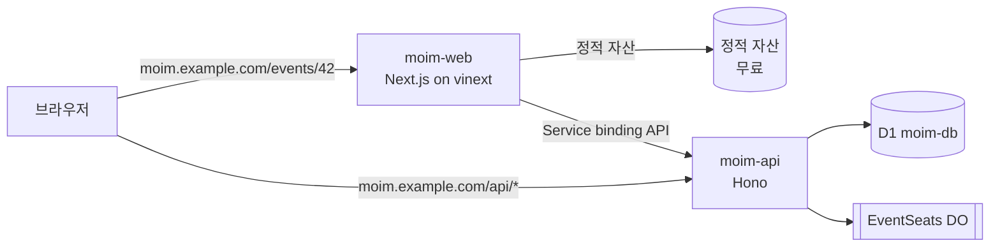

# 5장. 풀스택 앱 — React와 Next.js를 Workers에서

Next.js를 Vercel이 아닌 곳에 올리면 무엇을 잃을까?

이 질문은 생각보다 자주 미뤄진다. 처음에는 잃을 것이 없어 보인다. Next.js는 오픈 소스이고, `next build`가 만든 결과물은 어디서든 돌 것 같다. 실제로 노드 서버 하나에 올리면 대체로 잘 돈다. 그런데 그 노드 서버를 Workers 같은 다른 런타임으로 바꾸는 순간 사정이 달라진다. Next.js는 자기 빌드 결과물이 어떤 런타임에서 어떻게 실행될지를 Vercel의 실행 환경에 맞춰 진화시켜 왔고, 다른 플랫폼은 그 결과물을 자기 런타임에 맞게 "번역"해야 한다. 그 번역기를 보통 어댑터라고 부른다.

`moim`도 이제 이 갈림길에 섰다. 2장에서 만든 `moim-web`은 Vite로 빌드한 React SPA다. 정적 자산으로만 서빙되니 무료이고 빠르다. 그런데 행사 상세 페이지를 메신저에 공유하면 미리보기가 텅 빈다. 검색 엔진도 빈 HTML만 본다. 행사 제목과 남은 좌석 수가 박힌 HTML을 서버에서 그려 보내고 싶다. 서버 렌더링(SSR)이 필요해진 것이다.

SSR을 하려면 프레임워크를 골라야 하고, 많은 독자에게 첫 후보는 Next.js다. 그렇다면 Workers 위의 Next.js는 실제로 어떤 일을 겪어왔을까? 사례부터 살펴보자.

## 어댑터가 프레임워크를 쫓아가는 구조

### 깨진 업그레이드들

OpenNext의 Cloudflare 어댑터(`@opennextjs/cloudflare`) 저장소를 열어 반응이 많은 이슈를 정렬해보면 묘한 패턴이 보인다. 상위 이슈 대부분이 "Next.js 새 버전을 지원해 달라"는 내용이다.

2025년 11월 4일에 열린 #972의 제목은 그냥 "Next16 support"다. Next.js 16이 나왔는데 어댑터가 아직 따라오지 못했다는 뜻이고, 39개의 댓글이 달린 끝에 닫혔다. 2025년 12월 19일의 #1049는 더 구체적이다. Next.js 16.1.0으로 올리자 Workers에서 Error 1101과 함께 `setImmediate`라는 읽기 전용 속성에 값을 넣을 수 없다는 에러로 앱이 죽었다. 이 이슈에서 가장 실용적이었던 답은 고친 방법이 아니라 되돌린 방법이었다.

> "Downgrading to 16.0.10 fixed it immediately."

16.0.10으로 내렸더니 바로 해결됐다는 말이다. 이 이슈는 2026년 1월 16일에야 닫혔다. 거의 한 달 동안 16.1을 쓰고 싶은 사람은 기다리거나 버전을 고정하는 수밖에 없었다.

2026년 3월 18일의 #1157도 비슷하다. Next.js 16.2.0이 빌드 결과물에 새 매니페스트 파일(`prefetch-hints.json`)을 추가했고, 어댑터는 그 파일을 몰라 실행 중에 멈췄다. 성능 쪽 이슈도 있다. 2025년 5월 8일의 #653은 제목부터 "Performance is unusably slow"였다. 응답 첫 바이트까지 1.2~3초가 걸린다는 보고에 33개의 댓글이 붙었다. 이후 Cloudflare가 V8 가비지 컬렉션 튜닝과 스트림 버퍼 개선을 반영하면서 일부 해소된 것으로 보이지만, 완전히 풀렸다고 단정할 근거는 아직 없다. 2026년 4월 20일에 열린 #1214는 Hyperdrive와 `node-postgres`를 함께 쓸 때 번들링이 실패하는 문제인데, 2026년 10월 기준으로 여전히 열려 있다(이 문제의 우회책은 8장에서 다룬다).

이 다섯 개의 이슈를 한 줄로 묶으면 무엇이 될까? Next.js가 움직일 때마다 어댑터가 한 번씩 넘어졌다는 것이다.

### 왜 어댑터는 늘 한 박자 늦을까

원인은 구조에 있다. OpenNext 같은 어댑터는 Next.js가 내놓은 빌드 결과물을 받아 Workers에서 돌 수 있는 형태로 다시 조립한다. 문제는 그 빌드 결과물의 내부 형식이 공개된 약속이 아니라는 점이다. 매니페스트 파일이 하나 늘거나, 서버 코드가 Node.js 내부 객체를 조금 다르게 건드리기만 해도 어댑터는 그 사실을 사후에 알게 된다. #1049가 정확히 그런 경우였다. Workers의 Node.js 호환성은 2025년 이후 크게 나아졌지만, 프레임워크가 런타임 내부를 직접 만지는 지점에서는 여전히 새 문제가 생긴다.

현장 개발자들도 이 구조를 피곤해한다. HN의 한 댓글은 짧고 솔직하다.

> "its really annoying that nextjs has to be forked and/or patched to work on cloudflare."

Next.js를 Cloudflare에서 돌리려면 포크하거나 패치해야 한다는 사실 자체가 짜증스럽다는 얘기다. 빌드 산출물 크기도 문제가 됐다. 이전 어댑터였던 next-on-pages가 폐기된 뒤 Next 16에서 함수당 산출물이 5~10KB에서 약 500KB로 커졌다는 r/nextjs의 경험담도 있다(2025년 12월 무렵, 미러 경유).

여기서 얻을 수 있는 원리는 단순하다. 프레임워크의 내부 형식에 기대는 어댑터는 그 프레임워크의 릴리스 속도를 결코 앞지를 수 없다. 어댑터 팀이 아무리 성실해도, 새 버전이 나온 날과 그 버전이 다른 플랫폼에서 안전하게 도는 날 사이에는 틈이 생긴다. 이 틈은 개발자에게 두 가지 선택을 강요한다. 최신 버전을 포기하고 버전을 고정하거나, 업그레이드할 때마다 프로덕션을 걸고 시험하거나. 어느 쪽도 마음 편한 선택은 아니다.

그렇다면 Cloudflare는 이 틈을 어떻게 메우려 했을까?

## vinext — 공식 권장 기본값, 그리고 1.0이 바꾼 것

### vinext는 어디까지 왔나

Cloudflare의 답은 번역기를 버리고 Next.js의 API 표면을 다시 구현하는 것이었다. 공식 문서는 vinext를 이렇게 소개한다.

> "vinext is a Vite plugin that reimplements the Next.js API surface."

vinext는 Next.js의 빌드 결과물을 해석하지 않는다. 대신 App Router, 서버 컴포넌트, Server Actions, 미들웨어 같은 Next.js의 API를 Vite 플러그인 위에서 직접 구현한다. 그러면 Next.js 내부 형식이 바뀌어도 그 변화에 휘둘릴 여지가 줄어든다. 2026년 8월 25일에 갱신된 Cloudflare의 Next.js 가이드는 이 길을 기본값으로 못 박았다.

> "Cloudflare recommends vinext as the default way to run Next.js applications on Cloudflare Workers."

OpenNext 가이드(2026-08-25 기준)도 새 앱에는 vinext를 권하고, 자신은 기존 OpenNext 앱을 유지하는 용도라고 적는다. 2026년 9월 28일에는 vinext 1.0.0이 나왔고, 10월 1일에 1.0.1이 이어졌다. 발표 글에 따르면 Next.js 테스트 호환성이 캐시 컴포넌트를 제외하고 99%를 넘었고, Next.js의 종단 간 테스트 스위트를 매일 밤 vinext에 돌린다.

물론 1.0이라는 숫자만 보고 안심하기는 이르다. 정직하게 짚어둘 것이 세 가지 있다. 첫째, Cloudflare 공식 가이드는 2026년 10월 현재 아직 "vinext is in beta"라고 적혀 있다. 1.0 출시 이후 갱신되지 않은 것이다. 둘째, vinext README는 1.0 이후에도 "모든 애플리케이션이나 프로덕션 워크로드를 그대로 대체하지는 못한다"는 문구를 유지하고, 특히 새 App Router 기능에서 호환성 틈을 예상하라고 말한다. 셋째, `"use cache"` 지원이 부분적이다. 파일 수준과 함수 수준의 `"use cache"`는 동작하지만, 그 위에 올라가는 Cache Components 전체 동작은 아직 미완이다. 이미지 최적화도 요청 시점 최적화만 되고 Next.js의 빌드 시점 이미지 파이프라인은 재현하지 않는다(vinext README 2026-09-28 기준).

그래서 판단 기준이 필요하다. 새로 시작하는 앱이나 비교적 단순한 App Router 앱이라면 vinext가 자연스러운 출발점이다. 반대로 `"use cache"`와 Cache Components에 깊이 기대는 앱은 당분간 OpenNext를 유지하는 편이 합리적일 수 있다. OpenNext 지원표는 이 기능들을 "Supported"로 적고 있기 때문이다(단, Next.js 쪽에서 아직 실험 기능이다). 어느 쪽이든 기존 앱이라면 먼저 `npx vinext check`로 호환성 문제를 훑어보는 습관을 들이자.

vinext를 둘러싼 현장의 온도도 함께 알아두는 게 좋다. 2026년 2월 처음 공개됐을 때 vinext는 "AI로 일주일 만에 다시 만든 Next.js"라는 이야기와 함께 등장했고, 반응은 기대와 경계로 갈렸다. 성능과 Vite 생태계에 기대를 거는 목소리가 있었던 반면, 의문도 컸다. 한 사람은 "I am not touching an AI version without waiting for a while."라고 했고, AI가 만든 버전은 한동안 지켜본 뒤에 쓰겠다는 뜻이다. 다른 사람은 "does it actually handle the edge cases or does it just pass the tests."라고 물었다. 테스트만 통과하는 것인지 엣지 케이스까지 정말 처리하는 것인지 묻는 말이다. Vercel 측에서 vinext의 취약점을 공개한 일도 있었다. 다만 이것은 경쟁 관계에 있는 이해관계자의 공개라는 점을 함께 기억해두자. 1.0 이후의 실사용 후기는 2026년 10월 초 기준으로 아직 거의 없다.

### `cf`가 기본이 된 init, 그리고 이 책이 레거시 플래그를 쓰는 이유

vinext 1.0에는 이 책의 설정 방식과 정면으로 부딪히는 변화가 하나 들어 있다. README의 문장을 그대로 옮겨보자.

> "Cloudflare init uses `cf` and `cloudflare.config.ts` by default. Both `vinext init` and `create-vinext-app` accept `--legacy-wrangler-cloudflare-init` to retain the legacy Wrangler setup. Existing Wrangler configs are not automatically migrated."

1.0부터 `vinext init`과 `create-vinext-app`은 `wrangler.jsonc`를 만들지 않는다. 대신 2026년 9월 28일 베타로 공개된 새 CLI인 `cf`와, 타입이 있는 TypeScript 설정 파일 `cloudflare.config.ts`를 만든다. 이 기본값은 1.0 직전인 2026년 9월 27일에 병합된 PR #3504에서 바뀌었고, Wrangler 경로는 "레거시" 플래그 뒤로 물러났다. 레거시 경로를 고르면 Cloudflare Vite 플러그인도 v2가 아닌 v1을 쓴다.

여기서 실습 중에 만날 함정도 하나 짚고 가자. 이미 `wrangler.jsonc`가 있는 프로젝트에서 플래그 없이 `vinext init`을 돌리면 init이 멈춘다. OpenNext로 운영하던 Next.js 앱은 거의 다 `wrangler.jsonc`를 갖고 있으니, OpenNext에서 vinext로 옮기려는 독자는 이 메시지를 높은 확률로 만나게 된다.

괄호 안의 파일명은 원문 메시지에서 실제 파일 이름으로 채워지는 자리다.

```text
Cloudflare init cannot replace an existing Wrangler config (wrangler.jsonc).
Migrate its bindings to cloudflare.config.ts first, or use
--legacy-wrangler-cloudflare-init to keep the Wrangler setup.
```

그렇다면 이 책은 어느 쪽을 택할까? `moim-web`은 레거시 플래그를 써서 `wrangler.jsonc`와 Wrangler v4 경로에 그대로 둔다. 이유는 세 가지다. 첫째, `moim`의 다른 Worker들이 모두 `wrangler.jsonc`로 설정돼 있고, 13장에서 Worker마다 거는 `limits.*` 비용 브레이크와 8장의 GitHub Actions 배포가 모두 `wrangler.jsonc`와 `wrangler deploy`를 기준으로 짜여 있다. 한 Worker만 다른 설정 체계에 두면 운영 점검표가 둘로 갈라진다. 둘째, 2026년 10월 기준 Wrangler는 GA이고 `cf`는 베타다. 셋째, Cloudflare 공식 Next.js 가이드 자체가 아직 "바인딩을 Wrangler 설정에 정의하고 `wrangler types`로 타입을 만들라"고 안내한다. 1.0의 기본값과 공식 가이드가 서로 어긋나 있는 셈이다.

물론 이 선택에도 위험이 있다. 이름에 "legacy"가 붙은 플래그는 대개 언젠가 사라질 길이라는 신호다. 언제 사라질지는 공지된 바 없지만, vinext의 새 기능이 `cf` 경로에 먼저 붙을 가능성은 충분하다. 그러니 두 설정 파일이 어떻게 대응하는지를 지금 익혀두면 나중에 옮길 때 훨씬 덜 난감하다. 아래는 vinext init이 만드는 `cloudflare.config.ts`의 골격을 init 소스의 템플릿에서 재구성한 것이다(원문 그대로는 아니다).

```ts
// cloudflare.config.ts — vinext 1.0 기본 경로가 만드는 파일의 골격 (재구성)
import { bindings, defineConfig, defineWorker } from "cf/config";

export default defineConfig({
  worker: defineWorker({
    name: "moim-web",
    entrypoint: "vinext/server/fetch-handler",
    compatibilityDate: "2026-09-01",
    compatibilityFlags: ["nodejs_compat"],
    assets: { notFoundHandling: "none" },
    env: {
      ASSETS: bindings.assets(),
      // D1을 붙인다면: DB: bindings.d1({ name: "moim-db" }),
    },
  }),
});
```

| `cloudflare.config.ts` (`cf`) | `wrangler.jsonc` (Wrangler) |
|---|---|
| `name` | `"name"` |
| `entrypoint` | `"main"` |
| `compatibilityDate` | `"compatibility_date"` |
| `env: { ASSETS: bindings.assets() }` | `"assets": { "binding": "ASSETS", ... }` |
| `env: { DB: bindings.d1({ name }) }` | `"d1_databases": [ ... ]` |
| 타입 생성 `cf workers types` | 타입 생성 `wrangler types` |

생성된 골격에 `compatibilityFlags: ["nodejs_compat"]`가 들어 있는 점도 눈여겨보자. 이 책의 규약대로 호환성 날짜를 2026-08-04 이후로 두면 `nodejs_compat`은 기본으로 켜지므로, Wrangler 쪽에서는 따로 적지 않는다.

> **전망: `cf` CLI (베타, 2026-10-03 기준)**
> `cf`는 2026년 9월 28일 베타로 공개된 Cloudflare의 새 CLI다. 공식 문서는 Wrangler를 "`wrangler.jsonc`나 `wrangler.toml`로 설정된 Workers 프로젝트의 CLI", `cf`를 "Cloudflare 공개 API 전체를 다루고 Workers 프로젝트에는 `cloudflare.config.ts`를 쓰는 CLI"로 구분한다. 기존 Wrangler 프로젝트는 `cf migrate`로 변환한 뒤에 `cf dev`·`cf build`·`cf deploy`를 쓸 수 있다. 레거시 플래그 없이 만든 vinext 프로젝트는 `npx @vinext/cloudflare deploy`로 배포하고, 이 명령은 빌드 결과물을 `cf`로 올린다. vinext 1.0이 이미 `cf`를 기본으로 삼았으니 방향은 분명해 보이지만, 베타 제품이라 명령과 설정 형식이 빠르게 바뀔 수 있다. 옮길 때는 공식 문서를 함께 확인하자.

## `moim-web`을 Next.js로

### 프로젝트를 만들고 옮기기

`moim-web`은 Vite로 만든 SPA라서 기존 Next.js 앱을 옮기는 `vinext init`의 대상이 되지 못한다. 새 Next.js(App Router) 프로젝트를 만들고 기존 React 컴포넌트를 옮겨 심는 편이 깔끔하다. `create-vinext-app`은 TypeScript App Router 프로젝트를 만든 뒤 기존 앱용 init과 같은 설정 과정을 돌려준다. 여기에 레거시 플래그를 붙이자.

```bash
# 새 vinext 프로젝트 — Wrangler(레거시) 경로로 생성
pnpm create vinext-app@latest moim-web-next --legacy-wrangler-cloudflare-init

# (참고) 기존 Next.js 앱을 옮긴다면
npx vinext check                                   # 호환성 사전 점검
npx vinext init --legacy-wrangler-cloudflare-init  # Wrangler 설정 유지
```

생성된 프로젝트에 2장의 SPA 컴포넌트를 옮긴다. 행사 목록처럼 브라우저 상호작용이 많은 화면은 `"use client"`를 붙인 클라이언트 컴포넌트로 그대로 가져오고, 행사 상세처럼 서버에서 그릴 화면만 서버 컴포넌트로 새로 쓴다. 한꺼번에 다 바꾸려 하지 말고 SSR이 필요한 페이지부터 하나씩 옮기는 편이 낫다.

다음은 `wrangler.jsonc`다. Worker 이름은 2장과 같은 `moim-web`으로 바꿔서 기존 Worker를 그대로 이어받게 하고, 2장에서 정한 커스텀 도메인과 `"workers_dev": false`도 유지한다. 새로 추가하는 것은 `moim-api`로 가는 Service binding 하나다.

```jsonc
// moim-web/wrangler.jsonc
{
  "$schema": "./node_modules/wrangler/config-schema.json",
  "name": "moim-web",
  // "main"·"assets" 항목은 vinext init이 레거시 경로에서 만든 값을 그대로 둔다 (사실 확인 필요)
  "compatibility_date": "2026-09-01",
  "workers_dev": false,
  // 커스텀 도메인(moim.example.com) 설정은 2장과 동일
  "services": [
    { "binding": "API", "service": "moim-api" } // (사실 확인 필요)
  ],
  "observability": { "enabled": true }
}
```

배포는 Vite 빌드 뒤에 Wrangler로 올리는 흐름이다. `create-vinext-app`이 만든 프로젝트는 스크립트 이름이 `build`·`deploy`다. 다만 레거시 경로에서 `deploy` 스크립트가 정확히 무엇을 실행하는지는 1차 문서로 확인하지 못했다. 아래는 그 흐름을 풀어 쓴 것이다.

```bash
npm run build        # vinext(Vite) 빌드
npx wrangler deploy  # 레거시 경로의 배포 명령 (사실 확인 필요)
```

로컬 개발은 어떨까? `npm run dev`가 vinext 개발 서버를 띄운다. vinext는 Cloudflare Vite 플러그인 위에서 돌고, 이 플러그인은 Worker 코드를 실제 런타임과 같은 workerd 안에서 실행한다. 3장에서 `moim-api`를 로컬에서 돌릴 때와 같은 감각으로, SSR 코드도 운영과 같은 런타임 위에서 확인할 수 있다는 뜻이다. "로컬 Node에서는 됐는데 Workers에 올리니 깨졌다"는 류의 놀람이 줄어든다.

### 행사 상세 SSR과 Service binding

이제 핵심인 행사 상세 페이지를 서버에서 그려보자. 그 전에 `moim-api`에 단건 조회 라우트 `GET /api/events/:id`를 하나 더 붙였다고 하자. 4장에서 만든 D1 조회를 그대로 쓰면 된다.

```ts
// moim-api/src/index.ts (추가분)
app.get("/api/events/:id", async (c) => {
  // ...4장의 D1 조회와 동일 — 없으면 404
});
```

`moim-web` 쪽 서버 컴포넌트는 다음과 같다. vinext는 바인딩에 접근할 때 `cloudflare:workers` 모듈의 `env`를 쓰라고 권한다. 별도 엔트리 파일이나 개발용 프록시가 필요 없다.

```tsx
// moim-web/app/events/[id]/page.tsx
import { env } from "cloudflare:workers";
import { notFound } from "next/navigation";

type MoimEvent = { id: string; title: string; startsAt: string; seatsLeft: number };

export default async function EventPage({ params }: { params: Promise<{ id: string }> }) {
  const { id } = await params;

  // 같은 존의 다른 Worker를 부를 때는 전역 fetch()가 아니라 Service binding으로
  const res = await env.API.fetch(`https://moim.example.com/api/events/${id}`);
  if (res.status === 404) notFound();
  const event = (await res.json()) as MoimEvent;

  return (
    <main>
      <h1>{event.title}</h1>
      <p>{new Date(event.startsAt).toLocaleString("ko-KR")}</p>
      <p>남은 좌석 {event.seatsLeft}석</p>
    </main>
  );
}
```

여기서 3장의 제약이 다시 등장한다. `moim-web`과 `moim-api`는 같은 존 `moim.example.com` 위에 있다. 같은 존의 다른 Worker를 Service binding 없이 전역 `fetch()`로 부르면 요청이 실패한다. SSR 코드에서 무심코 `fetch("https://moim.example.com/api/...")`를 쓰면 로컬에서는 될 것 같다가 배포 후에 깨지는, 꽤 난감한 상황을 만나게 된다. Service binding은 이 제약을 피하는 공식 경로이고, 덤으로 비용도 아낀다. Service binding으로 다른 Worker를 부르면 추가 요청 요금이 붙지 않는다(CPU 시간은 합산된다, Workers Pricing 2026-10-02 기준).


그림 1. `moim-web`(Next.js)과 `moim-api`를 잇는 Service binding 구조

행사 상세는 자주 바뀌지 않으니 매 요청마다 그릴 필요는 없다. 그래서 ISR(정해진 주기로 페이지를 다시 생성하는 방식)을 떠올리게 되는데, 여기서 한 가지를 짚어두자. vinext README는 ISR을 지원한다고 적으면서도, 기본 캐시 핸들러인 `MemoryCacheHandler`는 "그대로 동작하지만 프로덕션에서는 자기 백엔드로 바꾸라"고 권한다. 3장에서 봤듯 isolate의 메모리는 요청과 데이터센터를 넘어 공유되지 않는다. 메모리 캐시는 개발할 때나 믿을 만한 것이다. `@vinext/cloudflare`는 KV에 데이터 캐시를 두는 `kvDataAdapter()`와 페이지 수준 ISR을 Workers Cache에서 서빙하는 `workersCacheCdnAdapter()` 같은 어댑터를 제공한다. 다만 Workers Cache를 켜는 순간 과금 구조가 바뀐다는 점을 먼저 알아야 한다. 어떤 캐시 경로를 고를지는 11장에서 세 경로를 나란히 놓고 다시 판단하자. 지금은 행사 상세를 매 요청 SSR로 두고 넘어간다.

Next.js가 꼭 필요한 게 아니라면 다른 길도 있다. `@cloudflare/vite-plugin`은 2026년 9월 30일 기준으로 React Router v8과 TanStack Start의 SSR을 공식 지원한다. Next.js 생태계에 묶일 이유가 없는 팀이라면, 어댑터나 재구현 없이 Vite 플러그인 위에서 바로 도는 이쪽 프레임워크가 오히려 마음 편할 수 있다. r/nextjs에서 Next 16 빌드 산출물 문제로 고생하던 개발자에게 "build with a better tool like react router or tanstack start"라는 답글이 달렸던 것도 같은 맥락이다. React Router나 TanStack Start 같은 더 나은 도구로 빌드하라는 조언이다.

> **비용 메모**
> 행사 상세 SSR 요청은 Worker 요청으로 계산된다. Free는 하루 100,000건(00:00 UTC 리셋), Workers Paid는 월 1,000만 건 포함에 100만 건당 $0.30이다. 반면 이미지·CSS·JS 같은 정적 자산 요청은 무료·무제한이다(Workers Pricing·Static Assets Billing 2026-10 기준). 그러니 SSR은 정말 서버에서 그려야 하는 페이지에만 쓰자. `moim-web`이 `moim-api`를 Service binding으로 부르는 것은 추가 요청 요금이 없다. 다만 Workers Cache를 켜면 평소 무료인 정적 자산과 Worker 간 호출까지 과금되는 함정이 있다. 자세한 이야기는 11장에서 한다.

## 배포한 다음의 일

### 패치와 위치 — WAF는 패치를 대체하지 않는다

SSR을 시작하면 서버 쪽 공격 표면도 함께 생긴다. 2026년 5월에 React 서버 컴포넌트와 Next.js에서 여러 취약점이 공개됐다. Cloudflare 변경 기록(2026-05-07)은 패치 버전을 이렇게 정리했다. React의 `react-server-dom-webpack`·`react-server-dom-parcel`·`react-server-dom-turbopack`은 19.0.6, 19.1.7, 19.2.6이고, Next.js는 15.5.16과 16.2.5다. 같은 글에는 vinext의 최신 릴리스는 공개된 CVE 어느 것에도 취약하지 않다는 문장도 있다. 그런데 그보다 더 중요한 문장이 있다.

> "Several of the disclosed vulnerabilities are not possible to block in WAF. We strongly recommend updating your applications so they are not purely reliant on WAF mitigations."

공개된 취약점 가운데 몇 가지는 WAF로 막을 수 없으니 WAF에만 기대지 말고 앱을 업데이트하라는 얘기다. Cloudflare 위에 올렸으니 앞단의 WAF가 알아서 지켜주리라 생각하기 쉽다. 하지만 WAF는 알려진 공격 패턴을 걸러내는 그물이지 취약한 코드를 고쳐주는 도구가 아니다. 의존성 업데이트를 미루는 습관은 Cloudflare 위에서도 그대로 위험하다. WAF 설정 자체는 9장에서 다룬다.

성능 쪽에서 알아둘 장치는 Smart Placement다. Worker는 보통 사용자와 가까운 데이터센터에서 실행되는데, Worker가 멀리 있는 백엔드와 여러 번 왕복해야 한다면 차라리 백엔드 가까이에서 실행하는 편이 전체 응답이 빠를 수 있다. Smart Placement는 이 판단을 자동으로 해준다. 2026년 10월 기준 모든 Workers 플랜에서 쓸 수 있고, 배포 후 Worker를 분석하는 데 최대 15분이 걸릴 수 있다. 켜는 설정은 `wrangler.jsonc`의 `"placement": { "mode": "smart" }`다 (사실 확인 필요).

한국 개발자 커뮤니티 다모앙에는 이와 관련한 경험담이 있다(2025년 12월 13일, 개인 일화). 무료 플랜에서 응답이 1~2초씩 걸려 확인해보니 요청이 LA 쪽으로 라우팅되고 있었다고 한다. 유료 플랜으로 바꾸고 Smart Placement를 켜자 "체감상 아주 조금, 한 10~20% 정도는 빨라진 느낌"이었고, 도메인당 월 $5인 Argo Smart Routing을 더하자 "눈에 띄게 빨라졌다"는 것이 글쓴이의 평가다. 측정이 아닌 체감이고 한 사람의 사례이니 일반화는 조심하자. 다만 "엣지에 올렸으니 무조건 가깝다"는 기대가 늘 맞지는 않는다는 점은 기억해둘 만하다. 백엔드가 Cloudflare 밖에 있을 때 Worker의 위치를 직접 지정하는 Placement Hints는 7장에서 본다.

### Workers Builds와 PR별 Preview

이제 배포를 사람 손에서 떼어내자. Workers Builds는 GitHub이나 GitLab 저장소를 Worker에 연결해, 푸시할 때마다 Cloudflare가 직접 빌드하고 배포하는 기능이다. 대시보드에서 `moim-web` Worker의 설정으로 들어가 저장소를 연결하고, 빌드 명령(`npm run build`)과 배포 명령을 적으면 된다. 빌드 환경의 기본 Node.js는 2026년 7월 30일부터 24.18.0이다.

여기서 알아둘 동작이 하나 있다. 운영 브랜치에서는 `wrangler deploy`가 돌아 실제로 배포되지만, 운영이 아닌 브랜치의 빌드는 기본적으로 `wrangler versions upload`를 실행한다. 새 버전을 올려두기만 하고 운영 트래픽에는 내보내지 않는 것이다. 브랜치에 푸시했는데 운영 사이트가 바뀌지 않았다고 당황하지 말자. 의도된 동작이다.

2026년 9월 22일에는 여기에 PR별 Worker Preview가 더해졌다. 공식 블로그는 이렇게 설명한다.

> "Each Git branch gets a production-like place to run, with its own code, configuration, URL, observability, and state."

브랜치마다 코드·설정·URL·관측성·상태까지 운영과 비슷한 독립 환경이 생긴다는 뜻이다. 로컬에서는 Wrangler 4.135.0 이상에서 `npx wrangler preview`로 격리된 프리뷰를 직접 띄울 수 있다. 리뷰어가 PR에 달린 URL을 열어 행사 상세 페이지를 직접 눌러볼 수 있으니, 리뷰의 질이 눈에 띄게 달라진다.

그런데 "상태까지 독립"이라는 말에는 한 가지 단서가 붙는다.

> "For Durable Objects and Containers, Cloudflare automatically provisions separate namespaces, storage, apps, and instances for every Preview."

Durable Objects와 Containers는 프리뷰마다 네임스페이스와 저장소, 인스턴스가 따로 만들어진다. `moim-web`에는 DO가 없지만, `moim-api`에는 4장의 `EventSeats`가 있다. `moim-api`에도 프리뷰를 켜면 PR이 열릴 때마다 좌석 카운터 DO가 새로 생긴다는 뜻이다. 테스트 격리라는 점에서는 고마운 동작이다. 하지만 그 DO에 스스로를 깨우는 코드가 있다면 어떻게 될까? 프리뷰 하나하나가 각자 독립된 비용원이 된다. 이 문장이 실제로 어떤 청구서로 이어졌는지는 13장에서 다시 만난다. 지금은 프리뷰를 켜기 전에 "이 Worker에 DO가 붙어 있는가?"를 한 번 묻는 습관만 들여두자. GitHub Actions로 배포하는 다른 길(`wrangler-action`)은 8장에서 다룬다.

---

`moim-web`은 이제 Next.js 위에서 행사 상세를 서버에서 그리고, `moim-api`와 요금 없이 대화하며, PR마다 미리보기 URL을 얻는다. 그 사이 우리가 확인한 것은 Next.js의 버전 숫자도, vinext의 1.0이라는 숫자도 아니었다. 프레임워크는 바뀌고, 어댑터는 늦는다.
