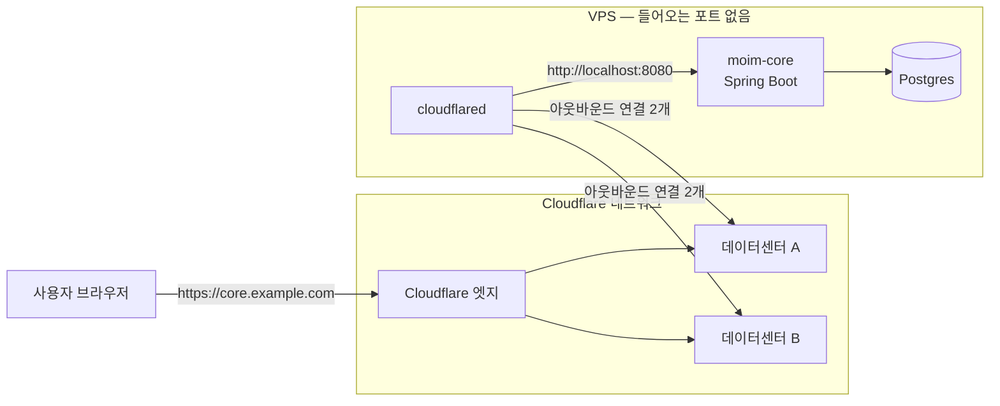

# 6장. Cloudflare Tunnel — 포트를 열지 않고 서버를 세상에 내놓기

금요일 저녁 여섯 시라고 해보자. 일곱 시에 `moim`을 함께 운영할지 고민 중인 커뮤니티 운영진과 화상 회의가 잡혀 있다. 보여줄 것은 `moim-core`다. 회원 관리와 결제 정산을 맡은 Spring Boot 서버이고, 지금은 집 책상 밑 미니 PC에서 `localhost:8080`으로 돌고 있다. 화면 공유로 보여줘도 되지만, 운영진이 각자 브라우저로 직접 눌러보게 하고 싶다. 남은 시간은 한 시간이다.

검색창에 "집 서버 외부 접속"을 쳐보면 가장 먼저 나오는 답은 대개 공유기 포트 포워딩이다. 공유기 관리 화면에 들어가 바깥의 8080 포트를 미니 PC의 8080으로 넘기고, 공인 IP를 알려주면 끝이라는 설명이다. 정말 그걸로 충분할까?

## 포트를 여는 대신

### 공유기 포트를 여는 일이 찜찜한 이유

포트 포워딩이 동작하지 않는 것은 아니다. 문제는 그 대가다. 하나씩 짚어보자.

먼저 주소가 불안정하다. 가정용 회선의 공인 IP는 대개 바뀐다. 오늘 알려준 주소가 다음 주에도 맞는다는 보장이 없고, 그래서 DDNS 같은 도구를 하나 더 붙이게 된다. 통신사나 건물 망 구조에 따라서는 공인 IP가 아예 내 공유기에 할당되지 않아 포워딩 자체가 안 되는 경우도 있다.

다음은 HTTPS다. `http://공인IP:8080`을 운영진에게 보내면 브라우저가 경고부터 띄운다. 인증서를 붙이려면 도메인을 연결하고 인증서를 발급받고 갱신까지 챙겨야 한다. 한 시간 안에 하기에는 손이 너무 많이 간다.

가장 마음에 걸리는 것은 열린 포트 자체다. 인터넷에는 열린 포트를 쉬지 않고 훑는 스캐너가 돌아다닌다. 포트를 여는 순간 `moim-core`는 운영진뿐 아니라 그 스캐너들에게도 보인다. 앞단에 어떤 방어도 없이 Spring Boot가 바로 인터넷을 마주하게 된다. 회의가 끝난 뒤 포워딩 규칙을 지우는 것을 잊어버린다면? 그다음 일은 생각만 해도 아찔하다.

그렇다면 ngrok 같은 터널 서비스는 어떨까? 방향은 맞다. 다만 그 길을 택하면 결국 "이 터널을 운영 환경에서도 쓸 것인가"라는 질문으로 돌아오게 되고, 그때는 도메인·인증·방어를 다시 따로 붙여야 한다. 기왕이면 데모에서 운영까지 같은 도구로 이어지는 길을 찾아보자.

Cloudflare Tunnel은 이 질문을 거꾸로 뒤집는다. 바깥에서 안으로 들어올 구멍을 여는 대신, 안에서 바깥으로 연결을 먼저 맺는다. 서버 쪽에서 보면 들어오는 포트는 하나도 열려 있지 않다. 그 원리는 잠시 뒤에 보고, 우선 금요일 저녁의 급한 불부터 끄자.

### 30초 데모 — Quick Tunnel과 Protected Quick Tunnel

미니 PC에 `cloudflared`를 설치했다면 명령 한 줄이면 된다.

```bash
cloudflared tunnel --url http://localhost:8080
```

잠시 후 터미널에 `https://<임의의-이름>.trycloudflare.com` 형태의 주소가 찍힌다. 이 주소를 운영진에게 보내면 끝이다. Cloudflare 계정도, 도메인도 필요 없다. 이것이 Quick Tunnel이다.

종종 Quick Tunnel을 2026년의 새 기능으로 소개하는 글이 보이는데, 사실이 아니다. 2026년 9월 HN에서 844점을 받은 "Cloudflare Quick Tunnels" 스레드에서도 한 댓글이 2021년 웹 아카이브를 근거로 5년 넘은 기능이라고 지적했다. 정말 새로 생긴 것은 따로 있다. 바로 다음에 볼 보호 모드다.

Quick Tunnel은 테스트와 개발용이다. 공식 문서(Quick Tunnels 2026-09-30 기준)가 밝힌 한계를 보면 이유가 분명하다. 터널 하나가 동시에 처리하는 요청은 200개까지이고, 그 이상은 429 응답을 받는다. Server-Sent Events(SSE)는 지원하지 않는다. 운영 환경이라면 정식 Cloudflare Tunnel을 만들라는 것이 문서의 권고다.

그런데 데모 주소를 메신저에 붙여 넣는 순간 조금 불안해진다. 주소만 알면 누구나 들어올 수 있기 때문이다. 2026년 10월 2일 추가된 Protected Quick Tunnel이 이 지점을 메운다.

```bash
cloudflared tunnel --url http://localhost:8080 --allowed-mail '*@example.com'
```

`--allowed-mail` 플래그를 붙이면 방문자는 이메일로 받은 일회용 PIN으로 인증해야 들어올 수 있다. 위 예처럼 도메인 단위 와일드카드를 쓰면 운영진의 회사 메일 주소만 통과시킬 수 있다. 공식 변경 기록도 이 기능을 로컬 개발 서버, 웹훅 수신기, 데모를 공유하는 용도로 소개한다. 8장에서 Stripe 웹훅을 로컬에서 받아볼 때 이 기능을 다시 쓴다.

Workers 쪽 개발 중이라면 `cloudflared`를 따로 깔 필요도 없다. Wrangler에는 `wrangler tunnel quick-start` 명령이 있고, Wrangler가 `cloudflared` 바이너리를 알아서 내려받아 관리한다. 개발 서버가 떠 있는 상태에서 Wrangler 화면에서는 `t`, Vite에서는 `t`와 Enter를 누르면 터널이 열린다. `moim-web`의 작업 중인 화면을 누군가에게 잠깐 보여줄 때 요긴하다.

금요일 데모는 이걸로 무사히 넘겼다고 하자. 그렇다면 월요일부터는 어떻게 할까? 이제 정식으로 열어보자.

## 바깥으로 맺는 연결

### Tunnel은 어떻게 동작하는가

정식 Tunnel의 구성 요소는 둘이다. 서버 옆에서 도는 작은 데몬 `cloudflared`와, Cloudflare 쪽에 저장된 터널 설정이다. 공식 문서(Tunnel 2026-09-11 기준)의 설명은 간결하다. 공인 IP를 노출하는 대신 서버에 `cloudflared`라는 가벼운 데몬을 설치하고, 이 데몬이 두 Cloudflare 데이터센터로 오래 유지되는 연결 네 개를 맺어 자체 이중화를 갖춘다.


그림 1. `cloudflared`가 바깥으로 맺는 연결과 요청이 오리진에 닿는 경로

요청의 흐름을 따라가보자. 사용자가 `core.example.com`에 접속하면 요청은 가장 가까운 Cloudflare 엣지로 간다. 엣지는 이 호스트명이 어떤 터널에 연결돼 있는지 알고, `cloudflared`가 미리 열어둔 연결을 타고 요청을 서버 안으로 들여보낸다. `cloudflared`는 그 요청을 `localhost:8080`의 Spring Boot에 넘기고 응답을 같은 길로 돌려보낸다. 서버의 방화벽은 들어오는 연결을 전부 막아도 된다. 연결은 늘 안에서 밖으로만 맺어지기 때문이다.

이 구조 덕분에 앞에서 본 포트 포워딩의 문제들이 한꺼번에 사라진다. 바깥으로 나가는 연결은 공유기 뒤에서도, 공인 IP가 내 공유기에 할당되지 않는 망에서도 대개 그냥 된다. 집의 공인 IP가 바뀌어도 상관없다. `cloudflared`가 다시 연결을 맺으면 그만이고, 사용자는 언제나 `core.example.com`이라는 같은 이름으로 들어온다. 그래서 금요일 데모에 썼던 집 미니 PC든, 월 몇 달러짜리 VPS든, 회사 사무실 구석의 서버든 같은 방식으로 내놓을 수 있다.

반대로 생각해볼 점도 있다. 연결이 하나의 데몬에 달려 있다는 것은, 그 데몬이 멈추면 서비스도 멈춘다는 뜻이다. `cloudflared`가 죽거나 서버가 꺼지면 엣지는 요청을 넘길 곳을 잃고 사용자는 Cloudflare의 오류 화면을 보게 된다. Spring Boot만 재시작 중이어도 마찬가지다. 그래서 `cloudflared`를 시스템 서비스로 등록하고, 필요하면 replica를 두는 이야기가 뒤따른다. 서버 자체가 꺼지는 경우는 Tunnel이 풀어줄 수 없는 문제이고, 그 질문은 7장에서 정면으로 다룬다.

도메인이 Cloudflare에 있으니 HTTPS 인증서는 엣지가 처리하고, 이 요청은 Cloudflare의 CDN과 보안 기능을 그대로 거친다. 요금은 어떨까? Tunnel은 모든 플랜에서 쓸 수 있다(Tunnel 2026-09-11 기준). 존 요금제가 Free여도, Workers Paid가 아니어도 된다.

### 원격 관리 터널로 `moim-core` 공개하기

이제 `moim-core`를 VPS로 옮겼다고 하자. Postgres도 아직 같은 VPS에 있다(7장에서 밖으로 옮긴다). 터널을 만드는 방식은 두 가지다. 설정을 Cloudflare에 저장하는 원격 관리 터널과, 서버의 설정 파일로 관리하는 로컬 관리 터널이다. Cloudflare는 대부분의 경우 원격 관리 터널을 권한다. 대시보드·API·Terraform 어디서든 터널을 관리할 수 있기 때문이다. 로컬 관리 터널은 로컬 개발이나 테스트, 기존 구성을 유지하는 특수한 경우를 위한 것으로 정리돼 있다.

대시보드에서 **Networking > Tunnels**로 들어가 **Create Tunnel**을 누르자. 이름을 `moim-core`로 정하면 대시보드가 이 터널 전용 토큰이 들어간 설치 명령을 보여준다. 이어서 라우트로 "Published application"을 추가하고, 호스트명에 `core.example.com`, 서비스에 `http://localhost:8080`을 적는다. API로 같은 일을 하려면 `POST /accounts/$ACCOUNT_ID/cfd_tunnel`에 `"config_src": "cloudflare"`를 넣어 만들면 된다. Tunnel은 2026년부터 독립 제품 문서(`/tunnel/`)와 독립 메뉴로 자리를 옮겼다. 예전 글에서 "Zero Trust 메뉴 안의 Tunnel"을 찾으라는 안내를 보더라도 당황하지 말자.

여기서 하나 꼭 기억해두자. 원격 관리 터널은 토큰만 있으면 실행된다. 토큰을 가진 사람은 누구든 그 터널을 자기 기계에서 띄울 수 있다는 뜻이다. 토큰은 비밀번호처럼 다뤄야 한다.

VPS에서는 `cloudflared`를 시스템 서비스로 등록한다. 대시보드가 보여주는 대로 `sudo cloudflared service install <토큰>`을 실행하면 systemd 유닛이 만들어지는데, 그 파일을 열어보면 `ExecStart` 줄에 토큰이 그대로 박혀 있다. 명령줄 인자는 같은 서버의 다른 사용자에게 프로세스 목록으로 보일 수 있으니, 토큰을 파일로 빼고 `--token-file`로 읽게 바꾸는 편이 낫다.

```ini
# /etc/systemd/system/cloudflared.service (발췌)
[Service]
ExecStart=/usr/local/bin/cloudflared tunnel run --token-file /etc/cloudflared/moim-core.token
Restart=on-failure
```

```bash
sudo install -m 600 -o root moim-core.token /etc/cloudflared/moim-core.token
sudo systemctl daemon-reload
sudo systemctl enable --now cloudflared
```

`--token-file`은 환경 변수 `TUNNEL_TOKEN_FILE`로도 줄 수 있다(`--token`은 `TUNNEL_TOKEN`). 컨테이너 환경에서는 이쪽이 더 편하다.

로컬 관리 터널도 알아두면 기존 글을 읽을 때 도움이 된다. 흐름은 `cloudflared tunnel login`으로 인증하고, `cloudflared tunnel create moim-core`로 터널을 만든 뒤, `~/.cloudflared/config.yml`에 ingress 규칙을 쓰고, `cloudflared tunnel route dns`로 호스트명을 연결해 `cloudflared tunnel run`으로 띄우는 순서다.

```yaml
# ~/.cloudflared/config.yml — 로컬 관리 터널
tunnel: <Tunnel-UUID>
credentials-file: /root/.cloudflared/<Tunnel-UUID>.json
ingress:
  - hostname: core.example.com
    service: http://localhost:8080
  - service: http_status:404   # 마지막 규칙은 반드시 모든 요청을 받는 catch-all이어야 한다
```

이 방식에서는 호스트명이 `{터널 UUID}.cfargotunnel.com`을 가리키는 CNAME 레코드로 연결된다. 이 구조를 두고 HN에는 "It boggles my mind that Cloudflare ever considered this acceptable for production"이라는 댓글도 있었다. Cloudflare가 이걸 운영 환경에 적합하다고 여겼다는 게 놀랍다는 말이니, 취향이 갈리는 지점이라는 정도만 알아두자. 이 책은 원격 관리 터널을 기본으로 쓴다.

## Spring Boot와 함께 운영하기

### Spring Boot 쪽에서 챙길 것

Tunnel을 붙였다고 Spring Boot 설정을 손대지 않아도 되는 것은 아니다. 몇 가지를 살펴보자.

첫째, 프록시 뒤에 있다는 사실을 Spring에 알려야 한다. `moim-core` 입장에서 요청은 언제나 `localhost`의 `cloudflared`에서 평문 HTTP로 들어온다. 그대로 두면 Spring이 리다이렉트 URL을 `http://`로 만들거나, 모든 요청의 클라이언트 IP를 `127.0.0.1`로 기록하는 일이 생긴다. 프록시가 붙여 보내는 전달 헤더(`X-Forwarded-Proto` 등)를 신뢰하도록 설정하자. Spring Boot에서는 `server.forward-headers-strategy` 속성이 이 역할을 한다. 지원되는 클라우드 플랫폼이 아니면 기본값이 `NONE`이니, `X-Forwarded-For`와 `X-Forwarded-Proto`를 처리하도록 `server.forward-headers-strategy=native`로 직접 켜자(Spring Boot 4.1.1 문서 기준). 원래 사용자 IP를 알고 싶다면 Cloudflare가 오리진으로 보내는 `CF-Connecting-IP` 헤더를 읽으면 된다. 이 헤더들은 반드시 Cloudflare를 거쳐 온 요청에서만 믿어야 한다. 그래서 다음 항목이 중요하다.

둘째, Spring Boot가 바깥 인터페이스에서 듣지 않게 하자. VPS에 `cloudflared`와 Spring Boot를 함께 띄운다면 Spring은 `127.0.0.1`에만 바인딩하고(`server.address=127.0.0.1`), 방화벽은 들어오는 연결을 모두 막는다. 그러면 `moim-core`에 닿는 길은 터널 하나뿐이다. 누군가 VPS의 IP를 알아내 8080으로 직접 두드려도 아무것도 응답하지 않는다.

셋째, 지금 이 문이 어떤 상태인지 정확히 알아두자. `core.example.com`은 이제 인터넷 어디서든 접속할 수 있다. `moim-core`에는 원래 쓰던 Spring의 로그인 기능이 있으니 활짝 열린 문은 아니다. 다만 Cloudflare가 아직 앞에서 지켜주지 않는 문이다. 누가 들어오려 하는지 Cloudflare 단계에서 묻지 않고, 로그인 화면까지는 누구에게나 보인다. 이 문 앞에 Access를 세워 사람과 기기를 먼저 확인하게 하고, Spring Security가 그 결과를 검증하게 만드는 일은 10장에서 한다.

넷째, 업로드 크기다. 존 요금제가 Free라면 Cloudflare를 지나는 요청 본문은 최대 100 MB이고, 넘으면 413 응답을 받는다(Workers Limits 2026-09-05 기준). Immich 같은 사진·동영상 서버를 Tunnel 뒤에 둔 HN 사용자가 "Only issue is the 100MB upload size for videos."라고 적은 것도 이 때문이다. 동영상 업로드의 100MB 제한이 유일한 문제였다는 말이다. `moim`의 발표 자료 업로드는 R2로 가니 영향이 없지만, Spring 쪽에 파일 업로드 API가 있다면 이 한도를 설계에 넣어두자.

다섯째, gRPC다. Spring으로 gRPC 서비스를 만드는 독자라면 주의가 필요하다. `cloudflared` 저장소의 gRPC 지원 이슈 #491은 2021년 10월에 열려 2026년 9월 30일 현재까지 66개의 댓글을 달고 열려 있다. 커뮤니티에는 `--protocol http2 --http2-origin --no-tls-verify` 조합에 HTTPS 앱·HTTP2·청크 인코딩 비활성화를 더해 우회했다는 보고(2026-09-30)와, 대시보드의 "Match SNI To Host" 옵션을 켜면 응답 트레일러가 깨진다는 경고(2026-09-06)가 있다. 둘 다 개인 경험담이니 그대로 따르기보다 실험 출발점으로 삼자. Containers로 들어오는 인바운드 gRPC는 다른 경로인데, 아직 비공개 베타라 7장에서 전망으로만 다룬다.

### Docker·Kubernetes와 replica

`moim-core`를 Docker Compose로 띄운다면 `cloudflared`를 옆 컨테이너로 두는 편이 깔끔하다. 공식 이미지는 `cloudflare/cloudflared`다.

```yaml
# docker-compose.yml (발췌)
services:
  moim-core:
    image: moim-core:latest
    # ports: 항목을 두지 않는다 — 호스트에 포트를 열지 않는다
  cloudflared:
    image: cloudflare/cloudflared
    command: tunnel --no-autoupdate run
    environment:
      TUNNEL_TOKEN_FILE: /run/secrets/tunnel_token
    secrets: [tunnel_token]
    restart: unless-stopped
secrets:
  tunnel_token:
    file: ./moim-core.token
```

이 경우 대시보드의 서비스 주소는 Compose 네트워크 안의 이름을 써서 `http://moim-core:8080`으로 바꾼다. `moim-core`에 `ports:`를 두지 않았으니 호스트 바깥에서는 Spring Boot에 직접 닿을 방법이 없다.

Kubernetes에서는 `cloudflared`를 Deployment로 띄운다. 공식 예시는 `replicas: 2`로 두 개를 띄우고 `cloudflared tunnel --no-autoupdate --loglevel info --metrics 0.0.0.0:2000 run`을 실행한다.

여기서 replica를 오해하기 쉽다. replica는 같은 터널을 가리키는 `cloudflared` 인스턴스를 하나 더 띄우는 것이고, 각 replica가 연결 네 개를 새로 맺는다. 터널 하나에 replica를 25개(연결 100개)까지 붙일 수 있다. 문서는 트래픽이 지리적으로 가장 가까운 replica로 간다고 설명하면서도, 동시에 이렇게 못 박는다.

> "We do not recommend using `cloudflared` in autoscaling setups because downscaling (removing replicas) will break existing user connections to that replica. Additionally, `cloudflared` does not load balance across replicas; replicas are strictly for high availability."

정리하면 replica는 HA용이지 LB용이 아니다. 가까운 replica로 요청이 가긴 하지만, 그 목적은 한 대가 죽어도 터널이 살아 있게 하는 데 있다. 그래서 replica 수를 부하에 따라 늘렸다 줄였다 하는 오토스케일링도 권하지 않는다. 줄이는 순간 그 replica에 붙어 있던 사용자 연결이 끊긴다. 부하 분산이 필요하다면 터널 뒤쪽, 즉 Spring Boot 인스턴스 앞에서 해결하자.

> **비용 메모**
> Cloudflare Tunnel은 모든 플랜에서 무료로 쓸 수 있고, Quick Tunnel은 계정조차 필요 없다(Tunnel 2026-09-11, Quick Tunnels 2026-09-30 기준). 비용 대신 걸리는 것은 약관과 한도다. Free·Pro·Business 플랜에서 Tunnel 공개 호스트명으로 동영상 같은 대용량 파일을 서빙하는 것은 서비스별 약관상 별도 유료 서비스가 필요하다. 공식 FAQ의 문장은 이렇다. "On Free, Pro, and Business plans, the service-specific terms require you to use a specific paid service to serve video and other large files." Free 존의 요청 본문 한도 100 MB도 함께 기억해두자.

## 한계와 대안

### Tunnel, Tailscale, ngrok — 무엇을 어디에 쓸까

Tunnel이 늘 정답일까? 현장의 의견은 꽤 갈린다. 세 관점을 나란히 놓아보자.

Tunnel을 좋아하는 쪽은 편리함을 꼽는다. 포트를 열지 않고, TLS 인증서와 도메인, 나중에는 Access 인증까지 한 번에 해결된다. 2026년 4월의 한 HN 댓글은 이렇게 표현했다. "It's a magical invention that lets us host websites while keeping our server firewalls closed!" 서버 방화벽을 닫아둔 채로 웹사이트를 호스팅하게 해주는 마법 같은 발명이라는 것이다.

Tailscale을 선호하는 쪽의 핵심 논거는 TLS가 어디서 끝나느냐다.

> "it acts as a termination point for TLS, whereas Tailscale does not. … that's a pretty big privacy downgrade for tunneling from the Internet."

Tunnel에서는 사용자와의 TLS가 Cloudflare 엣지에서 끝난다. 즉 Cloudflare가 요청 내용을 볼 수 있는 위치에 있다. Tailscale은 기기끼리 직접 암호화된 연결을 맺으므로 중간 사업자가 내용을 보지 않는다. 그 밖에 P2P 연결이 없다는 점과 벤더 종속도 지적된다. Java Champion인 Nicolas Fränkel은 2026년 1월 Cloudflare Zero Trust에서 Tailscale로 옮긴 경험을 글로 남겼다. 사용자 기기가 사설망 안에 있지 않아 서비스마다 공개 엔드포인트를 만들어야 했고, SSH가 불편했으며, 인증서 투명성 로그 때문에 서브도메인과 홈 서버가 드러났다는 이유였다. 그의 결론은 "Migrating to Tailscale was a leap of faith, but I'm very happy I did it."이었다. Tailscale로 옮긴 것은 믿음의 도약이었지만 아주 만족한다는 뜻이다.

세 번째 관점은 계정 없는 익명 터널 자체를 비판한다. ngrok 창업자는 HN Quick Tunnels 스레드(2026-09-18)에서 익명 사용이 자사 제품 악용의 가장 큰 원천이었기 때문에 오래전에 없앴다며, 계정 없는 터널 서비스는 인터넷 보안에 순손실이라고 주장했다. 경쟁 사업자의 발언이라는 점을 감안해야 하지만, 무료 프록시 주소가 결국 차단 목록에 오르기 쉽다는 다른 사용자의 지적과 함께 생각해볼 만한 이야기다. 우리가 Quick Tunnel을 데모에만 쓰고, 그것도 가능하면 `--allowed-mail`로 보호한 이유이기도 하다.

그렇다면 어떻게 나눠 쓰는 게 좋을까? 현장에서 반복되는 합의는 이렇다. 누구나 접속해야 하는 공개 서비스는 Tunnel로 내놓고 Access를 앞에 세운다. 나와 팀원만 쓰는 사설 접근, 예컨대 SSH나 파일 동기화, 개인 미디어 서버는 Tailscale 같은 사설망 도구로 간다. `moim-core`는 운영진뿐 아니라 `moim-api`도 부르는 서버이고, 10장에서 Access로 닫을 예정이니 Tunnel 쪽이 맞다. 팀원의 SSH는 10장에서 `cloudflared access ssh`로 다시 다룬다. Tunnel을 사설망·VPN 대체로 쓰는 이야기는 Cloudflare One의 Tunnel 문서 쪽 주제이고, 그 역시 10장의 몫이다.

### 오래 굴리기 위한 운영 수칙

터널은 한번 띄우면 잊고 지내기 쉽다. 그래서 오히려 운영 수칙을 정해두는 편이 낫다.

먼저 네트워크다. `cloudflared`는 7844 포트로 바깥에 연결한다. UDP(QUIC)와 TCP(HTTP/2) 둘 다 쓰므로, 회사망이나 클라우드 보안 그룹에서 아웃바운드 7844가 막혀 있으면 터널이 뜨지 않는다. 2026.5.2 버전부터는 `cloudflared`가 시작할 때 DNS와 7844 포트 연결을 스스로 점검하고, DNS를 풀지 못하거나 UDP와 TCP가 둘 다 실패하면 원인을 알려주며 일찍 종료한다(2026-05-27 기준). 커뮤니티에 보고된 QUIC 타임아웃 문제도 상당수는 UDP 7844가 막힌 환경에서 HTTP/2로 넘어가거나 버전을 올려 해결됐다.

다음은 버전이다. Cloudflare는 최신 릴리스로부터 1년 이내의 `cloudflared`만 지원한다. 2026년 10월 기준 최신은 2026.9.3(2026-09-24)이다. Windows에서는 `cloudflared`가 자동으로 업데이트되지 않으니 직접 챙겨야 한다. 오래된 글에 나오는 `cloudflared proxy-dns` 명령은 2026년 2월 2일 이후 릴리스에서 제거됐고, 그 역할은 Cloudflare One Client(구 WARP Client)와 Mesh node(구 WARP Connector)로 넘어갔다. 2027년에는 32비트 Windows와 Intel macOS용 빌드 제공이 중단될 예정이다(2026-09-18 공지).

마지막으로 토큰이다. 토큰이 새어 나갔다고 의심되면 대시보드에서 토큰을 교체하고 파일을 바꿔 서비스를 다시 띄우자. 토큰 파일 권한(`600`)과 소유자도 정기 점검 목록에 넣어두는 게 좋다.

---

금요일 저녁의 데모는 명령 한 줄로 끝났고, 월요일의 운영은 몇 개의 설정으로 자리를 잡았다. 그 뒤로 남는 것은 결국 세 줄이다.

```bash
sudo systemctl enable --now cloudflared   # 재부팅해도 터널이 다시 뜨게 서비스로 등록
sudo journalctl -u cloudflared -n 50      # 시작 시 7844 사전 점검과 연결 상태 확인
cloudflared --version                     # 최신 릴리스 1년 이내인지 확인
```
