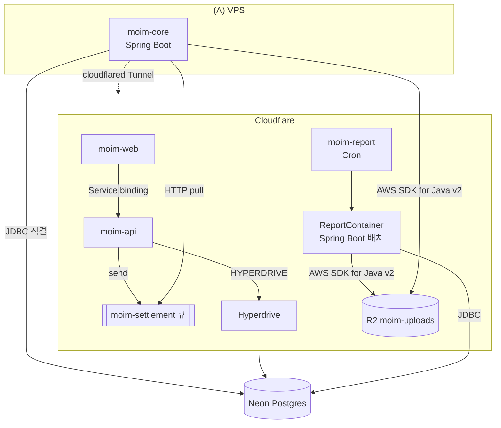

# 7장. Spring Boot의 자리 — JVM 백엔드를 어디에 두고 어떻게 잇는가

앞 장에서 우리는 포트 하나 열지 않고 `moim-core`를 `core.example.com`으로 꺼냈다. VPS 안의 Spring Boot는 이제 Cloudflare 엣지를 거쳐 세상과 이어져 있다. 그런데 그 VPS의 전원이 꺼지면 어떻게 될까?

Tunnel은 길을 놓아줄 뿐, 길 끝의 서버를 대신 살려주지는 않는다. VPS가 재부팅되는 몇 분, 디스크가 가득 차 Postgres가 멈춘 한 시간 동안 `moim-core`는 그냥 없다. 게다가 이 VPS에는 Spring Boot와 Postgres가 함께 살고 있다. 서버 한 대가 API와 데이터와 매달 한 번 도는 정산 배치까지 전부 떠안은 구조다. 3장에서 확인했듯 Workers에는 JVM이 없고, Kotlin/Wasm은 2026년 10월 기준 아직 Beta이니 Spring을 Workers로 옮기는 길도 주력 경로가 될 수 없다.

그렇다면 Java·Kotlin 백엔드는 Cloudflare 옆에서 어디에 살아야 할까? 하나의 답을 고르기 전에, 갈 수 있는 길부터 나란히 놓아보자.

## 세 착지점

### 세 갈래 길

JVM 백엔드가 Cloudflare와 함께 살 수 있는 자리는 크게 셋이다.

첫째는 6장의 길이다. **(A) Tunnel 뒤의 VM이나 집 서버**에 Spring Boot를 상시 띄워두고, `cloudflared`로 엣지와 잇는다. 익숙하고 단순하며, 서버 한 대 값만 내면 된다. 대신 서버의 생사와 OS 업데이트, 디스크 관리는 전부 내 몫이다.

둘째는 **(B) Cloudflare Containers**다. 2026년 4월 13일 GA가 된 제품으로, 공식 문서의 소개는 이렇다.

> "Run code written in any programming language, built for any runtime, as part of apps built on Workers."

어떤 언어, 어떤 런타임으로 만든 코드든 Workers 앱의 일부로 실행한다는 뜻이다. JVM도 예외가 아니다. 다만 Containers는 Workers Paid 플랜에서만 쓸 수 있다. 이 책에서 계정이 처음으로 Workers Paid로 넘어가는 지점이 바로 여기다.

셋째는 **(C) 이미 쓰고 있는 클라우드에 그대로 두고 잇는 것**이다. AWS나 GCP에 Spring Boot와 데이터베이스가 이미 있다면, Worker를 그 리전 근처에서 실행하도록 Placement Hints로 지정할 수 있다. `"placement": { "region": "aws:us-east-1" }`처럼 AWS·GCP·Azure의 리전 식별자를 쓴다(2026-01-22 기준). 공인 인터넷에 노출되지 않은 사설 API에 Worker가 직접 닿게 해주는 Workers VPC도 이 길에 속하지만, 2026년 10월 현재 베타라서 아래 전망 상자로만 다룬다.


그림 1. `moim-core`의 세 착지점과 이 장에서 놓는 연결선(Tunnel·Hyperdrive·Queues·Containers)

`moim`은 이 셋을 하나만 고르지 않고 역할에 따라 나눈다. 요청에 늘 응답해야 하는 회원·정산 API는 (A)에 그대로 둔다. 매달 한 번 몰아서 도는 정산 리포트 배치는 (B)의 Containers로 뺀다. 그리고 VPS 안에 갇혀 있던 Postgres를 Neon으로 옮겨 `moim-core`와 `moim-api`가 같은 데이터를 보게 하고, 둘 사이의 작업 전달은 큐에 맡긴다. 서버 한 대가 전부 떠안던 구조를 풀어내는 것이다. 각 연결을 하나씩 만들어보자.

## Containers — 가끔, 몰아서 도는 JVM

### Containers는 어떤 물건인가

Containers의 생김새부터 보자. 컨테이너 인스턴스마다 Durable Object가 하나씩 붙고, Worker 코드가 그 DO를 통해 컨테이너를 켜고 끈다. 이미지는 `linux/amd64` 아키텍처에서 돌 수 있어야 하며, 공식 문서는 "그것 말고는 제약이 거의 없다"고 적는다. 인스턴스 타입은 다음과 같다(Containers Limits 2026-09-30 기준).

| 타입 | vCPU | 메모리 | 디스크 |
|---|---|---|---|
| lite | 1/16 | 256 MiB | 2 GB |
| basic | 1/4 | 1 GiB | 4 GB |
| standard-1 | 1/2 | 4 GiB | 8 GB |
| standard-2 | 1 | 6 GiB | 12 GB |
| standard-3 | 2 | 8 GiB | 16 GB |
| standard-4 | 4 | 12 GiB | 20 GB |

과금 방식은 따로 짚어둘 만하다. 공식 FAQ의 문장이다.

> "Memory and disk usage are based on the *provisioned resources* for the instance type you select, while CPU usage is based on *active usage* only."

메모리와 디스크는 고른 인스턴스 타입이 프로비저닝한 양 그대로, CPU는 실제로 쓴 만큼만 과금된다. JVM처럼 메모리를 넉넉히 잡아야 하는 런타임에게는 메모리가 비용의 대부분을 차지한다는 뜻이다. 단가는 메모리 GiB-초당 $0.0000025, CPU vCPU-초당 $0.000020, 디스크 GB-초당 $0.00000007이고, Workers Paid에 메모리 25 GiB-시간·CPU 375 vCPU-분·디스크 200 GB-시간이 매달 포함된다(Containers Pricing 2026-08-28 기준). 이그레스 단가는 지역마다 다르다. 북미·유럽은 GB당 $0.025(1 TB 포함)인데, 한국은 오세아니아·대만과 함께 GB당 $0.05(500 GB 포함)로 두 배다.

콜드 스타트는 어떨까? 공식 FAQ는 "대개 1~3초 범위일 수 있지만 이미지 크기와 코드 실행 시간 등에 따라 달라진다"고 적는다. 2026년 9월 30일 Cloudflare 블로그는 새 `durable_object` 스케줄링 정책으로 컨테이너를 "6배 이상 빠르게" 시작한다고 발표했지만, 이것은 블로그의 주장이고 문서의 보장 수치는 위의 1~3초다. 여기에 JVM이라면 Spring Boot 자체의 기동 시간이 더해진다. 그 시간은 앱마다 다르니 자기 이미지로 직접 재보는 수밖에 없다. 그리고 2026년 10월 기준 무상태 앱을 위한 내장 오토스케일링은 아직 없다. Cloudflare는 향후 추가할 계획이라고만 밝혔다.

현장의 평가는 극명하게 갈린다. 긍정하는 쪽은 쓰임새를 정확히 짚는다.

> "This is the perfect use of cloudflare containers. Rare, bursty workloads that fit around regular use of Workers. … not even noticeable in billing."

드물고 몰아서 오는 작업을 Workers 옆에 붙여 쓰기에 딱 맞고, 청구서에서 눈에 띄지도 않는다는 평이다. "Cloudflare Containers is literally 'pay for usage', while AWS is pay for capacity."라는 비교도 있었다. Containers는 쓴 만큼 내고 AWS는 잡아둔 용량만큼 낸다는 말이다. 반대쪽 경험도 무시할 수 없다. 2026년 5월 walla.my의 개발자는 이렇게 적었다.

> "We also tried Cloudflare Containers, but they weren't as reliable as just spinning up a small VM. 1vCPU and 1GB RAM were enough to synchronize about 3,000 users."

Containers도 써봤지만 작은 VM 하나 띄우는 것만큼 안정적이지 않았고, vCPU 1개와 1GB 메모리로 3,000명 정도의 동기화를 감당했다는 것이다. "가장 비싼 제품 같다(Feels like it is the nost expensive product they have.)"는 반응도 있다(원문 오타 그대로). 2026년 9월에는 같은 호스트에서 다른 고객이 쓰던 디스크 블록을 Workers Paid 계정이 복구할 수 있었던 교차 테넌트 취약점이 보고됐고, Cloudflare는 수정을 마쳤으며 악용 증거는 없다고 밝혔다. 제품이 아직 빠르게 다듬어지는 중이라는 신호로 읽어두자.

이 평가들을 모으면 하나의 선이 그어진다. Containers는 "가끔, 몰아서" 도는 작업에 강하고, 상시 실시간으로 응답해야 하는 서버는 작은 VM이 더 무난했다는 경험이 쌓여 있다. `moim`이 정산 리포트 배치만 Containers로 보내는 이유가 여기에 있다.

> **최소 안전장치**
> Containers를 쓰려고 Workers Paid로 전환하는 순간, 계정의 성격이 바뀐다. Free에서는 대부분의 제품이 한도에 닿으면 에러를 내고 멈췄다. Workers Paid에서는 포함량을 넘은 사용분이 과금된 채로 계속 돈다. 2026년 10월 현재 계정 전체에 지출 상한을 거는 기능은 없다. 그러니 전환하는 날 다음 세 가지를 해두자.
> 1. **모든 Worker에 호출 단위 상한을 건다.** `wrangler.jsonc`에 `"limits": { "cpu_ms": 1000, "subrequests": 10 }`처럼 Worker가 실제로 쓰는 만큼만 넉넉히 잡는다(값은 Worker마다 조정, Workers Pricing 2026-10-02 기준 `cpu_ms` 기본 30,000·최대 300,000). 이 상한은 호출 한 번의 폭주를 막을 뿐 호출 횟수 자체는 막지 못한다는 점도 기억해두자.
> 2. **컨테이너 인스턴스 수를 묶는다.** `containers` 설정의 `max_instances`를 작업에 필요한 만큼만 둔다. `moim`의 정산 배치는 1이면 충분하다.
> 3. **예산 알림 임계치를 내 예산에 맞춘다.** 2026년 7월부터 적격 Pay-as-you-go 계정에는 $10 알림이 기본으로 켜지기 시작했다(순차 적용). 다만 예산 알림은 정보 제공용이라 사용을 멈추지 않고, 하루 늦게 오며, Workers Paid 월 기본료는 계산에서 빠진다.
>
> 알림과 차단을 겹겹이 쌓는 전체 방어선은 13장에서 세운다.

### ReportContainer 만들기 — 저자 작성 예제

여기서부터의 코드는 공식 예제가 없어서 직접 작성한 예제다. 2026년 10월 기준 Containers 공식 문서와 예제 저장소에는 Go·Node·Python 예제만 있고 Java나 Spring Boot 예제는 한 건도 없다. 문서 전반에 "Spring"이라는 단어조차 나오지 않는다. Containers 위의 Spring Boot 실사용기도 찾지 못했다. 아래 구성은 문서화된 사실을 조합한 것이니, 운영에 쓰기 전에 자기 이미지로 꼭 검증하자.

정산 리포트는 `moim-core`와 같은 코드베이스에서 리포트 기능만 켠 프로필(`report`)로 돌린다. Spring Boot는 2026년 8월 20일 GA인 4.1.1을 기준으로 하며, Java 17 이상이 필요하다. 컨테이너 안의 Spring은 두 개의 엔드포인트만 연다. 준비 상태를 알리는 `/healthz`와, 한 달 치 정산을 집계해 R2에 CSV로 남기는 `/reports/{month}`다.

```java
@RestController
@Profile("report")
class ReportController {

    private final SettlementReportService reports;

    ReportController(SettlementReportService reports) {
        this.reports = reports;
    }

    @GetMapping("/healthz")
    String health() {
        return "ok";
    }

    @PostMapping("/reports/{month}")
    ReportResult run(@PathVariable String month) {
        // Neon에서 집계하고 R2에 reports/{month}.csv로 저장 (R2 코드는 뒤에서)
        return reports.generate(YearMonth.parse(month));
    }
}
```

이미지는 평범한 JRE 이미지에 jar를 얹는다. 베이스 이미지(Eclipse Temurin)와 힙 설정은 저자의 선택이다.

```dockerfile
# moim-report/Dockerfile — 저자 작성 예제
FROM --platform=linux/amd64 eclipse-temurin:21-jre
WORKDIR /app
COPY build/libs/moim-core.jar app.jar
# 컨테이너 메모리의 75%까지만 힙으로 쓴다 — 스왑이 없으니 여유를 남긴다
ENV JAVA_TOOL_OPTIONS="-XX:MaxRAMPercentage=75"
EXPOSE 8080
ENTRYPOINT ["java", "-jar", "/app/app.jar"]
```

`--platform=linux/amd64`를 박아둔 이유는 Apple Silicon 맥에서 빌드해도 amd64 이미지가 나오게 하려는 것이다. 힙을 메모리의 75%로 묶은 데도 이유가 있다. 컨테이너는 스왑을 쓰지 않고, 메모리가 바닥나면 Out of Memory 에러와 함께 인스턴스가 재시작된다. JVM은 힙 말고도 메타스페이스와 스레드 스택 등에 메모리를 쓰니 여유를 남겨야 한다. 종료 신호도 맞춰두자. 컨테이너를 내릴 때 Cloudflare는 메인 프로세스에 `SIGTERM`을 보내고 최대 15분을 기다린 뒤 `SIGKILL`을 보낸다. Spring 쪽에 `server.shutdown=graceful`을 켜두면 진행 중인 리포트 요청을 마무리하고 내려갈 수 있다(이 조합은 저자 판단이다).

이 배치를 담을 Worker는 `moim-report`로 따로 둔다. Containers 비용과 수명 주기를 `moim-api`와 섞지 않으려는 것이다.

```jsonc
// moim-report/wrangler.jsonc — 저자 작성 예제
{
  "$schema": "./node_modules/wrangler/config-schema.json",
  "name": "moim-report",
  "main": "src/index.ts",
  "compatibility_date": "2026-09-01",
  "workers_dev": false,
  "triggers": { "crons": ["0 1 1 * *"] },        // 매월 1일 01:00 UTC
  "containers": [
    {
      "class_name": "ReportContainer",
      "image": "./Dockerfile",
      "max_instances": 1,
      "instance_type": "standard-1"              // (사실 확인 필요)
    }
  ],
  "durable_objects": {
    "bindings": [{ "name": "REPORT", "class_name": "ReportContainer" }]
  },
  "migrations": [{ "tag": "v1", "new_sqlite_classes": ["ReportContainer"] }],
  "limits": { "cpu_ms": 1000 },
  "observability": { "enabled": true }
}
```

인스턴스 타입을 설정 파일에 적은 데는 사정이 있다. 2026년 9월 29일 갱신된 Containers API 문서는 신규 앱에 Durable Object Container API(`ctx.container`)를 권하고, 기존 `Container` 클래스는 "기존 애플리케이션을 위해 문서를 유지한다"고 적는다. 그런데 이 API의 `start()`에 인스턴스 크기를 넘기는 옵션은 `durable_object` 스케줄링 정책 전용이고, 그 정책은 Cloudflare 관리 레지스트리의 digest 고정 이미지만 받는다. `./Dockerfile`을 바로 쓰는 이 예제는 기본 정책을 택하고 인스턴스 크기를 설정 파일에서 지정했다. 무엇을 택하든 기억할 것은 하나다. `start()`의 기본 인스턴스는 `lite`, 즉 256 MiB다. JVM을 거기 올리면 뜨기도 전에 메모리가 바닥난다. 한 가지 더 있다. 문서의 새 최소 구성은 `migrations` 대신 `exports` 항목으로 DO를 선언하는데, 기존 `migrations` 형식도 계속 쓸 수 있고 둘을 함께 두지만 않으면 된다.

이제 Worker와 DO 코드다. DO Container API로 컨테이너를 시작했다고 포트가 준비된 것은 아니다. 문서도 이 점을 분명히 적는다. JVM은 기동이 느리니, 준비될 때까지 기다리는 로직을 직접 넣어야 한다.

```ts
// moim-report/src/index.ts — 저자 작성 예제
import { DurableObject } from "cloudflare:workers";

export class ReportContainer extends DurableObject<Env> {
  async run(month: string): Promise<string> {
    const container = this.ctx.container!;
    if (!container.running) {                    // (사실 확인 필요)
      container.start({
        // 값은 wrangler secret put으로 등록해둔 시크릿에서 읽는다
        env: {                                   // 환경 변수 전달 형태 (사실 확인 필요)
          SPRING_PROFILES_ACTIVE: "report",
          SPRING_DATASOURCE_URL: this.env.NEON_JDBC_URL,
          R2_ACCESS_KEY_ID: this.env.R2_ACCESS_KEY_ID,
          R2_SECRET_ACCESS_KEY: this.env.R2_SECRET_ACCESS_KEY,
        },
      });
    }
    // 활동이 없으면 5분 뒤 정지 (0 초과, 최대 6시간)
    container.setInactivityTimeout(5 * 60 * 1000);

    await this.waitForSpring();
    const res = await container
      .getTcpPort(8080)
      .fetch(`http://report/reports/${month}`, { method: "POST" });
    return res.text();
  }

  private async waitForSpring(tries = 60): Promise<void> {
    for (let i = 0; i < tries; i++) {
      try {
        const res = await this.ctx.container!.getTcpPort(8080).fetch("http://report/healthz");
        if (res.ok) return;
      } catch {
        // 아직 포트가 열리지 않았다 — JVM이 뜨는 중
      }
      await new Promise((r) => setTimeout(r, 1000));
    }
    throw new Error("Spring Boot가 제때 준비되지 않았다");
  }
}

export default {
  async scheduled(controller, env, ctx) {
    // previousMonth는 "2026-09" 형식의 지난달 문자열을 돌려주는 헬퍼 (생략)
    const month = previousMonth(new Date(controller.scheduledTime));
    const stub = env.REPORT.get(env.REPORT.idFromName(month));
    ctx.waitUntil(stub.run(month).then((r) => console.log("report done", r)));
  },
} satisfies ExportedHandler<Env>;
```

`setInactivityTimeout()`을 빼먹으면 DO가 비활성 상태가 되자마자 컨테이너도 곧 멈춘다는 점에 주의해야 한다. 월 단위 리포트를 같은 달 이름의 DO에 맡겼으니, 같은 달 리포트를 실수로 두 번 돌려도 인스턴스가 하나 더 생기지는 않는다. 기존 `Container` 클래스(`@cloudflare/containers`)를 쓰면 `defaultPort = 8080`, `sleepAfter` 같은 속성과 포트 준비를 기다려주는 `startAndWaitForPorts()`가 있어 코드가 더 짧아진다. 다만 신규 앱의 권장 경로는 위의 DO API다.

기동 시간을 더 줄이고 싶다면 JVM 쪽 선택지도 있다. 실행 중인 JVM 상태를 체크포인트로 떠두는 CRaC나, 미리 네이티브 바이너리로 컴파일하는 GraalVM 네이티브 이미지다. 둘 다 빌드와 호환성 검증이 만만치 않으니, 한 달에 한 번 도는 배치라면 몇 초의 기동 시간을 그냥 받아들이는 편이 대개 합리적이다.

배포에도 한 가지 함정이 있다. Workers Builds를 쓴다면, 운영 브랜치에서는 `wrangler deploy`가 돌아야 이미지와 컨테이너 인스턴스가 갱신된다. 운영이 아닌 브랜치의 기본 동작인 `wrangler versions upload`는 이미지를 갱신하지 않는다. 또 Containers를 쓰는 Worker는 DO를 구현하므로 프리뷰 URL이 생성되지 않는다(Containers FAQ 2026-10-02 기준).

### 상시 가동하면 얼마일까 — 저자 계산

그렇다면 `moim-core`의 API까지 Containers에 상시 띄우면 어떨까? 공식 단가로 직접 계산해보자. `standard-1`(vCPU 1/2, 메모리 4 GiB, 디스크 8 GB) 한 대를 30일 내내 켜두는 경우다. 30일은 2,592,000초다. 인스턴스가 떠 있는 시간만 과금된다고 가정했고, 앞단 Worker·DO 사용량과 이그레스는 따로 셈한다.

| 항목 | 계산 (Containers Pricing 2026-08-28 기준) | 월 금액 |
|---|---|---|
| 메모리 | 4 GiB × 2,592,000초 = 10,368,000 GiB-초 − 포함 90,000(25 GiB-시간) = 10,278,000 × $0.0000025 | 약 $25.70 |
| 디스크 | 8 GB × 2,592,000초 = 20,736,000 GB-초 − 포함 720,000(200 GB-시간) = 20,016,000 × $0.00000007 | 약 $1.40 |
| CPU (평균 사용률 10% 가정) | 0.5 vCPU × 10% × 2,592,000초 = 129,600 vCPU-초 − 포함 22,500(375분) = 107,100 × $0.000020 | 약 $2.14 |
| CPU (사용률 100% 가정) | 0.5 vCPU × 2,592,000초 = 1,296,000 − 22,500 = 1,273,500 × $0.000020 | 약 $25.47 |
| Workers Paid 기본료 | 계정당 월 최소 | $5.00 |
| **합계** | 10% 가정: 25.70 + 1.40 + 2.14 + 5.00 / 100% 가정: 25.70 + 1.40 + 25.47 + 5.00 | **약 $34.24 / 약 $57.57** |

예상대로 메모리가 지배적이다. CPU를 거의 쓰지 않아도 메모리 4 GiB를 켜둔 값만 월 $25 남짓이다. 경쟁 PaaS의 공동창업자가 쓴 글에서는 상시 standard(4 GiB) 인스턴스를 월 약 $82.44로 계산하며 일반 PaaS의 5~10배라고 주장했다. 이해관계자의 수치이고 계산 시점과 가정이 이 표와 다르니 그대로 비교하기는 어렵다. 다만 어느 계산이든 "JVM을 상시 켜두는 용도"가 Containers의 강점은 아니라는 결론은 같다. 같은 돈으로 쓸 수 있는 VPS의 사양은 독자가 쓰는 업체의 가격표와 직접 대조해보자.

이번에는 정산 배치로 계산해보자. 리포트 작업이 10분 걸리고 비활성 타이머 5분 뒤 꺼진다면, 한 번에 15분(900초)이다. 메모리는 4 GiB × 900초 = 3,600 GiB-초로, 매달 포함된 90,000 GiB-초의 4%에 불과하다. 매일 돌려도 한 달 108,000 GiB-초이니 초과분 18,000 GiB-초에 대해 약 $0.05가 붙는 정도다. 같은 인스턴스가 상시 가동이면 월 수십 달러, 배치면 사실상 포함량 안이다. 숫자가 Containers의 쓰임새를 대신 말해준다.

> **비용 메모**
> Containers는 Free에서 쓸 수 없고 Workers Paid(월 최소 $5)가 필요하다. 메모리·디스크는 프로비저닝 기준, CPU는 활성 사용 기준이며, 한국 이그레스는 GB당 $0.05(500 GB 포함)로 북미·유럽의 두 배다(Containers Pricing 2026-08-28 기준). 컨테이너 앞단의 Worker와 Durable Object 사용량은 별도로 과금된다. 비활성 타이머를 길게 잡을수록 놀고 있는 메모리 값이 쌓인다는 점도 잊지 말자.

## 데이터와 메시지로 잇기

### Hyperdrive로 Postgres 공유하기

다음은 데이터다. VPS 안의 Postgres를 Neon으로 옮기자. `pg_dump`로 뜬 덤프를 Neon에 복원하고, `moim-core`의 데이터소스 URL을 Neon이 안내하는 JDBC 연결 문자열로 바꾸면 Spring 쪽 이전은 끝난다. VPS가 꺼져도 데이터는 남고, 6장의 Tunnel은 이제 API 서버만 지키면 된다.

그런데 `moim-api`도 이 데이터를 봐야 한다. 행사 신청 내역은 D1에 있지만, 회원 등급이나 정산 상태는 `moim-core`가 관리하는 Postgres에 있기 때문이다. Worker가 외부 Postgres에 직접 붙으면 무엇이 문제일까? Worker는 요청마다 짧게 깨어나는 실행 단위다. 요청마다 멀리 있는 DB와 TCP 연결을 맺고 TLS와 인증을 다시 치르면, 쿼리보다 연결 준비가 더 오래 걸리는 난감한 상황이 된다. Hyperdrive가 이 문제를 맡는다. Cloudflare Workers 리드 엔지니어인 kentonv는 Hyperdrive를 "Hyperdrive, which provides connection management and caching over plain old Postgres, MySQL, etc."라고 설명했다. 평범한 Postgres나 MySQL 위에 연결 관리와 캐싱을 얹어준다는 뜻이다. 연결 풀을 DB 가까이에 유지해두고 Worker는 그 풀을 빌려 쓰는 구조다.

```bash
npx wrangler hyperdrive create moim-neon \
  --connection-string="postgres://user:password@<neon-host>:5432/moim"
```

```jsonc
// moim-api/wrangler.jsonc (추가분)
{
  // ...4장과 동일
  "hyperdrive": [{ "binding": "HYPERDRIVE", "id": "<hyperdrive-id>" }],
  "placement": { "region": "aws:us-east-1" } // Neon 프로젝트가 있는 리전으로
}
```

```ts
// moim-api — 회원 등급 조회
import { Client } from "pg";

app.get("/api/members/:id/tier", async (c) => {
  const client = new Client({ connectionString: c.env.HYPERDRIVE.connectionString }); // (사실 확인 필요)
  await client.connect();
  try {
    const { rows } = await client.query("SELECT tier FROM member WHERE id = $1", [c.req.param("id")]);
    return rows.length ? c.json(rows[0]) : c.notFound();
  } finally {
    c.executionCtx.waitUntil(client.end());
  }
});
```

Neon 전용 서버리스 드라이버 대신 `pg`를 쓴 이유와 공급자별 주의점은 8장에서 정리한다. `placement.region`은 앞에서 본 Placement Hints다. `moim-api`가 Neon과 여러 번 왕복한다면 Worker를 DB 리전 가까이에서 돌리는 편이 응답이 빠르다.

여기서 중요한 사실이 하나 있다. Hyperdrive는 Worker의 바인딩이다. `moim-core`는 상시 떠 있는 서버이니 지금처럼 자기 커넥션 풀로 Neon에 직접 붙으면 된다. 같은 DB를 두 경로로 공유하는 셈이다. 그래서 두 가지를 챙겨야 한다. 하나는 연결 수 예산이다. Hyperdrive가 원본 DB에 여는 연결은 Free에서 약 20개, Paid에서 약 100개까지이고(Hyperdrive Limits 2026-06-09 기준), 여기에 Spring 커넥션 풀의 크기를 더한 값이 Neon 플랜의 연결 한도 안에 들어와야 한다. 다른 하나는 풀링 방식이다. Hyperdrive는 트랜잭션 모드로 풀링한다. 트랜잭션이 끝나면 연결이 풀로 돌아가며 `RESET`되므로, 세션에 `SET`한 값은 다음 쿼리에 이어지지 않는다. advisory lock이나 `LISTEN`/`NOTIFY`, SQL 수준의 `PREPARE` 같은 기능도 지원하지 않는다(2026-09-30 기준). 이런 기능이 필요하면 Hyperdrive를 거치지 않는 직접 연결을 따로 쓰라는 것이 문서의 권고다. 우리 구조에서는 Spring 쪽이 그 직접 연결이니, 세션에 기대는 작업은 `moim-core`에 두자.

한도도 확인해두자. Hyperdrive 자체에는 추가 요금이 없다. Free는 하루 쿼리 10만 건과 설정 10개, Workers Paid는 쿼리 무제한에 설정 25개다. Free에서 쿼리 한도를 넘으면 과금되지 않고 에러가 난다. 쿼리 하나는 최대 60초까지 돈다(Hyperdrive Pricing 2026-06-18, Limits 2026-06-09 기준).

### Queues HTTP pull — Spring이 큐를 당겨 가기

이제 `moim-api`와 `moim-core` 사이의 작업 전달이다. 신청이 확정되거나 취소될 때마다 `moim-api`가 정산 대상 이벤트를 만들어 `moim-core`에 알려야 한다. Tunnel 너머의 `moim-core`를 HTTP로 바로 부르면 되지 않을까? 그러면 VPS가 재부팅되는 몇 분 동안 생긴 이벤트는 그대로 사라진다. 이 장의 첫 질문으로 다시 돌아온 셈이다. 큐를 사이에 두면 `moim-core`가 잠시 꺼져 있어도 이벤트는 큐에 남아 기다린다.

보내는 쪽은 4장에서 `MAIL_QUEUE`를 쓸 때와 같다. `moim-settlement` 큐를 만들고 `moim-api`에 `SETTLEMENT_QUEUE` 프로듀서 바인딩을 추가한 뒤 메시지를 넣는다.

```ts
// moim-api — 신청 확정 시
await c.env.SETTLEMENT_QUEUE.send(
  { type: "rsvp.confirmed", eventId, memberId, at: Date.now() },
  { contentType: "json" } // 외부 소비자가 읽을 수 있는 형식으로 (사실 확인 필요)
);
```

받는 쪽이 달라진다. Worker 소비자 대신 HTTP pull 소비자를 붙인다. 외부 프로그램이 Cloudflare API로 메시지를 당겨 가는 방식이다. 큐에 HTTP pull 소비자를 설정하는 방법(대시보드 또는 `wrangler queues consumer http add moim-settlement`, 사실 확인 필요)을 마치고, `com.cloudflare.api.account.queues_read`와 `com.cloudflare.api.account.queues_write` 권한을 가진 API 토큰을 만든다. 이 토큰은 `moim-core`의 환경 변수로만 넣자.

Spring 쪽은 주기적으로 메시지를 당기고, 처리한 메시지를 확인(ack)한다. 아래 코드는 저자 작성 예제다.

```java
@Component
class SettlementPuller {

    private final RestClient cf;
    private final SettlementService settlements;
    private final String queuePath; // /accounts/{account_id}/queues/{queue_id}

    SettlementPuller(RestClient.Builder builder, SettlementService settlements,
                     @Value("${moim.cf.account-id}") String accountId,
                     @Value("${moim.cf.queue-id}") String queueId,
                     @Value("${moim.cf.queues-token}") String token) {
        this.cf = builder.baseUrl("https://api.cloudflare.com/client/v4")
                .defaultHeader("Authorization", "Bearer " + token)
                .build();
        this.settlements = settlements;
        this.queuePath = "/accounts/" + accountId + "/queues/" + queueId;
    }

    @Scheduled(fixedDelay = 5_000)
    void pull() {
        PullResponse res = cf.post()
                .uri(queuePath + "/messages/pull")                    // (사실 확인 필요)
                .body(Map.of("visibility_timeout_ms", 30_000, "batch_size", 10))
                .retrieve()
                .body(PullResponse.class);

        List<Map<String, String>> acks = new ArrayList<>();
        for (QueueMessage m : res.result().messages()) {
            settlements.apply(m.id(), m.body());  // 같은 메시지가 다시 와도 안전하게(멱등)
            acks.add(Map.of("lease_id", m.leaseId()));
        }
        if (!acks.isEmpty()) {
            cf.post().uri(queuePath + "/messages/ack")                // (사실 확인 필요)
                    .body(Map.of("acks", acks))
                    .retrieve()
                    .toBodilessEntity();
        }
    }

    // 응답 필드 이름 (사실 확인 필요)
    record PullResponse(PullResult result) {}
    record PullResult(List<QueueMessage> messages) {}
    record QueueMessage(String id, String body,
                        @JsonProperty("lease_id") String leaseId) {}
}
```

`@Scheduled`를 쓰려면 설정 클래스에 `@EnableScheduling`을 붙여야 한다. Kotlin이라면 같은 구조를 코루틴 루프로 써도 되지만, Spring의 스케줄러를 그대로 쓰는 편이 운영에서 다루기 쉽다.

여기서 `visibility_timeout_ms`의 의미를 짚고 가자. 당겨 간 메시지는 이 시간 동안 다른 소비자에게 보이지 않는다. 그 안에 ack하지 않으면 메시지는 다시 보이게 되고, 다음 pull에서 또 온다. 정산 처리 도중 `moim-core`가 죽어도 이벤트가 유실되지 않는 이유가 이것이다. 대신 같은 메시지가 두 번 처리될 수 있으니, `settlements.apply()`는 메시지 ID로 이미 처리한 것인지 확인하는 멱등 처리가 필요하다. 이 점은 꼭 기억해두자. 가시성 타임아웃은 최대 12시간까지 늘릴 수 있다.

비용도 살펴보자. 메시지 하나를 전달하는 데는 대개 쓰기·읽기·삭제 세 번의 operation이 든다. Free는 하루 10,000 operations, Workers Paid는 월 100만 operations가 포함되고 넘으면 100만 건당 $0.40이다(Workers Pricing 2026-10-02 기준). 메시지가 64 KB를 넘으면 64 KB 단위로 operation이 늘어난다. 빈 큐를 5초마다 당기는 요청이 어떻게 계산되는지는 문서로 확인해두자 (사실 확인 필요).

### R2를 AWS SDK for Java v2로

마지막은 파일이다. 정산 리포트 컨테이너는 CSV를 R2에 남기고, `moim-core`는 그 파일과 발표 자료를 읽는다. R2는 S3 호환 API를 제공하니 Java 쪽에서는 익숙한 AWS SDK for Java v2를 그대로 쓰면 된다. 다만 설정 세 가지가 S3와 다르다.

```java
@Configuration
class R2Config {

    @Bean
    S3Client r2(@Value("${moim.r2.account-id}") String accountId,
                @Value("${moim.r2.access-key-id}") String accessKeyId,
                @Value("${moim.r2.secret-access-key}") String secret) {
        S3Configuration serviceConfiguration = S3Configuration.builder()
                .pathStyleAccessEnabled(true)
                .chunkedEncodingEnabled(false) // 없으면 putObject가 403
                .build();
        return S3Client.builder()
                .endpointOverride(URI.create("https://" + accountId + ".r2.cloudflarestorage.com"))
                .credentialsProvider(StaticCredentialsProvider.create(
                        AwsBasicCredentials.create(accessKeyId, secret)))
                .region(Region.of("auto")) // SDK가 요구하지만 R2는 쓰지 않는다
                .serviceConfiguration(serviceConfiguration)
                .build();
    }
}
```

```java
// 리포트 저장
r2.putObject(b -> b.bucket("moim-uploads").key("reports/" + month + ".csv").contentType("text/csv"),
             RequestBody.fromString(csv));
```

엔드포인트는 계정 ID가 들어간 R2 주소이고, 리전은 `auto`다. R2 문서에 따르면 리전을 지정할 수 없는 도구를 위해 빈 값이나 `us-east-1`도 `auto`의 별칭으로 받아준다. 가장 많이 걸려 넘어지는 지점은 `chunkedEncodingEnabled(false)`다. R2 문서(2026-04-21 기준)의 문장을 그대로 보자.

> "You must set `chunkedEncodingEnabled(false)` in the `S3Configuration` when building your client. The AWS SDK for Java v2 uses chunked transfer encoding by default for `putObject` requests, which causes a signature mismatch error (HTTP 403) with R2."

SDK가 업로드에 기본으로 쓰는 청크 전송 인코딩이 R2와 서명 불일치를 일으켜 403이 난다는 것이다. 이 한 줄을 빼먹으면 읽기는 잘 되는데 쓰기만 403으로 실패하니, 원인을 찾기까지 꽤 찜찜한 시간을 보내게 된다.

하나 더 알아둘 것이 있다. AWS SDK for Java 2.x는 2.30.0부터 업로드에 CRC32 체크섬을 기본으로 계산한다. R2 문서는 이 기본값과의 상호작용을 따로 적지 않았고, AWS 문서도 R2를 언급하지 않는다(2026-10 기준). 위 설정으로도 서명 오류나 체크섬 오류가 계속된다면 클라이언트 빌더에 `requestChecksumCalculation(RequestChecksumCalculation.WHEN_REQUIRED)`를 주는 것을 시도해볼 만하다. 다만 이것은 양쪽 1차 문서로 확인된 처방이 아니니, 자기 SDK 버전으로 직접 확인하자.

비용 쪽으로는 4장에서 본 R2의 원칙이 그대로 적용된다. 이그레스는 무료지만 읽기·쓰기 요청은 Class A·B operation으로 과금되고, 무료 포함량을 넘은 사용분은 차단되지 않고 청구된다. 사용자에게 파일을 내려줄 때는 Spring이 중계하지 말고 presigned URL로 직접 받게 하는 편이 낫다. Java SDK에도 같은 엔드포인트와 `Region.of("auto")`, `pathStyleAccessEnabled(true)`로 구성하는 `S3Presigner`가 있다. JS 쪽 presigned URL과 다른 저장소에서 R2로 옮기는 이야기는 8장에서 다룬다.

> **전망: Workers VPC (베타, 2026-10-03 기준)**
> Workers VPC는 공인 인터넷에 노출되지 않은 외부 클라우드(AWS·Azure·GCP·온프레미스 등)의 사설 API와 서비스, 데이터베이스에 Worker를 연결해준다. 베타 기간에는 모든 Workers 플랜에서 무료다. 2026년 4월 29일부터는 공개되지 않은 사설 DB에 Hyperdrive를 붙일 때 Workers VPC 서비스를 거치는 것이 권장 방식이 됐다. (C) 착지점, 즉 기존 클라우드의 사설망 안에 Spring을 둔 팀에게는 Tunnel 없이 Worker에서 바로 닿는 길이 될 수 있다. 베타 제품이라 기능과 가격이 빠르게 바뀔 수 있으니, 도입 전에 공식 문서를 함께 확인하자.

> **전망: 인바운드 TCP·gRPC (비공개 베타, 2026-10-03 기준)**
> 2026년 8월 3일 Cloudflare는 Spectrum이 넘겨주는 인바운드 TCP 소켓을 Worker가 직접 받는 `connect(socket)` 핸들러와, Worker가 그 소켓을 컨테이너 안의 gRPC 서버로 넘겨 양방향 gRPC를 처리하는 기능을 비공개 베타로 발표했다. 6장에서 본 `cloudflared`의 gRPC 이슈를 겪는 Spring gRPC 서비스에게는 반가운 소식이지만, 아직 비공개 베타라 언제 어떤 형태로 열릴지 알 수 없다. 빠르게 바뀔 수 있는 영역이다.

이렇게 `moim-core`의 자리가 정해졌다. 다만 `core.example.com`은 여전히 Cloudflare가 앞에서 사람을 확인해주지 않는 문이다. 그 문을 Access로 닫는 일은 10장에서 한다.

### 이 장의 핵심

- Workers에는 JVM이 없다. JVM 백엔드의 착지점은 (A) Tunnel 뒤의 VM·집 서버, (B) Containers(Workers Paid 전용), (C) 기존 클라우드 + Placement Hints(·Workers VPC 베타) 셋이며, 역할별로 나눠 써도 된다.
- Containers는 메모리를 프로비저닝 기준으로 과금한다. `standard-1` 상시 가동은 월 수십 달러 수준이지만 배치는 대개 포함량 안에 든다. "가끔, 몰아서" 도는 작업에 쓰자.
- JVM을 Containers에 올릴 때는 인스턴스 타입을 명시하고(기본 `lite`는 256 MiB), 포트 준비 대기와 힙 상한을 직접 챙긴다.
- Hyperdrive는 Worker 쪽 연결 풀이다. Spring은 같은 DB에 직접 붙고, 두 경로의 연결 수 합과 트랜잭션 모드 풀링의 제약을 설계에 넣는다.
- Spring과 Workers 사이의 작업 전달은 Queues HTTP pull로 하고 멱등하게 처리한다. R2는 AWS SDK for Java v2에 `chunkedEncodingEnabled(false)`를 잊지 않는다.

---

세 착지점을 상황별로 다시 놓으면 이렇다.

| 상황 | (A) Tunnel 뒤 VM·집 서버 | (B) Containers | (C) 기존 클라우드 + Placement Hints |
|---|---|---|---|
| 요청에 늘 응답하는 API | 가장 무난하다 | 상시 가동이면 메모리 비용이 쌓인다 | 이미 있다면 그대로 둔다 |
| 가끔 몰아서 도는 배치·변환 | 서버를 내내 켜둬야 한다 | 가장 잘 맞는다 | 가능하지만 상시 자원이 남는다 |
| 이미 AWS·GCP에 인프라와 DB가 있다 | 옮길 이유가 적다 | 일부 배치만 떼어낼 때 | 가장 자연스럽다 |
| Free 계정으로 버티고 싶다 | 가능하다(Tunnel 무료) | 불가능하다(Workers Paid 전용) | 가능하다 |
| 서버를 직접 돌보기 싫다 | 직접 관리해야 한다 | 실행은 Cloudflare가 관리한다 | 클라우드의 관리형 서비스에 맡긴다 |
| 서버가 꺼져도 작업이 유실되면 안 된다 | 큐(HTTP pull)를 앞에 둔다 | 큐·Cron으로 다시 깨운다 | 큐를 앞에 둔다 |
