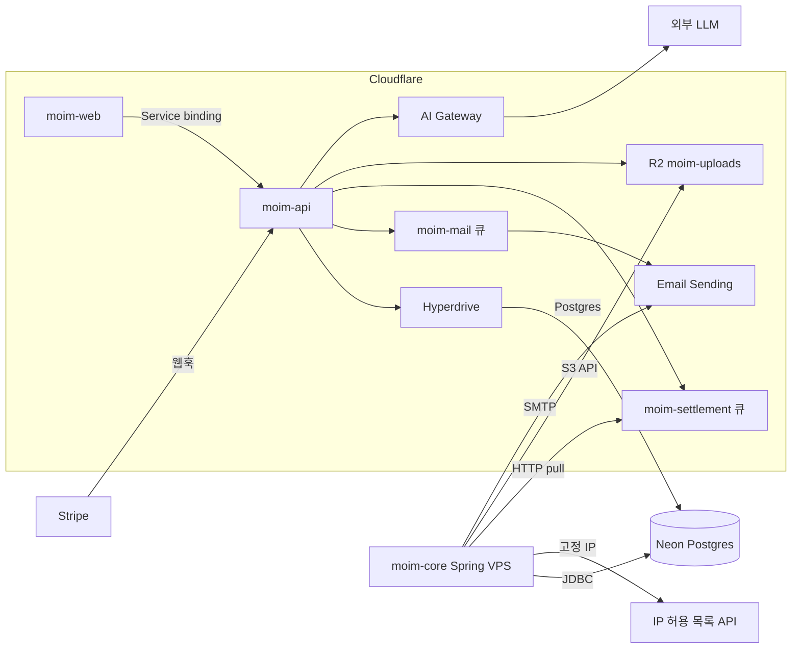

# 8장. Cloudflare 밖과 함께 — DB·결제·메일·AI·IaC 통합 전략

2026년 8월 15일, 해커 뉴스에 "Cloudflare's AI Psychosis"라는 글이 올라와 120점을 받았다. 글쓴이는 Cloudflare의 저장소 제품군을 두고 이렇게 적었다.

> "Too many ways to do the same thing, none of them great"

같은 일을 하는 방법이 너무 많고, 그중 어느 것도 썩 훌륭하지 않다는 불평이다. 댓글에서 hasyimibhar가 곧바로 반박했다. 제품마다 쓰임새를 한 줄로 정리할 수 있다는 것이다. 4장에서 D1·KV·Durable Objects·R2를 하나씩 나눠 본 우리라면 반박 쪽에 손을 들어주고 싶어진다. 실제로 "이 데이터는 어디에?"라는 질문에 답할 기준만 있으면 선택지가 많다는 것은 오히려 장점이다.

그런데 이 불평이 정말 아프게 들어맞는 곳은 Cloudflare 안이 아니다. 안과 밖의 경계선이다. 7장을 마친 `moim`을 떠올려보자. 계정은 Workers Paid로 바뀌었고, Postgres는 Neon으로 옮겨 `moim-core`(Spring Boot)와 `moim-api`가 Hyperdrive를 통해 함께 쓴다. 정산 큐 `moim-settlement`는 Spring이 HTTP pull로 당겨 가고, 정산 리포트는 `ReportContainer`가 몰아서 만든다. 이제 남은 일은 유료 티켓을 팔고, 확인 메일을 실제로 보내고, 이 모든 리소스를 손이 아닌 코드로 관리하는 것이다.

일감마다 같은 질문이 따라붙는다. 안에서 할까, 밖에서 할까? Cloudflare는 거의 모든 칸에 자기 제품을 하나씩 준비해두었다. DB에는 D1이 있고, 메일에는 Email Sending이, AI에는 Workers AI가 있다. 반면 결제처럼 Cloudflare에 아예 해당 제품이 없는 칸도 있다. 같은 일을 하는 방법이 안에도 있고 밖에도 있으니, 앞의 불평은 경계선에서 두 배로 커진다. 이 장에서는 `moim`이 실제로 만나는 통합 사례 다섯 가지를 따라가면서, 매번 무엇을 기준으로 판단했는지를 함께 뽑아보자.

## 경계선에서 던지는 질문

### 세 가지 질문 — 데이터의 무게, 표준 프로토콜, 빠져나갈 길

사례로 들어가기 전에 판단의 틀부터 세워두자. 외부 서비스를 하나 붙일 때마다 세 가지를 묻는 편이 낫다.

첫째는 데이터의 무게다. 이 데이터는 어디에 오래 남고, 누가 읽는가? `moim`의 회원·결제·정산 내역은 몇 년을 남아야 하고, Spring과 Worker가 함께 읽는다. 이런 데이터는 무겁다. 무거운 데이터는 양쪽이 모두 손을 뻗을 수 있는 자리에 두는 편이 낫다. 7장에서 Postgres를 Neon에 두고 Hyperdrive로 Worker를 연결한 이유가 여기에 있다. 반대로 선착순 좌석 카운터나 행사 설정 플래그처럼 Worker만 읽고 쓰는 가벼운 데이터는 Durable Objects나 KV에 두어도 아무 문제가 없다.

둘째는 표준 프로토콜이다. 외부 서비스와 무엇으로 이어지는가? Postgres 와이어 프로토콜, S3 API, SMTP, OIDC 같은 표준으로 이어진다면 한쪽을 바꿔도 다른 쪽 코드는 거의 그대로다. `moim-core`는 R2를 AWS SDK for Java v2로 읽는다(7장). 내일 R2를 다른 S3 호환 저장소로 바꿔도 엔드포인트와 자격 증명만 고치면 된다. 반대로 특정 벤더 전용 API에 깊이 묶이면 그만큼 떠나기가 어려워진다.

셋째는 빠져나갈 길이다. Cloudflare가 멈추거나 가격이 바뀌면 이 연결은 어떻게 되는가? 2025년 11월과 12월, 2026년 2월에 Cloudflare의 큰 장애가 있었고 2026년 8월 8일에는 R2 장애가 있었다. 단일 벤더 의존이 얼마나 위험한지는 14장에서 양쪽 관점을 함께 놓고 따져보겠다. 여기서는 원칙 하나만 챙기자. 표준 프로토콜로 이어둔 것은 나중에 옮길 수 있다. 이 원칙이 앞의 두 질문과 맞물려 이 장의 결론이 된다.

세 질문을 머리에 넣고 `moim`이 Cloudflare 밖과 만나는 지점을 한 장의 그림으로 먼저 보자.


그림 1. `moim`과 외부 서비스의 연결도

화살표 하나하나에 붙은 이름을 보자. Postgres, S3 API, SMTP, HTTP. 대부분이 표준이다. 이 그림을 기준으로 사례를 하나씩 살펴보자.

## 다섯 가지 통합 사례

### 외부 DB — Hyperdrive와 공급자별 주의점

Hyperdrive의 기본 설정과 Spring과의 DB 공유는 7장에서 다뤘다. 여기서는 Postgres를 어느 공급자에 두느냐에 따라 달라지는 지점만 짚어보자. 공식 문서는 범위를 넓게 잡는다.

> "Hyperdrive supports any Postgres or MySQL database, including those hosted on AWS, Google Cloud, Azure, Neon and PlanetScale. Hyperdrive also supports Postgres-compatible databases like CockroachDB and Timescale."

어디든 붙는다는 말이다. 그런데 붙는다는 것과 제대로 붙는다는 것은 다르다. 공급자마다 하나씩 함정이 있다.

Neon부터 보자. Neon은 자체 serverless 드라이버를 제공하는데, Hyperdrive 문서는 그 드라이버 대신 일반 TCP 드라이버를 쓰라고 한다. "you should use a driver like node-postgres (pg) or Postgres.js to connect directly to the underlying database instead of the Neon serverless driver." Neon 쪽 FAQ도 같은 이야기를 한다. serverless 드라이버는 WebSocket으로 붙기 때문에 Hyperdrive의 연결 풀을 그냥 지나쳐버린다. 풀링을 맡기려고 Hyperdrive를 붙였는데 풀을 우회하면 아무 의미가 없다.

Supabase에는 반대 방향의 함정이 있다. Supabase는 자체 커넥션 풀러를 두고, 대시보드의 연결 화면에서 풀러를 거치는 연결 문자열도 함께 보여준다. Hyperdrive의 Supabase 문서(Hyperdrive 2026-04-21 기준)는 이렇게 적는다. "you should use the Direct connection connection string rather than the pooled connection strings. Hyperdrive will perform pooling of connections to ensure optimal access from Workers." 풀러 뒤에 풀러를 또 세우면 이중 풀링이 된다. Hyperdrive가 이미 풀링을 하니 Supabase 쪽은 직접 연결로 두자. 그런데 Supabase 문서(2026년 10월 3일 확인)를 보면 직접 연결에는 네트워크 조건이 하나 붙는다. 직접 연결은 기본적으로 IPv6로만 열리고, IPv4로 열려면 유료 IPv4 애드온이 필요하다. 반대로 Supabase의 공유 풀러는 IPv4 전용이고, 세션 모드(5432 포트)와 트랜잭션 모드(6543 포트)로 나뉜다. 트랜잭션 모드는 prepared statement를 지원하지 않는다. Hyperdrive의 Supabase 문서는 IPv6 이야기를 따로 하지 않으니, IPv4 애드온이 없는 프로젝트라면 도입 전에 Hyperdrive 설정을 만들어 직접 연결이 실제로 붙는지부터 확인해두자.

AWS RDS나 Aurora라면 네트워크부터 열어야 한다. 문서는 데이터베이스의 공개 접근을 켜고, Hyperdrive가 쓰는 IP 대역(또는 전체 대역)을 허용하라고 안내한다. 공개 접근이 마음에 걸린다면 대안이 있다. 2026년 4월 29일부터 Workers VPC를 거쳐 사설 DB에 붙는 경로가 Hyperdrive의 권장 방식이 됐다. Workers VPC는 2026년 10월 기준 베타이고 베타 동안은 무료다(7장 전망 박스). PlanetScale을 쓴다면 청구가 편해진다. 2026년 6월 18일부터 PlanetScale 사용료가 Cloudflare 청구서에 함께 실린다.

MySQL은 2026년 8월 7일 정식 지원(GA)이 됐고, 가격은 Postgres와 같다. 단 `mysql2` 드라이버를 쓴다면 3.13.0 이상 버전을 쓰고, 설정 하나를 꼭 챙기자(Hyperdrive mysql2 문서 2026-04-21 기준).

```ts
import { createConnection } from "mysql2/promise";

const conn = await createConnection({
  host: env.HYPERDRIVE.host,
  user: env.HYPERDRIVE.user,
  password: env.HYPERDRIVE.password,
  database: env.HYPERDRIVE.database,
  port: env.HYPERDRIVE.port,
  disableEval: true,                 // Workers에서는 eval 기반 파서를 끈다
});
```

Workers 런타임은 보안상의 이유로 문자열을 코드로 평가하는 `eval()`과 `new Function`을 허용하지 않는다(Workers Web standards 2026-04-23 기준). `mysql2`는 성능을 위해 결과 파서를 코드로 생성해 실행하는데, 그 경로를 꺼주는 옵션이 `disableEval`이다.

공급자와 상관없이 알아둘 성질도 있다. Hyperdrive의 풀러는 트랜잭션 모드로 동작한다(Hyperdrive 2026-08-20 기준). 트랜잭션 하나가 끝나면 연결은 풀로 돌아가고, 이때 `RESET`이 걸려 앞에서 실행한 `SET` 명령은 다음 쿼리에 남지 않는다. 이름 붙은 prepared statement는 `postgres.js`와 `node-postgres`가 구현한 방식만 지원한다. SQL 수준의 `PREPARE`·`EXECUTE`, advisory lock, `LISTEN`/`NOTIFY`는 지원하지 않는다. 이런 기능이 꼭 필요하면 Hyperdrive를 거치지 않는 두 번째 직접 연결을 따로 두라는 것이 Hyperdrive 팀의 권고다. 다행히 `moim`에서는 크게 걱정할 일이 없다. 스키마 마이그레이션 같은 무거운 작업은 `moim-core`가 JDBC로 Neon에 직접 붙어 처리하고, Hyperdrive를 거치는 쪽은 Worker의 짧은 쿼리뿐이다.

한도도 확인해두자. 쿼리 하나는 최대 60초, 캐시되는 응답은 50 MB까지다. 원본 DB로 여는 연결은 Free가 약 20개, Workers Paid가 약 100개다(Hyperdrive Limits 2026-06-09 기준). 혹시 Next.js를 vinext가 아닌 OpenNext로 돌리고 있다면 하나 더 있다. OpenNext 이슈 #1214에서 `node-postgres`의 `pg-cloudflare` 모듈을 찾지 못하는 번들링 문제가 보고됐고, 2026년 9월 18일에도 같은 증상이 다시 올라왔다. 알려진 우회는 `next build --webpack`이나 `outputFileTracingIncludes`에 `pg-cloudflare`를 넣는 것이다.

### 결제 — Stripe 웹훅을 Worker에서 받기

`moim`에 유료 티켓이 생겼다. 결제는 Cloudflare에 해당 제품이 없으니 고민할 것도 없이 밖에 둔다. 여기서는 Stripe를 쓴다고 해보자. 사용자가 결제를 마치면 Stripe가 우리 서버로 이벤트를 보낸다. 이것이 웹훅이다. 우리는 `moim-api`에 `POST /api/webhooks/stripe`를 열고 이 이벤트를 받는다.

먼저 정직하게 밝혀둘 것이 있다. Cloudflare 문서에는 Stripe 전용 가이드가 없다. 2026년 10월 3일에 Workers 문서 전문을 확인했을 때 Stripe가 언급된 곳은 vinext 관련 한 줄뿐이었다. 그래서 이 절의 근거는 Stripe 공식 문서, stripe-node 라이브러리의 소스와 예제, Hono의 Stripe 웹훅 예제다. 모두 Cloudflare 바깥의 문서라는 점을 기억해두자.

웹훅에서 가장 중요한 일은 이 요청이 정말 Stripe가 보낸 것인지 확인하는 것이다. Stripe는 요청마다 `Stripe-Signature` 헤더에 서명을 담는다. 타임스탬프와 원본 본문을 이어 붙인 문자열에 HMAC-SHA256을 씌운 값이다. 그렇다면 우리가 할 일은 같은 계산을 해서 비교하는 것이다. 여기서 많은 사람이 걸려 넘어진다. Stripe 문서는 이렇게 경고한다.

> "Stripe requires the raw body of the request to perform signature verification. If you're using a framework, make sure it doesn't manipulate the raw body."

프레임워크가 본문을 JSON으로 먼저 파싱하고, 우리가 그 객체를 다시 문자열로 만들면 어떻게 될까? 공백 하나, 키 순서 하나만 달라져도 바이트가 바뀌고 서명은 맞지 않는다. 그래서 본문은 `.text()`로 원본 그대로 받아야 한다.

두 번째 함정은 Workers 런타임과 관련이 있다. stripe-node v23.0.0(2026-10-01 릴리스)의 `package.json`에는 `workerd` 조건이 있어서, Workers에서 import하면 웹 표준용 빌드가 선택된다. 이 빌드는 HTTP 클라이언트로 `fetch`를, 암호 연산으로 Web Crypto의 SubtleCrypto를 쓴다. 문제는 SubtleCrypto가 비동기 전용이라는 점이다. Node 예제에서 흔히 보는 동기 메서드 `constructEvent`를 그대로 부르면 "SubtleCryptoProvider cannot be used in a synchronous context."라는 에러가 난다. Workers에서는 `constructEventAsync`를 쓰자.

```ts
import { Hono } from "hono";
import Stripe from "stripe";

type Env = {
  STRIPE_SECRET_KEY: string;      // 9장에서 시크릿으로 등록
  STRIPE_WEBHOOK_SECRET: string;
  DB: D1Database;
  SETTLEMENT_QUEUE: Queue;
};

const app = new Hono<{ Bindings: Env }>();

app.post("/api/webhooks/stripe", async (c) => {
  const signature = c.req.header("stripe-signature");
  if (!signature) return c.text("missing signature", 400);

  const stripe = new Stripe(c.env.STRIPE_SECRET_KEY);
  const body = await c.req.text(); // 파싱하지 않은 원본 본문

  let event: Stripe.Event;
  try {
    event = await stripe.webhooks.constructEventAsync(
      body,
      signature,
      c.env.STRIPE_WEBHOOK_SECRET,
    );
  } catch {
    return c.text("invalid signature", 400);
  }

  // 같은 이벤트가 두 번 와도 한 번만 처리한다
  const result = await c.env.DB
    .prepare("INSERT INTO stripe_events (id, type) VALUES (?, ?) ON CONFLICT(id) DO NOTHING")
    .bind(event.id, event.type)
    .run();
  if (result.meta.changes === 0) return c.json({ received: true });

  if (
    event.type === "checkout.session.completed" ||
    event.type === "checkout.session.async_payment_succeeded"
  ) {
    // completed라도 payment_status가 unpaid면 아직 돈이 들어오지 않았다 — 소비자에서 확인
    // 무거운 처리는 큐로 넘기고 바로 2xx를 돌려준다
    await c.env.SETTLEMENT_QUEUE.send({ stripeEventId: event.id });
  }
  return c.json({ received: true });
});

export default app;
```

코드에 담긴 판단을 하나씩 짚어보자. 서명을 확인한 다음, 이벤트 ID를 D1에 `ON CONFLICT(id) DO NOTHING`으로 기록한다. Stripe 문서는 같은 이벤트가 두 번 이상 올 수 있다고 분명히 적는다. "Webhook endpoints might occasionally receive the same event more than once." 처리한 이벤트 ID를 기록해두면 중복을 걸러낼 수 있다. `ON CONFLICT` 한 줄이 빠지면 무슨 일이 생기는지는 13장의 $4,868 청구서 사례가 보여준다. 이벤트 이름도 결제 수단에 따라 달라진다. Stripe Checkout을 쓰면 결제가 끝날 때 `checkout.session.completed`가 온다. 그런데 계좌 이체처럼 확정이 늦은 결제 수단은 이 시점에 아직 돈이 들어오지 않았고, 나중에 `checkout.session.async_payment_succeeded`(실패하면 `checkout.session.async_payment_failed`)로 확정된다. Stripe 문서는 세션의 `payment_status`를 확인해 처리 여부를 정하라고 안내한다(docs.stripe.com 2026-10-03 확인). 코드가 두 이벤트를 함께 받는 이유다.

다음은 응답 속도다. Stripe는 복잡한 로직을 돌리기 전에 2xx부터 빨리 돌려주라고 권하고, 들어온 이벤트를 비동기 큐로 처리하라고까지 적는다. 우리에게는 이미 큐가 있다. 정산은 7장에서 만든 `moim-settlement` 큐에 넣고, `moim-core`가 HTTP pull로 당겨서 처리한다. 결제를 받는 일은 엣지의 Worker가, 돈을 맞춰보는 일은 Spring이 맡는 구조다. 7장에서 만든 연결선이 이렇게 제 몫을 한다.

재시도와 순서도 기억해두자. 라이브 모드에서 Stripe는 실패한 이벤트를 지수 백오프로 최대 3일 동안 다시 보낸다. 그리고 이벤트가 생성된 순서대로 도착한다는 보장이 없다. 처리 코드는 순서를 가정하지 말고, 같은 이벤트를 여러 번 받아도 결과가 같도록 짜자. 리다이렉트 응답도 실패로 친다는 점이 중요하다. "We consider redirect responses to webhook requests as failures." 10장에서 Access로 `/admin/*`을 닫을 때 웹훅 경로까지 Access 뒤로 들어가면, Stripe는 로그인 페이지로 가는 302를 받고 실패로 기록한다. 웹훅 경로는 Access 범위 밖에 두고, 서명 검증으로 지키자.

라이브러리 선택에도 주의가 필요하다. 서드파티 패키지 `@worker-tools/stripe-webhook`은 `constructEvent`가 서명 헤더를 제대로 검증하지 않는 취약점이 공지된 적이 있다. 검증 코드는 공식 stripe-node에 맡기자.

로컬에서 웹훅을 받아보려면 6장의 Quick Tunnel로 로컬 `moim-api`를 잠시 공개하면 된다. 2026년 10월 2일 나온 Protected Quick Tunnel은 방문자에게 이메일 일회용 PIN을 요구한다. 체인지로그는 공유 대상으로 "webhook receiver"를 들지만, Quick Tunnels 문서(2026-09-30 기준)는 한계를 분명히 적는다. "Email authentication requires an interactive browser session. It does not support non-interactive clients." 브라우저 없이 호출하는 Stripe 서버는 이메일 PIN 인증을 통과할 수 없다. 사람에게 화면을 보여줄 때는 보호 모드를, Stripe의 호출을 받을 때는 일반 Quick Tunnel과 서명 검증을 쓰는 편이 안전하다.

### 메일 — 받는 메일과 보내는 메일

4장에서 `moim-mail` 큐의 소비자는 로그만 남기거나 검증된 내 주소로만 메일을 보냈다. 이제 진짜로 보낼 차례다. Cloudflare의 메일 기능은 두 갈래다. 받는 메일을 다른 주소로 넘기는 Email Routing과, 앱에서 메일을 보내는 Email Sending이다. 둘을 합쳐 Cloudflare Email Service라 부른다.

Email Routing은 무료이고 무제한이다. `support@example.com`으로 온 문의를 운영자 개인 메일함으로 넘기는 일은 여기서 끝난다. 2026년 9월 4일부터는 라우팅 규칙을 Wrangler로도 관리할 수 있다.

보내는 쪽은 사정이 다르다. Email Sending은 2026년 4월 16일 공개 베타로 나왔고, 2026년 10월 기준 아직 베타다. 베타 제품은 동작과 가격이 빠르게 바뀔 수 있으니 공식 문서를 함께 확인하자. Workers Paid에는 월 3,000통이 포함되고, 넘으면 1,000통당 $0.35다. Free에서는 검증된 자기 주소로 보내는 것만 된다(Email Service Pricing 2026-06-09 기준). `moim`은 7장에서 이미 Workers Paid로 옮겼으니 바로 쓸 수 있다. Worker에서는 `EMAIL` 바인딩의 `send()`를 부른다.

```ts
// moim-mail 큐 소비자 (MAIL_QUEUE의 consumer)
export default {
  async queue(batch: MessageBatch<{ to: string; eventTitle: string }>, env: Env) {
    for (const msg of batch.messages) {
      await env.EMAIL.send({
        from: "moim@example.com",
        to: msg.body.to,
        subject: `[moim] ${msg.body.eventTitle} 신청이 확정됐습니다`,
        text: "행사 당일 이 메일을 보여주세요.",
      });
      msg.ack();
    }
  },
};
```

`send()`는 `to`·`from`·`subject`와 `text` 또는 `html`을 받고, 성공하면 `messageId`를 돌려준다. 실패하면 `code` 속성을 가진 에러를 던진다. 바인딩은 `wrangler.jsonc`의 `send_email` 키로 선언한다(Email Sending Workers API 2026-09-16 기준).

```jsonc
// moim-api/wrangler.jsonc 에 추가
"send_email": [{ "name": "EMAIL" }]
```

보내는 주소의 도메인은 Email Sending에 먼저 등록해 검증받아야 한다. 검증하지 않은 발신 도메인으로 보내면 `E_SENDER_NOT_VERIFIED` 에러가 난다.

한도도 미리 알아두자. 메시지 하나는 첨부 포함 5 MiB, 수신자는 메일당 50명까지다(Email Limits 2026-09-25 기준). 그리고 신규 계정은 보수적인 일일 할당량에서 시작해, 발송 이력에 따라 점차 늘어난다. 행사 공지를 첫날 수천 명에게 한꺼번에 보내려 하면 할당량에 걸릴 수 있다. 큐에 넣고 소비자가 천천히 보내게 하면 이런 상황을 자연스럽게 흡수할 수 있다. 발송 결과 이벤트를 Queues로 구독하는 기능(2026-07-15)도 있으니, 반송 처리가 필요해지면 살펴보자.

Spring 쪽은 어떨까? `moim-core`도 정산 완료 메일을 보내야 한다. Email Sending은 2026년 6월 8일부터 SMTP를 베타로 지원한다. 호스트는 `smtp.mx.cloudflare.net`, 포트는 465, 사용자명은 `api_token`, 비밀번호는 "Email Sending: Edit" 권한을 가진 API 토큰이다. SMTP는 표준이니 Spring Boot의 `JavaMailSender`로도 보낼 수 있을 것이다. 다만 이것은 SMTP 표준에 기댄 추론이고, Cloudflare가 Spring 예제를 낸 것은 아니다.

```yaml
spring:
  mail:
    host: smtp.mx.cloudflare.net
    port: 465
    username: api_token
    password: ${CF_EMAIL_SENDING_TOKEN}
    properties:
      mail.smtp.auth: true
      mail.smtp.ssl.enable: true   # 465는 처음부터 TLS로 연결하는 포트
```

이미 다른 메일 서비스를 쓰고 있다면 굳이 옮기지 않아도 된다. 그 서비스의 HTTP API를 Worker에서 `fetch()`로 부르면 그만이다. Email Sending의 장점은 바인딩 하나로 끝나고 청구서가 하나로 모인다는 데 있다. 그 편의와 베타라는 불확실성을 저울에 올려 고르자.

> **비용 메모** — Email Routing(수신)은 무료·무제한이다. Email Sending(발신, 공개 베타)은 Workers Paid에 월 3,000통이 포함되고 초과분은 1,000통당 $0.35다. Free에서는 검증된 자기 주소로만 보낼 수 있다(Email Service Pricing 2026-06-09 기준). Stripe 수수료는 Stripe가 따로 청구한다.

### 객체 저장과 AI — R2로 옮기고, AI Gateway로 감싸기

R2를 Java에서 쓰는 법(`chunkedEncodingEnabled(false)`를 빼먹으면 403이 나는 함정)은 7장에서 다뤘다. 여기서는 기존 저장소에서 R2로 옮기는 이야기를 하자. R2는 S3 호환 API를 제공하고, 리전은 `auto`다. 리전을 비워 둘 수 없는 도구라면 빈 값이나 `us-east-1`을 넣어도 `auto`로 처리된다(R2 S3 API 2026-07-31 기준). 그래서 Node나 브라우저 쪽 코드도 AWS SDK for JavaScript를 그대로 쓰고, 엔드포인트만 `https://<ACCOUNT_ID>.r2.cloudflarestorage.com`으로 바꾸면 된다.

이미 S3에 쌓인 발표 자료가 많다면 어떨까? 한 번에 다 복사하면 시간도 비용도 든다. Sippy는 요청이 들어올 때 기존 버킷의 객체를 R2로 복사해 담는 점진적 이전 도구다. 요청한 객체가 R2에 있으면 R2에서 내주고, 없으면 원본 버킷에서 응답하면서 동시에 R2로 복사한다(Sippy 문서 2026-09-18 기준). 어차피 내야 할 이그레스 안에서 이전이 일어나니, 이전만을 위한 이그레스 비용을 따로 치르지 않아도 된다. 2026년 7월 24일부터는 Azure Blob과 S3 호환 저장소도 원본으로 쓸 수 있다.

업로드 경로도 다시 보자. 사용자가 올린 파일을 Worker가 받아서 R2에 넣는 구조는 단순하지만, 파일마다 Worker 요청과 CPU 시간이 든다. Cloudflare의 비용 최적화 문서는 "Use presigned URLs for direct client access instead of proxying through Workers"라고 권한다(2026-05-04 기준). Worker는 짧은 유효 기간의 presigned URL만 발급하고, 브라우저가 R2로 직접 올리게 하자. 4장에서 본 기본 패턴을 비용 관점에서 한 번 더 확인하는 셈이다. R2는 이그레스가 무료일 뿐 읽기·쓰기 연산에는 요금이 붙는다는 점, 그리고 무료 포함량을 넘으면 차단되지 않고 그대로 청구된다는 점(R2 문서 2026-10 기준)도 잊지 말자.

AI는 어떨까? 운영자가 발표 초록을 요약하는 기능을 외부 LLM에 맡긴다고 해보자. Worker에서 LLM 공급자의 API를 바로 불러도 되지만, 그 사이에 AI Gateway를 끼워두자. AI Gateway의 분석·캐싱·레이트 리밋 같은 핵심 기능은 무료다. 같은 질문이 반복되면 캐시가 응답하고, 호출이 몰리면 레이트 리밋이 막는다. 2026년 9월 24일 이후의 신규 로그는 Workers Logs 가격으로 과금되고, Unified Billing으로 크레딧을 충전해 쓰면 5% 수수료가 붙는다(AI Gateway Pricing 2026-09-24 기준). 무엇보다 AI Gateway에는 달러 기준 지출 상한(spend limits, 2026-06-05)이 있다. 예산을 넘으면 실제로 요청을 막는다. 단 AI Gateway를 지나는 트래픽에만 적용되고 계정 전체 상한은 아니다. 13장에서 이 장치를 다른 방어선과 함께 배치하겠다.

> **다른 쓰임: Workers AI** — LLM을 Cloudflare 안에서 돌리고 싶다면 Workers AI가 있다. Free와 Workers Paid 모두 하루 10,000 Neurons가 포함되고, 넘으면 1,000 Neurons당 $0.011이다. Free에서 한도를 넘으면 에러로 멈춘다. 2026년 7월 28일부터 일부 대형 모델은 Free에서 403/5035로 막힌다(Workers AI Pricing 2026-10-01 기준). 모델별 단가는 자주 바뀌니 공식 가격표를 함께 확인하자.

### 고정 출구 IP — 허용 목록을 요구하는 상대

어느 날 제휴 PG사나 사내 정산 API 담당자가 이렇게 말한다고 해보자. "호출하는 서버의 IP를 알려주세요. 허용 목록에 넣어야 합니다." VM에서라면 쉬운 질문이다. Worker에서라면 난감해진다.

먼저 사실부터 정리하자. 계정 전용 고정 출구 IP는 Cloudflare에서 Enterprise 제품이다. Smart Shield의 Dedicated CDN Egress IPs가 그렇고(2026-04-16 기준), Zero Trust 쪽 dedicated egress IP도 "Only available as an add-on to Zero Trust Enterprise plans."다(2026-09-04 기준). Enterprise에서 전용 IP를 써도 Worker의 `connect()`로 여는 TCP 연결에는 적용되지 않는다. Workers의 기본 `fetch()`가 어떤 IP로 나가는지를 직접 적은 1차 문장은 이 책의 리서치에서 찾지 못했다. 그러니 이렇게 정리하는 편이 정확하다. 계정 전용 고정 출구 IP는 Enterprise 제품이고, 그 밖의 플랜에서 허용 목록이 필요하면 고정 IP를 가진 자기 서버를 거쳐 나가게 한다.

그 "자기 서버를 거쳐 나가는" 방법으로 Cloudflare가 문서화한 것이 Tunnel 호스트명 라우팅이다. 2025년 9월 18일 체인지로그는 특정 공개 호스트명으로 가는 트래픽을 지정한 Tunnel로 보내 출발 IP를 고정할 수 있다고 소개하며, 이것이 서드파티 허용 목록 문제를 푼다고 적었다. 이 기능은 Cloudflare One 고객이면 무료다. `cloudflared`가 설치된 서버의 IP가 곧 출구 IP가 된다. 이 경로는 10장의 사설 라우팅과 같은 기능 위에 서 있다.

그런데 `moim`에는 더 단순한 답이 있다. `moim-core`는 이미 고정 IP를 가진 VPS에서 돈다. 허용 목록이 필요한 API는 Spring이 부르게 하면 된다. Worker가 직접 부를 이유가 없다면 굳이 경로를 꼬지 말자. 2026년 6월 5일부터 VPC Network 바인딩(`network_id: "cf1:network"`)을 쓴 Worker가 Gateway를 거쳐 공용 인터넷으로 나가는 경로도 생겼다. 다만 Gateway의 전용 IP 역시 Enterprise 애드온이므로, 그 밖의 플랜에서는 공유 IP로 나간다고 보는 편이 안전하다. 두 1차 문장을 조합한 추론이다.

## 리소스를 코드로 묶어두기

### IaC와 CI — Terraform, Pulumi, wrangler-action

여기까지 오면서 `moim`의 리소스는 꽤 늘었다. D1 하나, KV 하나, R2 버킷 하나, 큐 둘, Hyperdrive 설정, Tunnel, 그리고 10장에서 만들 Access 앱까지. 대시보드에서 하나씩 클릭해 만들었다면 지금쯤 어떤 설정을 왜 바꿨는지 기억하기 어려울 것이다. 스테이징 계정에 같은 구성을 다시 만들어야 한다면? 상상만 해도 번거롭다.

인프라를 코드로 관리하는 도구는 둘이다. Terraform의 Cloudflare provider는 v5 계열이고, 2026년 10월 3일 기준 최신은 v5.27.0이다. 2025년 10월 9일부터는 정적 자산을 포함한 풀스택 Worker와 Workflows까지 Terraform으로 배포할 수 있다. Access의 IdP 같은 Cloudflare One 설정도 `cloudflare_zero_trust_access_identity_provider` 같은 리소스로 다룰 수 있고, 원격 관리 Tunnel도 Terraform으로 관리할 수 있다.

Java 팀이라면 Pulumi가 반갑다. Pulumi는 "Use TypeScript, JavaScript, Python, Go, .Net, Java, or YAML to write Pulumi programs."라고 밝힌다. Spring 개발자가 익숙한 언어로 인프라를 정의할 수 있다는 뜻이다. 아래는 `moim`의 오래 사는 리소스를 Pulumi Java로 적어본 골격이다.

```java
// Pulumi Java 골격 — Pulumi Cloudflare provider 6.x 기준(2026-10)
import com.pulumi.Pulumi;
import com.pulumi.cloudflare.D1Database;
import com.pulumi.cloudflare.D1DatabaseArgs;
import com.pulumi.cloudflare.R2Bucket;
import com.pulumi.cloudflare.R2BucketArgs;

public class App {
    public static void main(String[] args) {
        Pulumi.run(ctx -> {
            var accountId = ctx.config().require("accountId");

            new R2Bucket("moim-uploads", R2BucketArgs.builder()
                .accountId(accountId)
                .name("moim-uploads")
                .build());

            new D1Database("moim-db", D1DatabaseArgs.builder()
                .accountId(accountId)
                .name("moim-db")
                .build());
        });
    }
}
```

어디까지 IaC로 묶을지 선을 긋는 편이 좋다. 오래 살고 여러 Worker가 함께 쓰는 리소스(D1, R2, 큐, Hyperdrive 설정, Tunnel, Access 앱)는 IaC로 정의한다. 자주 바뀌는 Worker 코드의 배포는 Wrangler에 맡긴다. 둘을 같은 도구로 모두 하려 들면 배포 한 번에 인프라 계획까지 다시 도는 일이 생긴다.

코드 배포는 5장에서 Workers Builds로 자동화했다. 그런데 이미 GitHub Actions로 테스트와 배포를 돌리는 팀이라면 파이프라인을 둘로 나누기 싫을 것이다. 그럴 때는 `cloudflare/wrangler-action@v4`를 쓴다. 2026년 9월 24일 기준 최신은 v4.1.3이다.

```yaml
# .github/workflows/deploy.yml
jobs:
  deploy:
    runs-on: ubuntu-latest
    steps:
      - uses: actions/checkout@v6
      - uses: cloudflare/wrangler-action@v4
        with:
          apiToken: ${{ secrets.CLOUDFLARE_API_TOKEN }}
          accountId: ${{ secrets.CLOUDFLARE_ACCOUNT_ID }}
          command: deploy
```

`apiToken`·`accountId`·`command`는 wrangler-action이 받는 입력 이름 그대로이고, Cloudflare 문서의 예제(2026-09-18 기준)도 같은 형태다. API 토큰은 "Edit Cloudflare Workers" 템플릿에서 출발해, 필요한 권한만 남기는 편이 낫다. 토큰 권한을 어디까지 좁힐지는 9장에서 시크릿과 함께 다시 정리한다. Workers Builds와 GitHub Actions 중 하나를 고르고, 둘이 같은 브랜치를 동시에 배포하지 않게 하자. 배포가 두 번 일어나면 어느 쪽 결과가 남았는지 헷갈리기 쉽다.

> **다른 쓰임: Browser Run** — Browser Run(구 Browser Rendering)은 2026년에 이름이 바뀐 헤드리스 브라우저 서비스다. 행사 페이지의 OG 이미지를 스크린숏으로 만들 때처럼 브라우저가 필요한 작업에 쓴다. Free는 하루 10분·동시 3개, Workers Paid는 월 10시간·동시 10개가 포함되고, 초과분은 시간당 $0.09, 추가 동시 브라우저당 $2.00다(Browser Run Pricing 2026-04-21 기준).

> **다른 쓰임: Images** — 이미지 리사이즈·변환이 필요하다면 Images가 있다. Free에서 월 5,000건의 고유 변환을 넘으면 새 변환은 9422 에러로 멈추고, 문서는 "You will not be charged for exceeding the limits in the Free plan."이라고 적는다(Images Pricing 2026-07-08 기준).

이제 `moim`은 돈을 받고, 메일을 보내고, 자기 리소스를 코드로 기억한다. 다섯 가지 사례를 지나며 던진 질문은 매번 같았다. 데이터가 어디에 오래 남는가, 무엇으로 잇는가, 떠날 길이 있는가. Neon과는 Postgres로, R2와는 S3 API로, 메일은 SMTP로 이었고, 다음 장들에서 사람의 신원은 OIDC와 JWT로 잇게 된다. 그 대가로 `moim`은 공격자에게도 더 흥미로운 대상이 됐다. 결제 버튼과 신청 폼이 있는 공개 앱이니까. 그 표면을 지키는 일은 바로 다음에 할 일이다. 이 장의 판단을 한 줄로 줄이면 이렇다.

밖에 둘 것은 표준 프로토콜로 잇는다.
