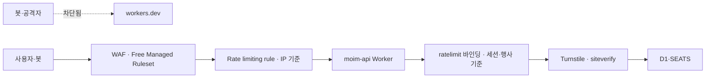

# 9장. 공개 앱 지키기 — Turnstile·WAF·레이트 리미팅·시크릿

2026년 2월 25일, 해커 뉴스에 "GPT Bot Ignoring Robots.txt on my cloudflare worker"라는 글이 올라왔다. 글쓴이 white_viel은 자기 Worker를 커스텀 도메인에 붙이고, 그 도메인에 WAF 규칙을 걸어 특정 봇을 막아두었다. 그런데 봇은 여전히 들어오고 있었다. 로그를 따라가 보니 이유는 허무할 만큼 단순했다.

> "the bot was bypassing the route on the domain and using the worker.dev domain … interesting that GPT was accessing the worker directly to bypass the WAF rule son Cloudflare"

("rule son"은 원문 그대로다.) 봇은 도메인의 라우트를 건너뛰고 `workers.dev` 주소로 Worker를 직접 부르고 있었다. WAF 규칙은 커스텀 도메인이라는 문에만 달려 있었고, 같은 Worker로 통하는 두 번째 문에는 아무것도 없었다. 정문에 경비를 세워두었는데 옆문이 활짝 열려 있었던 셈이다.

Cloudflare Workers의 리드 엔지니어인 kentonv가 같은 날 댓글을 달았다. Cloudflare 내부 사람의 답변이라는 점을 감안하고 읽자.

> "workers.dev domains can be a liability sometimes … you can disable the workers.dev zone by putting `"workers_dev": false,` in wranlger.jsonc. You can also enable Cloudflare Access on your workers.dev zone to require login … But of course you have to remember to do those things..."

(`wranlger`는 원문 그대로다.) 마지막 문장이 이 장의 출발점이다. 해야 할 일을 기억해야 한다. `moim`은 이제 누구나 들어올 수 있는 신청 폼과 결제 웹훅을 가진 공개 앱이다. 8장에서 돈이 오가기 시작했으니 노리는 쪽도 생긴다. 공개 표면을 지키는 장치를 하나씩 세워보자. 그 전에 뒷문부터 닫아야 한다.

## 뒷문부터 닫자

### `workers.dev`와 커스텀 도메인 — 같은 Worker, 두 개의 문

Worker를 만들면 Cloudflare는 기본으로 `<이름>.<계정 서브도메인>.workers.dev` 주소를 붙여준다. 처음 배포할 때는 이 주소가 고맙다. 도메인이 없어도 바로 결과를 볼 수 있으니까. 그런데 커스텀 도메인을 붙이는 순간 이 주소는 뒷문이 된다. 존(도메인 단위의 설정 공간)에 건 WAF 규칙, Rate limiting rule, 캐시 규칙은 모두 그 존을 지나는 요청에만 적용된다. `workers.dev`로 들어온 요청은 우리 존을 지나지 않는다.

2장에서 `moim-web`을 배포할 때 `"workers_dev": false` 한 줄을 넣고 "이유는 9장에서"라고 미뤄두었다. 이제 그 이유를 알았다. 그렇다면 `moim-api`는 어떨까? 3장에서 만든 뒤로 바인딩을 계속 붙여왔지만, `workers.dev`를 닫았는지는 확인하지 않았다. 계정의 모든 Worker를 하나씩 열어보자.

```jsonc
// moim-api/wrangler.jsonc
{
  "name": "moim-api",
  "main": "src/index.ts",
  "compatibility_date": "2026-09-01",
  "workers_dev": false,
  "routes": [
    { "pattern": "moim.example.com/api/*", "zone_name": "example.com" }
  ]
  // ...4~8장의 바인딩은 앞 장과 동일
}
```

커스텀 도메인으로만 서비스하는 Worker라면 `workers.dev`를 끈다. 이것이 기본값이다. 큐 소비자처럼 외부 요청을 받을 일이 없는 Worker도 마찬가지로 닫아두는 편이 낫다. 열어둘 이유가 없는 문은 닫혀 있어야 한다.

kentonv가 말한 두 번째 방법, 즉 `workers.dev` 앞에 Access를 거는 길도 있다. 개발 중에 팀원끼리만 `workers.dev` 주소로 결과를 보고 싶을 때 쓸 만하다. 2026년 8월 14일부터는 계정의 모든 Worker를 기본 비공개로 만들어 로그인 없이는 아무도 닿지 못하게 하는 옵션도 생겼다. Access는 10장의 주제이니 자세한 구성은 그때 보자.

이 한 줄이 왜 이토록 중요할까? 이 장에서 세울 방어선은 모두 "Worker 앞"에 선다. WAF가 막고, Rate limiting rule이 걸러낸 요청만 Worker에 닿는다. 뒷문이 열려 있으면 이 모든 전제가 무너진다. 보안만의 문제도 아니다. 13장에서 다룰 비용 방어 역시 "Worker 앞에서 걸러낸다"는 같은 전제 위에 서 있다. 공격자가 뒷문으로 Worker를 직접 두드리면, 그 요청은 하나하나 Worker 요청으로 계산된다.

### 문 목록부터 만들자 — `moim`의 공개 표면

뒷문을 닫았다면 이제 정문이 몇 개인지 세어볼 차례다. 방어 장치를 고르기 전에 "누가, 어느 경로로, 무엇을 하러 들어오는가"를 경로별로 적어보면 생각이 훨씬 정리된다. `moim.example.com`을 경로 단위로 나눠보자.

가장 바깥에는 정적 자산이 있다. 행사 소개 페이지의 이미지·스크립트·스타일시트는 2장에서 본 대로 Worker를 거치지 않고 무료로 나간다. 여기에 공격자가 할 수 있는 일은 많지 않다. 다음은 행사 목록과 상세처럼 읽기만 하는 경로다. `GET /api/events`가 대표적이다. 누구나 읽어도 되는 데이터이니 막을 이유는 없지만, 같은 요청을 퍼부으면 Worker 요청과 D1 읽기가 쌓인다. 이 경로는 11장의 캐싱이 가장 좋은 방어가 된다.

진짜 지켜야 할 곳은 상태를 바꾸는 경로다. 신청 폼 `POST /api/events/:id/rsvp`는 사람이 브라우저로 누르는 버튼이다. 사람인지 확인하고, 너무 자주 누르지 못하게 해야 한다. 결제 웹훅 `POST /api/webhooks/stripe`는 성격이 전혀 다르다. 이 문을 두드리는 것은 사람이 아니라 Stripe 서버다. 사람 확인 장치를 붙이면 오히려 정상 호출이 막힌다. 8장에서 본 서명 검증이 이 문의 자물쇠다. 마지막으로 `/admin/*`은 운영자 몇 명만 들어와야 하는 문이고, 이 문은 10장의 Access가 맡는다.

이렇게 적어놓고 보면 "공개 앱에 보안 장치를 붙인다"는 말이 얼마나 뭉뚱그린 표현이었는지 드러난다. 문마다 들어오는 주체가 다르고, 그래서 맞는 자물쇠도 다르다. 사람이 누르는 문에는 Turnstile과 레이트 리미팅을, 기계가 두드리는 문에는 서명 검증을, 내부 사람만 쓰는 문에는 신원 확인을 건다. 그리고 모든 문 앞에는 WAF가 공통으로 선다. 이 지도를 손에 들고 방어선을 하나씩 세워보자.

## 네 겹의 방어선

뒷문을 닫았으니 정문 앞에 무엇을 세울지 정해보자. 요청이 거치는 순서대로 그림을 그리면 이렇다.


그림 1. 요청이 거치는 방어 층

앞의 두 층(WAF, Rate limiting rule)은 존에서, 즉 Worker가 실행되기 전에 작동한다. 뒤의 두 층(`ratelimit` 바인딩, Turnstile 검증)은 Worker 코드 안에서 작동한다. 앞의 층은 싸고 거칠고, 뒤의 층은 정교하지만 Worker가 한 번은 실행돼야 한다. 이 차이를 머리에 두고 층마다 살펴보자.

### WAF — Free Managed Ruleset과 패치

WAF는 요청 내용을 보고 알려진 공격 패턴을 막는다. 무료 플랜에서도 쓸 수 있는 것이 Cloudflare Free Managed Ruleset이다. 문서는 이 규칙 묶음이 모든 플랜에서 제공되고 "Provides protection against high-impact and widely exploited vulnerabilities."라고 설명한다. Pro 이상 플랜의 Cloudflare Managed Ruleset에서 일부를 떼어낸 것이다. 반가운 점은 Free 플랜에 기본으로 배포된다는 사실이다. 우리가 따로 켤 필요는 없지만, 대시보드의 보안 메뉴에서 `example.com` 존에 실제로 적용돼 있는지 한 번 확인해두자. 남이 만들어준 기본값일수록 눈으로 확인해두는 편이 마음 편하다.

그렇다면 WAF만 있으면 안심해도 될까? 5장에서 본 2026년 5월의 React·Next.js 취약점을 떠올려보자. 그때 Cloudflare 체인지로그(2026-05-07)는 이렇게 적었다.

> "Several of the disclosed vulnerabilities are not possible to block in WAF. We strongly recommend updating your applications so they are not purely reliant on WAF mitigations."

WAF는 시간을 벌어줄 뿐 구멍을 메우지는 못한다. 프레임워크와 라이브러리의 보안 패치는 WAF와 별개로 챙겨야 한다. `moim-web`의 의존성 업데이트를 미루지 말자.

실무에서는 이 원칙을 습관으로 만들어두는 편이 좋다. 5장에서 붙인 Workers Builds나 8장의 GitHub Actions 파이프라인에 의존성 점검 단계를 넣고, 보안 공지가 나오면 그 주 안에 패치 버전을 배포하는 흐름을 정해두자. 특히 Next.js처럼 어댑터(vinext, OpenNext)를 한 겹 더 거치는 프레임워크는 패치가 두 군데서 나온다. 프레임워크 본체의 패치와 어댑터의 대응을 함께 확인해야 한다. 2026년 5월 사례에서 Cloudflare는 "Vinext's latest release is not vulnerable"이라고 따로 밝혔다. 어댑터 쪽 공지까지 확인하는 습관이 있으면 이런 문장을 놓치지 않는다. Spring 쪽도 다르지 않다. `moim-core`는 6장부터 Tunnel 뒤에 있으니 포트가 열려 있지 않지만, Tunnel을 지나 들어온 요청은 결국 Spring 애플리케이션이 처리한다. Spring Boot와 의존 라이브러리의 패치 역시 같은 주기로 챙기자.

### 레이트 리미팅 두 층 — Rate limiting rule과 `ratelimit` 바인딩

신청 폼 `POST /api/events/:id/rsvp`를 누군가 스크립트로 초당 수백 번 두드린다고 해보자. 선착순 좌석은 순식간에 가짜 신청으로 찬다. 레이트 리미팅이 필요한 순간이다. Cloudflare에는 레이트 리미팅을 거는 자리가 두 군데 있다. 어디에서 무엇을 세느냐가 다르다.

첫째는 WAF의 Rate limiting rule이다. 존에서 동작하므로 걸러진 요청은 Worker까지 오지 않는다. Free 플랜에는 규칙이 1개 주어지고, 카운팅 기간은 10초, 차단(완화) 기간도 10초다(2026년 10월 기준). 조건에 쓸 수 있는 필드는 Path와 Verified Bot이고, 세는 기준은 IP다. Pro는 2개, Business는 5개, Enterprise는 100개까지 쓸 수 있다. 예전의 종량 과금형 레이트 리미팅은 이제 제공되지 않는다. `moim`의 하나뿐인 규칙은 신청 경로에 쓰자. 경로가 `/api/events/`로 시작하는 요청을 IP당 10초에 일정 횟수 넘게 보내면 10초 동안 막는 식이다.

그런데 IP 기준에는 함정이 있다. 밋업 행사장을 떠올려보자. 참가자 백 명이 같은 와이파이에 붙어 현장에서 신청 확인 페이지를 연다. 바깥에서 보면 모두 같은 IP다. IP 기준 규칙을 빡빡하게 걸면 정상 참가자들이 한꺼번에 막힌다. 그래서 IP 규칙은 명백한 폭주만 걸러내도록 넉넉하게 두고, 정교한 판단은 다음 층에 맡기는 편이 낫다.

둘째가 Workers의 `ratelimit` 바인딩이다. 2025년 9월 19일 GA가 됐고, 체인지로그는 "The `ratelimit` binding is now stable and recommended for all production workloads."라고 적었다. Worker 코드 안에서 동작하므로 키를 마음대로 정할 수 있다. 행사 ID와 세션을 묶어 "이 세션은 이 행사에 1분에 5번까지"처럼 셀 수 있다.

```jsonc
// moim-api/wrangler.jsonc 에 추가 — 설정 형식은 (사실 확인 필요)
"ratelimits": [
  {
    "name": "RATE_LIMITER",
    "namespace_id": "1001",
    "simple": { "limit": 5, "period": 60 }
  }
]
```

```ts
app.post("/api/events/:id/rsvp", async (c) => {
  const sessionId = getSessionId(c); // 앱의 세션 식별자
  const { success } = await c.env.RATE_LIMITER.limit({
    key: `${c.req.param("id")}:${sessionId}`,
  });
  if (!success) return c.text("잠시 후 다시 시도해주세요", 429);
  // ...Turnstile 검증, 좌석 확보(4장의 SEATS)
});
```

이 바인딩의 카운트가 데이터센터마다 따로 세는 근사치인지, 전역에서 정확히 세는 값인지는 이 책의 레퍼런스로 확인하지 못했다(사실 확인 필요). 정확한 상한이 필요한 곳, 예를 들어 좌석 수 그 자체는 4장의 `EventSeats` Durable Object가 지킨다. 레이트 리미팅은 남용을 줄이는 장치이지 정확한 회계 장부가 될 수는 없다.

여기서 4장의 실패담을 다시 꺼내보자. KV로 레이트 리미터를 만들었다가 에러 하나 없이 조용히 실패한 사례였다. KV는 최종 일관성이고 키당 초당 한 번만 쓸 수 있으니, 여러 엣지에서 동시에 들어오는 요청을 세는 일에는 맞지 않는다. 카운터가 필요하면 KV 대신 `ratelimit` 바인딩이나 Durable Objects를 쓰자.

### Turnstile — 위젯과 siteverify, 두 쪽이 다 있어야 한다

레이트 리미팅은 "너무 자주"를 막는다. 그런데 천천히, 사람처럼 신청하는 스크립트는 어떻게 할까? 여기서 Turnstile이 등장한다. 사용자를 귀찮게 하는 퍼즐 없이 브라우저 신호로 봇 여부를 판단하는 Cloudflare의 CAPTCHA 대체재다.

Turnstile을 처음 붙일 때 가장 흔한 실수가 있다. 문서는 이를 아예 첫머리에 적어두었다.

> "Turnstile setup has two parts: embed the widget in your frontend, then call siteverify from your backend. Without the second part, the widget appears on the page but does not protect the request."

위젯만 붙이면 화면에는 그럴듯한 체크 표시가 뜬다. 그런데 서버가 그 결과를 확인하지 않으면 봇은 위젯을 무시하고 API를 바로 부르면 그만이다. 보기에는 지켜지는 것 같은데 실제로는 아무것도 막지 않으니 아찔한 일이다. 얼마나 흔한 실수였는지, Turnstile 대시보드는 siteverify 호출이 없는 위젯에 따로 표시를 해준다.

`moim-web`의 신청 폼에 위젯을 넣자.

```html
<!-- 스크립트 주소·클래스 이름은 (사실 확인 필요) -->
<script src="https://challenges.cloudflare.com/turnstile/v0/api.js" async defer></script>
<form method="post" action="/api/events/42/rsvp">
  <input name="email" type="email" required />
  <div class="cf-turnstile" data-sitekey="<사이트 키>"></div>
  <button type="submit">신청하기</button>
</form>
```

위젯은 검증을 마치면 폼에 토큰을 넣어 함께 보낸다. `moim-api`는 그 토큰을 Cloudflare에 물어본다.

```ts
// siteverify 엔드포인트와 필드 이름은 (사실 확인 필요)
async function verifyTurnstile(token: string, secret: string): Promise<boolean> {
  const form = new FormData();
  form.append("secret", secret);
  form.append("response", token);
  const res = await fetch(
    "https://challenges.cloudflare.com/turnstile/v0/siteverify",
    { method: "POST", body: form },
  );
  const data = await res.json<{ success: boolean }>();
  return data.success;
}
```

신청 핸들러에서 레이트 리미팅을 통과한 요청에 이 함수를 부르고, `false`면 403으로 돌려보내자. 검증 순서를 이렇게 둔 데는 이유가 있다. siteverify는 외부 호출이다. 레이트 리미팅으로 폭주를 먼저 걸러야 Cloudflare에 묻는 호출 수도 줄어든다. 비밀 키 `TURNSTILE_SECRET_KEY`는 사이트 키와 달리 브라우저로 내려가서는 안 되는 값이다. 뒤에서 볼 시크릿으로 관리하자.

Turnstile이 무엇을 증명하는지도 정확히 알아두자. Turnstile이 통과시켰다는 것은 "이 요청은 실제 브라우저에서 사람이 보낸 것으로 보인다"는 뜻이다. 그 사람이 정당한 참가자인지, 같은 사람이 이메일을 바꿔가며 열 번 신청하는지는 Turnstile의 관심사가 아니다. 그런 판단은 앱의 규칙이 맡는다. 같은 이메일로 같은 행사에 중복 신청하지 못하게 D1에 유일 제약을 걸고, 좌석은 `EventSeats`가 원자적으로 센다. Turnstile은 대량 자동화의 문턱을 높이는 장치이고, 업무 규칙을 대신하지는 않는다. 앞의 공개 표면 지도에서 Turnstile을 신청 폼에만 붙이고 결제 웹훅에는 붙이지 않은 것도 같은 이유다. 사람이 누르지 않는 문에 사람 확인 장치를 달면 정상 호출만 막힌다.

Turnstile은 무료로 넉넉하다. Free 플랜에서 위젯 20개, 위젯당 호스트명 10개까지 쓸 수 있고 챌린지 수는 무제한이며, 분석 데이터는 7일 보관된다(Turnstile Plans 2026-08-14 기준). 다른 Cloudflare 서비스 없이 단독으로도 쓸 수 있으니, Cloudflare 밖에서 운영하는 다른 서비스의 폼에도 붙일 수 있다. 2026년 8월 10일 GA가 된 Turnstile Spin은 대시보드나 Wrangler에서 siteverify 연결까지 한 번에 구성해주는 도구다. 처음이라면 이 도구로 뼈대를 잡고 코드를 읽어보는 것도 방법이다.

### 시크릿 — 코드 밖에, 그러나 잊히지 않게

8장과 이 장을 지나며 비밀 값이 꽤 쌓였다. Stripe 비밀 키와 웹훅 서명 비밀, Turnstile 비밀 키, Email Sending용 API 토큰, `moim-core`가 큐를 당길 때 쓰는 API 토큰. 이 값들이 `wrangler.jsonc`의 `vars`나 소스 코드에 들어가면 저장소를 볼 수 있는 모든 사람이 보게 된다. 실수로 공개 저장소에 올라가기라도 하면 끔찍한 일이다.

Worker의 비밀 값은 `wrangler secret`으로 따로 넣는다. 값은 Cloudflare에 암호화돼 저장되고, 코드에서는 `env.STRIPE_SECRET_KEY`처럼 바인딩으로 읽는다.

```bash
npx wrangler secret put STRIPE_SECRET_KEY
npx wrangler secret put STRIPE_WEBHOOK_SECRET
npx wrangler secret put TURNSTILE_SECRET_KEY
```

로컬 개발에서는 프로젝트 루트의 `.dev.vars` 파일에 같은 이름으로 테스트용 값을 넣는다. 이 파일은 `.gitignore`에 넣어 저장소에 올라가지 않게 하자.

그런데 시크릿에는 고질적인 약점이 있다. 코드 밖에 있으니 잊히기 쉽다. 새 환경에 배포하면서 시크릿 하나를 빠뜨리면, 배포는 성공하고 첫 결제 웹훅에서야 서명 검증이 터진다. 2026년 3월 25일부터 Wrangler 설정에 필요한 시크릿 이름을 선언해두는 기능이 생겼다. 선언한 시크릿이 없을 때 배포 단계에서 알려주는 장치로 이해하면 된다. 정확한 키 이름과 동작은 레퍼런스로 확인하지 못했으니 아래는 모양만 보자.

```jsonc
// 형식은 (사실 확인 필요) — Wrangler 설정 문서로 맞출 것
"secrets": {
  "required": ["STRIPE_SECRET_KEY", "STRIPE_WEBHOOK_SECRET", "TURNSTILE_SECRET_KEY"]
}
```

Wrangler 자체의 인증 정보도 시크릿이다. 2026년 6월 3일부터 Wrangler는 로그인 자격 증명을 OS 키체인에 저장한다. 7월 2일에는 여러 계정을 오가는 인증 프로필이, 8월 4일에는 브라우저 없는 환경을 위한 디바이스 플로 로그인이 추가됐다. 개인 계정과 회사 계정을 한 노트북에서 오간다면 프로필을 나눠두자. 엉뚱한 계정에 배포하는 사고를 줄여준다.

마지막은 API 토큰의 범위다. 토큰은 쓰임마다 따로 만들고 권한을 그 쓰임에만 맞추자. CI 배포 토큰은 "Edit Cloudflare Workers" 템플릿에서 출발해 필요 없는 권한을 덜어낸다. Email Sending SMTP 토큰은 "Email Sending: Edit"만, `moim-core`의 큐 소비 토큰은 7장에서 본 Queues 읽기·쓰기 권한만 갖게 한다. 토큰 하나가 새어도 피해가 그 토큰의 일 하나로 끝나게 하는 것, 그것이 최소 권한의 의미다.

`moim-core` 쪽 비밀 값도 같은 원칙으로 정리하자. Neon 접속 정보, R2 접근 키, 큐 소비용 API 토큰, SMTP 토큰은 `application.yml`에 값으로 적지 말고 `${...}` 자리표시자로 두고, 실제 값은 VPS의 환경 변수나 권한을 좁힌 별도 파일에서 주입한다. 6장에서 `cloudflared`의 터널 토큰을 `--token-file`로 분리했던 것과 같은 발상이다. 마지막으로 교체 계획을 세워두자. 키가 샜다는 의심이 들면 어떤 순서로 바꿀지 미리 적어두면 당황할 일이 줄어든다. Stripe 키를 새로 발급하고, `wrangler secret put`으로 덮어쓰고, 옛 키를 폐기한다. 10장에서 만들 서비스 토큰은 교체 유예 기간을 지원하니 그때 함께 살펴보겠다.

> **비용 메모** — 이 장의 방어선은 대부분 무료 범위에 있다. Turnstile은 Free에서 위젯 20개·챌린지 무제한이고(Turnstile Plans 2026-08-14 기준), Free Managed Ruleset은 모든 플랜에 제공되며 Free에는 기본 배포된다. WAF Rate limiting rule은 Free 1개, Pro 2개, Business 5개, Enterprise 100개다(2026년 10월 기준). 반면 API Shield는 Enterprise 전용 유료 애드온이다. Worker 앞에서 걸러진 요청은 Worker까지 오지 않는다는 점에서, 이 장치들은 보안 장치이면서 비용 장치이기도 하다(13장).

## 방어선 바깥의 이야기

### mTLS·API Shield, 그리고 DDoS는 내 일인가

보안 문서를 읽다 보면 mTLS와 API Shield라는 이름을 만난다. mTLS는 클라이언트도 인증서로 자기를 증명하게 하는 방식이다. 서버 인증서만 확인하는 보통의 TLS에서 한 걸음 더 나간 셈이다. 모바일 앱이나 IoT 기기가 API를 부를 때 쓸 만하다. 문서에 따르면 Cloudflare가 관리하는 인증 기관으로는 누구나 mTLS를 설정할 수 있고, 존마다 기본 100개의 활성 클라이언트 인증서를 쓸 수 있다(2026-09-08 기준). 2026년 3월 27일부터는 Worker에서 RFC 9440 형식의 클라이언트 인증서 필드를 읽을 수 있다. 반면 자기 인증 기관을 가져오는 BYOCA는 Enterprise 계정 전용이고, API Shield는 "Enterprise-only paid add-on"이다. 브라우저로 쓰는 `moim`에는 해당 사항이 없다. 개인·소규모 팀이라면 이 경계만 알아두고 넘어가도 충분하다.

DDoS는 어떨까? "내 작은 사이드 프로젝트를 누가 공격하겠어"라고 생각하기 쉽다. 2017년 IMC 학회에 실린 Jonker 등의 연구는 다른 그림을 보여준다. 2년간 관측한 결과, 활성 /24 네트워크의 약 3분의 1이 적어도 한 번 공격을 받았고, .com·.net·.org 웹사이트의 약 3%가 하루 평균으로 공격에 연루됐다. 2017년 데이터라는 점을 감안해도, 공격 대상이 유명 서비스에 한정되지 않는다는 점은 분명하다. 유료 계정의 Worker라면 이야기가 하나 더 붙는다. Worker까지 도달한 요청은 하나하나 요청 수로 청구된다. 그래서 앞에서 세운 WAF와 Rate limiting rule이 보안 장치이면서 동시에 비용 장치가 된다. 이 관점은 13장에서 다시 이어 받겠다.

### 고객 로그인과 Access의 경계

공개 앱을 지키다 보면 자연스럽게 다음 질문이 나온다. 로그인은 어디서 처리할까? 여기서 두 종류의 사용자를 구분해두자.

하나는 `moim`의 고객, 즉 밋업 참가자다. 누구나 가입할 수 있고 몇 명이 될지 모른다. 이들의 로그인은 앱의 몫이다. `moim-core`의 기존 Spring 로그인을 그대로 쓰거나, Auth0·Clerk 같은 외부 인증 서비스를 OIDC로 붙이면 된다. Cloudflare 문서에서 이런 서비스와의 연동 전용 가이드는 확인하지 못했지만, 모두 OpenID Connect 같은 표준 위에 서 있으니 8장의 원칙대로 표준으로 이으면 된다.

다른 하나는 운영자와 내부 시스템이다. `/admin/*` 화면에 들어오는 몇 명의 팀원, `moim-api`가 `moim-core`를 부르는 기계 간 호출, 팀원의 서버 SSH 접속. 이들은 수가 정해져 있고, 들어와야 할 사람이 누구인지 우리가 안다. 이쪽이 Cloudflare Access의 자리다. 고객 수천 명을 Access 좌석으로 받는 구조는 맞지 않고, 운영자 몇 명을 위해 앱에 관리자 로그인을 따로 짜는 것도 낭비다.

이제 공격자의 눈으로 `moim`을 한 바퀴 걸어보자. `workers.dev` 주소로 Worker를 직접 두드린다. 문이 없다. 신청 경로를 한 IP에서 퍼붓는다. Rate limiting rule이 10초씩 끊어낸다. IP를 바꿔가며 천천히 보낸다. `ratelimit` 바인딩이 세션과 행사 단위로 센다. 브라우저 없이 API만 부른다. Turnstile 토큰이 없으니 siteverify에서 막힌다. 알려진 프레임워크 취약점을 찌른다. Managed Ruleset이 일부를 막고, 나머지는 우리가 제때 올린 패치가 막는다. 공개 저장소를 뒤져 키를 찾는다. 키는 저장소에 없고, 어딘가에서 새더라도 그 키는 한 가지 일만 할 수 있다. 그렇다면 공격자에게 남은 문은 어디일까? `/admin/*`이다. 지금 그 문을 지키는 것은 앱의 로그인 화면 하나뿐이다. 그 문을 Cloudflare 앞단에서 닫는 일이 다음 차례다.
