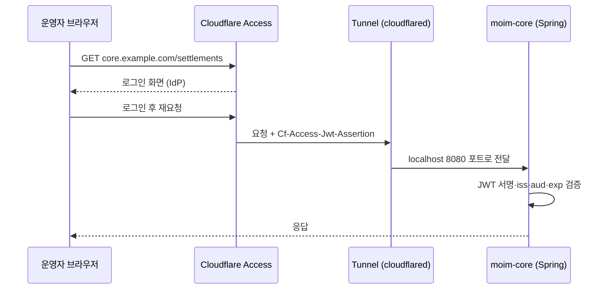

# 10장. Cloudflare One — 작은 팀을 위한 제로 트러스트

"사내망 안에 있으면 안전하다." 오랫동안 회사 보안은 이 문장 위에 서 있었다. 방화벽으로 성벽을 쌓고, 성 안으로 들어오는 길은 VPN 하나로 좁힌다. 일단 VPN에 붙으면 사내 위키도, 관리자 화면도, 데이터베이스도 손이 닿는다. 성 안에 들어온 사람은 믿을 만한 사람이라는 전제다.

2020년 8월 미국 국립표준기술연구소(NIST)가 낸 SP 800-207 「Zero Trust Architecture」는 바로 이 전제를 뒤집는 문장으로 제로 트러스트를 정의한다.

> "Zero trust assumes there is no implicit trust granted to assets or user accounts based solely on their physical or network location (i.e., local area networks versus the internet) or based on asset ownership (enterprise or personally owned)."

물리적 위치나 네트워크 위치만으로, 즉 사내 LAN에 있느냐 인터넷에 있느냐만으로 주어지는 암묵적 신뢰는 없다는 것이다. 같은 문서는 이어서 이렇게 적는다.

> "Authentication and authorization (both subject and device) are discrete functions performed before a session to an enterprise resource is established."

사용자와 기기 모두의 인증과 인가가 세션이 열리기 전에 매번 따로 수행된다는 말이다. 2014년 12월 구글도 사내 보안 모델 BeyondCorp를 소개하며 "We are removing the requirement for a privileged intranet and moving our corporate applications to the Internet."라고 썼다. 제로 트러스트의 질문은 "어디에서 왔는가"에서 "누구이고, 어떤 기기인가"로 바뀐다. 사내망이라는 "안"이 사라진 자리에 매 요청의 신원 확인이 들어선다.

이 생각을 `moim`에 대어보자. 9장 끝에서 공격자에게 남은 문은 앱 로그인 하나로만 지켜지는 `/admin/*`이었다. 6장에서 Tunnel로 공개한 `core.example.com`도 인터넷 어디서든 Spring의 로그인 화면까지는 닿는다. 팀원이 VPS에 SSH로 들어가려면 22번 포트가 어딘가 열려 있어야 한다. VPN을 새로 깔아 이 셋을 성 안에 넣을 수도 있다. 하지만 서너 명짜리 팀이 VPN 서버를 운영하는 일은 생각만 해도 번거롭다. Cloudflare One(Zero Trust)은 이 셋을 VPN 없이 닫는 도구다. 하나씩 닫아보자.

## 작은 팀의 언어로 본 제로 트러스트

### 위치 대신 신원과 기기 — Cloudflare One의 구성

Cloudflare One은 제품 하나가 아니라 여러 부품의 묶음이다. 이름이 많아 처음에는 헷갈리니 `moim`에 필요한 순서대로 자리를 잡아두자.

가장 먼저 쓸 것은 Access다. Access는 애플리케이션 앞에 서서 요청마다 "누구인가"를 묻는다. 로그인하지 않은 사람은 Access의 로그인 화면에서 멈추고, 정책을 통과한 요청만 오리진까지 간다. 오리진에 도착한 요청에는 Access가 서명한 JWT가 실려 있다. 이 JWT를 오리진이 검증하는 것이 이 장의 중심 실습이다.

두 번째는 Cloudflare One Client(구 WARP Client)다. 팀원의 노트북에 까는 에이전트로, 기기의 상태(posture)를 Access 정책에 알려주고 기기의 트래픽을 Cloudflare로 보낸다. NIST가 말한 "subject and device"에서 device 쪽을 맡는 부품이다. 세 번째는 Gateway로, Client를 통해 들어온 트래픽에 DNS·HTTP 필터링 정책을 건다. 네 번째는 Cloudflare Mesh다. Mesh node(구 WARP Connector)를 서버에 두면 팀원 기기와 서버가 하나의 사설망으로 묶인다. 마지막으로 6장의 Tunnel이 이 모든 것의 연결선이다. 공개 호스트명을 오리진에 잇는 것도, 사설 호스트명을 내부 서버에 잇는 것도 Tunnel이다.

작은 팀이라면 이 다섯을 한꺼번에 들일 필요가 없다. Access와 Tunnel만으로 운영자 화면, 내부 API, SSH를 닫을 수 있다. 기기 상태까지 따지고 싶어질 때 Client를 더하고, 스테이징 환경을 통째로 사설망에 넣고 싶을 때 Mesh를 더하면 된다. 이 장도 그 순서를 따른다.


그림 1. Access 인증 흐름 — JWT 검증은 오리진(Spring)에서 한 번 더

### 좌석과 플랜 — 50명까지 $0, 그다음은

돈 이야기부터 정확히 해두자. Cloudflare의 Access 제품 페이지(페이지에 날짜 표기가 없어 2026년 10월 3일 확인 기준)에는 세 가지 플랜이 있다. Free 플랜은 "$0 forever"이고 "Best for teams under 50 users"라는 설명과 함께 사용량 행에 "50 user limit"가 적혀 있다. Pay-as-you-go는 "$7 per user/month (paid annually)"이고 사용자 수 제한이 없다. 그 위로 가격을 따로 정하는 Contract 플랜이 있다. $7에는 "연간 결제"라는 조건이 붙어 있다는 점을 놓치지 말자. 연간 결제 기준 사용자당 월 $7이고, 월 단위 결제 단가는 확인하지 못했다. 50석 무료 구조는 2020년 10월 Teams 무료 플랜 발표 때부터 이어져 온 것이다.

혼동하기 쉬운 숫자가 하나 있다. 2026년 4월 Mesh 발표 글에는 "50 nodes and 50 users free"라는 문구가 나온다. 이것은 Mesh라는 별개 제품에 대한 문구다. Access 좌석의 근거로 섞어 쓰지 말자.

좌석이 어떻게 소비되는지가 더 중요하다. 좌석 관리 문서(2026-05-01 기준)에 따르면 사용자는 인증 이벤트가 한 번만 일어나도 좌석을 차지한다. 그리고 "A user who authenticates will hold their seat until you remove the user from your account. By default, inactive users will not be automatically removed"라고 적혀 있다. 한 번 로그인한 사람은 우리가 지울 때까지 좌석을 붙들고 있고, 활동하지 않는 사용자도 기본으로는 자동 정리되지 않는다는 뜻이다. 행사 때 한 번 들어와 본 자원봉사자 스무 명이 그대로 좌석을 차지하면 50석은 금세 찬다. 분기마다 사용자 목록을 정리하자. 서비스 토큰은 좌석을 쓰지 않으니, 기계 간 호출을 사람 계정으로 처리하지 말아야 할 이유가 하나 더 생긴다.

운영 한도도 작은 팀에게는 넉넉하다. 계정당 Access 앱 500개, IdP 50개, 서비스 토큰 50개, 규칙당 이메일 1,000개, Gateway DNS·HTTP·Network 정책 각 500개다(Cloudflare One Account limits 2026-09-04 기준).

> **비용 메모** — Access Free 플랜은 50명까지 $0이고, 넘으면 Pay-as-you-go로 연간 결제 기준 사용자당 월 $7이다(Access 제품 페이지, 2026-10-03 확인). 한 번 인증한 사용자는 지울 때까지 좌석을 차지하고, 서비스 토큰은 좌석을 쓰지 않는다. Mesh는 노드 50개·사용자 50명까지 무료(2026-04-14 발표 기준)이고, Tunnel의 호스트명 기반 사설 라우팅은 Cloudflare One 고객이면 무료다. 원격 브라우저 격리와 전용 출구 IP는 유료 애드온이다.

## `moim`의 문을 Access로 닫기

### Access 앱 만들기 — `/admin/*`과 `core.example.com`

Cloudflare One을 처음 열면 팀 이름을 정한다. 이 이름이 `https://<팀 이름>.cloudflareaccess.com`이라는 팀 도메인이 되고, 뒤에서 JWT를 검증할 때 발급자(`iss`)와 공개 키 주소의 기준이 된다.

다음은 로그인 수단(IdP)이다. 2026년 6월 18일 이후 새로 만든 조직은 Cloudflare 자체 IdP가 기본이고, 그 전에는 이메일 일회용 PIN(OTP)이 기본이었다. OTP는 지금도 설정 없이 바로 쓸 수 있으니 서너 명짜리 팀이라면 이것으로 시작해도 된다. GitHub나 Google 같은 소셜 IdP도 붙일 수 있고, OIDC나 OAuth를 지원하는 서비스라면 generic OIDC를 고른다. Auth0·Clerk 전용 연동 가이드는 확인하지 못했으니 generic OIDC로 붙이고 동작을 직접 확인하자.

이제 Access 애플리케이션을 두 개 만든다. 첫째는 `moim.example.com`의 운영자 경로다. 화면 `/admin/*`과 그 화면이 부르는 `/api/admin/*`을 한 앱으로 묶어 보호한다(사실 확인 필요: 경로 단위 앱 구성 방법). 정책은 단순하게 시작하자. 팀원의 이메일 주소를 나열하거나, 회사 도메인 이메일 전체를 허용한다. 여기서 8장의 경고를 떠올리자. 결제 웹훅 `/api/webhooks/stripe`가 이 앱의 범위에 들어가면 Stripe는 로그인 화면으로 가는 302를 받고, Stripe는 리다이렉트를 실패로 처리한다. 운영자 경로만 정확히 감싸고 웹훅 경로는 범위 밖에 두자.

둘째는 `core.example.com` 전체다. 6장에서 Tunnel로 공개한 `moim-core`를 통째로 Access 뒤에 둔다. 이 앱에는 정책이 둘 필요하다. 운영자가 정산 화면을 보러 들어오는 사람용 정책과, `moim-api`가 정산 데이터를 가져가는 기계용 정책이다. 기계용 정책은 뒤에서 서비스 토큰으로 만든다.

실수로 내부 도구를 노출하는 일을 막는 안전장치도 있다. 2026년 1월 22일에 나온 Require Access protection은 "When enabled, traffic to any hostname that does not have a matching Access application is automatically blocked."라고 설명된다. 대응하는 Access 앱이 없는 호스트명으로 가는 트래픽을 자동으로 막는, 기본 거부 방식이다. 새 내부 호스트명을 만들고 Access 앱을 깜빡해도 문이 열리지 않는다. 다만 `moim.example.com`의 공개 페이지처럼 누구나 들어와야 하는 호스트명과 이 설정이 어떻게 공존하는지, 적용 범위를 어떻게 지정하는지는 레퍼런스로 확인하지 못했다(사실 확인 필요). 켜기 전에 문서에서 범위부터 확인하자. Worker 쪽에는 2026년 8월 14일 추가된 옵션이 있다. "Make all Workers private by default"를 켜면 기존 Worker와 새로 만드는 Worker 모두 로그인 없이는 닿을 수 없게 된다. 9장에서 본 `workers.dev` 뒷문을 계정 단위로 닫는 또 하나의 방법이다.

### Access JWT 검증 ① — Workers와 Node

Access가 앞에서 막아주는데 오리진에서 또 검증해야 할까? 해야 한다. Access는 Access를 지나온 요청만 확인한다. 누군가 다른 길로 오리진에 닿으면, 예를 들어 9장의 `workers.dev`가 열려 있거나 Tunnel 설정이 잘못되어 Access 앱이 없는 호스트명이 생기면, 오리진은 그 요청이 Access를 거쳤는지 알 수 없다. Cloudflare도 2025년 10월 체인지로그에서 "To fully secure your application, it is important that you validate the JWT that Cloudflare Access adds to the `Cf-Access-Jwt-Assertion` header on the incoming request."라고 적었다.

검증할 대상은 `Cf-Access-Jwt-Assertion` 요청 헤더다. 브라우저 요청에는 `CF_Authorization` 쿠키로도 같은 토큰이 오지만, 문서는 쿠키가 항상 전달된다는 보장이 없으니 헤더를 검증하라고 권한다(Validate JWTs 2026-05-06 기준).

Worker가 오리진이라면 더 쉬운 길이 있다. 2026년 8월에 문서화된 `ctx.access`다. Worker는 로그인한 사용자의 신원을 `ctx.access`로 읽을 수 있고, 문서는 "No extra configuration or JWT parsing is required."라고 말한다. Access가 인증하지 않은 요청이면 `ctx.access`는 `undefined`다.

```ts
// moim-api — /api/admin/* 핸들러 (사실 확인 필요: ctx.access의 신원 필드 이름)
export default {
  async fetch(request: Request, env: Env, ctx: ExecutionContext) {
    if (!ctx.access) {
      return new Response("unauthorized", { status: 401 });
    }
    // ctx.access에서 이메일·그룹 등 신원 정보를 읽는다
    return handleAdmin(request, env, ctx.access);
  },
};
```

그런데 `moim`의 구조에서는 이 편리함에 두 군데 구멍이 있다. 문서가 직접 밝힌 제약이다. 첫째, "Workers with Static Assets execute behind an internal router Worker. Access still protects the application and its assets. However, the router does not pass `ctx.access` to the user Worker." `moim-web`은 정적 자산을 가진 Worker다. Access는 `/admin/*`을 여전히 지켜주지만, `moim-web`의 코드에서는 `ctx.access`를 읽을 수 없다. 둘째, "Cloudflare Access does not propagate `ctx.access` through Service Binding HTTP requests or remote procedure call (RPC) invocations." 5장에서 `moim-web`이 `moim-api`를 Service binding으로 부르게 했으니, 관리자 화면이 SSR 중에 `moim-api`를 부르면 그 호출에도 `ctx.access`가 없다.

그렇다면 어떻게 할까? `moim-web`의 운영자 화면은 `ctx.access` 대신 `Cf-Access-Jwt-Assertion` 헤더를 직접 검증하자. Service binding으로 `moim-api`를 부를 때는 그 헤더를 그대로 실어 보내고, `moim-api`도 같은 방식으로 다시 검증한다. 신원을 "이미 확인했다"는 내부 표시로 넘기는 대신 서명된 토큰 자체를 넘기면, 받는 쪽은 아무도 믿지 않고 스스로 확인할 수 있다. 제로 트러스트를 Worker 사이에도 적용하는 셈이다. 검증 코드는 Cloudflare 공식 예제와 같은 `jose` 패키지로 쓴다. Node.js 오리진에서도 그대로 쓸 수 있다.

```ts
import { createRemoteJWKSet, jwtVerify } from "jose";

type AccessEnv = { TEAM_DOMAIN: string; POLICY_AUD: string };
// TEAM_DOMAIN 예: "https://moim-team.cloudflareaccess.com"

let jwks: ReturnType<typeof createRemoteJWKSet> | undefined;

export async function verifyAccess(request: Request, env: AccessEnv) {
  const token = request.headers.get("Cf-Access-Jwt-Assertion");
  if (!token) return null;

  jwks ??= createRemoteJWKSet(new URL(`${env.TEAM_DOMAIN}/cdn-cgi/access/certs`));
  try {
    const { payload } = await jwtVerify(token, jwks, {
      issuer: env.TEAM_DOMAIN,
      audience: env.POLICY_AUD,
    });
    return payload; // email, sub 등
  } catch {
    return null;
  }
}
```

`POLICY_AUD`는 Access 앱마다 붙는 AUD 태그로, 앱 설정의 Additional settings에서 확인하며 앱을 다시 만들지 않는 한 바뀌지 않는다. 모듈 수준 변수 `jwks`는 3장에서 본 대로 isolate가 재사용될 때만 살아남는 캐시이니, 사라져도 다시 만들면 그만이다. 로컬 개발에서는 `wrangler.jsonc`에 `"access": { "dev": { "aud": "...", "identity": { ... } } }`를 두면 가짜 신원으로 `ctx.access` 경로를 시험할 수 있다.

### Access JWT 검증 ② — Spring Security로 (저자 작성 예제)

이제 `moim-core`의 차례다. 먼저 밝혀둘 것이 있다. Cloudflare의 JWT 검증 문서는 Workers, Go, Python, Node.js 예제를 제공하지만 Java나 Kotlin 예제는 없다. 아래 Spring Security 설정은 공식 예제가 없어 직접 작성한 예제다. 기준 버전은 Spring Boot 4.1.1과 Spring Security 7.1.1(둘 다 2026-08-20 GA, Java 17 이상)이다.

검증에 필요한 사실부터 모아보자. 공개 키는 `https://<팀 이름>.cloudflareaccess.com/cdn-cgi/access/certs`에 있고, 응답의 `keys` 배열이 표준 JWKS 형식(RSA, RS256)이다. 토큰의 `iss`는 팀 도메인, `aud`는 앱의 AUD 태그를 담은 배열이다. Spring Security Resource Server로 이 세 가지(서명, `iss`, `aud`)와 만료(`exp`)를 검증하면 된다.

여기에 함정이 두 개 있다. 첫째는 토큰을 꺼내는 위치다. Resource Server의 기본 `DefaultBearerTokenResolver`는 `Authorization` 헤더에서 `Bearer `로 시작하는 값을 찾는다. 헤더 이름은 `setBearerTokenHeaderName`으로 바꿀 수 있지만, Spring Security 7.1.1 소스를 보면 값이 `Bearer `로 시작하지 않으면 무시한다. Access는 `Cf-Access-Jwt-Assertion`에 접두어 없이 JWT만 넣는다. 그래서 헤더 이름만 바꾸면 토큰을 영영 찾지 못한다. 문서가 "provider is using both a custom header and value"인 경우를 위해 안내하는 `HeaderBearerTokenResolver`를 쓰자. 헤더 값을 그대로 돌려주는 리졸버다.

둘째는 `issuer-uri`다. Spring Boot에서 `issuer-uri`만 적으면 애플리케이션은 그 주소의 OIDC 디스커버리 엔드포인트를 조회해 공개 키 위치를 알아내려 한다. 그런데 Access 팀 도메인에 디스커버리 엔드포인트가 있는지는 이 책의 리서치로 확인하지 못했다. 그러니 `jwk-set-uri`를 명시하자. Spring Security 문서도 이 조합을 설명한다. "jwk-set-uri can be supplied as well … Resource Server will not ping the authorization server at startup", 그리고 "We still specify the issuer-uri so that Resource Server still validates the iss claim on incoming JWTs."

```yaml
# moim-core application.yml — 저자 작성 예제
spring:
  security:
    oauth2:
      resourceserver:
        jwt:
          jwk-set-uri: https://moim-team.cloudflareaccess.com/cdn-cgi/access/certs
          issuer-uri: https://moim-team.cloudflareaccess.com   # iss 검증용
          audiences: ${CF_ACCESS_AUD}                          # 앱의 AUD 태그
```

```java
// moim-core SecurityConfig — 저자 작성 예제 (Spring Security 7.1.1 기준)
@Configuration
@EnableWebSecurity
class SecurityConfig {

    @Bean
    SecurityFilterChain accessProtected(HttpSecurity http) throws Exception {
        http
            .authorizeHttpRequests(auth -> auth
                .requestMatchers("/internal/**").hasAuthority("ROLE_SERVICE")
                .anyRequest().authenticated())
            .oauth2ResourceServer(oauth -> oauth
                .bearerTokenResolver(new HeaderBearerTokenResolver("Cf-Access-Jwt-Assertion"))
                .jwt(jwt -> jwt.jwtAuthenticationConverter(new AccessJwtConverter())));
        return http.build();
    }
}
```

`AccessJwtConverter`는 뒤의 서비스 토큰 절에서 채운다. 서명 알고리즘은 Boot의 기본값 RS256이 Access와 맞고, 시계 오차는 Resource Server 기본값인 60초를 허용한다. 검증 항목을 코드로 드러내고 싶다면 Spring Security 레퍼런스의 방식대로 `NimbusJwtDecoder.withJwkSetUri(...)`에 `JwtValidators.createDefaultWithIssuer(...)`와 `JwtClaimValidator<List<String>>`(aud 검사)를 `DelegatingOAuth2TokenValidator`로 묶어 등록해도 된다. Kotlin이라면 같은 빈을 Kotlin 문법으로 옮기면 되고 설정 값은 같다. 기존 Spring 로그인 체인이 남아 있다면 `securityMatcher`로 경로별 체인을 나눠두자.

마지막은 키 회전이다. 문서는 "By default, Access rotates the signing key every 6 weeks."라고 적고, 이전 키는 회전 뒤 7일 동안 유효하다고 덧붙인다. API로 수동 회전도 할 수 있다. 그래서 certs 응답에는 키가 둘 들어 있고, 토큰 헤더의 `kid`로 맞는 키를 골라야 한다. 응답에 있는 `public_cert`(현재 키 하나)를 그대로 읽어 쓰지 말라는 경고도 있다. 오래된 캐시에서 만료된 값을 읽을 수 있기 때문이다. 공개 키를 애플리케이션 설정에 하드코딩하면 6주 뒤 어느 날 모든 요청이 401로 바뀐다. 아찔한 장면이다. JWKS 주소를 설정하면 Spring이 키를 받아 캐시하는데, 그 캐시가 얼마 동안 유지되는지, 모르는 `kid`가 오면 즉시 다시 받아오는지는 이 책의 리서치로 1차 확인하지 못했다. [리서치 공백] 스테이징에서 API로 키를 수동 회전한 뒤, 애플리케이션을 재시작하지 않고도 새 토큰이 통과하는지 확인해두자. 7일의 유예가 있으니 하루 이틀 캐시는 문제되지 않지만, 확인해두면 마음이 편하다.

## 사람이 아닌 호출자, 그리고 팀원의 기기

### 서비스 토큰 — `moim-api`가 `moim-core`를 부를 때

`core.example.com`이 Access 뒤로 들어가면 `moim-api`는 어떻게 들어갈까? Worker는 로그인 화면에서 이메일 PIN을 입력할 수 없다. 기계 간 호출에는 서비스 토큰을 쓴다. Cloudflare One에서 서비스 토큰을 만들면 Client ID와 Client Secret 한 쌍이 나온다. 호출하는 쪽은 이 둘을 헤더에 실어 보내고, `core.example.com` 앱에는 이 토큰을 허용하는 Service Auth 정책을 둔다.

```ts
// moim-api → moim-core (두 값은 9장의 wrangler secret으로 관리)
const res = await fetch("https://core.example.com/internal/settlements/summary", {
  headers: {
    "CF-Access-Client-Id": env.CORE_ACCESS_CLIENT_ID,
    "CF-Access-Client-Secret": env.CORE_ACCESS_CLIENT_SECRET,
  },
});
```

헤더를 하나밖에 보낼 수 없는 SaaS라면 `Authorization` 헤더에 두 값을 JSON으로 담는 대안도 있다. 7장에서 `moim-core`가 큐를 당길 때 쓴 API 토큰과 헷갈리지 말자. API 토큰은 Cloudflare API를 부르는 열쇠이고, 서비스 토큰은 Access가 지키는 우리 앱에 들어가는 열쇠다.

2026년 10월 2일 체인지로그는 서비스 토큰 인증의 strict 모드를 알렸다. 이 모드에서는 인증이나 인가가 실패하면 Access가 로그인 페이지로 302 리다이렉트하지 않고 항상 401이나 403을 돌려준다. 또 Service Auth 정책만 요청을 허가할 수 있다. 그리고 "Zero Trust organizations created on or after October 5, 2026 have strict service token authentication turned on by default and cannot turn it off." 2026년 10월 5일 이후 만든 조직은 strict 모드가 기본이고 끌 수도 없다. 기계 입장에서는 반가운 변화다. 토큰이 틀렸을 때 로그인 페이지 HTML을 받아 들고 파싱 에러를 내는 대신, 401을 받고 곧바로 원인을 알 수 있다.

Spring 쪽에서는 어떻게 보일까? 서비스 토큰으로 통과한 요청에도 `Cf-Access-Jwt-Assertion`이 실려 오고, 앞의 설정으로 그대로 검증된다. 다만 토큰 내용이 다르다. 애플리케이션 토큰 문서(2026-06-25 기준)에 따르면 서비스 토큰으로 인증한 경우 `sub`는 "Contains an empty string"이고, `common_name`에 서비스 토큰의 Client ID가 들어간다. Spring의 기본 principal은 `sub`를 쓰므로, 아무 처리 없이 두면 서비스 호출의 사용자 이름이 빈 문자열이 된다. 로그에 이름 없는 호출이 찍히는 것은 찜찜하다. 변환기에서 둘을 구분해 권한을 붙이자.

```java
// 저자 작성 예제 — sub가 비어 있으면 서비스 토큰 호출로 본다
class AccessJwtConverter implements Converter<Jwt, AbstractAuthenticationToken> {
    private static final String MOIM_API_CLIENT_ID = System.getenv("MOIM_API_CLIENT_ID");

    @Override
    public AbstractAuthenticationToken convert(Jwt jwt) {
        String sub = jwt.getSubject();
        if (sub == null || sub.isEmpty()) {
            String clientId = jwt.getClaimAsString("common_name");
            List<GrantedAuthority> authorities = clientId != null && clientId.equals(MOIM_API_CLIENT_ID)
                ? List.of(new SimpleGrantedAuthority("ROLE_SERVICE"))
                : List.of();
            return new JwtAuthenticationToken(jwt, authorities, "service:" + clientId);
        }
        String email = jwt.getClaimAsString("email");
        return new JwtAuthenticationToken(jwt,
            List.of(new SimpleGrantedAuthority("ROLE_OPERATOR")), email);
    }
}
```

이렇게 하면 `/internal/**`은 `moim-api`의 서비스 토큰만 통과하고, 운영자는 이메일 이름으로 로그에 남는다. 권한 판단에 Access JWT의 커스텀 클레임을 쓰려는 유혹이 생길 수 있다. 문서는 직렬화한 커스텀 클레임이 약 1 KB를 넘으면 잘라낸다고 경고한다. 자라날 수 있는 값은 권한 판단에 쓰지 말자.

서비스 토큰은 계정당 50개까지 만들 수 있다. 2026년 8월 25일부터 교체 유예 기간과 일시 비활성화가, 8월 26일부터는 유출 스캐너가 알아볼 수 있는 시크릿 형식이, 9월 22일부터는 오래 쓰지 않은 토큰의 자동 관리가 추가됐다. 9장에서 세운 교체 계획에 서비스 토큰도 넣어두자.

### 팀원의 기기와 사설망 — Cloudflare One Client, Gateway, Mesh, SSH

Access만으로도 문은 닫혔다. 그런데 팀이 자라면 질문이 하나 더 생긴다. 로그인한 사람의 노트북은 믿을 만한가? 회사 노트북이 아닌 PC방 컴퓨터에서 운영자 화면에 들어오는 것까지 허용할까? 기기를 따지려면 기기에 무언가를 깔아야 한다. 그것이 Cloudflare One Client다. Client가 깔린 기기의 상태를 Access 정책 조건으로 쓸 수 있고, Workers의 `ctx.access`에도 기기 상태 필드가 실린다. 다만 Client 배포와 설정이 작은 팀에게 쉬운 일은 아니다. 2026년 9월 HN의 한 사용자는 "between the broken dashboard side of Zero Trust and nightmare of Warp… it was basically impossible to setup."이라고 썼다. 대시보드와 Client 설정에 막혀 포기했다는 일화다. 그러니 Access만으로 시작하고, 기기 조건이 꼭 필요해질 때 Client를 들이자.

Client를 깔면 Gateway의 DNS 필터링도 쓸 수 있다. 팀원 기기의 DNS 질의를 Cloudflare가 받아 악성 도메인 같은 범주를 막는다. 2020년 무료 플랜 발표 글은 DNS 필터링을 50명까지 무료로 포함한다고 밝혔지만, 지금 Free 플랜 Gateway의 세부(로그 보관 기간 등)는 확인하지 못했다. [리서치 공백]

사설망이 필요하면 Mesh가 있다. 대시보드의 Networking > Mesh에서 시작하고, 2026년 4월 발표 기준 노드 50개·사용자 50명까지 무료다. 스테이징 서버에 Mesh node를 두면 Client를 깐 팀원 노트북과 하나의 사설망으로 묶여, 공개 호스트명 없이 스테이징 DB에 닿는다. Tunnel에도 호스트명 기준 사설 라우팅이 있다(2025-09-18, "free for all Cloudflare One customers"). 2026년 8월 11일 GA를 알리는 글이 올라왔고(체인지로그 제목으로만 확인), 8장에서 고정 출구 IP 문제를 풀 때 쓴 바로 그 기능이다. 6장의 현장 합의처럼 사설 접근은 Tailscale에 맡기는 선택도 여전히 유효하다.

마지막 문은 SSH다. `moim-core`가 도는 VPS에 22번 포트를 열어두지 말고, SSH도 Tunnel과 Access 뒤로 넣자. Tunnel에 `ssh.example.com` 같은 호스트명을 하나 더 만들어 VPS의 SSH 서비스로 잇고(사실 확인 필요: Tunnel ingress의 SSH 서비스 표기), 그 호스트명에 팀원만 허용하는 Access 앱을 건다. 팀원은 자기 컴퓨터의 SSH 설정에 `cloudflared`를 ProxyCommand로 지정한다. 아래는 2026년 4월 HN 사용자가 공유한 방식을 `moim`에 맞춘 것이다.

```
# ~/.ssh/config
Host ssh.example.com
  ProxyCommand cloudflared access ssh --hostname %h
```

이제 `ssh ssh.example.com`을 치면 브라우저에서 Access 로그인이 뜨고, 통과하면 SSH 세션이 열린다. 팀원이 떠날 때 할 일도 단순해진다. 서버마다 돌아다니며 공개 키를 지우는 대신 Access 정책에서 그 사람을 빼고 사용자 목록에서 지우면 된다. 좌석도 함께 돌아온다.

## 어디까지가 무료이고, 무엇을 믿는가

작은 팀에 필요한 것은 대부분 무료 범위에 있지만 경계도 알아두자. 원격 브라우저 격리는 Zero Trust Pay-as-you-go와 Enterprise 플랜의 애드온이고, 전용 출구 IP는 Zero Trust Enterprise 플랜의 애드온이다(8장). CASB 같은 기능의 무료 범위는 확인하지 못했다. 표준도 하나 짚어두자. "OAuth 2.1"이라는 이름을 자주 보게 될 텐데, 2026년 10월 기준 OAuth 2.1은 IETF 초안(draft-ietf-oauth-v2-1-16, 2026-09-03)이고 RFC로 발행되지 않았다.

이 구조가 기대는 믿음도 짚어두자. HN의 jorams는 Tunnel과 Zero Trust를 두고 "You've also in the process converted your entire security model to Cloudflare's idea of 'Zero Trust' which involves 100% trusting Cloudflare."라고 썼다. 위치에 대한 신뢰를 걷어낸 자리에 Cloudflare라는 사업자에 대한 신뢰가 들어선 것은 사실이다. 오리진에서 JWT를 직접 검증하는 이유도 여기에 있다. 그 검증이 표준 JWT 위에 서 있으니, 앞단을 바꾸더라도 Spring의 코드는 키 주소와 발급자만 바꾸면 된다. 8장의 원칙이 신원에서도 통한다.

여기까지 왔다면 우리 팀에 무엇이 필요한지 스스로 물어볼 차례다. 세 가지 질문을 남긴다.

첫째, 우리 시스템에서 "사내망 안이니까 괜찮다"는 이유로 열어둔 문은 몇 개인가? 관리자 화면, 내부 API, SSH, 스테이징 DB를 하나씩 세어보자. 그 문마다 Access 앱이 있는가?

둘째, 오리진은 Access를 믿는가, 아니면 스스로 확인하는가? Spring이든 Node든 Worker든, `Cf-Access-Jwt-Assertion`의 서명과 `iss`와 `aud`를 검증하고 있는가? 키가 회전하는 날에도 그 검증은 살아남는가?

셋째, 사람과 기계를 구분하고 있는가? 기계 간 호출을 누군가의 개인 계정으로 처리하고 있지는 않은가? 서비스 토큰은 몇 개이고, 마지막으로 교체한 것은 언제인가?

### 이 장의 핵심

- 제로 트러스트는 네트워크 위치 대신 사용자와 기기의 신원을 매 요청 확인한다. 작은 팀은 Access와 Tunnel만으로 운영자 화면·내부 API·SSH를 VPN 없이 닫을 수 있다.
- Access Free 플랜은 50명까지 $0이고, 넘으면 연간 결제 기준 사용자당 월 $7이다(2026-10 기준). 한 번 인증한 사용자는 지울 때까지 좌석을 차지하고, 서비스 토큰은 좌석을 쓰지 않는다.
- 오리진은 `Cf-Access-Jwt-Assertion`의 서명·`iss`·`aud`·`exp`를 직접 검증한다. 정적 자산 Worker와 Service binding에서는 `ctx.access`가 전달되지 않으니 헤더를 검증한다.
- Spring Security에서는 `HeaderBearerTokenResolver("Cf-Access-Jwt-Assertion")`와 명시적 `jwk-set-uri`가 필요하다. 서명 키는 6주마다 회전하고 이전 키는 7일간 유효하다.
- 기계 간 호출은 서비스 토큰으로 하고, 서비스 토큰 JWT는 `sub`가 비어 있고 `common_name`에 Client ID가 담긴다. 2026-10-05 이후 생성 조직은 strict 모드가 기본이다.
