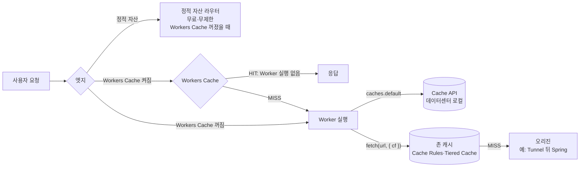

# 11장. 캐싱 — 세 가지 캐시 경로와 무효화

2026년 4월, Hacker News의 한 스레드에 이런 고백이 올라왔다.

> "CDN edge caching served stale HTML after a deploy, and the service worker cached the bad response. Took a CDN purge from the dashboard to fix. The debugging experience when things go wrong at the edge is painful, you're always guessing which cache layer is the problem." (HN Manchitsanan, 2026-04-07)

배포를 마쳤는데 엣지가 옛 HTML을 내보냈고, 브라우저의 서비스 워커가 그 잘못된 응답을 다시 붙잡아 두었다. 결국 대시보드에서 CDN 퍼지를 하고 나서야 풀렸다. 마지막 문장이 특히 아프다. 엣지에서 뭔가 틀어지면 어느 캐시 층이 범인인지 늘 짐작으로 찾아야 한다는 것이다. 같은 스레드의 다른 개발자는 다른 CDN을 쓰면서 "Every time I purge the pull zone cache, I do it twice, cause once from my CI isn't enough."라고 덧붙였다. 한 번 지우는 것으로는 믿음이 안 가서 두 번 지운다는 이야기다. 웃고 넘기기엔 너무 익숙한 장면이다.

왜 이런 일이 생길까? 캐시가 하나가 아니기 때문이다. 브라우저 캐시, 서비스 워커, 엣지의 존 캐시, 그리고 Workers 위에서는 그 사이에 몇 겹이 더 끼어든다. 각 층이 언제 무엇을 붙잡고 언제 놓아주는지 모르면, 캐시는 빠르게 만드는 도구가 아니라 원인을 알 수 없는 버그 공장이 된다.

지금까지 `moim`은 캐시를 거의 의식하지 않고 자랐다. 2장에서 정적 자산이 무료·무제한이라는 사실을 확인했고, 5장에서 행사 상세 페이지를 SSR로 바꿨다. 그런데 12장에서 다룰 "커뮤니티 1면에 오른 날"이 오면, 매 요청마다 Worker가 D1과 Durable Objects를 두드리며 같은 HTML을 수만 번 다시 그리게 된다. 이제 캐시를 제대로 들여다볼 때다. 이 장은 Cloudflare 위의 캐시 경로들을 나란히 놓고 비교한다. 어느 경로가 어디서 일하는지, 무엇을 공짜로 주고 무엇을 청구하는지, 바뀐 콘텐츠는 어떻게 내리는지를 차례로 살펴보자.

## 캐시는 어디에 있는가

### 아무것도 하지 않았을 때의 출발점

먼저 기본값부터 확인하자. 도메인을 Cloudflare로 옮기고 프록시를 켰다고 해서 모든 응답이 캐시되지는 않는다. 특히 HTML은 별다른 설정이 없으면 응답의 `cf-cache-status` 헤더에 `DYNAMIC`이 찍힌다. 캐시 대상이 아니라는 뜻이다. 사용자마다 다를 수 있는 HTML을 함부로 캐시했다가 남의 장바구니를 보여주는 사고를 막기 위한 보수적인 기본값이다.

HTML까지 캐시하고 싶다면 예전에는 Page Rules의 "Cache Everything"을 썼다. 지금 Page Rules는 폐기(deprecated) 상태이고, 같은 일을 Cache Rules 같은 Rules 제품이 넘겨받는 중이다. 이관 일정은 개인 블로그마다 말이 달라 여기서는 날짜를 적지 않겠다. 새로 설정한다면 처음부터 Cache Rules로 시작하는 편이 낫다. Free 존에서도 Cache Rules를 10개까지 만들 수 있다(Cache Rules 문서, 2026-10-03 기준).

존 캐시에는 무료로 딸려 오는 장치가 하나 더 있다. Tiered Cache와 Smart Topology는 Free 플랜에도 포함된다. 엣지 데이터센터가 캐시를 놓치면 곧장 오리진으로 가지 않고 상위 계층 데이터센터를 먼저 들르게 해서 오리진이 받는 요청을 줄이는 구조다. 토폴로지를 직접 고르는 Generic Global·Regional·Custom 방식만 Enterprise 전용이다(Tiered Cache 문서, 2026-10-03 기준).

여기까지는 전통적인 CDN의 이야기다. 오리진 서버가 있고, Cloudflare가 그 앞에서 응답을 붙잡아 둔다. 그런데 `moim`의 구성을 떠올려보자. `moim.example.com`에 들어오는 요청을 처음 받는 것은 오리진이 아니라 Worker다. 여기서부터 이야기가 달라진다.

### Workers는 캐시 앞에서 실행된다

Workers 가격 문서의 작은 글씨에는 이런 문장이 있다.

> "Since Cloudflare Workers runs before the Cloudflare cache, the caching of a request still incurs costs." (Workers Pricing, 2026-10-02 기준)

Worker는 캐시보다 앞에서 실행된다. 그러니 요청을 캐시하더라도 그 요청에 대한 Worker 비용은 나간다는 뜻이다. 이 한 문장이 이 장 전체의 열쇠다. 요청이 들어오는 순서를 그려보면 이렇다. 사용자의 요청이 엣지에 닿으면 정적 자산이면 정적 자산 라우터가 바로 응답하고, Worker 경로면 Worker가 먼저 깨어난다. Worker가 `fetch()`로 오리진에 서브요청을 보낼 때, 그 서브요청이 비로소 존 캐시를 지난다.

이 순서에서 두 가지 결론이 따라 나온다. 첫째, Worker가 만들어 돌려주는 응답 자체는 존 캐시를 거치지 않는다. Cache Rules에 "행사 상세 페이지를 캐시하라"고 적어도, 그 페이지를 Worker가 SSR로 그린다면 규칙은 할 일이 없다. 둘째, Cache Rules와 존 캐시가 일하는 곳은 Cloudflare 프록시 뒤의 진짜 오리진으로 가는 트래픽이다. `moim`으로 치면 6장에서 Tunnel로 공개한 `core.example.com`의 Spring 서버, 혹은 Worker가 `fetch()`로 부르는 외부 오리진이다.

이 사실을 모르고 Cache Rules를 열심히 만들었다가 `cf-cache-status`가 끝내 바뀌지 않아 난감해하는 경우가 많다. 규칙이 틀린 게 아니라, 규칙이 닿지 않는 곳을 캐시하려 한 것이다.

그렇다면 Worker가 그리는 HTML은 영영 캐시할 수 없을까? 그렇지 않다. Workers에는 Worker 자신을 위한 캐시 경로가 따로 있다. 그것도 셋이나 된다. 하나씩 살펴보자.


그림 1. 요청이 세 캐시 경로와 존 캐시를 지나는 흐름

## 세 가지 캐시 경로 비교하기

### Workers Cache — Worker를 깨우지 않는 캐시

가장 새로운 경로부터 보자. Workers Cache는 Worker 설정에 한 줄을 넣으면 켜진다.

```jsonc
// moim-web/wrangler.jsonc (발췌)
{
  "name": "moim-web",
  "compatibility_date": "2026-09-01",
  // ...앞 장과 동일
  "cache": { "enabled": true }
}
```

이름 그대로 Worker 앞에 놓이는 캐시다. 공식 문서는 이렇게 설명한다.

> "Workers Cache lets Cloudflare return cached HTTP responses from your Worker without executing your Worker code." (Workers Cache, 2026-09-22 기준)

캐시에 맞는 응답이 있으면 Worker 코드를 아예 실행하지 않고 돌려준다. 무엇을 얼마나 캐시할지는 Worker가 응답에 붙이는 `Cache-Control` 헤더로 정하고, Cloudflare는 이를 RFC 9111(HTTP 캐싱 표준)에 따라 해석한다. 문서는 다른 성질도 몇 가지 분명히 적어두었다. 기본으로 계층형(tiered)이라 한 데이터센터가 놓쳐도 상위 계층에서 찾는다. 같은 URL에 요청이 몰리면 Worker를 한 번만 실행하고 그 결과를 기다리던 모든 요청에 나눠준다("Cloudflare runs your Worker once and serves the resulting response to every waiting request"). 태그 단위 퍼지도 `ctx.cache.purge({ tags: [...] })`로 지원한다.

요청 병합은 12장의 "1면에 오른 날"에 특히 반갑다. 막 마감 임박 공지가 뜬 행사 페이지에 수천 명이 동시에 들어와도, 캐시가 비어 있는 첫 순간에도 Worker는 데이터센터마다 한 번씩만 깨어난다. 오리진 보호 측면에서 이만한 장치가 없다.

그런데 주의할 문장이 하나 있다. "No zone configuration for caching applies to Workers Caching." 존에 만들어 둔 Cache Rules는 Workers Cache에 적용되지 않는다. 캐시 동작을 바꾸고 싶다면 대시보드가 아니라 Worker의 응답 헤더를 고쳐야 한다. 그리고 가장 중요한 문장은 아래 비용 메모에 옮겨 두었다.

> **비용 메모**
> Workers Cache를 켜면 Worker로 들어오는 **모든 요청**이 표준 Workers 요청 단가로 계산된다. 캐시 HIT도, 평소 무료인 정적 자산 요청도, Worker 간 호출도 포함이다. 원문: "When caching is enabled, every request to your Worker is charged at the standard Workers request rate, including requests that are normally free: static asset requests and worker-to-worker invocations" (Workers Cache, 2026-09-22 기준). Workers Paid 기준 월 1,000만 요청까지 포함, 초과분은 100만 건당 $0.30이다(Workers Pricing, 2026-10-02 기준). 2장에서 지킨 "정적 자산은 무료" 원칙이 이 한 줄로 깨진다는 점을 기억해두자.

캐시를 켰더니 청구서의 요청 수가 늘어난다. 직관과 정반대다. 이 함정은 이 장의 마지막에서 다시 다루겠다.

### Cache API — 데이터센터 하나짜리 캐시

두 번째 경로는 Worker 코드 안에서 직접 다루는 Cache API(`caches.default`)다. 서비스 워커의 Cache API와 생김새가 같아서 프런트엔드 개발자에게 익숙하다.

```ts
// moim-api: 행사 목록을 30초 동안 데이터센터 로컬 캐시에 담는 예
app.get("/api/events", async (c) => {
  const cache = caches.default;
  const hit = await cache.match(c.req.raw);
  if (hit) return hit;

  const { results } = await c.env.DB
    .prepare("SELECT id, title, starts_at FROM events WHERE published = 1")
    .all();
  const res = Response.json(results, {
    headers: { "Cache-Control": "public, max-age=30" },
  });
  c.executionCtx.waitUntil(cache.put(c.req.raw, res.clone()));
  return res;
});
```

손에 쥐는 맛은 좋다. 무엇을 넣고 언제 꺼낼지 코드로 정확히 정할 수 있다. 하지만 공식 문서가 밝힌 한계를 같이 읽어야 한다.

> "the contents of the cache do not replicate outside of the originating data center." / "The `cache.put` method is not compatible with tiered caching." / "the Cache API does not collapse concurrent requests, so a burst of traffic to a fresh URL invokes your Worker once per request." / "The `stale-while-revalidate` and `stale-if-error` directives are not supported when using the `cache.put` or `cache.match` methods." (Cache API·Workers Cache 문서, 2026-10-03 확인)

정리하면 이렇다. 캐시는 그 데이터센터 안에만 머문다. 서울에서 담은 응답을 도쿄는 모른다. 계층형 캐시도, 요청 병합도 없다. 막 비워진 URL로 트래픽이 몰리면 요청마다 Worker가 깨어난다. `stale-while-revalidate`(재검증하는 동안 옛 응답을 내보내기)와 `stale-if-error`(오리진이 실패하면 옛 응답으로 버티기)도 `cache.put`/`cache.match`에서는 동작하지 않는다.

무효화도 까다롭다. `cache.delete()`는 지금 코드가 실행되는 데이터센터의 항목만 지운다. 전 세계에 흩어진 사본을 한 번에 내릴 방법이 마땅치 않으니, Cache API에 담는 데이터는 짧은 TTL로 스스로 만료되게 두는 편이 낫다. 위 예제가 30초를 고른 이유다. 행사 목록이 30초 늦게 바뀌어도 아무도 다치지 않는다. 반대로 좌석 잔여 수처럼 틀리면 안 되는 값은 Cache API에 넣지 말자. 4장에서 그 값의 진실은 `EventSeats` Durable Object에 두기로 했다.

### `fetch()`의 `cf` 옵션 — 미들웨어형 Worker의 캐시

세 번째 경로는 Worker가 오리진 앞의 미들웨어로 일할 때 쓴다. 공식 문서의 권고는 분명하다.

> "For requests where Workers are behaving as middleware (that is, Workers are sending a subrequest via `fetch`) it is recommended to use `fetch`." (How the cache works, 2026-10-03 기준)

Worker가 오리진으로 `fetch()`를 보낼 때 `cf` 옵션을 붙이면, 그 서브요청의 응답이 존 캐시에 담긴다. 앞에서 본 "Workers는 캐시 앞에서 실행된다"는 그림에서, Worker 뒤쪽에 있는 존 캐시를 이용하는 방법이다. 쓸 수 있는 옵션은 `cacheEverything`, `cacheKey`, `cacheTags`, `cacheTtl`, `cacheTtlByStatus`이고, 2026-06-28부터 `cf.vary`도 지원한다.

```ts
// 오리진 앞에서 일하는 미들웨어 Worker의 예 (moim 밖의 일반 예제)
export default {
  async fetch(request: Request): Promise<Response> {
    const url = new URL(request.url);
    const originUrl = `https://origin.example.com${url.pathname}`;
    return fetch(originUrl, {
      cf: {
        cacheEverything: true,
        cacheTtlByStatus: { "200-299": 86400, "404": 60, "500-599": 0 },
        cacheTags: ["public-pages"],
      },
    });
  },
} satisfies ExportedHandler;
```

이 경로의 장점은 존 캐시의 모든 혜택을 그대로 누린다는 것이다. Tiered Cache가 적용되고, 태그로 퍼지할 수 있고, Cloudflare의 일반 퍼지·무효화 도구가 그대로 통한다. 상태 코드별로 TTL을 다르게 주는 `cacheTtlByStatus`는 특히 쓸모가 많다. 오리진이 500을 뱉을 때 그 에러 페이지를 하루 동안 캐시해버리는 끔찍한 일을 막아준다.

`moim`에서 이 경로가 맞는 곳은 생각보다 좁다. `moim-web`과 `moim-api`는 응답을 직접 만드는 Worker이고, 오리진인 `moim-core`는 10장에서 Access 뒤로 들어갔다. 하지만 독자의 서비스가 이미 Spring이나 다른 서버로 공개 페이지를 내놓고 있고 그 앞에 Worker를 얹어 인증·리다이렉트·A/B 분기 같은 일을 시킨다면, 이 경로가 주인공이다.

### `moim`에는 무엇을 쓸까

세 경로를 한 표에 놓고 보자.

| 경로 | 캐시 위치 | 계층형 | 요청 병합 | 무효화 | 비용 관점 |
|---|---|---|---|---|---|
| Workers Cache | Worker 앞 | 기본 tiered | 있음 | `ctx.cache.purge({ tags })` | HIT·정적 자산까지 요청 과금 |
| Cache API | 데이터센터 로컬 | 불가 | 없음 | 로컬 `delete`, 사실상 TTL | Worker 요청·CPU는 그대로 |
| `fetch()` + `cf` | 존 캐시(오리진 앞) | Tiered Cache | 존 캐시 동작 | 존 퍼지·invalidate | Worker 요청은 그대로, 오리진 부하 감소 |

표 1. 세 캐시 경로 비교 (Workers Cache 2026-09-22, Cache API·How the cache works 문서 2026-10-03 기준)

이제 `moim`의 콘텐츠를 하나씩 대어보자. JS·CSS·이미지 같은 정적 자산은 아무것도 하지 않는 것이 정답이다. 이미 무료·무제한이고, 빌드 도구가 파일 이름에 해시를 붙여주니 브라우저 캐시도 길게 잡힌다. 좌석 잔여 수는 캐시하지 않는다. 행사 목록 API는 위에서 본 대로 Cache API에 30초. 남은 것은 행사 상세 페이지다. 5장에서 vinext로 SSR하게 만든 바로 그 페이지다.

행사 상세 HTML은 Worker가 그린다. 그러니 존 캐시와 Cache Rules는 닿지 않는다. Cache API를 쓰면 데이터센터마다 따로 놀고, 몰리는 순간의 요청 병합도 없다. 남는 후보는 Workers Cache다. 1면에 오른 날의 폭주를 요청 병합과 계층형 캐시로 받아내기에 가장 잘 맞는다. 문제는 비용 메모에서 본 함정이다.

계산을 해보자. 행사 상세 페이지 하나가 HTML 1개와 정적 파일 12개를 불러온다고 가정하자. Workers Cache를 끄면 페이지뷰 하나당 과금 요청은 SSR 1건이다. 켜면 브라우저 캐시가 비어 있는 첫 방문 기준으로 13건이 된다. 평소 하루 1,500 페이지뷰라면 한 달 45,000 페이지뷰, 과금 요청은 45,000건에서 최대 585,000건으로 뛴다. 숫자만 보면 열 배가 넘게 뛰지만, `moim`은 7장에서 Workers Paid로 올라왔고 월 1,000만 요청이 포함돼 있다(Workers Pricing, 2026-10-02 기준). 둘 다 추가 요금은 $0다. 재방문자는 해시 붙은 정적 파일을 브라우저 캐시에서 꺼내 쓰니 실제 증가분은 이보다 적다.

그래서 `moim`은 `moim-web`에 Workers Cache를 켠다. 다만 이유를 정확히 적어두자. 싸지기 때문이 아니다. 몰리는 순간 D1과 `EventSeats`를 두드리는 SSR 실행을 줄이고, 첫 바이트를 빠르게 하기 위해서다. 그리고 `moim-api`에는 켜지 않는다. `moim-web`이 Service binding으로 `moim-api`를 부르는 호출은 원래 추가 요청 요금이 없는데, `moim-api`에 Workers Cache를 켜는 순간 그 호출까지 과금 대상이 되기 때문이다.

한 가지 더. 이 결정은 Workers Paid 계정이라서 성립한다. Free 계정에서 같은 설정을 하면 평소 일일 한도와 무관하던 정적 자산 요청이 Worker 요청으로 잡힐 수 있다. 일일 10만 요청 한도에 어떻게 반영되는지는 문서에 없으니(2026-10-03 확인), Free 계정이라면 켜지 않는 편이 안전하다.

## 헤더로 캐시에게 말하기

### 표준이 정한 언어: `Cache-Control`과 `CDN-Cache-Control`

캐시는 결국 HTTP 헤더로 대화한다. 기준은 RFC 9111 "HTTP Caching"(2022년 6월, Internet Standard)이다. 공유 캐시와 개인 캐시를 구분하고, 신선도를 계산하고, 재검증하는 규칙을 정한다. 여기에 RFC 9213 "Targeted HTTP Cache Control"(2022년 6월)이 CDN 전용 `CDN-Cache-Control` 응답 헤더를 더해 브라우저 캐시와 CDN 캐시의 수명을 따로 줄 수 있게 했다. RFC 5861(2010년 5월)은 재검증하는 동안 옛 응답을 내보내는 `stale-while-revalidate`와, 오리진이 5xx를 낼 때 옛 응답으로 버티는 `stale-if-error`를 정의한다.

이 셋을 조합하면 실무에서 자주 원하는 정책이 나온다. "브라우저엔 짧게, 엣지엔 길게." 브라우저가 붙잡은 옛 HTML은 사용자 기기 안에 있어서 퍼지로도 고칠 수 없다. 반면 엣지 캐시는 우리가 언제든 지울 수 있다. 그러니 브라우저에는 짧은 수명을, 엣지에는 긴 수명을 주고, 바뀌면 엣지를 지우는 것이 정석이다.

Java 독자를 위해 Spring 쪽 코드로 옮겨보자. 6장에서 Tunnel로 공개한 Spring 서버가 공개 페이지를 내놓는 경우다. HTML이니 Cache Rules로 캐시 대상에 넣어 뒀다고 하자.

```java
// Spring MVC 컨트롤러 예: 브라우저엔 60초, 엣지엔 1시간
@GetMapping("/public/notice")
public ResponseEntity<String> notice() {
    String html = renderNotice();
    return ResponseEntity.ok()
        .cacheControl(CacheControl.maxAge(Duration.ofSeconds(60))
            .cachePublic()
            .staleWhileRevalidate(Duration.ofSeconds(30)))
        .header("CDN-Cache-Control", "max-age=3600")
        .contentType(MediaType.TEXT_HTML)
        .body(html);
}
```

물론 표준이 정했다고 벤더가 모두 그대로 구현하는 것은 아니다. Cloudflare 존 캐시는 `CDN-Cache-Control`을 지원한다. 이 헤더가 오면 엣지의 캐싱 판단은 이것으로 하고, Cache Rules의 Edge Cache TTL이 있으면 그쪽이 이긴다(2026-04-16 문서 기준). 존 캐시의 `stale-while-revalidate`는 2026-02-26부터 완전히 비동기로 동작하고, Free·Pro·Business 존 모두에 적용됐다("Cloudflare's `stale-while-revalidate` support is now fully asynchronous."). 반대로 앞에서 본 것처럼 Cache API의 `cache.put`/`cache.match`에서는 SWR과 SIE가 동작하지 않는다. 같은 회사, 같은 엣지인데도 경로마다 지원 범위가 다르다. 헤더를 적기 전에 어느 경로가 그 헤더를 읽는지부터 묻는 습관을 들이자.

Spring 오리진이라면 하나 더 챙길 것이 있다. 공개 페이지 응답에 세션 쿠키(`Set-Cookie: JSESSIONID=...`)가 섞여 나가면 캐시가 그 응답을 거부하거나, 더 나쁘게는 쿠키째 다른 사용자에게 퍼뜨릴 위험이 생긴다. 2026-03-24에 나온 Cache Response Rules가 이 문제를 오리진을 고치지 않고 풀어준다. "Cache Response Rules let you modify `Cache-Control` directives, manage cache tags, and strip headers like `Set-Cookie` from origin responses *before* they reach Cloudflare's cache." 캐시에 들어가기 전에 `Set-Cookie`를 떼어낼 수 있다. 물론 근본 처방은 공개 페이지에서 세션을 만들지 않도록 Spring 설정을 고치는 것이다.

### 캐시 키와 HIT율: 한 번만 불리는 객체들

캐시를 켰는데 HIT율이 생각보다 낮다. 왜 그럴까? 학계에는 이 질문에 대한 오래된 답이 있다. Akamai의 Maggs와 Sitaraman은 실제 CDN 로그를 분석해 이렇게 보고했다.

> "On a typical CDN server cluster serving web traffic over two days, 74% of the roughly 400 million objects in cache were accessed only once and 90% were accessed less than four times." (Maggs & Sitaraman, SIGCOMM CCR 45(3), 2015)

캐시에 들어간 객체의 74%가 이틀 동안 단 한 번만 불렸다. 이런 객체를 one-hit-wonder라고 부른다. 그들은 이런 객체로 디스크를 낭비하지 않으려고 "두 번째 요청 때 캐시한다"는 규칙을 썼다고 설명한다. 다른 연구도 같은 방향을 가리킨다. Yang 등의 SOSP '23 논문은 편향된 워크로드에서 대부분의 객체가 짧은 시간 창 안에 한 번만 접근되므로 일찍 내보내는 것이 중요하다고 정리했다. 엣지 캐시가 교과서의 LRU처럼 동작하지 않는다는 것은 엣지 캐시 연구의 일반적인 결과다. 특정 벤더가 어떤 알고리즘을 쓰는지는 이 논문들이 말해주지 않는다는 점도 함께 짚어두자.

이 연구가 우리에게 주는 실무 교훈은 단순하다. 캐시 키를 쪼갤수록 one-hit-wonder가 늘어난다. 행사 페이지 링크가 SNS로 퍼지면 `?utm_source=x`, `?utm_source=threads&utm_medium=...`, `?fbclid=...` 같은 꼬리가 붙은 URL이 수십 가지로 들어온다. 쿼리스트링이 캐시 키에 들어가면 이 URL들은 모두 다른 객체다. 똑같은 HTML이 수십 벌로 캐시되고, 각각은 몇 번 불리지도 못한 채 밀려난다. HIT율이 낮게 나오는 이유가 여기에 있다.

처방은 캐시 키에서 의미 없는 쿼리를 걷어내는 것이다. `fetch()` 경로라면 `cf.cacheKey`로 키를 직접 정할 수 있다. Workers Cache라면 Worker가 응답을 만들 때 마케팅 파라미터를 무시하도록 정규화한 URL로 리다이렉트하는 방법도 있다. 존 캐시의 Cache Rules로 쿼리 파라미터를 골라 넣고 빼는 캐시 키 설정은 Enterprise 전용이다(Cache Rules 설정 문서, 2026-09-16 기준). 그리고 롱테일 객체가 많은 서비스일수록 Tiered Cache가 효과를 낸다. 엣지 하나에서는 한 번 불린 객체라도 상위 계층에서 모으면 여러 번 불린 객체가 되기 때문이다.

## 바뀐 것을 내리는 법

### invalidate와 purge, 그리고 `moim`의 신청 마감

캐시 설계의 절반은 넣는 일이고, 나머지 절반은 내리는 일이다. Cloudflare 존 캐시에는 2026-09-28부터 내리는 방법이 두 가지가 됐다.

새로 생긴 invalidate는 콘텐츠를 지우지 않고 "오래됨" 표시만 한다.

> "Invalidation marks matching content as stale. On the next request, Cloudflare revalidates the content with your origin. If your origin responds with `304 Not Modified`, Cloudflare reuses the cached content" (Changelog, 2026-09-28)

다음 요청이 오면 오리진에 재검증을 묻고, 오리진이 `304 Not Modified`로 답하면 캐시된 내용을 그대로 다시 쓴다. 바뀐 것만 새로 받아오니 오리진의 부담이 적다. 엔드포인트는 `POST /zones/$ZONE_ID/invalidate_cache`, 본문은 퍼지와 같은 형식(`{"tags":[...]}` 등)이다. 존 캐시 전용이라 Workers Cache에는 닿지 않는다. 오리진이 `ETag`나 `Last-Modified`로 재검증에 응답할 수 있어야 효과가 난다는 점도 잊지 말자.

전통적인 purge는 말 그대로 지운다. Free 존에서도 URL·호스트명·태그·프리픽스·전체(Purge Everything) 방식을 모두 쓸 수 있다. 한도는 알아두자. 호스트명·태그·프리픽스·전체 퍼지는 Free 기준 분당 5회, 단일 URL 퍼지는 초당 800개 URL까지다(Purge cache 문서, 2026-10-03 기준). CI에서 배포할 때마다 전체 퍼지를 연달아 부르는 파이프라인이라면 분당 5회는 금방 찬다.

그렇다면 `moim`의 신청 마감은 어떻게 반영할까? 행사 상세 페이지는 Workers Cache에 있으니 `ctx.cache.purge`를 쓴다. 운영자가 `/admin/*` 화면에서 "신청 마감"을 누르면, `moim-web`이 `moim-api`에 마감을 기록하고 이어서 그 행사의 캐시 태그를 지운다. Worker 진입점 수준으로 줄여 쓰면 다음과 같다.

```ts
// moim-web: 운영자 마감 처리 (Worker 진입점 수준으로 단순화한 예)
async function closeEvent(eventId: string, env: Env, ctx: ExecutionContext) {
  // 1) 진실의 원천에 마감을 기록한다 (Service binding, 추가 요청 요금 없음)
  //    API는 5장에서 만든 moim-web → moim-api Service binding
  const res = await env.API.fetch(
    `https://moim-api/api/admin/events/${eventId}/close`,
    { method: "POST" },
  );
  if (!res.ok) throw new Error(`close failed: ${res.status}`);

  // 2) 행사 상세 페이지 캐시를 태그로 지운다
  ctx.waitUntil(ctx.cache.purge({ tags: [`event-${eventId}`] }));
}
```

태그는 응답에 `Cache-Tag: event-42`처럼 헤더로 붙인다(여러 개면 쉼표로 구분, 2026-08 문서 기준). vinext 같은 프레임워크 안에서 `ctx`를 꺼내는 방법도 프레임워크마다 다르니, 여기서는 원리만 가져가면 된다.

좌석이 다 차서 자동으로 마감되는 경우는 어떻게 할까? 좌석은 `EventSeats`가 세고, 페이지의 잔여 좌석 숫자는 클라이언트가 캐시하지 않는 API로 따로 받아온다. 행사 상세 HTML에는 "마감되었습니다" 같은 상태 문구만 남는데, 이 HTML의 `max-age`를 60초 정도로 짧게 두면 최악의 경우에도 1분 안에 바뀐다. 신청 버튼을 눌러도 `EventSeats`가 마지막 판정을 내리니 초과 신청은 일어나지 않는다. 캐시가 조금 늦어도 데이터가 틀리지 않는 구조. 캐시를 안전하게 쓰는 핵심이 여기에 있다.

### Next.js 쪽 캐시와 배포 후 stale HTML 디버깅

5장에서 미뤄둔 이야기를 회수하자. Next.js에는 프레임워크 자체의 캐시가 있다. ISR(증분 정적 재생성)과 `"use cache"` 지시어다. vinext 1.0 기준으로 ISR은 지원되지만 `"use cache"`는 일부만 구현돼 있다. vinext README의 Known gaps는 이렇게 적는다. "`"use cache"` is partially implemented, but full `cacheComponents` behavior is still incomplete." 1.0 발표 블로그도 "limited support for the "use cache" directive"라고 밝혔다(2026-09-28). 이 기능에 기대는 앱이라면 5장에서 말했듯 당분간 OpenNext를 유지하는 판단이 합리적일 수 있다.

더 흥미로운 것은 vinext가 이 캐시를 어디에 저장하느냐다. `@vinext/cloudflare`는 저장소 어댑터를 고르게 한다. `kvDataAdapter()`는 `"use cache"` 데이터 캐시를 Workers KV에 담고, `workersCacheCdnAdapter()`는 페이지 단위 ISR을 Workers Cache(`ctx.cache`)에서 서빙한다. 기본값인 `MemoryCacheHandler`에 대해서는 README가 "Swap in your own backend for production."이라고 권한다.

이 어댑터 이름들을 앞 장들과 겹쳐 읽어보자. 메모리 캐시는 isolate마다 따로 존재하니 3장에서 본 대로 요청마다 다른 isolate가 다른 캐시를 볼 수 있다. KV 어댑터는 4장의 최종 일관성을 그대로 물려받는다. 태그로 재검증해도 전 세계에 반영되기까지 시간이 걸린다. 그리고 Workers Cache 어댑터는 이 장의 비용 메모를 물려받는다. "ISR을 켠다"는 결정이 곧 "Workers Cache 과금 구조를 받아들인다"는 결정이 된다. 프레임워크 설정 한 줄 뒤에 숨은 인프라를 알아야 하는 이유다.

이제 이 장을 연 장면으로 돌아가자. 배포했는데 옛 HTML이 보인다면 어디부터 볼까? 캐시 층을 바깥에서 안쪽으로, 순서대로 의심하자.

1. **HTML 응답부터.** `curl -I https://moim.example.com/events/42`로 응답 헤더를 본다. 존 캐시를 거친 응답이라면 `cf-cache-status`와 `age`가 무엇을 말하는지 확인한다. 엣지가 옛 것을 들고 있다면 여기서 드러난다.
2. **브라우저와 서비스 워커.** curl로는 새 HTML인데 브라우저에서만 옛 화면이라면 범인은 사용자 기기 안에 있다. 시크릿 창으로 열어보고, 개발자 도구에서 서비스 워커를 해제해본다. 서비스 워커가 HTML을 캐시하는 전략이었다면 배포 절차에 서비스 워커 갱신을 넣어야 한다.
3. **CDN 층 정리.** 엣지가 범인이면 태그나 URL로 지운다. 지운 뒤에는 다시 1번으로 돌아가 헤더로 확인한다. 두 번 지우는 대신 한 번 지우고 확인하는 편이 낫다.

이 순서를 지키면 "어느 캐시 층이 문제인지 늘 짐작한다"는 상황을 상당 부분 벗어날 수 있다.

> **비용 메모**
> Cache Reserve는 롱테일 객체를 R2 기반 저장소에 오래 붙잡아 두는 유료 기능이다. Free에서는 쓸 수 없고("A paid Cache Reserve plan is required."), 저장 GB-월당 $0.015, Class A 100만 건당 $4.50, Class B 100만 건당 $0.36이다. 문서는 "In most cases, a Cache Reserve miss will result in both one class A and one class B operation"이라고 적는다. 2026-09-28부터는 퍼지하면 Cache Reserve의 콘텐츠도 강제로 MISS가 된다(Cache Reserve 문서, 2026-10-03 기준). 대용량 파일을 많이 서빙하는 서비스가 아니라면 `moim` 규모에서는 필요 없다.

### "캐시를 켜면 싸진다"는 오해

캐시라는 말을 들으면 많은 개발자가 반사적으로 "비용 절감"을 떠올린다. 오리진 서버의 부하가 줄고, DB 조회가 줄고, 이그레스가 줄어드니 당연히 싸진다고 여기기 쉽다. 전통적인 CDN 앞에 VM 오리진이 있는 구조라면 대체로 맞는 말이다.

Workers 위에서는 이 등식이 깨진다. Worker는 캐시 앞에서 실행되니 존 캐시가 HIT를 내도 Worker 요청은 과금된다. Workers Cache는 Worker 실행을 건너뛰지만, 대신 HIT와 평소 무료인 정적 자산 요청까지 요청 단가로 센다. Cache API는 D1 조회를 줄여주지만 Worker 요청과 CPU는 그대로다. 세 경로 어디에서도 "켰더니 요청 청구가 줄었다"는 결과는 자동으로 따라오지 않는다.

그렇다면 Workers 위에서 캐시는 무엇을 사는 걸까? 지연 시간을 산다. 몰리는 순간의 오리진과 데이터 계층 보호를 산다. D1 행 읽기, Durable Objects 요청, CPU 시간 같은 하위 비용을 줄인다. 이것들은 분명 값진 것들이다. 다만 청구서의 맨 윗줄인 요청 수는 오히려 늘 수 있다는 사실을 알고 켜자. 캐시를 켜기 전에 "이 캐시가 줄이는 비용은 어느 줄이고, 늘리는 비용은 어느 줄인가"를 한 번만 물어보면 된다. 그 질문에 답할 수 있다면, 무료 한도와 유료 청구서를 숫자로 따져볼 준비도 이미 된 셈이다.

### 이 장의 핵심

- Worker는 캐시 앞에서 실행된다. Worker가 만든 응답은 존 캐시·Cache Rules가 닿지 않고, 존 캐시는 Worker가 `fetch()`로 부르는 오리진 쪽에서 일한다.
- Workers 위의 캐시 경로는 셋이다. Workers Cache(Worker 실행 생략·tiered·요청 병합·태그 퍼지), Cache API(데이터센터 로컬·병합 없음·SWR/SIE 미지원), `fetch()`의 `cf` 옵션(존 캐시 활용).
- Workers Cache를 켜면 HIT·정적 자산·Worker 간 호출까지 요청 단가로 과금된다(2026-09-22 문서 기준). vinext의 ISR 어댑터도 이 경로를 쓴다.
- 캐시 키를 쪼개면 한 번만 불리는 객체가 늘어 HIT율이 떨어진다. 의미 없는 쿼리스트링은 키에서 걷어내자.
- 무효화는 invalidate(재검증, 2026-09-28)와 purge(삭제, Free 분당 5회)를 구분하고, 배포 후 이상하면 HTML 응답 → 브라우저·서비스 워커 → CDN 순으로 확인한다.
