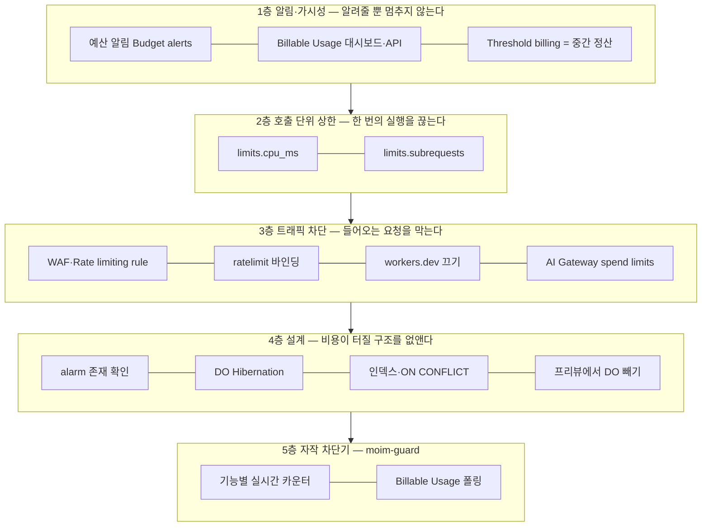

# 13장. 유료 계정에서 안전하게 — 하드캡 없는 세상의 다층 방어

$34,895.

2026년 4월 16일, Hacker News에 한 개발자가 이 금액이 적힌 청구서 이야기를 올렸다. 아직 서비스를 출시하지도 않은 1인 사업자였다. 그가 남긴 타임라인은 짧고 건조하다.

> "April 4-5: peaked at ~930 billion row reads/day … April 15: $34,895 invoice due with no billing response yet" (HN thewillmoss, 2026-04-16)

하루 행 읽기가 약 9,300억 건까지 치솟았고, 열흘 뒤 3만 4천 달러가 넘는 청구서의 납부일이 다가왔는데 청구 담당 쪽의 답은 아직 없었다. 이 청구서가 결국 어떻게 처리됐는지는 확인되지 않았다. 이 책은 그 결말을 모른다. 확실한 것은 청구서가 나왔다는 사실, 그리고 그가 쓴 다음 문장이다.

> "I'm a pre-launch sole proprietor who put all my personal savings into this startup. This bill would financially destroy me for usage that generated zero business value."

개인 저축을 모두 넣은 출시 전 스타트업에, 사업적 가치가 전혀 없는 사용량으로 이 청구서가 왔다. 7장에서 `moim`을 Workers Paid로 올린 우리에게 남의 일이 아니다. Free 계정은 (R2를 빼면) 한도에서 멈추지만, 유료 계정은 한도를 넘으면 청구하며 계속 돈다. 그렇다면 유료 계정에서는 무엇이 우리를 멈춰줄까? 이 장은 그 질문에 정직하게 답하고, 답이 마음에 들지 않을 때 직접 쌓을 수 있는 방어선을 함께 만든다.

## 두 장의 청구서

### $34,895 — 스스로 깨어나는 루프

원인부터 보자. 글쓴이는 이렇게 설명했다.

> "My DO agent's onStart() handler called this.ctx.storage.setAlarm() on every wake-up without checking whether an alarm was already scheduled. Combined with 60+ preview Worker deployments each creating independent DO instances, this created a runaway self-health-check loop."

Durable Object가 깨어날 때마다 호출되는 `onStart()`에서, 이미 예약된 alarm이 있는지 확인하지 않고 `setAlarm()`을 불렀다. 여기에 60개가 넘는 프리뷰 배포가 각자 독립된 DO 인스턴스를 만들었다. 그 결과 스스로를 점검하는 루프가 폭주했다. 원문 설명을 코드로 옮기면 대략 이런 모양이다.

```ts
// 원문 설명을 바탕으로 재구성한 패턴 — 깨어날 때마다 호출되는 훅
async onStart() {
  // 이미 예약된 alarm이 있는지 묻지 않는다
  await this.ctx.storage.setAlarm(Date.now() + 60_000);
}
```

이 코드를 본 순간 찜찜하다는 느낌이 들지 않는가? 깨어날 때마다 다음 깨어남을 예약하는 객체는 구조상 스스로를 계속 깨우는 루프다. 누가 요청하지 않아도 돈다. 4장에서 `EventSeats`의 마감 alarm을 걸 때 쓴 규칙을 떠올리자. alarm은 이미 걸려 있는지 확인하고 건다. 그 규칙을 이 코드에 옮기면 이렇다.

```ts
// 4장의 ensureCloseAlarm과 같은 규칙: alarm이 이미 있으면 다시 걸지 않는다
async onStart() {
  const existing = await this.ctx.storage.getAlarm();
  if (!existing) await this.ctx.storage.setAlarm(Date.now() + 60_000);
}
```

같은 스레드의 jacobmei는 더 근본적인 대안을 제시했다. 쓰기가 외부에서 들어온 요청에서만 일어나게 설계하면, 루프가 생길 여지 자체가 사라진다는 것이다. "No alarms means no self-triggering loop is even possible." 스스로 깨어나는 구조가 꼭 필요하지 않다면 만들지 않는 편이 가장 안전하다.

프리뷰 배포 쪽도 짚어두자. 5장에서 PR마다 Worker Preview를 띄웠다. 2026년 9월 발표된 Worker Previews는 "For Durable Objects and Containers, Cloudflare automatically provisions separate namespaces, storage, apps, and instances for every Preview."라고 적는다(Cloudflare 블로그, 2026-09-22). 프리뷰마다 DO와 Containers가 따로 생긴다는 뜻이다. 테스트 환경을 격리해준다는 점에서는 고마운 기능이지만, 루프를 가진 코드가 프리뷰 60개에 퍼지면 루프도 60배가 된다. 글쓴이 스스로가 남긴 처방 첫 줄이 "Strip DO bindings from preview environments entirely"였던 이유다.

마지막으로 그가 남긴 이 문장은 시점과 함께 읽어야 한다.

> "Cloudflare's Workers Usage Notifications only monitors CPU time. Not Durable Object row reads or writes. There is also no hard spending cap for DO operations available in the dashboard or Wrangler config. Nothing would have fired an alert during this runaway. I found out when the bill showed up."

사용량 알림이 CPU 시간만 감시해서 DO의 행 읽기·쓰기에는 아무 알림도 울리지 않았고, 청구서를 받고서야 알았다는 증언이다. 이것은 2026년 4월 초의 이야기다. 계정 단위의 Billable Usage 대시보드와 예산 알림은 그 직후인 2026-04-21에 도입됐다. 지금 같은 사고가 난다면, 예산 알림이 걸려 있는 계정에는 적어도 하루 늦게라도 알림이 온다. 하지만 아래에서 보겠지만, 알림이 왔다고 루프가 멈추지는 않는다.

### $4,868 — `ON CONFLICT` 하나

두 번째 청구서는 더 평범한 버그에서 나왔다. Little Bear Apps의 Nathan Schram은 2026년 1월의 사고를 3월에 블로그로 정리했다. D1에 48.3억 건의 쓰기가 일어났다. 원인은 버그 두 개, 중복 제거 누락과 `ON CONFLICT` 누락이었다. 월 $5짜리 계정에 $4,868이 청구됐고, 가장 많이 나온 날은 하루 $1,411.40이었다.

계산해보면 숫자가 맞아떨어진다. D1 쓰기는 100만 행당 $1.00이다(Workers Pricing, 2026-10-02 기준). 48.3억 행이면 그것만으로 약 $4,830이다. 읽기 단가가 100만 행당 $0.001이니 쓰기는 읽기보다 천 배 비싸다. 같은 데이터를 거듭 써넣는 버그가 무서운 이유가 여기에 있다.

`moim`의 신청 처리에 이 교훈을 옮겨보자. 네트워크가 흔들려 클라이언트가 같은 신청을 재시도해도 행이 한 번만 남도록, 유일성 제약과 `ON CONFLICT`로 쓰기를 멱등하게 만든다.

```sql
-- moim-db: 같은 회원이 같은 행사에 두 번 신청해도 한 행만 남는다
CREATE UNIQUE INDEX IF NOT EXISTS rsvps_event_member
  ON rsvps (event_id, member_id);

INSERT INTO rsvps (event_id, member_id, created_at)
VALUES (?1, ?2, ?3)
ON CONFLICT (event_id, member_id) DO NOTHING;
```

이 사고의 결말은 알려져 있다. 18일 만에 $4,586.64가 면제됐고 계정도 복구됐다. 그런데 그 18일 사이에 그는 이런 글을 남겼다. "Support said my $4.8k billing dispute was on hold, but the automated system just suspended me anyway."(r/CloudFlare, 2026-02-18, 블로그 인용 경유) 분쟁이 보류 중인데도 자동화된 시스템이 계정을 정지시켰다는 것이다. 면제를 받긴 했지만 그 과정은 끔찍했다. 이 장의 태도는 여기서 정해진다. 면제를 기대하지 말고 사전에 차단하자.

블로그에서 그는 자기 처지를 이렇게 요약했다. "I don't have a billing department. I have a credit card and a vague hope that nothing goes catastrophically wrong." 청구 부서도 없이 신용카드 한 장과 막연한 희망만 가진 개발자. 이 책의 독자 대부분이 같은 처지일 것이다. 한국 커뮤니티에도 로깅 설정을 실수로 켰다가 큰 청구를 받았다는 경험담이 있다. 사고의 원인을 따라가 보면 대개 우리 자신의 코드에 닿는다. 그러니 방어선도 우리 손으로 세울 수 있다.

## 정직한 결론부터

### 2026년 10월 현재, 하드캡은 없다

먼저 가장 듣고 싶지 않은 사실을 확인하자. 2026년 10월 현재, Cloudflare에는 계정 전체의 지출 상한을 거는 기능, 즉 계정 단위 지출 상한(하드캡)이 없다. Workers·Durable Objects·D1·R2 전체를 덮는 "이 금액을 넘으면 모든 것을 멈춰라" 스위치는 1차 문서 어디에도 없다. 웹 문서 조사와 커뮤니티 조사가 따로 같은 결론에 이르렀다(검색 시점 2026-10-03). 출간 직전에 다시 확인할 항목이지만, 이 장은 하드캡이 없다는 전제 위에서 쓴다.

커뮤니티는 이 상황을 한 문장으로 정리한다. Free 계정은 하루 한도에서 멈추는 사실상의 하드캡이고, 유료로 올리면 그 브레이크가 사라진다. woodylondon의 말이 그 불안을 그대로 담고 있다. "once you're on the paid plan, you're exposed to unlimited risk if your worker goes crazy due to a stupid code bug or if you're hacked."(HN 2026-04-16)

그 대신 우리 손에는 여러 장치가 있다. 문제는 이 장치들이 하는 일이 서로 다르다는 데 있다. 어떤 장치는 알려줄 뿐 멈추지 않는다. 어떤 장치는 실제로 멈추지만 정해진 범위 안에서만 멈춘다. 어떤 장치는 사고가 나기 전에 설계로 막는다. 이 구분을 흐리면 "알림을 걸어뒀으니 안전하다"는 착각에 빠진다. 장치를 다섯 층으로 나눠 하나씩 쌓아보자.


그림 1. 하드캡 없는 계정의 다층 방어

## 1층 알림과 가시성 — 알려줄 뿐 멈추지 않는다

### 예산 알림, Billable Usage, 그리고 Threshold billing

가장 먼저 손에 잡히는 장치는 예산 알림(Budget alerts)이다. 2026-04-21에 Billable Usage 대시보드와 함께 도입됐고, 2026년 7월부터는 적격 Pay-as-you-go 계정에 $10 계정 단위 알림이 기본으로 켜지기 시작했다. 다음 결제 주기부터, 코호트별로 순차 적용되는 방식이라 내 계정에 이미 켜졌는지는 직접 확인해야 한다(Changelog "Budget alerts now on by default", 2026-07-20 게시). Enterprise 계약 계정은 대상이 아니다.

이 알림의 성격은 문서가 분명히 적어두었다.

> "Budget alerts are informational only. They do not pause or cap usage. Your monthly invoice remains the authoritative source for billing." (Budget alerts, 2026-05-29 기준)
> "Usage is processed once per day for the prior day's activity, so budget alerts fire the day after the threshold is reached rather than in real time."
> "Budget alerts only consider spend on usage-based products. Recurring subscription fees, such as the Workers Paid plan fee or other monthly plan charges, are not included in the threshold calculation."

세 가지를 기억해두자. 정보 제공용이라 사용량을 멈추거나 제한하지 않는다. 사용량을 하루 한 번 처리하므로 임계치에 닿은 다음 날 울린다. Workers Paid 월 기본료 같은 정기 요금은 임계치 계산에서 빠진다. $34,895 사고의 기울기를 떠올려보면 하루의 지연이 얼마나 긴지 실감이 난다. 하루 행 읽기가 수천억 건인 루프라면 알림이 울릴 무렵 이미 하루치 청구가 쌓여 있다.

그래도 켜둘 가치는 충분하다. 기본 $10 알림 하나로 끝내지 말고, 자기 예산에 맞춰 임계치를 몇 개 더 걸자. 예를 들어 월 예산이 $30이라면 $15, $30, $60처럼 단계를 둔다. 마지막 단계는 "이 알림을 받으면 무엇을 할지"까지 미리 정해두는 편이 낫다.

가시성 도구도 두 가지가 있다. Billable Usage 대시보드는 "The data comes from the same system that generates your monthly invoice, so the figures match your bill."이라고 소개된다(Changelog 2026-04-21). 청구서와 같은 시스템에서 나온 숫자라 믿을 만하다. 2026-08-03에는 같은 데이터를 프로그램으로 읽는 Billable Usage API가 나왔다. 단 발표 블로그는 "Today, usage and cost data are updated daily while we work towards providing more real time data."라고 적었다. 하루 단위 갱신이다. 발표 스레드의 반응 한 줄이 이 장치의 위치를 정확히 짚는다. "Translated: Close, but still not hard cost cap at Cloudflare."(HN mathoff, 2026-08-03)

Pro 이상 존이라면 제품별 사용량 이메일 알림도 켤 수 있는데, 이것도 "The email notifications are for informational purposes only."다(Usage-based billing, 2026-05-29 기준).

마지막으로 이름 때문에 오해받기 쉬운 장치가 하나 있다. Threshold billing이다. 이름만 보면 "임계치에서 멈추는" 기능 같지만 실제로는 중간 정산이다.

> "When your combined usage charges across all usage-based products reach a certain level during a billing cycle, Cloudflare generates a mid-cycle invoice and charges your payment method on file." / "The threshold is automatically set by Cloudflare and cannot be modified." (Threshold billing, 2026-06-16 기준)

사용 요금이 일정 수준에 닿으면 결제 주기 중간에 청구서를 발행해 등록된 결제수단으로 결제한다. 임계치는 Cloudflare가 정하고 우리가 바꿀 수 없다. 사용을 멈추는 장치가 아니라, 큰 금액이 월말에 한꺼번에 몰리지 않게 나눠 받는 장치다. 카드 명세서에서 예상하지 못한 중간 결제를 발견했다면 이것일 가능성이 높다.

## 2층과 3층 — 실제로 멈추는 장치들

### 호출 단위 브레이크: `limits.cpu_ms`와 `limits.subrequests`

이제 실제로 멈추는 장치다. 가장 가까운 것은 Worker 설정 안에 있다. Workers 가격 문서는 `limits.cpu_ms`를 이렇게 소개한다.

> "To prevent accidental runaway bills or denial-of-wallet attacks, configure the maximum amount of CPU time that can be used per invocation" (Workers Pricing, 2026-10-02 기준)

폭주하는 청구서와 지갑을 노린 공격(denial-of-wallet)을 막기 위해 호출 한 번이 쓸 수 있는 CPU 시간의 상한을 정하라는 것이다. Workers Paid의 기본값은 30,000 ms(30초), 최대 300,000 ms(5분)다. 2026-02-11 changelog는 서브요청 수에도 같은 장치를 더했다. "To protect against runaway code or unexpected costs, you can also set a lower limit for both subrequests and CPU usage." Paid 기본값은 호출당 서브요청 10,000건이다.

`moim`의 Worker들에 걸어보자. 숫자는 Workers Logs로 각 Worker의 정상 최댓값을 잰 뒤 넉넉히 몇 배를 준 값이 좋다. 아래는 예시다.

```jsonc
// moim-api/wrangler.jsonc (발췌)
{
  "name": "moim-api",
  "compatibility_date": "2026-09-01",
  // ...앞 장과 동일
  "limits": {
    "cpu_ms": 1000,      // 기본 30,000 → API 요청 하나에 1초면 충분하다
    "subrequests": 50    // 기본 10,000 → 정상 경로의 최댓값 × 여유
  }
}
```

`moim-web`, `moim-mail` 소비자, 이 장 뒤에서 만들 `moim-guard`에도 같은 방식으로 건다. 상한에 걸린 호출은 종료되니, 정상 요청이 잘리지 않는지 프리뷰에서 먼저 확인하자. 런타임 한도 자체의 의미는 3장에서 다뤘다.

이 브레이크가 막지 못하는 것도 분명히 알아두자. 이 상한은 호출 한 번 단위다. 무한 루프에 빠진 요청 하나가 30초 동안 CPU를 태우는 일은 막아주지만, 정상적인 요청이 초당 수만 번 들어오는 일은 막지 못한다. $34,895 사고처럼 각 호출은 짧고 정상인데 호출 횟수가 폭주하는 경우에는 이 층만으로 부족하다. 그래서 다음 층이 필요하다.

### 트래픽 앞단의 차단과 AI Gateway spend limits

호출 횟수 자체를 줄이는 장치는 Worker보다 앞에 둔다. 9장에서 만든 것들이다. WAF Free Managed Ruleset, Rate limiting rule(Free 존 1개, 10초 기간), Worker 안의 `ratelimit` 바인딩이 비정상적인 요청 폭주를 Worker에 닿기 전이나 비싼 작업 전에 끊는다. 여기에 체크리스트 한 줄을 더하자. 커스텀 도메인을 붙였다면 `"workers_dev": false`로 `workers.dev`를 꺼두었는지 확인한다. `workers.dev`로 들어오는 요청은 존의 WAF를 우회한다. 자세한 이유는 9장에서 봤다.

AI를 쓰는 서비스라면 한 가지 장치가 더 있다. AI Gateway spend limits다. 2026-06-05에 나온 이 기능은 달러 기준 예산을 넘으면 요청을 실제로 차단한다(Changelog 2026-06-05). Cloudflare가 제공하는 장치 가운데 "금액 기준으로 멈추는" 거의 유일한 것이다. 하지만 범위를 정확히 읽자. AI Gateway를 지나는 트래픽에만 적용된다. 계정 전체 상한도, Workers·D1·DO의 상한도 아니다. 8장에서 외부 LLM 호출을 AI Gateway로 보내도록 구성했다면, 그 게이트웨이에 월 예산을 걸어두자. 프롬프트 루프 하나가 LLM 청구서를 키우는 일은 이것으로 막을 수 있다.

> **비용 메모**
> 3층의 장치들은 대부분 Free 범위 안에 있다. WAF Free Managed Ruleset과 Rate limiting rule 1개는 Free 존에서 쓸 수 있고, `ratelimit` 바인딩은 GA다(2025-09-19). AI Gateway의 분석·캐싱·레이트 리밋은 핵심 기능으로 무료이고, 2026-09-24 이후 신규 로그는 Workers Logs 가격을 따른다(AI Gateway Pricing, 2026-09-24 기준). 방어선을 세우는 데 큰돈이 들지 않는다는 뜻이다.

## 4층 설계 — 비용이 터질 구조를 없앤다

### 사고 사례에서 거꾸로 읽은 설계 규칙

가장 싼 방어는 처음부터 터질 구조를 만들지 않는 것이다. 앞의 두 사례와 지금까지의 장들을 거꾸로 읽으면 설계 규칙이 나온다.

Durable Objects부터 보자. alarm은 존재를 확인하고 건다. 스스로 깨어나는 구조가 꼭 필요한지부터 묻는다. 그리고 DO의 Duration 과금은 실제 사용량과 무관하게 할당된 128 MB 기준이라는 점을 기억하자("Duration billing charges for the 128 MB of memory your Durable Object is allocated, regardless of actual usage."). WebSocket을 `accept()`해 두면 연결 내내 Duration이 쌓인다. WebSocket Hibernation API를 쓰면 "billing pauses while the Durable Object is hibernated"다(Optimize costs, 2026-05-04 기준). 스토리지 쪽은 SQLite 백엔드 DO의 스토리지 과금이 2026년 1월부터 시작될 예정으로 공지됐다(목표일 2026-01-07, Free는 과금 없음). 실제 개시 여부는 출간 전에 다시 확인할 항목이다.

프리뷰 환경에서는 DO 바인딩을 뺀다. 프리뷰는 운영 설정을 물려받지 않고 `wrangler.jsonc`의 `previews` 블록에 적은 것만 쓴다. 클래스와 마이그레이션은 최상위에 두고, `previews.durable_objects.bindings`를 적지 않으면 프리뷰의 `env`에는 DO 바인딩이 없다(Worker Previews 설정 문서, 2026-09-22 기준). Containers도 프리뷰마다 따로 생기니 같은 원칙을 적용한다. 그리고 7장의 `moim-report` 설정에서 `max_instances`로 `ReportContainer`의 인스턴스 수를 묶어둔 것처럼, Containers를 쓰는 모든 Worker에 인스턴스 수의 상한이 걸려 있는지 확인하자(7장에서 봤듯 베타인 `durable_object` 스케줄링 정책은 이 항목을 받지 않는다). Containers에는 내장 오토스케일링이 없으니, 이 숫자가 곧 동시에 과금될 수 있는 인스턴스의 최댓값이다.

D1은 두 가지다. 쓰기 경로는 `ON CONFLICT`와 유일성 제약으로 멱등하게 만들고, 읽기 경로는 인덱스를 확인한다. 인덱스 없는 풀 스캔은 반환 행이 적어도 스캔한 행 전부가 "rows read"다. Queues는 배치와 재시도마다 메시지별로 operation이 과금되고, 64 KB를 넘는 메시지는 여러 operation으로 센다. 재시도 횟수와 데드레터 큐 설정이 곧 비용 설정이다. Workflows는 step 과금이 "no earlier than August 10, 2026"으로 예고됐다(Changelog 2026-07-07). 단가는 10만 step당 $0.80이고, `default_retention`으로 보존 기간을 줄이면 저장 과금도 준다.

이 밖에 다른 장에서 본 함정들이 있다. 캐시를 켜면 오히려 요청 과금이 느는 Workers Cache는 11장을 참조하자. 2026년 12월 1일부터 Paid 계정의 Observability는 포함량을 넘으면 "Paid usage continues automatically after an allowance is exhausted."다(Observability Pricing, 2026-10-02 기준). 로그를 아낌없이 남기는 습관이 그대로 청구서가 된다. Containers의 이그레스는 한국이 GB당 $0.05로 북미·유럽($0.025)의 두 배이고, 포함량도 500 GB로 북미·유럽의 1 TB보다 적다(Containers Pricing, 2026-08-28 기준). 4장에서 전망으로 소개한 KV Instant는 쓰기·삭제·list가 "$0.10 per operation"이다. 100만 건당이 아니라 건당이다. 기존 KV 감각으로 쓰면 수만 배 비싸다.

이 규칙들은 무언가를 알려주거나 막는 장치와 성격이 다르다. 사고가 일어날 구조 자체를 지우는 예방이다. 부록 B의 체크리스트에서 이 항목들에 따로 "설계" 표시를 붙인 이유다.

## 5층 자작 차단기 — `moim-guard`

### 왜 직접 만드는가

여기까지 쌓아도 빈 곳이 하나 남는다. 계정 전체, 혹은 기능 하나가 정해진 금액을 넘었을 때 그 기능을 멈추는 장치다. Cloudflare가 주지 않으니 직접 만들어야 한다. 커뮤니티에서도 같은 결론에 이른 사람들이 있다. Show HN에 "A usage circuit breaker for Cloudflare Workers"를 올린 3mins.news 운영자는 Cron Trigger 10개 이상이 몇 분마다 도는 구조라 직접 차단기를 만들었다(HN 2026-03-10). 댓글의 photobombastic은 한 마디로 요약했다. "Prevention over detection."

참고할 만한 설계는 $4,868 사고를 겪은 Little Bear Apps의 3단 서킷 브레이커다. 기능별 예산, 프로젝트 합산, 전역 비상 정지의 세 단계를 두고, 70%에서 경고, 90%에서 위험, 100%에서 자동 비활성화한다. 비활성화는 KV의 TTL로 1시간 뒤 자동 해제되고, 탐지 지연은 약 30초라고 한다(Little Bear Apps 블로그, 2026-03-18).

`moim-guard`는 이 구조를 빌리되 신호를 두 갈래로 나눈다. 왜 그럴까? Billable Usage API는 청구서와 같은 정확한 숫자를 주지만 하루 단위로 갱신된다. 하루 지연으로는 $34,895 같은 기울기를 잡을 수 없다. 그래서 정확하지만 느린 신호와, 거칠지만 빠른 신호를 함께 쓴다.

- **빠른 신호:** `moim-api`가 비싼 작업(D1 쓰기, R2 업로드, 메일 발송)을 할 때마다 기능별 카운터를 올린다. 카운터는 Durable Object `UsageMeter`에 둔다. 4장에서 봤듯 카운터를 KV에 두면 최종 일관성 때문에 조용히 틀린다. 기능 × 날짜마다 인스턴스 하나다.
- **느린 신호:** `moim-guard`의 Cron이 한 시간마다 Billable Usage API를 읽어 이번 달 누적 비용을 월 예산과 비교한다. 예산을 넘으면 KV `CONFIG`에 계정 전체 정지 플래그를 TTL과 함께 쓴다. 드물게 바뀌는 플래그라 KV에 맞는 데이터다.

먼저 밝혀둘 것이 있다. 아래 코드는 공식 예제가 없어 직접 작성한 예제이고, Cloudflare가 문서화한 패턴이 아니다. Billable Usage API의 엔드포인트(`GET /accounts/{account_id}/billable-usage`), 토큰 권한(Billing Read), 응답 필드(`ContractedCost` 등 FOCUS 호환 이름)는 발표 블로그(2026-08-03) 기준이니, 배포 전에 API 문서로 다시 확인하자.

### `moim-guard` 구현

`moim-guard`의 설정부터 보자. `UsageMeter` 클래스는 `moim-guard`에 두고, `moim-api`는 `script_name`으로 그 클래스를 바인딩한다.

```jsonc
// moim-guard/wrangler.jsonc
{
  "name": "moim-guard",
  "main": "src/index.ts",
  "compatibility_date": "2026-09-01",
  "workers_dev": false,
  "triggers": { "crons": ["0 * * * *"] },          // 한 시간마다
  "kv_namespaces": [{ "binding": "CONFIG", "id": "<moim-config의 id>" }],
  "durable_objects": {
    "bindings": [{ "name": "METER", "class_name": "UsageMeter" }]
  },
  "migrations": [{ "tag": "v1", "new_sqlite_classes": ["UsageMeter"] }],
  "vars": {
    "MONTHLY_BUDGET_USD": "30",
    "BILLABLE_USAGE_URL": "https://api.cloudflare.com/client/v4/accounts/<ACCOUNT_ID>/billable-usage"
  },
  "limits": { "cpu_ms": 1000, "subrequests": 10 }
  // BILLING_API_TOKEN은 시크릿으로 둔다 (9장 참조)
}
```

```ts
// moim-guard/src/index.ts — 저자 작성 예제
import { DurableObject } from "cloudflare:workers";

// 기능별 하루 예산: 그 기능이 만드는 과금 연산의 수 (moim 기준 예시)
export const DAILY_BUDGET: Record<string, number> = {
  "rsvp.write": 50_000,   // D1 쓴 행
  "upload.put": 2_000,    // R2 Class A
  "mail.send": 3_000,     // 확인 메일
};

// 기능 하나 × 하루 하나. 카운터는 강한 일관성이 필요하니 DO에 둔다
export class UsageMeter extends DurableObject {
  async add(feature: string, n: number): Promise<{ used: number; open: boolean }> {
    const used = ((await this.ctx.storage.get<number>("used")) ?? 0) + n;
    await this.ctx.storage.put("used", used);
    const budget = DAILY_BUDGET[feature] ?? Infinity;
    if (used >= budget * 0.9) console.warn(JSON.stringify({ guard: feature, used, budget }));
    return { used, open: used >= budget }; // open = 회로가 열림(차단)
  }
}

// Billable Usage API에서 이번 달 누적 비용을 읽는다
// 쿼리 없이 부르면 이번 청구 기간을 상품·기간별 행으로 돌려준다 (블로그 2026-08-03 기준)
// 행이 기간별 누적이면 CumulatedContractedCost를 쓴다 — 응답 모양은 API 문서로 확인
async function monthToDateCost(env: Env): Promise<number> {
  const res = await fetch(env.BILLABLE_USAGE_URL, {
    headers: { Authorization: `Bearer ${env.BILLING_API_TOKEN}` },
  });
  if (!res.ok) throw new Error(`billable usage ${res.status}`);
  const body = await res.json<{ result: Array<{ ContractedCost: number }> }>();
  return body.result.reduce((sum, row) => sum + row.ContractedCost, 0);
}

export default {
  async scheduled(_controller, env, _ctx) {
    let cost: number;
    try {
      cost = await monthToDateCost(env);
    } catch (err) {
      // 차단기 자신이 서비스를 멈추지 않도록, 조회 실패는 정지 사유로 삼지 않는다
      console.error(JSON.stringify({ guard: "account", error: String(err) }));
      return;
    }
    const ratio = cost / Number(env.MONTHLY_BUDGET_USD);
    const level =
      ratio >= 1 ? "stop" : ratio >= 0.9 ? "danger" : ratio >= 0.7 ? "warn" : "ok";
    if (level === "stop") {
      // 2시간 TTL: 다음 Cron이 다시 확인해 연장하거나, 저절로 풀린다
      await env.CONFIG.put("guard:all", "stop", { expirationTtl: 7200 });
    }
    console.log(JSON.stringify({ guard: "account", cost, ratio, level }));
  },
} satisfies ExportedHandler<Env>;
```

`moim-api` 쪽은 비싼 작업 앞에 한 줄을 넣는다. 읽기 위주의 `GET` 경로에는 넣지 않는다. 차단기를 확인하는 비용까지 모든 요청에 곱할 필요는 없다.

```ts
// moim-api/src/guard.ts — 저자 작성 예제
import { HTTPException } from "hono/http-exception";

export async function guard(env: Env, feature: string, cost = 1) {
  // 1) 계정 전체 정지 플래그 (느린 신호, KV)
  if ((await env.CONFIG.get("guard:all")) === "stop") {
    throw new HTTPException(503, { message: "잠시 신청을 받을 수 없습니다" });
  }
  // 2) 기능별 오늘 카운터 (빠른 신호, DO)
  const day = new Date().toISOString().slice(0, 10); // UTC 기준 날짜
  const meter = env.METER.get(env.METER.idFromName(`${feature}:${day}`));
  const { open } = await meter.add(feature, cost);
  if (open) {
    throw new HTTPException(503, { message: "오늘 처리량을 넘었습니다" });
  }
}

// 사용하는 곳
app.post("/api/events/:id/rsvp", async (c) => {
  await guard(c.env, "rsvp.write");
  // ...4장과 동일
});
```

```jsonc
// moim-api/wrangler.jsonc (추가분)
{
  "durable_objects": {
    "bindings": [
      // ...EventSeats(SEATS)는 4장과 동일
      // 다른 Worker(moim-guard)에 정의된 DO 클래스는 script_name으로 바인딩하고 RPC로 부른다
      { "name": "METER", "class_name": "UsageMeter", "script_name": "moim-guard" }
    ]
  }
}
```

몇 가지 설계 판단을 짚어두자. 기능별 카운터는 날짜가 이름에 들어가 있어서 UTC 자정이 지나면 새 인스턴스가 0부터 센다. 따로 해제할 필요가 없다. 계정 전체 정지는 TTL로 저절로 풀리게 했다. 사람이 해제를 깜빡해서 서비스가 며칠씩 멈추는 사고를 막기 위해서다. Billable Usage API 조회가 실패하면 정지하지 않는다. 차단기가 스스로 장애의 원인이 되면 곤란하다. 그 대신 에러 로그를 남기고, 경고 단계의 알림은 8장의 `EMAIL` 바인딩이나 쓰고 있는 메신저 웹훅으로 보내면 된다.

한계도 정직하게 적어두자. 첫째, 이 차단기는 비싼 하위 작업을 멈출 뿐 Worker 요청 자체를 멈추지는 못한다. 정지 상태에서도 `moim-api`로 들어오는 요청은 계속 과금된다(포함량을 넘으면 100만 건당 $0.30). 요청까지 끊으려면 라우트를 해제하거나 WAF 차단 규칙을 켜야 한다. 둘 다 Cloudflare API가 있다. 라우트 삭제는 `DELETE /zones/{zone_id}/workers/routes/{route_id}`, 규칙 켜기는 Rulesets API의 `PATCH .../rulesets/{ruleset_id}/rules/{rule_id}`다. 다만 Cloudflare가 이를 자동 차단 패턴으로 문서화한 것은 아니니, 처음에는 운영 문서의 수동 절차로 적어두자. 둘째, 차단기도 공짜가 아니다. 보호하는 작업 하나마다 DO 요청 1건과 저장 쓰기 1건이 더해진다. `moim` 규모에서는 무시할 만하지만, 모든 요청에 붙이면 차단기가 비용을 만든다. 셋째, 예산 숫자는 결국 우리가 정한다. 하루 50,000건의 신청 쓰기가 정상인 날이 오면 차단기가 정상 트래픽을 막는다. 숫자를 서비스의 성장에 맞춰 고치는 일도 운영의 일부다.

그래도 이 차단기는 $34,895 같은 사고의 모양을 바꾼다. 루프가 하루 수천억 건의 연산을 만들기 전에, 기능별 카운터가 몇 분 안에 그 기능을 503으로 돌린다. 사용자 몇 명이 "잠시 신청을 받을 수 없습니다"를 보는 대가로 청구서의 자릿수가 바뀐다.

> **논쟁: 알림이면 충분한가, 하드캡이 필요한가**
> 현행 장치로 충분하다는 쪽은 기본 $10 예산 알림, Billable Usage API, `limits.*`, AI Gateway spend limits를 겹쳐 쓰면 된다고 본다.
> 하드캡이 필요하다는 쪽의 목소리도 크다. simonw는 이렇게 썼다. "I want to set a cap of $100/month and know, for sure, that if something untoward happens my apps will all stop serving traffic rather than me getting hit with a bill for $1000s."(HN 2026-06-20) jacobmei는 "per-binding spend caps would have caught this"라며 바인딩 단위 상한을 제안했다(HN 2026-04-27). woodylondon은 "I am using Supabase at the moment, and see they have a hard cap now. and so does Vercel …"이라며 타사와 비교했는데, 타사 기능에 대한 이용자의 주장이며 이 책에서 검증하지 않았다.
> 이 책의 입장은 이렇다. 하드캡이 생기면 반갑게 쓰자. 그 전까지는 이 장의 다섯 층을 겹쳐 쓰고, 출간 이후 변화는 공식 changelog로 확인하자.

### 오늘 밤 할 일 다섯 가지

긴 장이었다. 전부를 한 번에 할 필요는 없다. 유료 계정을 쓰고 있다면 오늘 밤 이 다섯 가지만 먼저 하자.

첫째, 예산 알림을 열어 기본 $10 알림이 켜져 있는지 확인하고, 자기 예산에 맞춘 임계치를 두세 개 더 건다. 이 알림은 다음 날 울린다는 점을 기억하면서.

둘째, 모든 Worker의 `wrangler.jsonc`에 `limits.cpu_ms`와 `limits.subrequests`를 넣는다. 기본값 30초와 10,000건은 우리 앱에 너무 넉넉하다.

셋째, 커스텀 도메인을 붙인 Worker의 `workers.dev`가 꺼져 있는지, Rate limiting rule이 신청 경로에 걸려 있는지 확인한다.

넷째, 코드에서 `setAlarm`을 검색해 모든 호출 앞에 `getAlarm()` 확인이 있는지 보고, D1 쓰기 경로에 `ON CONFLICT`가 있는지 본다. 프리뷰 배포에 DO 바인딩이 따라가는지도 확인한다.

다섯째, AI Gateway를 쓴다면 spend limit을 건다. 그리고 `moim-guard` 같은 차단기를 이번 주 안에 배포할 계획을 잡는다.

나머지 항목은 부록 B "출시 전 과금 안전 체크리스트"에 담당 장 번호와 함께, 각 장치가 알림인지 차단인지 설계인지 표시해 두었다. 출시 전에 한 줄씩 지워나가자. 하드캡이 없는 세상에서 우리가 가진 가장 확실한 상한은, 이 목록을 끝까지 지운 우리 자신이다.

### 이 장의 핵심

- 2026년 10월 현재 Cloudflare에는 계정 단위 지출 상한(하드캡)이 없다. 장치들을 겹쳐 쓰는 수밖에 없다.
- 예산 알림·Billable Usage·Threshold billing은 알려주거나 나눠 청구할 뿐 멈추지 않는다. 예산 알림은 하루 늦게 오고 Workers Paid 기본료를 빼고 계산한다.
- 실제로 멈추는 장치는 범위가 정해져 있다. `limits.*`는 호출 한 번, WAF·`ratelimit`은 들어오는 트래픽, AI Gateway spend limits는 AI Gateway 트래픽만 막는다.
- 사고 대부분은 자기 코드에서 시작한다. alarm 존재 확인, 프리뷰에서 DO 빼기, `ON CONFLICT`와 인덱스가 가장 싼 방어다.
- 남은 빈자리는 기능별 실시간 카운터와 Billable Usage 폴링을 합친 자작 차단기로 메운다. 면제를 기대하지 말고 사전에 차단하자.
