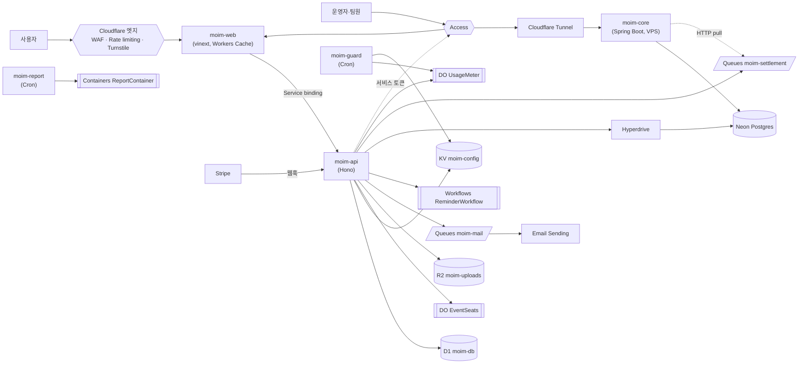

# 14장. 출시, 그리고 그 너머

2025년 11월 18일, Cloudflare에 큰 장애가 났다. 그날의 사후 분석 글이 GeekNews에 올라오자 한 개발자가 이런 댓글을 남겼다.

> "Cloudflare가 안되어서 온갖 서비스가 중단되니 지옥이더군요.." (GeekNews princox, "Cloudflare 2025년 11월 18일 장애 사후 분석" 댓글)

같은 사후 분석을 다룬 Hacker News 스레드는 1,465점에 댓글 916개가 달렸다. 한 사용자는 "28M 500 errors/sec for several hours from a single provider. Must be a new record."라고 적었다. 한 회사에서 초당 2,800만 건의 500 에러가 몇 시간 동안 나왔으니 신기록일 거라는 자조였다.

책의 마지막 장을 장애 이야기로 여는 이유가 있다. 우리는 지금 `moim`의 출시 버튼 앞에 서 있다. 13장에 걸쳐 정적 사이트 하나로 시작한 서비스를 API와 데이터, 풀스택 프런트, Spring 백엔드, 외부 결제와 메일, 보안과 제로 트러스트, 캐시와 비용 방어까지 키웠다. 그리고 그 대부분을 한 회사의 플랫폼 위에 올렸다. 출시를 앞두고 던져야 할 질문은 두 가지다. 지금 만든 것을 내보내도 되는가? 그리고 이 플랫폼에 기대는 서비스를 오래 운영하려면 무엇을 마음에 둬야 하는가? 지금까지의 여정을 돌아보며 두 질문에 차례로 답해보자.

## 지금까지의 여정

### `moim`의 최종 모습

먼저 우리가 만든 것을 한 장의 그림으로 보자.

그림 1. `moim` 최종 아키텍처

복잡해 보이지만 한 줄씩 따라가면 각 선이 어느 장에서 그어졌는지 떠오를 것이다. 이 그림을 네 개의 동사로 다시 읽어보자.

올리기. 1장에서 Cloudflare를 CDN 회사가 아니라 isolate부터 VM까지 이어지는 실행 환경의 스펙트럼으로 다시 봤다. 2장은 정적 자산이 무료·무제한이라는 사실 위에 `moim-web`을 올렸고, 3장은 Workers의 실행 모델이 Node 서버나 Spring 서버와 어떻게 다른지 몸으로 익히게 했다. 전역 상태를 믿지 않고, 스레드 대신 요청 단위로 생각하는 습관이다. 4장에서는 "DB 하나에 스키마 하나"라는 오래된 전제가 깨졌다. 행사와 신청은 D1에, 드물게 바뀌는 설정은 KV에, 틀리면 안 되는 좌석 수는 Durable Objects에, 발표 자료는 R2에 두었다. 5장은 Next.js를 vinext로 올리며 어댑터가 프레임워크를 따라가는 구조의 위험을 배웠다.

잇기. 6장의 Tunnel은 포트를 하나도 열지 않고 집 서버의 Spring을 세상에 내놓았다. 7장은 JVM 백엔드가 살 자리를 세 갈래로 나눠, 상시 API는 Tunnel 뒤 VM에, 가끔 몰아서 도는 정산 배치는 Containers에 두고, Postgres는 Hyperdrive로 Workers와 함께 썼다. 8장은 결제·메일·DB·AI를 붙이며 "밖에 둘 것은 표준 프로토콜로 잇는다"는 원칙을 세웠다.

지키기. 9장은 공개 표면을 겹겹이 막았다. Turnstile과 siteverify, WAF, 두 층의 레이트 리미팅, 그리고 잊기 쉬운 `workers.dev` 뒷문까지. 10장은 운영자 화면과 Spring 서버를 Access로 닫고, Spring Security로 Access JWT를 직접 검증했다.

운영하기. 11장은 Worker가 캐시 앞에서 실행된다는 사실에서 출발해 세 캐시 경로를 골랐다. 12장은 무료 티어를 숫자로 따져 "청구 대신 에러"의 대가를 봤고, 13장은 하드캡이 없는 유료 계정에 다섯 층의 방어선을 쌓았다.

이 넷은 순서대로 맞물린다. 올린 것을 알아야 무엇을 밖에 둘지 판단할 수 있었고, 이은 것이 있어야 지킬 경계가 생겼고, 지킨 서비스여야 오래 운영할 의미가 있었다. 그리고 비용은 처음부터 끝까지 따라다녔다. 4장의 R2 구독, 7장의 Workers Paid 전환, 11장의 Workers Cache 함정이 12·13장에서 하나의 전략으로 묶였다.

### 출시 전 마지막 점검

이제 출시 버튼 앞에서 마지막으로 점검하자. 장별로 흩어진 확인 항목을 네 묶음으로 모았다.

보안부터 보자. 신청 폼의 Turnstile은 위젯만 붙이고 끝내지 않았는지 다시 확인한다. 공식 문서의 말대로 "Without the second part, the widget appears on the page but does not protect the request." 백엔드의 siteverify가 없으면 보호도 없다. 커스텀 도메인을 붙인 모든 Worker에서 `workers.dev`가 꺼졌는지, Rate limiting rule이 신청 경로에 걸렸는지 본다. `/admin/*`과 `core.example.com`이 Access 뒤에 있는지, Spring 쪽 JWT 검증이 `aud`와 만료를 확인하는지, 서비스 토큰이 시크릿으로만 존재하는지 본다. 그리고 의존성 패치를 확인한다. 5장에서 말했듯 WAF는 패치를 대체하지 않는다.

캐시는 11장의 결정을 다시 읽는다. 좌석 잔여 수처럼 틀리면 안 되는 값이 캐시에 들어가지 않았는지, 신청 마감 시 태그 퍼지가 실제로 동작하는지 프리뷰에서 한 번 눌러본다. Workers Cache를 켠 Worker는 정적 자산 요청까지 과금된다는 사실을 팀 전체가 알고 있는지도 확인하자.

비용은 부록 B의 체크리스트를 위에서부터 지운다. 13장의 "오늘 밤 할 일 다섯 가지"를 했다면 절반은 끝났다.

마지막은 관측이다. 3장에서 `"observability": { "enabled": true }`로 Workers Logs를 켰다. 출시하면 로그의 양이 달라진다. Workers 트레이싱은 OpenTelemetry 표준을 따르고("Workers tracing follows OpenTelemetry (OTel) standards"), 외부 도구로 내보낼 수 있다. Cloudflare 대시보드에 저장하지 않고 내보내기만 하는 `persist: false` 옵션도 있다. 2026-10-02에는 보안 규칙·캐시 결정·라우팅·Workers·오리진 처리를 요청 단위로 보여주는 Cloudflare Traces가 오픈 베타로 나왔다. 11장의 "어느 캐시 층이 범인인가"라는 질문에 답하는 도구가 될 수 있다.

관측에는 가격 변화가 하나 예고돼 있다. 2026년 12월 1일부터 Workers Logs·Traces·Containers 로그가 통합된 Cloudflare Observability 가격으로 바뀐다(2026-10 공지). 출시 첫 주에 로그를 넉넉히 남기는 것은 좋은 습관이지만, 첫 주가 지나면 샘플링 비율(`head_sampling_rate`, 기본 1)을 낮추는 계획도 같이 세우자.

> **비용 메모**
> 2026-12-01부터의 Cloudflare Observability 가격: Free는 하루 0.5 GB 수집, 7일 보존이고 한도에 닿으면 수집을 멈춘다. Workers Paid는 주기당 수집 50 GB와 저장 12 GB-월이 포함되고, 넘으면 수집 GB당 $0.25, 저장 GB-월당 $0.10이 자동으로 계속 청구된다("Paid usage continues automatically after an allowance is exhausted.", Observability Pricing 2026-10-02 기준). 출간 시점이 12월 이후라면 이미 적용된 가격이다.

## 한 회사에 기댄다는 것

### 장애와 단일 벤더 리스크

이 장을 연 장애로 돌아가자. 2025-11-18의 장애는 Bot Management의 feature file에서, 2025-12-05의 장애는 WAF 규칙의 전역 설정에서, 2026-02-20의 장애는 BYOIP API 버그에서 시작됐다. 원인은 매번 달랐지만 영향 반경이 전역이었다는 점은 같았다. 2026-08-08에는 R2에도 장애가 있었다. 오래 R2를 써 온 한 사용자는 "Please don't make me have to figure out how to move services again, I am tired folks."라고 썼다. 그 장애가 데이터에 어떤 영향을 남겼는지는 커뮤니티의 말이 엇갈려 이 책에서 판단하지 않는다.

이 사건들을 두고 개발자들의 생각은 크게 둘로 갈린다.

한쪽은 중앙집중이 인터넷을 더 약하게 만든다고 본다. "Homogeneous systems like Cloudflare will continue to cause global outages. Rust won't help, people will always make mistakes, also in Rust."(HN mixedbit, 2025-12-05) 같은 시스템이 모두를 떠받치면 실수 하나가 모두를 쓰러뜨린다는 것이다. 업무에서는 전역으로 무너지지 않는 분산 인프라가 필요하니 추천할 수 없다는 목소리도 있다. 2025-12-05의 장애 뒤에는 "Cloudflare is now below 99.9% uptime, for anyone keeping track."이라는 계산도 나왔다(HN lionkor).

다른 쪽은 중앙집중이 오히려 더 견고하고, 다만 눈에 잘 띌 뿐이라고 본다. "Centralized services don't decrease redundancy. They're usually far more redundant than whatever homegrown solution you can come up with. The difference between centralized and homegrown is mostly psychological."(HN miki123211, 2025-11-24) 직접 꾸린 인프라는 장애가 덜 요란할 뿐 더 자주 아프다는 지적도 있다. vasco는 작은 업체들의 문제를 "'chronic' vs 'acute' pains"라고 표현했다. 만성 통증과 급성 통증의 차이라는 것이다.

사후 분석을 읽은 개발자들이 남긴 반응에는 우리 자신의 운영에 가져올 교훈도 섞여 있다. otterley는 재발 방지 목록을 보고 "Absent from this list are canary deployments and incremental or wave-based deployment of configuration files (which are often as dangerous as code changes)"라고 지적했다. 설정 파일 배포도 코드 배포만큼 위험한데 카나리나 단계적 배포가 빠져 있다는 것이다. 이 말은 `moim`에도 그대로 적용된다. 13장에서 `wrangler.jsonc`에 넣은 `limits` 값 하나를 잘못 고치면 정상 요청이 잘린다. 설정 변경도 5장의 프리뷰에서 먼저 돌려보고 내보내자. 한편 SerCe는 "kudos for releasing a post mortem in less than 24 hours after the outage"라며 하루도 안 돼 사후 분석을 공개한 점을 높이 샀다. 장애가 없는 플랫폼은 없으니, 장애를 얼마나 투명하게 설명하는지도 벤더를 고르는 기준이 된다.

어느 쪽이 맞을까? 둘 다 맞는 이야기를 하고 있다. `moim` 같은 서비스가 직접 꾸린 VPS 하나보다 Cloudflare 위에서 더 자주 멈출 가능성은 낮다. 하지만 Cloudflare가 멈추는 날에는 우리 서비스뿐 아니라 우리가 장애를 확인하려고 여는 다른 서비스들까지 함께 멈춘다. 확률은 낮고 반경은 넓다. 그렇다면 우리가 할 수 있는 일은 반경을 줄이는 것이다.

### 출구는 표준 프로토콜에 있다

8장에서 세운 원칙이 여기서 빛을 낸다. 밖에 둘 것은 표준 프로토콜로 잇는다. `moim`을 다시 보면, 표준으로 이은 부분은 생각보다 많다.

데이터의 무게중심인 Postgres는 Neon에 있고, Spring은 JDBC로, Workers는 Hyperdrive를 거쳐 Postgres 프로토콜로 붙는다. Cloudflare가 사라져도 Spring은 그대로 같은 DB를 본다. 발표 자료는 R2에 있지만 7장에서 AWS SDK for Java v2로 읽었듯 S3 API로 접근한다. S3 호환 저장소라면 어디로든 옮길 수 있다. 메일은 SMTP로 보낼 수 있고, 인증은 OIDC와 JWT(RFC 7519)라는 표준 위에 있다. `moim-core`는 Spring Boot 그대로라 Tunnel을 걷어내면 리버스 프록시 뒤 어디서든 돈다. 프런트도 마찬가지다. vinext 1.0 발표 글은 "Vinext lets you take any Next.js application, whether it was built for the Pages or App Router, and make it portable to be deployed to any web platform, including the Cloudflare Workers free plan, Netlify, or AWS Lambda."라고 적었다(2026-09-28).

반대로 Cloudflare 고유의 부분도 정직하게 세어보자. Durable Objects로 만든 `EventSeats`와 `UsageMeter`는 1:1로 옮겨갈 곳이 마땅치 않다. Orleans 같은 가상 액터 모델과 닮았지만 같은 것은 아니다. Queues와 Workflows, KV도 다른 플랫폼의 비슷한 제품으로 옮기려면 코드를 고쳐야 한다. 출구 전략은 이 목록을 아는 데서 시작한다. 고유 기능은 써도 좋다. 다만 쓸 때 "이걸 옮겨야 한다면 무엇을 다시 써야 하는가"를 한 줄 적어두자.

그 밖에 지금 할 수 있는 대비도 있다. Cloudflare가 멈췄을 때 사용자에게 보여줄 정적 안내 페이지를 다른 곳에 하나 두고, 장애를 알릴 채널을 Cloudflare 바깥에 마련하자. 그리고 12장의 논쟁에서 본 것처럼 무료 조건이나 가격은 바뀔 수 있다. 출구 목록은 장애 대비이자 가격 변화 대비이기도 하다.

## 이 책이 멈춘 시점

### 2026년 10월의 베타 지도

이 책은 2026년 10월 3일을 기준으로 쓰였다. 이 플랫폼은 빠르게 변한다. 2026년에만 Pages가 Workers로 수렴했고, WARP Client가 Cloudflare One Client로, Browser Rendering이 Browser Run으로 이름을 바꿨다. 그러니 이 책에서 베타나 예고 상태로 다룬 것들의 지도를 남겨두자. 출간 이후 바뀌었을 수 있다. 공식 문서와 changelog로 다시 확인하자.

| 항목 | 2026-10-03 기준 상태 | 다룬 장 |
|---|---|---|
| vinext | 1.0 출시(2026-09-28), 공식 가이드는 아직 beta 표기 | 5 |
| `cf` CLI | 2026-09-28 베타 공개, GA 미정 | 3, 5 |
| Workers VPC | 오픈 베타, 베타 기간 무료 | 7 |
| KV Instant | 2026-10-01 비공개 베타, 가격·한도 변경 가능 | 4, 13 |
| Containers 인바운드 TCP·gRPC | 2026-08-03 비공개 베타 | 7 |
| Email Sending | 2026-04-16 공개 베타 | 8 |
| Cloudflare Traces | 2026-10-02 오픈 베타 | 14 |
| DO SQLite 스토리지 과금 | 2026년 1월 과금 예정으로 공지(목표일 2026-01-07), 개시 확정 공지 미확인 | 4, 13 |
| Workflows step·storage 과금 | "no earlier than August 10, 2026"로 예고 | 4, 13 |
| Cloudflare Observability 가격 | 2026-12-01부터 통합 가격 | 13, 14 |
| Access strict 서비스 토큰 | 2026-10-05 이후 생성 조직은 기본 켜짐·해제 불가 | 10 |
| 계정 단위 하드캡 | 없음 | 12, 13 |
| Analytics Engine | 가격표 공개, "Currently, you will not be billed" | 12 |
| OAuth 2.1 | 초안(draft-16, 2026-09-03), RFC 미발행 | 10 |
| `cloudflared` 32-bit Windows·Intel macOS 빌드 | 2027년 폐기 예정 | 6 |
| 도구 버전 전체(Wrangler·vinext·`cloudflared` 등) | 2026-10-02 기준 | 부록 C |

표 1. 2026-10-03 기준 베타·예고 상태 지도

이 표에서 가장 먼저 확인할 줄은 "계정 단위 하드캡: 없음"이다. 이 줄이 바뀌었다면 13장의 방어선 가운데 일부는 더 간단해질 것이다. 바뀌지 않았다면 13장은 그대로 유효하다.

확인하는 방법도 정해두자. 가격과 한도는 각 제품 문서의 가격·한도 페이지가, 상태 변화는 개발자 문서의 changelog가 1차 출처다. 이 책이 날짜를 붙여 적은 숫자는 모두 이 두 곳에서 왔다. 블로그 글이나 커뮤니티 요약에 적힌 한도는 쓰인 날짜부터 확인하자. 이 책을 쓰는 동안에도 Worker 크기 한도가 3 MB·10 MB·15 MB로 제각각 적힌 글들을 만났는데, 2026-09-04 이후의 1차 문서는 Free와 Paid 모두 비압축 64 MiB였다. 한 분기에 한 번쯤 부록 A의 표를 공식 가격 페이지와 나란히 놓고 대조해보는 것만으로도 낡은 숫자로 설계하는 일을 피할 수 있다.

### 새 기능을 붙일 때 묻는 다섯 질문

책을 덮은 뒤에도 `moim`은 자랄 것이다. 행사가 끝나면 발표 영상 다시보기를 붙이고 싶어질 수도 있다. 그럴 때마다 이 책을 처음부터 다시 읽을 수는 없으니, 14장에 걸친 판단을 다섯 개의 질문으로 압축해두자.

첫째, 어디에 둘까? 이 기능의 실행과 데이터는 isolate에 맞는가, 컨테이너가 필요한가, 원래 서버에 두는 편이 나은가. 데이터는 최종 일관성으로 충분한가, 강한 일관성이 필요한가. 1·3·4·7장의 질문이다. 둘째, 무엇으로 이을까? 밖에 있는 것과는 표준 프로토콜로 잇고, 안에 있는 것끼리는 Service binding과 바인딩으로 잇는다. 6·7·8장의 질문이다. 셋째, 누가 들어올까? 누구나 들어오는 공개 표면인지, 운영자와 기계만 들어오는 내부 경계인지에 따라 9장의 방어선과 10장의 Access를 고른다. 넷째, 얼마가 들까? 무료 한도 중 무엇에 먼저 닿고, 유료라면 어느 줄이 늘어나는지, 캐시를 켜면 줄어드는 줄과 늘어나는 줄은 무엇인지를 11·12·13장의 방식으로 계산한다. 다섯째, 멈추면 어떻게 될까? 한도에 닿아 멈출 때, 차단기가 열려 멈출 때, 플랫폼이 멈출 때 사용자는 무엇을 보는가. 그리고 그 기능을 옮겨야 한다면 무엇을 다시 써야 하는가.

영상 다시보기에 대어보자. 영상 파일은 R2에 둘 수 있고 이그레스는 무료지만 저장과 읽기 연산은 과금된다. 6장에서 본 Tunnel FAQ의 문장도 떠올려야 한다. "On Free, Pro, and Business plans, the service-specific terms require you to use a specific paid service to serve video and other large files." Tunnel 뒤 서버에서 영상을 직접 내보내는 길은 약관부터 확인해야 한다. 누가 볼지에 따라 공개 링크로 둘지 Access 뒤에 둘지가 갈리고, 멈추면 어떻게 될지에는 2026년 8월의 R2 장애가 답의 재료가 된다. 다섯 질문을 거치고 나면, 결론이 무엇이든 그 이유를 설명할 수 있게 된다.

## 닫으며

### 나의 클라우드라는 말의 뜻

이 책의 제목은 "Cloudflare를 나의 클라우드로"였다. 여정을 마친 지금 이 말을 다시 읽어보자.

처음 이 제목을 봤을 때 떠올린 그림은 아마 모든 것을 Cloudflare 위에 올리는 모습이었을 것이다. 실제로 우리가 만든 `moim`은 그렇지 않다. 정적 자산과 API, 상태와 큐는 Cloudflare 안에 있지만, 데이터의 무게중심인 Postgres는 Neon에, 회원과 정산을 맡은 Spring 서버는 VPS에, 결제는 Stripe에 있다. Cloudflare는 그 모두를 세상과 잇고, 앞에서 지키고, 가까운 곳에서 실행하는 자리를 맡았다. 나의 클라우드란 한 회사의 제품 목록을 모두 쓰는 것이 아니라, 각 조각이 어디에 살지 내가 판단하고 그 판단의 이유를 아는 상태다.

부제의 두 구절도 다시 읽어보자. "무료로 시작해"는 12장에서 숫자가 됐다. 무료 티어는 설계할 수 있는 전략이고, 그 대가는 가용성이라는 사실까지 포함해서다. "안전하게 운영하기"는 13장에서 정직한 문장이 됐다. 2026년 10월 현재 하드캡은 없고, 안전은 겹겹이 쌓은 장치에서 나온다. 이 책이 제목으로 지킬 수 없는 약속을 하지 않으려 했던 이유가 거기에 있다.

`moim`을 따라 여기까지 온 독자라면 이제 자기 서비스를 같은 눈으로 볼 수 있을 것이다. 무엇을 안에 두고 무엇을 밖에 둘지, 무엇을 열고 무엇을 닫을지, 무엇이 공짜이고 무엇이 청구서가 되는지, 그리고 멈추는 날에는 무엇이 남는지. 플랫폼은 계속 바뀔 것이다. 이름이 바뀌고, 베타가 GA가 되고, 가격표가 고쳐질 것이다. 하지만 이 다섯 가지를 묻는 습관은 바뀌지 않는다. 그 습관을 가진 개발자에게 클라우드는 빌려 쓰는 남의 데이터센터가 아니라, 스스로 설계하고 책임지는 자기 서비스의 터전이 된다. 이제 출시 버튼을 누르자.
