# Insider One과 Braze로 시작하는 CRM 마케팅 — 보내기 전에 설계하라

## 저자
Toby-AI

**판본:** v1.0.0 · 2026-11-03

---

## 판권

**Insider One과 Braze로 시작하는 CRM 마케팅 — 보내기 전에 설계하라**
**판본:** v1.0.0
**발행일:** 2026-11-03
**저자:** Toby-AI
**식별자:** urn:uuid:c1fd6a26-7487-422d-81c2-41ec6885d988

### 라이선스

이 책은 **CC BY-NC-SA 4.0** 라이선스로 배포된다 — [Creative Commons 저작자표시-비영리-동일조건변경허락 4.0 국제](https://creativecommons.org/licenses/by-nc-sa/4.0/).

- **저작자 표시(BY):** 출처를 밝혀야 한다.
- **비상업적 이용(NC):** 상업적 목적으로 이용할 수 없다.
- **동일조건 변경허락(SA):** 변경·재배포 시 동일한 라이선스를 적용해야 한다.

### 출처

이 책은 [book-writer](https://github.com/tobyilee/book-writer) 하네스 v2.0.0로 자동 생성되었다.

이 책에 실린 제품 기능·명칭·상태(베타·얼리 액세스·정식 출시)는 2026년 11월 기준이다. Braze와 Insider One은 모두 AI 기능 이름과 문서 주소를 자주 바꾼다. 실제로 설정하기 전에는 Braze Docs와 Insider One Academy의 최신 문서를 함께 확인하자. 고객 사례의 성과 수치는 대부분 벤더가 스스로 발표한 값이다.

Braze, Insider One과 이 책에 나오는 제품·기능 이름은 각 회사의 상표다. 이 책은 두 회사와 아무 관계 없이 공개 자료를 바탕으로 쓰였다.

---

## 서문

입사 첫 주에 계정 하나를 받는다. Braze일 수도 있고 Insider One일 수도 있다. 푸시 한 통은 금방 보낸다. 문구를 쓰고, 대상을 고르고, 버튼을 누르면 끝이다. 그런데 며칠 지나 세그먼트, 여정, Liquid, 예측 같은 메뉴를 열면 손이 멈춘다. 물어볼 사수는 없다. 채용 공고에는 "Braze 활용 역량"이 적혀 있었는데, 그 말이 정확히 무엇을 할 줄 안다는 뜻인지 아무도 알려 주지 않았다.

이 책은 그 자리에 앉은 주니어 CRM 마케터를 위해 썼다. 1장에서 인용하는 한 강의 소개 글은 이 분야를 두고 "마땅히 배울 곳도, 알려줄 수 있는 사람도 많지 않은 것이 현실"이라고 적었다. 그래서 이 책의 목표는 단순하다. 옆자리 선배가 되어 주는 것이다. 화면의 버튼 위치를 외워 주는 선배가 아니라, 그 버튼이 무엇을 정하는지, 누르기 전에 무엇을 확인해야 하는지 말해 주는 선배 말이다. 사수가 없다면 이 책을 사수 삼아 보자.

### 보내기 전에 설계하라

이 책 전체를 한 문장으로 줄이면 부제가 된다. 보내기 전에 설계하라. 발송된 메시지는 되돌릴 수 없기 때문이다. 이름이 빈칸으로 나간 푸시, 이미 구매한 고객에게 날아간 "아직 고민 중이신가요?", 밤 9시를 넘겨 도착한 광고 메시지는 모두 버튼을 누른 뒤에야 드러난다. 그리고 이 사고들은 거의 언제나 버튼을 누르기 전에 막을 수 있었다.

설계한다는 것은 푸시 버튼 뒤에 쌓인 층을 본다는 뜻이다. 이 책은 그 층을 다섯 개로 나눈다. 고객에 대한 사실을 담는 데이터, 누구에게 보낼지 고르는 대상, 어디로 보낼지 정하는 채널, 언제 어떤 순서로 말을 걸지 그리는 여정, 그리고 그 모든 것이 효과가 있었는지 묻는 측정이다. 푸시 버튼은 이 다섯 층 맨 위의 한 동작일 뿐이다. 1장에서 이 그림을 펼치고, 14장에서 다시 접는다.

이 책은 두 도구를 나란히 놓는다. 같은 기능을 Braze에서 한 번, Insider One에서 한 번 보여 주고, 같은 여정을 두 도구로 각각 만든다. 어느 쪽이 더 낫다고 말하려는 것이 아니다. 개념은 하나이고 이름만 둘이라는 감각을 기르려는 것이다. 지금 회사가 어느 도구를 쓰든, 나중에 다른 도구를 만나든, 다섯 층의 개념을 알고 있으면 새 화면에서도 같은 자리를 금방 찾을 수 있다.

### 누가 읽으면 좋은가

- Braze나 Insider One 계정을 막 받았거나 곧 받게 될 주니어 마케터
- 단발 푸시와 이메일은 보내 봤지만 세그먼트·여정·개인화 화면에서 막힌 사람
- 회사의 도구가 바뀌거나 이직을 준비하면서 두 도구를 함께 이해해 두고 싶은 사람
- CRM 마케터와 함께 일하면서 마케터가 어떤 데이터와 실험을 원하는지 알고 싶은 개발자·데이터 분석가

개발 지식은 필요 없다. 코드는 Liquid 한두 줄이 전부이고, API나 SDK는 "개발팀이 심어 주는 것" 정도로만 다룬다.

### 어떻게 읽으면 좋은가

처음 읽는다면 1장부터 순서대로 읽기를 권한다. 장의 순서가 곧 다섯 층을 아래에서 위로 쌓는 순서이기 때문이다. 2장부터 4장까지가 데이터·대상·채널이라는 기반을 놓고, 5장부터 8장까지가 여정 빌더 두 가지와 개인화, AI 기능을 다룬다. 9장은 실제로 보내기 전에 거쳐야 할 관문, 곧 한국의 발송 규제와 수신 동의, 피로도 관리다. 10장부터 12장까지는 온보딩, 장바구니 이탈과 가격 인하, 윈백과 크로스셀을 두 도구로 만들어 보는 유스케이스 장이고, 13장은 측정, 14장은 첫 90일 계획이다.

급하게 필요한 부분부터 펼쳐도 괜찮다. 몇 가지 길을 제안하면 이렇다.

- **한 도구만 쓴다면:** 5장(Braze Canvas)이나 6장(Insider One Architect) 가운데 우리 도구의 장을 먼저 읽고, 6장 끝의 번역표로 다른 도구의 이름을 한 번 훑어 두자.
- **당장 여정을 하나 만들어야 한다면:** 5장의 여정 설계서 양식부터 보고 10~12장 중 맞는 유스케이스로 가자. 다만 광고성 메시지를 보낼 계획이라면 9장은 건너뛰지 말자.
- **성과 보고가 고민이라면:** 13장을 먼저 읽고, 11장 끝과 12장의 실패 장면을 함께 보자.

책 끝의 부록 A에는 두 도구의 용어 대조표를, 부록 B에는 공식 학습 자료와 문서 링크를 모았다. 화면 앞에서 이름이 헷갈릴 때 펼쳐 보면 된다.

### 읽기 전에 알아 둘 세 가지 약속

**첫째, 이 책의 기능 서술은 2026년 11월 기준이다.** 두 도구는 2025년과 2026년 사이에 여러 이름을 바꿨다. Insider는 2025년 12월에 Insider One이 되었고, Braze의 Sage AI는 BrazeAI로, Insider의 Sirius AI는 Agent One으로 불린다. 베타나 얼리 액세스인 기능은 본문에 그 상태를 함께 적었다. 메뉴 위치와 클릭 순서는 쉽게 바뀌기 때문에 이 책은 "그 설정이 무엇을 정하는가"를 설명하고, 정확한 위치는 Braze Docs와 Insider One Academy에 맡긴다.

**둘째, 벤더가 발표한 숫자는 벤더의 숫자로 읽는다.** 이 책에 나오는 고객 사례의 성과 수치는 대부분 회사가 스스로 발표한 값이고, 기준값과 표본, 통계적 유의성이 공개되지 않은 경우가 많다. 그런 수치에는 "회사 측 발표에 따르면"이나 "(벤더 발표)"를 붙였다. "최대(up to)"라는 말이 붙은 수치는 가장 잘된 경우를 가리킨다는 점도 기억해 두자. 사례에서 가져올 것은 숫자보다 구조다. 왜 그래야 하는지는 13장에서 대조군과 증분을 다루며 분명해진다.

**셋째, 확인하지 못한 것은 확인하지 못했다고 쓴다.** 공개 자료로 확인되지 않은 기능은 "확인되지 않음"이라고 적고, 담당 벤더에 확인하라고 안내했다. 대표적인 것이 카카오톡이다. 2026년 11월 기준 공개 자료로 확인되는 것은 Braze의 채널 친구 대상 마케팅 메시지뿐이고, 알림톡은 두 도구 모두 확인되지 않았다. 9장의 한국 규제 내용도 법률 자문이 아니라 실무 안내다. 최종 판단은 회사의 법무·개인정보 담당자와 함께 내리자.

### 표기에 대하여

- 제품과 기능의 고유명은 영문 그대로 쓴다(Canvas, Architect, Intelligent Timing, Smart Recommender 등). 세그먼트, 여정, 대조군, 수신 동의, 빈도 상한 같은 일반 개념은 우리말로 쓴다.
- 이 책에서 "Canvas"는 언제나 Braze의 여정 빌더다. Insider One도 여정 편집 화면을 canvas라고 부르지만, 그쪽은 "Architect 편집 화면"이라고 쓴다.
- 2025년 12월 사명 변경 이전의 일은 "Insider(현 Insider One)"라고 적는다.
- 코드 블록에는 어느 제품의 문법인지 캡션을 달았다. Braze와 Insider One의 Liquid는 고객 정보를 부르는 방식이 다르니 한 메시지에 섞지 말자.

이 책은 리뷰 사이트와 블로그, 커뮤니티에 자기 경험을 솔직하게 남겨 준 실무자들의 기록에 크게 기대고 있다. 그들이 남긴 고백 덕분에 주니어가 어디서 막히는지를 미리 알 수 있었다. 그 기록들은 책 끝의 참고문헌에 모두 밝혀 두었다.

## 목차

- 서문
- 1장. 푸시 버튼 뒤에 있는 것들 — CRM 마케팅과 두 도구의 지도
- 2장. 메시지보다 데이터가 먼저다 — 프로필·식별자·이벤트·속성
- 3장. 누구에게 보낼 것인가 — 세그먼트와 예측 세그먼트
- 4장. 고객이 있는 곳으로 — 채널 고르기
- 5장. Braze Canvas로 여정 설계하기
- 6장. Insider One Architect로 여정 설계하기
- 7장. 한 사람에게 말 걸기 — Liquid와 개인화
- 8장. AI가 거드는 마케팅 — BrazeAI와 Agent One
- 9장. 보내기 전에 지켜야 할 것 — 한국 발송 규제·동의 관리·피로도
- 10장. 유스케이스 ① 첫인상을 설계하라 — 온보딩과 첫 구매
- 11장. 유스케이스 ② 떠나기 직전의 고객 — 장바구니 이탈·가격 인하·재입고
- 12장. 유스케이스 ③ 붙잡을 고객, 더 권할 고객 — 이탈 방지·윈백·크로스셀
- 13장. 보내지 않았다면 어땠을까 — 대조군·A/B 테스트·성과 측정
- 14장. 우리 팀의 다음 90일 — 도구 고르기·함께 일하기·더 배우기
- 에필로그 — 이 책이 답하지 못한 것들
- 부록 A. Braze ↔ Insider One 용어 대조표
- 부록 B. 공식 문서와 학습 자료
- 참고문헌

---

# 1장. 푸시 버튼 뒤에 있는 것들 — CRM 마케팅과 두 도구의 지도

입사 첫 주에 푸시는 이미 한 번 보내 봤다. 문구를 쓰고, 대상에서 '전체 사용자'를 고르고, 예약 시각을 정한 뒤 버튼을 눌렀다. 생각보다 어렵지 않았다. 그런데 금요일 오후, 팀장이 지나가며 이렇게 말했다고 해보자. "다음 주부터 '가입 3일 차 미구매자' 여정 좀 맡아 줘. Canvas 열어 보면 감이 올 거야."

Canvas를 열어 보니 빈 화면에 상자 몇 개와 선 몇 개를 그릴 수 있는 공간이 펼쳐진다. 진입 조건, Delay, Decision Split, Exit criteria 같은 낯선 이름들이 기다리고 있다. 푸시를 보낼 때는 한 번도 만나지 않았던 단어들이다. 가입 3일 차라는 건 어떻게 골라내지? 미구매자는 누가 알려 주지? 3일을 기다린다는 건 어디에 적는 거지? 화면은 친절하게 열려 있는데 무엇부터 눌러야 할지 모르겠다. 꽤 난감한 순간이다.

이 막막함은 당신만 겪는 것이 아니다. 해외 리뷰 사이트와 국내 실무 글을 훑어보면 같은 고백이 반복된다. 단발 푸시와 이메일은 금방 익히는데, 여정과 이벤트 데이터와 동적 콘텐츠로 넘어가는 순간 벽을 만난다는 것이다. 그 벽이 무엇으로 이루어져 있는지 먼저 살펴보자. 벽의 구조를 알면 어디부터 넘어야 할지도 보인다.

## 푸시 발송은 일의 마지막 한 칸이다

한 실무자는 CRM 마케팅을 처음 맡는 사람들이 흔히 빠지는 오해를 이렇게 정리했다. "CRM 마케팅의 업무를 단순히 push 메세지 보내는 것으로 생각한다." 그리고 바로 뒤에 이렇게 덧붙였다. "Push 발송은 Action item 중의 하나이다." (이오플래닛, 2022) 같은 글은 무엇을 먼저 정해야 하는지도 짚는다. "실행을 위한 \"why, what, how\" 가 정말 중요하다."

왜 그럴까? 동네 꽃집을 떠올려 보면 이해하기 쉽다. 오래 장사한 사장님은 단골손님이 지난봄에 어머니 생신 꽃을 사 갔다는 것을 기억한다. 그래서 올봄 생신 즈음에 "이번에도 카네이션으로 준비해 둘까요?"라고 문자를 보낸다. 문자를 보내는 동작 자체는 몇 초면 끝난다. 하지만 그 문자가 고객에게 반가운 연락이 된 이유는 문자 앞에 쌓인 것들 덕분이다. 누가 무엇을 언제 샀는지 기억하고(데이터), 그중 이 연락을 반길 사람을 고르고(대상), 그 사람이 확인할 수단을 택하고(채널), 보낼 때와 다음 연락까지의 간격을 정하고(여정), 문자 덕분에 정말 주문이 왔는지 돌아보는(측정) 일 말이다.

CRM 마케팅 도구가 하는 일도 이 다섯 층으로 나눠 보면 선명해진다. 이 책은 처음부터 끝까지 이 다섯 층을 기준으로 이야기를 쌓는다.

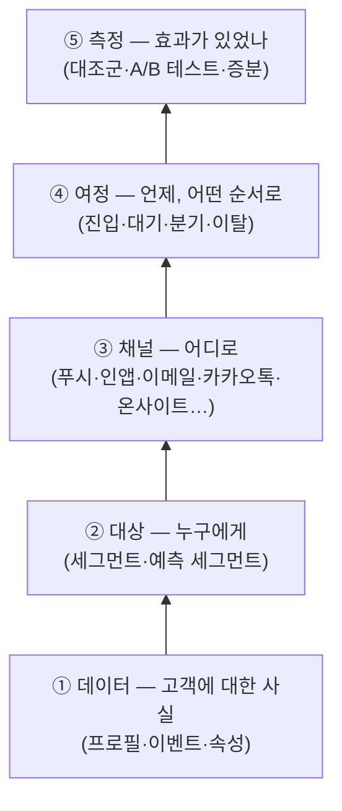
그림 1. CRM 마케팅의 다섯 층 — 푸시 버튼은 맨 위 층의 한 동작일 뿐이다

팀장이 맡긴 '가입 3일 차 미구매자' 여정을 이 그림 위에 올려 보자. 먼저 고객이 언제 가입했는지, 구매한 적이 있는지가 어딘가에 기록되어 있어야 한다. 그게 데이터 층이다. 그 기록으로 "가입한 지 3일이 지났고 아직 구매가 없는 사람"을 골라내는 일이 대상 층이다. 그 사람에게 푸시를 보낼지, 앱 안에서 메시지를 띄울지, 이메일을 보낼지가 채널 층이다. 3일을 기다리고, 메시지를 받은 뒤 구매하면 여정에서 내보내고, 그래도 안 사면 일주일 뒤 한 번 더 말을 거는 흐름이 여정 층이다. 마지막으로, 이 여정이 없었어도 그 사람들이 샀을지를 따져 보는 일이 측정 층이다.

이렇게 놓고 보면 Canvas 앞에서 막막했던 이유가 드러난다. 화면은 네 번째 층인데, 그 아래 세 층이 머릿속에 아직 없었던 것이다. 앞으로 만날 기능 이름이 아무리 낯설어도 "이건 다섯 층 중 어디에 속하지?"라고 물어보는 습관을 들여 두자. 그 질문 하나만으로도 처음 보는 메뉴의 절반은 정리된다.

## 고객 여정, 그리고 우리가 닿을 수 있는 접점

'여정'이라는 말은 이 책에서 두 가지 뜻으로 쓰인다. 하나는 도구 안에서 우리가 설계하는 메시지 흐름이고, 다른 하나는 고객이 실제로 겪는 경험 전체다. 둘을 구분해 두면 이후의 대화가 한결 편해진다.

마케팅 학계에서 '고객 여정'이라는 말을 자리 잡게 한 대표 문헌으로 Lemon과 Verhoef의 2016년 리뷰 논문이 꼽힌다. 이 논문은 고객 경험을 구매 전, 구매, 구매 후라는 세 단계에 걸쳐 고객이 브랜드와 만나는 여러 접점(touchpoint)의 총합으로 본다. 그리고 그 접점을 누가 소유하느냐에 따라 나눈다. 브랜드가 직접 만든 접점, 유통사 같은 파트너의 접점, 고객 스스로 만드는 접점, 그리고 지인의 추천이나 리뷰처럼 브랜드 바깥의 사회적 접점이다. 논문은 이 넷을 각각 brand-owned, partner-owned, customer-owned, social/external 접점이라고 부른다.

이 구분이 주니어 마케터에게 왜 중요할까? 우리가 Canvas나 Architect에서 그리는 여정은 이 중 첫 번째, 브랜드가 소유한 접점만 다룬다는 사실을 일깨워 주기 때문이다. 고객은 우리 앱 푸시를 받기 전에 친구에게 이미 후기를 들었을 수도 있고, 포털에서 가격을 비교했을 수도 있다. 회사가 통제할 수 있는 접점은 전체 경험의 일부일 뿐이다. 그러니 여정을 설계할 때는 "이 메시지가 고객 경험 전체에서 어떤 빈자리를 채우는가"를 겸손하게 묻는 편이 낫다.

한 가지 개념을 더 짚고 가자. 멀티채널과 옴니채널이다. 리테일 연구에서 Verhoef, Kannan, Inman(2015)은 채널을 각각 따로 관리하던 방식에서, 여러 채널과 접점을 하나로 묶어 고객 경험과 성과를 함께 최적화하는 방식으로 넘어가는 흐름을 정리했다. 쉬운 말로 바꾸면 이렇다. 이메일팀, 앱 푸시 담당, 카카오톡 담당이 각자 일정표대로 메시지를 보내는 것이 멀티채널이다. 같은 고객 프로필을 보면서 "이 고객에게는 오늘 이미 이메일이 갔으니 푸시는 쉬자"라고 조율하는 것이 옴니채널이다.

멀티채널 상태의 회사에서 실제로 무슨 일이 벌어지는지 상상해 보면 아찔하다. 화요일 오전 10시에 이메일팀의 신상품 메일이 나가고, 11시에 앱 푸시 담당의 할인 알림이 울리고, 오후 2시에 카카오톡으로 같은 할인이 또 온다. 각 담당자는 자기 채널의 성과표만 보니 문제를 모른다. 고객만 하루에 세 번 같은 이야기를 듣는다. Braze와 Insider One 같은 도구가 존재하는 이유가 바로 여기에 있다. 고객 한 명에 대한 사실을 한곳에 모으고, 그 위에서 여러 채널을 하나의 흐름으로 조율하게 해 주는 것이다.

## Insider One — 웹 위의 개인화에서 출발한 플랫폼

이제 두 도구를 차례로 만나 보자. 먼저 Insider One이다.

이 회사의 이름은 얼마 전까지 Insider였다. 2025년 12월 9일, 회사는 사명을 Insider One으로 바꾼다고 발표했다. 그래서 이 책에서는 그 이전의 일을 이야기할 때 "Insider(현 Insider One)"라고 적는다. 리브랜딩 보도자료에서 공동창업자이자 CEO인 Hande Cilingir는 이런 문장을 남겼다. "AI no longer belongs inside MarTech. It now sits above it." AI를 마케팅 기술의 한 부품으로 두지 않고 그 위에 올려 두겠다는 선언이다. 회사는 스스로를 '에이전틱 고객 참여 플랫폼'이라고 부른다.

2026년 11월 기준 Insider One의 한국어 플랫폼 페이지는 제품을 여섯 개 모듈로 소개한다. 고객 데이터 관리, Insider One AI, 개인화, 여정 오케스트레이션, 리포팅 & 데이터, 행동 분석이다. 다섯 층에 대어 보면 고객 데이터 관리가 데이터 층을, 여정 오케스트레이션이 여정 층을, 리포팅 & 데이터와 행동 분석이 측정 층을 맡는 셈이다. 데이터 쪽으로는 100개 이상의 데이터 소스를 연동한다고 밝히고 있다. 고객 수는 회사 측 발표에 따르면 2,000곳 이상이다(2025-12 자사 발표). 이보다 앞선 2024년 11월 자료에는 1,500곳 이상으로 적혀 있으니, 숫자를 인용할 때는 시점을 함께 적어 두자.

Insider One의 색깔을 가장 잘 보여 주는 것은 온사이트 개인화다. 고객이 웹사이트나 앱 화면에 들어왔을 때 그 사람에게 맞춘 상품 추천, 배너, 카테고리 정렬, 사이트 검색 결과를 보여 주는 영역이다. Smart Recommender(상품 추천), Web Suite, Category Optimizer, InStory, 사이트 검색 Eureka 같은 이름이 이 영역에 속한다. 메시지를 '보내는' 채널과 함께, 고객이 이미 와 있는 화면을 '바꾸는' 장치가 두텁다는 점이 Insider One을 이해하는 첫 번째 열쇠다.

외부 평가도 이 강점과 맞닿아 있다. Insider One은 2026년 Gartner Magic Quadrant의 Personalization Engines(개인화 엔진) 부문에서 Leader로 선정됐다고 발표했다(자사 발표상 5회째). 반면 멀티채널 마케팅 허브(MMH) 부문에서는 2025년 6월 자사 자료 기준 Visionary로 표기하고 있고, 2026년 MMH 평가에서의 위치는 이 책을 쓰는 시점에 확인하지 못했다. AI 쪽 브랜드는 Agent One이다. 예전 이름은 Sirius AI였는데, 이 이름의 변천과 기능은 8장에서 자세히 다룬다.

## Braze — 여러 채널을 하나의 흐름으로 묶는 허브

다음은 Braze다. Braze는 스스로를 '고객 참여 플랫폼(Customer Engagement Platform)'이라고 소개한다. Insider One과 마찬가지로 고객 데이터, 세그먼트, 여정, 측정을 모두 갖추고 있지만 무게중심은 조금 다르다. 앱 푸시, 인앱 메시지, 이메일, SMS, 카카오톡 같은 여러 채널을 하나의 여정 안에서 엮어 내는 데 강점이 있다는 평가를 받는다.

외부 평가가 이를 보여 준다. Braze 발표에 따르면 Braze는 Gartner Magic Quadrant의 Multichannel Marketing Hubs(멀티채널 마케팅 허브, MMH) 부문에서 2026년까지 4년 연속 Leader로 선정됐다. 규모도 크다. 회사 측 발표에 따르면 2026년 4월 기준 글로벌 MAU가 78억 이상이고, 연간 처리하는 메시지가 3조 9천억 건을 넘는다. 이런 숫자는 벤더가 스스로 밝힌 값이라는 점만 기억해 두면 충분하다.

한국 독자에게 특히 중요한 소식은 2026년 4월 8일에 나왔다. Braze가 AWS 기반 국내 데이터센터를 열고, 같은 시기에 카카오톡 메시징 채널을 출시한 것이다. 전화번호 같은 개인식별정보를 국내에 저장해 데이터 현지화 요건에 대응할 수 있게 되었다는 것이 회사의 설명이다. 카카오톡 채널에서 무엇이 되고 무엇이 아직 확인되지 않았는지는 4장에서 꼼꼼히 짚는다. 미리 말해 두면, 2026년 11월 기준 공개 자료로 확인되는 것은 채널을 친구로 추가한 고객에게 보내는 마케팅 메시지(Braze가 '친구톡'이라고 부르는 것)뿐이다.

그렇다면 두 도구 중 어느 쪽이 더 나을까? 이 책은 그 질문에 한 줄로 답하지 않는다. Gartner의 분류가 힌트를 줄 뿐이다. Insider One은 개인화 엔진 부문에서, Braze는 멀티채널 마케팅 허브 부문에서 높은 평가를 받는다. 웹 화면 위의 개인화가 중요한 회사와, 앱을 중심으로 여러 채널의 여정을 엮는 일이 중요한 회사가 각각 다른 도구에 끌리는 이유다. 더 낫다 못하다를 가리기보다, 같은 일을 두 도구가 어떤 이름으로 부르는지부터 익혀 두자. 아래 표가 출발점이다.

| 다섯 층 | 이 책의 일반 표기 | Braze | Insider One |
|---|---|---|---|
| ① 데이터 | 고객 프로필 | 사용자 프로필(user profile) | UCD(Unified Customer Database) |
| ② 대상 | 세그먼트·예측 세그먼트 | 세그먼트, Predictive Churn·Predictive Events | 세그먼트, Predictive Segments |
| ③ 채널 | 채널 | 인앱 메시지·Content Cards·Push·Email·SMS·KakaoTalk 등 | 웹·앱·이메일·웹 푸시·SMS & RCS·WhatsApp·온사이트 등 |
| ④ 여정 | 여정 빌더 | Canvas | Architect |
| ⑤ 측정 | 대조군·A/B 테스트 | Experiment Paths·다변량 테스트 등 | Journey A/B Split·A/B autowinner 등 |

표 1. 다섯 층에 놓은 두 도구의 대표 이름 (2026-11 기준)

표를 외울 필요는 없다. 다만 "개념은 하나, 이름은 둘"이라는 감각만은 지금 챙겨 가자. 회사가 쓰는 도구가 바뀌어도, 혹은 이직해서 다른 도구를 만나도, 다섯 층의 개념을 알고 있으면 새 화면에서 같은 자리를 금방 찾을 수 있다.

## 한국에서 이 도구들을 만난다는 것

두 회사 모두 한국 시장에 공을 들이고 있다. Braze는 2024년 11월 기준 한국 지사(Braze 코리아)를 두고 있고, 2017년부터 AB180(에이비일팔공)이 공식 리셀링 파트너로 라이선스와 컨설팅을 맡아 왔다. 국내에는 이 밖에도 Braze 도입과 운영을 돕는 파트너사들이 활동한다. Insider One 쪽은 2024년 11월 Insider(현 Insider One)가 시리즈E 투자 유치를 발표하면서 2027년까지 한국에 1,500억 원을 투자하겠다는 계획을 함께 밝혔다. 당시 회사는 한국 고객으로 삼성전자, 대한항공, 롯데호텔, GS샵 등을 꼽았다.

채용 시장에서도 신호가 보인다. CRM 마케터 채용 공고에는 "Braze를 활용해 앱 푸시, 인앱 팝업, 카카오 메시지 등 다양한 채널의 CRM 캠페인을 기획하고 운영해요" 같은 문구가 반복해서 나온다. 한 강의 소개 글은 현실을 이렇게 적었다. "CRM 마케터의 채용 공고 자격요건/우대사항 등에는 브레이즈 활용 역량이 포함되어 있습니다. 그러나 마땅히 배울 곳도, 알려줄 수 있는 사람도 많지 않은 것이 현실입니다." 강의를 파는 글이라 홍보 성격이 있지만, 사수 없이 도구를 익혀야 하는 주니어의 처지를 정확히 짚은 문장이다.

그렇다면 이 도구들은 배우기 쉬운 걸까, 어려운 걸까? 사용자 리뷰는 두 쪽으로 갈린다. 한 Braze 사용자는 "It is very easy to understand and use for day-to-day promotional and transactional communications."라고 했다. 같은 시기의 다른 사용자는 "Because Braze is so feature-dense, configuring campaigns can feel overly complicated."라고 적었다(두 리뷰 모두 2026-10). Insider One 쪽에도 "There was a steeper learning curve than we expected"라는 고백이 있다.

두 평가가 모두 맞다. 갈리는 지점은 사용 단계다. 단발 푸시와 이메일은 쉽다는 쪽이고, 여정과 이벤트 데이터와 동적 콘텐츠로 넘어가면 어렵다는 쪽이다. 커뮤니티가 공유하는 진단도 흥미롭다. 기능이 많아서 어렵다기보다, 고급 기능이 전부 데이터 모델에 대한 이해를 전제하기 때문에 어렵다는 것이다. 이 장 첫머리의 장면을 떠올려 보자. 푸시는 쉽게 보냈는데 Canvas 앞에서 막혔다. 바로 그 지점이 리뷰어들이 말한 벽이다.

## 이 책을 걷는 순서

이 책은 그 벽을 아래층부터 차례로 넘는다. 다섯 층 그림에서 아래쪽부터 위로 올라가는 순서다.

2장부터 4장까지는 아래 세 층을 쌓는다. 2장은 데이터, 3장은 세그먼트, 4장은 채널이다. 데이터가 없으면 세그먼트를 만들 수 없고, 세그먼트가 없으면 채널을 골라도 보낼 사람이 없다. 그래서 이 순서다. 장마다 같은 기능을 Braze와 Insider One에서 나란히 보여 줄 것이다.

5장부터 8장까지는 여정과 그 위의 지능을 다룬다. 5장은 Braze Canvas, 6장은 Insider One Architect로 같은 여정을 만들어 본다. 7장은 메시지에 고객 이름과 상품을 넣는 Liquid와 개인화를, 8장은 발송 시간과 채널을 골라 주는 AI 기능을 살펴본다.

9장은 관문이다. 실제로 보내기 전에 한국에서 지켜야 할 발송 규제와 수신 동의, 그리고 고객을 지치게 하지 않는 피로도 관리를 한데 모았다. 10장부터 12장까지는 온보딩, 장바구니 이탈과 가격 인하, 이탈 방지와 윈백, 크로스셀 같은 유스케이스를 고객 생애주기 순서대로 두 도구에서 각각 만들어 본다. 13장은 측정, 14장은 지금까지의 여정을 묶어 첫 90일 계획을 세우는 장이다.

읽기 전에 두 가지 약속을 해 두자. 첫째, 이 책의 기능 서술은 2026년 11월 기준이다. 2025년부터 2026년 사이에 Insider One은 사명을 바꿨고, 두 회사 모두 AI 기능 이름과 문서 주소를 여러 번 바꿨다. 기능 목록이나 베타 여부는 앞으로도 바뀔 수 있으니, 실제로 설정할 때는 Braze Docs와 Insider One Academy의 최신 문서를 함께 확인하는 편이 낫다. 같은 이유로 이 책은 메뉴를 몇 번 클릭하라는 식의 경로보다 "그 설정이 무엇을 정하는가"를 설명하는 데 집중한다. 둘째, 이 책에 나오는 고객 사례의 성과 수치는 대부분 벤더가 스스로 발표한 값이다. 기준값이나 표본, 통계적 유의성이 공개되지 않은 경우가 많다. 그래서 그런 수치에는 "회사 측 발표에 따르면" 또는 "(벤더 발표)"를 붙여 두었다. 숫자를 그대로 믿기보다, 그 숫자가 어떤 조건에서 나왔는지를 함께 읽는 습관을 들이자. 13장에 가면 그 습관이 왜 중요한지 분명해질 것이다.

다시 금요일 오후의 장면을 떠올려 보자. 팀장이 말한 여정의 첫 단어는 '가입 3일 차'였다. 우리는 이제 그것이 다섯 층 중 맨 아래, 데이터 층의 이야기라는 것을 안다. 그렇다면 한 가지가 궁금해진다. 그 '가입 3일 차'라는 사실은 도대체 어디에 적혀 있는 걸까?

# 2장. 메시지보다 데이터가 먼저다 — 프로필·식별자·이벤트·속성

흔히 CRM 도구를 '메시지 보내는 도구'라고 한다. 실제로는 '고객에 대한 사실을 담는 그릇'에 더 가깝다. 메시지는 그 그릇에서 사실을 꺼내 쓰는 마지막 동작일 뿐이다. 그릇이 비어 있으면 아무리 좋은 문구를 써도 누구에게 보낼지 고를 수 없고, 이름 한 글자 넣을 수 없고, 언제 보낼지도 정할 수 없다.

앞 장 끝에서 던진 질문으로 돌아가 보자. '가입 3일 차'라는 사실은 어디에 적혀 있을까? 답은 이 그릇 안이다. 고객이 가입하는 순간 앱이나 웹사이트가 "이 사람이 지금 가입했다"는 기록을 도구에 보내고, 도구는 그 기록을 고객 프로필에 담아 둔다. 그 기록이 있어야 "가입 후 3일이 지난 사람"이라는 조건을 세울 수 있다.

문제는 그 기록이 늘 있지는 않다는 데 있다.

## 세그먼트 필터가 비어 있던 날

이런 장면을 상상해 보자. 팀장이 맡긴 '가입 3일 차 미구매자' 여정을 만들기 위해 세그먼트 화면을 열었다. 가입일 조건은 금방 찾았다. 이제 "구매한 적 없음"을 걸어야 하는데, 필터 목록을 아무리 내려도 구매 이벤트가 보이지 않는다. 비슷한 이름의 항목이 두어 개 있지만 마지막 기록이 반년 전에 멈춰 있다. 개발팀에 물어보니 "구매 이벤트는 예전에 쓰다가 앱 개편 때 빠졌어요. 다시 넣으려면 지라 티켓 올려 주세요. 일정은 3주 뒤쯤 될 것 같아요."라는 답이 돌아온다.

여정은 다음 주에 시작해야 하는데 재료가 없다. 정말 난감하다. 그런데 이 장면은 주니어만 겪는 사고가 아니다. 커뮤니티에서 반복해서 나오는 진단이 하나 있다. 세그먼트, 트리거, 개인화의 재료는 모두 개발팀이 앱과 웹에 심어 둔 이벤트와 속성이고, 그것을 정하고 심는 일은 개발 조직의 백로그에 들어간다는 것이다. 그래서 커뮤니티는 이렇게 정리한다. 마케터의 자율성은 도입 초기 데이터 설계 품질에 비례한다.

여기서 잠깐 용어 하나를 쉽게 풀어 두자. 앱이나 웹사이트가 고객의 행동을 도구로 보내려면 개발팀이 그 도구의 SDK(소프트웨어 개발 키트)를 앱에 심어야 한다. 마케터 입장에서는 "도구가 고객 행동을 들을 수 있게 앱 안에 달아 두는 마이크" 정도로 이해하면 충분하다. 마이크가 달린 곳의 소리만 들린다. 구매 버튼에 마이크가 없으면 구매는 도구에게 없는 일이 된다.

그렇다면 어떻게 해야 할까? 무작정 "필요한 거 다 넣어 주세요"라고 요청하면 될까? 이 방법은 뒤에서 보겠지만 비용과 혼란을 함께 부른다. 올바른 해법으로 가려면 먼저 그릇의 구조를 알아야 한다. 고객 한 명이 어떻게 식별되고, 그 사람에 대한 사실이 어떤 형태로 담기는지 두 도구에서 차례로 살펴보자.

## Braze에서는 — 모든 것이 사용자 프로필에 모인다

Braze 문서는 데이터 모델의 출발점을 이렇게 정의한다. "All persistent data associated with a user is stored in their user profile." 고객 한 명에 대해 오래 남는 데이터는 모두 그 사람의 사용자 프로필(user profile)에 저장된다는 뜻이다.

그렇다면 Braze는 이 프로필이 누구의 것인지 어떻게 알까? 핵심은 external_id다. 회사가 자기 회원 시스템에서 쓰는 고유 번호를 Braze에 알려 주는 식별자다. 문서는 그 역할을 이렇게 설명한다. "An `external_id` allows you to identify the same user profile across multiple devices." 같은 고객이 휴대폰 앱과 태블릿 앱을 오가도 external_id가 같으면 하나의 프로필로 묶인다.

아직 로그인하지 않은 고객은 어떨까? Braze 문서의 표현을 빌리면 "Any user without a designated `external_id` is called an anonymous user." external_id가 없는 사용자는 익명 사용자이고, Braze는 이들을 기기별 식별자인 braze_id로 구분한다. 여기에 alias라는 장치가 하나 더 있다. 이름표(label)와 값(name)을 한 쌍으로 붙여, 회사가 쓰는 다른 식별자로 프로필을 가리킬 수 있게 해 준다.

주니어가 꼭 알아 두면 좋은 함정이 하나 있다. 익명으로 앱을 둘러보던 고객이 나중에 로그인해서 기존 회원으로 식별되는 순간이다. 이때 익명 프로필은 기존 사용자 프로필에 흡수되는데, 문서는 이렇게 경고한다. "Not all data is merged from the anonymous profile." 익명 프로필은 고아(orphan) 상태가 되고, 기존 프로필에 비어 있던 일부 필드만 복사된다. 다시 말해 로그인 전에 쌓인 행동 기록이 로그인 후 프로필로 전부 넘어오지는 않는다는 뜻이다.

이게 왜 중요할까? "비회원 상태에서 장바구니에 담고 나중에 로그인한 고객"을 겨냥하는 여정을 기획했다고 해보자. 장바구니 기록이 익명 프로필에만 남아 있다면, 로그인한 프로필 기준으로는 그 고객이 장바구니에 무엇을 담았는지 모를 수 있다. 어느 데이터가 넘어오고 어느 데이터가 남는지는 회사의 연동 방식에 따라 달라진다. 그러니 이런 여정을 기획할 때는 개발팀에 "익명 시절 행동이 로그인 후에 어떻게 이어지나요?"라고 먼저 물어보는 편이 낫다.

## Insider One에서는 — UCD와 identifiers

Insider One에서 같은 역할을 하는 그릇은 UCD(Unified Customer Database)다. Insider One Academy는 UCD를 이렇게 소개한다. "The Unified Customer Database (UCD) is the core Customer Data Platform (CDP) that powers all Insider One products." Architect의 여정, 세그먼트, 온사이트 개인화, 추천까지 모든 제품이 이 하나의 고객 데이터베이스 위에서 돌아간다는 것이다(2026-08 문서 기준).

UCD는 이메일, 전화번호, user ID 같은 식별자로 고객 레코드를 하나로 합친다. Insider One 문서는 이 식별자들을 identifiers라는 묶음(객체)에 담아 보내도록 안내하는데, 동일 고객을 판별(identity resolution)할 때는 이 묶음에 들어 있는 값만 본다고 설명한다(2026-11 Academy 문서 기준). 마케터에게 주는 함의는 분명하다. 이메일 주소를 다른 칸에 담아 보내면, 같은 사람이라도 다른 고객으로 남을 수 있다.

식별이 잘 되면 좋은 일이 생긴다. 고객이 웹과 앱에서 같은 식별자로 로그인하면, 예를 들어 "Last Visited Product(마지막으로 본 상품)" 같은 속성이 하나로 통합된다. 웹에서 운동화를 보고 나간 고객에게 앱에서 그 운동화를 다시 보여 줄 수 있는 것은 이 통합 덕분이다. Insider One이 온사이트 개인화에 강한 이유도 여기에 닿아 있다. 화면을 바꾸려면 화면 앞의 사람이 누구인지부터 알아야 하기 때문이다.

Insider One은 이벤트와 속성을 각각 기본(default)과 커스텀(custom)으로 나눈다. 기본 이벤트와 속성은 Insider One이 미리 정해 둔 것이고, 커스텀은 회사가 필요에 따라 새로 정의하는 것이다. 속성 개수에는 상한이 있다. 2026년 11월 Academy 문서 기준으로 UCD 속성은 기본과 커스텀을 합쳐 200개(기본 120개, 커스텀 80개)까지이고, 커스텀 속성이 더 필요하면 Insider One 팀에 증설을 요청할 수 있다. 커스텀 이벤트 종류에는 상한이 없지만 커스텀 이벤트 파라미터는 80개까지다. 계정마다 한도가 다를 수 있다고 하니, 실제 한도는 우리 계정의 Attributes and Events 화면에서 확인하자. 참고로 Braze 쪽은 커스텀 이벤트와 속성 개수에 고정된 상한을 두지 않고, 데이터 형태와 수집량, 워크스페이스 성능에 따라 달라진다고 설명한다.

## 이벤트로 남길까, 속성으로 남길까

두 도구 모두 고객에 대한 사실을 크게 두 가지 형태로 담는다. 이벤트와 속성이다. 이 둘의 차이를 이해하는 것이 데이터 층의 핵심이다.

이벤트는 고객이 한 행동의 기록이다. Braze 문서는 커스텀 이벤트를 "actions taken by, or updates about, your users."라고 정의하고, Insider One은 이벤트를 타임스탬프가 붙은 행동 기록이라고 설명한다. 가입했다, 상품을 봤다, 장바구니에 담았다, 구매했다처럼 '언제 무엇을 했는지'가 시간 순서대로 쌓인다. 일기장이라고 생각하면 이해하기 쉽다. 한 줄 한 줄에 날짜가 붙어 있다.

속성은 고객에 대한 현재 상태의 기록이다. 이름, 가입일, 선호 카테고리, 회원 등급, 누적 구매 횟수 같은 것들이다. 이쪽은 명함에 가깝다. 날짜별 기록은 없고, 지금 이 사람이 어떤 사람인지가 적혀 있다.

이벤트에는 한 가지 장치가 더 붙는다. 이벤트 속성(event properties)이다. "장바구니에 담았다"는 이벤트에 "어떤 상품을, 얼마짜리를"이라는 세부 정보를 함께 실어 보내는 것이다. Braze 문서에 따르면 이벤트 속성은 트리거 조건, 메시지 개인화, 전환 판정, 분석에 두루 쓰인다. 아래 표처럼 생각해 보자.

| 사용자 | 이벤트 이름 | 발생 시각 | 이벤트 속성 |
|---|---|---|---|
| user_1024 | sign_up | 2026-11-02 09:14 | channel: app |
| user_1024 | add_to_cart | 2026-11-03 21:40 | product_id: SH-221, price: 89000 |
| user_1024 | purchase | 2026-11-05 12:03 | order_id: A-778, amount: 89000 |

표 1. 이벤트 기록의 예 (의사 데이터, 이름은 예시)

| 사용자 | 속성 이름 | 값 |
|---|---|---|
| user_1024 | signup_date | 2026-11-02 |
| user_1024 | favorite_category | 운동화 |
| user_1024 | purchase_count | 1 |

표 2. 같은 고객의 속성 기록 예 (의사 데이터, 이름은 예시)

그렇다면 어떤 사실을 이벤트로, 어떤 사실을 속성으로 남겨야 할까? Braze 문서가 좋은 기준을 준다. 시계열 분석이 필요 없으면 커스텀 속성으로 남기라는 것이다. 예를 들어 "몇 번 샀는지"만 알면 되고 "언제 언제 샀는지"는 필요 없다면, 매번 이벤트를 쌓기보다 누적 구매 횟수라는 속성 하나를 늘려 가는 편이 가볍다. 반대로 "마지막 구매 후 30일이 지난 사람", "지난주에 장바구니에 담았지만 사지 않은 사람"처럼 시점과 순서가 중요한 조건은 이벤트가 있어야 만들 수 있다.

이 구분을 잘못하면 나중에 찜찜한 일이 생긴다. 가입일을 이벤트로만 남기고 속성으로는 두지 않았다면 "가입 3일 차"를 고르는 조건이 복잡해질 수 있고, 반대로 구매를 속성으로만 덮어쓰면 "언제 샀는지"가 사라진다. 기획 단계에서 "이 여정에 필요한 조건이 시점을 묻는가, 상태를 묻는가"를 먼저 따져 보자.

## 데이터는 공짜가 아니다

여기까지 읽으면 이런 생각이 들 수 있다. "그럼 나중에 무엇이 필요할지 모르니 일단 전부 보내 달라고 하면 되겠네." 물론 데이터가 많으면 쓸 수 있는 조건도 많아진다. 하지만 이 방법에는 두 가지 함정이 있다.

첫 번째 함정은 비용이다. 두 도구 모두 데이터 사용량이 과금과 연결되어 있다. Braze는 데이터 포인트(data points)와 메시지 크레딧이라는 개념으로 사용량을 계산하는데, 한 Braze 사용자는 리뷰에 이렇게 적었다. "The billing is tricky to understand because I have to work out how many message credits I need" (2026-10). 또 다른 고객은 "The cost for data usage limits us from importing all of our data."라고 털어놓기도 했다(연동 벤더 블로그에 인용된 고객 발언이라 이해관계가 있다). Insider One도 마찬가지다. Academy 문서는 커스텀 이벤트와 커스텀 속성이 월 데이터 포인트 소비에 영향을 준다고 안내한다(2026-11 기준). 두 제품 모두 가격을 공개하지 않으니 구체적인 금액은 회사의 계약 조건과 담당 매니저에게 확인해야 한다. 다만 원리만은 같다. 어떤 속성과 이벤트를 보낼지 정하는 일이 곧 비용을 정하는 일이다.

두 번째 함정은 혼란이다. 기준 없이 쌓인 데이터는 이름이 제각각이 된다. 어떤 화면에서는 purchase, 어떤 화면에서는 order_complete, 또 다른 곳에서는 buy_success라는 이름으로 같은 행동이 들어온다. 세그먼트를 만들 때마다 "이 셋 중 무엇이 진짜 구매지?"를 물어야 한다면 데이터가 많을수록 오히려 손이 묶인다.

그래서 성숙한 팀은 이벤트 택소노미(event taxonomy)라는 것을 만든다. 어떤 행동을 어떤 이름으로, 어떤 속성과 함께 기록할지 정해 둔 데이터 사전이다. 국내 실무 커뮤니티의 한 글은 그 효용을 이렇게 설명한다. "이벤트 택소노미가 잘 구축되어 있으면 필요한 데이터가 빠짐없이 일관되게 쌓이기 때문에 여러 팀이 공통된 지표를 신뢰하며 소통할 수 있습니다." 마케터, 개발자, 데이터 분석가가 같은 단어로 같은 행동을 가리키게 되는 것이다.

## 개발팀에 무엇을, 어떻게 요청할 것인가

이제 처음 장면의 해법이 보인다. "필요한 거 다 넣어 주세요"가 아니면, 무엇을 요청해야 할까?

먼저 이 문제를 둘러싼 커뮤니티의 논쟁부터 살펴보자. 한쪽에서는 마케터가 혼자서도 충분히 쓸 수 있다고 말한다. 한 금융업 Insider One 사용자는 "my team could build and optimize journeys fully independently without heavy technical support."라고 했다. 반대쪽 증언도 만만치 않다. 다른 Insider One 사용자는 "the initial setup still required developer help for custom API integrations"라고 했고, 한 Braze 사용자는 연동과 권한 설정에 "required unexpected workarounds."라고 적었다(모두 2026-09~10 리뷰).

둘 다 맞는 말이다. 커뮤니티가 찾은 화해 지점은 단계의 차이다. 도구를 처음 들이고 데이터를 연결하는 단계에서는 개발팀에 크게 의존한다. 데이터가 잘 깔린 뒤 운영하는 단계에서는 마케터가 상당 부분 혼자 해낼 수 있다. 그러니 당신이 입사한 회사가 이미 데이터를 잘 깔아 둔 곳이라면 "혼자 가능" 쪽을, 아직 설계가 엉성한 곳이라면 "리소스 필수" 쪽을 체감하게 된다.

어느 쪽이든 마케터가 할 수 있는 일은 같다. 요청을 "이벤트 하나, 속성 몇 개, 쓰임새 하나"의 형태로 구체화하는 것이다. 처음 장면이라면 이렇게 요청할 수 있다. "구매 완료 시점에 purchase 이벤트를 보내 주세요. 이벤트 속성으로 주문 번호, 결제 금액, 상품 ID를 함께 담아 주세요. 용도는 가입 후 미구매자 여정의 이탈 조건과 구매 금액 기반 세그먼트입니다." 이름과 속성과 용도가 함께 있는 요청은 개발팀이 우선순위를 판단하기도 쉽다.

외부 데이터가 필요한 경우도 있다. 앱 밖, 예를 들어 회사 데이터 웨어하우스에 있는 회원 등급이나 오프라인 구매 이력 같은 것이다. Braze에는 이런 데이터를 가져오는 Cloud Data Ingestion이, 반대로 Braze의 참여 데이터를 바깥으로 내보내는 Currents가 있다. Insider One은 100개 이상의 데이터 소스와 연동하는 통합 허브를 내세운다. 바깥으로 데이터를 빼서 성과를 측정하는 이야기는 13장에서 다시 만난다. 지금은 데이터가 앱에서만 들어오는 것은 아니라는 정도만 그림으로 잡아 두자.

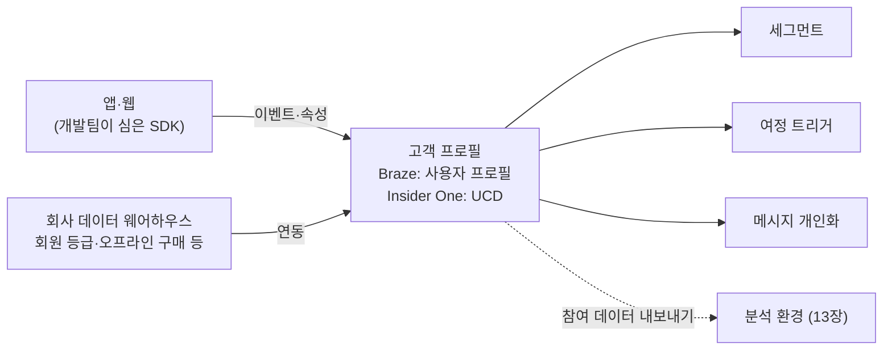
그림 1. 고객 프로필로 들어오고 나가는 데이터의 흐름

다시 처음의 장면이다. 3주 뒤에야 들어올 구매 이벤트를 기다리는 동안, 다음 개발팀 미팅에 아래 다섯 가지 질문을 들고 가 보자. 이 질문에 대한 답을 받아 적는 것만으로도 당신은 회사의 데이터 사전 첫 장을 갖게 된다.

1. 우리 회사의 고객 식별자는 무엇인가? Braze라면 external_id에, Insider One이라면 identifiers에 어떤 값을 담고 있는가?
2. 익명 사용자는 언제 식별되는가? 로그인 전의 행동 기록은 로그인 후 프로필로 어디까지 이어지는가?
3. 지금 도구로 들어오고 있는 이벤트는 무엇이고, 각 이벤트에는 어떤 속성이 함께 실려 오는가? 마지막으로 들어온 시점은 언제인가?
4. 같은 행동이 서로 다른 이름으로 들어오고 있지는 않은가? 이벤트 이름을 정하는 규칙이 있는가?
5. 새 이벤트나 속성을 추가하면 데이터 사용량과 비용에 어떤 영향이 있는가? 요청은 어떤 양식으로, 누구에게 하면 되는가?

### 이 장의 핵심

- CRM 도구가 할 수 있는 일은 그 안에 담긴 고객 데이터의 범위를 넘지 못한다. 세그먼트·트리거·개인화의 재료는 모두 개발팀이 심어 둔 이벤트와 속성이다.
- Braze는 사용자 프로필과 external_id·braze_id·alias로, Insider One은 UCD와 identifiers로 고객을 식별한다. Braze에서는 익명 프로필의 데이터가 전부 병합되지는 않는다.
- 시점과 순서가 중요한 사실은 이벤트로, 현재 상태만 필요한 사실은 속성으로 남긴다.
- 데이터 사용량은 두 도구 모두 비용과 연결된다. "전부 보내기"보다 이벤트 택소노미로 무엇을 어떤 이름으로 보낼지 정하는 편이 낫다.
- 개발팀에는 "이벤트 이름 + 함께 담을 속성 + 쓰임새"의 형태로 요청한다.

# 3장. 누구에게 보낼 것인가 — 세그먼트와 예측 세그먼트

> "실제 발송 가능한 모수를 파악하는 게 가장 중요해요."
> — 고구마팜, CRM 마케팅 실무 글(2022)

국내 한 마케팅 미디어에 실린 CRM 실무 글에서 이 문장을 처음 봤을 때는 조금 싱겁게 느껴질 수 있다. 세그먼트 이야기를 기대했는데 첫마디가 "모수부터 세라"라니. 그런데 CRM 일을 몇 달 해 본 사람일수록 이 문장에 고개를 끄덕인다. 공들여 만든 세그먼트를 열어 보니 보낼 수 있는 사람이 몇십 명뿐이었던 경험을 한 번쯤 해 봤기 때문이다.

같은 맥락의 조언은 다른 실무 글에서도 반복된다. 처음부터 너무 세분화하기보다 적정한 모수를 먼저 확보하라는 것이다. 왜 현장의 선배들은 하나같이 '나누기'보다 '세기'를 먼저 말할까? 그 이유를 따라가다 보면 세그먼트가 무엇인지, 그리고 예측 세그먼트가 그 일을 어떻게 바꾸는지가 함께 보인다.

## 세그먼트는 조건을 쌓아 고객을 고르는 일이다

세그먼트(segment)는 같은 메시지를 받을 고객 묶음이다. 앞 장에서 본 고객 프로필에 담긴 사실을 조건으로 걸어 고객을 골라낸다. 조건은 크게 세 종류다.

첫째는 속성 조건이다. "선호 카테고리가 운동화", "회원 등급이 골드", "가입일이 3일 전"처럼 고객의 현재 상태를 묻는다. 둘째는 행동 조건이다. "최근 30일 안에 앱을 연 적이 있다", "지난주에 장바구니에 담았다"처럼 이벤트 기록을 시점과 함께 묻는다. 셋째는 이 둘을 엮는 조합이다. "그리고(AND)"로 묶으면 범위가 좁아지고, "또는(OR)"으로 묶으면 넓어진다. 대부분의 세그먼트는 이 세 가지의 조합이다.

그렇다면 '발송 가능한 모수'는 무엇이 다를까? 조건에 맞는 고객 수와 실제로 메시지를 받을 수 있는 고객 수는 다르다. 예를 들어 조건에 맞는 고객이 5만 명이라고 해보자. 그중 앱 푸시를 보내려면 앱을 설치했고 알림을 허용한 사람만 남는다. 광고성 메시지라면 수신 동의를 한 사람만 남는다. 이메일이라면 유효한 주소가 있어야 한다. 이렇게 걸러 내고 나면 5만 명이 생각보다 훨씬 작아질 수 있다. Insider One의 Architect가 여정 안에 채널 도달 가능성(reachability) 체크를 별도 장치로 두는 것도 같은 이유다. 조건에 맞는 고객과 닿을 수 있는 고객은 다른 집합이다.

여기서 세그먼트를 잘게 쪼개면 무슨 일이 생기는지 보이기 시작한다. 조건을 하나 더할 때마다 대상은 줄어든다. "20대 여성, 운동화 선호, 최근 7일 방문, 장바구니 보유, 앱 푸시 허용"까지 가면 남는 사람은 손에 꼽을 수도 있다. 그 정도 규모로는 메시지가 효과가 있었는지도 판단하기 어렵다. 그래서 선배들은 이렇게 권한다. 세그먼트를 만들고 나면 조건에 맞는 인원과 채널별로 닿을 수 있는 인원을 먼저 확인하자. 숫자를 보고 나서 더 쪼갤지 결정해도 늦지 않다.

## 두 도구에서 세그먼트를 만든다는 것

Braze에서는 사용자 프로필의 속성과 커스텀 이벤트를 조건으로 세그먼트를 만든다. 2장에서 본 것처럼 Braze 문서는 커스텀 이벤트를 캠페인과 Canvas의 트리거, 그리고 세그먼트의 재료로 쓴다고 설명한다. 한 Braze 사용자는 리뷰에서 실시간 세그먼트를 SQL 없이 만들 수 있다는 점을 장점으로 꼽기도 했다(검색 요약 기준 리뷰). 데이터가 잘 들어와 있다면 마케터가 직접 조건을 걸고 인원을 확인하는 데까지 개발팀을 부르지 않아도 된다는 뜻이다.

Insider One에서는 2장에서 본 UCD의 속성과 이벤트가 세그먼트의 재료가 된다. Architect의 용어 사전은 여정에 사람을 들이거나 걸러 내는 조건을 Condition이라고 부르고, 그 재료로 속성, 이벤트, 세그먼트를 든다. 세그먼트가 여정 바깥에서 따로 쓰이는 목록이기도 하면서, 여정 안에서 길을 가르는 기준이기도 하다는 점을 기억해 두자. 이 감각은 5장과 6장에서 여정 빌더를 다룰 때 다시 쓰인다.

1장에서 팀장이 맡긴 '가입 3일 차 미구매자'를 세그먼트 조건으로 옮겨 보자. 도구가 무엇이든 말로 먼저 적어 보면 구조가 선명해진다. 첫 줄은 속성 조건이다. "가입일이 3일 전이다." 둘째 줄은 행동 조건이다. "구매 이벤트가 한 번도 없다." 셋째 줄은 도달 조건이다. "앱 푸시를 받을 수 있다." 그리고 마지막에 제외 조건을 붙인다. "사내 테스트 계정은 뺀다." 네 줄을 모두 '그리고'로 묶으면 세그먼트 하나가 완성된다.

이렇게 써 놓고 나면 2장의 질문들이 다시 의미를 갖는다. 가입일은 속성으로 들어오고 있는가, 이벤트로만 들어오고 있는가? 구매 이벤트는 지금도 빠짐없이 들어오고 있는가? 둘 중 하나라도 비어 있으면 화면에서 아무리 조건을 만지작거려도 원하는 사람을 고를 수 없다. 세그먼트를 만들다 막히면 화면보다 데이터 사전을 먼저 펼쳐 보자. 막힌 이유의 대부분은 거기에 적혀 있다.

두 도구 모두 세그먼트를 만드는 원리는 같다. 다른 것은 화면의 이름과 배치 정도다. 그러니 메뉴 위치를 외우기보다 "이 조건은 속성인가 이벤트인가, 시점을 묻는가 상태를 묻는가"를 먼저 생각하는 편이 낫다. 정확한 설정 화면은 Braze Docs와 Insider One Academy에서 그때그때 확인하자.

## 먼저 RFM으로 나누어 보기

세그먼트를 처음 설계할 때 어떤 축으로 나눌지 막막하다면, 오래된 도구 하나를 꺼내 보자. RFM이다. 최근성(Recency, 마지막 구매가 얼마나 최근인가), 빈도(Frequency, 얼마나 자주 사는가), 금액(Monetary, 얼마나 쓰는가)의 세 숫자로 고객을 나누는 방법이다.

RFM이 왜 지금도 쓰일까? 세 숫자만으로도 고객의 미래 가치를 꽤 잘 가늠할 수 있기 때문이다. Fader, Hardie, Lee(2005)는 RFM 세 값을 확률 모델과 연결해 고객별 미래 가치를 계산하는 방법을 제시했다. 이 연구는 구매 이력이 서로 달라도 미래 가치가 비슷한 고객들을 같은 선으로 잇는 '등가치 곡선(iso-value curve)'이라는 아이디어를 내놓았다. 등고선이 높이가 같은 지점을 잇듯, 가치가 같은 고객을 잇는 선이다.

이 관점은 실무에 바로 쓸 수 있는 교훈을 준다. 지금까지 많이 산 VIP라도 최근성이 낮으면 이미 떠났을 수 있다는 것이다. 누적 구매 금액만 보고 "VIP 전용 혜택"을 보내면, 반년째 들어오지 않은 고객이 대상의 상당수를 차지할 수 있다. 세 숫자를 함께 봐야 하는 이유다.

국내 실무 강의에서도 비슷한 순서를 권한다. 한 CRM 마케터 강의는 RFM과 코호트로 고객을 먼저 분류한 뒤에 Braze 세그먼트를 설정하는 순서를 보여 준다. 도구를 열기 전에 우리 고객을 어떤 축으로 볼지 먼저 정하는 것이다. 표로 정리해 보면 이런 식이다.

| 묶음 | 최근성 | 빈도 | 금액 | 어울리는 메시지 방향 |
|---|---|---|---|---|
| 핵심 고객 | 최근 | 잦음 | 높음 | 신상품 소식, 감사 혜택 |
| 식어 가는 VIP | 오래됨 | 잦았음 | 높음 | 재방문 계기 만들기 |
| 새로 온 고객 | 최근 | 1회 | 낮음 | 두 번째 구매 유도 |
| 잠든 고객 | 오래됨 | 드묾 | 낮음 | 발송 여부부터 재검토 |

표 1. RFM으로 나눈 고객 묶음의 예 (구간 기준은 회사마다 정한다)

> **이론 배경 — CLV를 쉬운 말로**
>
> RFM과 함께 자주 등장하는 말이 CLV(고객 생애 가치, Customer Lifetime Value)다. 연구자들은 RFM 모델, 확률 모델, 머신러닝 모델 등 여러 방법으로 CLV를 추정해 왔다. 수식은 복잡하지만 뜻은 단순하다. CLV는 "이 고객이 앞으로도 남아 있을 확률 × 한 번에 쓰는 돈 × 얼마나 자주 사는지"를 미래까지 더한 뒤, 그것을 지금 가치로 할인한 값이다. 주니어 마케터가 CLV 모델을 직접 만들 일은 드물다. 다만 "이 세그먼트에 쿠폰을 쓰는 것이 그 고객의 미래 가치에 비해 과한가?"를 묻는 감각은 갖춰 두면 좋다.

## Braze에서는 — Predictive Suite

지금까지의 세그먼트는 "이미 일어난 일"로 고객을 골랐다. 예측 세그먼트는 "앞으로 일어날 가능성"으로 고른다. 두 도구 모두 이 기능을 갖추고 있는데, 접근법이 조금 다르다.

Braze는 예측 기능을 Predictive Suite라는 이름으로 묶는다. 문서는 이 기능을 "puts machine learning tools directly in your hands"라고 소개한다. 데이터 과학자에게 부탁하지 않아도 마케터가 직접 머신러닝 예측을 만들어 쓸 수 있다는 뜻이다. 2026년 11월 기준 핵심은 두 가지다.

첫째는 Predictive Churn(이탈 예측)이다. 가장 큰 특징은 무엇을 이탈로 볼지 회사가 직접 정한다는 점이다. 구독 서비스의 이탈과 쇼핑몰의 이탈은 같은 단어라도 뜻이 다르기 때문이다. 예측이 만들어지면 각 사용자에게 0부터 100까지의 이탈 위험 점수가 붙는다. 점수가 높을수록 이탈 가능성이 크다. 이 점수로 "이탈 위험이 높은 고객" 같은 세그먼트를 만들 수 있고, 점수를 얼마나 자주 다시 계산할지도 고를 수 있다. 활성 상태로 둘 수 있는 예측 수에는 상한이 있는데, 2026년 11월 조회 기준 Braze Docs의 개요 페이지는 최대 3개, 예측 생성 페이지는 동시 활성 5개로 서로 다르게 적고 있으니 계약 조건과 함께 확인하자. Predictive Churn을 구매하기 전 미리보기 단계에서는 1개다. 예측에 필요한 최소 데이터는 고정 수치로 공개되어 있지 않다. 대신 이탈 정의를 입력하면 대시보드가 학습에 필요한 과거 이탈자와 비이탈자의 최소 인원을 보여 준다. 우리 데이터가 그 기준에 못 미치면 예측을 만들 수 없다.

둘째는 Predictive Events(이벤트 예측)다. 구매처럼 회사가 정한 특정 행동을 할 가능성을 점수로 매긴다. "곧 첫 구매를 할 것 같은 신규 고객"을 골라 한 번 더 밀어 주거나, 반대로 "어차피 살 것 같은 고객"에게는 할인을 아끼는 식으로 쓸 수 있다.

Braze 문서가 스스로 밝히는 흥미로운 구분도 하나 있다. Predictive Suite는 측정 결과로 학습하고 자체 정확도를 보고한다는 것이다. 예측이 얼마나 맞았는지를 도구가 알려 준다는 뜻이니, 점수를 쓰기 전에 그 정확도 보고부터 읽어 보는 습관을 들이자.

## Insider One에서는 — Predictive Segments

Insider One은 같은 일을 Predictive Segments라는 이름으로 제공한다. 2026년 8월 기준 Academy 문서에 나오는 유형은 다섯 가지다. Likelihood to Purchase(구매 가능성), User Engagement(참여도), Customer Lifecycle Status(고객 생애주기 상태), Discount Affinity(할인 선호도), Attribute Affinity(속성 선호도)다. 계정에 따라 쓸 수 있는 유형의 범위가 다르니, 우리 계정에서 무엇이 열려 있는지부터 확인하는 편이 낫다.

이름에서 쓰임새를 어느 정도 짐작할 수 있다. 다만 유형별 세부 정의는 계정의 Academy 문서로 확인하자. Likelihood to Purchase는 가까운 시일 안에 구매할 가능성이 높은 사용자를 골라낸다. Academy 문서에 따르면 점수가 모델이 정한 기준선을 넘은 사용자는 향후 7일 안에 구매할 것으로 본다. Discount Affinity는 과거 행동을 바탕으로 할인이 있을 때 살 가능성이 높은 사용자를 찾는 유형이다(최근 6개월 데이터 기준, 이커머스 전용). 할인 쿠폰을 아무에게나 뿌리지 않고 할인이 있어야 움직이는 사람에게 쓰고 싶을 때 떠올릴 만하다. Attribute Affinity는 지난 30일 동안의 상품 상호작용을 바탕으로 브랜드, 카테고리, 색상 같은 특정 속성에 대한 사용자별 선호를 읽는 유형이다(모두 2026-11 Academy 문서 기준).

Braze와 비교해 눈에 띄는 차이가 하나 있다. Insider One 문서에는 이탈 전용 유형의 이름이 따로 없다. '이탈 위험(churn risk)'은 활용 예시로만 등장한다. 그러니 Insider One에서 이탈 위험 고객을 겨냥하고 싶다면, 참여도나 생애주기 상태 같은 유형을 조합해 그 의도를 표현하게 된다. Braze가 이탈 예측을 독립된 기능으로 두는 것과는 설계 방식이 다르다. 이 차이를 두고 어느 쪽이 낫다고 말하기는 어렵다. 다만 회사 안에서 "이탈 예측 돌려 봐"라는 말이 오갈 때, 두 도구에서 그 말이 가리키는 화면이 다르다는 점은 알고 있어야 대화가 엇갈리지 않는다.

## 현장의 함정, 그리고 예측 점수라는 모델

세그먼트를 둘러싼 사고는 대개 비슷한 곳에서 난다. 첫 번째는 앞에서 본 과세분화다. 두 번째는 제외 조건의 누락이다. 이미 구매한 사람에게 "아직 고민 중이신가요?"라는 메시지가 가는 장면을 떠올려 보자. 고객에게는 회사가 자기를 모른다는 신호가 되고, 마케터에게는 끔찍한 고객센터 문의로 돌아온다. 한 Insider One 사용자는 리뷰에서 초기 세그먼트 규칙을 손봐야 했던 경험을 이렇게 적었다. "Initial segment rules also needed manual adjustments to filter out already purchased items." 같은 시기 다른 리테일 사용자는 "we still can't combine audience filters with dynamic segments."라며 필터를 원하는 대로 묶지 못하는 불편을 꼽았다(모두 2026-10 리뷰). 도구가 무엇이든, 세그먼트를 만든 뒤에는 "이 안에 들어오면 안 되는 사람은 없는가"를 따로 점검하자. 이미 산 사람, 방금 같은 메시지를 받은 사람, 수신을 거부한 사람이 대표적이다.

세 번째 함정은 예측 점수를 정답처럼 믿는 것이다. 점수는 숫자로 나오기 때문에 객관적인 사실처럼 보인다. 하지만 예측 점수도 결국 모델의 결과다. 마케팅 학계에서 유명한 연구가 하나 있다. Neslin 등(2006)은 학계와 실무자들이 같은 데이터로 이탈 예측 모델을 만들어 겨루게 했다. 그 결과 모델 사이의 정확도 차이만으로도 이탈 방지 캠페인의 수익이 수십만 달러 달라질 수 있다는 결론이 나왔다(2차 출처 확인). 모델 품질이 곧 돈이라는 뜻이다. Braze가 예측 정확도를 보고해 주는 기능을 둔 것도, 점수를 쓰는 사람이 그 품질을 확인할 수 있게 하려는 장치로 읽을 수 있다.

그렇다면 이탈 위험 점수가 높은 고객에게 쿠폰을 보내면 되는 걸까? 직관적으로는 그렇게 보인다. 그런데 이 질문에는 생각보다 깊은 함정이 숨어 있다. 위험이 가장 높은 고객이 메시지에 가장 잘 반응하는 고객이라는 보장은 없기 때문이다. 누구를 겨냥해야 하는지에 대한 답은 12장에서 윈백 여정을 만들 때 실험 연구와 함께 다시 살펴보자. 지금은 예측 세그먼트를 "누구에게 보낼지 고르는 새로운 재료" 정도로 받아 두면 충분하다.

다시 고구마팜의 문장으로 돌아가 보자. 선배들이 모수부터 세라고 한 것은 세분화가 나쁘다는 뜻이 아니었다. 세분화든 예측이든, 결국 메시지가 닿을 사람이 있어야 의미가 있다는 뜻이었다. 잘게 쪼갠 세그먼트보다 보낼 수 있는 세그먼트가 먼저다.

### 이 장의 핵심

- 세그먼트는 속성 조건과 행동(이벤트) 조건을 조합해 고객을 고르는 일이다. 조건에 맞는 인원과 채널별로 닿을 수 있는 인원은 다르니, 발송 가능한 모수부터 확인한다.
- 세그먼트 축이 막막하면 RFM(최근성·빈도·금액)으로 먼저 나눈다. 누적 금액이 높아도 최근성이 낮은 고객은 이미 떠났을 수 있다.
- Braze Predictive Suite는 회사가 정의한 이탈을 0~100 점수로 예측하는 Predictive Churn과 특정 행동 가능성을 예측하는 Predictive Events를 제공한다(2026-11 기준).
- Insider One Predictive Segments는 구매 가능성·참여도·생애주기 상태·할인 선호도·속성 선호도 유형을 제공하고, 이탈 전용 유형명은 따로 없다.
- 예측 점수도 모델이다. 정확도를 확인하고, 이미 구매한 사람 같은 제외 조건을 따로 점검한다.

# 4장. 고객이 있는 곳으로 — 채널 고르기

한 연구에서 사람들은 하루 평균 63.5개의 알림을 받았다. 우리가 공들여 쓴 마케팅 푸시는 그중 하나다.

이 숫자는 Pielot, Church, de Oliveira가 2014년에 발표한 연구에서 나왔다. 참가자 15명의 휴대폰 알림 기록을 1주일 동안 모으고 일기 조사를 함께 진행했다. 표본이 15명뿐이니 이 숫자를 모든 사람의 평균으로 읽어서는 곤란하다. 그래도 연구가 보여 주는 풍경만은 기억해 둘 만하다. 알림의 대부분은 메신저와 이메일에서 왔다. 친구의 메시지, 업무 메일, 단체방의 수다 사이에 우리 브랜드의 할인 알림이 끼어 있는 것이다.

이 장면을 떠올리면 채널을 고르는 질문이 달라진다. "어느 채널이 성과가 좋은가?"보다 먼저 물어야 할 것이 있다. 이 고객은 지금 어디에 있고, 이 메시지는 그 자리에 끼어들 자격이 있는가? 앱 푸시, 인앱 메시지, 이메일, SMS, 카카오톡, 웹 푸시, 온사이트, WhatsApp까지, 두 도구가 제공하는 채널을 하나씩 살펴보며 그 질문에 답할 기준을 세워 보자.

## 제품 안의 채널, 제품 밖의 채널

채널이 많아 보여도 크게 두 갈래로 나누면 정리가 쉽다. Braze 문서는 채널을 인프로덕트(in-product)와 아웃오브프로덕트(out-of-product)로 나눠 소개한다. 우리말로 옮기면 제품 안의 채널과 제품 밖의 채널이다.

제품 안의 채널은 고객이 이미 우리 앱이나 웹사이트에 들어와 있을 때 보여 주는 메시지다. 앱을 연 순간 뜨는 팝업, 화면 한쪽에 자리 잡은 카드, 웹사이트 상단의 맞춤 배너가 여기에 속한다. 오프라인 매장으로 치면 매장 안의 진열대 안내판이나 계산대 옆 POP 광고와 비슷하다. 이미 들어온 손님에게 말을 거는 것이니 방해가 적고, 대개 추가 발송 비용도 크지 않다. 대신 매장에 오지 않는 손님에게는 닿지 않는다.

제품 밖의 채널은 고객이 우리 제품 바깥에 있을 때 불러오는 메시지다. 앱 푸시, 이메일, SMS, 카카오톡이 대표적이다. 매장으로 치면 전단지나 문자 안내에 가깝다. 매장에 오지 않는 손님을 불러올 수 있지만, 앞에서 본 하루 60여 개의 알림 사이를 비집고 들어가야 한다. 그래서 더 신중해야 한다.

이 구분은 채널 선택의 첫 번째 기준이 된다. 고객이 이미 앱 안에 있다면 굳이 푸시로 불러낼 필요가 없다. 반대로 일주일째 앱을 열지 않은 고객에게 인앱 메시지를 걸어 두면, 그 메시지는 아무에게도 보이지 않은 채 기간이 끝난다.

## Braze에서는 — 앱 안과 밖을 두루 갖춘 채널 구성

2026년 11월 기준 Braze 문서가 소개하는 채널을 두 갈래로 정리해 보자.

제품 안의 채널로는 인앱 메시지(in-app message), Content Cards, Banners가 있다. 인앱 메시지는 다시 화면 전체를 덮는 fullscreen, 화면 가운데에 창을 띄우는 modal, 화면 가장자리에서 미끄러져 들어오는 slideup, 그리고 고객에게 질문을 던지는 서베이 형식으로 나뉜다. Content Cards와 Banners는 앱이나 웹 화면 안에 자리를 잡고 머무는 형식이다. Banners는 2025년 5월 릴리스에서 정식 출시(GA)되었다.

제품 밖의 채널은 더 다양하다. Email과 Transactional email(주문 확인 같은 거래성 이메일), Landing pages, LINE, Live notifications, Push(Android·iOS·Web), SMS/MMS/RCS, Webhooks, WhatsApp이 있고, KakaoTalk은 문서에서 별도 섹션으로 다룬다. RCS는 휴대폰에 기본으로 깔린 메시지 앱 안에서 고화질 이미지, 버튼, 인증된 브랜드 발신자 프로필 같은 풍부한 형식을 담을 수 있는 문자 규격이다(Braze 문서 기준). Braze에서는 2025년 5월 릴리스로 Android와 iOS 모두 정식 출시되었다. Webhooks는 조금 성격이 다르다. 고객에게 직접 메시지를 보내는 채널이라기보다, 여정의 특정 시점에 다른 시스템으로 신호를 보내는 장치다. 예를 들어 "이 고객이 여정을 마쳤다"는 사실을 사내 시스템에 알리는 데 쓴다. 자세한 연동은 개발팀이 맡는 영역이라고 생각해 두면 된다.

여기서 주니어가 놓치기 쉬운 점이 하나 있다. 문서에 채널이 있다고 해서 우리 계정에서 바로 쓸 수 있는 것은 아니라는 점이다. Braze의 시작 가이드 일부(스페인어판 기준)는 RCS, WhatsApp, Banners, Content Cards를 애드온(추가 계약 항목)으로 표시한다. 전 Braze 사용자인 한 뉴스레터 필자는 SMS나 Content Cards 같은 애드온이 붙으면서 비용이 늘어난다고 적기도 했다(2023). 어떤 채널이 계약에 포함되어 있는지는 회사의 Braze 담당자나 사내 관리자에게 먼저 물어보자.

Braze는 2025년에도 채널을 계속 늘렸다. 회사의 2025년 연간 리뷰에 따르면 RCS와 배너 외에도 WhatsApp Commerce, WhatsApp Flows, WhatsApp 광고 대상 Audience Sync가 추가되었다. 채널 목록은 앞으로도 바뀔 가능성이 크니, 새 기능을 쓰기 전에는 공식 문서와 릴리스 노트를 함께 보는 습관을 들여 두면 좋다.

## Insider One에서는 — 메시지를 보내는 채널과 화면을 바꾸는 채널

Insider One의 채널 구성은 무게중심이 조금 다르다. 2025년 12월 리브랜딩 보도자료가 나열한 채널은 Web, Email, Site Search, Conversational CX, WhatsApp, Web Push, InStory, App, SMS & RCS다. 한국어 플랫폼 페이지도 웹, 앱, 이메일, 웹 푸시, SMS 및 RCS, WhatsApp, 인스토리, 대화형 CX, 사이트 검색을 든다. 광고 쪽으로는 TikTok, Facebook, Instagram과의 연동을 소개한다.

여정 빌더인 Architect 안에서 쓸 수 있는 채널 요소(Channel Elements)도 살펴보자. 2026년 2월 Academy 문서 기준으로 Web push, App push, Email, SMS, WhatsApp, Onsite, In-app, Facebook Custom Audiences, Call an API, Google Ads가 있다. Call an API는 Braze의 Webhooks처럼 외부 시스템에 신호를 보내는 요소이고, Facebook Custom Audiences와 Google Ads는 이름 그대로 여정을 광고 플랫폼의 대상 목록과 잇는 요소로 이해하면 된다.

목록을 보면 Insider One의 색깔이 드러난다. 사이트 검색, 웹, 온사이트, 인스토리처럼 고객이 이미 와 있는 화면 자체를 다루는 항목이 두텁다. 1장에서 본 온사이트 개인화 제품군(Web Suite, Smart Recommender, Category Optimizer, InStory, 사이트 검색 Eureka)이 바로 이 영역이다. 메시지를 '보내서' 고객을 불러오는 채널과 함께, 들어온 고객에게 보여 줄 화면을 '바꾸는' 채널이 함께 있는 셈이다.

왜 이것이 강점이 될까? 2장에서 본 UCD를 떠올려 보자. 고객이 웹과 앱에서 같은 식별자로 로그인하면 마지막으로 본 상품 같은 속성이 하나로 합쳐진다. 그 사실을 바탕으로 웹사이트에 들어온 순간 첫 화면의 추천 상품과 배너를 그 고객에게 맞출 수 있다. 웹 매출 비중이 큰 쇼핑몰이라면 이 영역이 푸시 몇 통보다 더 큰 차이를 만들 수 있다. 웹 온사이트 경험이 중요한 회사가 Insider One을 눈여겨보는 이유다.

WhatsApp도 짚고 가자. Insider(현 Insider One)는 2023년 1월 대화형 커머스 도구 MindBehind를 인수한 뒤 Meta의 비즈니스 솔루션 제공자(BSP)가 되었고, 2023년 3월 WhatsApp Commerce를 출시했다. 상품 카드, 카테고리 목록, 카탈로그, 대화 흐름, 결제 연동을 WhatsApp 안에서 제공하는 기능이다(2023년 자료라 현재 구성은 달라졌을 수 있다). 한국에서는 메신저 시장의 중심이 카카오톡이니, WhatsApp은 해외 시장을 함께 맡는 팀에게 의미 있는 채널로 이해하면 된다.

## 카카오톡 — 2026년 11월 기준 확인된 것과 확인되지 않은 것

한국 마케터에게 가장 궁금한 채널은 단연 카카오톡이다. Braze 발표에 따르면 국내 카카오톡 사용자는 약 4,900만 명이다(2026-04 기준). 그런데 이 채널은 이 책에서 가장 조심스럽게 다뤄야 하는 부분이기도 하다. 공개 자료로 확인된 범위와 그렇지 않은 범위를 분명히 나눠 보자.

Braze는 2026년 4월 카카오톡 메시징 채널을 출시했다. 같은 시기 Braze 블로그는 친구톡 지원을 소개하며 친구톡을 이렇게 설명했다. "친구톡 메시지는 카카오톡 플랫폼에서 내 채널을 팔로우하는 카카오톡 친구에게 메시지를 보낼 수 있는 기능입니다." 지원하는 형식은 텍스트, 이미지, 와이드 이미지, 와이드 아이템 리스트다. 블로그가 소개한 활용 방식도 눈여겨볼 만하다. 친구톡 메시지를 클릭하지 않은 사람에게 푸시나 이메일로 후속 메시지를 보내거나, Canvas 안에서 카카오톡을 푸시·이메일·웹과 한 흐름으로 엮거나, Audience Sync로 카카오톡에서 이미 전환한 고객에게는 광고 노출을 멈추는 식이다.

설정 요건은 꼼꼼하게 챙겨야 한다. Braze 문서(2026-11 조회 기준)에 따르면 카카오톡은 지원 파트너인 CJ올리브네트웍스 또는 Infobip을 거쳐 연결한다. 미리 갖춰야 할 것은 지원 파트너 계정, 사업자등록증과 대표자 신분증 등으로 비즈니스 인증을 받은 카카오톡 비즈니스 채널, 유효한 Sender Key, 채널 관리자 연락처, 그리고 파트너 쪽에 Braze 서버 IP를 허용해 두는 설정이다. 제약도 있다. Sender Key는 한 번에 한 워크스페이스에만 연결된다. 채널 정보는 제출한 서류와 정확히 일치해야 한다. 고객 전화번호는 +821012345678(가상의 번호) 같은 국제 표기 형식인 E.164로만 받는다. Infobip을 쓴다면 광고 메시지를 보낼 때 고객센터 연락처를 반드시 넣게 되어 있다. 이 중 상당수는 마케터 혼자 처리할 수 없는 항목이다. 서류는 경영지원팀과, IP 허용과 전화번호 형식은 개발팀과 함께 준비하는 편이 낫다.

그렇다면 알림톡은 어떨까? 주문 확인이나 배송 안내처럼 정보성 메시지에 많이 쓰이는 알림톡은 2026년 11월 기준 Braze 공식 문서와 발표 글 어디에도 나오지 않는다. 발표 글은 이 채널을 "KakaoTalk marketing messages" 지원이라고 소개하고, 문서는 "For now, KakaoTalk can only message friends of the channel."이라고 적는다. 지금의 Braze 카카오톡 채널은 채널 친구에게 보내는 광고성 메시지 전용으로 읽는 편이 안전하다. 채널 친구가 아닌 수신 동의 고객에게도 보낼 수 있는 브랜드 메시지 방식 역시 지원한다는 언급이 없다. 하나 더 짚어 두자. 카카오는 2025년 5월 브랜드 메시지를 출시했고, 발송 대행사들은 친구톡이 2025년 말 종료되어 브랜드 메시지로 대체됐다고 안내한다(대행사 안내 기준, 카카오 공식 공지는 미확인). Braze 설정 화면도 CJ올리브네트웍스 대시보드의 브랜드 메시지 API 자격 증명을 쓰지만, 실제 발송 경로가 무엇인지는 문서에 적혀 있지 않다. 그러니 "Braze가 알림톡을 지원한다"고 단정하지 말고, 도입 전에 Braze 담당자에게 직접 확인하자.

Insider One은 더 조심스럽다. 네이티브 카카오톡 채널은 2026년 11월 기준 공식 자료에서 확인되지 않는다. 한국어 플랫폼 페이지의 채널 목록에도 카카오톡과 알림톡은 없다. 대신 Academy의 Call an API 사용 사례 문서가 Architect 여정에서 카카오톡 메시지를 보내는 커스텀 연동 방법을 소개한다. 고객이 카카오톡 채널에 동의할 때 받은 사용자 키를 UCD 속성에 저장해 두고, Call an API 요소로 카카오 API를 호출하는 방식이다. 주의할 점이 있다. 이 문서는 해당 API를 "AlimTalk API"라고 부르지만, 예시로 든 주소는 카카오 디벨로퍼스의 친구에게 메시지 보내기 API 형태다. 알림톡은 공식 딜러의 비즈메시지 API와 승인된 템플릿을 거쳐야 하므로, 이 문서만으로 Insider One이 알림톡을 지원한다고 볼 수는 없다. Insider One에서 카카오톡을 쓰려 한다면 Insider One 담당자에게 가능 여부와 방법, 범위부터 물어보는 것이 순서다.

| 항목 | Braze | Insider One |
|---|---|---|
| 채널 친구 대상 마케팅 메시지(친구톡) | 확인됨 (2026-04 출시, CJ올리브네트웍스·Infobip 경유) | 네이티브 채널은 확인되지 않음 — Call an API 커스텀 연동 사례만 문서화 |
| 알림톡 | 확인되지 않음 — 담당 벤더에 확인 | 확인되지 않음 — 담당 벤더에 확인 |
| 브랜드 메시지(비친구 수신 동의자 발송) | 확인되지 않음 — 현재는 채널 친구만 가능 | 확인되지 않음 — 담당 벤더에 확인 |

표 1. 카카오톡 메시지 지원 현황 (2026-11 기준 공개 자료)

알림톡, 친구톡, 브랜드 메시지가 각각 어떤 메시지이고 어떤 동의와 규칙을 따라야 하는지는 9장에서 한국 발송 규제와 함께 다룬다.

## 푸시의 현실 — 효과는 작고, 피로는 단호하다

하루 63.5개의 알림을 다시 떠올려 보자. 알림이 많다는 것은 곧 우리 푸시가 방해가 되기 쉽다는 뜻이기도 하다. Mehrotra 등(2016)의 연구는 중요하거나 유용한 내용의 알림조차 방해로 느껴질 수 있음을 보여 주었다(2차 출처 확인). 고객에게 쓸모 있는 정보라는 이유만으로 모든 순간에 환영받지는 못한다는 것이다.

그렇다면 푸시는 실제로 얼마나 효과가 있을까? 이 질문에 무작위 실험으로 답한 연구가 있다. Bidargaddi 등(2018)은 직장인 웰빙 앱 사용자 1,255명을 89일 동안 관찰하며, 하루 여섯 개 시각 중 하나에서 푸시를 보낼지 말지를 매번 동전 던지듯 50:50으로 정했다. 그 결과 맞춤 메시지 푸시를 보냈을 때 24시간 안에 앱을 쓸 가능성이 보내지 않았을 때보다 3.9% 높았다. 주말에는 8.7%, 주중에는 2.5% 높았지만 이 차이는 통계적으로 유의하지 않았다.

3.9%라는 숫자를 어떻게 읽어야 할까? 효과가 있다는 점에서는 반가운 숫자다. 하지만 생각보다 작다는 점에서는 정신이 번쩍 드는 숫자이기도 하다. 효과가 이 정도 크기라면, 대조군 없이 "푸시를 보냈더니 구매가 늘었다"고 말하기는 어렵다. 원래 살 사람이 산 것인지 푸시 덕분에 산 것인지 구분이 안 되기 때문이다. 이 연구가 헬스 앱을 대상으로 했다는 점도 기억해 두자. 이커머스 앱 마케팅 푸시를 대규모 무작위 실험으로 검증한 연구는 이번 리서치에서 찾지 못했다. 효과를 어떻게 재는지는 13장에서 본격적으로 다룬다.

반면 과하게 보냈을 때의 반응은 단호하다. 푸시 벤더 Airship은 과다 발송을 겪은 사용자가 알림을 서서히 무시하는 대신 수신 거부, OS 알림 권한 해제, 앱 삭제처럼 단호하게 행동한다고 지적했다(벤더 자료, 검색 요약 기준). 푸시 권한을 한 번 잃으면 그 고객에게는 다시 푸시를 보낼 수 없다. 효과는 몇 퍼센트 단위로 쌓이는데 잃는 것은 채널 전체라니, 생각만 해도 아찔하다.

그래서 두 도구 모두 발송 횟수를 제한하는 빈도 상한(frequency capping)과 방해 금지 시간 장치를 갖추고 있다. Braze에서는 Quiet Hours, Insider One에서는 Silent hours라는 이름으로 만나게 된다. 이 장치를 어떻게 겹쳐 쓰고 피로도를 어떻게 관리하는지는 9장에서 자세히 살펴보자.

## 무엇으로 고를 것인가

지금까지 본 채널들을 앞에 두고, 메시지 하나를 보낼 때 어떤 기준으로 채널을 고르면 좋을까? 네 가지 질문으로 정리해 보자.

첫째, 이 메시지는 정보성인가 광고성인가? 주문 확인, 비밀번호 재설정, 배송 안내처럼 고객이 이미 맺은 거래에 관한 메시지는 정보성에 가깝고, 할인 소식이나 신상품 추천은 광고성에 가깝다. 이 구분은 채널 선택과 함께 수신 동의 여부를 가른다. Insider One의 Architect가 여정을 Promotional(프로모션, opt-in 필요)과 Transactional(트랜잭션, opt-in 불필요)로 나눠 설정하게 하는 것도 같은 맥락이다. 한국 법이 이 구분에 무엇을 요구하는지는 9장에서 살펴본다.

둘째, 이 고객에게 닿을 수 있는가? 앱을 설치하고 알림을 허용했는지, 유효한 이메일 주소가 있는지, 카카오톡 채널을 친구로 추가했는지에 따라 쓸 수 있는 채널이 달라진다. 3장에서 본 '발송 가능한 모수'가 채널마다 다르다는 뜻이다. 앱을 지운 고객에게 아무리 좋은 푸시를 준비해도 소용이 없다.

셋째, 비용은 얼마인가? 채널마다 비용 구조가 다르다. 국내 한 실무 글은 현장 감각을 이렇게 요약했다. "플러스친구와 LMS는 비용이 비싸고, 앱푸시·인앱·eDM은 비용이 적은 편"(검색 요약 기준). 여기서 플러스친구는 지금의 카카오톡 채널을 가리키던 예전 이름이다. 정확한 단가는 계약과 발송 대행사에 따라 다르니 사내 담당자에게 묻는 편이 정확하다. 다만 같은 메시지를 보낼 수 있는 채널이 여럿이라면, 비싼 채널은 꼭 필요한 순간을 위해 아껴 두는 편이 낫다.

넷째, 얼마나 급한가? 지금 바로 알려야 하는 메시지와 며칠 안에만 보면 되는 메시지는 채널이 다르다. 결제 실패 안내는 놓치면 고객도 회사도 손해를 보지만, 신상품 소개는 고객이 앱을 열었을 때 보여 줘도 늦지 않다.

이 네 가지 질문을 표로 모아 보면 다음과 같다. 정답표가 아니라 출발점이니, 우리 회사의 고객과 비용 구조에 맞춰 고쳐 쓰자.

| 이런 메시지라면 | 먼저 떠올릴 채널 | 함께 확인할 것 |
|---|---|---|
| 앱 안에서 막 행동한 고객에게 다음 단계 안내 | 인앱 메시지(slideup·modal), Content Cards | 고객이 지금 앱 안에 있는가 |
| 웹사이트에 들어온 고객에게 맞춤 상품 노출 | 온사이트 개인화(Insider One 강점 영역), 웹 배너 | 웹·앱 식별자가 통합되어 있는가 |
| 며칠째 앱을 열지 않은 고객 불러오기 | 앱 푸시, 이메일 | 알림 허용·수신 동의, 빈도 상한 |
| 주문 확인·배송 안내 같은 거래 정보 | Transactional email, 앱 푸시, 문자 | 정보성 메시지 요건(9장), 카카오 정보성 메시지 지원 여부는 벤더 확인 |
| 할인·신상품 같은 광고성 소식 | 앱 푸시, 이메일, 카카오톡 채널 친구 대상 메시지(Braze, 2026-11 기준) | 광고성 수신 동의, 표기 의무(9장) |
| 지금 바로 알려야 하는 긴급 안내 | 앱 푸시, SMS | 방해 금지 시간, 비용 |
| 해외 시장 고객과의 대화형 상담·구매 | WhatsApp | 해당 국가의 메신저 이용 환경 |

표 2. 메시지 목적별 채널 선택 출발점

채널은 고객이 있는 곳에 놓는 문이다. 문을 많이 달기보다 고객이 실제로 드나드는 문을 고르는 것, 그 감각이 앞으로 여정을 설계할 때 모든 선택의 바탕이 된다.

# 5장. Braze Canvas로 여정 설계하기

월요일 오전 회의가 끝나고, 팀장이 자리로 돌아가다 말고 한마디를 던졌다고 해보자. "가입하고 3일 안에 첫 구매가 없으면 쿠폰 하나 보내 주세요. 그래도 안 사면 일주일 뒤에 한 번 더요." 수첩에 받아 적으면 두 줄이다. 어렵지 않아 보인다. 1장의 금요일 오후에 맡았던 바로 그 '가입 3일 차 미구매자' 여정이다. 그사이 데이터와 세그먼트와 채널이라는 아래 세 층을 쌓았으니, 이제 정말로 화면을 열 차례다.

그런데 Braze 대시보드를 열면 손이 멈춘다. 캠페인을 두 개 만들면 되는 걸까? 가입하고 3일이 지났다는 건 누가 세어 주지? 쿠폰을 받고 다음 날 바로 산 고객에게도 일주일 뒤 "아직 안 사셨네요?"가 날아가면 어떡하지?

두 줄짜리 요청 안에는 생각보다 많은 결정이 숨어 있다. 누구를 언제 들여보낼지, 얼마나 기다릴지, 무엇을 보고 길을 가를지, 언제 놓아줄지. 이 결정들을 한 화면에 그려 두고 고객 한 명 한 명에게 자동으로 적용되게 하는 도구가 여정 빌더다. Braze에서는 이 도구를 Canvas(여정 빌더)라고 부른다. 팀장의 두 줄을 끝까지 붙들고, 실제로 돌아가는 Canvas로 옮겨 보자.

## 캠페인 하나로는 왜 부족할까

Braze에서 메시지를 내보내는 길은 크게 두 갈래다. 캠페인과 Canvas. 캠페인은 "이 메시지를 이 사람들에게 보낸다"는 한 번의 발송을 다루는 단위라고 생각하면 이해하기 쉽다. 1~4장에서 다룬 세그먼트와 채널을 고르고 메시지를 써서 보내는 일이 캠페인 하나에 담긴다.

Canvas는 그 위에 시간과 갈림길을 얹는다. Braze 공식 문서는 Canvas를 이렇게 소개한다.

> "Canvas is a unified interface where marketers craft campaigns with multiple messages"

여러 메시지를 하나의 흐름으로 엮는 화면이라는 뜻이다. 그렇다면 캠페인 두 개로 팀장의 요청을 처리하면 무엇이 문제일까? 직접 상상해 보면 금방 보인다. 첫 번째 캠페인은 "가입 3일 차 미구매자"에게 쿠폰을 보낸다. 두 번째 캠페인은 "가입 10일 차, 쿠폰을 받았고, 여전히 미구매인 사람"에게 보낸다. 두 캠페인은 서로를 모른다. 두 번째 캠페인의 세그먼트에 "첫 번째 쿠폰을 받은 사람"이라는 조건을 정확히 걸어야 하고, 그사이 구매한 사람을 빼는 조건도 따로 챙겨야 한다. 여정이 세 단계, 네 단계로 늘어나면 캠페인 사이를 잇는 조건이 거미줄처럼 얽힌다. 번거롭고, 무엇보다 하나만 빠뜨려도 사고가 난다.

Canvas는 고객 한 명이 흐름 위 어디에 서 있는지를 기억한다. "이 사람은 쿠폰을 받고 7일째 기다리는 중"이라는 상태를 도구가 들고 있으니, 마케터는 단계 사이의 연결을 조건으로 일일이 재현하지 않아도 된다. 참고로 지금 Canvas를 열면 보이는 편집기는 Canvas Flow라는 이름으로 2022년에 나온 것이고, 2026-11 기준 Canvas의 기본 편집기다.

한 번 보내고 끝나는 공지라면 캠페인으로 충분하다. 고객의 반응을 보고 다음 수를 두어야 하는 일이라면 Canvas를 꺼내는 편이 낫다. 팀장의 요청은 분명히 후자다.

## 그리기 전에 설계 문서부터

Canvas 편집기는 빈 화면에 상자를 끌어다 놓고 선으로 잇는 방식이라 손이 먼저 나가기 쉽다. 여기서 한 번 멈추자. 커뮤니티에서 반복해서 나오는 진단이 있다. 여정을 문서로 정리하지 않고 툴 위에서 바로 그리면, 분기가 하나둘 쌓이다가 어느새 아무도 전체를 설명하지 못하는 여정이 된다는 것이다. 만든 사람이 휴가를 가면 그 여정은 누구도 손대기 무서운 물건이 된다.

그래서 화면을 열기 전에 네 가지를 먼저 적어 보자. 목표, 진입 조건, 이탈 조건, 전환 이벤트다. 팀장의 두 줄을 이 틀에 넣으면 이렇게 된다.

| 항목 | 스스로에게 던질 질문 | 3일 차 여정 |
|---|---|---|
| 목표 | 이 여정이 끝났을 때 고객에게 무슨 일이 일어나 있어야 하는가? | 신규 가입자의 첫 구매 |
| 진입 조건 | 누가, 어떤 순간에 들어오는가? | 회원가입 완료 이벤트가 발생한 고객 |
| 단계 | 얼마나 기다리고, 무엇을 보고 가르는가? | 3일 대기 → 미구매면 쿠폰 → 7일 대기 → 여전히 미구매면 한 번 더 |
| 이탈 조건 | 언제 놓아주는가? | 첫 구매를 하는 순간 |
| 전환 이벤트 | 성공을 무엇으로 세는가? | 첫 구매 이벤트 |

표를 채우다 보면 질문이 저절로 생긴다. "회원가입 완료"라는 이벤트가 정말로 Braze에 들어오고 있는가? 2장에서 이야기한 커스텀 이벤트가 없으면 이 여정은 시작조차 못 한다. "첫 구매"는 어떤 이벤트로 판별하는가? 구매 이벤트는 있는데 그것이 첫 구매인지 알려면 구매 횟수 같은 속성이 필요할 수도 있다. 쿠폰은 광고성 메시지인가? 그렇다면 수신 동의를 한 사람에게만 가야 한다. 이 부분은 9장에서 제대로 다루니 지금은 설계 문서 한쪽에 "동의 확인"이라고 적어 두기만 하자.

이 문서가 좋은 점은 하나 더 있다. 표의 각 칸이 거의 그대로 Canvas의 설정 하나, 컴포넌트 하나에 대응한다는 것이다. 진입 조건은 진입 설정으로, 단계는 컴포넌트로, 이탈 조건은 Exit criteria로, 전환 이벤트는 전환 설정으로 간다. 문서를 먼저 쓰면 Canvas 작업은 번역에 가까워진다. 문서가 먼저, 화면은 그다음이다.

## 진입 — 누가, 언제 들어오는가

모든 여정은 입구에서 시작한다. Canvas에서 입구를 정하는 일은 두 가지 질문에 답하는 것이다. 언제 들여보낼 것인가, 그리고 누구를 들여보낼 것인가.

"언제"에 해당하는 것이 진입 방식이다. Braze의 캠페인과 마찬가지로 Canvas에도 세 가지 진입 방식이 있다. 정해진 일정에 맞춰 대상자를 훑어 들여보내는 일정 기반(Scheduled), 고객이 특정 행동을 하는 순간 들여보내는 행동 기반(Action-Based), 그리고 회사 시스템이 Braze에 신호를 보내 들여보내는 API 기반(API-Triggered)이다. API 기반은 개발팀이 Braze의 Canvas 트리거 API(`/canvas/trigger/send`)를 호출해 고객을 들여보내는 방식이다. 마케터 감각으로 바꿔 말하면, 일정 기반은 "매주 월요일 아침에 명단을 뽑아 보낸다", 행동 기반은 "고객이 문을 열고 들어오는 순간 인사한다", API 기반은 "개발팀이 심어 둔 신호가 오면 움직인다"에 가깝다.

팀장의 여정은 어느 쪽일까? "가입하고 3일"이라는 시계는 고객마다 가입한 순간부터 따로 돌아야 한다. 그러니 회원가입 완료 이벤트를 진입 트리거로 삼는 행동 기반이 자연스럽다. 일정 기반으로 "매일 아침, 3일 전에 가입한 미구매자"를 뽑는 방법도 가능은 하다. 다만 세그먼트 조건이 복잡해지고, 가입 시각에 따라 실제 대기 시간이 들쭉날쭉해진다는 점이 찜찜하다.

"누구를"은 진입 대상 세그먼트로 한 번 더 거른다. 트리거 이벤트가 발생했더라도 이 조건을 통과한 사람만 여정에 들어온다. 3일 차 여정이라면 사내 테스트 계정을 빼고, 앱 푸시나 이메일을 받을 수 있는 사람으로 좁히는 정도를 생각해 볼 수 있다. 3장에서 강조한 "발송 가능한 모수부터"가 여기서 다시 등장한다. 진입 조건을 너무 촘촘하게 걸면 막상 여정에 들어오는 사람이 하루에 몇 명 되지 않는다. 진입 조건을 확정하기 전에 해당 세그먼트의 규모를 꼭 확인해 보자.

진입 설계에서 놓치기 쉬운 질문도 하나 있다. 이미 가입해 있는 기존 회원은 어떻게 되는가? 행동 기반 진입이라면 Canvas를 켠 뒤에 가입한 사람만 들어온다. 이 점을 팀장과 미리 맞춰 두면 "왜 기존 미구매자에게는 안 갔냐"는 질문에 당황하지 않는다. 같은 고객이 여정을 다시 탈 수 있게 할지도 정해 두는 편이 좋다. 탈퇴 후 재가입한 사람이 쿠폰을 또 받는 상황을 원하는 회사는 드물다.

## 컴포넌트 투어 — 열세 개 중 손에 익혀 둘 것들

입구를 정했으면 이제 흐름을 만든다. Canvas에서 흐름을 이루는 상자 하나하나를 컴포넌트라고 부른다. 2026-11 기준 Braze 문서에 올라 있는 컴포넌트는 열세 가지다. Message, Delay, Decision Split, Audience Paths, Action Paths, Experiment Paths, User Update, Context, Feature Flag, Send to Destination, Canvas Audience Sync, Content Optimizer, Agent.

이름만 늘어놓으면 막막하다. 하지만 각 컴포넌트를 "이 상자는 어떤 결정을 표현하는가"로 보면 훨씬 단순해진다. 마케터가 거의 매번 쓰게 되는 여섯 개부터 살펴보자.

**Message**는 실제로 메시지를 보내는 상자다. 4장에서 고른 채널(푸시, 이메일, 인앱 메시지 등)이 여기서 쓰인다. 고객별로 가장 반응이 좋은 시간에 보내 주는 Intelligent Timing도 Canvas에서는 이 Message 단계에서 설정한다. 이 기능은 8장에서 자세히 다룬다.

**Delay**는 기다리는 상자다. "3일 뒤", "7일 뒤"가 여기에 들어간다. 여정에서 가장 단순해 보이지만, 고객 입장에서 메시지 사이의 간격을 정하는 중요한 상자다.

**Decision Split**은 조건 하나로 길을 둘로 가르는 상자다. "첫 구매를 했는가, 안 했는가"처럼 예와 아니오로 나뉘는 질문에 쓴다. 조건은 세그먼트나 필터로 만들고, 조건에 맞는 사람은 예 쪽으로, 나머지는 모두 아니오 쪽으로 간다.

**Audience Paths**는 길을 여러 갈래로 나눈다. 고객을 등급별, 관심 카테고리별로 서너 무리로 나눠 각자 다른 메시지를 보내고 싶을 때 쓴다. 한 상자에서 최대 여덟 갈래까지 나눌 수 있고, 고객은 위에서부터 조건을 따져 처음 맞는 길로 간다. 그러니 가장 중요한 길을 맨 위에 두자.

**Action Paths**는 일정 기간 고객의 행동을 지켜본 뒤, 무엇을 했느냐에 따라 길을 가른다. BlaBlaCar가 예약을 망설이는 고객에게 Action Paths로 정해진 시간을 기다린 뒤 아직 예약하지 않은 사람만 다음 단계로 보낸 사례가 대표적이다(11장에서 자세히 본다). 행동한 사람을 곧바로 다음 단계로 보낼지, 기간이 끝날 때까지 모아 두었다가 우선순위가 가장 높은 길로 보낼지도 정할 수 있다. 기본값은 행동하는 즉시 보내는 쪽이다.

**Experiment Paths**는 고객을 무작위로 나눠 서로 다른 길을 태운다. 메시지를 받지 않는 대조군을 둘 수도 있고, 성과가 좋은 길로 나중 사람들을 몰아주는 Winning Path도 여기에 포함된다. 실험을 어떻게 설계하고 읽는지는 13장의 몫이니 지금은 "여정 안에서도 실험을 걸 수 있다"는 것만 알아 두자.

나머지 일곱 개는 한 줄씩만 알아 두어도 충분하다.

| 컴포넌트 | 한 줄 설명 |
|---|---|
| User Update | 여정 안에서 고객 프로필의 속성을 바꾼다. 잡코리아도 커스텀 속성 갱신에 Canvas를 활용했다 |
| Context | 고객이 여정을 지나는 동안 쓸 변수를 만들고 갱신한다. 워크스페이스에 따라 보이지 않을 수 있다 |
| Feature Flag | 여정의 특정 지점에서 고객에게 기능 플래그를 부여한다. 개발팀이 앱에 심어 둔 기능 켜고 끄기를 여정과 연결하는 셈이다 |
| Send to Destination | 고객을 이 Canvas에서 다른 Canvas로 보낸다. 외부 API 호출 없이 Braze 안에서 여정끼리 잇는다 |
| Canvas Audience Sync | 여정의 고객 명단을 광고 매체 오디언스로 보낸다. BlaBlaCar는 미전환자에게 Facebook·Google 광고를 보여 줬다 |
| Content Optimizer | 2026-11 기준 베타 상태의 콘텐츠 최적화 컴포넌트. 세부는 공식 문서를 확인하자 |
| Agent | 발송 시점에 고객 한 명 단위로 분류·라우팅·내용 보강·작성을 맡는 Braze Agents와 연결된다(8장) |

베타나 신규 컴포넌트는 이름과 동작이 빠르게 바뀔 수 있다. 실제로 쓰기 전에는 Braze Docs의 Canvas 컴포넌트 문서를 한 번 더 열어 보자.

이제 팀장의 여정을 컴포넌트로 옮겨 보자. 설계 문서의 "단계" 칸을 그대로 따라가면 이렇게 된다.

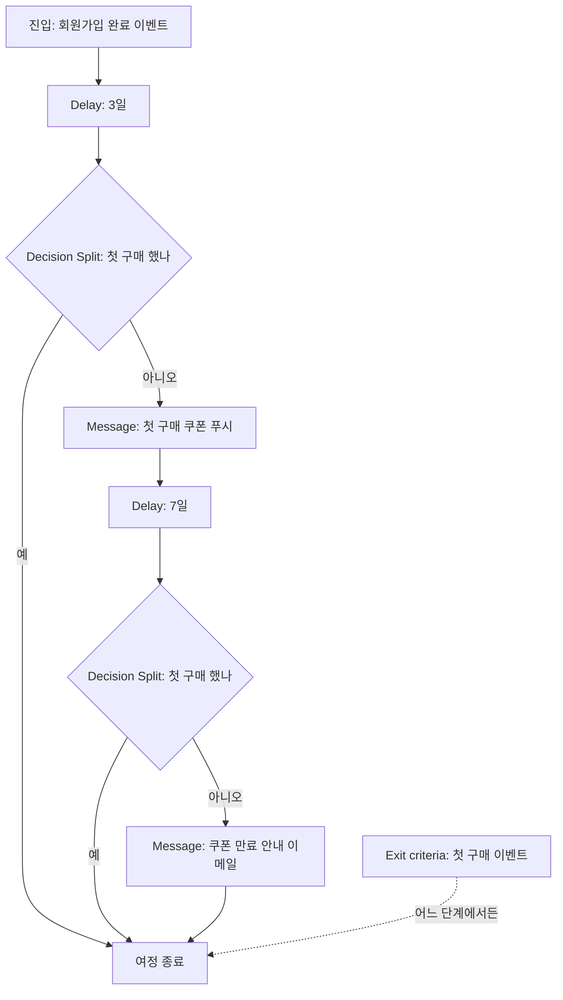
그림 1. "가입 후 3일 미구매자" Canvas 흐름

Delay와 Decision Split 대신 Action Paths 하나로 "3일 동안 구매를 지켜보다가 안 산 사람만 쿠폰으로" 보내도 된다. 둘 다 같은 일을 하니 팀이 읽기 쉬운 쪽을 고르면 된다. 그런데 그림 아래쪽에 점선으로 붙은 Exit criteria는 무엇일까? 이 상자 하나가 여정 사고의 상당수를 막아 준다.

## Exit criteria — 놓아줄 때를 정하기

이런 장면을 떠올려 보자. 고객이 쿠폰 푸시를 받고 그날 저녁 첫 구매를 했다. 기분 좋게 배송을 기다리는데, 일주일 뒤 이메일이 온다. "아직 첫 구매 전이시죠? 쿠폰이 곧 만료돼요!" 고객은 고개를 갸웃한다. 마케터가 이 캡처를 고객센터 문의로 받아 보는 순간은 정말 아찔하다.

커뮤니티가 꼽는 대표적인 여정 사고가 바로 이것, "이미 구매한 사람 제외"의 누락이다. 그림 1에서는 메시지 앞마다 Decision Split을 두었으니 괜찮지 않을까? 한 번 따져 보자. Decision Split은 고객이 그 상자에 도착한 순간에만 질문을 던진다. 여정이 길어지고 메시지가 늘어나면, 어느 메시지 앞에 분기를 하나 빠뜨리는 일이 생긴다. 나중에 누군가 중간에 메시지 하나를 끼워 넣으면서 분기를 같이 넣지 않는 일도 흔하다.

Exit criteria는 접근이 다르다. 특정 지점에서 묻는 것이 아니라, 여정 전체에 걸쳐 "이 행동을 한 사람은 여기서 내린다"는 규칙을 건다. 3일 차 여정이라면 첫 구매 이벤트를 Exit criteria로 걸어 두는 것이다. 그러면 고객이 Delay 상자 안에서 기다리는 중이든, 다음 메시지를 받기 직전이든 상관없이 첫 구매가 기록되는 순간 여정에서 빠진다.

그렇다면 Decision Split은 필요 없을까? 꼭 그렇지는 않다. Exit criteria는 "여정의 목표를 이룬 사람을 놓아주는 규칙"이고, Decision Split은 "여정 안에서 길을 가르는 규칙"이다. 목표를 이뤘는데 여정에 남아 있어야 할 이유가 있는 사람은 거의 없으니, 목표 달성은 Exit criteria로 처리하고, 분기는 정말로 길을 갈라야 하는 곳에만 쓰는 편이 여정을 단순하게 만든다. 이 원칙을 따르면 그림 1의 두 Decision Split은 사실상 Exit criteria가 대신해 준다. 분기를 지우고 "Delay → Message → Delay → Message"의 일직선으로 줄여도 같은 일을 한다.

Exit criteria를 정할 때 함께 확인할 것이 있다. 이탈 조건으로 쓸 이벤트가 실제로 제때 Braze에 들어오는가? 구매 이벤트가 결제 시스템에서 몇 시간 늦게 넘어오는 구조라면, 그 사이에 메시지가 나갈 수 있다. 이런 지연이 있는지는 마케터 혼자 알기 어렵다. 2장에서 만든 "개발팀에 가져갈 질문" 목록에 "구매 이벤트는 결제 후 얼마 만에 들어오나요?"를 한 줄 더하자.

## 시작하기 전에, 시작한 다음에 — 테스트와 QA

여정이 완성되면 바로 시작 버튼을 누르고 싶어진다. 그 전에 하나만 떠올리자. 발송된 메시지는 되돌릴 수 없다. 현장 실무 글들이 철저한 여정 설계와 테스트를 거듭 강조하는 이유다. Canvas 하나는 캠페인 하나보다 훨씬 많은 사람에게, 훨씬 오랫동안 메시지를 보낸다. 실수의 반경도 그만큼 넓다.

Braze 문서는 Canvas 테스트와 관련해 몇 가지 장치를 안내한다. 테스트 발송, 사용자 경로 미리보기, QA 체크리스트, 그리고 버전 히스토리와 복제다. 테스트 발송은 각 메시지가 실제 기기와 메일함에서 어떻게 보이는지 확인하는 것이다. 사용자 경로 미리보기는 고객 한 명을 가정하고 그 사람이 어떤 길로 흘러가는지 따라가 보는 기능이라고 생각하면 된다. 가입 직후 바로 구매한 고객, 3일째 구매한 고객, 끝까지 사지 않은 고객처럼 서로 다른 사람을 넣어 보고, 각자 기대한 길로 가는지 확인하자. 그림 1의 길 하나하나에 최소 한 명씩은 걸어 보게 하는 셈이다.

시작한 다음이 더 조심스럽다. 이미 여정 안에는 Delay 상자에서 기다리는 사람들이 있다. 이때 단계를 빼거나 순서를 바꾸면 그 사람들이 어디로 가게 될지 직관적으로 알기 어렵다. 실험이 걸린 메시지라면 더 민감하다. Braze는 다변량 테스트를 시작한 뒤 제목이나 본문을 바꾸면 그 실험이 무효가 된다고 안내한다. 그래서 큰 변경이 필요하면 기존 Canvas를 고치기보다 복제해서 새 버전을 만들고, 버전 히스토리로 무엇을 언제 바꿨는지 추적하는 편이 안전하다. 운영 중인 Canvas의 수정이 기존 참여자에게 어떤 영향을 주는지는 공식 문서에서 따로 짚어 두는 편이 좋다.

현장의 목소리도 들어 볼 만하다. Braze 리뷰에는 "캔버스가 분기와 복제가 많아 복잡해지면 전체 구조를 파악하기 어렵다", "캔버스 빌더가 제한적이며 복사·붙여넣기 기능이 없다" 같은 불만이 보인다(리뷰 검색 요약으로 확인한 내용이다). 공식 문서에는 Canvas 복제 기능이 분명히 있으니, 리뷰의 "복사·붙여넣기"는 Canvas 전체가 아니라 단계 단위 편집을 말하는 것으로 보인다. 또 다른 리뷰어는 "Because Braze is so feature-dense, configuring campaigns can feel overly complicated."라고 적었다. 기능이 많다는 건 장점이면서 길을 잃기 쉽다는 뜻이기도 하다.

이 불만들이 가리키는 방향은 하나다. 여정이 스파게티가 되는 건 도구 탓만은 아니다. 한 Canvas에 목표를 하나만 두고, 설계 문서와 Canvas를 함께 관리하면 분기가 늘어도 길을 잃지 않는다. 처음부터 거대한 여정을 그리기보다, 3일 차 여정처럼 작고 분명한 여정 하나를 끝까지 돌려 보는 경험이 먼저다.

## 한 장짜리 여정 설계서

팀장의 두 줄에서 출발해 꽤 먼 길을 왔다. 정리해 보면 Canvas 작업의 절반 이상은 Canvas를 열기 전에 끝난다. 목표를 정하고, 입구와 출구를 정하고, 그 사이에서 기다릴 시간과 가를 길을 정하는 일이다. 다음 여정을 맡게 되면 아래 양식을 복사해 빈칸부터 채워 보자.

```text
[여정 설계서]  작성자:          작성일:          검토자:

1. 여정 이름 / 한 줄 목표
   - 예) 신규 가입 3일 차 첫 구매 유도 / 신규 가입자의 첫 구매

2. 진입
   - 진입 방식: Scheduled(일정 기반) / Action-Based(행동 기반) / API-Triggered(API 기반)
   - 트리거 이벤트:
   - 진입 대상 세그먼트(제외 조건 포함):
   - 예상 진입 규모(하루/주):
   - 재진입 허용 여부:

3. 단계 (순서대로)
   - 대기 시간:
   - 분기 조건과 각 길의 목적지:
   - 메시지별 채널 / 광고성 여부 / 동의 확인:

4. 이탈 조건 (Exit criteria)
   - 목표 달성 이벤트:
   - 그 밖에 내려야 할 사람(탈퇴, 수신 거부 등):

5. 전환과 측정
   - 전환 이벤트:
   - 대조군 여부와 비율:

6. 테스트 계획
   - 경로 미리보기에 넣을 가상 고객 3명:
   - 테스트 발송 받을 사람:

7. 운영
   - 시작일 / 점검 주기 / 변경 시 연락할 사람:
```

이 설계서에는 Braze 전용 칸이 하나도 없다. 진입, 단계, 이탈, 전환은 어느 여정 빌더에나 있는 개념이기 때문이다. 같은 종이 한 장을 들고 Insider One의 Architect를 열어도 그대로 쓸 수 있다.

### 이 장의 핵심

- Canvas는 여러 메시지를 하나의 흐름으로 엮고, 고객 한 명이 흐름 위 어디에 있는지 기억한다. 반응을 보고 다음 수를 두는 일이라면 캠페인보다 Canvas가 맞다.
- 화면을 열기 전에 목표·진입 조건·이탈 조건·전환 이벤트를 문서로 먼저 적는다. 문서의 칸이 그대로 Canvas의 설정과 컴포넌트가 된다.
- 열세 개 컴포넌트는 "어떤 결정을 표현하는가"로 읽는다. 자주 쓰는 것은 Message·Delay·Decision Split·Audience Paths·Action Paths·Experiment Paths다.
- 목표를 이룬 고객은 Exit criteria로 놓아준다. 분기는 지점에서만 묻지만 Exit criteria는 여정 전체를 지켜본다.
- 시작 전에는 서로 다른 가상 고객으로 경로를 걸어 보고, 시작 후 큰 변경은 복제와 버전 히스토리로 다룬다.

# 6장. Insider One Architect로 여정 설계하기

앞 장에서 Canvas로 만든 3일 차 여정을 이번엔 Insider One의 Architect로 옮겨 보자. 손에는 앞 장 끝에서 채운 한 장짜리 여정 설계서가 들려 있다. 목표는 신규 가입자의 첫 구매, 진입은 회원가입 완료, 3일 기다렸다가 미구매면 쿠폰, 다시 7일 기다렸다가 한 번 더, 첫 구매를 하면 내린다.

그런데 Architect를 열자마자 첫 화면에서 헷갈린다. Insider One도 이 여정 편집 화면을 "canvas"라고 부르기 때문이다. 방금 Braze Canvas를 배우고 온 사람에게는 꽤 짓궂은 우연이다. 그래서 이 책은 규칙을 하나 정해 두었다. "Canvas"라고 쓰면 언제나 Braze의 기능이고, Insider One 쪽은 "Architect 편집 화면"이라고 부른다.

이름이 겹친다는 건 생각해 보면 자연스러운 일이다. 두 도구가 푸는 문제가 같기 때문이다. 고객을 들여보내고, 기다리고, 갈림길에서 가르고, 메시지를 보내고, 목표를 이루면 놓아준다. 그렇다면 무엇이 같고 무엇이 다를까? 설계서를 한 줄씩 Architect로 번역하면서 확인해 보자.

## Architect는 어떤 도구인가

Insider One Academy는 Architect를 두 가지 문장으로 소개한다. 2026-02-12에 갱신된 Feature Set 문서는 Architect를 "AI-backed marketing automation tool"이라고 부르고, 2026-08-27에 갱신된 소개 문서는 Architect가 연결된 모든 플랫폼에 걸쳐 고객 여정을 "orchestrate high-performing customer journeys across every connected platform" 한다고 적는다. 앞 문장은 자동화 도구라는 정체를, 뒤 문장은 채널을 가로지르는 여정이라는 쓰임을 말한다.

Architect가 서 있는 바닥은 2장에서 살펴본 UCD(Unified Customer Database)다. Insider One의 모든 제품이 이 통합 고객 데이터베이스를 떠받침으로 삼는다. 그러니 Architect에서 쓰는 이벤트와 속성은 전부 UCD에 쌓인 것들이다. Canvas가 Braze 사용자 프로필 위에서 돌아가는 것과 같은 구조다. 여정 빌더가 아무리 화려해도, 진입 조건에 쓸 이벤트가 UCD에 없으면 여정은 시작되지 않는다. 이 사실은 도구가 바뀌어도 그대로다.

흐름의 생김새도 익숙하다. Feature Set 문서에 따르면 Architect의 여정은 starter에서 시작해 고객의 행동과 속성에 따라 if/else로 갈라지며 진행된다. 그리고 여정 전반에 걸쳐 쓸 수 있는 공통 기능으로 속성 기반 개인화, 크로스 플랫폼 운영, 빈도 상한(frequency capping), 최적 채널 선택, 발송 시간 최적화를 꼽는다. 뒤의 두 가지는 8장에서, 빈도 상한은 9장에서 다시 만난다.

## Element 다섯 계열 — 상자의 종류

Canvas의 상자를 컴포넌트라고 불렀다면, Architect의 상자는 Element라고 부른다. Academy 문서 목차는 Element를 다섯 계열로 묶는다. Starter Elements, Wait Elements, Check Elements, Channel Elements, Action Elements다. 여기에 Journey A/B Split, Next Best Channel, Dynamic Content, Components가 따로 문서로 묶여 있다.

계열 이름만 봐도 역할이 짐작된다. 하나씩 짚어 보자.

**Starter Elements**는 여정의 입구다. 2026-11 기준 문서는 실시간 starter와 날짜 기반 starter를 함께 소개한다. 고객이 어떤 행동을 하는 순간 들여보내는 방식과, 생일이나 가입 기념일처럼 날짜를 기준으로 들여보내는 방식이다. 상품 가격이 내려가면 여정을 시작하는 On Price Drop, 재입고 때 시작하는 On Back in Stock 같은 특수한 starter도 있는데, 이것들은 11장에서 장바구니 이탈과 함께 다룬다.

**Wait Elements**는 기다리는 상자다. 정해진 기간을 기다리거나, 특정 시간대까지 기다리게 할 수 있다. Canvas의 Delay에 해당한다.

**Check Elements**는 길을 가르는 상자다. 메시지에 반응했는지, 정해진 기간 안에 특정 이벤트를 했는지, 특정 속성을 가졌는지를 보고 고객을 가른다. 눈여겨볼 것은 채널 도달 가능성(reachability) 체크다. 이 고객에게 지금 앱 푸시를 보낼 수 있는지, 이메일 주소가 있는지를 확인해 길을 나눈다. 4장에서 말한 "도달 가능성"이 여정 안의 상자로 들어와 있는 셈이다.

**Channel Elements**는 메시지를 보내는 상자다. Feature Set 문서에 실린 채널은 Web push, App push, Email, SMS, WhatsApp, Onsite, In-app, Facebook Custom Audiences, Call an API, Google Ads다. 웹사이트 위에 띄우는 온사이트 경험이 여정의 한 단계로 들어간다는 점, 광고 매체 오디언스와 외부 API 호출까지 같은 계열에 묶여 있다는 점이 눈에 띈다. 4장에서 본 Insider One의 웹 온사이트 강점이 여정 빌더에도 그대로 이어진다.

**Action Elements**는 메시지 대신 동작을 수행하는 상자로 보면 된다. 흐름 중에 고객 속성을 업데이트하는 Update User Attribute가 대표적이고, 고객을 정적 세그먼트에 넣거나 빼는 Update Static Segment도 이 계열이다. 속성 업데이트는 Canvas의 User Update와 같은 쓰임이다.

따로 묶인 네 가지도 한 줄씩 알아 두자. Journey A/B Split은 고객을 무작위로 나눠 서로 다른 길을 태우는 실험 장치이고, 성과가 좋은 쪽을 자동으로 고르는 A/B autowinner와 짝을 이룬다. 실험 설계는 13장에서 본격적으로 다룬다. Next Best Channel은 고객별로 반응할 가능성이 가장 높은 채널을 골라 주는 장치로 8장의 주제다. Dynamic Content는 메시지 안에 고객별 내용을 끼워 넣는 Insider One의 개인화 방식으로 7장에서 만난다. Components는 문서 목차에 별도 항목으로 올라 있는데, 상자의 종류라기보다 진입 제한, 대조군, 여정 우선순위, 여정 편집, 테스트처럼 여정을 운영하는 설정과 도구를 모아 둔 문서 묶음이다.

## Architect만의 용어 — Terms to Know

Element 이름은 Canvas와 대응시키며 금방 익힐 수 있다. 정작 처음 쓰는 사람을 붙잡는 것은 Architect 고유의 용어다. Insider One Academy의 Terms to Know 문서(2025-11-14)가 이 용어들을 정리해 두었다. 마케터가 화면에서 자주 마주칠 것들만 골라 보자.

먼저 기본 뼈대를 이루는 말들이다. **Trigger**는 여정의 첫 단계로, 조건에 맞는 고객을 진입시킨다. 문서는 Trigger와 Starter를 같은 것으로 다룬다. **Condition**(criteria)은 고객을 진입시키거나 여정 안에서 걸러 내는 속성·이벤트·세그먼트를 말한다. **Path**는 체크 조건이나 도달 가능성 체크, A/B split 뒤에 갈라지는 가지다. Canvas에서 분기 뒤의 각 길과 같다.

다음은 Canvas 쪽에 똑같은 이름이 없어 번역이 필요한 말들이다.

**Live Actions**는 메시지를 보낸 뒤, 고객이 그 메시지에 특정 행동을 할 때까지 붙잡아 두는 대기 지점이다. "쿠폰 푸시를 보내고, 고객이 쿠폰 페이지를 열 때까지 기다린다"는 식이다. 행동을 기다렸다가 길을 가른다는 점에서 Canvas의 Action Paths와 닮았다.

**Layer**는 여정 안에서 고객이 몇 번째 상호작용을 하고 있는지를 가리킨다. 문서는 이것으로 두 번째 메시지의 효과를 확인할 수 있다고 설명한다. 3일 차 여정이라면 첫 쿠폰과 7일 뒤의 두 번째 메시지가 각각 다른 Layer다. "두 번째 메시지가 정말 무언가를 더했나?"라는 질문을 숫자로 볼 수 있게 해 주는 장치다.

**Conversion Goal**과 **Conversion Attribution Model**은 여정의 성공을 무엇으로 세고, 그 공을 어느 메시지에 돌릴지를 정한다. 문서가 드는 예는 마지막으로 클릭한 채널에 전환을 전부 귀속하는 방식이다. 편리하지만 이 방식이 "보내지 않았어도 샀을 사람"까지 메시지의 공으로 센다는 점은 13장에서 다시 따져 보자.

**Dry Run**은 실제로 메시지를 보내지 않고, 여정에 몇 명이 들어오고 어떻게 흘러가는지 시뮬레이션하는 기능이다. 설계서의 "예상 진입 규모" 칸을 채울 때 아주 요긴하다.

**Sunset**은 여정을 끝내는 방식 중 하나다. 새로운 고객의 진입은 막고, 이미 들어와 있는 고객은 끝까지 진행시킨다. 앞 장에서 "운영 중인 여정을 바꿀 때 이미 안에 있는 사람이 어떻게 될까?"라는 걱정을 했는데, Architect는 이 상황을 위한 상태를 이름까지 붙여 제공하는 셈이다. 새 버전을 만들어 켜고 옛 버전은 Sunset으로 서서히 비워 내는 방식을 떠올려 볼 수 있다.

마지막으로 꼭 알아야 할 구분이 **Promotional**과 **Transactional** Use Case다. 프로모션 여정은 고객의 수신 동의(opt-in)가 필요하고, 주문 확인이나 비밀번호 재설정 같은 트랜잭션 여정은 동의가 필요하지 않다. 3일 차 여정의 쿠폰은 누가 봐도 프로모션이다. 이 구분이 여정을 만들 때부터 선택지로 들어와 있다는 점이 좋다. 한국에서 광고성 메시지와 정보성 메시지를 어떻게 가르는지는 9장에서 법과 함께 다시 본다.

## 흐름을 다스리는 장치들

용어를 익혔으니 여정이 엉키지 않게 하는 장치를 살펴보자. Feature Set 문서는 흐름 제어 기능으로 진입 제한, 자격 규칙, 종료 조건(Exit criteria)을 함께 든다. 이름은 조금씩 달라도 앞 장의 Canvas에서 고민한 것과 같은 질문에 답하는 장치들이다. 누가 몇 번까지 들어올 수 있는가, 들어온 뒤에도 어떤 사람은 걸러야 하는가, 언제 놓아주는가.

Exit criteria의 중요성은 Architect에서도 똑같다. 한 Insider One 사용자는 리뷰에 이렇게 적었다. "Initial segment rules also needed manual adjustments to filter out already purchased items." 이미 구매한 상품을 걸러 내려고 처음 세운 세그먼트 규칙을 손으로 고쳐야 했다는 이야기다. 도구가 달라도 "이미 산 사람, 이미 산 상품을 빼는 일"은 처음 설계할 때 놓치기 쉽다는 뜻이다. 3일 차 여정에서도 첫 구매 이벤트를 종료 조건으로 걸어 두자.

도달 가능성 체크도 흐름을 다스리는 좋은 장치다. 쿠폰을 앱 푸시로만 보내도록 그려 두면, 푸시 알림을 꺼 둔 고객은 여정에 들어와 아무것도 받지 못한 채 시간만 보낸다. 리포트에는 진입 인원으로 잡히는데 실제로는 메시지를 한 통도 못 받은 사람들이다. 난감하다. 도달 가능성 체크로 "푸시를 받을 수 있는 사람"과 "그렇지 않은 사람"을 먼저 가르고, 후자에게는 이메일을 보내는 식으로 길을 하나 더 내 주면 이 빈틈이 메워진다.

흐름 중 속성 업데이트도 기억해 둘 만하다. 쿠폰을 보낸 시점에 "첫 구매 쿠폰 발송함" 같은 속성을 남겨 두면, 다른 여정이나 세그먼트에서 이 고객이 이미 쿠폰을 받았다는 사실을 알 수 있다. 같은 고객이 여러 여정에서 쿠폰을 겹쳐 받는 일을 막는 작은 습관이다.

## 3일 차 여정을 Architect로 옮기기

이제 설계서를 Architect로 번역해 보자. 진입은 회원가입 완료 이벤트를 받는 실시간 Starter다. 3일을 기다리는 Wait를 두고, 첫 구매 여부를 보는 Check로 가른다. 미구매자에게는 도달 가능성 체크를 한 번 더 걸어 앱 푸시가 가능한 사람에게는 App Push로, 그렇지 않은 사람에게는 Email로 쿠폰을 보낸다. 다시 7일 Wait, 다시 Check, 그리고 마지막 메시지. 여정 전체에는 첫 구매를 종료 조건과 Conversion Goal로 걸어 둔다.

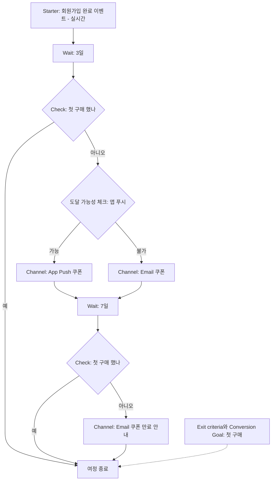
그림 1. 3일 차 여정을 Architect로 옮긴 흐름

앞 장의 그림 1과 나란히 놓고 보자. 골격은 거의 같다. 입구 하나, 대기 두 번, 판단 두 번, 메시지 두 번, 출구 하나. 달라진 곳은 도달 가능성 체크가 들어간 자리 정도다. 물론 Canvas에서도 채널 도달 여부로 길을 가를 수 있다. Architect가 이 체크를 여정의 기본 상자로 전면에 내세우고 있을 뿐이다.

앞 장에서 했던 질문도 그대로 가져올 수 있다. 종료 조건이 첫 구매자를 이미 내려 주는데 Check가 꼭 필요할까? 결론도 같다. 목표 달성은 종료 조건에 맡기고, Check는 정말로 길을 가를 필요가 있는 곳에 쓰는 편이 여정을 단순하게 만든다. Check를 남겨 둔다면 "종료 조건이 혹시 놓친 사람을 한 번 더 거르는 안전장치"라는 의도를 설계서에 적어 두자. 의도가 적혀 있지 않은 분기는 몇 달 뒤 아무도 지우지 못하는 분기가 된다.

마지막으로 쿠폰 메시지는 Promotional Use Case로 만든다. 수신 동의를 한 고객에게만 나가도록 하는 장치가 여기서 걸린다.

## 리포트와 테스트 — 켜기 전에, 켠 다음에

Architect의 테스트 장치는 Canvas와 비슷하면서도 결이 조금 다르다. Feature Set 문서가 꼽는 테스트 기능은 테스트 발송, 랜덤 테스트, 샘플 프로필로 동적 콘텐츠 미리보기, 사용자 추적, 그리고 앞에서 본 Dry Run이다.

Dry Run부터 돌려 보자. 실제 발송 없이 진입 인원과 흐름을 볼 수 있으니, "하루에 몇 명이 들어오고, 그중 몇 명이 도달 가능성 체크에서 이메일 쪽으로 빠지는가"를 켜기 전에 가늠할 수 있다. 예상보다 진입 인원이 터무니없이 적다면 Starter의 이벤트나 진입 조건부터 의심해 보자. 다만 Dry Run이 모든 기능을 그대로 흉내 내지는 않는다. 예를 들어 Insider One 문서는 발송 시간 최적화(STO)가 Dry Run과 테스트 상태에서는 동작하지 않는다고 밝힌다. 이 이야기는 8장에서 다시 만난다.

샘플 프로필로 동적 콘텐츠를 미리 보는 기능은 7장의 개인화와 직결된다. 고객 이름이나 상품명이 들어가는 메시지라면, 값이 꽉 찬 프로필과 비어 있는 프로필을 모두 넣어 보는 편이 낫다. 사용자 추적은 특정 고객이 여정 안에서 어디를 지나고 있는지 따라가 보는 기능이다. 고객센터에서 "저는 왜 이 쿠폰을 받았죠?"라는 문의가 왔을 때 가장 먼저 열어 볼 화면이다.

켠 다음에는 Journey Analytics가 기다린다. 문서가 소개하는 리포트는 실시간 흐름 통계, 채널별 통계와 여정 전체 통계, 성과 대시보드, A/B 통계, 데이터 export, 전환 목표, last-touch 어트리뷰션이다. 처음에는 흐름 통계에서 "각 상자에 몇 명이 지나갔는가"부터 보자. 어느 상자에서 사람이 예상보다 많이 빠지거나 고이는지가 보이면 설계서와 실제가 어디서 어긋났는지 알 수 있다. 전환 숫자를 볼 때는 앞에서 말한 어트리뷰션 방식이 그 숫자를 어떻게 셌는지를 함께 떠올리자.

## 두 여정 빌더 사이를 오가는 번역표

Architect에 대한 현장 평가는 Canvas만큼이나 엇갈린다. Gartner 리뷰에는 Architect 덕분에 "without asking engineers every time" 여정을 짤 수 있다는 호평이 있고, 2024년의 3.0점짜리 리뷰는 "steep initial learning curve"를 지적했다(둘 다 리뷰 검색 요약으로 확인한 내용이다). 2026-10에 올라온 여행업 사용자의 리뷰도 "There was a steeper learning curve than we expected"라고 적었다. 앞 장에서 본 Braze 리뷰의 "feature-dense"라는 불평과 겹쳐 보면, 두 도구 모두 첫 여정까지의 언덕이 만만치 않다는 점은 같다.

그 언덕을 덜 가파르게 만드는 방법이 이 장 내내 해 온 일이다. 설계서 한 장을 들고, 도구의 상자 이름으로 번역하는 것. 한 번 번역해 보면 다른 도구로 옮기는 일도 어렵지 않다. 회사가 쓰는 도구가 바뀌거나, 이직한 회사가 다른 도구를 쓰더라도 아래 표가 있으면 개념은 그대로 가져갈 수 있다. 2026-11 기준으로 정리했다.

| 결정 | Braze Canvas | Insider One Architect |
|---|---|---|
| 여정 빌더 이름 | Canvas (기본 편집기 Canvas Flow) | Architect (편집 화면도 canvas라고 부름) |
| 여정의 상자 | 컴포넌트 | Element |
| 입구 | 진입 방식(Scheduled·Action-Based·API-Triggered) + 진입 대상 세그먼트 | Starter(=Trigger), 실시간·날짜 기반 |
| 기다리기 | Delay | Wait Elements |
| 조건으로 가르기 | Decision Split, Audience Paths | Check Elements → Path |
| 행동을 기다렸다가 가르기 | Action Paths | Live Actions, Check(기간 내 이벤트) |
| 보낼 수 있는지 확인 | 진입 대상 세그먼트·분기 조건으로 처리 | 도달 가능성(reachability) 체크 |
| 메시지 보내기 | Message | Channel Elements |
| 프로필 속성 바꾸기 | User Update | 흐름 중 속성 업데이트 |
| 광고 매체로 보내기 | Canvas Audience Sync | Facebook Custom Audiences, Google Ads |
| 외부 시스템 호출 | 웹훅(Message 단계의 채널) | Call an API |
| 여정 안 실험 | Experiment Paths, Winning Path | Journey A/B Split, A/B autowinner |
| 최적 채널 | Intelligent Channel filter | Next Best Channel |
| 발송 시간 최적화 | Intelligent Timing (Message 단계에서 설정) | Send Time Optimization (채널 단계) |
| 개인화 | Liquid | Dynamic Content, Liquid(얼리 액세스) |
| 놓아주기 | Exit criteria | Exit criteria(종료 조건) |
| 성공 세기 | 전환 이벤트 | Conversion Goal, Conversion Attribution Model |
| 몇 번째 메시지인가 | (대응 용어 없음 — 공식 문서 확인) | Layer |
| 발송 없이 리허설 | 사용자 경로 미리보기, 테스트 발송 | Dry Run, 샘플 프로필 미리보기, 랜덤 테스트 |
| 신규 진입만 막기 | (대응 용어 없음 — 공식 문서 확인) | Sunset |
| 동의가 필요한 여정 구분 | 구독 상태·opt-in 설정으로 처리 | Promotional vs Transactional Use Case |

표의 오른쪽과 왼쪽은 이름이 다를 뿐 같은 결정을 가리킨다. 여정 하나를 설계서로 쓸 수 있다면, 두 도구 중 어느 쪽 화면 앞에 앉아도 길을 잃지 않는다.

### 이 장의 핵심

- Architect는 UCD 위에서 돌아가는 Insider One의 여정 빌더로, starter에서 시작해 행동·속성에 따라 if/else로 갈라진다. 편집 화면을 canvas라 부르지만 이 책의 "Canvas"는 언제나 Braze다.
- 상자는 Starter·Wait·Check·Channel·Action의 다섯 계열이고, Journey A/B Split·Next Best Channel·Dynamic Content가 따로 붙는다.
- Live Actions, Layer, Dry Run, Sunset, Promotional/Transactional은 Canvas에 같은 이름이 없는 Architect 고유 용어다. 특히 프로모션 여정에는 수신 동의가 필요하다.
- 도달 가능성 체크로 "보낼 수 없는 고객"의 길을 따로 내고, 종료 조건으로 첫 구매자를 놓아준다.
- 같은 설계서를 두 도구의 상자 이름으로 번역할 수 있으면, 도구가 바뀌어도 여정 설계 능력은 그대로 남는다.

# 7장. 한 사람에게 말 걸기 — Liquid와 개인화

화요일 오후 2시, 첫 개인화 푸시가 나갔다. 고객 이름을 넣어 "OO님, 장바구니에 담아 두신 상품이 곧 품절돼요"라고 말을 거는 메시지다. 테스트 발송도 했다. 내 폰에서는 "지은님, 장바구니에 담아 두신 상품이…"라고 예쁘게 떴다. 커피를 한 모금 마시는데 사내 메신저가 울린다. 고객센터 채널에 캡처 한 장이 올라와 있다.

"안녕하세요, 님! 장바구니에 담아 두신 상품이 곧 품절돼요."

이름이 들어갈 자리가 텅 비어 있다. 10분 사이에 비슷한 캡처가 두 장 더 올라온다. 누군가는 "님이 누구예요?"라고 묻고, 누군가는 "자동 발송 티 너무 나네요"라고 적었다. 이미 수만 명에게 나간 메시지는 되돌릴 수 없다. 등줄기가 서늘해진다.

무엇이 잘못됐을까? 문법은 틀리지 않았다. 내 폰에서는 멀쩡히 나왔으니까. 문제는 이름이 저장되어 있지 않은 고객이었다. 개인화 사고는 대개 이렇게 난다. 코드를 잘못 써서가 아니라, 값이 없는 사람을 생각하지 못해서다. 이 화요일 오후를 거꾸로 되짚어 가며 Liquid와 개인화를 살펴보자.

## Liquid는 편지 양식의 빈칸이다

어릴 때 받아 본 단체 생일 카드를 떠올려 보자. "사랑하는 ______에게"라고 인쇄된 카드에 이름만 손으로 채워 넣는다. 수백 장을 보내도 받는 사람은 자기 이름이 적힌 한 장을 받는다. 메시지 개인화의 원리도 이와 같다. 메시지 본문에 빈칸을 뚫어 두고, 보내는 순간 받는 사람의 정보로 채운다.

그 빈칸을 표기하는 약속이 Liquid다. Liquid는 Shopify가 만든 오픈소스 템플릿 언어로, Braze 문서는 이렇게 설명한다.

> "Liquid is an open-source template language created by Shopify and used by Braze to power dynamic personalization."

핵심은 "발송 직전에 치환된다"는 점이다. 마케터가 쓰는 것은 빈칸이 뚫린 양식이고, 고객이 받는 것은 빈칸이 채워진 완성본이다. 그 사이에서 도구가 고객 프로필을 들여다보고 빈칸을 채운다. 그러니 2장에서 말한 사용자 프로필과 UCD에 값이 없으면, 빈칸은 빈칸으로 남는다. 화요일 오후의 사고가 정확히 이 지점에서 났다.

Liquid의 기호는 세 가지만 알면 읽을 수 있다. 이중 중괄호 `{{ }}`는 "여기에 값을 출력하라"는 뜻이다. 중괄호와 퍼센트 기호 ``는 "여기서 판단하라", 즉 조건이나 반복 같은 로직을 뜻한다. 세로 막대 `|`는 필터로, 값을 한 번 가공해서 내보내라는 뜻이다. 대문자로 바꾸거나, 숫자를 반올림하거나, 날짜 형식을 바꾸는 일이 필터의 몫이다. 이 세 기호는 Braze와 Insider One 모두에서 같다. 달라지는 것은 빈칸 안에서 고객 정보를 부르는 방식이다.

## Braze에서는 — 정식 기능, 그러나 100%는 아니다

Braze에서 Liquid는 2026-11 기준 정식 기능이다. 고객 프로필의 속성을 부를 때는 달러 기호와 중괄호를 쓴다. 이름은 `${first_name}`, 도시는 `${city}`다. 출력 기호와 합치면 이렇게 된다.

```liquid
안녕하세요, {{${first_name}}}님! {{${city}}}에 새로 들어온 상품을 소개할게요.
```
예시 1. Braze Liquid — 이름과 도시 넣기

처음 보면 괄호가 겹겹이 쌓여 있어 눈이 어지럽다. 바깥의 `{{ }}`가 "출력하라", 안쪽의 `${ }`가 "고객 속성을 불러라"라고 나눠 읽으면 금방 익숙해진다.

조건도 같은 방식으로 쓴다. Braze 문서의 예를 빌리면, 고객의 언어 설정이 영어인지 확인해 다른 인사말을 보낼 수 있다.

```liquid
Hi there!안녕하세요!
```
예시 2. Braze Liquid — 언어에 따라 인사말 바꾸기

필터는 `{{"Big Sale" | upcase}}`처럼 쓴다. 이렇게 쓰면 "BIG SALE"이 출력된다. Braze 문서는 Shopify의 Liquid 5까지 지원한다고 밝히고, 배열과 숫자를 다루는 필터로 at_least, at_most, compact, concat, sort_natural, where를 새로 추가했다고 소개한다.

여기서 한 가지 주의할 점이 있다. Braze가 지원하는 것은 Shopify Liquid의 전부가 아니다. Braze 문서도 일부 기능은 지원하지 않으니 발송 전에 테스트하라고 안내하고, Braze의 Liquid FAQ는 Shopify Liquid를 100% 지원하지는 않는다고 적고 있다. 인터넷에서 찾은 Shopify Liquid 예제를 그대로 붙여 넣었는데 Braze에서는 동작하지 않는 일이 생길 수 있다는 뜻이다. 남이 쓴 Liquid를 가져올 때는 미리보기와 테스트 발송으로 한 번 더 확인하는 편이 낫다.

Braze에는 Connected Content라는 기능도 있다. 고객 프로필에 없는 정보를 발송 순간 외부에서 불러와 메시지에 넣는 장치다. BlaBlaCar가 예약 이탈 여정에서 이 기능을 썼다(11장). 날씨나 실시간 재고처럼 프로필에 담아 두기 어려운 값이 필요할 때 쓰는데, 외부 시스템을 불러야 하니 대개 개발팀과 함께 설정한다. 지금은 "프로필 밖의 정보도 빈칸에 넣을 수 있다" 정도로만 알아 두자.

## Insider One에서는 — 얼리 액세스 Liquid와 Dynamic Content

Insider One도 Liquid를 지원한다. 다만 2026-11 기준 상태가 다르다. Insider One Academy의 Liquid Tags 문서(2026-10-20)에 따르면 Insider One의 Liquid는 얼리 액세스 기능이고, 쓰려면 Insider One 팀에 문의해 참여해야 한다. 회사 계정에서 Liquid가 켜져 있는지부터 확인하자. 이 사실을 모르고 Braze 쪽 자료만 보고 덤비면 첫날부터 막힌다.

지원 채널도 정해져 있다. 문서가 밝힌 지원 범위는 App Push(standalone), Web Push, Enhanced Templates, Web Templates, Email, Transactional Email API v2, 그리고 Architect 여정 안의 Email과 Enhanced Templates다. 쓰려는 채널이 이 목록에 있는지 확인하는 것이 첫 단계다. 얼리 액세스 기능은 지원 범위가 빠르게 바뀔 수 있으니, 쓰기 직전에 문서의 지원 목록을 다시 보자.

기호는 같다. 출력은 `{{ }}`, 로직은 ``, 필터는 `|`. 문서에 실린 필터 예는 이렇다.

```liquid
{{ price | times: 100 | round }}
```
예시 3. Insider One Liquid — 필터를 이어 붙여 값 가공하기

`price`에 100을 곱하고 반올림하라는 뜻이다. 필터를 여러 개 이어 붙이면 왼쪽부터 차례로 적용된다. 고객 속성을 부르는 방식은 Braze와 다르다. 웹 템플릿용 Liquid 문서에서는 `{{ attribute.first_name }}` 형태로 부른다. Braze의 `{{${first_name}}}`와 생김새가 전혀 다르니, 두 도구의 예제를 한 메시지에 섞어 쓰지 않도록 조심하자.

Liquid가 얼리 액세스라면 Insider One의 기본 개인화는 무엇일까? Dynamic Content다. 이벤트, 이벤트 파라미터, 속성을 이용해 메시지 내용을 고객별로 바꾸는 기능으로, 6장에서 본 것처럼 Architect의 별도 문서 항목이기도 하다. 다만 Dynamic Content에서 쓰는 개인화 태그의 정확한 표기는 문서마다 표현이 달라, 이 책에서는 문법을 확정해 싣지 않는다. 계정에서 제공하는 태그 선택 기능을 이용하고, 결과는 샘플 프로필 미리보기로 확인하는 편이 안전하다. 참고로 웹 템플릿 문서에 따르면 Liquid 태그 빌더의 속성·이벤트 목록에는 개인 식별 정보(PII)가 나오지 않는다.

정리하면 이렇다. Braze에서 Liquid는 정식 기능이고 개인화의 기본 언어다. Insider One에서는 Dynamic Content가 기본이고, Liquid는 2026-11 기준 얼리 액세스로 들어오는 중이다. 어느 쪽이든 기호 세 개와 "발송 직전 치환"이라는 원리는 같다.

## 사고는 값이 없을 때 난다

화요일 오후로 돌아가 보자. "안녕하세요, 님!"의 문법은 멀쩡했다. 이름이 비어 있는 고객에게 빈칸이 빈칸 그대로 나갔을 뿐이다. 이런 고객은 생각보다 흔하다. 회원가입 때 이름을 필수로 받지 않는 서비스, 소셜 로그인으로 가입해 닉네임만 있는 고객, 앱을 깔고 둘러보기만 하는 익명 사용자. 2장에서 본 것처럼 익명 프로필이 나중에 식별된 프로필과 합쳐질 때 모든 데이터가 따라오지도 않는다.

Phiture가 2023년에 쓴 Liquid 실무 글은 이 문제를 이렇게 정리한다.

> "If there's no first name, we make sure we don't have any blank spaces."

이름이 없으면 빈칸을 남기지 않는다. 방법은 크게 두 가지다. 값이 비었을 때 대신 쓸 기본값을 정해 두거나, 조건문으로 값이 있을 때와 없을 때 문장을 아예 다르게 쓰는 것이다. Braze 문서는 `default` 필터로 기본값을 지정하는 방법을 안내한다. `{{ ${first_name} | default: '고객' }}`님이라고 쓰면 이름이 없는 고객에게는 "고객님"이 나간다. Insider One의 웹 템플릿 문서도 `{{ attribute.first_name | default: "Dear Customer" }}`처럼 같은 필터를 쓴다. 다만 Braze 문서도 빈 값의 종류에 따라 기본값이 나오지 않는 경우가 있다고 주의를 준다. 그래서 조건문으로 직접 가르는 방법도 알아 두면 좋다. 조건문으로 쓰면 이런 모양이 된다.

```liquid
고객님{{${first_name}}}님, 장바구니를 확인해 보세요.
```
예시 4. Braze Liquid — 이름이 없을 때 다른 호칭 쓰기

문법보다 중요한 것은 습관이다. 빈칸 하나를 만들 때마다 "이 값이 없는 고객에게는 뭐라고 말하지?"를 같이 묻는 습관. 그리고 그 답을 미리보기로 확인하는 습관이다. 한 QA 담당자는 Braze 리뷰에 이런 장점을 적었다.

> "it gives me a straightforward way to check the Liquid scripting by previewing it with different values"

여러 값으로 미리보기를 해 보라는 것이다. 내 폰에서 예쁘게 나왔다고 끝내지 말고, 이름이 꽉 찬 고객, 이름이 빈 고객, 이름이 아주 긴 고객, 영문 이름인 고객을 하나씩 넣어 보자. Insider One에서도 Architect의 샘플 프로필 미리보기로 같은 확인을 할 수 있다.

값이 없는 것만큼 흔한 사고가 하나 더 있다. 빈칸의 이름 자체가 틀리는 경우다. 앞서 인용한 Phiture 글의 예제 코드에는 같은 값을 가리키는 변수 이름이 곳곳에서 엇갈려 있다. `order_ide`와 `order_id`, `product_link`와 `product_url`, `favoriteProduct`와 `favoriteProducts` 같은 식이다. 전문가가 공들여 쓴 글에서도 이런 일이 생긴다. 하물며 바쁜 발송일의 마케터라면 어떨까? 변수 이름은 기억에 의존하지 말고, 2장에서 개발팀과 함께 만든 데이터 사전에서 복사해 붙이자. 철자 하나, 끝의 s 하나 차이로 빈칸이 통째로 비어 나간다.

현장에서 Liquid를 두고 "steep learning curve and heavy QA burden"이라는 평이 나오는 것도 같은 맥락이다. Liquid가 어려운 이유는 기호가 낯설어서라기보다, 고객 수만큼의 경우의 수를 미리 상상해야 하기 때문이다.

## 복잡한 판별은 속성으로 굳혀 두자

Liquid에 익숙해지면 욕심이 생긴다. "최근 30일 안에 두 번 이상 샀고, 그중 한 번은 할인 상품이고, VIP 등급이 아닌 고객에게만 이 문구를 넣자" 같은 판단을 Liquid 조건문 안에서 다 해결하고 싶어진다. 가능은 할지 모른다. 그런데 그 조건문을 석 달 뒤의 나, 혹은 내 자리를 이어받은 동료가 읽을 수 있을까? 조건이 길어질수록 테스트해야 할 경우의 수도 폭발한다. 찜찜하다.

Braze 사용자 커뮤니티에서 비슷한 질문에 달린 답이 좋은 방향을 알려 준다.

> "The easiest way to do this is add a custom attribute to users in your segment then use liquid to insert your content based on that attribute."

복잡한 판별은 세그먼트로 해 두고, 그 결과를 커스텀 속성으로 고객 프로필에 붙인 다음, Liquid는 그 속성 하나만 보게 하라는 것이다. 판단은 세그먼트가, 문구 선택은 Liquid가 나눠 맡는다. 5장에서 본 User Update나 6장의 흐름 중 속성 업데이트가 바로 이런 속성을 붙이는 데 쓰인다. 이렇게 하면 Liquid는 짧아지고, 판별 조건은 세그먼트 화면에서 누구나 확인할 수 있다.

잡코리아의 사례도 이 방향과 맞닿아 있다. Braze가 게재한 사례에 따르면 잡코리아의 CRM 담당자는 커스텀 속성을 Canvas와 실시간 갱신, CSV 일회성 업로드로 꾸준히 관리했고, Liquid로는 가입일을 날짜 형식으로 바꿔 오늘과의 차이, 즉 가입 경과 일수를 계산해 문구에 넣었다. 그렇게 나온 카피가 이것이다.

> "잡코리아에 가입한 n일동안, 경쟁자들은 연봉 UP하고 있어요!"

n 자리에 고객마다 다른 숫자가 들어간다. 날짜 계산처럼 Liquid가 잘하는 일은 Liquid에 맡기고, 누구에게 보낼지는 속성과 세그먼트로 정한 셈이다. 이 카피를 쓴다면 어떤 경우를 미리 상상해야 할까? 가입 당일에 메시지가 나가면 n은 0이 되고, "가입한 0일 동안"이라는 어색한 문장이 만들어진다. 가입일 속성이 비어 있는 고객이라면 계산 자체가 틀어진다. 빈칸의 예외를 상상하는 일은 이렇게 카피 한 줄에도 따라붙는다. 이 사례의 온보딩 여정 전체는 10장에서 해부한다.

## 개인화는 정말 효과가 있을까

여기까지 오면 근본적인 질문이 남는다. 이름 하나 넣으려고 이렇게까지 해야 할까? 개인화는 정말 효과가 있을까?

근거는 엇갈린다. 개인화 연구에서 자주 인용되는 Sahni, Wheeler, Chintagunta의 2018년 연구는 대규모 필드 실험에서 이메일 제목에 수신자 이름을 넣었더니 오픈 확률이 약 9.05%에서 10.80%로, 상대적으로 약 20% 올랐다고 보고했다. 주 실험에서는 세일즈 리드도 31% 늘었다(2차 출처로 확인한 수치다). 정보로서는 아무 가치가 없는 이름 한 단어가 행동을 바꾼 것이다.

그런데 2023년 Marketing Letters에 실린 한 연구는 이름 개인화의 효과를 재현하지 못했다. 오픈율도 클릭률도 나아지지 않았다. 한편 2025년에 발표된 반려동물 활동 모니터링 앱의 필드 실험(보호자 595명)에서는 개인화 푸시가 일반 푸시보다 참여가 높았고, 보호자 이름과 반려동물 이름을 둘 다 넣은 알림이 반려동물 이름만 넣은 알림보다 나았다. 참여 이력 데이터를 넣는 것도 효과가 있었지만 이름 개인화만 한 것보다 유의하게 더 크지는 않았다. 다만 표본이 작고 앱 하나에서 나온 결과다.

벤더 사례도 있다. 잡코리아 사례에서 Braze는 지원자 데이터로 개인화한 메시지의 평균 CTR이 4~5배 늘었다고 소개한다. 회사 측 발표이고, 2023년 시점의 수치다.

이 결과들을 한 줄로 묶으면 무엇일까? "개인화는 효과가 있다"도 "없다"도 아니다. 효과는 고객과 맥락에 따라 다르다. 우리 고객에게 통할지는 우리 고객으로 테스트해 봐야 안다. 이름을 넣은 버전과 넣지 않은 버전을 나눠 보내는 작은 실험 하나가 어떤 논문보다 우리 팀에 정확한 답을 준다. 실험 설계는 13장에서 다룬다.

마지막으로 요즘 흐름 하나. Liquid를 직접 쓰는 부담을 AI가 덜어 주는 쪽으로 도구가 움직이고 있다. Braze 문서는 BrazeAI의 생성형 AI 기능이 카피와 이미지뿐 아니라 Liquid와 HTML 템플릿 작성도 돕는다고 소개한다. 현장에서는 "Liquid Assistant"라는 이름도 돌지만, 이 이름은 1차 문서 목록에서 확인되지 않았다. 이 이야기는 8장에서 이어 가자. 다만 AI가 써 준 Liquid도 값이 없는 고객 앞에서는 똑같이 빈칸을 남길 수 있다는 점은 미리 말해 두고 싶다.

## 발송 전 개인화 QA 체크리스트

화요일 오후의 사고는 아래 목록 중 한 줄만 지켰어도 막을 수 있었다. 개인화가 들어간 메시지를 예약하기 전에, 한 줄씩 소리 내어 확인해 보자.

```text
[발송 전 개인화 QA 체크리스트]

□ 빈칸마다 "값이 없을 때" 문구가 있는가? (기본값 또는 조건문)
□ 미리보기를 네 종류 이상의 고객으로 돌려 봤는가?
    - 값이 꽉 찬 고객 / 값이 빈 고객 / 아주 긴 값 / 예상 밖 값(영문, 0, 과거 날짜)
□ 변수 이름을 데이터 사전에서 복사해 왔는가? (철자, 대소문자, 단수·복수)
□ 한 메시지에 한 도구의 문법만 썼는가?
    - Braze: {{${속성}}}   /   Insider One: 계정의 태그 표기
□ (Braze) 외부에서 가져온 Shopify Liquid 예제가 Braze에서 동작하는지 테스트했는가?
□ (Insider One) 계정에서 Liquid 얼리 액세스가 켜져 있고, 이 채널이 지원 목록에 있는가?
□ 복잡한 판별을 Liquid 대신 세그먼트·커스텀 속성으로 옮길 수 있는가?
□ 실제 기기와 메일함으로 테스트 발송을 받아 봤는가?
□ 잠금 화면이나 미리보기 창에 이 개인 정보가 보여도 괜찮은 메시지인가?
□ 개인화 효과를 확인할 비교군(개인화 안 한 버전)을 두었는가?
```

목록이 길어 보이지만 익숙해지면 5분이면 끝난다. 그 5분이 고객센터 채널에 올라올 캡처 한 장을 막아 준다.

### 이 장의 핵심

- Liquid는 메시지에 뚫어 둔 빈칸을 발송 직전 고객 정보로 채우는 템플릿 언어다. 출력 `{{ }}`, 로직 ``, 필터 `|` 세 기호로 읽는다.
- Braze에서는 정식 기능(`{{${first_name}}}` 형태, Liquid 5까지 지원)이지만 Shopify Liquid를 100% 지원하지는 않는다. Insider One에서는 2026-11 기준 Liquid가 얼리 액세스이고, 기본 개인화는 Dynamic Content다.
- 개인화 사고는 대개 문법 오류보다 값이 없는 고객과 변수 이름 불일치에서 난다. 여러 값으로 미리보기하는 습관이 가장 강한 방어다.
- 복잡한 판별은 세그먼트와 커스텀 속성으로 굳혀 두고, Liquid는 그 속성만 참조하게 한다.
- 개인화 효과에 대한 연구는 엇갈린다. 우리 고객에서 통하는지는 비교 실험으로 확인한다.

# 8장. AI가 거드는 마케팅 — BrazeAI와 Agent One

AI가 누구에게, 언제, 어느 채널로 보낼지 정해 준다면 마케터에게는 무엇이 남을까?

입사하고 몇 주가 지나면 이 질문이 꽤 현실적으로 다가온다. Braze 화면 곳곳에는 BrazeAI 표시가 붙어 있고, Insider One 쪽 소개 자료에는 Agent One이라는 이름이 맨 앞에 나온다. 발송 시간을 알아서 골라 주고, 채널을 대신 골라 주고, 카피와 Liquid까지 써 준다고 한다. 그러면 세그먼트를 고민하고 여정을 그리던 일은 곧 사라지는 걸까?

답을 미리 말하면 김이 빠지니, 이렇게 접근해 보자. AI 기능 하나하나를 "이 기능은 무엇을 대신 결정해 주는가"라는 질문으로 분류하는 것이다. 그렇게 나눠 보면 AI가 맡는 결정과 여전히 사람이 맡아야 하는 결정 사이에 꽤 또렷한 선이 보인다. 그 선이 어디쯤 있는지 함께 찾아보자.

## 이름부터 정리하자

AI 기능을 공부하려고 검색을 시작하면 이름 때문에 먼저 헷갈린다. 두 회사 모두 2023년부터 2026년 사이에 AI 브랜드 이름을 바꿨기 때문이다. 이 책은 **2026-11 기준** 이름으로 고정해서 쓴다.

Braze는 2023-06-27에 "Sage AI by Braze"라는 이름으로 AI 기능 묶음을 발표했다. 그 뒤로는 BrazeAI라는 이름으로 통칭하고 있고, 공식 문서 주소도 `/sage_ai/`에서 `/brazeai/`로 옮겨 갔다. 다만 "이름을 바꾼다"는 공식 공지는 리서치에서 찾지 못했다. 예전 블로그나 강의에서 Sage AI라는 말을 만나면 지금의 BrazeAI를 가리킨다고 읽으면 된다. 기능 이름도 함께 바뀌었다. 예전의 Intelligent Selection은 지금 Optimize with BrazeAI로, Most Engaged 필터는 Intelligent Channel filter로 부른다.

Insider One 쪽은 조금 더 복잡하다. 예전에는 Sirius AI라는 브랜드를 썼는데, 2025-03에 그 위에 자율 에이전트를 얹은 Agent One을 발표했다. 그리고 2026-09-17에 Agent One을 Agent One Teams와 Agent One Audiences라는 두 축으로 다시 정의해 발표했다. 리뷰 사이트 G2가 제품명을 "Insider One (Agent One, ex-Sirius AI)"로 적고 있으니, Sirius AI는 Agent One에 흡수된 옛 이름으로 보는 편이 자연스럽다. 한국어 플랫폼 페이지에는 모듈 이름으로 "Insider One AI"라는 표현도 함께 나온다.

이름을 굳이 길게 정리한 이유가 있다. 인터넷에서 찾은 자료가 어느 시점의 이야기인지 가늠하는 단서가 바로 이 이름이기 때문이다. Sirius AI 시절 자료에 나온 수치나 화면은 지금과 다를 가능성이 크다.

## AI 기능을 "무엇을 결정해 주는가"로 나누자

기능 이름을 하나씩 외우기 전에 분류표부터 펼쳐 보자. 마케터가 메시지 하나를 보낼 때 내리는 결정은 대략 다섯 가지다. 누구에게 보낼지, 언제 보낼지, 어느 채널로 보낼지, 어떤 내용을 보낼지, 그리고 무엇을 권할지. 두 제품의 AI 기능을 이 다섯 칸에 넣어 보면 다음과 같다.

| 결정 | Braze (BrazeAI) | Insider One | 더 자세히 |
|---|---|---|---|
| 누구에게 | Predictive Churn, Predictive Events | Predictive Segments | 3장, 12장 |
| 언제 | Intelligent Timing | Send Time Optimization(STO) | 이 장 |
| 어느 채널로 | Intelligent Channel filter | Next Best Channel | 이 장 |
| 어떤 내용을 | Optimize with BrazeAI, Winning Path, Generative AI | A/B autowinner, Agent One | 이 장, 13장 |
| 무엇을 권할지 | AI item recommendations | Smart Recommender | 이 장, 12장 |
| 여러 결정을 한꺼번에 | Operator, Braze Agents, Decisioning Studio | Agent One Teams | 이 장 |

표 위쪽 다섯 줄은 결정 하나를 맡는 기능이다. 발송 시간만 고르거나, 채널만 고르거나, 이긴 변형만 골라 준다. 마지막 줄은 성격이 다르다. 목표를 주면 여러 결정을 묶어서 내리거나, 대화하듯 지시하면 캠페인을 만들어 주는 쪽이다. 요즘 "에이전트"라는 말이 붙는 기능은 대부분 이 줄에 들어간다.

이렇게 나눠 두면 새 기능이 발표돼도 당황할 일이 줄어든다. 이름이 낯설어도 "이건 어느 칸을 대신해 주는 기능일까?"를 먼저 물으면 되기 때문이다.

## BrazeAI 기능 한눈에 보기 (2026-11 기준)

Braze 공식 문서의 BrazeAI 목록을 2026-11 기준으로 정리하면, 위의 칸 바깥에 있는 큰 덩어리가 세 개 보인다.

첫째는 **BrazeAI Operator**다. 대시보드 안에서 대화하듯 캠페인과 Canvas를 만들고, 검토하고, 분석하는 기능이다. 카피·이미지·Liquid·HTML 템플릿을 만들어 주고 콘텐츠를 검토해 주는 Generative AI 기능도 Operator를 거쳐 쓰는 구조다. 7장에서 Liquid 작성을 AI가 거들 수 있다고 했던 것이 바로 이 부분이다. 커뮤니티에서는 "Liquid Assistant"라는 이름이 돌기도 하는데, 2026-11 공식 문서 목록에서는 그 이름을 확인하지 못했다.

둘째는 **Braze Agents**다. 메시지를 보내는 바로 그 순간, 사용자 한 명 단위로 분류하고, 경로를 정하고, 정보를 보강하고, 문구를 쓰는 에이전트다. 5장 Canvas 컴포넌트 목록에 Agent가 있던 것을 떠올려 보자. 여정 한가운데에 끼워 넣는 AI 판단 단계라고 생각하면 이해하기 쉽다.

셋째는 **Decisioning Studio**다. Go와 Pro 두 가지가 있다. Go는 수신자마다 콘텐츠·타이밍·빈도를 개인화하고, Pro는 오퍼까지 포함한 모든 레버를 비즈니스·재무 지표에 맞춰 최적화한다. 이 기능의 뿌리는 Braze가 2025-06-02에 인수를 마친 OfferFit이다. Braze의 2025 연간 리뷰는 Decisioning Studio를 강화학습으로 고객별 채널·메시지·오퍼·타이밍·빈도를 정하는 기능으로 소개한다.

여기에 3장에서 본 Predictive Suite, 카탈로그 기반 AI item recommendations, 그리고 개인정보를 뺀 Braze 데이터를 Claude·Cursor 같은 외부 AI 도구에 열어 주는 Braze MCP server가 더해진다.

한 가지 주의할 점이 있다. Braze의 2025-12 연간 리뷰에서 Operator와 Agent Console은 베타로 소개됐다. 2026-11 기능 목록에서 Operator는 상태 표시 없이 올라 있고, Agent Console이라는 이름은 목록에 따로 보이지 않는다. Content Optimizer도 목록에 베타로 표시돼 있다. 그래서 이 책은 이 기능들을 정식 출시(GA)라고 쓰지 않는다. 우리 회사 계정에서 쓸 수 있는지, 추가 계약이 필요한지는 담당 매니저에게 먼저 물어보자. 이 영역은 몇 달 단위로 바뀌니 공식 문서를 함께 확인하는 편이 낫다.

## Agent One — 목표를 주면 다음 행동을 고른다

Insider One의 2026-09-17 발표는 Agent One을 "자율 고객 참여를 위한 자기 최적화 지능 시스템"으로 소개했다. 구조는 두 축이다.

**Agent One Teams**는 마케터 쪽을 향한다. 마케터가 목표와 가드레일(넘지 말아야 할 선)을 정하면, Agent One이 다음 최적 행동을 고른다. 이때 기획·콘텐츠·오케스트레이션·최적화를 맡는 전용 에이전트를 불러 쓰고, 결과를 보고 배운다는 것이 회사 측 설명이다. **Agent One Audiences**는 고객 쪽을 향한다. 고객이 자기 말로 표현한 의도를 해석하는 역할이다. 이름이 붙은 에이전트로는 Shopping Agent와 Support Agent가 있다.

> "Agent One autonomously makes and acts upon millions of decisions" — Serhat Soyuerel, Insider One CRO (2026-09-17 보도자료)

멋진 문장이지만 벤더 발표라는 점은 기억해 두자. "수백만 개의 결정"이 각각 얼마나 잘 내려졌는지는 이 문장이 말해 주지 않는다. Sirius AI 시절에 나온 "마케팅 팀 생산성 향상" 같은 수치도 마찬가지다. 발행 시점조차 분명하지 않은 자사 주장이라 이 책에서는 인용하지 않는다.

Braze와 비교하면 어떨까? Braze는 Operator·Agents·Decisioning Studio처럼 역할별로 이름을 나눠 놓았고, Insider One은 Agent One이라는 하나의 지능 시스템 아래에 마케터용과 고객용을 묶었다. 어느 쪽이 낫다기보다 설명하는 방식이 다르다. 실무에서 물어야 할 질문은 같다. 목표를 무엇으로 줄 수 있는지, 가드레일로 무엇을 막을 수 있는지, 그리고 AI가 내린 결정을 사람이 어디서 확인할 수 있는지다.

## 언제 보낼까 — Intelligent Timing과 Send Time Optimization

AI 기능 가운데 주니어가 가장 먼저 켜 보게 되는 것은 아마 발송 시간 최적화일 것이다. 체크박스 하나로 켤 수 있고, 효과도 직관적으로 그럴듯해 보이기 때문이다. 그런데 두 제품의 동작 방식은 생각보다 꽤 다르다.

**Braze Intelligent Timing**은 사용자마다 과거 상호작용 통계를 분석해 그 사람이 가장 많이 반응하는 시각(5분 단위로 반올림)에 보낸다. 재료는 세션 시간, 푸시를 직접 또는 간접으로 연 기록, 이메일 클릭·오픈(기계가 자동으로 연 것은 제외), 그리고 링크 단축과 고급 추적을 켰을 때의 SMS 클릭이다. 데이터가 부족한 사용자를 위해 폴백을 정할 수 있는데, 워크스페이스 평균 세션 시작 시각(Most popular)이나 직접 정한 시각(Custom) 중에서 고른다. 세션 데이터가 전혀 없으면 사용자 현지 시각 오후 5시에 보낸다. Canvas에서는 Message 단계에서 설정한다.

**Insider One Send Time Optimization**은 Architect의 채널 단계에서 사용자별 최적 시각까지 기다렸다가 보낸다. 대상 채널은 Web Push, App Push, Email, SMS, WhatsApp이다. 계산할 때 App Push·SMS·WhatsApp은 모바일 활동으로, Email·Web Push는 웹 활동으로 묶는다. 클릭을 가장 믿을 만한 반응으로 보고 가중치를 주며, Architect 채널에서 생긴 클릭만 본다. 하루를 시간 단위로 나눠 24시간 안에서 최적 시각을 고르고, 폴백은 바로 보내기(Send immediately) 또는 지정 시각(Send at)이다. Silent hours를 설정해 두면 최적 시각이 그 안에 걸릴 때 다음 최적 시각으로 넘긴다.

켜기 전에 꼭 확인할 제약도 있다.

| 제약 | Braze Intelligent Timing | Insider One STO |
|---|---|---|
| 쓸 수 없는 경우 | API 트리거 캠페인 | Dry Run·테스트 상태 |
| 즉시 나가는 채널 | 인앱, 웹훅 | — |
| 함께 바뀌는 설정 | — | 해당 채널의 Override Global Frequency Capping이 자동으로 켜짐 |

마지막 줄은 특히 눈여겨보자. Insider One에서 STO를 켜면 그 채널은 전역 빈도 상한을 무시하는 설정이 자동으로 켜진다. 문서가 이유를 밝히지는 않지만, 사람마다 다른 최적 시각을 지키는 일과 전역 상한이 서로 부딪힐 수 있다는 뜻으로 읽힌다. 피로도를 관리하려고 상한을 정성껏 세워 둔 팀이라면 아찔한 대목이다. 이 충돌은 9장에서 피로도 관리를 다룰 때 다시 꺼낸다. 또 Dry Run에서는 STO가 동작하지 않으니, 시뮬레이션 결과의 발송 시각이 실제와 다를 수 있다는 점도 알아 두자.

그렇다면 발송 시간 최적화는 정말 효과가 있을까? 학술 근거는 생각보다 얇다. 약 100만 명의 이메일 데이터를 5개월간 본 연구(Singh et al., 2020)에서 개인별 상위 10개 시간대의 오픈율은 19.24%, 무작위 10개 시간대는 16.48%였다. 그런데 이 결과는 무작위 필드 실험이 아니라 관찰 데이터에서 나왔고, 동료 심사도 확인되지 않은 프리프린트다. 무작위 실험으로 개인별 발송 시간 최적화를 검증한 논문은 리서치에서 찾지 못했다. 벤더가 내놓는 효과 수치는 어디까지나 벤더 발표로 읽는 편이 낫다. 우리 고객에게 효과가 있는지 알고 싶다면 STO를 켠 그룹과 끈 그룹을 나눠 비교해 보면 된다. 그 방법은 13장에서 다룬다.

## 어느 채널로 — Intelligent Channel filter와 Next Best Channel

같은 고객이라도 푸시는 잘 열고 이메일은 거의 안 보는 사람이 있고, 그 반대인 사람도 있다. 채널 선택을 AI에 맡기는 기능은 이 차이를 이용한다.

Braze의 **Intelligent Channel filter**(예전 이름 Most Engaged)는 세그먼트 필터다. 마케터가 고른 채널이 그 사용자에게 "최적" 채널인 사람만 골라낸다. 예를 들어 푸시 캠페인에 이 필터를 걸면, 푸시를 가장 잘 반응하는 채널로 둔 사용자만 남는다. 채널마다 메시지를 하나씩 만들어 두고 각각 이 필터를 걸면, 결과적으로 사람마다 자기에게 맞는 채널로 받게 된다.

Insider One의 **Next Best Channel**은 Architect 안의 Element다. 사용자별 채널 참여 확률 점수를 읽고, 도달할 수 있는 채널만 남긴 뒤, 그중 가장 나은 경로로 사용자를 보낸다. 6장에서 본 Element 목록에 별도 항목으로 있던 바로 그 기능이다.

둘의 차이는 쓰는 위치에 있다. Braze는 "누구를 남길까"를 정하는 필터로, Insider One은 "어느 길로 보낼까"를 정하는 분기로 설계됐다. 어느 쪽이든 전제는 같다. 고객이 여러 채널에 도달 가능해야 하고, 채널별 반응 기록이 쌓여 있어야 한다. 앱을 설치하지 않은 고객에게는 푸시가 아무리 최적이라도 보낼 길이 없다. 4장에서 본 도달 가능성(reachability)이 여기서도 먼저다.

## 어떤 메시지가 이겼나 — 자동 승자 선택

변형 A와 B를 만들어 두고 이긴 쪽으로 트래픽을 몰아 주는 기능도 두 제품 모두에 있다. Braze의 **Optimize with BrazeAI**는 변형을 테스트한 뒤 성과가 좋은 쪽으로 트래픽을 옮긴다. 조건이 있다. 반복 발송 캠페인이어야 하고, 변형이 둘 이상이어야 하며, 전환 이벤트가 정해져 있어야 한다. 한 번만 나가는 캠페인에는 쓸 수 없다. Canvas 안에서는 Experiment Paths의 Winning Path가 비슷한 역할을 한다. Insider One에서는 Architect의 Journey A/B Split과 함께 **A/B autowinner**를 쓴다.

여기서 꼭 짚을 질문이 하나 있다. "이겼다"는 무엇을 기준으로 판정할까? 기준을 클릭으로 잡으면 AI는 클릭을 잘 부르는 변형을 고른다. 그런데 클릭을 잘 부르는 메시지와 구매를 잘 부르는 메시지가 같다는 보장은 없다. 한 소매은행의 디스플레이 광고 연구(Schwartz, Bradlow & Fader, 2017)는 이 차이를 숫자로 보여 준다. 노출 7억 5천만 회가 넘는 캠페인에서 실험하면서 동시에 승자로 예산을 옮기는 방식(밴딧)을 써서 2개월간 고객 획득률을 8% 높였는데, 만약 전환 대신 클릭률을 최적화했다면 고객 획득은 약 10% 줄었을 것으로 추정했다. Braze가 Optimize with BrazeAI에 전환 이벤트를 요구하는 것도 같은 맥락으로 읽을 수 있다.

자동 승자 선택은 실험을 대신해 주는 것처럼 보이지만, 무엇을 목표로 삼을지는 여전히 마케터가 정한다. 대조군을 어떻게 두고 결과를 어떻게 읽는지는 13장에서 제대로 다루자.

## 상품 추천은 맛보기만

추천은 "무엇을 권할까"를 맡는 AI다. Insider One의 **Smart Recommender**는 온사이트 개인화에 강한 Insider One의 대표 기능으로, 2026-10 기준 목적별로 여섯 개 그룹의 알고리즘을 제공한다. 인기 상품, 상품 발견, 개인화, 장바구니 금액 키우기, 대안 제시, 캠페인 목표 같은 목적에 따라 알고리즘을 고른다. Braze 쪽은 카탈로그를 바탕으로 딥러닝 추천을 만드는 **AI item recommendations**가 있고, 크로스셀 매핑에는 Decisioning Studio도 쓸 수 있다.

여기서는 이 정도만 알고 넘어가자. 추천은 "함께 산 상품"이나 "보완 상품"처럼 구체적인 쓰임새와 함께 볼 때 훨씬 잘 이해된다. 여섯 그룹의 상세와 크로스셀 여정은 12장에서 다룬다.

## 현장은 AI를 어떻게 보고 있나

벤더 발표만 보면 AI가 마케팅을 통째로 맡을 기세다. 실제로 쓰는 사람들은 어떻게 말할까? 리뷰를 보면 평가가 꽤 갈린다.

긍정적인 쪽에서는 생산성을 꼽는다. Insider One을 쓰는 한 금융업 리뷰어는 이제 프롬프트로 게임형 팝업을 만들 수 있어서 AI Agent가 정말 도움이 된다고 적었다(2026-10). 반대쪽 목소리도 선명하다.

> "On the AI side, it's not always consistent" — Insider One 리뷰어 (2026-09)

> "The AI feels only average overall: accuracy, consistency, explainability, controls, and trust are all just mid-level." — 금융업 리뷰어 (2026-09)

AI로 카피를 만드는 경험이 즐겁지 않았다는 리뷰(2026-10)도 있다. 정리하면 이렇다. 초안을 빨리 만드는 데는 쓸 만하지만, 결과가 매번 고르지 않고 왜 그렇게 결정했는지 설명이 부족하다. 커뮤니티 리뷰라 일반화하기는 이르지만, 주니어가 처음 AI 기능을 켤 때 예상해 둘 만한 그림이다.

흥미로운 것은 Braze가 스스로 그어 둔 선이다. Braze 문서는 Predictive Suite가 측정 결과로 학습하고 자체 정확도를 보고한다고 설명하면서, Braze Agents는 결과로 학습하지 않는다고 따로 구분한다. 같은 BrazeAI라는 이름 아래에서도 "예측 모델"과 "그 순간 판단하는 에이전트"는 성격이 다르다는 뜻이다. 예측 점수는 시간이 지나며 정확도를 확인할 수 있지만, 에이전트가 쓴 문구가 좋았는지는 누군가 결과를 보고 판단해 줘야 한다.

이제 이 장을 연 질문에 답할 차례다. AI가 누구에게, 언제, 어느 채널로 보낼지 정해 주면 마케터에게 무엇이 남을까? 앞의 표를 다시 보면 답이 보인다. AI가 맡는 것은 정해진 목표 안에서 고르는 일이다. 무엇을 목표로 삼을지, 어떤 결정은 AI에 맡기지 않을지, 그리고 그 결정이 고객에게 괜찮은지 확인하는 일은 여전히 우리 몫이다.

### 이 장의 핵심

- 두 제품의 AI 이름은 2023~2026년에 바뀌었다. 2026-11 기준 BrazeAI(구 Sage AI), Agent One(구 Sirius AI)으로 읽는다.
- AI 기능은 "누구에게·언제·어느 채널로·어떤 내용을·무엇을 권할지" 가운데 어떤 결정을 대신하는지로 분류하면 새 기능도 빠르게 파악할 수 있다.
- 발송 시간 최적화는 켜기 전에 제약을 확인한다. Braze Intelligent Timing은 API 트리거 캠페인에서 쓸 수 없고, Insider One STO는 Dry Run에서 동작하지 않으며 켜면 전역 빈도 상한 무시 설정이 함께 켜진다.
- 자동 승자 선택의 기준을 클릭으로 잡으면 진짜 목표인 전환이 나빠질 수 있다.
- Operator·Agent Console 같은 신기능은 2025-12에 베타로 소개됐고 2026-11 기준 정식 출시 여부가 공식 목록에 명시되지 않았으니, 계정에서 쓸 수 있는지 먼저 확인한다.

AI가 써 준 카피와 Liquid도, AI가 고른 승자도, 마지막 확인은 사람이 한다. 발송 버튼을 누르는 손이 여전히 우리 손이라는 것만은 잊지 말자.

# 9장. 보내기 전에 지켜야 할 것 — 한국 발송 규제·동의 관리·피로도

금요일 밤 9시 10분, 주말 플래시 세일 푸시를 예약하려는 순간이라고 해보자. 문구도 다듬었고 세그먼트 모수도 확인했다. 발송 버튼에 커서를 올렸는데, 옆자리 선배가 모니터를 보더니 묻는다.

"그거 광고 표기랑 동의 확인했어? 지금 밤 9시 넘었는데."

순간 머리가 하얘진다. 세일 안내가 광고라는 건 알겠는데, 시간이 왜 문제일까? 앱 푸시를 허용한 고객이면 보내도 되는 것 아니었나? 카카오톡으로 같은 내용을 보내면 또 뭐가 달라질까?

2장부터 8장까지 우리는 데이터를 쌓고, 대상을 고르고, 채널과 여정을 설계하고, AI의 도움까지 받는 법을 살펴봤다. 이제 실제로 보내기 직전, 한국에서 마케터가 지켜야 할 규칙을 한곳에 모아 보자.

> **먼저 밝혀 둔다.** 이 장은 법률 자문이 아니라 주니어 마케터를 위한 실무 안내다. 조문 구성과 해석은 2026-11 기준으로 법무법인 자료, 정부 포털 보도, 법령 정보 미러, 발송 대행사 해설을 교차해 정리했고, 일부는 국가법령정보센터 원문으로 직접 대조하지 못했다. 법령과 안내서는 계속 바뀐다. 실제 판단은 회사의 법무·개인정보 담당자와 함께하고, 최신 국가법령정보센터(law.go.kr) 조문과 한국인터넷진흥원(KISA) 안내서를 확인하자.

## 광고성 정보란 무엇이고, 법은 무엇을 요구하는가

한국에서 마케팅 메시지를 보낼 때 가장 먼저 만나는 법은 정보통신망법(정보통신망 이용촉진 및 정보보호 등에 관한 법률) 제50조, "영리목적의 광고성 정보 전송 제한" 조항이다. 문자, 이메일, 앱 푸시처럼 전자적 전송매체로 광고를 보낼 때 지켜야 할 규칙이 여기에 모여 있다.

그렇다면 무엇이 "광고성 정보"일까? 카카오비즈니스 공식 가이드는 정보통신망법의 기준을 따라, 전송자가 경제적 이득을 얻으려고 보내는 "전송자에 관한 정보"와 "전송자가 제공할 재화나 서비스에 관한 정보"를 광고성으로 본다. 예로 드는 것이 "특가/할인 상품안내", "상품 및 서비스 홍보를 위한 프로모션 또는 이벤트"다. 여기서 주니어가 자주 놓치는 지점이 있다. 메시지의 대부분이 정보여도 할인이나 프로모션 내용이 섞이면 광고성으로 본다는 것이다. 주문 확인 메시지 아래에 "지금 구매하면 10% 추가 할인" 배너를 붙이는 순간, 그 메시지의 성격이 달라질 수 있다.

헷갈리는 사례도 하나 짚어 두자. 2026년 3월 KISA와 방송미디어통신위원회(방미통위)가 개정한 「불법스팸 방지를 위한 정보통신망법 안내서」를 다룬 보도에 따르면, 쿠폰·마일리지·포인트를 회사가 일방적으로 지급한 뒤 보내는 발급·소멸 안내도 명시적 사전 동의가 필요하다. 광고성으로 본다는 뜻이다. "포인트가 곧 사라져요"는 정보처럼 들리지만, 결국 구매를 부르는 메시지이기 때문이다. 참고로 방송통신위원회는 2025~2026년 사이 방송미디어통신위원회로 개편됐다. 예전 자료에서 "방통위"라는 이름을 보면 그 시점의 기관명으로 읽으면 된다.

이제 제50조가 요구하는 내용을 마케터 언어로 풀어 보자. 아래는 법령 정보 미러와 실무 자료를 교차해 정리한 조문 구성이다(2026-11 기준, law.go.kr 원문 대조 권장).

| 요구 | 내용 | 마케터가 챙길 것 |
|---|---|---|
| 사전 동의 | 광고를 보내려면 수신자의 명시적 사전 동의가 필요하다 | 광고 수신 동의 여부를 프로필에 저장하고, 동의자만 대상으로 |
| 거래관계 예외 | 거래로 연락처를 직접 받은 경우, 정해진 기간 안에 같은 종류의 재화 광고는 예외 | 실무 해설은 이 기간을 "거래 종료일부터 6개월"로 본다. 적용 여부는 법무와 확인 |
| 수신 거부 후 전송 금지 | 거부·철회한 사람에게 다시 보내면 안 된다 | 거부 처리가 모든 채널·도구에 즉시 반영되는지 |
| 야간 전송 | 오후 9시부터 다음 날 오전 8시까지는 별도 사전 동의가 있어야 한다. 시행령이 정한 매체(이메일)는 예외 | 야간 동의를 따로 받지 않았다면 이 시간대 광고 발송 차단 |
| 명시 의무 | 전송자 명칭·연락처, 수신 거부·동의 철회 방법을 구체적으로 밝힌다 | 템플릿에 고정 문구로 넣기 |
| 금지 행위 | 수신 거부 회피·방해, 연락처 자동 생성·등록, 신원 은폐, 기망 회신 유도 등 | 거부 링크를 숨기거나 복잡하게 만들지 않기 |
| 비용·결과 통지 | 거부 비용을 수신자가 내지 않게 하고, 동의·거부 처리 결과를 알린다 | 수신 거부 후 처리 결과 안내 |
| 정기 확인 | 동의를 받은 자는 정기적으로 수신 동의 여부를 확인한다 | 동의 일자를 저장하고 확인 안내를 자동화 |

앞의 금요일 밤 장면이 왜 문제였는지 이제 보인다. 밤 9시 10분은 야간 전송 시간대다. 고객이 광고 수신에 동의했더라도, 야간 광고 수신에 별도로 동의하지 않았다면 이 시간에 광고 푸시를 보내면 안 된다. 실무 해설은 이 판단을 발송 시점이 아니라 고객이 받는 시점으로 본다고 설명한다(2차 출처). 예약은 8시 55분에 걸어 두었는데 대량 발송이 밀려 9시 넘어 도착한다면? 이런 경우까지 생각해 여유를 두는 편이 낫다.

광고 표기는 어떨까? "(광고)" 같은 표기를 매체마다 어디에 어떻게 넣어야 하는지는 KISA 안내서의 "전송매체별 명시사항"에서 다룬다. 실무 자료는 오랫동안 광고가 시작되는 부분에 "(광고)"를 넣는 방식으로 안내해 왔다. 한 발송 대행사는 2026년 3월 개정 이후 제목이 있는 메시지라면 제목과 본문 시작 부분 모두에 "(광고)"를 넣어야 한다고 공지했다(2026-04, 대행사 안내 기준). 다만 2026년 개정본 원문은 이번에 직접 확인하지 못했고, 앱 푸시에서 표기 위치와 전송자 명칭·수신 거부 방법을 어떻게 담을지는 공개 자료로 확정되지 않았다. 앱 푸시의 표기 방식은 최신 안내서 원문과 법무 검토로 정하자.

## 동의는 하나가 아니다

"이 고객은 동의했어요"라는 말을 들으면, 무엇에 동의했는지부터 되묻는 습관을 들이자. 마케팅과 관련된 동의는 최소 세 겹이다.

첫째, **정보통신망법상 광고성 정보 수신 동의**다. 앞에서 본 제50조의 동의다. 2026년 3월 개정 안내서를 다룬 보도에 따르면, "혜택 알림"이나 "정보제공" 같은 모호한 표현으로 광고 수신 동의를 받을 수 없고 광고 수신 동의라는 점을 분명히 표시해야 한다. 가입 화면에 "혜택 소식 받기"라고만 적어 두었다면 지금 동의 문구를 한번 점검해 볼 때다.

둘째, **개인정보 보호법상 홍보·판매 권유 목적의 개인정보 처리 동의**다. 개인정보 보호법 제22조는 동의 사항을 구분해 각각 받도록 하고, 그중 하나로 재화나 서비스를 홍보하거나 판매를 권유하기 위한 처리를 든다. 마케팅 동의를 거부했다고 서비스 제공을 거부할 수도 없다. 실무 해설(ISMS-P 인증기준 해설)은 이 "마케팅 목적 이용 동의"와 정보통신망법의 "광고성 정보 수신 동의"를 서로 다른 동의로 보고, 분리해 받거나 함께 받더라도 각각 표시하라고 안내한다. 두 법의 항·호 번호는 개정으로 바뀌었을 수 있으니, 문서에 조문 번호를 적어야 한다면 law.go.kr에서 대조하는 편이 안전하다.

셋째, **기기의 알림 권한**이다. 앱을 처음 열 때 뜨는 "알림을 허용하시겠습니까?" 창이다. 실무 해설 다수는 운영체제 푸시 권한을 허용한 것만으로는 광고 수신 동의가 성립하지 않는다고 본다. 이 해설은 1차 원문으로 확인하지 못했으니 실무 통설로 받아들이자. 다만 같은 보도에 실린 개정 안내서 내용, 즉 **앱 푸시 광고 수신을 거부할 때 로그인 같은 복잡한 절차를 요구할 수 없다**는 점은 안내서가 앱 푸시를 제50조의 적용 매체로 다룬다는 근거가 된다.

동의는 받고 끝나는 것도 아니다. 제50조는 동의를 받은 자가 정기적으로 수신 동의 여부를 확인하도록 한다. 시행령 해설과 여러 기업의 고객 공지는 그 주기를 "동의를 받은 날부터 2년마다"로 안내하고, 확인 안내에 전송자 명칭, 동의 날짜와 동의 사실, 동의를 유지하거나 철회하는 방법을 담는다고 설명한다. 시행령 원문으로 대조하지 못한 실무 해석이니 주기와 문구는 법무와 확인하자. 도구 쪽 준비는 어렵지 않다. 동의 일자를 커스텀 속성(예: `marketing_consent_at`, 이름은 예시일 뿐 벤더 표준이 아니다)으로 저장해 두면, 2장에서 본 속성 기반 세그먼트로 확인 대상자를 뽑아 정기 안내를 자동으로 보낼 수 있다.

### 2026-10-01부터 달라진 것

"걸려도 과태료 조금 내면 되지"라는 생각은 이제 위험하다. 정보통신망법 개정안이 2026-03-31 법률 제21500호로 공포되어 2026-10-01부터 시행됐다(정보보호수준 평가 제도는 2027-04-01 시행). 법무법인 율촌은 이 개정이 "광고성 정보전송(불법스팸)에 대한 규제를 강화하는 것을 주요 내용으로" 한다고 정리했다.

> "불법스팸 전송자뿐 아니라 불법스팸 방지 의무를 소홀히 한 사업자에게도 관련 매출액의 최대 6%까지 과징금을 부과할 수 있게 된다." — 대한민국 정책브리핑, 2026-09-30

과징금은 위반의 중대성에 따라 정해지고, 최근 처분 이력이 있거나 조사를 방해하면 무거워지며, 자진 신고나 조사 전 시정은 가볍게 한다. 기존 과태료의 구체 금액은 자료마다 정리가 엇갈려 이 책에서는 적지 않는다. 마케터가 기억할 것은 방향이다. 기존에는 과태료 중심이던 제재에 매출 기준 과징금이 더해졌고, 보낸 사람만이 아니라 방지 의무를 소홀히 한 사업자도 대상이 될 수 있다. 우리 회사, 그리고 우리가 쓰는 발송 대행사나 CRM 솔루션이 어디까지 해당하는지는 법무에 확인하자.

## 카카오 메시지는 세 가지다

한국 CRM에서 카카오톡을 빼놓을 수는 없다. 그런데 "카카오톡으로 보내자"는 말 안에는 서로 다른 상품이 섞여 있다. 2026-11 기준 카카오비즈니스 공식 가이드와 발표 자료로 정리해 보자.

| 구분 | 성격 | 받는 사람 | 조건 | 상태 (2026-11) |
|---|---|---|---|---|
| 알림톡 | 정보성만 | 채널 친구가 아니어도 전화번호로 발송 | 카카오 내부 심사를 통과한 템플릿만, 공식 딜러사 API 경유 | 운영 중 |
| 친구톡 | 광고성 가능 | 채널 친구 | 광고라면 정보통신망법 동의 | 대행사들은 2025년 말 종료·브랜드 메시지 대체로 안내 (카카오 공식 공지 미확인) |
| 브랜드 메시지 | 광고형 | 채널 친구, 그리고 채널 친구가 아닌 광고 수신 동의자 | 사전 광고 수신 동의 기반, 전송 자격을 인증받은 공식 딜러만 전송 | 2025-05-15 출시 |

알림톡의 핵심은 "정보성 메시지에 한해" 쓸 수 있다는 점이다. 카카오 가이드는 정보성 메시지에 포함된 링크를 통해 광고가 먼저 노출되지 않도록 유의하라고까지 적어 두었다. 주문·배송 안내 알림톡의 버튼이 기획전 페이지로 이어진다면 위험 신호다.

광고형 메시지에는 카카오 자체의 시간 제한도 있다. 브랜드 메시지 가이드는 "광고성 메시지의 발송 가능 시간은 08:00 ~ 20:50(한국 시간)"이라고 적는다. 법정 야간 기준(오후 9시)보다 10분 이르다. 금요일 밤 장면을 카카오톡으로 바꿔 보면, 8시 55분 예약도 이미 늦다는 이야기다.

두 도구는 이 가운데 무엇을 지원할까? 4장에서 본 내용을 다시 정리한다.

- **Braze**는 2026-04 카카오톡 채널을 출시했다. 공식 문서와 발표 글이 확인해 주는 것은 채널을 팔로우하는 친구에게 보내는 **마케팅 메시지**다. 발표 글은 이를 "ChinguTalk messages"로 소개하고, 문서는 "For now, KakaoTalk can only message friends of the channel."이라고 적는다. 지원 파트너는 CJ올리브네트웍스와 Infobip이다. 또 문서에 따르면 대략 20:50부터 08:00(KST)까지 모든 KakaoTalk 메시지에 발송 금지 시간대가 적용되고, 이는 Braze Quiet Hours 설정과 무관하게 발송 제공자가 강제한다. 알림톡은 Braze 공식 문서와 발표 글 어디에도 나오지 않는다. 설정 화면이 CJ올리브네트웍스 쪽 "브랜드 메시지" API 자격 증명을 쓰지만, 메시지가 카카오의 어떤 상품으로 나가는지는 문서가 명시하지 않으니 담당 파트너에게 확인하자.
- **Insider One**은 2026-11 기준 네이티브 카카오톡 채널을 공식 자료에서 확인하지 못했다. Insider One Academy에는 Architect의 범용 HTTP 호출 요소(Call an API)로 카카오 쪽 API를 부르도록 직접 설정하는 사용 사례 문서가 있다. 4장에서 짚었듯 이 문서는 해당 API를 "AlimTalk API"라고 부르지만 예시는 친구에게 메시지 보내기 API 형태라, 알림톡 지원의 근거로 보기 어렵다. 그러니 이 문서를 근거로 알림톡 연동이 된다고 판단하지 말고, 담당 벤더와 국내 발송 대행사에 직접 확인하자.

## 도구가 제공하는 안전장치

법을 지키는 주체는 결국 회사와 마케터다. 그래도 도구에는 실수를 줄여 주는 장치가 꽤 있다. 앞 장들에서 지나가듯 만난 기능을 규제의 언어로 다시 묶어 보자.

Insider One Architect는 여정을 만들 때 **Promotional과 Transactional Use Case**를 구분한다. 프로모션 여정은 opt-in(수신 동의)이 필요하고, 주문 확인이나 비밀번호 재설정 같은 트랜잭션 여정은 opt-in이 필요 없다. 여정을 만들 때 이 선택을 정직하게 하는 것만으로도 동의하지 않은 고객에게 광고가 나가는 일을 상당 부분 막을 수 있다. 할인 쿠폰이 들어간 여정을 Transactional로 분류하는 것은 장치를 스스로 끄는 일이다.

Braze에서는 **Quiet Hours**로 방해 금지 시간대를 정할 수 있고(설정 위치와 세부 동작은 Braze Docs 참조), 가격 인하 알림처럼 opt-in한 사용자만 받도록 설계된 기능도 있다. Insider One은 STO를 쓸 때 **Silent hours**를 정해 두면 최적 시각이 그 안에 걸릴 때 다음 최적 시각으로 넘긴다. 다만 이 장치들이 무엇을 기준으로 막는지는 우리가 정한다. 야간 광고 동의가 없는 고객에게 오후 9시~오전 8시를 막고 싶다면, 그 시간대를 직접 넣어야 한다. 사용자 현지 시각 기준인지 회사 기준 시각인지도 설정에서 확인하자. 해외 거주 고객이 섞여 있다면 생각보다 난감한 문제가 된다.

채널 쪽 장치도 있다. Braze 카카오톡을 Infobip으로 연동하면 광고 메시지 발송 시 고객센터 연락처를 반드시 넣어야 한다. 명시 의무와 맞닿는 지점이다. 또 Braze가 2026-04에 연 AWS 기반 국내 데이터센터는 전화번호 같은 개인식별정보를 국내에 저장·활용하도록 해 데이터 현지화 요건에 대응한다. 우리 회사에 그런 요건이 있는지는 개인정보 담당자가 판단할 문제지만, 도구 선택 때 물어볼 항목으로 알아 두자.

이제 발송 전 점검표를 만들어 보자. 모든 광고성 캠페인에 아래 질문을 던지면 대부분의 사고를 미리 막을 수 있다.

| 점검 질문 | 확인하는 곳 |
|---|---|
| 이 메시지에 할인·프로모션·포인트 소멸 안내가 섞여 있는가? 섞였다면 광고성으로 다룬다 | 메시지 본문, 링크·버튼의 목적지 |
| 대상자는 광고 수신 동의자만인가? 무엇에 동의했는지 구분돼 있는가? | 세그먼트 조건, 동의 속성, Insider One Use Case 분류 |
| 도착 시각이 오후 9시~오전 8시에 걸리는가? 카카오 광고라면 20:50 이후인가? | 예약 시각, Quiet Hours / Silent hours, STO 설정 |
| 전송자 명칭·연락처와 수신 거부 방법이 들어 있는가? 매체별 표기 방식은 최신 안내서와 맞는가? | 템플릿 고정 문구 |
| 수신 거부가 로그인 없이 쉽게 되는가? 거부가 모든 채널에 반영되는가? | 수신 거부 흐름, 도구 간 동기화 |
| 카카오 메시지라면 어떤 상품(알림톡·브랜드 메시지 등)으로 나가는지 알고 있는가? | 연동 파트너·대행사 계약 |

## 피로도 — 법이 정하지 않는 상한

법을 모두 지켰다고 끝이 아니다. 법적으로 문제없는 메시지도 너무 자주 오면 고객은 떠난다. 고구마팜의 실무 글은 이렇게 경고한다.

> "발송 빈도가 너무 잦으면 안 돼요." — 고구마팜 (2022-04-25)

자주 보내면 할인 직후에 산 고객은 불쾌해하고, 할인만 기다리는 고객이 생긴다는 것이다. 더 무서운 것은 피로가 조용히 쌓이지 않는다는 점이다. 벤더 블로그(Airship, 2026-08)에 따르면, 메시지를 과하게 받은 사용자는 서서히 무시하기보다 푸시 수신 거부, 운영체제 알림 권한 해제, 앱 삭제처럼 단호하게 행동한다. 그런데 이 비용은 캠페인 리포트에 잡히지 않는다. 캠페인마다 CTR만 보면 더 보낼수록 이득처럼 보인다. 여러 팀이 각자 보내기 시작하면 아무도 고객 한 명이 하루에 몇 개를 받는지 모르는 상황이 된다.

그렇다면 어떻게 관리해야 할까? 첫 번째 도구는 **빈도 상한(frequency capping)**이다. Braze 블로그는 주간 전체 상한과 채널별 상한(예: 하루 푸시 상한)을 겹쳐 쓰라고 권하고, 상한을 무시하는 override가 자주 필요하다면 상한이 너무 낮게 잡혔다는 신호로 보라고 말한다. Insider One Architect도 빈도 상한을 공통 기능으로 제공한다. 상한은 팀별이 아니라 고객 기준으로 걸려 있어야 의미가 있다는 점을 잊지 말자.

여기서 8장에서 예고한 충돌을 다시 꺼내 보자. Insider One에서 Send Time Optimization을 켜면 해당 채널에 Override Global Frequency Capping이 자동으로 켜진다. 정성껏 세운 전역 상한이 그 채널에서는 무력해질 수 있다는 뜻이다. STO를 켠 여정이 늘어날수록 상한의 구멍도 늘어난다. STO를 켠 채널 목록을 따로 관리하고, 그 채널은 여정 자체의 진입 제한이나 발송 횟수로 피로도를 묶어 두는 편이 낫다.

빈도만이 답은 아니라는 목소리도 있다. 발송 수보다 관련성이 중요하다는 쪽(Airship), 브랜딩 메시지 없이 무작정 채널을 늘리는 것이 진짜 실수라는 쪽(고구마팜)이다. 측정 관점도 있다. 한 세차 체인 구독 서비스의 필드 실험(Wang, Lu & Shi, 2022)은 보름 간격으로 이메일 2통을 보내 리텐션을 높였지만, 두 번째 메일 이후 피로 신호가 나타났고 일부 고객 등급에서는 이익이 오히려 줄었다. 피로도는 캠페인 하나의 대조군으로는 보이지 않는다. 발송 주기 자체를 실험하는 방법은 13장에서 다룬다.

## 동의는 손실만이 아니다

여기까지 읽으면 규제가 마케팅의 발목을 잡는 것처럼 느껴질 수 있다. 동의를 엄격하게 받으면 보낼 수 있는 고객이 줄어드는 것은 사실이다. 그런데 줄어든 만큼 잃기만 할까?

유럽의 GDPR 도입 이후를 분석한 연구(Aridor, Che & Salz, 2023)가 흥미로운 답을 준다. 옵트인 방식이 도입되자 한 데이터 중개업체가 관찰할 수 있는 소비자 수는 12.5% 줄었다. 그런데 남은 소비자는 더 오래 추적할 수 있었고, 평균 가치가 올라 손실의 대부분을 상쇄했다. 예측 모델의 정확도도 유의하게 나빠지지 않았다. 동의한 고객은 줄지만 더 선명해진다는 뜻이다.

동의를 받는 방식의 작은 설계도 결과를 크게 바꾼다. 독일 방문자 8만 명 이상을 대상으로 한 쿠키 동의 배너 실험(Utz et al., 2019)은 배너 위치, 선택지 구성, 넛지 같은 작은 구현 결정이 사람들이 동의 창과 상호작용하는 방식에 상당한 영향을 준다고 보고했다. 쿠키 배너 연구라 푸시 권한이나 광고 수신 동의 화면에 그대로 옮길 수는 없지만, 같은 원리가 적용될 가능성은 충분하다. 다만 고객을 헷갈리게 해서 동의를 끌어내는 설계는 앞서 본 "모호한 표현 금지"와 정면으로 부딪힌다는 점을 기억하자.

보상이 꼭 돈일 필요도 없다. 이탈리아 도서 소매업체 고객 3만 명 이상을 대상으로 한 연구(Montaguti, Neslin & Valentini, 2016)에서 잘 설계된 캠페인은 여러 채널을 쓰는 고객의 비율과 평균 수익성을 함께 높였는데, 그 효과는 금전 인센티브가 아니라 비금전 인센티브에서 나왔다. 앱 설치나 카카오톡 채널 추가를 권할 때 쿠폰부터 떠올릴 필요는 없다는 이야기다. 왜 이 채널로 받으면 좋은지 정직하게 설명하는 것이 먼저다.

### 이 장의 핵심

- 할인·프로모션·포인트 소멸 안내가 섞이면 광고성 정보로 다룬다. 광고는 명시적 사전 동의가 필요하고, 오후 9시~오전 8시 전송(이메일 제외)은 별도 동의가 필요하다. 카카오 광고형 메시지는 08:00~20:50만 보낼 수 있다.
- 동의는 세 겹이다. 정보통신망법의 광고 수신 동의, 개인정보 보호법의 마케팅 목적 처리 동의, 기기 알림 권한은 서로 다르다.
- 2026-10-01 시행 개정으로 불법스팸에 관련 매출액 최대 6% 과징금이 도입됐고, 방지 의무를 소홀히 한 사업자도 대상이 될 수 있다.
- 2026-11 기준 공개 자료로 확인된 카카오 연동은 Braze의 채널 친구 대상 마케팅 메시지(CJ올리브네트웍스·Infobip 경유)뿐이다. 알림톡 지원은 두 도구 모두 확인되지 않았다.
- 피로도 비용은 캠페인 리포트에 잡히지 않는다. 전역·채널별 빈도 상한을 겹쳐 쓰고, STO가 상한을 무력화하는 지점을 관리한다.

마지막으로 이 장을 실무 원칙 세 가지로 줄여 보자. 하나, 보내기 전에 "이건 광고인가?"를 먼저 묻는다. 애매하면 광고로 다룬다. 둘, 동의와 시간은 사람의 기억이 아니라 도구의 설정에 맡긴다. 동의 속성, Use Case 분류, Quiet Hours와 Silent hours, 빈도 상한을 한 번 제대로 세워 두면 금요일 밤의 실수는 시스템이 막아 준다. 셋, 법이 바뀌면 설정도 바뀐다. 분기마다 한 번은 법무와 최신 안내서를 확인하고 점검표를 고쳐 쓰자.

# 10장. 유스케이스 ① 첫인상을 설계하라 — 온보딩과 첫 구매

> "잡코리아에 가입한 n일동안, 경쟁자들은 연봉 UP하고 있어요!"

잡코리아가 이력서를 아직 등록하지 않은 회원에게 띄운 인앱 메시지 문구다. 7장에서 이 문구의 "n일"이 Liquid로 가입일과 오늘 날짜의 차이를 계산해 채워진다는 것을 봤다. 이번에는 문구 하나가 아니라 그 뒤에 있는 여정 전체를 들여다보자. 이 캠페인을 이끈 잡코리아 담당자는 Braze 고객 사례에서 이렇게 말했다.

> "CRM 담당자인 제가 다양한 시도를 할 수 있었던 배경에는 Braze가 있었습니다." — 한은파 매니저, 잡코리아

"다양한 시도"라는 말이 눈에 걸린다. 담당자는 무엇을 시도했고, 그 시도는 왜 가능했을까? 이 사례를 해부해 온보딩 여정의 원리를 뽑아낸 다음, 같은 여정을 Braze와 Insider One으로 각각 만들어 보자. 9장에서 배운 규칙도 이 여정 위에서 다시 만나게 된다.

## 잡코리아는 무엇이 막혀 있었나

먼저 이 사례의 시점부터 못 박아 두자. Braze 한국어 사이트의 잡코리아 사례 페이지는 게재일이 적혀 있지 않고, 본문 통계는 2023년 7월 기준이며 캠페인은 2023년 11월 전후의 일이다. 지금의 잡코리아 서비스나 Braze 화면과는 다를 수 있다. 성과 수치도 모두 회사 측이 발표한 자체 보고다.

사례에 적힌 잡코리아의 고민은 네 가지였다. 첫째, 지원 이후 단계, 즉 서류·면접·결과를 추적할 수 없었다. 고객이 지원 버튼을 누른 다음 무슨 일이 벌어지는지 데이터로 알 길이 없었던 것이다. 둘째, 프로필과 이력서를 쓰기 전에는 그 회원이 신입인지 경력인지 구분할 수 없었다. 셋째, 경력자에게 구직 활동은 민감한 일이라 푸시 타이밍을 잡기 어려웠다. 회사에서 동료와 회의하는 중에 "이직 준비 중이신가요?" 푸시가 화면에 뜬다고 생각해 보자. 꽤 아찔하다. 넷째, 웹 푸시는 들이는 리소스에 비해 효과가 불분명해 보류해 둔 상태였다. 이 마지막 항목은 그냥 지나치기 쉽지만 의미가 있다. 쓸 수 있는 채널을 모두 쓰는 대신, 효과를 설명할 수 없는 채널은 일단 접어 두기로 한 것이다. 채널을 줄이는 것도 마케터의 결정이다.

이 고민들을 2장의 언어로 다시 읽어 보면 공통점이 보인다. 모두 "고객에 대한 사실이 비어 있다"는 문제다. 신입인지 경력인지, 지원 후 어떻게 됐는지가 프로필에 없으니 세그먼트를 나눌 수 없고, 나눌 수 없으니 모든 신규 회원에게 같은 메시지를 보내게 된다. 온보딩이 어려운 이유가 바로 여기에 있다. 가입 직후의 고객은 우리가 아는 것이 가장 적은 고객이다.

## 잡코리아가 한 일

그렇다면 잡코리아는 이 빈칸을 어떻게 채웠을까? 사례가 전하는 실행 내용을 순서대로 보자.

먼저 마케터가 개발팀 도움 없이 세그먼트를 직접 구성했다. 이게 가능했던 것은 필요한 사실을 커스텀 속성으로 갱신하는 길을 여러 개 열어 두었기 때문이다. Canvas 안에서 속성을 업데이트하기도 하고, 실시간으로 갱신하기도 하고, CSV 파일로 한 번에 올리기도 했다. 여정 안에서 속성을 바로 바꿀 수 있다는 것은, 고객이 어떤 메시지에 반응했는지가 다음 메시지를 고르는 조건으로 곧장 이어진다는 뜻이다. 개발팀에 요청해 다음 배포를 기다리지 않아도 된다. 2장에서 "마케터의 자율성은 도입 초기 데이터 설계 품질에 비례한다"는 현장의 말을 봤는데, 이 사례가 그 긍정적인 쪽 예다.

다음은 메시지다. Liquid로 가입 경과일을 계산해 넣었고, 기업명·직무·희망 직무·경력 연수 같은 값으로도 개인화했다. 그리고 이력서를 아직 등록하지 않은 회원에게는 앱 안에서 화면 아래쪽에 살짝 떠오르는 슬라이드업 인앱 메시지를 보냈다. 앞의 "경쟁자들은 연봉 UP" 문구가 바로 이 메시지다. 푸시 대신 인앱을 고른 점이 흥미롭다. 고객이 이미 앱을 열고 있을 때만 보이니, 회의 중에 화면에 뜨는 푸시 같은 민감한 상황을 피할 수 있다.

마지막은 테스트다. 전체 발송 전에 랜덤 샘플로 먼저 보내 봤고, 색상·크리에이티브·아이콘(로고와 마스코트)을 바꿔 가며 A/B 테스트를 했다. 채널은 푸시, 인앱, 웹 인앱을 썼다.

성과는 어땠을까? 회사 측 발표에 따르면 이전과 비슷한 모수에서 평균 CTR이 4~5배 수준으로 올랐고, 지원자 데이터로 개인화한 메시지는 CTR을 5%p 이상 높였으며, 슬라이드업 인앱의 CTR은 두 자릿수에 가까웠다. 같은 목표의 다른 인앱보다 약 4%p 높은 수치다. 전환율(CVR)은 대조군보다 높았다고 한다.

여기서 수치 자체보다 눈여겨볼 것은 마지막 문장이다. "대조군보다 높았다." 잡코리아는 메시지를 받지 않은 집단과 비교하는 장치를 두었다. 다만 기준값과 표본, 통계적 유의성은 공개되지 않았으니, 이 수치를 우리 회사의 목표로 삼기보다는 "대조군을 두고 비교했다"는 방법을 가져오는 편이 낫다.

이 사례가 알려 주는 원리를 세 가지로 뽑아 보자. 하나, 온보딩은 메시지보다 사실을 채우는 일이 먼저다. 이력서 등록 여부라는 사실 하나가 세그먼트를 만들고 메시지를 바꿨다. 둘, 고객의 상태와 맥락에 맞는 채널을 고른다. 민감한 메시지는 고객이 이미 앱 안에 있을 때 보여 주는 편이 낫다. 셋, 크게 보내기 전에 작게 보내 보고, 받지 않은 집단과 비교한다.

그런데 왜 하필 이력서 등록이었을까? 구직 서비스에서 이력서는 고객이 서비스의 가치를 처음 제대로 맛보는 관문이다. 이력서가 있어야 추천 공고가 정확해지고, 지원 버튼 한 번으로 지원할 수 있다. 동시에 이력서는 잡코리아가 신입과 경력을 구분할 수 있게 해 주는 데이터이기도 하다. 고객에게는 가치의 시작점이고, 회사에게는 다음 메시지를 고를 재료다. 좋은 온보딩 목표는 대개 이렇게 양쪽에 동시에 이득이 되는 지점에 있다.

## 온보딩 설계 문서부터

이제 우리 회사에 적용해 보자. 5장에서 여정은 툴 위에서 바로 그리지 말고 설계 문서부터 쓰자고 했다. 온보딩 여정도 마찬가지다. 그런데 온보딩에서는 문서의 첫 칸, "목표"를 정하는 일이 생각보다 어렵다. "첫 구매"라고 쓰면 끝일까?

온보딩의 목표는 **첫 가치 순간**이다. 고객이 "아, 이 서비스 쓸 만하네"라고 처음 느끼는 순간을 말한다. 쇼핑 앱이라면 첫 구매일 수 있지만, 구독형 서비스라면 첫 콘텐츠 시청일 수 있고, 잡코리아 같은 구직 서비스라면 이력서 등록이나 첫 지원일 수 있다. 목표가 흐릿하면 여정 끝에 무엇을 확인해야 할지도 흐려진다.

그렇다면 첫 가치 순간은 어떻게 찾을까? 감으로 정하기보다 데이터를 먼저 보자. 가입 후 한두 달이 지나도 계속 쓰는 고객과 금방 떠난 고객을 나누고, 가입 첫 주에 두 집단이 무엇을 다르게 했는지 비교해 보는 것이다. 계속 쓰는 고객 다수가 첫 주에 관심 카테고리를 등록했다면, 그 행동이 첫 가치 순간의 후보가 된다. 다만 이 비교는 후보를 찾는 데까지만 쓰자. 카테고리를 등록해서 오래 쓰는 것인지, 원래 관심이 많은 고객이 카테고리도 등록한 것인지는 이 비교만으로 알 수 없다. 그 질문에 답하는 방법은 13장에서 다룬다.

기간도 함께 정해야 한다. "언젠가 첫 구매"는 목표가 될 수 없다. 우리 고객이 가입 후 보통 며칠 안에 첫 구매를 하는지 분포를 보고, 대부분이 들어오는 구간을 여정의 길이로 삼자.

예제를 하나 정해 두자. 가상의 생활용품 쇼핑 앱이고, 첫 가치 순간은 "가입 후 7일 안의 첫 구매"라고 하자. 설계 문서는 이렇게 채울 수 있다.

| 항목 | 내용 |
|---|---|
| 목표(첫 가치 순간) | 가입 후 7일 안에 첫 구매 |
| 진입 조건 | 회원 가입 이벤트가 발생한 사용자 |
| 단계 | 가입 직후 환영 메시지 → 1일 대기 → 관심 카테고리 미등록이면 인앱으로 등록 유도 → 3일 차까지 미구매면 첫 구매 혜택 안내 → 7일 차까지 미구매면 여정 종료 |
| 이탈 조건 | 첫 구매 이벤트 발생 시 즉시 이탈 |
| 전환 이벤트 | 첫 구매 |
| 대조군 | 진입자의 일부를 메시지 없이 남겨 두고 7일 구매율 비교 |
| 규제 확인 | 첫 구매 혜택 안내는 광고성 → 광고 수신 동의자만, 야간 시간대 제외 |

마지막 줄을 그냥 넘기지 말자. "가입 축하 쿠폰"은 친절한 환영 인사처럼 보이지만, 9장에서 본 기준으로는 할인을 담은 광고성 정보다. 광고 수신 동의를 하지 않은 신규 회원에게는 보내면 안 된다. 가입 확인이나 이용 안내 같은 정보성 메시지와 혜택 안내는 같은 메시지에 섞지 않는 것이 원칙이다.

## Braze로 만들기

설계 문서를 Canvas로 옮겨 보자. 5장에서 본 컴포넌트를 그대로 꺼내 쓰면 된다.

진입은 가입 이벤트로 잡는다. Canvas의 진입 방식은 Scheduled, Action-Based, API-Triggered 세 가지인데(2026-11 Braze Docs 기준), 여기서는 Action-Based를 쓴다. 사용자가 회원 가입이라는 행동(커스텀 이벤트)을 하면 Canvas에 들어오게 하는 방식이다. 진입 직후 Message 컴포넌트로 환영 푸시를 보내고, Delay로 하루를 기다린다.

다음은 분기다. 관심 카테고리를 등록했는지는 커스텀 속성으로 확인할 수 있으니 Audience Paths나 Decision Split으로 나눈다. 미등록자에게는 잡코리아처럼 슬라이드업 인앱 메시지로 등록을 권한다. 3일 차에는 Action Paths를 쓴다. Action Paths는 정해진 기간 동안 사용자의 행동을 기다렸다가, 그 행동을 했는지에 따라 길을 나눈다. 첫 구매 이벤트가 있었으면 성공 경로로, 없으면 혜택 안내 경로로 보낸다. 이때 혜택 안내 메시지의 대상은 광고 수신 동의자로 제한하고, Quiet Hours로 야간 시간대를 막아 두자.

인앱과 푸시 중 무엇을 고를지도 생각해 보자. 관심 카테고리 등록은 앱 안에서 바로 할 수 있는 행동이니, 앱을 열었을 때 보이는 인앱 메시지가 잘 맞는다. 반대로 3일 차 혜택 안내는 앱을 열지 않은 고객에게 닿아야 하니 푸시가 맞다. 메시지가 부르는 행동이 어디에서 일어나는지를 보고 채널을 고르는 것이다.

개인화는 7장에서 본 Liquid 한 줄이면 충분하다. 잡코리아처럼 가입 경과일을 문구에 넣고 싶다면 7장에서 본 방식, 곧 가입일 속성을 날짜로 바꿔 오늘과의 차이를 계산하는 방식을 쓰면 된다. 날짜를 다루는 필터의 정확한 문법은 Braze Docs의 Liquid 문서에서 확인하고, 7장에서 짚었듯 가입 당일에 경과일이 0이 되는 경우와 가입일 속성이 빈 경우도 미리 대비해 두자. 이름만 넣는다면 이렇게 쓴다.

```liquid
{{${first_name}}}님, 아직 장바구니가 비어 있어요.
```
예시 1. Braze Liquid — 이름 속성 참조 (이름이 비어 있을 때의 처리는 7장 QA 체크리스트 참조)

마지막으로 Exit criteria에 첫 구매 이벤트를 넣는다. 그래야 여정 중간 어디에 있든 구매한 고객은 바로 빠져나간다. 대조군은 Experiment Paths로 진입자의 일부를 메시지 없는 경로로 보내 만든다.

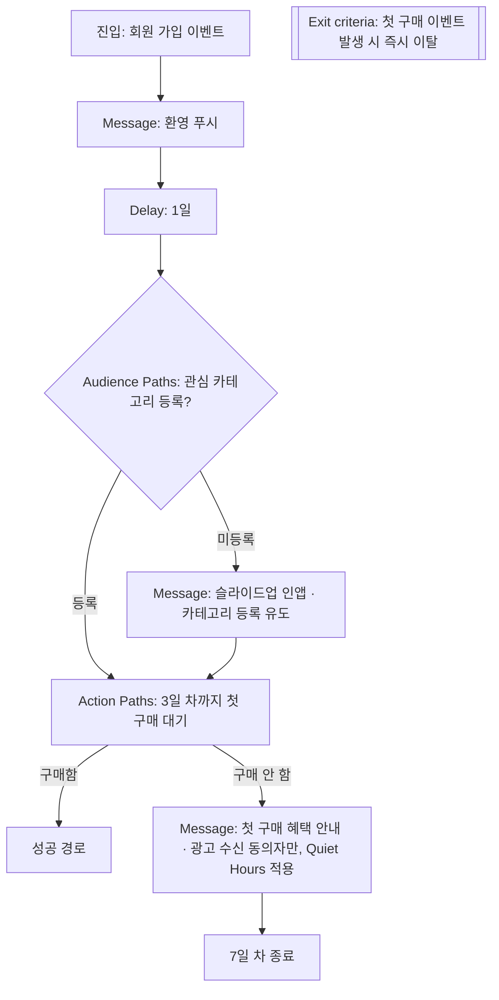
그림 1. Braze Canvas로 만든 7일 첫 구매 온보딩 여정 (대조군용 Experiment Paths는 진입 직후에 둔다)

## Insider One으로 만들기

같은 여정을 Insider One Architect로 옮기면 어떻게 될까? 6장에서 본 Element 이름으로 번역하면 대부분 일대일로 대응한다.

진입은 Starter Element다. 가입 이벤트가 발생하는 즉시 사용자를 들여보내는 실시간 Starter를 쓴다. 대기는 Wait Element, 조건 확인은 Check Element가 맡는다. "관심 카테고리를 등록했는가", "첫 구매 이벤트가 있었는가"를 Check로 확인하고 Path를 나눈다. 메시지는 Channel Element로 보낸다. Architect의 채널에는 App push, Email, In-app, Onsite 등이 있으니, 앱에서는 인앱으로, 웹에서는 온사이트 메시지로 카테고리 등록을 권할 수 있다. 웹 온사이트 경험은 Insider One이 특히 강한 영역이라, 웹 비중이 큰 서비스라면 이쪽을 적극적으로 활용해 볼 만하다.

Architect에서 꼭 챙길 설정이 하나 있다. 여정을 만들 때 고르는 **Promotional과 Transactional Use Case** 구분이다. 9장에서 봤듯 프로모션 여정은 opt-in이 필요하고, 트랜잭션 여정은 필요 없다. 이 온보딩 여정은 첫 구매 혜택 안내를 담고 있으니 Promotional로 분류하는 편이 맞다. 만약 가입 확인이나 이용 안내처럼 정보성 메시지를 동의와 무관하게 모든 신규 회원에게 보내고 싶다면, 그 부분은 별도의 Transactional 여정으로 떼어 내자. 한 여정에 두 성격을 섞으면 분류를 정직하게 할 수 없다.

Architect에는 채널 도달 가능성(reachability)을 확인하는 장치도 있다. 가입 직후의 고객은 앱 푸시 권한을 아직 허용하지 않았을 수도 있고, 웹으로만 가입해 앱을 설치하지 않았을 수도 있다. 환영 메시지를 보내기 전에 앱 푸시로 닿을 수 있는지 확인하고, 닿지 않는 고객은 이메일 경로로 보내도록 Path를 나눠 두면 "보냈는데 아무도 못 받은" 단계를 줄일 수 있다. 8장에서 본 Next Best Channel을 쓰면 이 판단을 채널 참여 점수에 맡길 수도 있다.

대조군은 Journey A/B Split으로 만들고, 이탈 조건은 Exit criteria에 첫 구매 이벤트로 넣는다. 그리고 실제로 켜기 전에 Dry Run으로 진입 인원과 흐름을 시뮬레이션해 보자. 다만 8장에서 봤듯 Send Time Optimization은 Dry Run에서 동작하지 않으니, STO를 켠 단계의 발송 시각은 시뮬레이션과 다를 수 있다.

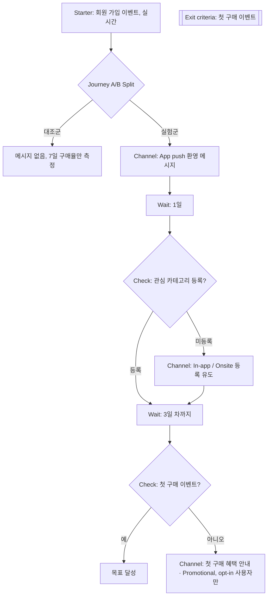
그림 2. Insider One Architect로 만든 같은 온보딩 여정

두 그림을 나란히 놓고 보면 구조는 거의 같다. 다른 것은 이름과, 동의를 다루는 위치다. Braze에서는 메시지 단계의 대상 조건과 Quiet Hours로 챙기고, Insider One에서는 여정 단위의 Use Case 분류로 먼저 챙긴다. 어느 쪽이든 마케터가 그 칸을 비워 두면 도구는 막아 주지 않는다.

## 온보딩에서 흔한 실수

이렇게 정리하고 나면 쉬워 보이지만, 실제로는 같은 실수가 반복된다. 세 가지만 짚어 두자.

첫째, 모든 신규 가입자에게 같은 메시지를 보낸다. 잡코리아가 처음 부딪힌 문제가 바로 이것이었다. 신입과 경력, 관심 카테고리가 있는 고객과 없는 고객에게 같은 환영 메시지를 보내면, 누구에게도 딱 맞지 않는 메시지가 된다. 가입 직후에 사실을 하나라도 더 채우는 단계를 넣고, 그 사실로 길을 나누자.

둘째, 목표를 달성한 고객을 빼지 않는다. 어제 첫 구매를 한 고객에게 오늘 "첫 구매 혜택이 곧 사라져요"가 도착한다면 어떨까? 고객은 혜택을 놓친 기분이 들거나, 이 회사가 자기를 모른다고 느낀다. 생각만 해도 찜찜한 장면이다. Exit criteria에 전환 이벤트를 넣는 것은 선택이 아니라 기본으로 여기자.

셋째, 채널을 너무 많이 쓴다. 가입 첫 주는 고객의 관심이 가장 높을 때라, 푸시·이메일·인앱·카카오톡을 다 동원하고 싶어진다. 하지만 9장에서 봤듯 과하게 받은 고객은 서서히 무시하는 대신 알림 권한을 끄거나 앱을 지운다. 가입 첫 주에 알림 권한을 잃으면 이후의 모든 여정이 길을 잃는다. 온보딩 여정에도 빈도 상한이 그대로 적용되는지 확인하고, 채널은 목적별로 하나씩만 고르는 편이 낫다.

이제 공을 우리 서비스로 넘겨 보자. 우리 서비스의 "첫 가치 순간"은 무엇인가? 고객이 처음으로 돈을 쓰는 순간인가, 처음으로 무언가를 만들어 내는 순간인가, 아니면 처음으로 다시 돌아오는 순간인가? 그 순간을 확인할 수 있는 이벤트가 지금 프로필에 쌓이고 있는가? 그리고 그 순간에 가장 가까이 있는 고객과 가장 멀리 있는 고객을 우리는 구분할 수 있는가? 이 세 질문에 답할 수 있다면 온보딩 설계 문서의 첫 칸은 이미 채워진 셈이다.

# 11장. 유스케이스 ② 떠나기 직전의 고객 — 장바구니 이탈·가격 인하·재입고

장바구니에 담고 앱을 닫은 고객은 정말 떠난 걸까, 아직 고민 중일까?

마케터라면 이 질문 앞에서 한 번쯤 손이 근질거린다. 담았다는 건 관심이 있다는 뜻이고, 결제하지 않았다는 건 무언가가 걸렸다는 뜻이다. 배송비가 마음에 걸렸을 수도 있고, 다른 쇼핑몰과 가격을 비교하러 갔을 수도 있다. 그냥 지하철에서 내려야 해서 앱을 닫았을 수도 있다. 이유는 제각각인데 우리가 볼 수 있는 건 "담았다, 그리고 사지 않았다"라는 두 줄의 기록뿐이다.

앞 장의 온보딩은 고객을 처음 가치 경험까지 데려가는 여정이었다. 이번에는 구매 문턱까지 와서 멈춘 고객을 다룬다. 생애주기로 치면 한가운데, 매출과 가장 가까운 자리다. 그래서 대부분의 회사가 CRM 자동화를 도입하고 가장 먼저 만드는 여정이 장바구니 이탈 여정이기도 하다.

## 멈춘 고객이 보내는 세 가지 신호

먼저 이 장에서 다룰 신호를 정리해 두자. 겉보기에는 모두 "구매 직전의 고객에게 메시지를 보낸다"로 묶이지만, 신호가 어디서 오는지는 서로 다르다.

첫째는 **고객의 행동이 멈춘 신호**다. 장바구니에 담았는데 일정 시간 안에 결제가 없다. 검색하고 상품을 들여다봤는데 예약하지 않았다. 고객이 무언가를 했고, 그다음 해야 할 일을 하지 않았다는 사실이 트리거가 된다.

둘째와 셋째는 **상품 쪽이 움직인 신호**다. 고객이 봐 두었던 상품의 가격이 내려갔다. 품절이던 상품이 다시 들어왔다. 이때 고객은 아무것도 하지 않았다. 바뀐 건 상품이고, 그 변화가 고객이 망설이던 이유를 풀어 줄 수 있기 때문에 연락할 명분이 생긴다.

이 구분이 왜 중요할까? 데이터가 들어오는 길이 다르기 때문이다. 행동 신호는 2장에서 본 커스텀 이벤트, 곧 앱과 웹이 심어 둔 "장바구니 담기", "구매 완료" 같은 기록에서 온다. 상품 신호는 상품 카탈로그나 상품 피드, 즉 가격과 재고가 적힌 상품 데이터에서 온다. 행동 트리거는 고객 데이터만 잘 깔려 있으면 되지만, 상품 트리거는 상품 데이터가 도구 안으로 꾸준히 흘러 들어와야 작동한다. 같은 "구매 직전 여정"이라도 개발팀에 요청할 내용이 달라지는 셈이다.

## BlaBlaCar의 예약 이탈 여정 해부

추상적인 이야기는 여기까지 하고 실제 사례를 하나 펼쳐 보자. 카풀·버스 예약 서비스 BlaBlaCar가 Braze로 만든 예약 이탈 여정이다. Braze가 공개한 고객 사례 페이지 기준이고(날짜 미표기, Canvas Flow 출시 이후인 2022년 이후 자료), 우리에게는 장바구니 이탈 여정의 교과서 같은 구조를 보여 준다. 예약 서비스라 "장바구니"라는 말 대신 "검색하고 조회했지만 예약하지 않은 사람"이 대상이지만, 뼈대는 쇼핑몰의 장바구니 이탈과 똑같다.

BlaBlaCar는 여정 입구에서 사용자를 네 무리로 나눴다. 이미 예약한 사람, 카풀을 검색하거나 조회한 사람, 버스를 검색하거나 조회한 사람, 그리고 나머지다. 이미 예약한 사람을 따로 떼어 둔 것이 눈에 띈다. 5장에서 "이미 구매한 사람 제외"를 여정 설계의 대표 사고 지점으로 짚었는데, 이 사례는 그것을 입구에서부터 막아 둔 셈이다. 카풀과 버스를 나눈 것도 의미가 있다. 같은 "예약 안 함"이라도 무엇을 찾다가 멈췄는지에 따라 할 말이 다르기 때문이다.

다음은 기다림이다. BlaBlaCar는 Action Paths 컴포넌트로 1시간처럼 정해 둔 시간 동안 사용자의 행동을 지켜보고, 그 시간 안에 예약하지 않은 사람만 다음 단계로 보냈다. 5장에서 본 대로 Action Paths는 "이 시간 안에 이 행동을 했는가"로 길을 가르는 컴포넌트다. 기다리는 동안 스스로 예약을 마친 고객에게는 아무 메시지도 가지 않는다. 고객 입장에서는 당연한 배려이고, 회사 입장에서는 쓸데없는 발송을 줄이는 장치다.

메시지 내용에는 고객이 검색했던 지역이 들어갔다. "검색" 이벤트에 붙어 온 이벤트 속성(어디서 어디로 가려 했는지)을 메시지에 넣은 것이다. 2장에서 이벤트 속성을 "그 행동에 딸린 세부 정보"라고 설명했는데, 바로 이런 데 쓰인다. 여기에 Connected Content로 외부 정보를 불러와 메시지를 채웠다. 7장에서 소개한 대로 Connected Content는 발송 순간에 회사 시스템이나 외부 서비스에서 최신 정보를 끌어오는 장치다. 예약 서비스라면 그 구간의 남은 좌석이나 출발 시각처럼 시시각각 바뀌는 정보를 넣을 수 있다.

가장 배울 만한 대목은 Experiment Paths로 대조군을 둔 것이다. 여정에 들어온 사람 일부에게는 일부러 메시지를 보내지 않았다. 이 대조군이 있었기 때문에 "메시지를 받은 무리가 받지 않은 무리보다 얼마나 더 예약했는가"를 말할 수 있게 된다. 이 장 마지막에 다시 이야기하겠지만, 대조군이 없는 장바구니 이탈 여정은 성과를 부풀려 말하기 쉽다.

마지막으로 메시지를 받고도 예약하지 않은 사람은 Audience Sync로 Facebook·Google 광고 대상에 넘겼다. CRM 메시지로 닿지 않은 고객을 유료 광고로 이어 받는 구조다. 채널은 이메일, 푸시, Content Cards, 인앱 메시지, 웹훅까지 두루 쓰였다.

성과는 어땠을까? 회사 측 발표에 따르면 메시지 클릭률이 "최대 48%", 예약 전환이 "최대 30%" 올랐다(벤더 발표). 원문 표현은 "up to"다. 가장 잘된 경우의 수치라는 뜻이고, 기준값과 표본은 공개되지 않았다. 숫자보다는 구조를 가져가자. 무리 나누기, 기다렸다가 행동 확인, 행동 속성으로 개인화, 대조군, 미전환자 후속 조치. 이 다섯 가지가 장바구니 이탈 여정의 뼈대다.

## 공통 구조로 다시 그리기

BlaBlaCar의 여정을 도구 이름을 지우고 다시 그리면 어떤 모양이 될까? 5장에서 만든 여정 설계서 양식을 꺼내 채워 보자.

- **목표:** 장바구니에 담은 상품의 구매 완료
- **진입 조건:** 장바구니 담기 이벤트 발생
- **대기:** 정해 둔 시간(예: 1시간) 동안 구매 여부 관찰
- **분기:** 그 사이 구매했으면 여정 종료, 아니면 다음 단계
- **이탈 조건:** 여정 어느 지점에서든 구매 완료 이벤트가 오면 즉시 이탈
- **대조군:** 진입자의 일부는 메시지 없이 관찰만
- **전환 이벤트:** 구매 완료

이것을 흐름으로 그리면 아래와 같다.

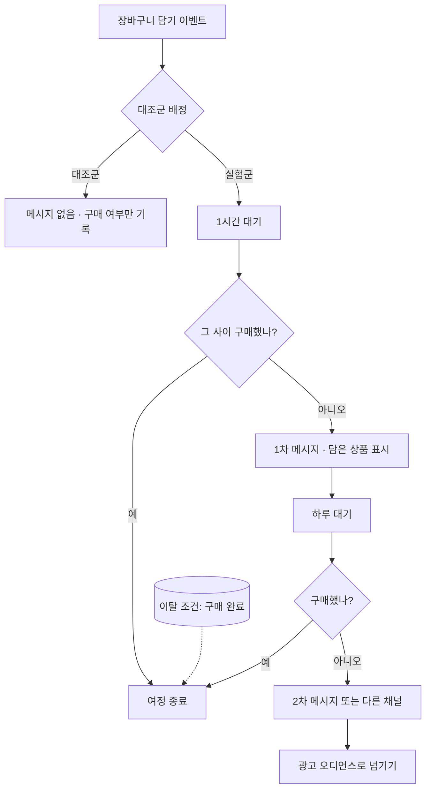
그림 1. 두 도구에 공통인 장바구니 이탈 여정 구조

그림에서 대기 시간은 예시일 뿐이다. 1시간이 맞는지, 30분이 맞는지는 우리 서비스의 구매 패턴과 실험으로 정할 일이다. 너무 빨리 보내면 아직 고민 중인 고객을 재촉하는 꼴이 되고, 너무 늦게 보내면 이미 다른 곳에서 샀을 수 있다.

이 구조를 두 도구의 부품에 대응시키면 다음과 같다.

| 공통 구조 | Braze (Canvas) | Insider One (Architect) |
|---|---|---|
| 진입 | 행동 기반 진입(장바구니 담기 이벤트) | 실시간 Starter(장바구니 담기 이벤트) |
| 대기 후 행동 확인 | Action Paths | Wait + Check, 또는 Live Actions |
| 대조군 | Experiment Paths | Journey A/B Split |
| 행동 속성 개인화 | 이벤트 속성 + Liquid, Connected Content | Dynamic Content / Liquid(얼리 액세스) |
| 이탈 조건 | Exit criteria | Exit criteria |
| 미전환자 광고 | Audience Sync | Facebook Custom Audiences·Google Ads Element |

## Braze로 만들기

Canvas에서는 입구부터 정하자. 5장에서 본 세 가지 진입 방식, 곧 일정 기반(Scheduled)·행동 기반(Action-Based)·API 기반(API-Triggered) 가운데, 장바구니 담기라는 행동이 일어나는 순간 고객을 들여보내는 행동 기반이 자연스럽다. 고객마다 담은 시각이 다르니 기다림의 시계도 고객마다 따로 돌아야 하기 때문이다.

입구 다음에는 Action Paths를 둔다. 관찰 시간을 정하고 "구매 완료 이벤트를 했는가"로 길을 가른다. 구매한 사람은 끝, 하지 않은 사람은 Message 컴포넌트로 간다. 메시지에는 장바구니 담기 이벤트에 딸려 온 상품명이나 이미지 같은 이벤트 속성을 넣는다. 이벤트 속성을 Liquid로 부르는 문법은 7장에서 다룬 사용자 속성 참조와 모양이 조금 다르니, 개발팀이 이벤트에 어떤 이름으로 속성을 실어 보내는지 먼저 확인하고 발송 전 테스트로 값이 제대로 찍히는지 보자. 장바구니가 비어 있거나 상품명이 없는 경우를 대비한 문구도 함께 준비해 두는 편이 낫다.

다음은 대조군이다. Message 앞에 Experiment Paths를 두고, 한 갈래는 메시지 없이 흘려보내도록 설정한다. 대조군 비율을 얼마로 할지, 결과를 어떻게 읽을지는 13장에서 자세히 다룬다. 여기서는 "처음 만들 때부터 대조군 갈래를 넣어 둔다"는 원칙만 챙기자. 여정이 돌아가기 시작한 뒤에 실험을 끼워 넣으면 앞뒤 기간이 섞여 비교가 흐려진다.

Exit criteria에는 구매 완료 이벤트를 걸어 둔다. Action Paths가 한 번 걸러 주더라도, 1차 메시지와 2차 메시지 사이에 구매한 사람이 2차 메시지를 받는 사고는 Exit criteria가 막아 준다. "방금 결제했는데 아직 안 사셨냐는 푸시가 왔다"는 고객 문의는 받는 순간 얼굴이 화끈해진다.

마지막으로 여정을 끝까지 따라와서도 사지 않은 사람은 Canvas Audience Sync로 광고 오디언스에 넘길 수 있다. 반대로 구매한 사람을 광고 대상에서 빼는 데도 같은 장치를 쓴다. 이미 산 상품의 광고를 계속 보는 것도 고객에게는 피로다.

채널 선택도 짚어 두자. 앱 사용자라면 푸시와 인앱 메시지가 기본이고, 앱을 다시 열었을 때 보이는 Content Cards나 인앱 메시지는 재촉하는 느낌이 덜하다. 이메일 주소만 있는 웹 고객이라면 이메일이 남는다. Braze는 2026-04에 카카오톡 채널을 출시하면서 리테일 업종의 활용 예로 장바구니 이탈을 들었다. 다만 카카오톡으로 장바구니 리마인드를 보낸다면 그것이 광고성 메시지인지, 수신 동의와 표기 의무를 어떻게 지킬지를 먼저 따져야 한다. 4장의 카카오톡 소절과 9장의 발송 규제 점검표를 함께 펼쳐 보자.

## Insider One으로 만들기

같은 여정을 Insider One Architect로 옮겨 보자. 6장에서 익힌 Element 이름을 떠올리면 어렵지 않다.

입구는 Starter Element다. 장바구니 담기 이벤트가 들어오는 순간 사용자를 진입시키는 실시간 Starter를 쓴다. 이때 진입 제한과 자격 규칙을 함께 정해 두자. 장바구니에 상품을 담을 때마다 여정에 다시 들어온다면, 상품을 여러 번 담는 고객은 하루에도 같은 메시지를 몇 번씩 받게 된다. 고객에게는 스팸과 다를 바 없다.

대기와 확인은 두 가지 방법이 있다. 하나는 Wait Element로 정해 둔 시간을 기다린 뒤 Check Element로 "구매 이벤트가 있었는가"를 보고 Path를 가르는 방법이다. 다른 하나는 Live Actions다. 6장에서 본 것처럼 Live Actions는 사용자가 특정 행동을 할 때까지 붙잡아 두는 대기 지점이라, "메시지를 보낸 뒤 구매할 때까지 기다렸다가, 일정 시간이 지나도 안 사면 다음 단계로" 같은 흐름을 표현하기에 좋다.

메시지를 보내기 전에는 도달 가능성(reachability) 체크를 넣자. 웹 푸시를 허용하지 않은 고객에게 웹 푸시 Element를 거쳐 봐야 아무 일도 일어나지 않는다. 도달 가능한 채널을 확인하고 갈래를 나누거나, 사용자별로 참여 가능성이 높은 채널을 고르는 Next Best Channel을 쓰는 방법이 있다(Next Best Channel은 8장 참조).

Insider One에서 장바구니 회수의 대표 채널은 웹 푸시다. 4장에서 본 것처럼 Insider One은 웹사이트 위의 경험에 강점이 있고, 웹 푸시는 앱이 없는 웹 쇼핑몰도 쓸 수 있는 채널이다. Insider One의 Samsung 사례는 갤럭시 노트 출시 기간에 Architect와 웹 푸시(재방문·장바구니 회수)를 비롯한 여러 기능을 함께 썼고, 헤드라인은 "Increases Conversions by 275% in 20 days"다(벤더 발표). 사례 페이지 안에서 지표 정의가 일관되지 않아 세부 수치를 옮기지 않았다. 여러 기능을 함께 쓴 결과라서 장바구니 회수 여정 하나의 효과로 읽을 수도 없다.

개인화는 Dynamic Content로 담은 상품 정보를 넣는 것이 기본이다. Liquid는 2026-11 기준 얼리 액세스라 계정에서 쓸 수 있는지 먼저 확인해야 한다는 점, 7장에서 이미 짚었다.

대조군은 Journey A/B Split으로 만든다. 한 갈래에는 메시지 Element를 두지 않고 흘려보내면 된다. Conversion Goal에는 구매 이벤트를 걸고, Exit criteria에도 구매를 넣어 이미 산 사람이 다음 메시지를 받지 않게 한다. Conversion Goal의 귀속 방식(마지막 클릭 채널에 전량 귀속하는 식)은 13장에서 다시 따져 볼 대상이다.

두 가지를 더 챙기자. 장바구니 리마인드는 대개 프로모션 성격이다. 6장에서 본 Promotional과 Transactional 구분에서 Promotional Use Case는 opt-in이 필요하다. 이 설정을 Transactional로 잡아 수신 동의를 건너뛰는 일은 없어야 한다. 그리고 여정을 켜기 전에 Dry Run으로 실제 발송 없이 진입 인원과 흐름을 시뮬레이션해 보자. 진입 인원이 예상보다 열 배 많다면 진입 조건 어딘가가 잘못된 것이다.

## 상품이 움직일 때 — 가격 인하 알림

이제 상품 쪽 신호로 넘어가자. 위시리스트에 담아 두고 "조금만 더 싸지면 살 텐데" 하던 고객에게 가격이 내렸다는 소식만큼 반가운 메시지는 드물다. 두 도구 모두 이 경우를 위한 전용 트리거를 갖추고 있는데, 작동 방식이 꽤 다르다. 두 가지 질문으로 비교해 보자. 누가 알림을 받는가? 그리고 가격 변화를 도구가 어떻게 아는가?

**Braze**에서는 카탈로그 기반의 가격 인하 알림을 쓴다. 상품 정보가 Braze 카탈로그에 들어 있어야 하고, 고객은 그 상품의 가격 인하 알림에 "구독"되어 있어야 한다. 구독은 개발팀이 보내는 커스텀 이벤트로 이뤄진다. 고객이 "가격 내리면 알려 주세요"를 눌렀을 때, 상품 ID와 가격 인하 알림이라는 종류 정보를 담은 이벤트가 Braze로 들어오는 식이다. 알림 규칙은 퍼센트 변화나 절대 금액 변화로 정한다. Canvas에서는 Perform Price Drop Event라는 트리거로 여정을 시작한다. opt-in한 사용자만 받고, Quiet Hours 같은 Canvas 설정은 그대로 적용된다.

처리 한도도 알아 두자. 2026-11 기준 Braze 문서에 따르면 알림은 분당 10,000명 이하의 속도로 나가고, Notify all subscribed users를 고르면 10분 동안 100,000명까지 알린다. 하루에 가격이 바뀐 상품 중 최대 50,000개까지가 트리거 대상이고, 동시에 활성화된 구독은 최대 1억 건이다. 구독은 90일 동안 유지되며 그 안에 가격이 내리지 않으면 해지된다. 인터넷에 떠도는 예전 자료에는 다른 제한이 적혀 있기도 하니, 한도는 늘 현재 문서 기준으로 보자. 구독자가 수십만 명인 인기 상품이라면 모두에게 알림이 닿기까지 시간이 걸린다는 뜻이고, 한정 수량 특가라면 늦게 받은 고객이 품절을 마주할 수도 있다.

**Insider One**에서는 Architect의 On Price Drop Starter를 쓴다. Product Feed에서 상품 가격을 추적하다가 가격이 내려가면 사용자를 여정에 바로 들여보낸다. Academy 문서의 표현대로 "triggers the journey immediately when the price drops."다. 누가 들어오는지는 기준 이벤트로 정한다. 기본은 Product Page View, 곧 그 상품을 본 사람이다. 대신 위시리스트 담기, 장바구니 담기, 혹은 회사가 만든 "가격 알림 구독" 커스텀 이벤트를 기준으로 지정할 수도 있다. 하락률(예: 20% 이상)을 정하고, 원가나 하락률로 특정 상품을 빼는 필터도 걸 수 있다.

제약도 분명하다. 기준 이벤트에 Product ID 파라미터가 없으면 쓸 수 없다. 가격 인상은 트리거가 되지 않는다. 그리고 카탈로그를 어떤 방식으로 넣느냐에 따라 도달 범위가 갈린다. 카탈로그 소스는 Clickstream, XML, Catalog API가 있는데, 상품 페이지를 방문한 적 없는 사용자에게 닿으려면 XML이나 Catalog API 방식이어야 한다.

| 비교 항목 | Braze 가격 인하 알림 | Insider One On Price Drop |
|---|---|---|
| 대상 | 해당 상품 알림에 구독한 opt-in 사용자 | 기준 이벤트(기본 Product Page View, 위시리스트·장바구니·커스텀 구독 이벤트로 변경 가능)를 한 사용자 |
| 가격 정보 출처 | Braze 카탈로그 | Product Feed (Clickstream·XML·Catalog API) |
| 규칙 | 퍼센트 또는 절대값 변화 | 하락률, 원가·하락률 제외 필터 |
| 여정 연결 | Canvas 트리거 Perform Price Drop Event | Architect Starter |
| 알아 둘 제약 (2026-11 기준) | 분당 10,000명 이하, 하루 50,000개 상품, 구독 90일 유지 | Product ID 없는 이벤트 불가, 가격 인상 불가, 미방문자 도달은 XML/Catalog API만 |

이 차이가 설계에 주는 의미는 무엇일까? Braze 방식은 고객이 명시적으로 구독해야 하므로 대상은 좁지만 의도가 선명하다. "알려 달라"고 한 사람에게만 가니 반응도 좋을 가능성이 높다. 그 대신 앱과 웹에 "가격 알림 받기" 버튼과 구독 이벤트를 심는 개발 작업이 먼저다. Insider One은 기본값이 "본 사람"이라 별도 구독 장치 없이도 시작할 수 있지만, 상품을 한 번 스쳐 본 사람까지 대상이 되므로 하락률 기준과 빈도 상한을 더 신경 써야 한다. 어느 쪽이든 가격 인하 알림은 성격상 광고성 메시지에 가깝다. 수신 동의와 야간 발송 같은 점검은 9장의 점검표를 따르자.

## 다시 들어왔을 때 — 재입고 알림

재입고 알림은 가격 인하 알림의 사촌이다. 품절 때문에 사지 못한 고객에게 "다시 들어왔다"고 알리는 여정이고, 신호는 역시 상품 쪽에서 온다.

Braze에서는 카탈로그 트리거 중 Back in stock 알림이 이 역할을 한다. 구조는 가격 인하 알림과 거의 같다. 고객은 종류 정보에 재입고(`back_in_stock`)를 담은 커스텀 이벤트로 구독되는데, 재고가 0인 상품에만 구독할 수 있다. 카탈로그에서 숫자형 재고 필드를 하나 지정해 두면 그 값이 0보다 커지는 순간 구독자에게 알림이 나가고, 행동 기반 Canvas의 Back in stock 트리거로 여정을 시작한다. 2026-11 기준 Braze 문서에 적힌 처리 한도(분당 10,000명 이하, 하루 50,000개 상품)와 구독 유지 기간(90일)도 가격 인하 알림과 같다.

Insider One Architect에는 On Price Drop과 별도로 On Back in Stock Starter가 있다. 기본 기준 이벤트가 Product Page View이고 위시리스트 담기 같은 이벤트로 바꿀 수 있다는 점, Product ID 파라미터가 있는 이벤트만 쓸 수 있다는 점, 카탈로그 소스가 Clickstream·XML·Catalog API라는 점은 On Price Drop과 같다. 다른 점은 재고 수량을 조건으로 쓸 수 없다는 것이다. 2026-09 Academy 문서 기준으로 이 Starter는 상품이 "재고 있음"인지 "품절"인지만 본다. 세부 설정은 바뀔 수 있으니 실제로 만들기 전에 각 도구의 재입고 문서를 한 번 더 확인하자.

세부 설정과 별개로, 재입고 여정을 설계할 때 미리 정해 둘 것은 두 도구에서 같다. 누가 기다리고 있었는가(알림 신청자인가, 품절 상품을 본 사람인가)를 정해야 대상이 정해진다. 재고가 몇 개 들어왔을 때 몇 명에게 알릴지도 정해야 한다. 두 도구의 트리거는 품절에서 재고 있음으로 바뀌는 순간을 기준으로 하니, 수량에 맞춰 대상을 줄이는 일은 여정 쪽에서 따로 챙겨야 한다. 열 개 들어왔는데 만 명에게 알리면 대부분의 고객은 "다시 품절"이라는 화면을 보게 된다. 그 경험은 알림을 받지 않은 것보다 나쁘다. 알림을 받은 뒤 다시 품절된 고객에게 다음에 무엇을 해 줄지까지 정해 두면 설계가 한결 단단해진다.

## "회수된 매출"이라는 착시

장바구니 이탈 여정을 켜고 한 달이 지나면 대시보드에 숫자가 찍힌다. "이 여정을 거친 고객 중 몇 %가 구매했고, 그 매출이 얼마다." 회의에서 이 숫자를 "회수된 매출"이라고 부르고 싶은 유혹이 크다.

그런데 잠시 멈추고 생각해 보자. 장바구니에 담은 고객 중 상당수는 메시지가 없어도 돌아와서 샀을 것이다. 지하철에서 내리느라 앱을 닫았던 고객은 집에 가서 결제를 마쳤을 테고, 가격 비교를 하러 갔던 고객 중 일부는 결국 돌아왔을 것이다. 메시지를 받은 뒤 구매한 고객 전부를 메시지의 성과로 세면, 원래 일어났을 구매까지 우리 공으로 가져오게 된다.

"그렇다면 메시지를 받은 사람과 받지 않은 사람을 비교하면 되지 않나?"라고 생각할 수 있다. 하지만 받은 사람과 받지 않은 사람은 애초에 다른 사람들이다. 앱 푸시를 허용한 고객은 허용하지 않은 고객보다 원래 충성도가 높을 가능성이 크다. Facebook의 대규모 실험 663개를 놓고, 무작위 대조군 없이 관찰 데이터로 효과를 추정한 방법들이 얼마나 빗나가는지 검증한 연구가 있다. 실험으로 잰 효과와 비교했을 때 오차의 중앙값이 퍼널 하단에서도 62%, 상단에서는 115%에 이르렀다(Gordon 외 2023). 마케터가 대시보드에서 "보낸 사람 vs 안 보낸 사람"을 비교하는 것은 이보다 훨씬 거친 방법이다.

BlaBlaCar가 여정에 Experiment Paths로 대조군을 둔 이유가 여기에 있다. 무작위로 나눈 대조군이 있어야 "메시지가 없었어도 이만큼은 샀다"는 기준선이 생기고, 그 위로 올라간 만큼만 메시지의 몫이라고 말할 수 있다. 앞에서 Braze와 Insider One 여정 모두에 대조군 갈래를 처음부터 넣자고 한 것도 같은 이유다.

장바구니 이탈, 가격 인하, 재입고. 세 여정 모두 고객이 구매 문턱에서 멈췄다는 신호를 붙잡는다. 신호가 고객에게서 오든 상품에게서 오든, 여정의 뼈대는 진입·대기·확인·이탈·대조군으로 같았다. 그런데 여정을 다 만들고 나면 마지막 질문 하나가 남는다.

돌아온 고객은 정말 우리 메시지 덕분에 돌아온 걸까?

# 12장. 유스케이스 ③ 붙잡을 고객, 더 권할 고객 — 이탈 방지·윈백·크로스셀

이탈 예측 점수 상위 10%에게 20% 쿠폰을 보냈다. 한 달 뒤 결과는 대조군과 다르지 않았다.

처음 이 여정을 기획할 때만 해도 자신이 있었다. 팀장은 "이번 분기에는 이탈을 줄여 보자"고 했고, 마침 Braze에서 Predictive Churn을 켜 둔 참이었다. 3장에서 배운 대로 회사가 직접 정한 이탈 기준(최근 30일 동안 구매 없음)에 맞춰 예측을 만들었고, 0에서 100까지의 이탈 위험 점수가 고객마다 붙었다. 점수가 높을수록 떠날 가능성이 높다는 뜻이니, 가장 위험한 상위 10%를 골라 큼직한 쿠폰을 보냈다. 11장에서 배운 대로 대조군도 따로 떼어 두었다.

한 달 뒤 두 무리를 비교했다. 쿠폰을 받은 무리의 재구매율은 쿠폰을 받지 않은 대조군과 거의 같았다. 쿠폰은 꽤 많이 쓰였는데, 그 쿠폰을 쓴 고객들은 쿠폰이 없어도 돌아왔을 사람들이었던 셈이다. 매출은 그대로이고 할인 비용만 나갔다. 대조군을 둔 덕분에 이 사실을 알게 되었지만, 뒷맛이 영 찜찜하다.

무엇이 잘못된 걸까? 점수 모델이 틀렸을까, 쿠폰이 작았을까, 아니면 질문 자체가 잘못되었을까? 이 장은 이 실패를 풀어 가는 이야기다. 그리고 고객을 붙잡는 일 옆에 놓인 또 하나의 일, 이미 붙어 있는 고객에게 무엇을 더 권할지도 함께 다룬다.

## 리텐션이 중요하다는 말의 근거

윈백 여정을 기획하는 회의에서는 거의 빠짐없이 이런 말이 나온다. "고객 이탈을 5%만 줄여도 이익이 25%에서 85%까지 늘어난다." 1990년 Harvard Business Review에 실린 Reichheld와 Sasser의 글에서 나온 주장이다. 은행 지점, 보험 중개, 자동차 정비 체인 같은 업종의 사례를 들어 이탈 감소가 이익을 얼마나 키우는지 보였다.

이 숫자는 업계에 널리 퍼졌지만, 근거는 생각보다 약하다. 통제된 실증 연구가 아니라 몇몇 사례를 바탕으로 한 추정이기 때문이다. Byron Sharp 같은 마케팅 연구자들은 이 계산이 사고 실험에 가깝고, 고객을 붙잡는 데 드는 비용을 0으로 가정했다고 비판했다. 같은 맥락에서 돌아다니는 "신규 고객 획득 비용은 기존 고객 유지 비용의 몇 배" 같은 말도 학술 출처를 확인하기 어렵다.

물론 리텐션이 중요하지 않다는 뜻은 아니다. 떠나려는 고객을 붙잡는 일은 여전히 CRM 마케터의 핵심 업무다. 다만 "리텐션은 무조건 남는 장사"라는 통념을 근거로 삼으면, 앞의 실패처럼 비용을 쓰고도 아무것도 얻지 못하는 캠페인을 정당화하게 된다. 붙잡는 데에도 돈이 든다. 그렇다면 질문은 "리텐션을 할 것인가"에서 "누구를 붙잡는 데 돈을 쓸 것인가"로 옮겨 간다.

## 윈백 여정의 기본 재료

질문에 답하기 전에, 두 도구가 윈백 여정에 어떤 재료를 주는지 정리해 두자. 예측 세그먼트의 기능 자체는 3장에서 소개했으니 여기서는 여정에 어떻게 쓰는지에 집중한다.

**Braze**에서는 Predictive Churn이 출발점이다. 무엇을 이탈로 볼지 회사가 직접 정의한다는 점이 핵심이다. "30일간 구매 없음"일 수도 있고 "14일간 앱 실행 없음"일 수도 있다. 정의를 바탕으로 예측을 만들면 고객마다 0~100의 이탈 위험 점수가 붙고, 점수 구간으로 세그먼트를 만들어 Canvas의 진입 대상이나 Audience Paths 분기 조건으로 쓴다. 동시에 활성으로 둘 수 있는 예측 수에는 상한이 있다. 3장에서 짚었듯 2026-11 조회 기준 Braze Docs는 페이지에 따라 3개와 5개로 다르게 적고 있고(구매 전 미리보기 단계는 1개), 어느 쪽이든 슬롯이 넉넉하지는 않으니 어떤 이탈 정의에 예측 슬롯을 쓸지 신중하게 고르자. 채널 쪽에서는 Intelligent Channel filter로, 고른 채널이 그 고객에게 가장 반응이 좋은 채널인 사람만 추려 낼 수 있다(8장 참조).

**Insider One**의 Predictive Segments에는 2026-11 기준 Academy 문서상 이탈 전용 유형이 따로 없다. "churn risk"는 예시로만 등장한다. 대신 Likelihood to Purchase(향후 7일 안에 구매할 가능성이 높은 사용자), User Engagement, Customer Lifecycle Status, Discount Affinity 같은 유형이 있다. 윈백 대상은 이 가운데 생애주기 상태나 참여 수준 유형을 기준으로 잡는 방법을 생각해 볼 수 있다. 각 유형이 정확히 어떻게 고객을 나누는지, 우리 계정에서 어떤 유형을 쓸 수 있는지는 계정마다 다를 수 있으니 Academy 문서와 담당 매니저에게 확인하자. 채널은 Next Best Channel이 고객별 채널 참여 가능성을 보고 도달 가능한 채널로 보낸다.

재료는 이렇게 갖춰져 있다. 두 도구 모두 "누가 떠날 것 같은가"를 점수나 세그먼트로 알려 주고, "어느 채널로 닿을까"를 골라 준다. 그런데 이 재료만으로 여정을 짜면 바로 앞의 실패를 반복하게 된다. 두 도구가 알려 주는 것은 위험도이지, 쿠폰이 그 고객에게 통할지가 아니기 때문이다.

## 왜 쿠폰은 듣지 않았을까

마케팅 연구자 Eva Ascarza는 2018년 Journal of Marketing Research에 실린 논문의 제목을 아예 "Retention Futility(리텐션의 헛수고)"로 붙였다. 부제는 "고위험 고객을 겨냥하는 것은 효과가 없을 수 있다"는 뜻이다. 두 건의 필드 실험에서 이탈 위험이 가장 높은 고객을 겨냥하는 대신, 리텐션 캠페인에 가장 민감하게 반응할 고객을 겨냥했더니 이탈이 더 많이 줄었다. AMA·MSI가 이 연구를 소개한 자료에 따르면, 민감도 기준 타기팅은 위험도 기준 타기팅보다 이탈률을 4.1~8.7%p 더 줄였다.

왜 그럴까? 의사에 비유하면 쉽다. 병원에 약이 한정되어 있다면 누구에게 줘야 할까? 가장 아픈 환자에게 주고 싶은 마음이 앞선다. 그런데 어떤 환자는 이미 너무 늦어서 약이 듣지 않고, 어떤 환자는 약 없이도 나을 사람이다. 약은 "가장 아픈 환자"가 아니라 "치료가 듣는 환자"에게 가야 한다. 이탈 위험 점수는 얼마나 아픈지를 알려 줄 뿐, 약이 들을지는 알려 주지 않는다.

이 생각을 정리하는 데 업계에서 흔히 쓰는 고객 4분류가 있다. 메시지(처치)를 받았을 때와 받지 않았을 때의 행동으로 고객을 나눈다.

| 분류 | 쿠폰을 받으면 | 쿠폰이 없으면 | 쿠폰을 보내면 |
|---|---|---|---|
| Persuadables (설득 가능 고객) | 돌아온다 | 떠난다 | 효과가 있다 |
| Sure things (어차피 올 고객) | 돌아온다 | 돌아온다 | 할인 비용만 나간다 |
| Lost causes (이미 떠난 고객) | 떠난다 | 떠난다 | 비용만 나간다 |
| Sleeping dogs (건드리면 떠날 고객) | 떠난다 | 남는다 | 오히려 손해다 |

앞의 실패에 이 표를 대 보자. 이탈 점수 상위 10%에는 Lost causes가 많이 섞여 있었을 것이다. 이미 마음이 떠난 고객은 20% 쿠폰에도 돌아오지 않는다. 그리고 쿠폰을 쓴 사람들은 대조군 결과로 보면 Sure things에 가까웠다. 쿠폰이 효과를 낸 Persuadables는 너무 적어서 결과에 드러나지 않았다. 마지막 칸 Sleeping dogs도 무시할 수 없다. 조용히 쓰던 서비스를 잊고 있었는데 "떠나지 마세요" 메시지를 받고 해지 버튼을 떠올리는 고객이다.

연구는 여기서 한 걸음 더 나아갔다. Lemmens와 Gupta는 2020년 Marketing Science 논문에서 이익을 기준으로 타기팅하는 방법이 위험도나 반응도 기준보다 낫다는 결과를 내놓았다. 흥미로운 점은 저자들 스스로 이 방법이 "누가 이탈할지" 맞히는 데에는 오히려 오차가 더 크다고 인정했다는 것이다. 이탈을 잘 맞히는 일과 이탈 방지로 돈을 버는 일은 다른 문제라는 이야기다. 위험도에서 반응도로, 반응도에서 이익으로. 타기팅의 기준이 이렇게 옮겨 가 왔다는 흐름만 기억해 두면 충분하다.

## 도구 안에서 민감도를 찾는 법

그렇다면 실무에서는 어떻게 해야 할까? 우리가 쓰는 도구는 위험 점수는 주지만 "쿠폰 민감도 점수"는 주지 않는다. 업리프트 모델을 직접 만들려면 데이터 조직의 도움이 필요하다. 주니어 마케터가 당장 할 수 있는 방법은 실험으로 민감도를 직접 재는 것이다.

방법은 이렇다. 상위 10%만 고르지 말고 이탈 위험 점수를 몇 개 구간으로 나눈다. 각 구간 안에서 고객을 무작위로 쿠폰 받는 무리와 받지 않는 무리로 다시 나눈다. 한 달 뒤 구간별로 두 무리의 재구매율 차이를 비교한다. 그 차이가 그 구간에서 쿠폰이 만들어 낸 증분이다.

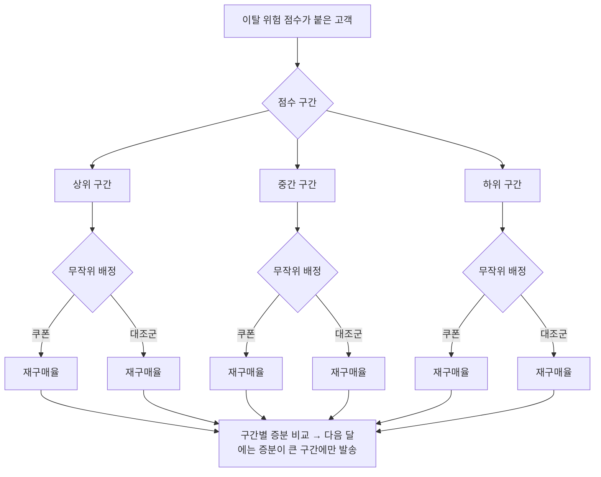
그림 1. 점수 구간별로 쿠폰 효과를 재는 윈백 실험 구조

Braze라면 점수 구간을 Audience Paths로 나누고 각 갈래 안에 Experiment Paths를 두어 대조군을 만든다. Insider One이라면 Check Element로 세그먼트를 가른 뒤 Journey A/B Split으로 쿠폰 갈래와 메시지 없는 갈래를 나눈다. 어느 쪽이든 구조는 그림과 같다.

결과가 이렇게 나왔다고 해 보자. 상위 구간은 쿠폰을 받아도 받지 않아도 재구매율이 낮다. 하위 구간은 둘 다 높다. 중간 구간에서만 쿠폰 받은 무리가 눈에 띄게 높다. 이것이 Retention Futility가 말하는 장면이다. 다음 달부터는 중간 구간에만 쿠폰을 보내고, 상위 구간에는 할인이 아닌 다른 접근(불편 사항 설문, 서비스 개선 소식)을 시험해 볼 수 있다.

주의할 점이 몇 가지 있다. 구간을 너무 잘게 나누면 구간마다 사람이 적어 차이가 우연인지 아닌지 가리기 어렵다. 3장에서 "보낼 수 있는 세그먼트가 먼저"라고 했던 원칙이 실험에도 그대로 적용된다. 대조군 크기와 실험 기간을 정하는 법, 결과를 중간에 들여다보며 끄면 안 되는 이유는 13장에서 자세히 다룬다.

Insider One의 Discount Affinity 같은 유형도 같은 눈으로 보자. 이름만 보면 할인에 잘 반응하는 고객을 찾아 줄 것 같다. 하지만 할인에 잘 반응한다는 것이 "할인이 있어야 산다"는 뜻인지 "원래 잘 사는데 할인도 잘 쓴다"는 뜻인지는 대조군 없이는 알 수 없다. 후자라면 그 고객은 Sure things다. 할인 성향 점수가 높은 고객에게 쿠폰을 몰아주기 전에 같은 방식의 실험으로 확인하는 편이 낫다.

## 더 권할 고객 — 크로스셀과 상품 추천

이제 이 장의 두 번째 주제로 넘어가자. 이탈 방지가 떠나려는 고객을 붙잡는 일이라면, 크로스셀은 이미 잘 머물고 있는 고객에게 다음 상품을 권하는 일이다. 고객이 산 상품과 함께 쓰면 좋은 상품, 장바구니 금액을 무료 배송 기준까지 채워 줄 상품을 알맞은 때에 보여 주는 것이다.

8장에서 상품 추천 기능을 짧게 소개했다. 여기서는 Insider One Smart Recommender를 조금 더 깊이 들여다보자. 2026-10 기준 Academy 문서는 추천 알고리즘을 목적별로 여섯 그룹으로 나눈다. 2024년 문서는 네 그룹이었으니, 예전 자료를 볼 때는 구성이 다를 수 있다는 점을 염두에 두자.

1. **인기·성과로 전환 유도:** Top Sellers, Most Popular, Trending Products, Most Valuable Products
2. **상품 발견·참여:** New Arrivals, Real-Time User Engagement(세션 안의 실시간 브라우징을 바탕으로 추천), User-Based, Chef(60일 동안 여러 조합을 시험한 뒤 슬롯별로 최적 조합을 자동 선택)
3. **개인화:** Recently Viewed, User-Based, Purchased with Last Purchased, Real-Time User Engagement
4. **장바구니·객단가 증대:** Purchased Together, Complementary Products(LLM 기반 추론으로 보완 카테고리를 판단), Checkout Recommendation(무료 배송 같은 기준 금액에 닿도록 돕고, 이미 충족했으면 보여 주지 않음), Viewed Together
5. **대안 제시:** Similar Products, Visually Similar Products(이미지 비교), Viewed Together
6. **캠페인·비즈니스 목표:** Highest Discounted Products, Location-Based Top Sellers(IP 위치 기반) 등. 예전의 Manual Merchandising·Mixed Strategy는 새 전략에서 더는 제공되지 않고 Bundle Strategy 슬롯을 쓴다.

크로스셀에 직접 쓰이는 것은 4번 그룹이다. 구매 완료 직후 메시지에는 Purchased Together나 Complementary Products가, 결제 직전 장바구니 화면에는 Checkout Recommendation이 잘 어울린다. 같은 알고리즘이 여러 그룹에 겹쳐 나오는 것은 쓰임새가 여러 목적에 걸쳐 있기 때문이다.

크로스셀 여정은 대략 이런 모양이 된다.

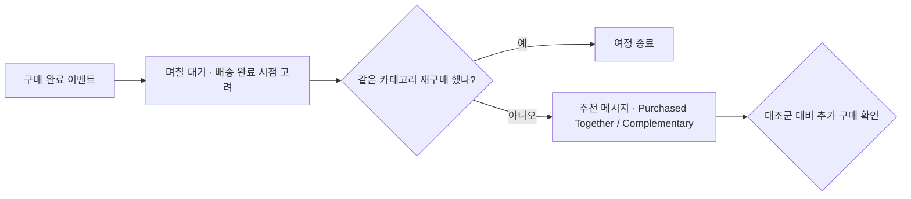
그림 2. 구매 후 크로스셀 여정의 기본 구조

Braze에서는 AI item recommendations가 카탈로그를 바탕으로 딥러닝 추천을 만들어 메시지에 넣는다. 2026-11 기준 BrazeAI 기능 목록에는 Decisioning Studio도 있다. Decisioning Studio Go는 수신자별로 콘텐츠·타이밍·빈도를 개인화하고, Pro는 오퍼까지 포함한 여러 레버를 회사의 비즈니스·재무 지표에 맞춰 최적화한다고 설명된다. 어떤 상품을 누구에게 권할지를 쌓이는 결과를 보며 정하게 하는 장치다. 8장에서 말했듯 이런 기능의 베타·정식 여부와 계약 범위는 담당 매니저에게 확인하자.

사례 하나도 보자. Insider One의 adidas 사례는 온사이트 개인화와 Smart Recommender를 함께 썼고, 헤드라인은 "increased AOV by 259% and conversion rate by 13%"다(벤더 발표). 그런데 사례 페이지를 자세히 보면 Smart Recommender로 늘어난 사용자당 매출이 본문에는 18.8%, 소제목에는 18.5%로 적혀 있다. 사소해 보이지만, 벤더 사례 수치가 검증된 숫자가 아니라 홍보 문구라는 점을 보여 주는 장면이다. 벤더 사례에서는 숫자 대신 어떤 기능을 어떤 순서로 조합했는지를 가져오는 편이 남는 게 많다.

## 추천의 원리와 CTR의 함정

"이 상품을 산 고객이 함께 산 상품"은 어떻게 고를까? 원리는 의외로 오래되었다. Amazon.com의 추천 방식을 소개한 2003년 논문(Linden, Smith & York)의 아이템 기반 협업 필터링이 대표적이다. 고객과 고객을 비교하는 대신 상품과 상품을 비교한다. A를 산 사람들이 B도 많이 샀다면 A와 B는 가깝다고 보고, 이 상품 사이의 유사도를 미리 계산해 둔다. 그러면 누군가 A를 샀을 때 바로 B를 권할 수 있다. Smart Recommender의 Purchased Together나 Viewed Together도 이름으로 보아 같은 계열의 생각에 서 있다.

그런데 추천을 넣고 나면 꼭 이런 보고가 올라온다. "추천 블록을 넣었더니 클릭률이 올랐습니다." 이 말을 들으면 한 번 되물어 보자. 그게 매출 증분인가? 추천 시스템의 비즈니스 가치를 어떻게 재는지 연구들을 정리한 리뷰(Jannach & Jugovac 2019)는 오프라인에서 추천 정확도가 좋아지는 것이 실제 비즈니스 가치로 이어지는지 불분명하다고 정리했다. 클릭도 마찬가지다. 추천 블록을 눌렀다는 것은 고객이 그 상품을 봤다는 뜻이지, 추천이 없었다면 사지 않았을 상품을 샀다는 뜻이 아니다. 고객이 원래 사려던 상품을 추천 블록에서 눌렀을 뿐일 수도 있다.

크로스셀도 결국 윈백과 같은 질문으로 돌아온다. 추천 메시지를 받은 무리와 받지 않은 무리의 추가 구매 금액은 얼마나 다른가? 그림 2의 마지막 칸에 "대조군 대비 추가 구매 확인"을 넣은 이유다.

## 참여가 늘면 이익도 늘까

마지막으로 하나 더 불편한 연구를 보자. 미국의 한 대형 구독형 세차 체인에서 한 필드 실험이다(Wang, Lu & Shi 2022). 구독 고객에게 보름 간격으로 이메일 두 통을 한 달 동안 보냈다. 결과만 보면 성공적이다. 5개월 뒤 고객이 남아 있을 가능성은 7.4% 높아졌고, 5개월 동안 이탈할 오즈는 26.3% 줄었으며, 구독자의 기간당 서비스 이용량은 7.0% 늘었다.

그런데 이익을 등급별로 나눠 보니 그림이 달라졌다. 이용 빈도가 낮은 중간 등급 고객과 최상위 등급 고객에서는 이익이 늘었지만, 이용 빈도가 높은 중간 등급과 기본 등급에서는 이익이 오히려 줄었다. 저자들의 설명은 이렇다. 붙잡아 둔 고객이 서비스를 더 많이 쓰면 그만큼 운영 비용이 늘고, 그 비용이 리텐션으로 얻는 이득보다 커지는 고객군에서는 이익이 줄어든다. 등급별 구독료를 내는 서비스라면 고객이 더 자주 와도 요금은 그대로일 테니, 자주 오는 고객일수록 이 비용이 먼저 드러났으리라는 것은 논문이 직접 밝힌 내용이 아니라 이 책의 해석이다. 효과는 시간이 지나며 약해졌고, 두 번째 메일 이후에는 피로의 신호도 보였다. 저자들은 이메일 참여를 "양날의 검(double-edged sword)"이라고 부르며 선택적으로 보내라고 권했다.

이 연구가 주는 교훈은 명확하다. 리텐션이 오르고 참여가 늘었다고 해서 회사가 돈을 번 것은 아닐 수 있다. 윈백에서는 쿠폰 비용이, 크로스셀에서는 할인과 반품이, 구독 서비스에서는 이용량에 따른 원가가 숨어 있다. 여정을 설계할 때 목표 지표를 "재방문"이나 "클릭"으로만 두지 말고, 가능하면 이익에 가까운 지표를 함께 보자. 그 지표를 어떻게 정하고 무엇과 비교할지는 13장에서 이어서 다룬다.

## 그 쿠폰은 누구에게 갔어야 했나

다시 처음 장면으로 돌아가 보자. 이탈 예측 점수 상위 10%에게 20% 쿠폰을 보냈고, 결과는 대조군과 다르지 않았다. 이제 무엇이 잘못되었는지 말할 수 있다.

점수 모델이 틀린 것은 아니었을 수 있다. 상위 10%는 정말로 떠날 가능성이 높은 고객이었을 것이다. 문제는 질문이었다. 우리는 "누가 가장 떠날 것 같은가"를 물었다. 물었어야 할 것은 "누구에게 쿠폰이 들을까"였다. 상위 10%에는 이미 마음이 떠나 쿠폰에도 돌아오지 않는 고객과, 쿠폰이 없어도 돌아올 고객이 섞여 있었다. 할인 비용은 그 두 무리에게 고스란히 흘러갔다.

그 쿠폰은 쿠폰이 있어야만 돌아오는 고객에게 갔어야 했다. 그 고객이 누구인지는 도구가 바로 알려 주지 않는다. 점수 구간마다 대조군을 두고 쿠폰의 증분을 재 보면, 우리 서비스에서 치료가 듣는 고객이 어느 구간에 모여 있는지 드러난다. 그다음 달의 쿠폰은 그 구간으로 보내면 된다. 위험 점수는 출발점이고, 실험이 그 점수에 의미를 붙인다.

# 13장. 보내지 않았다면 어땠을까 — 대조군·A/B 테스트·성과 측정

주간 회의에서 지난주 장바구니 이탈 푸시의 성과를 보고한다고 해 보자. 클릭률(CTR) 12%. 평소 캠페인의 두 배가 넘는 숫자라 내심 칭찬을 기대하며 슬라이드를 넘겼다. 그런데 팀장이 화면을 잠시 보더니 이렇게 묻는다.

"좋네요. 그런데 이 푸시를 안 보냈으면 몇 명이 샀을까요?"

머릿속이 하얘진다. 보낸 푸시의 클릭 수는 대시보드에 또렷하게 찍혀 있다. 하지만 보내지 않은 세계의 숫자는 어디에도 없다. 팀장의 질문은 정당하다. 앞의 두 장에서 계속 남겨 둔 질문, "돌아온 고객은 정말 우리 메시지 덕분에 돌아왔을까"를 회의실 언어로 바꾼 것뿐이다. 이 장에서 그 질문에 답하는 방법을 함께 익혀 보자.

## CTR은 왜 성과가 아닐까

CTR은 메시지가 얼마나 눈길을 끌었는지 알려 준다. 제목이 매력적이었는지, 이미지가 눈에 띄었는지, 발송 시각이 적절했는지를 비교하는 데 유용한 지표다. 문제는 CTR이 "고객의 행동이 바뀌었는가"까지는 말해 주지 못한다는 점이다.

장바구니 이탈 푸시를 누른 고객을 생각해 보자. 그 고객은 장바구니에 상품을 담아 둔 사람이다. 원래 살 마음이 있었고, 푸시가 오지 않았어도 오늘 저녁에 앱을 열어 결제했을지 모른다. 그런 고객이 푸시를 눌러 결제했다면, 푸시는 구매를 만든 것이 아니라 원래 일어날 구매의 입구를 바꿨을 뿐이다. 클릭은 찍혔지만 매출은 늘지 않았다.

그래서 성과를 이야기하려면 반사실(counterfactual), 곧 "보내지 않았다면 어땠을까"라는 가상의 세계와 비교해야 한다. 같은 고객에게 메시지를 보낸 세계와 보내지 않은 세계를 동시에 볼 수는 없다. 대신 비슷한 고객을 둘로 나눠 한쪽에만 보내고, 다른 쪽을 "보내지 않은 세계"의 대역으로 삼는다. 이것이 대조군이다.

"보낸 사람과 안 보낸 사람을 나중에 비교하면 되지 않나?" 11장에서 이미 이 생각이 왜 위험한지 봤다. Facebook의 실험 663개를 기준으로 비실험적 추정 방법을 검증한 연구(Gordon, Moakler & Zettelmeyer 2023)에서, 관찰 데이터로 잰 효과는 실험으로 잰 효과와 중앙값 기준으로 퍼널 하단 62%, 중단 107%, 상단 115%만큼 어긋났다. 정교한 통계 기법을 써도 이 정도다.

게다가 마케팅 효과는 대체로 작다. 광고 효과를 잰 25개의 대규모 필드 실험을 분석한 연구(Lewis & Rao 2015)는 무작위 실험을 해도 광고 수익률을 정밀하게 재기가 매우 어렵고, 의미 있는 신뢰 구간을 얻으려면 실험 규모가 1,000만 인-주(person-weeks)를 넘기기 쉽다고 보고했다. 4장에서 본 헬스 앱 푸시 실험의 효과도 24시간 내 앱 참여 3.9% 증가였다. 작은 효과는 노이즈 낀 라디오 속의 작은 목소리와 같다. 귀를 바짝 대고 조건을 맞춰야 겨우 들린다. 대조군 없이 들으려 하면 잡음만 들린다.

## 대조군이라는 기준선

대조군(control group)은 일부러 메시지를 보내지 않는 무리다. 핵심은 무작위로 나눈다는 데 있다. 마케터가 "이 사람은 보내고 저 사람은 빼자"고 고르면, 두 무리는 처음부터 다른 사람들이 되어 비교가 무너진다. 동전을 던지듯 도구가 무작위로 배정해야 두 무리가 평균적으로 비슷해지고, 결과의 차이를 메시지 탓으로 돌릴 수 있다.

계산은 단순하다. 가상의 숫자로 예를 들어 보자. 장바구니 이탈 여정에 1만 명이 들어왔고, 9천 명은 메시지를 받는 실험군, 1천 명은 대조군으로 배정했다. 일주일 뒤 실험군의 구매율은 5.2%, 대조군은 4.6%였다.

- 메시지 없이도 일어났을 구매율(기준선): 4.6%
- 메시지가 만든 증분: 5.2% − 4.6% = 0.6%p
- 증분 구매 수: 9,000명 × 0.6%p = 54건

대시보드에는 실험군 구매 468건(9,000명 × 5.2%)이 "여정 전환"으로 찍혔을 것이다. 그중 메시지의 몫은 54건이다. 나머지 414건은 메시지가 없어도 일어났을 구매다. 이 차이를 알고 나면 CTR 12%를 보고할 때와는 전혀 다른 대화를 하게 된다.

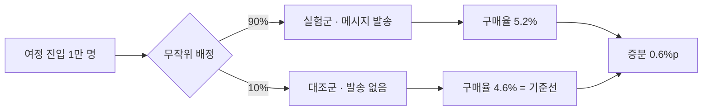
그림 1. 대조군으로 증분을 재는 기본 구조 (숫자는 가상의 예)

대조군 크기는 어떻게 정할까? 크게 잡을수록 결과가 또렷해지지만, 그만큼 메시지를 못 받는 고객이 늘어 단기 매출을 포기하게 된다. 작게 잡으면 앞에서 본 것처럼 효과가 작아 "유의하지 않음"만 나오기 쉽다. 정답은 없고, 기대 효과의 크기와 여정에 들어오는 인원으로 정한다. 인원이 적은 여정이라면 실험 기간을 길게 잡아 사람을 모으는 편이 낫다. 처음이라면 데이터 분석가와 함께 정해 보자.

## 두 도구의 실험 장치

두 도구는 이 구조를 만드는 장치를 이미 갖추고 있다. 5·6·8장에서 컴포넌트로 짧게 만났던 것들을 실험의 눈으로 다시 보자. 기능 목록은 2026-11 기준이다.

**Braze**의 캠페인에는 다변량 테스트가 있다. 변형을 최대 8개까지 만들어 비교할 수 있고, 메시지를 받지 않는 대조군도 함께 둘 수 있다. 주의할 점은 시작한 뒤 제목이나 본문을 바꾸면 실험이 무효가 된다는 것이다. 오타를 발견해 고치는 순간 그 앞의 결과와 뒤의 결과가 섞인다. 발송 전 QA를 꼼꼼히 하는 이유가 하나 더 생긴 셈이다.

Canvas 안에서는 Experiment Paths가 여정의 갈래 자체를 실험한다. 메시지 문구뿐 아니라 "1시간 뒤 보내기 vs 하루 뒤 보내기"처럼 흐름을 비교할 수 있고, 갈래 하나를 메시지 없는 대조군으로 둘 수도 있다. Winning Path를 켜면 일정 기간 뒤 성과가 좋은 갈래로 이후 진입자를 몰아준다. Optimize with BrazeAI(구 Intelligent Selection)는 변형별 성과를 보며 발송 비율을 자동으로 옮긴다. 반복 발송 캠페인이어야 하고, 변형이 두 개 이상이어야 하며, 전환 이벤트가 필요하다. 단일 발송에는 쓸 수 없다.

**Insider One** Architect에서는 Journey A/B Split이 여정을 갈래로 나눈다. A/B autowinner는 갈래 중 승자를 자동으로 고르고, A/B 통계로 결과를 확인한다. 여정에는 Conversion Goal을 정하고, Conversion Attribution Model로 전환을 어느 메시지의 몫으로 셀지 정한다. 6장에서 본 것처럼 마지막으로 클릭한 채널에 전환을 전부 돌리는 last-touch 방식이 대표적이다.

여기서 두 가지를 짚어 두자. 첫째, 자동 승자 선택이 고르는 것은 "변형 중 가장 나은 것"이다. 모든 변형이 보내지 않은 것보다 못할 수도 있다. 승자 선택을 쓰더라도 메시지 없는 갈래를 하나 두어야 그 승자가 기준선보다 나은지 알 수 있다. 둘째, 승자를 무엇으로 고르게 할지가 중요하다. 8장에서 본 소매은행 실험(Schwartz, Bradlow & Fader 2017)은 전환 대신 클릭률을 최적화했다면 고객 획득이 약 10% 줄었을 것이라고 추정했다. Optimize with BrazeAI가 전환 이벤트를 요구하는 것도, Conversion Goal을 구매로 잡아야 하는 것도 같은 이유다.

last-touch 어트리뷰션도 조심해서 읽자. 어트리뷰션은 일어난 전환을 메시지들에게 나눠 주는 회계 규칙이지, 메시지가 전환을 만들었는지 재는 실험이 아니다. 고객이 어차피 살 상품을 사기 직전에 푸시를 눌렀다면 last-touch는 그 구매를 통째로 푸시의 공으로 적는다.

## 실험이 스스로를 속이는 세 가지 방법

대조군을 두었다고 끝이 아니다. 실험은 생각보다 쉽게 스스로를 속인다. 주니어 마케터가 특히 자주 빠지는 함정 세 가지를 보자.

**첫째, 나눈 비율이 어긋난다.** 50:50으로 나눴는데 이메일을 실제로 받은 사람을 세 보니 52:48이라고 해 보자. "2%p쯤이야" 하고 넘기기 쉽지만, 이것은 표본비 불일치(SRM, Sample Ratio Mismatch)라는 경고등이다. 발송 실패나 하드 바운스, 푸시 토큰이 없는 사용자 제외 같은 처리가 한쪽 무리에만 걸리면 이런 일이 생긴다. 그러면 두 무리는 더 이상 비슷한 사람들이 아니다. Microsoft의 실험 플랫폼 팀이 보고한 바로는 그들이 돌린 실험의 약 6%에서 SRM이 발생했다. 관련 논문은 이렇게 비유한다. "열이 여러 병의 증상이듯, SRM은 다양한 데이터 품질 문제의 증상이다." 비율이 어긋났다면 결과를 해석하기 전에 원인부터 찾자.

**둘째, 중간에 들여다보고 끈다.** 실험을 켜 두고 매일 대시보드를 열어 보다가 실험군이 앞서는 날 "이겼다!" 하고 끝내는 습관이다. 결과는 날마다 출렁이기 마련이라, 계속 들여다보다 유리한 순간에 멈추면 실제로는 차이가 없는데도 차이가 있다는 결론을 내리기 쉽다. 연속 모니터링을 다룬 연구(Johari 외 2022)는 사용자가 테스트를 계속 지켜보며 표본 크기를 스스로 정하면 통상의 추론이 "전혀 믿을 수 없게(wholly unreliable)" 된다고 경고한다. 실험 기간과 판단 기준은 시작하기 전에 정해 두고, 그때까지는 결론을 미루자.

**셋째, 가장 높은 사람의 의견이 이긴다.** 실험 결과가 나왔는데 "그래도 나는 A안이 낫다고 본다"는 한마디에 B안이 묻히는 장면이다. 온라인 통제 실험의 실무 가이드로 널리 읽히는 논문(Kohavi 외 2009)은 개발팀이 고객의 목소리를 들을 때 큰 배움과 투자 수익이 생긴다고 하면서, 그 반대편을 "가장 높은 연봉을 받는 사람의 의견(HiPPO, Highest Paid Person's Opinion)"이라고 불렀다. 실험을 시작하기 전에 "무엇이 나오면 무엇을 하겠다"를 팀과 합의해 두면 결과가 나온 뒤의 논쟁이 훨씬 줄어든다.

## 캠페인 하나를 넘어서 — 유니버설 홀드아웃

캠페인마다 대조군을 두면 그 캠페인의 효과는 볼 수 있다. 그런데 팀장이 이번에는 이렇게 묻는다면 어떨까? "그래서 우리 CRM 전체가 회사 매출에 얼마나 기여하나요?" 캠페인별 증분을 모두 더하면 될 것 같지만 그렇지 않다. 같은 고객이 여러 여정에 동시에 들어가 있고, 메시지끼리 효과를 나눠 먹거나 서로 피로를 쌓기 때문이다.

Monzo의 시니어 데이터 과학자 Rodrigo Baptista가 2025-09에 공개한 방법이 좋은 참고가 된다. Monzo는 전체 사용자의 2.5%를 6개월 동안 CRM 메시지에서 무작위로 빼 둔다. 이것을 유니버설 홀드아웃(universal holdout)이라고 부른다. 6개월 뒤 홀드아웃 무리와 나머지 무리를 비교하면 CRM 프로그램 전체가 만든 효과를 볼 수 있다.

Monzo는 여기서 한 걸음 더 나아가 어트리뷰션을 홀드아웃 기준으로 보정한다. 예를 들어 홀드아웃으로 잰 CRM 전체 증분이 100건인데 어트리뷰션 모델은 200건을 CRM의 공으로 셌다면, 보정 계수 0.5를 곱해 어트리뷰션 수치를 낮춘다. 글은 어트리뷰션 모델이 "공을 지나치게 많이 가져가는 경향이 있다(tend to claim too much)"고 지적하고, "개별 실험의 업리프트는 더할 수 없다(Individual experiment uplifts are non additive)"고 못 박는다.

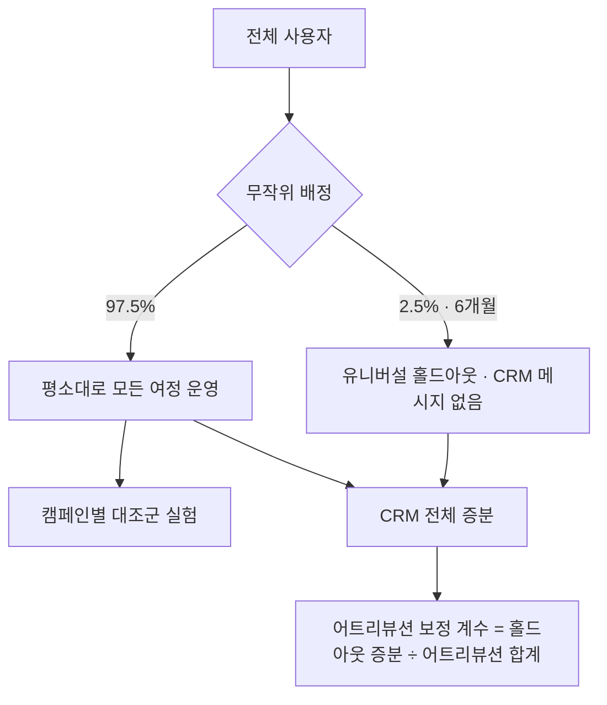
그림 2. 캠페인 대조군과 유니버설 홀드아웃을 함께 쓰는 구조 (Monzo 방식 참고)

유니버설 홀드아웃은 9장의 피로도 문제에도 답을 준다. 캠페인 하나의 대조군으로는 "얼마나 자주 보내야 하는가"를 알 수 없다. 메시지 한 통의 효과는 보이지만, 한 달 동안 쌓인 발송이 수신 거부와 앱 삭제를 얼마나 늘렸는지는 보이지 않기 때문이다. 한 CRM 실험 강의가 발송 주기(cadence)를 별도 실험으로 다루고 글로벌 홀드아웃을 유지하라고 권하는 이유다. 주 3회 무리와 주 1회 무리를 무작위로 나눠 몇 달간 비교하면, 캠페인 리포트에는 잡히지 않던 피로 비용이 드러난다.

물론 2.5%의 고객에게 6개월간 아무 메시지도 보내지 않는 결정은 마케터 혼자 내릴 수 없다. 정보성 메시지(주문 확인, 비밀번호 재설정 같은 것)는 홀드아웃에서도 계속 보내야 하고, 홀드아웃이 포기하는 단기 매출도 감수해야 한다. 팀장과 데이터 조직을 설득할 근거가 필요할 때 Monzo의 글을 함께 읽어 보자.

## 툴 밖으로 데이터 빼기

여기까지 오면 한 가지 벽에 부딪힌다. 유니버설 홀드아웃의 효과를 6개월치 매출로 비교하거나, 회원 등급별로 메시지 반응을 나눠 보려면 도구의 기본 대시보드로는 부족하다. 실제로 Insider One 리뷰에는 "대시보드 분석이 여전히 제한적이고 유연하지 않다"(리테일, 2026-10), "원하는 분석을 찾아내기가 어려울 때가 있다"(여행업) 같은 불만이 보인다. Braze 쪽에는 "대시보드로 무엇이 잘되고 있는지 한눈에 보기 쉽다"는 평도 있다. 한눈에 보는 일과 깊이 따져 보는 일은 다른 작업이다. 두 도구의 대시보드는 주로 발송·열람·클릭 중심이고, 회사의 매출·원가 데이터와 결합한 분석은 대개 도구 밖에서 한다.

**Braze**에서는 Currents가 그 출구다. 메시지 발송, 열람, 클릭 같은 참여 이벤트를 실시간 데이터 스트림으로 내보내는 기능이고, Braze에서 나가는 export 중 가장 세분화된 형태다. 데이터는 Avro 형식으로 데이터 파트너에 전달되고, Tealium·Segment·mParticle 같은 CDP로 보낼 수도 있다. 커넥터마다 어떤 종류의 이벤트를 내보낼지 엔타이틀먼트(Engagement Events 등)로 정하고, 이것이 과금과 연결된다. 2026-11 기준 Braze 문서는 Currents가 다수의 Pro/Enterprise 패키지에 포함되어 있고 가격은 담당 매니저에게 문의하라고 안내한다.

한국 사례로는 카카오스타일(지그재그)이 있다. Braze가 게재한 사례에 따르면, 카카오스타일은 Currents로 메시지 참여 이벤트를 AWS S3에 실시간으로 쌓고, 회원 등급·연령·구매 이력과 결합해 QuickSight 대시보드를 만들어 세그먼트별 크리에이티브 반응을 프로모션 팀과 공유했다. 사례 페이지는 앱 트래픽이 35% 늘었다고 적고 있다(벤더 게재, 게재일 미표기). 수치보다 구조를 보자. 도구 안의 참여 데이터와 회사의 고객·매출 데이터가 만나는 곳은 도구 밖이다.

**Insider One** Architect도 리포트 기능에 데이터 export를 포함한다. 실시간 흐름 통계, 채널별·여정 전체 통계, A/B 통계와 함께 데이터를 내보내 회사 분석 환경에서 결합할 수 있다. 어떤 형식과 주기로 내보낼 수 있는지는 계정 설정과 계약에 따라 다를 수 있으니 Academy 문서와 담당 매니저에게 확인하자.

주니어 마케터가 데이터 파이프라인을 직접 깔 일은 드물다. 하지만 "홀드아웃 무리의 6개월 매출을 실험군과 비교하고 싶다", "회원 등급별 쿠폰 증분을 보고 싶다"처럼 무엇을 보고 싶은지 말할 수 있으면, 데이터 조직이 무엇을 빼고 어떻게 결합할지 정하기가 훨씬 쉬워진다. 2장에서 이벤트를 요청하는 법을 익혔듯, 측정에서도 마케터의 몫은 질문을 정확히 만드는 일이다.

## 주간 리포트를 다시 쓰자

다시 주간 회의실이다. 팀장의 질문에 답하려면 리포트부터 바뀌어야 한다. CTR을 맨 위에 두던 리포트를, 대조군과 증분을 맨 위에 두는 리포트로 바꿔 보자. 아래는 한 장짜리 양식이다. 우리 팀 사정에 맞게 고쳐 쓰면 된다.

| 항목 | 이번 주 기록 |
|---|---|
| 여정·캠페인 이름 | 예: 장바구니 이탈 v2 |
| 목표 지표(전환 이벤트) | 예: 구매 완료 (클릭 아님) |
| 진입 인원 / 실험군 / 대조군 | 예: 10,000 / 9,000 / 1,000 |
| 배정 비율 점검(SRM) | 기대 90:10, 실제 배정 비율, 차이 원인 |
| 실험군 전환율 / 대조군 전환율 | 예: 5.2% / 4.6% |
| 증분(%p)과 증분 전환 수 | 예: 0.6%p, 54건 |
| 판단 시점과 기준(시작 전에 정한 것) | 예: 2주 후, 증분 0.3%p 이상이면 유지 |
| 비용 | 쿠폰·할인 비용, 채널 발송 비용 |
| 가드레일 지표 | 수신 거부, 푸시 권한 해제, 고객 문의 |
| 참고 지표 | CTR, 오픈율 (원인 분석용) |
| 다음 행동 | 유지 / 중단 / 다음 실험 가설 |

CTR이 사라진 것은 아니다. 맨 아래 "참고 지표" 칸으로 내려갔을 뿐이다. 증분이 작게 나왔을 때 그 원인이 메시지를 아무도 열지 않아서인지, 열었는데 행동이 바뀌지 않아서인지 가려낼 때 CTR이 다시 쓸모를 찾는다. 그리고 가드레일 칸에는 피로의 신호를 적는다. 증분이 늘었더라도 수신 거부가 함께 치솟았다면 그 여정은 다음 달의 고객을 당겨 쓴 것일 수 있다.

이 양식을 처음 내밀면 숫자가 초라해 보일 수 있다. 468건의 전환 대신 54건의 증분을 보고하는 일은 용기가 필요하다. 하지만 그 54건은 회사가 믿고 예산을 걸 수 있는 숫자다. "안 보냈으면 몇 명이 샀을까요?"라는 질문에 표 한 장으로 답할 수 있다면, 다음 회의에서는 당신의 실험이 이야기의 중심에 선다.

### 이 장의 핵심

- CTR은 메시지가 눈길을 끌었는지 보여 줄 뿐이다. 성과는 "보내지 않았다면"과의 차이, 곧 증분으로 말한다.
- 증분은 무작위로 나눈 대조군이 있어야 잴 수 있다. "보낸 사람 vs 안 보낸 사람"의 사후 비교는 크게 빗나간다.
- Braze(다변량·Experiment Paths·Winning Path·Optimize with BrazeAI)와 Insider One(Journey A/B Split·A/B autowinner·Conversion Goal)의 실험 장치를 쓰되, 메시지 없는 갈래를 두고 목표는 클릭이 아닌 전환으로 잡는다.
- SRM, 중간에 들여다보고 끄기, HiPPO는 대조군이 있어도 실험을 무너뜨린다. 판단 기준은 시작 전에 정한다.
- 캠페인을 넘어선 효과와 피로는 유니버설 홀드아웃과 발송 주기 실험으로 보고, 깊은 분석은 Currents나 데이터 export로 툴 밖에서 한다.

# 14장. 우리 팀의 다음 90일 — 도구 고르기·함께 일하기·더 배우기

> "Not all CRMs are created equal. Some are more implementation heavy than others. … P.S: I still love Braze."
> — The Grow Getter 뉴스레터 (2023-11-10)

Braze를 직접 써 본 사람이 고속 성장 스타트업의 CRM 선택을 두고 쓴 글의 한 대목이다. 이 글은 꽤 냉정하다. 실시간 인사이트를 얻으려면 "엔지니어링 리소스가 많이 드는 복잡한 기술 연동"이 필요하고, 엔지니어나 마케팅 테크 담당 한 명을 3~4개월 붙일 수 있어야 한다고 말한다. 비용에 대해서는 "Braze is very expensive. Period."라고 잘라 말한다. 그러고는 마지막 줄에 추신을 붙였다. 그래도 나는 여전히 Braze를 좋아한다고.

도구를 대하는 태도로 이만한 것이 있을까 싶다. 좋아하되 눈을 감지 않는 것. 무엇을 잘하는지 알고, 무엇이 드는지도 아는 것. 이 책이 Braze와 Insider One을 나란히 놓고 열세 장을 걸어온 것도 결국 이 태도를 기르기 위해서였다. 마지막 장에서는 지금까지 배운 것을 하나로 묶고, 그것을 들고 입사 후 첫 90일을 어떻게 보낼지 계획을 세워 보자.

## 다섯 층을 하나의 사이클로

1장에서 푸시 버튼 뒤에 다섯 층이 있다고 했다. 데이터, 대상, 채널, 여정, 측정. 지금까지의 여정을 이 층을 따라 돌아보자.

맨 아래에는 **데이터**가 있었다(2장). Braze의 사용자 프로필과 Insider One의 UCD는 고객에 대한 사실을 담는 곳이고, 커스텀 이벤트와 속성이 없으면 그 위의 어떤 기능도 작동하지 않는다. 그 위에서 **대상**을 골랐다(3장). 처음부터 잘게 쪼개기보다 보낼 수 있는 모수부터 확인하고, 예측 세그먼트도 결국 하나의 모델이라는 것을 배웠다. **채널**은 메시지의 목적과 고객의 상태로 골랐다(4장). 앱을 지운 고객에게 푸시는 닿지 않고, 웹에만 오는 고객에게는 온사이트 경험과 웹 푸시가 남는다.

**여정**은 이 책의 한가운데였다. Canvas와 Architect로 같은 여정을 만들며 진입·대기·분기·이탈이라는 공통 문법을 익혔고(5·6장), Liquid로 한 사람에게 말을 거는 법(7장)과 AI가 발송 시각과 채널, 승자를 대신 골라 주는 장치(8장)를 그 위에 얹었다. 그리고 실제로 보내기 전에 한국의 발송 규제와 수신 동의, 피로도라는 관문을 지났다(9장). 온보딩(10장), 장바구니 이탈과 가격 인하(11장), 윈백과 크로스셀(12장)은 그 모든 것을 꺼내 쓰는 연습이었다. 마지막으로 **측정**에서 "보내지 않았다면 어땠을까"를 묻는 법을 배웠다(13장).

그런데 다섯 층을 다 쌓고 보면 이것이 한 번 쌓고 끝나는 탑이 아니라는 것이 보인다. 측정 결과는 다시 데이터로 돌아간다. 12장의 윈백 실험에서 "중간 점수 구간이 쿠폰에 가장 민감하다"는 결과가 나왔다면, 그 사실은 다음 달의 대상 조건이 된다. 13장의 발송 주기 실험에서 주 3회가 피로를 쌓는다는 것을 알았다면, 그것은 9장의 빈도 상한 설정으로 돌아간다. 데이터에서 시작해 측정으로 끝나고, 측정이 다시 데이터를 고친다. CRM 마케터의 일은 이 바퀴를 한 바퀴씩 더 정확하게 돌리는 일이다.

## 우리 팀에는 무엇이 맞을까

이 책을 덮고 나면 가장 자주 받을 질문이 이것일지 모른다. "그래서 Insider One이 나아, Braze가 나아?" 이미 회사가 한쪽을 쓰고 있다면 질문할 일이 없겠지만, 도입을 검토하는 팀이나 이직을 고민하는 마케터라면 피할 수 없는 질문이다.

먼저 이 질문에 단정적으로 답하는 글을 조심하자. 인터넷에서 찾을 수 있는 두 도구의 비교 글은 상당수가 벤더가 직접 쓴 것이다. 한쪽 벤더의 자사 블로그이거나, 두 도구와 경쟁하는 제3의 벤더가 쓴 비교 글이다. 리뷰 사이트의 평점도 조회 시점과 리뷰 수에 따라 흔들린다. 이해관계가 없는 실무자들의 비교 토론은 이 책을 준비하며 거의 찾지 못했다.

그 대신 비교적 단단한 기준이 하나 있다. 시장 조사 기관 Gartner의 분류다. 2026-11 기준 회사 측 발표에 따르면 Insider One은 2026 Gartner Magic Quadrant의 **개인화 엔진(Personalization Engines)** 부문에서 Leader로 선정되었고, Braze는 **멀티채널 마케팅 허브(Multichannel Marketing Hubs)** 부문에서 4년 연속 Leader로 선정되었다. 두 회사가 서로 다른 부문에서 강점을 인정받았다는 사실이 두 제품의 성격을 잘 보여 준다. Insider One은 웹사이트 위의 개인화, 곧 온사이트 추천·검색·개인화 경험에 강점의 무게중심이 있다. Braze는 앱을 중심으로 여러 채널의 메시지를 하나의 흐름으로 묶는 데 무게중심이 있다.

여기에 우리 팀의 상황을 대 보자. 고객 접점이 주로 웹 쇼핑몰이고 상품 추천과 온사이트 경험을 바꾸는 것이 급하다면 Insider One의 강점이 먼저 눈에 들어올 것이다. 앱이 핵심이고 푸시·인앱·이메일을 정교한 여정으로 엮어야 한다면 Braze의 강점이 먼저 보일 것이다. 물론 두 도구 모두 상대의 영역을 상당 부분 갖추고 있으니, 이것은 무게중심의 차이로 읽는 편이 정확하다.

한국에서는 카카오가 중요한 기준이 된다. 4장과 9장에서 본 대로, 2026-11 기준 공개 자료로 확인되는 범위는 아직 좁다. Braze는 2026-04에 카카오톡 채널을 출시했고, 공식 자료로 확인되는 것은 CJ올리브네트웍스나 Infobip을 거쳐 채널을 추가한 친구에게 보내는 마케팅 메시지다. Insider One은 네이티브 카카오톡 채널을 공식 자료에서 확인하지 못했고, Architect의 Call an API 요소로 외부 메시지 API를 호출하도록 직접 설정하는 사용 사례 문서가 있는 정도다. 알림톡 지원은 두 도구 모두 공식 자료에서 확인되지 않는다. 카카오로 어떤 메시지를 보내야 하는지(정보성인지 광고성인지, 채널 친구에게만인지)를 먼저 표로 정리하고, 그 표를 들고 벤더에 직접 확인하는 편이 낫다. 이 부분은 이 책이 나온 뒤에도 빠르게 바뀔 수 있다.

학습 곡선과 비용도 따져 보자. 두 도구 모두 단발 발송은 쉽고, 여정과 이벤트 데이터와 동적 콘텐츠로 넘어가면 어려워진다는 평이 많다. 이 어려움은 도구의 문제라기보다 고급 기능이 모두 데이터 모델 이해를 전제하기 때문에 생긴다. 비용은 두 제품 모두 공개되어 있지 않고 견적으로 정해진다. 다만 무엇이 비용을 움직이는지는 알 수 있다. Braze는 데이터 포인트와 메시지 크레딧, 그리고 SMS나 Content Cards 같은 애드온이 비용을 키운다는 사용자 불만이 있고, Insider One도 커스텀 이벤트와 커스텀 속성이 월 데이터 포인트 소비에 영향을 준다. 2장에서 "모든 데이터를 다 넣자"가 공짜가 아니라고 했던 이유다. 어느 도구든 어떤 데이터를 얼마나 보낼지가 곧 비용 설계다.

## 혼자 할 수 있는 일, 함께 해야 하는 일

"마케터 혼자서도 쓸 수 있다"는 말과 "개발 리소스 없이는 반쪽짜리"라는 말. 두 도구의 리뷰를 읽다 보면 이 두 문장이 끝없이 부딪힌다. 어느 쪽이 맞을까?

둘 다 맞다. 시점이 다를 뿐이다. 한 Insider One 사용자는 "큰 기술 지원 없이 우리 팀이 여정을 완전히 독립적으로 만들고 최적화할 수 있었다"고 썼고(금융업, 2026-09), 다른 사용자는 "초기 설정에는 여전히 커스텀 API 연동을 위한 개발자 도움이 필요했다"고 썼다(2026-10). Braze 쪽에서도 "API 엔드포인트 연결과 팀 워크스페이스 권한 설정에 예상치 못한 우회가 필요했다"는 리뷰가 있다(2026-10). 10장의 잡코리아 사례에서는 마케터가 개발 도움 없이 세부 세그먼트를 구성했다.

이 엇갈림을 풀어 주는 열쇠는 단계다. 도입과 연동 단계에서는 개발에 크게 의존한다. 앱과 웹에 SDK를 심고, 이벤트를 정의하고, 회사 시스템과 데이터를 잇는 일은 마케터가 혼자 할 수 없다. 반면 데이터가 잘 깔린 뒤의 운영 단계에서는 마케터가 세그먼트를 만들고 여정을 짜고 실험을 돌리는 일을 꽤 독립적으로 할 수 있다. 마케터의 자율성은 도입 초기의 데이터 설계 품질에 비례한다는 커뮤니티의 진단이 정확히 이 지점을 가리킨다.

그래서 주니어 마케터가 회사에 들어가는 시점이 체감을 정반대로 만든다. 이미 몇 년째 운영 중인 회사라면 "생각보다 혼자 할 수 있는 게 많다"고 느낄 것이고, 막 도입을 시작한 회사라면 "개발팀 일정만 기다리고 있다"고 느낄 것이다. 도입을 앞둔 팀이라면 The Grow Getter의 조언을 떠올리자. 엔지니어나 마케팅 테크 담당 한 명을 3~4개월 붙일 수 있는지 먼저 확인하라는 것이다.

어느 단계든 함께 일해야 할 사람들은 정해져 있다. 개발팀에는 "어떤 이벤트를 어떤 속성과 함께" 심어 달라고 요청한다(2장). 데이터 조직과는 대조군 크기를 정하고 툴 밖에서 증분을 재는 일을 함께한다(13장). 법무·개인정보 담당자에게는 광고성 판단과 동의 관리를 확인받는다(9장). 마케터의 몫은 이 사람들에게 정확한 질문을 들고 가는 것이다.

## 첫 90일 로드맵

이제 입사한 주니어가 첫 90일 동안 무엇을 하면 좋을지 구체적으로 정리해 보자. 회사마다 사정이 다르니 순서와 기간은 조정하되, 네 단계의 흐름은 대부분의 팀에 통한다.

**1~3주 차: 데이터 사전 읽기.** 우리 도구에 어떤 커스텀 이벤트와 속성이 있는지 목록을 만든다. 이벤트 이름만 적지 말고, 언제 기록되는지, 어떤 속성이 붙어 오는지, 익명 사용자가 언제 식별되는지까지 적는다. 모르는 항목은 개발팀에 묻는다. 2장 끝의 질문 목록이 그대로 쓰인다. 이 문서가 생기면 세그먼트 화면의 필터가 갑자기 읽히기 시작한다.

**4~6주 차: 기존 여정 감사.** 지금 돌아가고 있는 여정과 캠페인을 하나씩 열어 5장의 여정 설계서 양식으로 역으로 적어 본다. 목표는 무엇인지, 이탈 조건에 "이미 목표를 이룬 사람"이 빠져 있지 않은지, 광고성 메시지에 동의 확인이 걸려 있는지, 여러 여정이 같은 고객에게 겹쳐 보내고 있지 않은지 본다. 이 과정에서 사고 직전의 여정을 하나쯤 발견할 가능성이 높다. 입사 한 달 만에 그것을 찾아내는 것만으로도 팀에 큰 기여다.

**7~9주 차: 홀드아웃 설정.** 13장의 유니버설 홀드아웃을 팀에 제안한다. 처음부터 전사 규모로 하기 어렵다면, 가장 발송량이 많은 여정 하나에 대조군 갈래를 넣는 것부터 시작해도 좋다. 주간 리포트 양식도 이때 바꾼다. CTR 대신 증분이 맨 위에 오는 리포트가 한두 번 회의에 올라가면 팀의 대화가 달라진다.

**10~13주 차: 첫 개선 실험.** 감사에서 찾은 문제 하나를 골라 가설을 세우고 실험한다. "장바구니 이탈 메시지를 1시간 뒤가 아니라 하루 뒤에 보내면 증분이 더 클 것이다" 같은 작은 가설이면 충분하다. 시작 전에 판단 기준과 기간을 정해 두고, 중간에 들여다보며 끄지 않는다. 결과가 기대와 달라도 실패가 아니다. 우리 고객에 대해 확인된 사실이 하나 늘어난 것이다.

90일이 지나면 손에 남는 것이 있다. 데이터 사전, 여정 감사 기록, 대조군이 있는 리포트, 실험 결과 한 건. 화려하지는 않지만, 모두 다음 사람이 이어받아 쓸 수 있는 자산이다.

## 더 배우기

이 책은 출발점이다. 두 도구 모두 기능이 빠르게 바뀌고 있으니, 1차 자료로 꾸준히 업데이트하는 습관을 들이자.

Braze는 무료 학습 경로인 Braze Practitioner Learning Path를 제공한다. 실무자 인증인 Braze Certified Practitioner 시험은 2026-11 기준 60분이고, 합격하면 3년간 유효하다. 장바구니 이탈 여정을 직접 만들어 보는 코스도 있어 11장의 내용을 손으로 다시 익히기 좋다. 채용 공고의 "Braze 활용 역량"을 증명할 방법을 찾는다면 인증이 하나의 답이 될 수 있다.

Insider One은 Insider One Academy가 공식 학습 창구다. 이 책의 Insider One 서술 대부분이 Academy 문서에 기대고 있다. Architect의 Terms to Know나 Feature Set 같은 문서는 6장을 다시 읽듯 한 번 정독해 둘 만하다. 문서마다 갱신 날짜가 적혀 있으니 날짜를 확인하며 읽자.

국내 유료 강의도 여럿 있다. 다만 품질의 편차가 크다. 한 강의 수강평은 정확한 절차 없이 "이렇게 입력하라"는 식이고, 예시 파일의 형식 안내도 없었다고 아쉬워했다(2022). 강의를 고를 때는 목차에 데이터 설계와 측정이 들어 있는지, 화면 따라 하기만이 아니라 "왜 그렇게 설정하는가"를 설명하는지, 강의가 만들어진 시점이 언제인지 확인하자. 2025~2026년의 이름 변경 이전에 만든 강의라면 기능 이름부터 다를 수 있다.

측정을 더 깊이 파고 싶다면 13장에서 인용한 Kohavi가 Tang, Xu와 함께 쓴 『Trustworthy Online Controlled Experiments』(2020)를 권한다. 마케터를 위해 쓴 책은 아니지만, 대조군과 실험의 함정을 이만큼 체계적으로 정리한 책은 드물다.

## 다시, 금요일 오후

1장의 장면으로 돌아가 보자. 입사 첫 주에 푸시는 한 번 보내 봤다. 금요일 오후, 팀장이 지나가며 말했다. "다음 주부터 '가입 3일 차 미구매자' 여정 좀 맡아 줘. Canvas 열어 보면 감이 올 거야." Canvas를 열었지만 무엇부터 눌러야 할지 몰랐다.

이제 그 장면을 다시 보면 무엇이 보이는가? "가입 3일 차"는 데이터 층의 이야기다. 가입 완료 이벤트가 기록되고 있는지, 가입일 속성이 프로필에 있는지부터 확인해야 한다. "미구매자"는 대상과 이탈 조건의 이야기다. 진입할 때 이미 구매한 사람을 빼고, 여정 도중 구매한 사람은 Exit criteria로 놓아줘야 한다. 그 사이에 어떤 채널로 보낼지, 쿠폰 메시지라면 광고성 정보로서 동의와 표기를 어떻게 지킬지, 하루에 몇 통까지 보낼지가 놓인다. 그리고 여정을 켜기 전에 대조군 갈래를 하나 넣어 둔다. 한 달 뒤 팀장이 "그래서 효과가 있었어?"라고 물을 때 증분으로 답하기 위해서다.

그 모든 것을 정하기 전에 해야 할 일도 이제 안다. 화면을 열기 전에 종이 한 장을 꺼내 설계서를 쓰는 것이다. 목표, 진입, 단계, 이탈, 측정. 칸이 채워지면 Canvas든 Architect든 어느 화면을 열어도 무엇부터 눌러야 할지 보인다.

1장의 제목에서 이 책을 두 도구의 지도라고 불렀다. 지도를 다 읽었다고 길을 다 걸은 것은 아니다. 하지만 어디에 무엇이 있는지 알면 처음 가는 길에서도 덜 헤맨다. 발송된 메시지는 되돌릴 수 없다. 그래서 보내기 전에 설계하자. 그 습관 하나가 당신을 푸시를 보내는 사람에서 고객의 여정을 설계하는 마케터로 바꿔 놓을 것이다.

# 에필로그 — 이 책이 답하지 못한 것들

금요일 오후, 팀장이 던진 '가입 3일 차 미구매자'라는 한마디에서 이 책은 시작했다. 그 한마디를 데이터와 대상과 채널로 풀고, Canvas와 Architect로 같은 여정을 두 번 그리고, 한국의 발송 규칙이라는 관문을 지나, 온보딩과 장바구니 이탈과 윈백으로 연습한 뒤, 마지막에는 "보내지 않았다면 어땠을까"를 물었다. 이제 그 여정이 어디까지 닿았고 어디서 멈췄는지 정직하게 적어 두자.

이 책에는 끝내 답하지 못한 질문들이 있다. 자료가 없어서이기도 하고, 벤더만 답할 수 있는 질문이어서이기도 하다.

**카카오톡으로 무엇을 보낼 수 있는가.** 2026년 11월 기준 공개 자료로 확인되는 것은 Braze의 채널 친구 대상 마케팅 메시지뿐이다(4장·9장). 알림톡은 두 도구 모두 확인되지 않았다. Braze 설정이 CJ올리브네트웍스 쪽 브랜드 메시지 API 자격 증명을 쓰지만 실제로 어떤 카카오 상품으로 나가는지는 문서에 적혀 있지 않고, Insider One은 Architect의 Call an API로 직접 설정하는 사용 사례 문서가 있을 뿐이다. 친구톡이 종료되고 브랜드 메시지로 대체됐다는 이야기도 발송 대행사의 안내로만 확인했다. 한국 CRM에서 가장 중요한 채널인데, 이 책이 가장 조심스럽게 쓸 수밖에 없었던 부분이다.

**신기능은 지금 어떤 상태인가.** BrazeAI Operator는 2025년 12월에 베타로 소개된 뒤 2026년 11월 목록에는 상태 표시 없이 올라 있고, Content Optimizer는 베타, Insider One의 Liquid는 얼리 액세스다(7장·8장). Braze Docs는 Predictive Churn의 활성 예측 상한을 페이지에 따라 3개와 5개로 다르게 적고 있다(3장). 이런 것들은 책이 나온 뒤에도 몇 달 단위로 바뀔 것이다.

**법은 앱 푸시에 정확히 무엇을 요구하는가.** 앱 푸시에서 "(광고)" 표기를 어디에 어떻게 넣을지, 2026년 3월 개정 안내서의 원문은 무엇이라고 쓰는지를 이 책은 공개 자료로 확정하지 못했다(9장). 조문도 법령 정보 미러와 실무 해설을 교차해 정리했을 뿐, 국가법령정보센터 원문과 직접 대조하지는 못했다.

**발송 시간 최적화와 마케팅 푸시는 정말 효과가 있는가.** 개인별 발송 시간 최적화를 무작위 실험으로 검증한 논문은 찾지 못했고, 이커머스 앱의 마케팅 푸시를 대규모 무작위 실험으로 검증한 연구도 찾지 못했다(4장·8장). 이 책이 인용한 실험은 헬스 앱과 반려동물 앱에서 나왔다.

그래서 다음 걸음은 두 갈래다.

하나는 묻는 일이다. 위의 질문들을 우리 회사 상황에 맞게 고쳐 적어, 담당 벤더와 발송 대행사, 법무 담당자에게 들고 가자. "카카오로 이런 메시지를 이런 고객에게 보내려 하는데, 어떤 상품으로, 어떤 동의를 받아, 어떤 경로로 나가나요?"처럼 구체적으로 물을수록 답도 구체적으로 돌아온다. 2장에서 개발팀에 "이벤트 하나, 속성 몇 개, 쓰임새 하나"로 요청하라고 했던 것과 같은 원리다.

다른 하나는 재는 일이다. 논문이 답하지 못한 질문은 우리 고객으로 직접 답할 수 있다. 발송 시간 최적화를 켠 무리와 끈 무리, 이름을 넣은 메시지와 넣지 않은 메시지, 주 3회와 주 1회. 13장의 대조군 하나와 14장의 90일 로드맵이면 시작하기에 충분하다. 그렇게 얻은 답은 어떤 책보다 우리 팀에 정확하다.

이 책이 낡는 속도보다 당신이 확인하는 속도가 빠르기를 바란다. 보내기 전에 설계하고, 보낸 뒤에는 재자.

# 부록

## 부록 A. Braze ↔ Insider One 용어 대조표

본문에 흩어진 두 도구의 이름을 한곳에 모았다. 앞부분은 데이터에서 측정까지 개념별 대응이고, 뒷부분은 6장의 여정 빌더 번역표를 합친 것이다. 모두 2026-11 기준이며, "(대응 용어 없음 — 공식 문서 확인)"으로 적은 칸은 이 책이 같은 이름의 기능을 확인하지 못했다는 뜻이지 기능이 없다는 뜻이 아니다.

### 개념별 대응

| 개념 | 이 책의 일반 표기 | Braze | Insider One | 본문 |
|---|---|---|---|---|
| 회사·제품명 | — | Braze | Insider One (2025-12 이전 사건은 "Insider(현 Insider One)") | 1장 |
| 고객 데이터 저장소 | 고객 프로필 | 사용자 프로필(user profile) | UCD(Unified Customer Database) | 2장 |
| 고객 식별자 | 식별자 | external_id, braze_id(익명), alias | identifiers 객체(이메일·전화번호·user ID) | 2장 |
| 행동 기록 | 커스텀 이벤트·이벤트 속성 | 커스텀 이벤트, 이벤트 속성(event properties) | 기본·커스텀 이벤트, 이벤트 파라미터 | 2장 |
| 상태 기록 | 커스텀 속성 | 커스텀 속성 | 기본·커스텀 속성 | 2장 |
| 외부 데이터 연결 | 데이터 연동 | Cloud Data Ingestion(가져오기), Currents(내보내기) | 100개 이상 데이터 소스 연동, 데이터 export | 2장·13장 |
| 예측 세그먼트 | 예측 세그먼트 | Predictive Suite(Predictive Churn, Predictive Events) | Predictive Segments(Likelihood to Purchase, User Engagement, Customer Lifecycle Status, Discount Affinity, Attribute Affinity) | 3장·12장 |
| 제품 안의 채널 | 인앱 메시지 등 | 인앱 메시지(fullscreen·modal·slideup·서베이), Content Cards, Banners | In-app, Onsite(온사이트 개인화), InStory | 4장 |
| 제품 밖의 채널 | 푸시·이메일·문자 등 | Push, Email, SMS/MMS/RCS, LINE, WhatsApp, KakaoTalk, Webhooks 등 | App push, Web push, Email, SMS & RCS, WhatsApp, Call an API 등 | 4장 |
| 카카오톡 | 알림톡·친구톡·브랜드 메시지 | 채널 친구 대상 마케팅 메시지 확인(2026-04 출시, CJ올리브네트웍스·Infobip 경유). 알림톡·브랜드 메시지 방식은 확인되지 않음 | 네이티브 채널은 확인되지 않음 — Architect Call an API 커스텀 연동 사용 사례 문서만. 알림톡은 확인되지 않음 | 4장·9장·14장 |
| 개인화 템플릿 | Liquid | Liquid(정식 기능), Connected Content | Dynamic Content(기본), Liquid(얼리 액세스) | 7장 |
| AI 브랜드 | — | BrazeAI(구 Sage AI) | Agent One(구 Sirius AI), "Insider One AI" | 8장 |
| 발송 시간 최적화 | 발송 시간 최적화 | Intelligent Timing | Send Time Optimization(STO) | 8장 |
| 최적 채널 선택 | 최적 채널 선택 | Intelligent Channel filter(구 Most Engaged) | Next Best Channel | 8장 |
| 자동 승자 선택 | 자동 승자 선택 | Optimize with BrazeAI(구 Intelligent Selection), Winning Path | A/B autowinner | 8장·13장 |
| 상품 추천 | 상품 추천 | AI item recommendations, Decisioning Studio | Smart Recommender(6개 그룹, 2026-10 기준) | 8장·12장 |
| 여러 결정을 묶는 AI | 에이전트 | Operator, Braze Agents, Decisioning Studio Go/Pro | Agent One Teams, Agent One Audiences | 8장 |
| 빈도 상한 | 빈도 상한(frequency capping) | Frequency capping(전역·채널별) | Frequency capping, Override Global Frequency Capping | 9장 |
| 방해 금지 시간 | 방해 금지 시간 | Quiet Hours | Silent hours | 9장 |
| 가격 인하 트리거 | 가격 인하 알림 | 카탈로그 기반 가격 인하 알림, Canvas 트리거 Perform Price Drop Event | On Price Drop Starter | 11장 |
| 재입고 트리거 | 재입고 알림 | 카탈로그 기반 Back in stock 알림 | On Back in Stock Starter | 11장 |
| 다변량·A/B 실험 | 실험 | 다변량 테스트(변형 최대 8개 + 대조군), Experiment Paths | Journey A/B Split, A/B 통계 | 13장 |
| 데이터 내보내기 | 툴 밖 분석 | Currents | 데이터 export | 13장 |

### 여정 빌더 번역표 (6장 대응표 통합)

| 결정 | Braze Canvas | Insider One Architect |
|---|---|---|
| 여정 빌더 이름 | Canvas (기본 편집기 Canvas Flow) | Architect (편집 화면도 canvas라고 부름) |
| 여정의 상자 | 컴포넌트(component) | Element |
| 입구 | 진입 방식(Scheduled·Action-Based·API-Triggered) + 진입 대상 세그먼트 | Starter(=Trigger), 실시간·날짜 기반 |
| 기다리기 | Delay | Wait Elements |
| 조건으로 가르기 | Decision Split, Audience Paths | Check Elements → Path |
| 행동을 기다렸다가 가르기 | Action Paths | Live Actions, Check(기간 내 이벤트) |
| 보낼 수 있는지 확인 | 진입 대상 세그먼트·분기 조건으로 처리 | 도달 가능성(reachability) 체크 |
| 메시지 보내기 | Message | Channel Elements |
| 프로필 속성 바꾸기 | User Update | 흐름 중 속성 업데이트(Update User Attribute) |
| 다른 여정으로 보내기 | Send to Destination | (대응 용어 없음 — 공식 문서 확인) |
| 광고 매체로 보내기 | Canvas Audience Sync | Facebook Custom Audiences, Google Ads |
| 외부 시스템 호출 | 웹훅(Message 단계의 채널) | Call an API |
| 여정 안 AI 판단 | Agent 컴포넌트(Braze Agents) | (대응 용어 없음 — 공식 문서 확인) |
| 여정 안 실험 | Experiment Paths, Winning Path | Journey A/B Split, A/B autowinner |
| 최적 채널 | Intelligent Channel filter | Next Best Channel |
| 발송 시간 최적화 | Intelligent Timing (Message 단계에서 설정) | Send Time Optimization (채널 단계) |
| 개인화 | Liquid | Dynamic Content, Liquid(얼리 액세스) |
| 놓아주기 | Exit criteria | Exit criteria(종료 조건) |
| 성공 세기 | 전환 이벤트 | Conversion Goal, Conversion Attribution Model |
| 몇 번째 메시지인가 | (대응 용어 없음 — 공식 문서 확인) | Layer |
| 발송 없이 리허설 | 사용자 경로 미리보기, 테스트 발송 | Dry Run, 샘플 프로필 미리보기, 랜덤 테스트 |
| 신규 진입만 막기 | (대응 용어 없음 — 공식 문서 확인) | Sunset |
| 동의가 필요한 여정 구분 | 구독 상태·opt-in 설정으로 처리 | Promotional vs Transactional Use Case |
| 여정 리포트 | (이 책에서 따로 다루지 않음 — 공식 문서 확인) | Journey Analytics(흐름 통계, 채널별·여정 통계, A/B 통계, last-touch 어트리뷰션) |

**혼동 주의:** Insider One도 여정 편집 화면을 "canvas"라고 부른다. 이 책에서 "Canvas"는 항상 Braze의 기능이다.

## 부록 B. 공식 문서와 학습 자료

14장의 "더 배우기"가 무엇을 어떻게 공부할지에 대한 이야기였다면, 이 부록은 바로 열어 볼 수 있는 주소 목록이다. 모두 이 책의 참고문헌에 실린 주소이고, 2026-11 조회 기준이다. 문서 주소는 바뀔 수 있으니 열리지 않으면 각 문서 사이트에서 제목으로 검색하자.

### Braze

- 인증·학습 경로: Braze Certification https://braze.com/docs/user_guide/administer/personal/braze_certification · Practitioner Learning Path https://lab.braze.com/path/braze-practitioner · 장바구니 이탈 여정 코스 https://learning.braze.com/build-an-abandoned-cart-user-journey
- 데이터: User profile lifecycle https://www.braze.com/docs/user_guide/data/user_data_collection/user_profile_lifecycle · Custom events https://www.braze.com/docs/user_guide/data/custom_data/custom_events
- 채널: Channels https://braze.com/docs/user_guide/channels · Set up KakaoTalk https://www.braze.com/docs/user_guide/channels/kakaotalk/kakaotalk_setup
- 여정: Canvas https://www.braze.com/docs/user_guide/engagement_tools/canvas
- 개인화: Liquid https://www.braze.com/docs/user_guide/personalization_and_dynamic_content/liquid
- AI: BrazeAI https://www.braze.com/docs/user_guide/brazeai · Intelligent Timing https://www.braze.com/docs/user_guide/brazeai/intelligence/intelligent_timing · Predictive Suite https://www.braze.com/docs/user_guide/brazeai/predictive_suite
- 트리거: Price drop notifications https://braze.com/docs/user_guide/data/activation/catalogs/catalog_triggers/price_drop_notifications/ · Back in stock notifications https://braze.com/docs/user_guide/data/activation/catalogs/catalog_triggers/back_in_stock_notifications
- 측정: Currents https://www.braze.com/docs/user_guide/data/braze_currents

### Insider One Academy

- Architect 입문: Introduction to Architect https://academy.insiderone.com/docs/introduction-to-architect.md · Architect Feature Set https://academy.insiderone.com/docs/architect-feature-set.md · Architect Terms to Know https://academy.insiderone.com/docs/architect-terms-to-know.md
- 데이터: Unified Customer Database (UCD) https://academy.insiderone.com/docs/unified-customer-database-ucd.md · How Identifiers Work in Insider One https://academy.insiderone.com/v1/docs/how-identifiers-work-in-insider-one
- 개인화: Liquid Tags https://academy.insiderone.com/docs/liquid-tags.md · Liquid in Web Templates https://academy.insiderone.com/docs/liquid-in-web-templates.md
- AI·추천: Architect Send Time Optimization https://academy.insiderone.com/docs/architect-send-time-optimization.md · Smart Recommender Algorithms https://academy.insiderone.com/docs/smart-recommender-algorithms.md · Predictive Segments(User Engagement) https://academy.insiderone.com/docs/predictive-segments-user-engagement.md
- 트리거: On Price Drop https://academy.insiderone.com/docs/on-price-drop
- 외부 연동: Call an API Use Case Library https://academy.insiderone.com/docs/call-an-api-use-case-library

### 한국 발송 규제와 카카오

- 카카오비즈니스 가이드: 알림톡 https://kakaobusiness.gitbook.io/main/ad/infotalk · 정보성/광고성 판단 https://kakaobusiness.gitbook.io/main/ad/infotalk/operations · 브랜드 메시지 https://kakaobusiness.gitbook.io/main/ad/brandmessage
- 법령과 안내서: 국가법령정보센터(law.go.kr)에서 현행 정보통신망법·개인정보 보호법 조문을, KISA 불법스팸대응센터(spam.kisa.or.kr)에서 「불법스팸 방지를 위한 정보통신망법 안내서」 최신본을 확인하자.

### 측정을 더 깊이

- Monzo (Rodrigo Baptista). Beyond the last click: how Monzo measures CRM's true impact. https://monzo.com/blog/beyond-the-last-click-how-monzo-measures-crms-true-impact
- Kohavi, R., Tang, D., & Xu, Y. Trustworthy Online Controlled Experiments. Cambridge University Press, 2020.

# 참고문헌

본문에서 인용한 출처를 리서치 원장(`01_reference.md` 6절)의 표기 그대로 옮겼다. 정렬은 원장의 출처 유형별 순서를 따른다. 항목 끝의 대괄호 태그([W1], [P-A1] 등)는 원장의 출처 번호이고, [스니펫]은 검색 요약으로만 확인한 자료, "이해관계"·"편향"·"경쟁사"는 원장이 붙인 이해관계 표기다.

## 웹 (벤더 공식·매체)
- Insider One. Insider Becomes Insider One. https://insiderone.com/news/insider-becomes-insider-one/ , 2025-12-09 (뉴스룸 목록 2025-12-08). [W1]
- Insider One. 플랫폼(한국어). https://insiderone.com/ko/platform/ , 날짜 미표기 — 2026-11 조회. [W2]
- Insider. 인사이더 시리즈E 및 한국 투자 발표. https://insiderone.com/ko/news/insider-kr-invest-1500-krw-create-60-jobs-following-500m-usd-series-e (영문 https://www.businesswire.com/news/home/20241031435852/en/), 2024-11-01. [W3]
- Insider One. Agent One 출시 보도자료. https://techintelpro.com/news/ai/agentic-ai/insider-one-introduces-agent-one-for-autonomous-customer-engagement , https://insiderone.com/zh-hant/news/insider-one-autonomous-customer-engagment/ , 2026-09-17. 2025-03 Agent One: https://useinsider.com/?p=520348 . G2: https://ai.g2.com/evaluations/categories/marketing/insider-one-agent-one-ex-sirius-ai . Sirius AI: https://martechseries.com/predictive-ai/ai-platforms-machine-learning/insider-announces-sirius-ai-the-worlds-most-comprehensive-generative-ai-solution-for-cx-making-marketing-teams-60-more-productive/ (발행일 미확인). [W4]
- Pulse 2.0 / FirstMark. Insider One acquires Bluecore. https://pulse2.com/insider-one-acquires-bluecore-to-expand-agentic-ai-customer-engagement-platform/ , https://firstmark.com/story/bluecore-acquired-by-insider-one/ , 2026-05-13. Insider One. OpenAI partnership. https://insiderone.com/news/openai-partnership/ , 2026-03(1차 날짜 미확인). [W5]
- Insider One Academy. Introduction to Architect. https://academy.insiderone.com/docs/introduction-to-architect.md , 2026-08-27. [W6]
- Insider One Academy. Architect Feature Set. https://academy.insiderone.com/docs/architect-feature-set.md , 2026-02-12. [W7]
- Insider One Academy. Architect Terms to Know. https://academy.insiderone.com/docs/architect-terms-to-know.md , 2025-11-14. [W8]
- Insider One Academy. Unified Customer Database (UCD). https://academy.insiderone.com/docs/unified-customer-database-ucd.md , 2026-08-28; https://academy.insiderone.com/docs/default-events-attributes ; https://academy.insiderone.com/v1/docs/how-identifiers-work-in-insider-one . [W9]
- Insider One Academy. Liquid Tags. https://academy.insiderone.com/docs/liquid-tags.md , 2026-10-20; https://academy.insiderone.com/docs/liquid-in-web-templates.md . [W10]
- Insider One Academy. Smart Recommender Algorithms. https://academy.insiderone.com/docs/smart-recommender-algorithms.md , 2026-10-26; https://insiderone.com/smart-recommender-similarity-engine/ ; https://academy.insiderone.com/docs/bring-your-own-recommendation . [W11]
- Insider One Academy. Architect Send Time Optimization. https://academy.insiderone.com/docs/architect-send-time-optimization.md , 2026-08-28. [W12]
- Insider One Academy. Predictive Segments. https://academy.insiderone.com/docs/likelihood-to-churn , https://academy.insiderone.com/docs/predictive-segments-user-engagement.md , https://academy.insiderone.com/docs/use-cases-for-predictive-segments-1 , 2026-08-27. [W13]
- Insider One Academy. On Price Drop. https://academy.insiderone.com/docs/on-price-drop , https://academy.insiderone.com/docs/architect-use-case-price-drop.md , https://academy.insiderone.com/docs/create-a-price-drop-web-push.md , 2026-09-03. [W14]
- Insider One. Case Studies(목록·Samsung·adidas). https://insiderone.com/case-studies/ , https://insiderone.com/case-studies/samsung/ , https://insiderone.com/case-studies/adidas/ , 날짜 미표기 — 2026-11 조회. [W15]
- PR Newswire. Insider launches WhatsApp Commerce. https://www.prnewswire.co.uk/news-releases/insider-launches-whatsapp-commerce-to-help-brands-deliver-end-to-end-buying-experiences-and-becomes-a-meta-business-solution-provider-bsp-301777122.html , 2023-03-21; tech.eu. https://tech.eu/2023/01/10/insider-picks-up-meta-certified-conversational-commerce-tool-mindbehind/ , 2023-01-10; casestudies.com. Clarins. https://www.casestudies.com/company/insider-one/case-study/clarins-boosts-whatsapp-sales-20x-with-insider . [W16]
- Insider One. Gartner MQ 2026 Personalization Engines / Peer Insights. https://insiderone.com/es/gartner-magic-quadrant-2026-personalization-engines/ , https://insiderone.com/fr/insider-one-nomme-leader-dans-le-magic-quadrant-2026-de-gartner-pour-les-moteurs-de-personnalisation/ , https://insiderone.com/es/news/es-insider-one-ha-sido-reconocida-en-2026-como-la-eleccion-de-los-clientes-de-gartner-peer-insights-para-centros-de-marketing-multicanal/ , 2026. [W17]
- Braze. 국내 데이터센터 오픈·카카오톡 채널 출시. https://www.braze.com/ko/press-releases/korea-data-center-kakaotalk-launch , 2026-04-08; 벤처스퀘어(한혜선) https://www.venturesquare.net/1074738/ ; 뉴스와이어 https://www.newswire.co.kr/newsRead.php?no=1031969 . [W18]
- Braze. 카카오톡 지원. https://www.braze.com/ko/resources/articles/braze-kakaotalk-support , 2026-04-07. [W19]
- Braze Docs. Set up KakaoTalk. https://www.braze.com/docs/user_guide/message_building_by_channel/kakaotalk/kakaotalk_setup , 날짜 미표기(© 2026) — 2026-11 조회. [W20]
- Braze Docs. User profile lifecycle / Custom events. https://www.braze.com/docs/user_guide/data/user_data_collection/user_profile_lifecycle , https://www.braze.com/docs/user_guide/data/custom_data/custom_events , 2026-11 조회. [W21]
- Braze Docs. Canvas. https://www.braze.com/docs/user_guide/engagement_tools/canvas , 2026-11 조회. [W22]
- Braze Docs. Liquid. https://www.braze.com/docs/user_guide/personalization_and_dynamic_content/liquid , 2026-11 조회. Liquid FAQ: https://braze.com/docs/user_guide/messaging/design_and_edit/personalize/liquid/faq . [W23, C-패턴4]
- Braze Docs. BrazeAI. https://www.braze.com/docs/user_guide/brazeai , 2026-11 조회. Business Wire. Sage AI by Braze. https://www.businesswire.com/news/home/20230627094460/en , 2023-06-27; https://www.braze.com/ja/resources/articles/sage-ai-by-braze-announcement (2024-07 업데이트). [W24]
- Braze Docs. Intelligent Timing / Intelligent Channel / Intelligent Selection. https://www.braze.com/docs/user_guide/brazeai/intelligence/intelligent_timing , https://www.braze.com/docs/user_guide/brazeai/intelligence/intelligent_channel , https://braze.com/docs/user_guide/brazeai/intelligence/intelligent_selection , 2026-11 조회. [W25]
- Braze Docs. Predictive Churn / Predictive Suite. https://www.braze.com/docs/user_guide/brazeai/predictive_suite/predictive_churn , https://www.braze.com/docs/user_guide/brazeai/predictive_suite , 2026-11 조회. [W26]
- Braze Docs. Currents. https://www.braze.com/docs/user_guide/data/braze_currents , 2026-11 조회. [W27]
- Braze Docs. Channels. https://braze.com/docs/user_guide/channels , https://www.braze.com/docs/es/user_guide/get_started/campaigns_and_canvases/ , 2026-11 조회; Release notes https://www.braze.com/docs/releases/2025/5_27_25 , 2025-05-27. [W28]
- Braze Docs. Price drop / Back in stock notifications. https://braze.com/docs/user_guide/data/activation/catalogs/catalog_triggers/price_drop_notifications/ , https://braze.com/docs/user_guide/data/activation/catalogs/catalog_triggers/back_in_stock_notifications , 2026-11 조회. [W29]
- Braze. 잡코리아 고객 사례. https://www.braze.com/ko/customers/jobkorea-case-study , 날짜 미표기(통계 2023-07 기준). [W30]
- Braze. BlaBlaCar case study. https://www.braze.com/customers/blablacar-case-study-abandoned-cart , 날짜 미표기. [W31]
- Braze. 2025 연간 리뷰. https://www.braze.com/ko/resources/articles/braze-2025-year-in-review , 2025-12-17; OfferFit 인수 완료 https://www.braze.com/press-releases/braze-completes-acquisition-of-offerfit , 2025-06-02. [W32]
- Braze. 2025 Gartner MQ MMH Leader. https://www.braze.com/press-releases/braze-named-a-leader-in-2025-gartner-magic-quadrant-for-multichannel-marketing-hubs-for-third-consecutive-year- , 2025-09; IT Brief Australia. https://itbrief.com.au/story/braze-named-gartner-leader-for-fourth-straight-year , 2026-09-25; https://www.braze.com/resources/reports-and-guides/gartner-magic-quadrant-mmh-2026 . [W33]
- 벤처스퀘어. 브레이즈 커넥션 서울 2024. https://www.venturesquare.net/945620 , 2024-11-06. 인프런 Braze 강의 https://www.inflearn.com/course/crm-마케팅-브레이즈 . [W34]
- Braze. Certification / Practitioner path / Abandoned cart course. https://braze.com/docs/user_guide/administer/personal/braze_certification , https://lab.braze.com/path/braze-practitioner , https://learning.braze.com/build-an-abandoned-cart-user-journey , 2026-11 조회. [W35]

## 논문·학술
- Lemon, K. N., & Verhoef, P. C. Understanding Customer Experience Throughout the Customer Journey. Journal of Marketing, 80(6), 69–96. DOI 10.1509/jm.15.0420, 2016. [P-A1]
- Rust, R. T., Lemon, K. N., & Zeithaml, V. A. Return on Marketing: Using Customer Equity to Focus Marketing Strategy. Journal of Marketing, 68(1), 109–127. DOI 10.1509/jmkg.68.1.109.24030, 2004. [P-A2]
- Reichheld, F. F., & Sasser, W. E. Jr. Zero Defections: Quality Comes to Services. Harvard Business Review, 1990년 9–10월호, pp.105–111 (권호 68(5) 미확인, DOI 없음). [P-주의]
- Fader, P. S., Hardie, B. G. S., & Lee, K. L. RFM and CLV: Using Iso-Value Curves for Customer Base Analysis. Journal of Marketing Research, 42(4), 415–430. DOI 10.1509/jmkr.2005.42.4.415, 2005. [P-B1]
- Fader, P. S., Hardie, B. G. S., & Lee, K. L. "Counting Your Customers" the Easy Way: An Alternative to the Pareto/NBD Model. Marketing Science, 24(2), 275–284. DOI 10.1287/mksc.1040.0098, 2005. [P-B2]
- Schmittlein, D. C., Morrison, D. G., & Colombo, R. Counting Your Customers: Who Are They and What Will They Do Next? Management Science, 33(1), 1–24. DOI 10.1287/mnsc.33.1.1, 1987. [P-B3]
- Gupta, S., Hanssens, D., Hardie, B., Kahn, W., Kumar, V., Lin, N., Ravishanker, N., & Sriram, S. Modeling Customer Lifetime Value. Journal of Service Research, 9(2), 139–155. DOI 10.1177/1094670506293810, 2006. [P-B4]
- Neslin, S. A., Gupta, S., Kamakura, W., Lu, J., & Mason, C. H. Defection Detection. Journal of Marketing Research, 43(2), 204–211. DOI 10.1509/jmkr.43.2.204, 2006. [P-C1]
- Ascarza, E. Retention Futility: Targeting High-Risk Customers Might Be Ineffective. Journal of Marketing Research, 55(1), 80–98. DOI 10.1509/jmr.16.0163, 2018. [P-C2]
- Lemmens, A., & Gupta, S. Managing Churn to Maximize Profits. Marketing Science, 39(5), 956–973. DOI 10.1287/mksc.2020.1229, 2020. [P-C3]
- Gutierrez, P., & Gérardy, J.-Y. Causal Inference and Uplift Modelling: A Review of the Literature. PMLR 67, 1–13. https://proceedings.mlr.press/v67/gutierrez17a.html , 2017. [P-D1]
- Devriendt, F., Moldovan, D., & Verbeke, W. A Literature Survey and Experimental Evaluation of the State-of-the-Art in Uplift Modeling. Big Data, 6(1), 13–41. DOI 10.1089/big.2017.0104, 2018. [P-D2]
- (저자 미확인). Uplift Modeling: From Causal Inference to Personalization. CIKM 2023 튜토리얼. DOI 10.1145/3583780.3615298 / arXiv 2308.09066, 2023. [P-D3]
- Lewis, R. A., & Rao, J. M. The Unfavorable Economics of Measuring the Returns to Advertising. The Quarterly Journal of Economics, 130(4), 1941–1973. DOI 10.1093/qje/qjv023, 2015. [P-D4]
- Johnson, G. A., Lewis, R. A., & Nubbemeyer, E. I. Ghost Ads. Journal of Marketing Research, 54(6), 867–884. DOI 10.1509/jmr.15.0297, 2017. [P-D5]
- Gordon, B. R., Moakler, R., & Zettelmeyer, F. Close Enough? A Large-Scale Exploration of Non-Experimental Approaches to Advertising Measurement. Marketing Science, 42(4), 768–793. DOI 10.1287/mksc.2022.1413 / arXiv 2201.07055, 2023. [P-D6]
- Kohavi, R., Longbotham, R., Sommerfield, D., & Henne, R. M. Controlled Experiments on the Web: Survey and Practical Guide. Data Mining and Knowledge Discovery, 18(1), 140–181. DOI 10.1007/s10618-008-0114-1, 2009. [P-E1]
- Kohavi, R., Tang, D., & Xu, Y. Trustworthy Online Controlled Experiments. Cambridge University Press. DOI 10.1017/9781108653985, 2020. [P-E2]
- Fabijan, A., Gupchup, J., Gupta, S., Omhover, J., Qin, W., Vermeer, L., & Dmitriev, P. Diagnosing Sample Ratio Mismatch in Online Controlled Experiments. KDD '19, 2156–2164. DOI 10.1145/3292500.3330722, 2019. [P-E3]
- Johari, R., Koomen, P., Pekelis, L., & Walsh, D. Always Valid Inference: Continuous Monitoring of A/B Tests. Operations Research, 70(3), 1806–1821. DOI 10.1287/opre.2021.2135, 2022. [P-E4]
- Kohavi, R., Deng, A., & Vermeer, L. A/B Testing Intuition Busters. KDD '22, 3168–3177. DOI 10.1145/3534678.3539160, 2022. [P-E5]
- Singh, H., Sinha, M., Sinha, A. R., Garg, S., & Banerjee, N. An RNN-Survival Model to Decide Email Send Times. arXiv 2004.09900, 2020. [P-F1]
- Bidargaddi, N., Almirall, D., Murphy, S., Nahum-Shani, I., Kovalcik, M., Pituch, T., Maaieh, H., & Strecher, V. To Prompt or Not to Prompt? JMIR mHealth and uHealth, 6(11), e10123. DOI 10.2196/10123, 2018. [P-F2]
- Pielot, M., Church, K., & de Oliveira, R. An In-Situ Study of Mobile Phone Notifications. MobileHCI '14, 233–242. DOI 10.1145/2628363.2628364, 2014. [P-F3]
- Sahami Shirazi, A., Henze, N., Dingler, T., Pielot, M., Weber, D., & Schmidt, A. Large-Scale Assessment of Mobile Notifications. CHI '14, 3055–3064. DOI 10.1145/2556288.2557189, 2014. [P-F4]
- Mehrotra, A., Pejovic, V., Vermeulen, J., Hendley, R., & Musolesi, M. My Phone and Me. CHI '16, 1021–1032. DOI 10.1145/2858036.2858566, 2016. [P-F5]
- Kim, Kim, & Choi (given name 미확인). Push the Paw: A Field Experiment on Personalised Push Notifications and User Engagement. Australasian Marketing Journal, 34(1), 76–85. DOI 10.1177/14413582251356702 (SSRN 10.2139/ssrn.4993370), 온라인 2025-07. [P-F6]
- Sahni, N. S., Wheeler, S. C., & Chintagunta, P. Personalization in Email Marketing: The Role of Noninformative Advertising Content. Marketing Science, 37(2), 236–258. DOI 10.1287/mksc.2017.1066, 2018. 반례: Marketing Letters 34(4), DOI 10.1007/s11002-023-09701-7, 2023 (제목·저자 미확인). [P-G1]
- Wang, Lu, & Shi (given name 미확인). Does Customer Email Engagement Improve Profitability? Manufacturing & Service Operations Management, 24(5), 2703–2721. DOI 10.1287/msom.2022.1122, 2022. [P-G2]
- Kumar, V., Zhang, X., & Luo, A. Modeling Customer Opt-In and Opt-Out in a Permission-Based Marketing Context. Journal of Marketing Research, 51(4), 403–419. DOI 10.1509/jmr.13.0169, 2014. [P-G3]
- Linden, G., Smith, B., & York, J. Amazon.com Recommendations: Item-to-Item Collaborative Filtering. IEEE Internet Computing, 7(1), 76–80. DOI 10.1109/MIC.2003.1167344, 2003. [P-H1]
- Gomez-Uribe, C. A., & Hunt, N. The Netflix Recommender System. ACM TMIS, 6(4), 1–19. DOI 10.1145/2843948, 2015. [P-H2]
- Jannach, D., & Jugovac, M. Measuring the Business Value of Recommender Systems. ACM TMIS, 10(4), 1–23. DOI 10.1145/3370082 / arXiv 1908.08328, 2019. [P-H3]
- Li, L., Chu, W., Langford, J., & Schapire, R. E. A Contextual-Bandit Approach to Personalized News Article Recommendation. WWW '10, 661–670. DOI 10.1145/1772690.1772758 / arXiv 1003.0146, 2010. [P-I1]
- Scott, S. L. Multi-Armed Bandit Experiments in the Online Service Economy. Applied Stochastic Models in Business and Industry, 31(1), 37–45. DOI 10.1002/asmb.2104, 2015. [P-I2]
- Schwartz, E. M., Bradlow, E. T., & Fader, P. S. Customer Acquisition via Display Advertising Using Multi-Armed Bandit Experiments. Marketing Science, 36(4), 500–522. DOI 10.1287/mksc.2016.1023, 2017. [P-I3]
- Verhoef, P. C., Kannan, P. K., & Inman, J. J. From Multi-Channel Retailing to Omni-Channel Retailing. Journal of Retailing, 91(2), 174–181. DOI 10.1016/j.jretai.2015.02.005, 2015. [P-J1]
- Neslin, S. A., Grewal, D., Leghorn, R., Shankar, V., Teerling, M. L., Thomas, J. S., & Verhoef, P. C. Challenges and Opportunities in Multichannel Customer Management. Journal of Service Research, 9(2), 95–112. DOI 10.1177/1094670506293559 (Crossref 조회 미실시), 2006. [P-J2]
- Kumar, V., & Venkatesan, R. Who Are the Multichannel Shoppers and How Do They Perform? Journal of Interactive Marketing, 19(2), 44–62. DOI 10.1002/dir.20034, 2005. [P-J3]
- Montaguti, E., Neslin, S. A., & Valentini, S. Can Marketing Campaigns Induce Multichannel Buying and More Profitable Customers? Marketing Science, 35(2), 201–217. DOI 10.1287/mksc.2015.0923, 2016. [P-J4]
- Goldfarb, A., & Tucker, C. E. Privacy Regulation and Online Advertising. Management Science, 57(1), 57–71. DOI 10.1287/mnsc.1100.1246, 2011. [P-K1]
- Aridor, G., Che, Y.-K., & Salz, T. The Effect of Privacy Regulation on the Data Industry: Empirical Evidence from GDPR. The RAND Journal of Economics, 54(4), 695–730. DOI 10.1111/1756-2171.12455, 2023 (NBER WP 26900, 2020). [P-K2]
- Johnson, G. A., Shriver, S. K., & Goldberg, S. G. Privacy and Market Concentration. Management Science, 69(10), 5695–5721. DOI 10.1287/mnsc.2023.4709, 2023. [P-K3]
- Utz, C., Degeling, M., Fahl, S., Schaub, F., & Holz, T. (Un)informed Consent: Studying GDPR Consent Notices in the Field. CCS '19, 973–990. DOI 10.1145/3319535.3354212 / arXiv 1909.02638, 2019. [P-K4]

## 커뮤니티·실무
- AWS Marketplace. Braze 리뷰 목록. https://aws.amazon.com/marketplace/reviews/reviews-list/prodview-mizcm7d44hr2s?page=9 (page=32, page=51), 2026-10 작성분.
- AWS Marketplace. Insider One 리뷰 목록(G2·Gartner·PeerSpot 신디케이션). https://aws.amazon.com/marketplace/reviews/reviews-list/prodview-dc6vbfqmn2y3y?page=97 , 2026-09~10 작성분.
- Capterra. Braze(Appboy) 리뷰. https://www.capterra.com/p/155423/Appboy/reviews?page=2 , https://capterra.com/p/155423/Appboy/reviews/ [스니펫].
- G2. Insider 리뷰 https://g2.com/products/insider/reviews?page=4 , https://www.g2.com/survey_responses/insider-review-5133670 ; Braze 리뷰 https://www.g2.com/survey_responses/braze-review-3176630 ; 비교 https://www.g2.com/compare/braze-vs-insider-vs-iterable [스니펫].
- TrustRadius. Braze 리뷰. https://trustradius.com/reviews/braze-2024-04-12-09-11-34 [스니펫].
- Gartner Peer Insights. Insider One. https://www.gartner.com/reviews/market/multichannel-marketing-hubs/vendor/insider-one [스니펫].
- CleverTap. Braze vs Insider. https://clevertap.com/blog/braze-vs-insider/ (경쟁사, 편향) [스니펫].
- Braze Bonfire. Using Liquid to identify users in a segment. https://community.braze.com/discussions/orchestration/using-liquid-to-identify-users-in-a-segment/4812/replies/4813 [스니펫].
- Braze 블로그. Don't bury customers in notifications. https://www.braze.com/resources/articles/dont-bury-customers-notifications.md [스니펫].
- Airship. https://www.airship.com/?p=28399 , 2026-08 [스니펫].
- The Grow Getter. Why are high-growth scaleups going…. https://thegrowthspurt98.beehiiv.com/p/why-are-high-growth-scaleups-going , 2023-11-10.
- Phiture (Alejandra Escobal). How to deploy Liquid code in CRM. https://phiture.com/mobilegrowthstack/how-to-deploy-liquid-code-crm/ , 2023-06-20.
- Mavlers. BrazeAI Liquid Assistant. https://www.mavlers.com/blog/brazeai-liquid-assistant-lifecycle-marketing/ (에이전시, 이해관계).
- Fivetran. Data API costs Braze. https://www.fivetran.com/blog/data-api-costs-braze-fivetran-activations (연동 벤더, 이해관계) [스니펫].
- Monzo (Rodrigo Baptista). Beyond the last click: how Monzo measures CRM's true impact. https://monzo.com/blog/beyond-the-last-click-how-monzo-measures-crms-true-impact , 2025-09-03.
- datainterview. CRM lifecycle experiments. https://www.datainterview.com/courses/marketing-ads-analytics/crm-lifecycle-experiments [스니펫].
- Braze. KakaoStyle case study. https://www-origin.braze.com/customers/kakaostyle-case-study , 게재일 미표기.
- Insider. Lenovo Korean Case Study. https://useinsider.com/assets/media/2023/10/Lenovo-Korean-Case-Study.pdf , 2023-10 [스니펫]. Insider 한국어 고객 페이지 https://insiderone.com/ko/customers/ .
- 벤처스퀘어. Braze 카카오톡 채널·데이터센터. https://www.venturesquare.net/fr/1074745/ , 2026-04-08.
- 바이라인네트워크. 마티니 아이오 3년만에 300억 매출. https://byline.network/2025/12/4-374/ , 2025-12-04.
- 고구마팜 (갱언니). CRM 마케팅의 기본 공식 feat. 푸시 메시지. https://gogumafarm.kr/crm-마케팅의-기본-공식-feat-푸시-메시지/ , 2022-04-25.
- 이오플래닛 (헨리퀀). https://eopla.net/magazines/1248 , 2022-06-16.
- 아이보스. 이벤트 택소노미 글 https://www.i-boss.co.kr/ab-6141-68205 ; 실무 요약 https://www.i-boss.co.kr/ab-6141-67309&PB_1499924161=33 [스니펫]; 채용 https://www.i-boss.co.kr/ab-2795-7339 .
- 디지털인사이트 (마티니 아이오 기고). https://ditoday.com/?p=82062 (Braze 리셀러, 이해관계).
- 리멤버 채용. https://career.rememberapp.co.kr/job/posting/324537 .
- 인프런. CRM 마케팅 브레이즈 강의 https://www.inflearn.com/course/crm-마케팅-브레이즈?cid=329457 ; 수강평 https://www.inflearn.com/community/reviews/105541 , 2022-11-12.
- 패스트캠퍼스. AI CRM 완전 정복(w. Braze & Claude Code). https://fastcampus.co.kr/mktg_online_AiBraze .
- 코멘토. Braze를 활용한 CRM 마케팅 개인화. https://comento.kr/class/pt/content/braze를-활용한-crm-마케팅-개인화/76 .

## 한국 발송 규제·카카오 메시지 (9장 근거, `research/korea-compliance.md`)

이 절의 항목은 보강 리서치 원장의 출처 표기를 그대로 옮겼다. 괄호 안의 확인 상태(원문 미확보, 2차 출처 등)도 원장 표기다.

- korea.legal. 정보통신망 이용촉진 및 정보보호 등에 관한 법률 제50조(법령 미러). https://korea.legal/wiki/정보통신망-이용촉진-및-정보보호-등에-관한-법-21/ , 최종 수정 2026-10-24 표기 (원 출처 law.go.kr에서 직접 확인하지 못함). [자료 1-1]
- 시행령 제61조 해설(실무 자료 교차 확인). solapi https://solapi.com/guides/sms-ad-guide ; yozm https://yozm.wishket.com/magazine/detail/2348/ ; 법제처 해석례 미러 https://www.nepla.ai/wiki/ (제50조 유권해석) (시행령 원문은 미확보). [자료 1-2]
- 시행령 제62조의3 해설. 교보문고 고객센터 정기 안내 공지 https://www.kyobobook.co.kr/cscenter/notice/1001193 ; ISMS-P 인증기준 3.1.7 해설 https://itwiki.kr/w/ISMS-P_인증_기준_3.1.7.홍보_및_마케팅_목적_활용_시_조치 . [자료 1-3]
- 보안뉴스. 「불법스팸 방지를 위한 정보통신망법 안내서」 2026년 3월 개정본 보도. http://www.boannews.com/news/articleView.html?idxno=142460 , 2026-03-04 (원문 배포처 KISA 불법스팸대응센터 spam.kisa.or.kr, PDF 원문은 미확보). [자료 1-4]
- 앱 푸시와 제50조(실무 해설, 2차). openads https://www.openads.co.kr/content/contentDetail?contsId=8549 ; Hackle 문서 "프로모션 푸시 가이드라인" https://docs.hackle.io/crm-marketing/push-message-guide/promotion-push-guideline ; 1point 블로그 https://1point.kr/blog/insights/ad-message . [자료 1-5]
- 법무법인 율촌. 개인정보 보호법, 동법 시행령 및 정보통신망법 개정 관련 동향(뉴스레터). https://yulchon.com/ko/resources/publications/newsletter-view/43666/page.do , 2026-04-10. [자료 1-7]
- 대한민국 정책브리핑(정책기자단). https://www.korea.kr/news/policyNewsView.do?newsId=148972710 , 2026-09-30. [자료 1-7]
- ZDNet Korea(박수형 기자). https://zdnet.co.kr/view?no=20260909190057 , 2026-09-09. [자료 1-7]
- 개인정보 보호법 제22조·시행령 제17조 해설. 서울시교육청 개인정보 자료 https://www.sen.go.kr/resources/www/data/infoprotect_3_03.pdf ; ISMS-P 3.1.7 해설(itwiki); nepla.ai 해석례 (law.go.kr 원문은 미확보). [자료 2-1]
- 카카오비즈니스. 알림톡 가이드. https://kakaobusiness.gitbook.io/main/ad/infotalk , 날짜 미표기, 2026-11 조회 기준. [자료 3-1]
- 카카오비즈니스. 정보성/광고성 판단 기준. https://kakaobusiness.gitbook.io/main/ad/infotalk/operations , 날짜 미표기, 2026-11 조회 기준. [자료 3-2]
- 카카오. 브랜드 메시지 출시 보도자료. https://www.kakaocorp.com/page/detail/11552 , 2025-05-15. [자료 3-3]
- 카카오비즈니스. 브랜드 메시지 가이드. https://kakaobusiness.gitbook.io/main/ad/brandmessage , 날짜 미표기, 2026-11 조회 기준. [자료 3-4]
- 친구톡 종료와 브랜드 메시지 전환(2차 출처, 공식 공지 미확보). 솔라피 가이드 https://solapi.com/guides/kakao ; 비즈고 https://blog.bizgo.io/howto/alimtalk-friendtalk-difference/ ; AMPM https://inside.ampm.co.kr/insight/59098 ; 카카오 데브톡 질의 https://devtalk.kakao.com/t/topic/146663 . [자료 3-5]
- Braze Docs. Set up KakaoTalk. https://www.braze.com/docs/user_guide/channels/kakaotalk/kakaotalk_setup ; Create a KakaoTalk message. https://www.braze.com/docs/user_guide/channels/kakaotalk/create_kakaotalk_message , 날짜 미표기(© 2026 푸터), 2026-11 조회 기준. [자료 4-1]
- Braze. Grow your presence in Korea with new support for KakaoTalk. https://www.braze.com/resources/articles/braze-kakaotalk-support , 메타데이터 발행일 2026-04-08. [자료 4-1]
- Insider One Academy. Call an API Use Case Library. https://academy.insiderone.com/docs/call-an-api-use-case-library , 날짜 미표기, 2026-11 조회 기준. 관련 문서 https://academy.insiderone.com/docs/call-an-api-integration-for-journeys . [자료 4-2]

## 사실 확인 단계에서 추가로 대조한 문서 (`factcheck_log.md`)

장별 사실 확인에서 원장 밖의 1차 문서와 대조해 본문을 정정·보강한 경우, 로그에 적힌 문서 이름과 주소를 그대로 옮긴다(주소 일부가 "…"로 줄어 있는 것은 로그 표기 그대로다). 모두 2026-11 조회다.

- Insider One Academy. Attributes and Events Guide. academy.insiderone.com/docs/attributes-events-guide (2장, UCD 속성 상한)
- Braze Docs. Predictive Churn 개요 braze.com/docs/…/predictive_churn/ ; Creating a churn prediction braze.com/docs/…/creating_a_churn_prediction/ (3장, 활성 예측 상한·최소 데이터)
- Insider One Academy. Predictive Segments — Likelihood to Purchase. academy.insiderone.com/docs/predictive-segments-likelihood-to-purchase (3장)
- Insider One Academy. Attribute Affinity. academy.insiderone.com/v1/docs/attribute-affinity ; Predictive Segments FAQ·Discount Affinity 문서 (3장)
- Braze Docs. RCS. braze.com/docs/…/sms_mms_rcs/rcs (4장)
- Bidargaddi et al.(2018) 초록 원문. PMC6293241 (4장)
- Braze Docs. Create a Canvas (Entry Controls) · Send to Destination step · Decision Split · Audience Paths · Action Paths · Context · Feature Flag · Canvas components 인덱스 (5장·10장·11장)
- Insider One Academy. Architect Journey Components · Architect Action Elements (6장)
- Braze Docs. Setting default values · Conditional logic (7장)
- Braze Docs. BrazeAI. braze.com/docs/user_guide/brazeai , 2026-11-03 조회 (8장)
- 보안뉴스 2026-03-04 · solapi 공지 2026-04-08 · Hackle·openads 해설 (9장, "(광고)" 표기)
- Braze Docs. Back in stock notifications · Insider One Academy. architect-journey-starter-on-back-in-stock , 2026-09-03 (11장)
- Wang, Lu & Shi(2022) MSOM abstract (IDEAS/RePEc·INFORMS 요약) (12장)
- Braze Docs. create_multivariate_campaign (13장)
