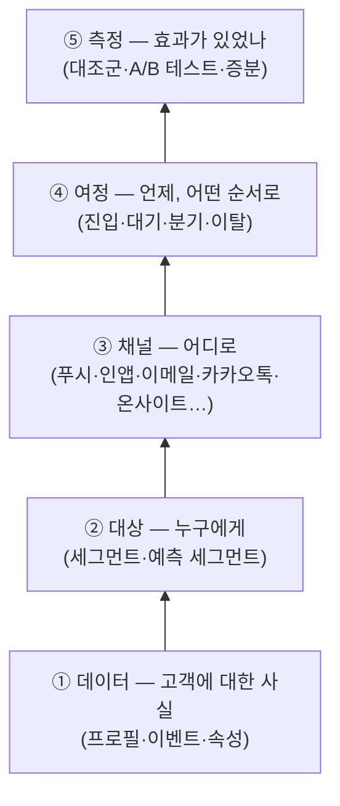

# 1장. 푸시 버튼 뒤에 있는 것들 — CRM 마케팅과 두 도구의 지도

입사 첫 주에 푸시는 이미 한 번 보내 봤다. 문구를 쓰고, 대상에서 '전체 사용자'를 고르고, 예약 시각을 정한 뒤 버튼을 눌렀다. 생각보다 어렵지 않았다. 그런데 금요일 오후, 팀장이 지나가며 이렇게 말했다고 해보자. "다음 주부터 '가입 3일 차 미구매자' 여정 좀 맡아 줘. Canvas 열어 보면 감이 올 거야."

Canvas를 열어 보니 빈 화면에 상자 몇 개와 선 몇 개를 그릴 수 있는 공간이 펼쳐진다. 진입 조건, Delay, Decision Split, Exit criteria 같은 낯선 이름들이 기다리고 있다. 푸시를 보낼 때는 한 번도 만나지 않았던 단어들이다. 가입 3일 차라는 건 어떻게 골라내지? 미구매자는 누가 알려 주지? 3일을 기다린다는 건 어디에 적는 거지? 화면은 친절하게 열려 있는데 무엇부터 눌러야 할지 모르겠다. 꽤 난감한 순간이다.

이 막막함은 당신만 겪는 것이 아니다. 해외 리뷰 사이트와 국내 실무 글을 훑어보면 같은 고백이 반복된다. 단발 푸시와 이메일은 금방 익히는데, 여정과 이벤트 데이터와 동적 콘텐츠로 넘어가는 순간 벽을 만난다는 것이다. 그 벽이 무엇으로 이루어져 있는지 먼저 살펴보자. 벽의 구조를 알면 어디부터 넘어야 할지도 보인다.

## 푸시 발송은 일의 마지막 한 칸이다

한 실무자는 CRM 마케팅을 처음 맡는 사람들이 흔히 빠지는 오해를 이렇게 정리했다. "CRM 마케팅의 업무를 단순히 push 메세지 보내는 것으로 생각한다." 그리고 바로 뒤에 이렇게 덧붙였다. "Push 발송은 Action item 중의 하나이다." (이오플래닛, 2022) 같은 글은 무엇을 먼저 정해야 하는지도 짚는다. "실행을 위한 \"why, what, how\" 가 정말 중요하다."

왜 그럴까? 동네 꽃집을 떠올려 보면 이해하기 쉽다. 오래 장사한 사장님은 단골손님이 지난봄에 어머니 생신 꽃을 사 갔다는 것을 기억한다. 그래서 올봄 생신 즈음에 "이번에도 카네이션으로 준비해 둘까요?"라고 문자를 보낸다. 문자를 보내는 동작 자체는 몇 초면 끝난다. 하지만 그 문자가 고객에게 반가운 연락이 된 이유는 문자 앞에 쌓인 것들 덕분이다. 누가 무엇을 언제 샀는지 기억하고(데이터), 그중 이 연락을 반길 사람을 고르고(대상), 그 사람이 확인할 수단을 택하고(채널), 보낼 때와 다음 연락까지의 간격을 정하고(여정), 문자 덕분에 정말 주문이 왔는지 돌아보는(측정) 일 말이다.

CRM 마케팅 도구가 하는 일도 이 다섯 층으로 나눠 보면 선명해진다. 이 책은 처음부터 끝까지 이 다섯 층을 기준으로 이야기를 쌓는다.

그림 1. CRM 마케팅의 다섯 층 — 푸시 버튼은 맨 위 층의 한 동작일 뿐이다

팀장이 맡긴 '가입 3일 차 미구매자' 여정을 이 그림 위에 올려 보자. 먼저 고객이 언제 가입했는지, 구매한 적이 있는지가 어딘가에 기록되어 있어야 한다. 그게 데이터 층이다. 그 기록으로 "가입한 지 3일이 지났고 아직 구매가 없는 사람"을 골라내는 일이 대상 층이다. 그 사람에게 푸시를 보낼지, 앱 안에서 메시지를 띄울지, 이메일을 보낼지가 채널 층이다. 3일을 기다리고, 메시지를 받은 뒤 구매하면 여정에서 내보내고, 그래도 안 사면 일주일 뒤 한 번 더 말을 거는 흐름이 여정 층이다. 마지막으로, 이 여정이 없었어도 그 사람들이 샀을지를 따져 보는 일이 측정 층이다.

이렇게 놓고 보면 Canvas 앞에서 막막했던 이유가 드러난다. 화면은 네 번째 층인데, 그 아래 세 층이 머릿속에 아직 없었던 것이다. 앞으로 만날 기능 이름이 아무리 낯설어도 "이건 다섯 층 중 어디에 속하지?"라고 물어보는 습관을 들여 두자. 그 질문 하나만으로도 처음 보는 메뉴의 절반은 정리된다.

## 고객 여정, 그리고 우리가 닿을 수 있는 접점

'여정'이라는 말은 이 책에서 두 가지 뜻으로 쓰인다. 하나는 도구 안에서 우리가 설계하는 메시지 흐름이고, 다른 하나는 고객이 실제로 겪는 경험 전체다. 둘을 구분해 두면 이후의 대화가 한결 편해진다.

마케팅 학계에서 '고객 여정'이라는 말을 자리 잡게 한 대표 문헌으로 Lemon과 Verhoef의 2016년 리뷰 논문이 꼽힌다. 이 논문은 고객 경험을 구매 전, 구매, 구매 후라는 세 단계에 걸쳐 고객이 브랜드와 만나는 여러 접점(touchpoint)의 총합으로 본다. 그리고 그 접점을 누가 소유하느냐에 따라 나눈다. 브랜드가 직접 만든 접점, 유통사 같은 파트너의 접점, 고객 스스로 만드는 접점, 그리고 지인의 추천이나 리뷰처럼 브랜드 바깥의 사회적 접점이다. 논문은 이 넷을 각각 brand-owned, partner-owned, customer-owned, social/external 접점이라고 부른다.

이 구분이 주니어 마케터에게 왜 중요할까? 우리가 Canvas나 Architect에서 그리는 여정은 이 중 첫 번째, 브랜드가 소유한 접점만 다룬다는 사실을 일깨워 주기 때문이다. 고객은 우리 앱 푸시를 받기 전에 친구에게 이미 후기를 들었을 수도 있고, 포털에서 가격을 비교했을 수도 있다. 회사가 통제할 수 있는 접점은 전체 경험의 일부일 뿐이다. 그러니 여정을 설계할 때는 "이 메시지가 고객 경험 전체에서 어떤 빈자리를 채우는가"를 겸손하게 묻는 편이 낫다.

한 가지 개념을 더 짚고 가자. 멀티채널과 옴니채널이다. 리테일 연구에서 Verhoef, Kannan, Inman(2015)은 채널을 각각 따로 관리하던 방식에서, 여러 채널과 접점을 하나로 묶어 고객 경험과 성과를 함께 최적화하는 방식으로 넘어가는 흐름을 정리했다. 쉬운 말로 바꾸면 이렇다. 이메일팀, 앱 푸시 담당, 카카오톡 담당이 각자 일정표대로 메시지를 보내는 것이 멀티채널이다. 같은 고객 프로필을 보면서 "이 고객에게는 오늘 이미 이메일이 갔으니 푸시는 쉬자"라고 조율하는 것이 옴니채널이다.

멀티채널 상태의 회사에서 실제로 무슨 일이 벌어지는지 상상해 보면 아찔하다. 화요일 오전 10시에 이메일팀의 신상품 메일이 나가고, 11시에 앱 푸시 담당의 할인 알림이 울리고, 오후 2시에 카카오톡으로 같은 할인이 또 온다. 각 담당자는 자기 채널의 성과표만 보니 문제를 모른다. 고객만 하루에 세 번 같은 이야기를 듣는다. Braze와 Insider One 같은 도구가 존재하는 이유가 바로 여기에 있다. 고객 한 명에 대한 사실을 한곳에 모으고, 그 위에서 여러 채널을 하나의 흐름으로 조율하게 해 주는 것이다.

## Insider One — 웹 위의 개인화에서 출발한 플랫폼

이제 두 도구를 차례로 만나 보자. 먼저 Insider One이다.

이 회사의 이름은 얼마 전까지 Insider였다. 2025년 12월 9일, 회사는 사명을 Insider One으로 바꾼다고 발표했다. 그래서 이 책에서는 그 이전의 일을 이야기할 때 "Insider(현 Insider One)"라고 적는다. 리브랜딩 보도자료에서 공동창업자이자 CEO인 Hande Cilingir는 이런 문장을 남겼다. "AI no longer belongs inside MarTech. It now sits above it." AI를 마케팅 기술의 한 부품으로 두지 않고 그 위에 올려 두겠다는 선언이다. 회사는 스스로를 '에이전틱 고객 참여 플랫폼'이라고 부른다.

2026년 11월 기준 Insider One의 한국어 플랫폼 페이지는 제품을 여섯 개 모듈로 소개한다. 고객 데이터 관리, Insider One AI, 개인화, 여정 오케스트레이션, 리포팅 & 데이터, 행동 분석이다. 다섯 층에 대어 보면 고객 데이터 관리가 데이터 층을, 여정 오케스트레이션이 여정 층을, 리포팅 & 데이터와 행동 분석이 측정 층을 맡는 셈이다. 데이터 쪽으로는 100개 이상의 데이터 소스를 연동한다고 밝히고 있다. 고객 수는 회사 측 발표에 따르면 2,000곳 이상이다(2025-12 자사 발표). 이보다 앞선 2024년 11월 자료에는 1,500곳 이상으로 적혀 있으니, 숫자를 인용할 때는 시점을 함께 적어 두자.

Insider One의 색깔을 가장 잘 보여 주는 것은 온사이트 개인화다. 고객이 웹사이트나 앱 화면에 들어왔을 때 그 사람에게 맞춘 상품 추천, 배너, 카테고리 정렬, 사이트 검색 결과를 보여 주는 영역이다. Smart Recommender(상품 추천), Web Suite, Category Optimizer, InStory, 사이트 검색 Eureka 같은 이름이 이 영역에 속한다. 메시지를 '보내는' 채널과 함께, 고객이 이미 와 있는 화면을 '바꾸는' 장치가 두텁다는 점이 Insider One을 이해하는 첫 번째 열쇠다.

외부 평가도 이 강점과 맞닿아 있다. Insider One은 2026년 Gartner Magic Quadrant의 Personalization Engines(개인화 엔진) 부문에서 Leader로 선정됐다고 발표했다(자사 발표상 5회째). 반면 멀티채널 마케팅 허브(MMH) 부문에서는 2025년 6월 자사 자료 기준 Visionary로 표기하고 있고, 2026년 MMH 평가에서의 위치는 이 책을 쓰는 시점에 확인하지 못했다. AI 쪽 브랜드는 Agent One이다. 예전 이름은 Sirius AI였는데, 이 이름의 변천과 기능은 8장에서 자세히 다룬다.

## Braze — 여러 채널을 하나의 흐름으로 묶는 허브

다음은 Braze다. Braze는 스스로를 '고객 참여 플랫폼(Customer Engagement Platform)'이라고 소개한다. Insider One과 마찬가지로 고객 데이터, 세그먼트, 여정, 측정을 모두 갖추고 있지만 무게중심은 조금 다르다. 앱 푸시, 인앱 메시지, 이메일, SMS, 카카오톡 같은 여러 채널을 하나의 여정 안에서 엮어 내는 데 강점이 있다는 평가를 받는다.

외부 평가가 이를 보여 준다. Braze 발표에 따르면 Braze는 Gartner Magic Quadrant의 Multichannel Marketing Hubs(멀티채널 마케팅 허브, MMH) 부문에서 2026년까지 4년 연속 Leader로 선정됐다. 규모도 크다. 회사 측 발표에 따르면 2026년 4월 기준 글로벌 MAU가 78억 이상이고, 연간 처리하는 메시지가 3조 9천억 건을 넘는다. 이런 숫자는 벤더가 스스로 밝힌 값이라는 점만 기억해 두면 충분하다.

한국 독자에게 특히 중요한 소식은 2026년 4월 8일에 나왔다. Braze가 AWS 기반 국내 데이터센터를 열고, 같은 시기에 카카오톡 메시징 채널을 출시한 것이다. 전화번호 같은 개인식별정보를 국내에 저장해 데이터 현지화 요건에 대응할 수 있게 되었다는 것이 회사의 설명이다. 카카오톡 채널에서 무엇이 되고 무엇이 아직 확인되지 않았는지는 4장에서 꼼꼼히 짚는다. 미리 말해 두면, 2026년 11월 기준 공개 자료로 확인되는 것은 채널을 친구로 추가한 고객에게 보내는 마케팅 메시지(Braze가 '친구톡'이라고 부르는 것)뿐이다.

그렇다면 두 도구 중 어느 쪽이 더 나을까? 이 책은 그 질문에 한 줄로 답하지 않는다. Gartner의 분류가 힌트를 줄 뿐이다. Insider One은 개인화 엔진 부문에서, Braze는 멀티채널 마케팅 허브 부문에서 높은 평가를 받는다. 웹 화면 위의 개인화가 중요한 회사와, 앱을 중심으로 여러 채널의 여정을 엮는 일이 중요한 회사가 각각 다른 도구에 끌리는 이유다. 더 낫다 못하다를 가리기보다, 같은 일을 두 도구가 어떤 이름으로 부르는지부터 익혀 두자. 아래 표가 출발점이다.

| 다섯 층 | 이 책의 일반 표기 | Braze | Insider One |
|---|---|---|---|
| ① 데이터 | 고객 프로필 | 사용자 프로필(user profile) | UCD(Unified Customer Database) |
| ② 대상 | 세그먼트·예측 세그먼트 | 세그먼트, Predictive Churn·Predictive Events | 세그먼트, Predictive Segments |
| ③ 채널 | 채널 | 인앱 메시지·Content Cards·Push·Email·SMS·KakaoTalk 등 | 웹·앱·이메일·웹 푸시·SMS & RCS·WhatsApp·온사이트 등 |
| ④ 여정 | 여정 빌더 | Canvas | Architect |
| ⑤ 측정 | 대조군·A/B 테스트 | Experiment Paths·다변량 테스트 등 | Journey A/B Split·A/B autowinner 등 |

표 1. 다섯 층에 놓은 두 도구의 대표 이름 (2026-11 기준)

표를 외울 필요는 없다. 다만 "개념은 하나, 이름은 둘"이라는 감각만은 지금 챙겨 가자. 회사가 쓰는 도구가 바뀌어도, 혹은 이직해서 다른 도구를 만나도, 다섯 층의 개념을 알고 있으면 새 화면에서 같은 자리를 금방 찾을 수 있다.

## 한국에서 이 도구들을 만난다는 것

두 회사 모두 한국 시장에 공을 들이고 있다. Braze는 2024년 11월 기준 한국 지사(Braze 코리아)를 두고 있고, 2017년부터 AB180(에이비일팔공)이 공식 리셀링 파트너로 라이선스와 컨설팅을 맡아 왔다. 국내에는 이 밖에도 Braze 도입과 운영을 돕는 파트너사들이 활동한다. Insider One 쪽은 2024년 11월 Insider(현 Insider One)가 시리즈E 투자 유치를 발표하면서 2027년까지 한국에 1,500억 원을 투자하겠다는 계획을 함께 밝혔다. 당시 회사는 한국 고객으로 삼성전자, 대한항공, 롯데호텔, GS샵 등을 꼽았다.

채용 시장에서도 신호가 보인다. CRM 마케터 채용 공고에는 "Braze를 활용해 앱 푸시, 인앱 팝업, 카카오 메시지 등 다양한 채널의 CRM 캠페인을 기획하고 운영해요" 같은 문구가 반복해서 나온다. 한 강의 소개 글은 현실을 이렇게 적었다. "CRM 마케터의 채용 공고 자격요건/우대사항 등에는 브레이즈 활용 역량이 포함되어 있습니다. 그러나 마땅히 배울 곳도, 알려줄 수 있는 사람도 많지 않은 것이 현실입니다." 강의를 파는 글이라 홍보 성격이 있지만, 사수 없이 도구를 익혀야 하는 주니어의 처지를 정확히 짚은 문장이다.

그렇다면 이 도구들은 배우기 쉬운 걸까, 어려운 걸까? 사용자 리뷰는 두 쪽으로 갈린다. 한 Braze 사용자는 "It is very easy to understand and use for day-to-day promotional and transactional communications."라고 했다. 같은 시기의 다른 사용자는 "Because Braze is so feature-dense, configuring campaigns can feel overly complicated."라고 적었다(두 리뷰 모두 2026-10). Insider One 쪽에도 "There was a steeper learning curve than we expected"라는 고백이 있다.

두 평가가 모두 맞다. 갈리는 지점은 사용 단계다. 단발 푸시와 이메일은 쉽다는 쪽이고, 여정과 이벤트 데이터와 동적 콘텐츠로 넘어가면 어렵다는 쪽이다. 커뮤니티가 공유하는 진단도 흥미롭다. 기능이 많아서 어렵다기보다, 고급 기능이 전부 데이터 모델에 대한 이해를 전제하기 때문에 어렵다는 것이다. 이 장 첫머리의 장면을 떠올려 보자. 푸시는 쉽게 보냈는데 Canvas 앞에서 막혔다. 바로 그 지점이 리뷰어들이 말한 벽이다.

## 이 책을 걷는 순서

이 책은 그 벽을 아래층부터 차례로 넘는다. 다섯 층 그림에서 아래쪽부터 위로 올라가는 순서다.

2장부터 4장까지는 아래 세 층을 쌓는다. 2장은 데이터, 3장은 세그먼트, 4장은 채널이다. 데이터가 없으면 세그먼트를 만들 수 없고, 세그먼트가 없으면 채널을 골라도 보낼 사람이 없다. 그래서 이 순서다. 장마다 같은 기능을 Braze와 Insider One에서 나란히 보여 줄 것이다.

5장부터 8장까지는 여정과 그 위의 지능을 다룬다. 5장은 Braze Canvas, 6장은 Insider One Architect로 같은 여정을 만들어 본다. 7장은 메시지에 고객 이름과 상품을 넣는 Liquid와 개인화를, 8장은 발송 시간과 채널을 골라 주는 AI 기능을 살펴본다.

9장은 관문이다. 실제로 보내기 전에 한국에서 지켜야 할 발송 규제와 수신 동의, 그리고 고객을 지치게 하지 않는 피로도 관리를 한데 모았다. 10장부터 12장까지는 온보딩, 장바구니 이탈과 가격 인하, 이탈 방지와 윈백, 크로스셀 같은 유스케이스를 고객 생애주기 순서대로 두 도구에서 각각 만들어 본다. 13장은 측정, 14장은 지금까지의 여정을 묶어 첫 90일 계획을 세우는 장이다.

읽기 전에 두 가지 약속을 해 두자. 첫째, 이 책의 기능 서술은 2026년 11월 기준이다. 2025년부터 2026년 사이에 Insider One은 사명을 바꿨고, 두 회사 모두 AI 기능 이름과 문서 주소를 여러 번 바꿨다. 기능 목록이나 베타 여부는 앞으로도 바뀔 수 있으니, 실제로 설정할 때는 Braze Docs와 Insider One Academy의 최신 문서를 함께 확인하는 편이 낫다. 같은 이유로 이 책은 메뉴를 몇 번 클릭하라는 식의 경로보다 "그 설정이 무엇을 정하는가"를 설명하는 데 집중한다. 둘째, 이 책에 나오는 고객 사례의 성과 수치는 대부분 벤더가 스스로 발표한 값이다. 기준값이나 표본, 통계적 유의성이 공개되지 않은 경우가 많다. 그래서 그런 수치에는 "회사 측 발표에 따르면" 또는 "(벤더 발표)"를 붙여 두었다. 숫자를 그대로 믿기보다, 그 숫자가 어떤 조건에서 나왔는지를 함께 읽는 습관을 들이자. 13장에 가면 그 습관이 왜 중요한지 분명해질 것이다.

다시 금요일 오후의 장면으로 돌아가 보자. 팀장이 말한 여정의 첫 단어는 '가입 3일 차'였다. 우리는 이제 그것이 다섯 층 중 맨 아래, 데이터 층의 이야기라는 것을 안다. 그렇다면 한 가지가 궁금해진다. 그 '가입 3일 차'라는 사실은 도대체 어디에 적혀 있는 걸까?
