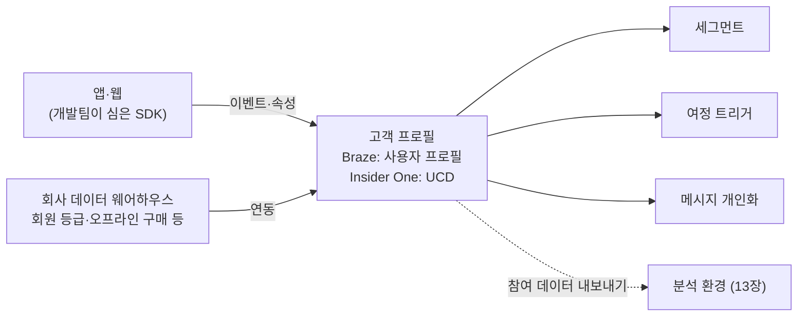

# 2장. 메시지보다 데이터가 먼저다 — 프로필·식별자·이벤트·속성

흔히 CRM 도구를 '메시지 보내는 도구'라고 한다. 실제로는 '고객에 대한 사실을 담는 그릇'에 더 가깝다. 메시지는 그 그릇에서 사실을 꺼내 쓰는 마지막 동작일 뿐이다. 그릇이 비어 있으면 아무리 좋은 문구를 써도 누구에게 보낼지 고를 수 없고, 이름 한 글자 넣을 수 없고, 언제 보낼지도 정할 수 없다.

앞 장 끝에서 던진 질문으로 돌아가 보자. '가입 3일 차'라는 사실은 어디에 적혀 있을까? 답은 이 그릇 안이다. 고객이 가입하는 순간 앱이나 웹사이트가 "이 사람이 지금 가입했다"는 기록을 도구에 보내고, 도구는 그 기록을 고객 프로필에 담아 둔다. 그 기록이 있어야 "가입 후 3일이 지난 사람"이라는 조건을 세울 수 있다.

문제는 그 기록이 늘 있지는 않다는 데 있다.

## 세그먼트 필터가 비어 있던 날

이런 장면을 상상해 보자. 팀장이 맡긴 '가입 3일 차 미구매자' 여정을 만들기 위해 세그먼트 화면을 열었다. 가입일 조건은 금방 찾았다. 이제 "구매한 적 없음"을 걸어야 하는데, 필터 목록을 아무리 내려도 구매 이벤트가 보이지 않는다. 비슷한 이름의 항목이 두어 개 있지만 마지막 기록이 반년 전에 멈춰 있다. 개발팀에 물어보니 "구매 이벤트는 예전에 쓰다가 앱 개편 때 빠졌어요. 다시 넣으려면 지라 티켓 올려 주세요. 일정은 3주 뒤쯤 될 것 같아요."라는 답이 돌아온다.

여정은 다음 주에 시작해야 하는데 재료가 없다. 정말 난감하다. 그런데 이 장면은 주니어만 겪는 사고가 아니다. 커뮤니티에서 반복해서 나오는 진단이 하나 있다. 세그먼트, 트리거, 개인화의 재료는 모두 개발팀이 앱과 웹에 심어 둔 이벤트와 속성이고, 그것을 정하고 심는 일은 개발 조직의 백로그에 들어간다는 것이다. 그래서 커뮤니티는 이렇게 정리한다. 마케터의 자율성은 도입 초기 데이터 설계 품질에 비례한다.

여기서 잠깐 용어 하나를 쉽게 풀어 두자. 앱이나 웹사이트가 고객의 행동을 도구로 보내려면 개발팀이 그 도구의 SDK(소프트웨어 개발 키트)를 앱에 심어야 한다. 마케터 입장에서는 "도구가 고객 행동을 들을 수 있게 앱 안에 달아 두는 마이크" 정도로 이해하면 충분하다. 마이크가 달린 곳의 소리만 들린다. 구매 버튼에 마이크가 없으면 구매는 도구에게 없는 일이 된다.

그렇다면 어떻게 해야 할까? 무작정 "필요한 거 다 넣어 주세요"라고 요청하면 될까? 이 방법은 뒤에서 보겠지만 비용과 혼란을 함께 부른다. 올바른 해법으로 가려면 먼저 그릇의 구조를 알아야 한다. 고객 한 명이 어떻게 식별되고, 그 사람에 대한 사실이 어떤 형태로 담기는지 두 도구에서 차례로 살펴보자.

## Braze에서는 — 모든 것이 사용자 프로필에 모인다

Braze 문서는 데이터 모델의 출발점을 이렇게 정의한다. "All persistent data associated with a user is stored in their user profile." 고객 한 명에 대해 오래 남는 데이터는 모두 그 사람의 사용자 프로필(user profile)에 저장된다는 뜻이다.

그렇다면 Braze는 이 프로필이 누구의 것인지 어떻게 알까? 핵심은 external_id다. 회사가 자기 회원 시스템에서 쓰는 고유 번호를 Braze에 알려 주는 식별자다. 문서는 그 역할을 이렇게 설명한다. "An `external_id` allows you to identify the same user profile across multiple devices." 같은 고객이 휴대폰 앱과 태블릿 앱을 오가도 external_id가 같으면 하나의 프로필로 묶인다.

아직 로그인하지 않은 고객은 어떨까? Braze 문서의 표현을 빌리면 "Any user without a designated `external_id` is called an anonymous user." external_id가 없는 사용자는 익명 사용자이고, Braze는 이들을 기기별 식별자인 braze_id로 구분한다. 여기에 alias라는 장치가 하나 더 있다. 이름표(label)와 값(name)을 한 쌍으로 붙여, 회사가 쓰는 다른 식별자로 프로필을 가리킬 수 있게 해 준다.

주니어가 꼭 알아 두면 좋은 함정이 하나 있다. 익명으로 앱을 둘러보던 고객이 나중에 로그인해서 기존 회원으로 식별되는 순간이다. 이때 익명 프로필은 기존 사용자 프로필에 흡수되는데, 문서는 이렇게 경고한다. "Not all data is merged from the anonymous profile." 익명 프로필은 고아(orphan) 상태가 되고, 기존 프로필에 비어 있던 일부 필드만 복사된다. 다시 말해 로그인 전에 쌓인 행동 기록이 로그인 후 프로필로 전부 넘어오지는 않는다는 뜻이다.

이게 왜 중요할까? "비회원 상태에서 장바구니에 담고 나중에 로그인한 고객"을 겨냥하는 여정을 기획했다고 해보자. 장바구니 기록이 익명 프로필에만 남아 있다면, 로그인한 프로필 기준으로는 그 고객이 장바구니에 무엇을 담았는지 모를 수 있다. 어느 데이터가 넘어오고 어느 데이터가 남는지는 회사의 연동 방식에 따라 달라진다. 그러니 이런 여정을 기획할 때는 개발팀에 "익명 시절 행동이 로그인 후에 어떻게 이어지나요?"라고 먼저 물어보는 편이 낫다.

## Insider One에서는 — UCD와 identifiers

Insider One에서 같은 역할을 하는 그릇은 UCD(Unified Customer Database)다. Insider One Academy는 UCD를 이렇게 소개한다. "The Unified Customer Database (UCD) is the core Customer Data Platform (CDP) that powers all Insider One products." Architect의 여정, 세그먼트, 온사이트 개인화, 추천까지 모든 제품이 이 하나의 고객 데이터베이스 위에서 돌아간다는 것이다(2026-08 문서 기준).

UCD는 이메일, 전화번호, user ID 같은 식별자로 고객 레코드를 하나로 합친다. Insider One 문서는 이 식별자들을 identifiers라는 묶음(객체)에 담아 보내도록 안내하는데, 동일 고객을 판별(identity resolution)할 때는 이 묶음에 들어 있는 값만 본다고 설명한다(2026-11 Academy 문서 기준). 마케터에게 주는 함의는 분명하다. 이메일 주소를 다른 칸에 담아 보내면, 같은 사람이라도 다른 고객으로 남을 수 있다.

식별이 잘 되면 좋은 일이 생긴다. 고객이 웹과 앱에서 같은 식별자로 로그인하면, 예를 들어 "Last Visited Product(마지막으로 본 상품)" 같은 속성이 하나로 통합된다. 웹에서 운동화를 보고 나간 고객에게 앱에서 그 운동화를 다시 보여 줄 수 있는 것은 이 통합 덕분이다. Insider One이 온사이트 개인화에 강한 이유도 여기에 닿아 있다. 화면을 바꾸려면 화면 앞의 사람이 누구인지부터 알아야 하기 때문이다.

Insider One은 이벤트와 속성을 각각 기본(default)과 커스텀(custom)으로 나눈다. 기본 이벤트와 속성은 Insider One이 미리 정해 둔 것이고, 커스텀은 회사가 필요에 따라 새로 정의하는 것이다. 속성 개수에는 상한이 있다. 2026년 11월 Academy 문서 기준으로 UCD 속성은 기본과 커스텀을 합쳐 200개(기본 120개, 커스텀 80개)까지이고, 커스텀 속성이 더 필요하면 Insider One 팀에 증설을 요청할 수 있다. 커스텀 이벤트 종류에는 상한이 없지만 커스텀 이벤트 파라미터는 80개까지다. 계정마다 한도가 다를 수 있다고 하니, 실제 한도는 우리 계정의 Attributes and Events 화면에서 확인하자. 참고로 Braze 쪽은 커스텀 이벤트와 속성 개수에 고정된 상한을 두지 않고, 데이터 형태와 수집량, 워크스페이스 성능에 따라 달라진다고 설명한다.

## 이벤트로 남길까, 속성으로 남길까

두 도구 모두 고객에 대한 사실을 크게 두 가지 형태로 담는다. 이벤트와 속성이다. 이 둘의 차이를 이해하는 것이 데이터 층의 핵심이다.

이벤트는 고객이 한 행동의 기록이다. Braze 문서는 커스텀 이벤트를 "actions taken by, or updates about, your users."라고 정의하고, Insider One은 이벤트를 타임스탬프가 붙은 행동 기록이라고 설명한다. 가입했다, 상품을 봤다, 장바구니에 담았다, 구매했다처럼 '언제 무엇을 했는지'가 시간 순서대로 쌓인다. 일기장이라고 생각하면 이해하기 쉽다. 한 줄 한 줄에 날짜가 붙어 있다.

속성은 고객에 대한 현재 상태의 기록이다. 이름, 가입일, 선호 카테고리, 회원 등급, 누적 구매 횟수 같은 것들이다. 이쪽은 명함에 가깝다. 날짜별 기록은 없고, 지금 이 사람이 어떤 사람인지가 적혀 있다.

이벤트에는 한 가지 장치가 더 붙는다. 이벤트 속성(event properties)이다. "장바구니에 담았다"는 이벤트에 "어떤 상품을, 얼마짜리를"이라는 세부 정보를 함께 실어 보내는 것이다. Braze 문서에 따르면 이벤트 속성은 트리거 조건, 메시지 개인화, 전환 판정, 분석에 두루 쓰인다. 아래 표처럼 생각해 보자.

| 사용자 | 이벤트 이름 | 발생 시각 | 이벤트 속성 |
|---|---|---|---|
| user_1024 | sign_up | 2026-11-02 09:14 | channel: app |
| user_1024 | add_to_cart | 2026-11-03 21:40 | product_id: SH-221, price: 89000 |
| user_1024 | purchase | 2026-11-05 12:03 | order_id: A-778, amount: 89000 |

표 1. 이벤트 기록의 예 (의사 데이터, 이름은 예시)

| 사용자 | 속성 이름 | 값 |
|---|---|---|
| user_1024 | signup_date | 2026-11-02 |
| user_1024 | favorite_category | 운동화 |
| user_1024 | purchase_count | 1 |

표 2. 같은 고객의 속성 기록 예 (의사 데이터, 이름은 예시)

그렇다면 어떤 사실을 이벤트로, 어떤 사실을 속성으로 남겨야 할까? Braze 문서가 좋은 기준을 준다. 시계열 분석이 필요 없으면 커스텀 속성으로 남기라는 것이다. 예를 들어 "몇 번 샀는지"만 알면 되고 "언제 언제 샀는지"는 필요 없다면, 매번 이벤트를 쌓기보다 누적 구매 횟수라는 속성 하나를 늘려 가는 편이 가볍다. 반대로 "마지막 구매 후 30일이 지난 사람", "지난주에 장바구니에 담았지만 사지 않은 사람"처럼 시점과 순서가 중요한 조건은 이벤트가 있어야 만들 수 있다.

이 구분을 잘못하면 나중에 찜찜한 일이 생긴다. 가입일을 이벤트로만 남기고 속성으로는 두지 않았다면 "가입 3일 차"를 고르는 조건이 복잡해질 수 있고, 반대로 구매를 속성으로만 덮어쓰면 "언제 샀는지"가 사라진다. 기획 단계에서 "이 여정에 필요한 조건이 시점을 묻는가, 상태를 묻는가"를 먼저 따져 보자.

## 데이터는 공짜가 아니다

여기까지 읽으면 이런 생각이 들 수 있다. "그럼 나중에 무엇이 필요할지 모르니 일단 전부 보내 달라고 하면 되겠네." 물론 데이터가 많으면 쓸 수 있는 조건도 많아진다. 하지만 이 방법에는 두 가지 함정이 있다.

첫 번째 함정은 비용이다. 두 도구 모두 데이터 사용량이 과금과 연결되어 있다. Braze는 데이터 포인트(data points)와 메시지 크레딧이라는 개념으로 사용량을 계산하는데, 한 Braze 사용자는 리뷰에 이렇게 적었다. "The billing is tricky to understand because I have to work out how many message credits I need" (2026-10). 또 다른 고객은 "The cost for data usage limits us from importing all of our data."라고 털어놓기도 했다(연동 벤더 블로그에 인용된 고객 발언이라 이해관계가 있다). Insider One도 마찬가지다. Academy 문서는 커스텀 이벤트와 커스텀 속성이 월 데이터 포인트 소비에 영향을 준다고 안내한다(2026-11 기준). 두 제품 모두 가격을 공개하지 않으니 구체적인 금액은 회사의 계약 조건과 담당 매니저에게 확인해야 한다. 다만 원리만은 같다. 어떤 속성과 이벤트를 보낼지 정하는 일이 곧 비용을 정하는 일이다.

두 번째 함정은 혼란이다. 기준 없이 쌓인 데이터는 이름이 제각각이 된다. 어떤 화면에서는 purchase, 어떤 화면에서는 order_complete, 또 다른 곳에서는 buy_success라는 이름으로 같은 행동이 들어온다. 세그먼트를 만들 때마다 "이 셋 중 무엇이 진짜 구매지?"를 물어야 한다면 데이터가 많을수록 오히려 손이 묶인다.

그래서 성숙한 팀은 이벤트 택소노미(event taxonomy)라는 것을 만든다. 어떤 행동을 어떤 이름으로, 어떤 속성과 함께 기록할지 정해 둔 데이터 사전이다. 국내 실무 커뮤니티의 한 글은 그 효용을 이렇게 설명한다. "이벤트 택소노미가 잘 구축되어 있으면 필요한 데이터가 빠짐없이 일관되게 쌓이기 때문에 여러 팀이 공통된 지표를 신뢰하며 소통할 수 있습니다." 마케터, 개발자, 데이터 분석가가 같은 단어로 같은 행동을 가리키게 되는 것이다.

## 개발팀에 무엇을, 어떻게 요청할 것인가

이제 처음 장면의 해법이 보인다. "필요한 거 다 넣어 주세요"가 아니면, 무엇을 요청해야 할까?

먼저 이 문제를 둘러싼 커뮤니티의 논쟁부터 살펴보자. 한쪽에서는 마케터가 혼자서도 충분히 쓸 수 있다고 말한다. 한 금융업 Insider One 사용자는 "my team could build and optimize journeys fully independently without heavy technical support."라고 했다. 반대쪽 증언도 만만치 않다. 다른 Insider One 사용자는 "the initial setup still required developer help for custom API integrations"라고 했고, 한 Braze 사용자는 연동과 권한 설정에 "required unexpected workarounds."라고 적었다(모두 2026-09~10 리뷰).

둘 다 맞는 말이다. 커뮤니티가 찾은 화해 지점은 단계의 차이다. 도구를 처음 들이고 데이터를 연결하는 단계에서는 개발팀에 크게 의존한다. 데이터가 잘 깔린 뒤 운영하는 단계에서는 마케터가 상당 부분 혼자 해낼 수 있다. 그러니 당신이 입사한 회사가 이미 데이터를 잘 깔아 둔 곳이라면 "혼자 가능" 쪽을, 아직 설계가 엉성한 곳이라면 "리소스 필수" 쪽을 체감하게 된다.

어느 쪽이든 마케터가 할 수 있는 일은 같다. 요청을 "이벤트 하나, 속성 몇 개, 쓰임새 하나"의 형태로 구체화하는 것이다. 처음 장면이라면 이렇게 요청할 수 있다. "구매 완료 시점에 purchase 이벤트를 보내 주세요. 이벤트 속성으로 주문 번호, 결제 금액, 상품 ID를 함께 담아 주세요. 용도는 가입 후 미구매자 여정의 이탈 조건과 구매 금액 기반 세그먼트입니다." 이름과 속성과 용도가 함께 있는 요청은 개발팀이 우선순위를 판단하기도 쉽다.

외부 데이터가 필요한 경우도 있다. 앱 밖, 예를 들어 회사 데이터 웨어하우스에 있는 회원 등급이나 오프라인 구매 이력 같은 것이다. Braze에는 이런 데이터를 가져오는 Cloud Data Ingestion이, 반대로 Braze의 참여 데이터를 바깥으로 내보내는 Currents가 있다. Insider One은 100개 이상의 데이터 소스와 연동하는 통합 허브를 내세운다. 바깥으로 데이터를 빼서 성과를 측정하는 이야기는 13장에서 다시 만난다. 지금은 데이터가 앱에서만 들어오는 것은 아니라는 정도만 그림으로 잡아 두자.

그림 1. 고객 프로필로 들어오고 나가는 데이터의 흐름

처음 장면으로 돌아가 보자. 3주 뒤에야 들어올 구매 이벤트를 기다리는 동안, 다음 개발팀 미팅에 아래 다섯 가지 질문을 들고 가 보자. 이 질문에 대한 답을 받아 적는 것만으로도 당신은 회사의 데이터 사전 첫 장을 갖게 된다.

1. 우리 회사의 고객 식별자는 무엇인가? Braze라면 external_id에, Insider One이라면 identifiers에 어떤 값을 담고 있는가?
2. 익명 사용자는 언제 식별되는가? 로그인 전의 행동 기록은 로그인 후 프로필로 어디까지 이어지는가?
3. 지금 도구로 들어오고 있는 이벤트는 무엇이고, 각 이벤트에는 어떤 속성이 함께 실려 오는가? 마지막으로 들어온 시점은 언제인가?
4. 같은 행동이 서로 다른 이름으로 들어오고 있지는 않은가? 이벤트 이름을 정하는 규칙이 있는가?
5. 새 이벤트나 속성을 추가하면 데이터 사용량과 비용에 어떤 영향이 있는가? 요청은 어떤 양식으로, 누구에게 하면 되는가?

### 이 장의 핵심

- CRM 도구가 할 수 있는 일은 그 안에 담긴 고객 데이터의 범위를 넘지 못한다. 세그먼트·트리거·개인화의 재료는 모두 개발팀이 심어 둔 이벤트와 속성이다.
- Braze는 사용자 프로필과 external_id·braze_id·alias로, Insider One은 UCD와 identifiers로 고객을 식별한다. Braze에서는 익명 프로필의 데이터가 전부 병합되지는 않는다.
- 시점과 순서가 중요한 사실은 이벤트로, 현재 상태만 필요한 사실은 속성으로 남긴다.
- 데이터 사용량은 두 도구 모두 비용과 연결된다. "전부 보내기"보다 이벤트 택소노미로 무엇을 어떤 이름으로 보낼지 정하는 편이 낫다.
- 개발팀에는 "이벤트 이름 + 함께 담을 속성 + 쓰임새"의 형태로 요청한다.
