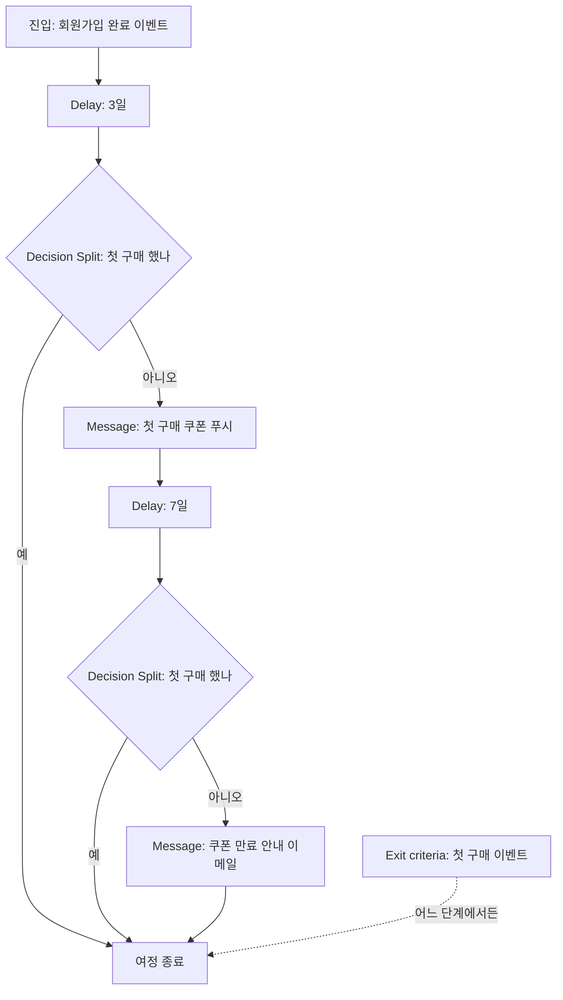

# 5장. Braze Canvas로 여정 설계하기

월요일 오전 회의가 끝나고, 팀장이 자리로 돌아가다 말고 한마디를 던졌다고 해보자. "가입하고 3일 안에 첫 구매가 없으면 쿠폰 하나 보내 주세요. 그래도 안 사면 일주일 뒤에 한 번 더요." 수첩에 받아 적으면 두 줄이다. 어렵지 않아 보인다.

그런데 Braze 대시보드를 열면 손이 멈춘다. 캠페인을 두 개 만들면 되는 걸까? 가입하고 3일이 지났다는 건 누가 세어 주지? 쿠폰을 받고 다음 날 바로 산 고객에게도 일주일 뒤 "아직 안 사셨네요?"가 날아가면 어떡하지?

두 줄짜리 요청 안에는 생각보다 많은 결정이 숨어 있다. 누구를 언제 들여보낼지, 얼마나 기다릴지, 무엇을 보고 길을 가를지, 언제 놓아줄지. 이 결정들을 한 화면에 그려 두고 고객 한 명 한 명에게 자동으로 적용되게 하는 도구가 여정 빌더다. Braze에서는 이 도구를 Canvas(여정 빌더)라고 부른다. 팀장의 두 줄을 끝까지 붙들고, 실제로 돌아가는 Canvas로 옮겨 보자.

## 캠페인 하나로는 왜 부족할까

Braze에서 메시지를 내보내는 길은 크게 두 갈래다. 캠페인과 Canvas. 캠페인은 "이 메시지를 이 사람들에게 보낸다"는 한 번의 발송을 다루는 단위라고 생각하면 이해하기 쉽다. 1~4장에서 다룬 세그먼트와 채널을 고르고 메시지를 써서 보내는 일이 캠페인 하나에 담긴다.

Canvas는 그 위에 시간과 갈림길을 얹는다. Braze 공식 문서는 Canvas를 이렇게 소개한다.

> "Canvas is a unified interface where marketers craft campaigns with multiple messages"

여러 메시지를 하나의 흐름으로 엮는 화면이라는 뜻이다. 그렇다면 캠페인 두 개로 팀장의 요청을 처리하면 무엇이 문제일까? 직접 상상해 보면 금방 보인다. 첫 번째 캠페인은 "가입 3일 차 미구매자"에게 쿠폰을 보낸다. 두 번째 캠페인은 "가입 10일 차, 쿠폰을 받았고, 여전히 미구매인 사람"에게 보낸다. 두 캠페인은 서로를 모른다. 두 번째 캠페인의 세그먼트에 "첫 번째 쿠폰을 받은 사람"이라는 조건을 정확히 걸어야 하고, 그사이 구매한 사람을 빼는 조건도 따로 챙겨야 한다. 여정이 세 단계, 네 단계로 늘어나면 캠페인 사이를 잇는 조건이 거미줄처럼 얽힌다. 번거롭고, 무엇보다 하나만 빠뜨려도 사고가 난다.

Canvas는 고객 한 명이 흐름 위 어디에 서 있는지를 기억한다. "이 사람은 쿠폰을 받고 7일째 기다리는 중"이라는 상태를 도구가 들고 있으니, 마케터는 단계 사이의 연결을 조건으로 일일이 재현하지 않아도 된다. 참고로 지금 Canvas를 열면 보이는 편집기는 Canvas Flow라는 이름으로 2022년에 나온 것이고, 2026-11 기준 Canvas의 기본 편집기다.

한 번 보내고 끝나는 공지라면 캠페인으로 충분하다. 고객의 반응을 보고 다음 수를 두어야 하는 일이라면 Canvas를 꺼내는 편이 낫다. 팀장의 요청은 분명히 후자다.

## 그리기 전에 설계 문서부터

Canvas 편집기는 빈 화면에 상자를 끌어다 놓고 선으로 잇는 방식이라 손이 먼저 나가기 쉽다. 여기서 한 번 멈추자. 커뮤니티에서 반복해서 나오는 진단이 있다. 여정을 문서로 정리하지 않고 툴 위에서 바로 그리면, 분기가 하나둘 쌓이다가 어느새 아무도 전체를 설명하지 못하는 여정이 된다는 것이다. 만든 사람이 휴가를 가면 그 여정은 누구도 손대기 무서운 물건이 된다.

그래서 화면을 열기 전에 네 가지를 먼저 적어 보자. 목표, 진입 조건, 이탈 조건, 전환 이벤트다. 팀장의 두 줄을 이 틀에 넣으면 이렇게 된다.

| 항목 | 스스로에게 던질 질문 | 3일 차 여정 |
|---|---|---|
| 목표 | 이 여정이 끝났을 때 고객에게 무슨 일이 일어나 있어야 하는가? | 신규 가입자의 첫 구매 |
| 진입 조건 | 누가, 어떤 순간에 들어오는가? | 회원가입 완료 이벤트가 발생한 고객 |
| 단계 | 얼마나 기다리고, 무엇을 보고 가르는가? | 3일 대기 → 미구매면 쿠폰 → 7일 대기 → 여전히 미구매면 한 번 더 |
| 이탈 조건 | 언제 놓아주는가? | 첫 구매를 하는 순간 |
| 전환 이벤트 | 성공을 무엇으로 세는가? | 첫 구매 이벤트 |

표를 채우다 보면 질문이 저절로 생긴다. "회원가입 완료"라는 이벤트가 정말로 Braze에 들어오고 있는가? 2장에서 이야기한 커스텀 이벤트가 없으면 이 여정은 시작조차 못 한다. "첫 구매"는 어떤 이벤트로 판별하는가? 구매 이벤트는 있는데 그것이 첫 구매인지 알려면 구매 횟수 같은 속성이 필요할 수도 있다. 쿠폰은 광고성 메시지인가? 그렇다면 수신 동의를 한 사람에게만 가야 한다. 이 부분은 9장에서 제대로 다루니 지금은 설계 문서 한쪽에 "동의 확인"이라고 적어 두기만 하자.

이 문서가 좋은 점은 하나 더 있다. 표의 각 칸이 거의 그대로 Canvas의 설정 하나, 컴포넌트 하나에 대응한다는 것이다. 진입 조건은 진입 설정으로, 단계는 컴포넌트로, 이탈 조건은 Exit criteria로, 전환 이벤트는 전환 설정으로 간다. 문서를 먼저 쓰면 Canvas 작업은 번역에 가까워진다. 이 작업 순서를 기억해두자.

## 진입 — 누가, 언제 들어오는가

모든 여정은 입구에서 시작한다. Canvas에서 입구를 정하는 일은 두 가지 질문에 답하는 것이다. 언제 들여보낼 것인가, 그리고 누구를 들여보낼 것인가.

"언제"에 해당하는 것이 진입 방식이다. Braze의 캠페인과 마찬가지로 Canvas에도 세 가지 진입 방식이 있다고 알려져 있다(사실 확인 필요). 정해진 일정에 맞춰 대상자를 훑어 들여보내는 일정 기반(scheduled), 고객이 특정 행동을 하는 순간 들여보내는 행동 기반(action-based), 그리고 회사 시스템이 Braze에 신호를 보내 들여보내는 API 기반(API-triggered)이다. 마케터 감각으로 바꿔 말하면, 일정 기반은 "매주 월요일 아침에 명단을 뽑아 보낸다", 행동 기반은 "고객이 문을 열고 들어오는 순간 인사한다", API 기반은 "개발팀이 심어 둔 신호가 오면 움직인다"에 가깝다.

팀장의 여정은 어느 쪽일까? "가입하고 3일"이라는 시계는 고객마다 가입한 순간부터 따로 돌아야 한다. 그러니 회원가입 완료 이벤트를 진입 트리거로 삼는 행동 기반이 자연스럽다. 일정 기반으로 "매일 아침, 3일 전에 가입한 미구매자"를 뽑는 방법도 가능은 하다. 다만 세그먼트 조건이 복잡해지고, 가입 시각에 따라 실제 대기 시간이 들쭉날쭉해진다는 점이 찜찜하다.

"누구를"은 진입 대상 세그먼트로 한 번 더 거른다. 트리거 이벤트가 발생했더라도 이 조건을 통과한 사람만 여정에 들어온다. 3일 차 여정이라면 사내 테스트 계정을 빼고, 앱 푸시나 이메일을 받을 수 있는 사람으로 좁히는 정도를 생각해 볼 수 있다. 3장에서 강조한 "발송 가능한 모수부터"가 여기서 다시 등장한다. 진입 조건을 너무 촘촘하게 걸면 막상 여정에 들어오는 사람이 하루에 몇 명 되지 않는다. 진입 조건을 확정하기 전에 해당 세그먼트의 규모를 꼭 확인해 보자.

진입 설계에서 놓치기 쉬운 질문도 하나 있다. 이미 가입해 있는 기존 회원은 어떻게 되는가? 행동 기반 진입이라면 Canvas를 켠 뒤에 가입한 사람만 들어온다. 이 점을 팀장과 미리 맞춰 두면 "왜 기존 미구매자에게는 안 갔냐"는 질문에 당황하지 않는다. 같은 고객이 여정을 다시 탈 수 있게 할지도 정해 두는 편이 좋다. 탈퇴 후 재가입한 사람이 쿠폰을 또 받는 상황을 원하는 회사는 드물다.

## 컴포넌트 투어 — 열세 개 중 손에 익혀 둘 것들

입구를 정했으면 이제 흐름을 만든다. Canvas에서 흐름을 이루는 상자 하나하나를 컴포넌트라고 부른다. 2026-11 기준 Braze 문서에 올라 있는 컴포넌트는 열세 가지다. Message, Delay, Decision Split, Audience Paths, Action Paths, Experiment Paths, User Update, Context, Feature Flag, Send to Destination, Canvas Audience Sync, Content Optimizer, Agent.

이름만 늘어놓으면 막막하다. 하지만 각 컴포넌트를 "이 상자는 어떤 결정을 표현하는가"로 보면 훨씬 단순해진다. 마케터가 거의 매번 쓰게 되는 여섯 개부터 살펴보자.

**Message**는 실제로 메시지를 보내는 상자다. 4장에서 고른 채널(푸시, 이메일, 인앱 메시지 등)이 여기서 쓰인다. 고객별로 가장 반응이 좋은 시간에 보내 주는 Intelligent Timing도 Canvas에서는 이 Message 단계에서 설정한다. 이 기능은 8장에서 자세히 다룬다.

**Delay**는 기다리는 상자다. "3일 뒤", "7일 뒤"가 여기에 들어간다. 여정에서 가장 단순해 보이지만, 고객 입장에서 메시지 사이의 간격을 정하는 중요한 상자다.

**Decision Split**은 조건 하나로 길을 둘로 가르는 상자다. "첫 구매를 했는가, 안 했는가"처럼 예와 아니오로 나뉘는 질문에 쓴다(사실 확인 필요).

**Audience Paths**는 길을 여러 갈래로 나눈다. 고객을 등급별, 관심 카테고리별로 서너 무리로 나눠 각자 다른 메시지를 보내고 싶을 때 쓴다(사실 확인 필요).

**Action Paths**는 일정 기간 고객의 행동을 지켜본 뒤, 무엇을 했느냐에 따라 길을 가른다. BlaBlaCar가 예약을 망설이는 고객에게 Action Paths로 정해진 시간을 기다린 뒤 아직 예약하지 않은 사람만 다음 단계로 보낸 사례가 대표적이다(11장에서 자세히 본다). 행동한 사람을 곧바로 다음 단계로 보낼지, 기간이 끝날 때까지 모아 둘지도 정할 수 있다(사실 확인 필요).

**Experiment Paths**는 고객을 무작위로 나눠 서로 다른 길을 태운다. 메시지를 받지 않는 대조군을 둘 수도 있고, 성과가 좋은 길로 나중 사람들을 몰아주는 Winning Path도 여기에 포함된다. 실험을 어떻게 설계하고 읽는지는 13장의 몫이니 지금은 "여정 안에서도 실험을 걸 수 있다"는 것만 알아 두자.

나머지 일곱 개는 한 줄씩만 알아 두어도 충분하다.

| 컴포넌트 | 한 줄 설명 |
|---|---|
| User Update | 여정 안에서 고객 프로필의 속성을 바꾼다. 잡코리아는 Canvas로 커스텀 속성을 실시간 갱신했다 |
| Context | 여정 안에서 쓸 값을 정의해 두는 단계로 소개된다(사실 확인 필요) |
| Feature Flag | 개발팀이 앱에 심어 둔 기능 켜고 끄기와 여정을 연결한다(사실 확인 필요) |
| Send to Destination | 여정 중의 정보를 외부 시스템으로 내보낸다(사실 확인 필요) |
| Canvas Audience Sync | 여정의 고객 명단을 광고 매체 오디언스로 보낸다. BlaBlaCar는 미전환자에게 Facebook·Google 광고를 보여 줬다 |
| Content Optimizer | 2026-11 기준 베타 상태의 콘텐츠 최적화 컴포넌트. 세부는 공식 문서를 확인하자 |
| Agent | 발송 시점에 고객 한 명 단위로 분류·라우팅·내용 보강·작성을 맡는 Braze Agents와 연결된다(8장) |

베타나 신규 컴포넌트는 이름과 동작이 빠르게 바뀔 수 있다. 실제로 쓰기 전에 Braze Docs의 Canvas 컴포넌트 문서를 함께 확인해두자.

이제 팀장의 여정을 컴포넌트로 옮겨 보자. 설계 문서의 "단계" 칸을 그대로 따라가면 이렇게 된다.


그림 1. "가입 후 3일 미구매자" Canvas 흐름

Delay와 Decision Split 대신 Action Paths 하나로 "3일 동안 구매를 지켜보다가 안 산 사람만 쿠폰으로" 보내도 된다. 둘 다 같은 일을 하니 팀이 읽기 쉬운 쪽을 고르면 된다. 그런데 그림 아래쪽에 점선으로 붙은 Exit criteria는 무엇일까? 이 상자 하나가 여정 사고의 상당수를 막아 준다.

## Exit criteria — 놓아줄 때를 정하기

이런 장면을 떠올려 보자. 고객이 쿠폰 푸시를 받고 그날 저녁 첫 구매를 했다. 기분 좋게 배송을 기다리는데, 일주일 뒤 이메일이 온다. "아직 첫 구매 전이시죠? 쿠폰이 곧 만료돼요!" 고객은 고개를 갸웃한다. 마케터가 이 캡처를 고객센터 문의로 받아 보는 순간은 정말 아찔하다.

커뮤니티가 꼽는 대표적인 여정 사고가 바로 이것, "이미 구매한 사람 제외"의 누락이다. 그림 1에서는 메시지 앞마다 Decision Split을 두었으니 괜찮지 않을까? 한 번 따져 보자. Decision Split은 고객이 그 상자에 도착한 순간에만 질문을 던진다. 여정이 길어지고 메시지가 늘어나면, 어느 메시지 앞에 분기를 하나 빠뜨리는 일이 생긴다. 나중에 누군가 중간에 메시지 하나를 끼워 넣으면서 분기를 같이 넣지 않는 일도 흔하다.

Exit criteria는 접근이 다르다. 특정 지점에서 묻는 것이 아니라, 여정 전체에 걸쳐 "이 행동을 한 사람은 여기서 내린다"는 규칙을 건다. 3일 차 여정이라면 첫 구매 이벤트를 Exit criteria로 걸어 두는 것이다. 그러면 고객이 Delay 상자 안에서 기다리는 중이든, 다음 메시지를 받기 직전이든 상관없이 첫 구매가 기록되는 순간 여정에서 빠진다.

그렇다면 Decision Split은 필요 없을까? 꼭 그렇지는 않다. Exit criteria는 "여정의 목표를 이룬 사람을 놓아주는 규칙"이고, Decision Split은 "여정 안에서 길을 가르는 규칙"이다. 목표를 이뤘는데 여정에 남아 있어야 할 이유가 있는 사람은 거의 없으니, 목표 달성은 Exit criteria로 처리하고, 분기는 정말로 길을 갈라야 하는 곳에만 쓰는 편이 여정을 단순하게 만든다. 이 원칙을 따르면 그림 1의 두 Decision Split은 사실상 Exit criteria가 대신해 준다. 분기를 지우고 "Delay → Message → Delay → Message"의 일직선으로 줄여도 같은 일을 한다.

Exit criteria를 정할 때 함께 확인할 것이 있다. 이탈 조건으로 쓸 이벤트가 실제로 제때 Braze에 들어오는가? 구매 이벤트가 결제 시스템에서 몇 시간 늦게 넘어오는 구조라면, 그 사이에 메시지가 나갈 수 있다. 이런 지연이 있는지는 마케터 혼자 알기 어렵다. 2장에서 만든 "개발팀에 가져갈 질문" 목록에 "구매 이벤트는 결제 후 얼마 만에 들어오나요?"를 한 줄 더하자.

## 시작하기 전에, 시작한 다음에 — 테스트와 QA

여정이 완성되면 바로 시작 버튼을 누르고 싶어진다. 그 전에 하나만 떠올리자. 발송된 메시지는 되돌릴 수 없다. 현장 실무 글들이 철저한 여정 설계와 테스트를 거듭 강조하는 이유다. Canvas 하나는 캠페인 하나보다 훨씬 많은 사람에게, 훨씬 오랫동안 메시지를 보낸다. 실수의 반경도 그만큼 넓다.

Braze 문서는 Canvas 테스트와 관련해 몇 가지 장치를 안내한다. 테스트 발송, 사용자 경로 미리보기, QA 체크리스트, 그리고 버전 히스토리와 복제다. 테스트 발송은 각 메시지가 실제 기기와 메일함에서 어떻게 보이는지 확인하는 것이다. 사용자 경로 미리보기는 고객 한 명을 가정하고 그 사람이 어떤 길로 흘러가는지 따라가 보는 기능이라고 생각하면 된다. 가입 직후 바로 구매한 고객, 3일째 구매한 고객, 끝까지 사지 않은 고객처럼 서로 다른 사람을 넣어 보고, 각자 기대한 길로 가는지 확인하자. 그림 1의 길 하나하나에 최소 한 명씩은 걸어 보게 하는 셈이다.

시작한 다음이 더 조심스럽다. 이미 여정 안에는 Delay 상자에서 기다리는 사람들이 있다. 이때 단계를 빼거나 순서를 바꾸면 그 사람들이 어디로 가게 될지 직관적으로 알기 어렵다. 실험이 걸린 메시지라면 더 민감하다. Braze는 다변량 테스트를 시작한 뒤 제목이나 본문을 바꾸면 그 실험이 무효가 된다고 안내한다. 그래서 큰 변경이 필요하면 기존 Canvas를 고치기보다 복제해서 새 버전을 만들고, 버전 히스토리로 무엇을 언제 바꿨는지 추적하는 편이 안전하다. 운영 중인 Canvas의 수정이 기존 참여자에게 어떤 영향을 주는지는 공식 문서를 함께 확인해두자.

현장의 목소리도 들어 볼 만하다. Braze 리뷰에는 "캔버스가 분기와 복제가 많아 복잡해지면 전체 구조를 파악하기 어렵다", "캔버스 빌더가 제한적이며 복사·붙여넣기 기능이 없다" 같은 불만이 보인다(리뷰 검색 요약으로 확인한 내용이다). 공식 문서에는 Canvas 복제 기능이 분명히 있으니, 리뷰의 "복사·붙여넣기"는 Canvas 전체가 아니라 단계 단위 편집을 말하는 것으로 보인다. 또 다른 리뷰어는 "Because Braze is so feature-dense, configuring campaigns can feel overly complicated."라고 적었다. 기능이 많다는 건 장점이면서 길을 잃기 쉽다는 뜻이기도 하다.

이 불만들이 가리키는 방향은 하나다. 여정이 스파게티가 되는 건 도구 탓만은 아니다. 한 Canvas에 목표를 하나만 두고, 설계 문서와 Canvas를 함께 관리하면 분기가 늘어도 길을 잃지 않는다. 처음부터 거대한 여정을 그리기보다, 3일 차 여정처럼 작고 분명한 여정 하나를 끝까지 돌려 보는 경험이 먼저다.

## 한 장짜리 여정 설계서

팀장의 두 줄에서 출발해 꽤 먼 길을 왔다. 정리해 보면 Canvas 작업의 절반 이상은 Canvas를 열기 전에 끝난다. 목표를 정하고, 입구와 출구를 정하고, 그 사이에서 기다릴 시간과 가를 길을 정하는 일이다. 다음 여정을 맡게 되면 아래 양식을 복사해 빈칸부터 채워 보자.

```text
[여정 설계서]  작성자:          작성일:          검토자:

1. 여정 이름 / 한 줄 목표
   - 예) 신규 가입 3일 차 첫 구매 유도 / 신규 가입자의 첫 구매

2. 진입
   - 진입 방식: 일정 기반 / 행동 기반 / API 기반
   - 트리거 이벤트:
   - 진입 대상 세그먼트(제외 조건 포함):
   - 예상 진입 규모(하루/주):
   - 재진입 허용 여부:

3. 단계 (순서대로)
   - 대기 시간:
   - 분기 조건과 각 길의 목적지:
   - 메시지별 채널 / 광고성 여부 / 동의 확인:

4. 이탈 조건 (Exit criteria)
   - 목표 달성 이벤트:
   - 그 밖에 내려야 할 사람(탈퇴, 수신 거부 등):

5. 전환과 측정
   - 전환 이벤트:
   - 대조군 여부와 비율:

6. 테스트 계획
   - 경로 미리보기에 넣을 가상 고객 3명:
   - 테스트 발송 받을 사람:

7. 운영
   - 시작일 / 점검 주기 / 변경 시 연락할 사람:
```

이 설계서에는 Braze 전용 칸이 하나도 없다. 진입, 단계, 이탈, 전환은 어느 여정 빌더에나 있는 개념이기 때문이다. 같은 종이 한 장을 들고 Insider One의 Architect를 열어도 그대로 쓸 수 있다.

### 이 장의 핵심

- Canvas는 여러 메시지를 하나의 흐름으로 엮고, 고객 한 명이 흐름 위 어디에 있는지 기억한다. 반응을 보고 다음 수를 두는 일이라면 캠페인보다 Canvas가 맞다.
- 화면을 열기 전에 목표·진입 조건·이탈 조건·전환 이벤트를 문서로 먼저 적는다. 문서의 칸이 그대로 Canvas의 설정과 컴포넌트가 된다.
- 열세 개 컴포넌트는 "어떤 결정을 표현하는가"로 읽는다. 자주 쓰는 것은 Message·Delay·Decision Split·Audience Paths·Action Paths·Experiment Paths다.
- 목표를 이룬 고객은 Exit criteria로 놓아준다. 분기는 지점에서만 묻지만 Exit criteria는 여정 전체를 지켜본다.
- 시작 전에는 서로 다른 가상 고객으로 경로를 걸어 보고, 시작 후 큰 변경은 복제와 버전 히스토리로 다룬다.
