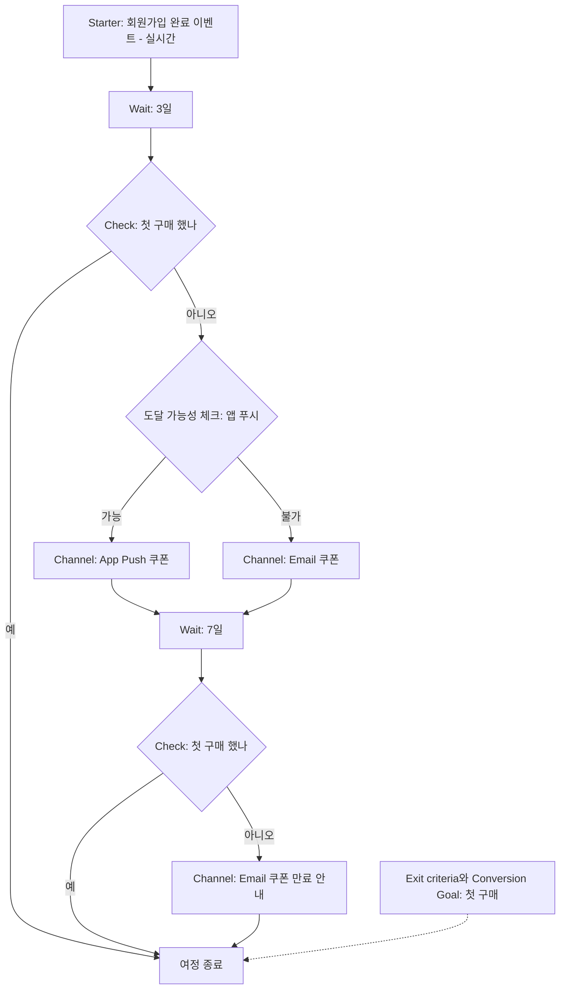

# 6장. Insider One Architect로 여정 설계하기

앞 장에서 Canvas로 만든 3일 차 여정을 이번엔 Insider One의 Architect로 옮겨 보자. 손에는 앞 장 끝에서 채운 한 장짜리 여정 설계서가 들려 있다. 목표는 신규 가입자의 첫 구매, 진입은 회원가입 완료, 3일 기다렸다가 미구매면 쿠폰, 다시 7일 기다렸다가 한 번 더, 첫 구매를 하면 내린다.

그런데 Architect를 열자마자 첫 화면에서 헷갈린다. Insider One도 이 여정 편집 화면을 "canvas"라고 부르기 때문이다. 방금 Braze Canvas를 배우고 온 사람에게는 꽤 짓궂은 우연이다. 그래서 이 책은 규칙을 하나 정해 두었다. "Canvas"라고 쓰면 언제나 Braze의 기능이고, Insider One 쪽은 "Architect 편집 화면"이라고 부른다.

이름이 겹친다는 건 생각해 보면 자연스러운 일이다. 두 도구가 푸는 문제가 같기 때문이다. 고객을 들여보내고, 기다리고, 갈림길에서 가르고, 메시지를 보내고, 목표를 이루면 놓아준다. 그렇다면 무엇이 같고 무엇이 다를까? 설계서를 한 줄씩 Architect로 번역하면서 확인해 보자.

## Architect는 어떤 도구인가

Insider One Academy는 Architect를 두 가지 문장으로 소개한다. 2026-02-12에 갱신된 Feature Set 문서는 Architect를 "AI-backed marketing automation tool"이라고 부르고, 2026-08-27에 갱신된 소개 문서는 Architect가 연결된 모든 플랫폼에 걸쳐 고객 여정을 "orchestrate high-performing customer journeys across every connected platform" 한다고 적는다. 앞 문장은 자동화 도구라는 정체를, 뒤 문장은 채널을 가로지르는 여정이라는 쓰임을 말한다.

Architect가 서 있는 바닥은 2장에서 살펴본 UCD(Unified Customer Database)다. Insider One의 모든 제품이 이 통합 고객 데이터베이스를 떠받침으로 삼는다. 그러니 Architect에서 쓰는 이벤트와 속성은 전부 UCD에 쌓인 것들이다. Canvas가 Braze 사용자 프로필 위에서 돌아가는 것과 같은 구조다. 여정 빌더가 아무리 화려해도, 진입 조건에 쓸 이벤트가 UCD에 없으면 여정은 시작되지 않는다. 이 사실은 도구가 바뀌어도 그대로다.

흐름의 생김새도 익숙하다. Feature Set 문서에 따르면 Architect의 여정은 starter에서 시작해 고객의 행동과 속성에 따라 if/else로 갈라지며 진행된다. 그리고 여정 전반에 걸쳐 쓸 수 있는 공통 기능으로 속성 기반 개인화, 크로스 플랫폼 운영, 빈도 제한(frequency capping), 최적 채널 선택, 발송 시간 최적화를 꼽는다. 뒤의 두 가지는 8장에서, 빈도 제한은 9장에서 다시 만난다.

## Element 다섯 계열 — 상자의 종류

Canvas의 상자를 컴포넌트라고 불렀다면, Architect의 상자는 Element라고 부른다. Academy 문서 목차는 Element를 다섯 계열로 묶는다. Starter Elements, Wait Elements, Check Elements, Channel Elements, Action Elements다. 여기에 Journey A/B Split, Next Best Channel, Dynamic Content, Components가 따로 문서로 묶여 있다.

계열 이름만 봐도 역할이 짐작된다. 하나씩 짚어 보자.

**Starter Elements**는 여정의 입구다. 2026-11 기준 문서는 실시간 starter와 날짜 기반 starter를 함께 소개한다. 고객이 어떤 행동을 하는 순간 들여보내는 방식과, 생일이나 가입 기념일처럼 날짜를 기준으로 들여보내는 방식이다. 상품 가격이 내려가면 여정을 시작하는 On Price Drop, 재입고 때 시작하는 Back in Stock 같은 특수한 starter도 있는데, 이것들은 11장에서 장바구니 이탈과 함께 다룬다.

**Wait Elements**는 기다리는 상자다. 정해진 기간을 기다리거나, 특정 시간대까지 기다리게 할 수 있다. Canvas의 Delay에 해당한다.

**Check Elements**는 길을 가르는 상자다. 메시지에 반응했는지, 정해진 기간 안에 특정 이벤트를 했는지, 특정 속성을 가졌는지를 보고 고객을 가른다. 눈여겨볼 것은 채널 도달 가능성(reachability) 체크다. 이 고객에게 지금 앱 푸시를 보낼 수 있는지, 이메일 주소가 있는지를 확인해 길을 나눈다. 4장에서 말한 "도달 가능성"이 여정 안의 상자로 들어와 있는 셈이다.

**Channel Elements**는 메시지를 보내는 상자다. Feature Set 문서에 실린 채널은 Web push, App push, Email, SMS, WhatsApp, Onsite, In-app, Facebook Custom Audiences, Call an API, Google Ads다. 웹사이트 위에 띄우는 온사이트 경험이 여정의 한 단계로 들어간다는 점, 광고 매체 오디언스와 외부 API 호출까지 같은 계열에 묶여 있다는 점이 눈에 띈다. 4장에서 본 Insider One의 웹 온사이트 강점이 여정 빌더에도 그대로 이어진다.

**Action Elements**는 메시지 대신 동작을 수행하는 상자로 보면 된다. 흐름 중에 고객 속성을 업데이트하는 Update User Attribute가 대표적이고, 고객을 정적 세그먼트에 넣거나 빼는 Update Static Segment도 이 계열이다. 속성 업데이트는 Canvas의 User Update와 같은 쓰임이다.

따로 묶인 네 가지도 한 줄씩 알아 두자. Journey A/B Split은 고객을 무작위로 나눠 서로 다른 길을 태우는 실험 장치이고, 성과가 좋은 쪽을 자동으로 고르는 A/B autowinner와 짝을 이룬다. 실험 설계는 13장에서 본격적으로 다룬다. Next Best Channel은 고객별로 반응할 가능성이 가장 높은 채널을 골라 주는 장치로 8장의 주제다. Dynamic Content는 메시지 안에 고객별 내용을 끼워 넣는 Insider One의 개인화 방식으로 7장에서 만난다. Components는 문서 목차에 별도 항목으로 올라 있는데, 상자의 종류라기보다 진입 제한, 대조군, 여정 우선순위, 여정 편집, 테스트처럼 여정을 운영하는 설정과 도구를 모아 둔 문서 묶음이다.

## Architect만의 용어 — Terms to Know

Element 이름은 Canvas와 대응시키며 금방 익힐 수 있다. 정작 처음 쓰는 사람을 붙잡는 것은 Architect 고유의 용어다. Insider One Academy의 Terms to Know 문서(2025-11-14)가 이 용어들을 정리해 두었다. 마케터가 화면에서 자주 마주칠 것들만 골라 보자.

먼저 기본 뼈대를 이루는 말들이다. **Trigger**는 여정의 첫 단계로, 조건에 맞는 고객을 진입시킨다. 문서는 Trigger와 Starter를 같은 것으로 다룬다. **Condition**(criteria)은 고객을 진입시키거나 여정 안에서 걸러 내는 속성·이벤트·세그먼트를 말한다. **Path**는 체크 조건이나 도달 가능성 체크, A/B split 뒤에 갈라지는 가지다. Canvas에서 분기 뒤의 각 길과 같다.

다음은 Canvas 쪽에 똑같은 이름이 없어 번역이 필요한 말들이다.

**Live Actions**는 메시지를 보낸 뒤, 고객이 그 메시지에 특정 행동을 할 때까지 붙잡아 두는 대기 지점이다. "쿠폰 푸시를 보내고, 고객이 쿠폰 페이지를 열 때까지 기다린다"는 식이다. 행동을 기다렸다가 길을 가른다는 점에서 Canvas의 Action Paths와 닮았다.

**Layer**는 여정 안에서 고객이 몇 번째 상호작용을 하고 있는지를 가리킨다. 문서는 이것으로 두 번째 메시지의 효과를 확인할 수 있다고 설명한다. 3일 차 여정이라면 첫 쿠폰과 7일 뒤의 두 번째 메시지가 각각 다른 Layer다. "두 번째 메시지가 정말 무언가를 더했나?"라는 질문을 숫자로 볼 수 있게 해 주는 장치다.

**Conversion Goal**과 **Conversion Attribution Model**은 여정의 성공을 무엇으로 세고, 그 공을 어느 메시지에 돌릴지를 정한다. 문서가 드는 예는 마지막으로 클릭한 채널에 전환을 전부 귀속하는 방식이다. 편리하지만 이 방식이 "보내지 않았어도 샀을 사람"까지 메시지의 공으로 센다는 점은 13장에서 다시 따져 보자.

**Dry Run**은 실제로 메시지를 보내지 않고, 여정에 몇 명이 들어오고 어떻게 흘러가는지 시뮬레이션하는 기능이다. 설계서의 "예상 진입 규모" 칸을 채울 때 아주 요긴하다.

**Sunset**은 여정을 끝내는 방식 중 하나다. 새로운 고객의 진입은 막고, 이미 들어와 있는 고객은 끝까지 진행시킨다. 앞 장에서 "운영 중인 여정을 바꿀 때 이미 안에 있는 사람이 어떻게 될까?"라는 걱정을 했는데, Architect는 이 상황을 위한 상태를 이름까지 붙여 제공하는 셈이다. 새 버전을 만들어 켜고 옛 버전은 Sunset으로 서서히 비워 내는 방식을 떠올려 볼 수 있다.

마지막으로 꼭 알아야 할 구분이 **Promotional**과 **Transactional** Use Case다. 프로모션 여정은 고객의 수신 동의(opt-in)가 필요하고, 주문 확인이나 비밀번호 재설정 같은 트랜잭션 여정은 동의가 필요하지 않다. 3일 차 여정의 쿠폰은 누가 봐도 프로모션이다. 이 구분이 여정을 만들 때부터 선택지로 들어와 있다는 점이 좋다. 한국에서 광고성 메시지와 정보성 메시지를 어떻게 가르는지는 9장에서 법과 함께 다시 본다.

## 흐름을 다스리는 장치들

용어를 익혔으니 여정이 엉키지 않게 하는 장치를 살펴보자. Feature Set 문서는 흐름 제어 기능으로 진입 제한, 자격 규칙, 종료 조건(Exit criteria)을 함께 든다. 이름은 조금씩 달라도 앞 장의 Canvas에서 고민한 것과 같은 질문에 답하는 장치들이다. 누가 몇 번까지 들어올 수 있는가, 들어온 뒤에도 어떤 사람은 걸러야 하는가, 언제 놓아주는가.

Exit criteria의 중요성은 Architect에서도 똑같다. 한 Insider One 사용자는 리뷰에 이렇게 적었다. "Initial segment rules also needed manual adjustments to filter out already purchased items." 이미 구매한 상품을 걸러 내려고 처음 세운 세그먼트 규칙을 손으로 고쳐야 했다는 이야기다. 도구가 달라도 "이미 산 사람, 이미 산 상품을 빼는 일"은 처음 설계할 때 놓치기 쉽다는 뜻이다. 3일 차 여정에서도 첫 구매 이벤트를 종료 조건으로 걸어 두자.

도달 가능성 체크도 흐름을 다스리는 좋은 장치다. 쿠폰을 앱 푸시로만 보내도록 그려 두면, 푸시 알림을 꺼 둔 고객은 여정에 들어와 아무것도 받지 못한 채 시간만 보낸다. 리포트에는 진입 인원으로 잡히는데 실제로는 메시지를 한 통도 못 받은 사람들이다. 난감하다. 도달 가능성 체크로 "푸시를 받을 수 있는 사람"과 "그렇지 않은 사람"을 먼저 가르고, 후자에게는 이메일을 보내는 식으로 길을 하나 더 내 주면 이 빈틈이 메워진다.

흐름 중 속성 업데이트도 기억해 둘 만하다. 쿠폰을 보낸 시점에 "첫 구매 쿠폰 발송함" 같은 속성을 남겨 두면, 다른 여정이나 세그먼트에서 이 고객이 이미 쿠폰을 받았다는 사실을 알 수 있다. 같은 고객이 여러 여정에서 쿠폰을 겹쳐 받는 일을 막는 작은 습관이다.

## 3일 차 여정을 Architect로 옮기기

이제 설계서를 Architect로 번역해 보자. 진입은 회원가입 완료 이벤트를 받는 실시간 Starter다. 3일을 기다리는 Wait를 두고, 첫 구매 여부를 보는 Check로 가른다. 미구매자에게는 도달 가능성 체크를 한 번 더 걸어 앱 푸시가 가능한 사람에게는 App Push로, 그렇지 않은 사람에게는 Email로 쿠폰을 보낸다. 다시 7일 Wait, 다시 Check, 그리고 마지막 메시지. 여정 전체에는 첫 구매를 종료 조건과 Conversion Goal로 걸어 둔다.

그림 1. 3일 차 여정을 Architect로 옮긴 흐름

앞 장의 그림 1과 나란히 놓고 보자. 골격은 거의 같다. 입구 하나, 대기 두 번, 판단 두 번, 메시지 두 번, 출구 하나. 달라진 곳은 도달 가능성 체크가 들어간 자리 정도다. 물론 Canvas에서도 채널 도달 여부로 길을 가를 수 있다. Architect가 이 체크를 여정의 기본 상자로 전면에 내세우고 있을 뿐이다.

앞 장에서 했던 질문도 그대로 가져올 수 있다. 종료 조건이 첫 구매자를 이미 내려 주는데 Check가 꼭 필요할까? 결론도 같다. 목표 달성은 종료 조건에 맡기고, Check는 정말로 길을 가를 필요가 있는 곳에 쓰는 편이 여정을 단순하게 만든다. Check를 남겨 둔다면 "종료 조건이 혹시 놓친 사람을 한 번 더 거르는 안전장치"라는 의도를 설계서에 적어 두자. 의도가 적혀 있지 않은 분기는 몇 달 뒤 아무도 지우지 못하는 분기가 된다.

마지막으로 쿠폰 메시지는 Promotional Use Case로 만든다. 수신 동의를 한 고객에게만 나가도록 하는 장치가 여기서 걸린다.

## 리포트와 테스트 — 켜기 전에, 켠 다음에

Architect의 테스트 장치는 Canvas와 비슷하면서도 결이 조금 다르다. Feature Set 문서가 꼽는 테스트 기능은 테스트 발송, 랜덤 테스트, 샘플 프로필로 동적 콘텐츠 미리보기, 사용자 추적, 그리고 앞에서 본 Dry Run이다.

Dry Run부터 돌려 보자. 실제 발송 없이 진입 인원과 흐름을 볼 수 있으니, "하루에 몇 명이 들어오고, 그중 몇 명이 도달 가능성 체크에서 이메일 쪽으로 빠지는가"를 켜기 전에 가늠할 수 있다. 예상보다 진입 인원이 터무니없이 적다면 Starter의 이벤트나 진입 조건부터 의심해 보자. 다만 Dry Run이 모든 기능을 그대로 흉내 내지는 않는다. 예를 들어 Insider One 문서는 발송 시간 최적화(STO)가 Dry Run과 테스트 상태에서는 동작하지 않는다고 밝힌다. 이 이야기는 8장에서 다시 만난다.

샘플 프로필로 동적 콘텐츠를 미리 보는 기능은 7장의 개인화와 직결된다. 고객 이름이나 상품명이 들어가는 메시지라면, 값이 꽉 찬 프로필과 비어 있는 프로필을 모두 넣어 보는 편이 낫다. 사용자 추적은 특정 고객이 여정 안에서 어디를 지나고 있는지 따라가 보는 기능이다. 고객센터에서 "저는 왜 이 쿠폰을 받았죠?"라는 문의가 왔을 때 가장 먼저 열어 볼 화면이다.

켠 다음에는 Journey Analytics가 기다린다. 문서가 소개하는 리포트는 실시간 흐름 통계, 채널별 통계와 여정 전체 통계, 성과 대시보드, A/B 통계, 데이터 export, 전환 목표, last-touch 어트리뷰션이다. 처음에는 흐름 통계에서 "각 상자에 몇 명이 지나갔는가"부터 보자. 어느 상자에서 사람이 예상보다 많이 빠지거나 고이는지가 보이면 설계서와 실제가 어디서 어긋났는지 알 수 있다. 전환 숫자를 볼 때는 앞에서 말한 어트리뷰션 방식이 그 숫자를 어떻게 셌는지를 함께 떠올리자.

## 두 여정 빌더 사이를 오가는 번역표

Architect에 대한 현장 평가는 Canvas만큼이나 엇갈린다. Gartner 리뷰에는 Architect 덕분에 "without asking engineers every time" 여정을 짤 수 있다는 호평이 있고, 2024년의 3.0점짜리 리뷰는 "steep initial learning curve"를 지적했다(둘 다 리뷰 검색 요약으로 확인한 내용이다). 2026-10에 올라온 여행업 사용자의 리뷰도 "There was a steeper learning curve than we expected"라고 적었다. 앞 장에서 본 Braze 리뷰의 "feature-dense"라는 불평과 겹쳐 보면, 두 도구 모두 첫 여정까지의 언덕이 만만치 않다는 점은 같다.

그 언덕을 덜 가파르게 만드는 방법이 이 장 내내 해 온 일이다. 설계서 한 장을 들고, 도구의 상자 이름으로 번역하는 것. 한 번 번역해 보면 다른 도구로 옮기는 일도 어렵지 않다. 회사가 쓰는 도구가 바뀌거나, 이직한 회사가 다른 도구를 쓰더라도 아래 표가 있으면 개념은 그대로 가져갈 수 있다. 2026-11 기준으로 정리했다.

| 결정 | Braze Canvas | Insider One Architect |
|---|---|---|
| 여정 빌더 이름 | Canvas (기본 편집기 Canvas Flow) | Architect (편집 화면도 canvas라고 부름) |
| 여정의 상자 | 컴포넌트 | Element |
| 입구 | 진입 방식 + 진입 대상 세그먼트 | Starter(=Trigger), 실시간·날짜 기반 |
| 기다리기 | Delay | Wait Elements |
| 조건으로 가르기 | Decision Split, Audience Paths | Check Elements → Path |
| 행동을 기다렸다가 가르기 | Action Paths | Live Actions, Check(기간 내 이벤트) |
| 보낼 수 있는지 확인 | 진입 대상 세그먼트·분기 조건으로 처리 | 도달 가능성(reachability) 체크 |
| 메시지 보내기 | Message | Channel Elements |
| 프로필 속성 바꾸기 | User Update | 흐름 중 속성 업데이트 |
| 광고 매체로 보내기 | Canvas Audience Sync | Facebook Custom Audiences, Google Ads |
| 외부 시스템 호출 | 웹훅(Message 단계의 채널) | Call an API |
| 여정 안 실험 | Experiment Paths, Winning Path | Journey A/B Split, A/B autowinner |
| 최적 채널 | Intelligent Channel filter | Next Best Channel |
| 발송 시간 최적화 | Intelligent Timing (Message 단계에서 설정) | Send Time Optimization (채널 단계) |
| 개인화 | Liquid | Dynamic Content, Liquid(얼리 액세스) |
| 놓아주기 | Exit criteria | Exit criteria(종료 조건) |
| 성공 세기 | 전환 이벤트 | Conversion Goal, Conversion Attribution Model |
| 몇 번째 메시지인가 | (대응 용어 없음 — 공식 문서 확인) | Layer |
| 발송 없이 리허설 | 사용자 경로 미리보기, 테스트 발송 | Dry Run, 샘플 프로필 미리보기, 랜덤 테스트 |
| 신규 진입만 막기 | (대응 용어 없음 — 공식 문서 확인) | Sunset |
| 동의가 필요한 여정 구분 | 구독 상태·opt-in 설정으로 처리 | Promotional vs Transactional Use Case |

표의 오른쪽과 왼쪽은 이름이 다를 뿐 같은 결정을 가리킨다. 여정 하나를 설계서로 쓸 수 있다면, 두 도구 중 어느 쪽 화면 앞에 앉아도 길을 잃지 않는다.

### 이 장의 핵심

- Architect는 UCD 위에서 돌아가는 Insider One의 여정 빌더로, starter에서 시작해 행동·속성에 따라 if/else로 갈라진다. 편집 화면을 canvas라 부르지만 이 책의 "Canvas"는 언제나 Braze다.
- 상자는 Starter·Wait·Check·Channel·Action의 다섯 계열이고, Journey A/B Split·Next Best Channel·Dynamic Content가 따로 붙는다.
- Live Actions, Layer, Dry Run, Sunset, Promotional/Transactional은 Canvas에 같은 이름이 없는 Architect 고유 용어다. 특히 프로모션 여정에는 수신 동의가 필요하다.
- 도달 가능성 체크로 "보낼 수 없는 고객"의 길을 따로 내고, 종료 조건으로 첫 구매자를 놓아준다.
- 같은 설계서를 두 도구의 상자 이름으로 번역할 수 있으면, 도구가 바뀌어도 여정 설계 능력은 그대로 남는다.
