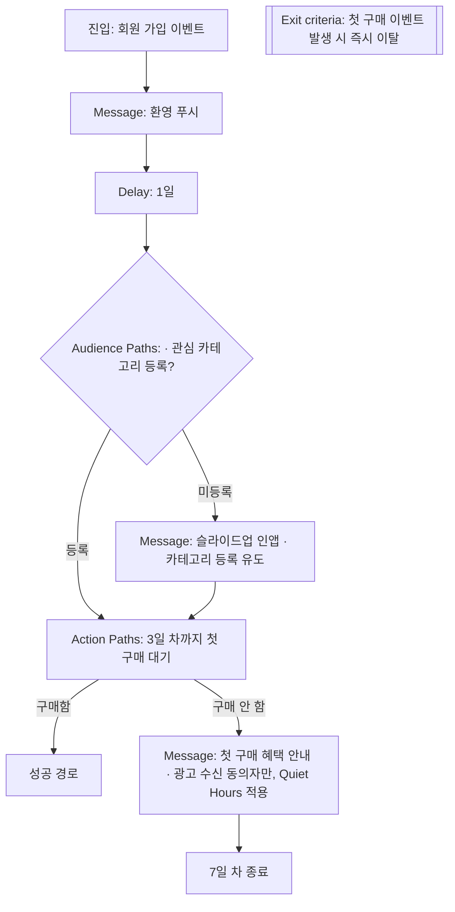
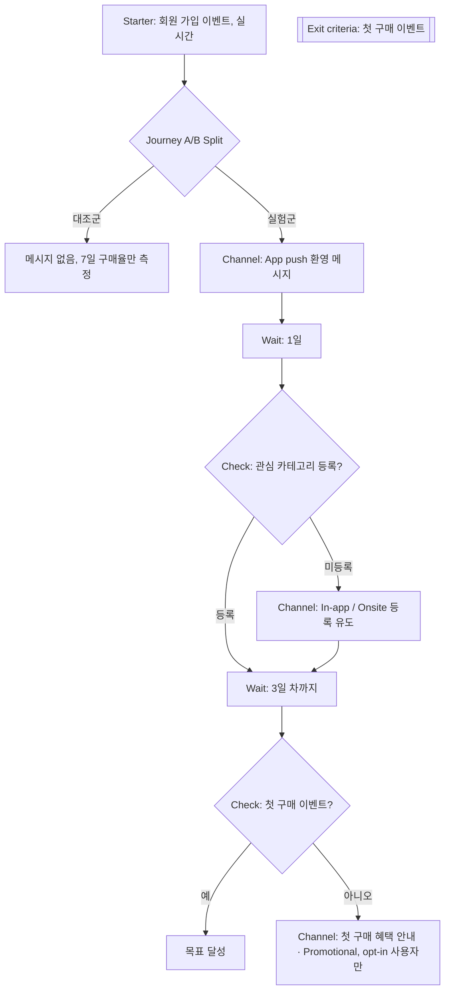

# 10장. 유스케이스 ① 첫인상을 설계하라 — 온보딩과 첫 구매

> "잡코리아에 가입한 n일동안, 경쟁자들은 연봉 UP하고 있어요!"

잡코리아가 이력서를 아직 등록하지 않은 회원에게 띄운 인앱 메시지 문구다. 7장에서 이 문구의 "n일"이 Liquid로 가입일과 오늘 날짜의 차이를 계산해 채워진다는 것을 봤다. 이번에는 문구 하나가 아니라 그 뒤에 있는 여정 전체를 들여다보자. 이 캠페인을 이끈 잡코리아 담당자는 Braze 고객 사례에서 이렇게 말했다.

> "CRM 담당자인 제가 다양한 시도를 할 수 있었던 배경에는 Braze가 있었습니다." — 한은파 매니저, 잡코리아

"다양한 시도"라는 말이 눈에 걸린다. 담당자는 무엇을 시도했고, 그 시도는 왜 가능했을까? 이 사례를 해부해 온보딩 여정의 원리를 뽑아낸 다음, 같은 여정을 Braze와 Insider One으로 각각 만들어 보자. 9장에서 배운 규칙도 이 여정 위에서 다시 만나게 된다.

## 잡코리아는 무엇이 막혀 있었나

먼저 이 사례의 시점부터 못 박아 두자. Braze 한국어 사이트의 잡코리아 사례 페이지는 게재일이 적혀 있지 않고, 본문 통계는 2023년 7월 기준이며 캠페인은 2023년 11월 전후의 일이다. 지금의 잡코리아 서비스나 Braze 화면과는 다를 수 있다. 성과 수치도 모두 회사 측이 발표한 자체 보고다.

사례에 적힌 잡코리아의 고민은 네 가지였다. 첫째, 지원 이후 단계, 즉 서류·면접·결과를 추적할 수 없었다. 고객이 지원 버튼을 누른 다음 무슨 일이 벌어지는지 데이터로 알 길이 없었던 것이다. 둘째, 프로필과 이력서를 쓰기 전에는 그 회원이 신입인지 경력인지 구분할 수 없었다. 셋째, 경력자에게 구직 활동은 민감한 일이라 푸시 타이밍을 잡기 어려웠다. 회사에서 동료와 회의하는 중에 "이직 준비 중이신가요?" 푸시가 화면에 뜬다고 생각해 보자. 꽤 아찔하다. 넷째, 웹 푸시는 들이는 리소스에 비해 효과가 불분명해 보류해 둔 상태였다. 이 마지막 항목은 그냥 지나치기 쉽지만 의미가 있다. 쓸 수 있는 채널을 모두 쓰는 대신, 효과를 설명할 수 없는 채널은 일단 접어 두기로 한 것이다. 채널을 줄이는 것도 마케터의 결정이다.

이 고민들을 2장의 언어로 다시 읽어 보면 공통점이 보인다. 모두 "고객에 대한 사실이 비어 있다"는 문제다. 신입인지 경력인지, 지원 후 어떻게 됐는지가 프로필에 없으니 세그먼트를 나눌 수 없고, 나눌 수 없으니 모든 신규 회원에게 같은 메시지를 보내게 된다. 온보딩이 어려운 이유가 바로 여기에 있다. 가입 직후의 고객은 우리가 아는 것이 가장 적은 고객이다.

## 잡코리아가 한 일

그렇다면 잡코리아는 이 빈칸을 어떻게 채웠을까? 사례가 전하는 실행 내용을 순서대로 보자.

먼저 마케터가 개발팀 도움 없이 세그먼트를 직접 구성했다. 이게 가능했던 것은 필요한 사실을 커스텀 속성으로 갱신하는 길을 여러 개 열어 두었기 때문이다. Canvas 안에서 속성을 실시간으로 업데이트하기도 하고, CSV 파일로 한 번에 올리기도 했다. 여정 안에서 속성을 바로 바꿀 수 있다는 것은, 고객이 어떤 메시지에 반응했는지가 다음 메시지를 고르는 조건으로 곧장 이어진다는 뜻이다. 개발팀에 요청해 다음 배포를 기다리지 않아도 된다. 2장에서 "마케터의 자율성은 도입 초기 데이터 설계 품질에 비례한다"는 현장의 말을 봤는데, 이 사례가 그 긍정적인 쪽 예다.

다음은 메시지다. Liquid로 가입 경과일을 계산해 넣었고, 기업명·직무·희망 직무·경력 연수 같은 값으로도 개인화했다. 그리고 이력서를 아직 등록하지 않은 회원에게는 앱 안에서 화면 아래쪽에 살짝 떠오르는 슬라이드업 인앱 메시지를 보냈다. 앞의 "경쟁자들은 연봉 UP" 문구가 바로 이 메시지다. 푸시 대신 인앱을 고른 점이 흥미롭다. 고객이 이미 앱을 열고 있을 때만 보이니, 회의 중에 화면에 뜨는 푸시 같은 민감한 상황을 피할 수 있다.

마지막은 테스트다. 전체 발송 전에 랜덤 샘플로 먼저 보내 봤고, 색상·크리에이티브·아이콘(로고와 마스코트)을 바꿔 가며 A/B 테스트를 했다. 채널은 푸시, 인앱, 웹 인앱을 썼다.

성과는 어땠을까? 회사 측 발표에 따르면 이전과 비슷한 모수에서 평균 CTR이 4~5배 수준으로 올랐고, 지원자 데이터로 개인화한 메시지는 CTR을 5%p 이상 높였으며, 슬라이드업 인앱의 CTR은 두 자릿수에 가까웠다. 같은 목표의 다른 인앱보다 약 4%p 높은 수치다. 전환율(CVR)은 대조군보다 높았다고 한다.

여기서 수치 자체보다 눈여겨볼 것은 마지막 문장이다. "대조군보다 높았다." 잡코리아는 메시지를 받지 않은 집단과 비교하는 장치를 두었다. 다만 기준값과 표본, 통계적 유의성은 공개되지 않았으니, 이 수치를 우리 회사의 목표로 삼기보다는 "대조군을 두고 비교했다"는 방법을 가져오는 편이 낫다.

이 사례가 알려 주는 원리를 세 가지로 뽑아 보자. 하나, 온보딩은 메시지보다 사실을 채우는 일이 먼저다. 이력서 등록 여부라는 사실 하나가 세그먼트를 만들고 메시지를 바꿨다. 둘, 고객의 상태와 맥락에 맞는 채널을 고른다. 민감한 메시지는 고객이 이미 앱 안에 있을 때 보여 주는 편이 낫다. 셋, 크게 보내기 전에 작게 보내 보고, 받지 않은 집단과 비교한다.

그런데 왜 하필 이력서 등록이었을까? 구직 서비스에서 이력서는 고객이 서비스의 가치를 처음 제대로 맛보는 관문이다. 이력서가 있어야 추천 공고가 정확해지고, 지원 버튼 한 번으로 지원할 수 있다. 동시에 이력서는 잡코리아가 신입과 경력을 구분할 수 있게 해 주는 데이터이기도 하다. 고객에게는 가치의 시작점이고, 회사에게는 다음 메시지를 고를 재료다. 좋은 온보딩 목표는 대개 이렇게 양쪽에 동시에 이득이 되는 지점에 있다.

## 온보딩 설계 문서부터

이제 우리 회사에 적용해 보자. 5장에서 여정은 툴 위에서 바로 그리지 말고 설계 문서부터 쓰자고 했다. 온보딩 여정도 마찬가지다. 그런데 온보딩에서는 문서의 첫 칸, "목표"를 정하는 일이 생각보다 어렵다. "첫 구매"라고 쓰면 끝일까?

온보딩의 목표는 **첫 가치 순간**이다. 고객이 "아, 이 서비스 쓸 만하네"라고 처음 느끼는 순간을 말한다. 쇼핑 앱이라면 첫 구매일 수 있지만, 구독형 서비스라면 첫 콘텐츠 시청일 수 있고, 잡코리아 같은 구직 서비스라면 이력서 등록이나 첫 지원일 수 있다. 목표가 흐릿하면 여정 끝에 무엇을 확인해야 할지도 흐려진다.

그렇다면 첫 가치 순간은 어떻게 찾을까? 감으로 정하기보다 데이터를 먼저 보자. 가입 후 한두 달이 지나도 계속 쓰는 고객과 금방 떠난 고객을 나누고, 가입 첫 주에 두 집단이 무엇을 다르게 했는지 비교해 보는 것이다. 계속 쓰는 고객 다수가 첫 주에 관심 카테고리를 등록했다면, 그 행동이 첫 가치 순간의 후보가 된다. 다만 이 비교는 후보를 찾는 데까지만 쓰자. 카테고리를 등록해서 오래 쓰는 것인지, 원래 관심이 많은 고객이 카테고리도 등록한 것인지는 이 비교만으로 알 수 없다. 그 질문에 답하는 방법은 13장에서 다룬다.

기간도 함께 정해야 한다. "언젠가 첫 구매"는 목표가 될 수 없다. 우리 고객이 가입 후 보통 며칠 안에 첫 구매를 하는지 분포를 보고, 대부분이 들어오는 구간을 여정의 길이로 삼는 편이 낫다.

예제를 하나 정해 두자. 가상의 생활용품 쇼핑 앱이고, 첫 가치 순간은 "가입 후 7일 안의 첫 구매"라고 하자. 설계 문서는 이렇게 채울 수 있다.

| 항목 | 내용 |
|---|---|
| 목표(첫 가치 순간) | 가입 후 7일 안에 첫 구매 |
| 진입 조건 | 회원 가입 이벤트가 발생한 사용자 |
| 단계 | 가입 직후 환영 메시지 → 1일 대기 → 관심 카테고리 미등록이면 인앱으로 등록 유도 → 3일 차까지 미구매면 첫 구매 혜택 안내 → 7일 차까지 미구매면 여정 종료 |
| 이탈 조건 | 첫 구매 이벤트 발생 시 즉시 이탈 |
| 전환 이벤트 | 첫 구매 |
| 대조군 | 진입자의 일부를 메시지 없이 남겨 두고 7일 구매율 비교 |
| 규제 확인 | 첫 구매 혜택 안내는 광고성 → 광고 수신 동의자만, 야간 시간대 제외 |

마지막 줄을 그냥 넘기지 말자. "가입 축하 쿠폰"은 친절한 환영 인사처럼 보이지만, 9장에서 본 기준으로는 할인을 담은 광고성 정보다. 광고 수신 동의를 하지 않은 신규 회원에게는 보내면 안 된다. 가입 확인이나 이용 안내 같은 정보성 메시지와 혜택 안내를 같은 메시지에 섞지 않는 편이 낫다.

## Braze로 만들기

설계 문서를 Canvas로 옮겨 보자. 5장에서 본 컴포넌트를 그대로 꺼내 쓰면 된다.

진입은 가입 이벤트로 잡는다. 사용자가 회원 가입이라는 행동을 하면 Canvas에 들어오게 하는 방식이다(Canvas 진입 방식의 정확한 명칭과 옵션은 Braze Docs에서 확인, 사실 확인 필요). 진입 직후 Message 컴포넌트로 환영 푸시를 보내고, Delay로 하루를 기다린다.

다음은 분기다. 관심 카테고리를 등록했는지는 커스텀 속성으로 확인할 수 있으니 Audience Paths나 Decision Split으로 나눈다. 미등록자에게는 잡코리아처럼 슬라이드업 인앱 메시지로 등록을 권한다. 3일 차에는 Action Paths를 쓴다. Action Paths는 정해진 기간 동안 사용자의 행동을 기다렸다가, 그 행동을 했는지에 따라 길을 나눈다. 첫 구매 이벤트가 있었으면 성공 경로로, 없으면 혜택 안내 경로로 보낸다. 이때 혜택 안내 메시지의 대상은 광고 수신 동의자로 제한하고, Quiet Hours로 야간 시간대를 막아 두자.

인앱과 푸시 중 무엇을 고를지도 생각해 보자. 관심 카테고리 등록은 앱 안에서 바로 할 수 있는 행동이니, 앱을 열었을 때 보이는 인앱 메시지가 잘 맞는다. 반대로 3일 차 혜택 안내는 앱을 열지 않은 고객에게 닿아야 하니 푸시가 맞다. 메시지가 부르는 행동이 어디에서 일어나는지를 보고 채널을 고르는 것이다.

개인화는 7장에서 본 Liquid 한 줄이면 충분하다. 잡코리아처럼 가입 경과일을 문구에 넣고 싶다면 7장의 날짜 계산 예를 가져오면 된다.

```liquid
{{${first_name}}}님, 아직 장바구니가 비어 있어요.
```
코드 1. Braze Liquid — 이름 속성 참조 (이름이 비어 있을 때의 처리는 7장 QA 체크리스트 참조)

마지막으로 Exit criteria에 첫 구매 이벤트를 넣는다. 그래야 여정 중간 어디에 있든 구매한 고객은 바로 빠져나간다. 대조군은 Experiment Paths로 진입자의 일부를 메시지 없는 경로로 보내 만든다.


그림 1. Braze Canvas로 만든 7일 첫 구매 온보딩 여정 (대조군용 Experiment Paths는 진입 직후에 둔다)

## Insider One으로 만들기

같은 여정을 Insider One Architect로 옮기면 어떻게 될까? 6장에서 본 Element 이름으로 번역하면 대부분 일대일로 대응한다.

진입은 Starter Element다. 가입 이벤트가 발생하는 즉시 사용자를 들여보내는 실시간 Starter를 쓴다. 대기는 Wait Element, 조건 확인은 Check Element가 맡는다. "관심 카테고리를 등록했는가", "첫 구매 이벤트가 있었는가"를 Check로 확인하고 Path를 나눈다. 메시지는 Channel Element로 보낸다. Architect의 채널에는 App push, Email, In-app, Onsite 등이 있으니, 앱에서는 인앱으로, 웹에서는 온사이트 메시지로 카테고리 등록을 권할 수 있다. 웹 온사이트 경험은 Insider One이 특히 강한 영역이라, 웹 비중이 큰 서비스라면 이쪽을 적극적으로 활용해 볼 만하다.

Architect에서 꼭 챙길 설정이 하나 있다. 여정을 만들 때 고르는 **Promotional과 Transactional Use Case** 구분이다. 9장에서 봤듯 프로모션 여정은 opt-in이 필요하고, 트랜잭션 여정은 필요 없다. 이 온보딩 여정은 첫 구매 혜택 안내를 담고 있으니 Promotional로 분류하는 편이 맞다. 만약 가입 확인이나 이용 안내처럼 정보성 메시지를 동의와 무관하게 모든 신규 회원에게 보내고 싶다면, 그 부분은 별도의 Transactional 여정으로 떼어 내자. 한 여정에 두 성격을 섞으면 분류를 정직하게 할 수 없다.

Architect에는 채널 도달 가능성(reachability)을 확인하는 장치도 있다. 가입 직후의 고객은 앱 푸시 권한을 아직 허용하지 않았을 수도 있고, 웹으로만 가입해 앱을 설치하지 않았을 수도 있다. 환영 메시지를 보내기 전에 앱 푸시로 닿을 수 있는지 확인하고, 닿지 않는 고객은 이메일 경로로 보내도록 Path를 나눠 두면 "보냈는데 아무도 못 받은" 단계를 줄일 수 있다. 8장에서 본 Next Best Channel을 쓰면 이 판단을 채널 참여 점수에 맡길 수도 있다.

대조군은 Journey A/B Split으로 만들고, 이탈 조건은 Exit criteria에 첫 구매 이벤트로 넣는다. 그리고 실제로 켜기 전에 Dry Run으로 진입 인원과 흐름을 시뮬레이션해 보자. 다만 8장에서 봤듯 Send Time Optimization은 Dry Run에서 동작하지 않으니, STO를 켠 단계의 발송 시각은 시뮬레이션과 다를 수 있다.


그림 2. Insider One Architect로 만든 같은 온보딩 여정

두 그림을 나란히 놓고 보면 구조는 거의 같다. 다른 것은 이름과, 동의를 다루는 위치다. Braze에서는 메시지 단계의 대상 조건과 Quiet Hours로 챙기고, Insider One에서는 여정 단위의 Use Case 분류로 먼저 챙긴다. 어느 쪽이든 마케터가 그 칸을 비워 두면 도구는 막아 주지 않는다.

## 온보딩에서 흔한 실수

이렇게 정리하고 나면 쉬워 보이지만, 실제로는 같은 실수가 반복된다. 세 가지만 짚어 두자.

첫째, 모든 신규 가입자에게 같은 메시지를 보낸다. 잡코리아가 처음 부딪힌 문제가 바로 이것이었다. 신입과 경력, 관심 카테고리가 있는 고객과 없는 고객에게 같은 환영 메시지를 보내면, 누구에게도 딱 맞지 않는 메시지가 된다. 가입 직후에 사실을 하나라도 더 채우는 단계를 넣고, 그 사실로 길을 나누자.

둘째, 목표를 달성한 고객을 빼지 않는다. 어제 첫 구매를 한 고객에게 오늘 "첫 구매 혜택이 곧 사라져요"가 도착한다면 어떨까? 고객은 혜택을 놓친 기분이 들거나, 이 회사가 자기를 모른다고 느낀다. 생각만 해도 찜찜한 장면이다. Exit criteria에 전환 이벤트를 넣는 것은 선택이 아니라 기본으로 여기자.

셋째, 채널을 너무 많이 쓴다. 가입 첫 주는 고객의 관심이 가장 높을 때라, 푸시·이메일·인앱·카카오톡을 다 동원하고 싶어진다. 하지만 9장에서 봤듯 과하게 받은 고객은 서서히 무시하는 대신 알림 권한을 끄거나 앱을 지운다. 가입 첫 주에 알림 권한을 잃으면 이후의 모든 여정이 길을 잃는다. 온보딩 여정에도 빈도 상한이 그대로 적용되는지 확인하고, 채널은 목적별로 하나씩만 고르는 편이 낫다.

이제 우리 서비스로 돌아가 보자. 우리 서비스의 "첫 가치 순간"은 무엇인가? 고객이 처음으로 돈을 쓰는 순간인가, 처음으로 무언가를 만들어 내는 순간인가, 아니면 처음으로 다시 돌아오는 순간인가? 그 순간을 확인할 수 있는 이벤트가 지금 프로필에 쌓이고 있는가? 그리고 그 순간에 가장 가까이 있는 고객과 가장 멀리 있는 고객을 우리는 구분할 수 있는가? 이 세 질문에 답할 수 있다면 온보딩 설계 문서의 첫 칸은 이미 채워진 셈이다.
