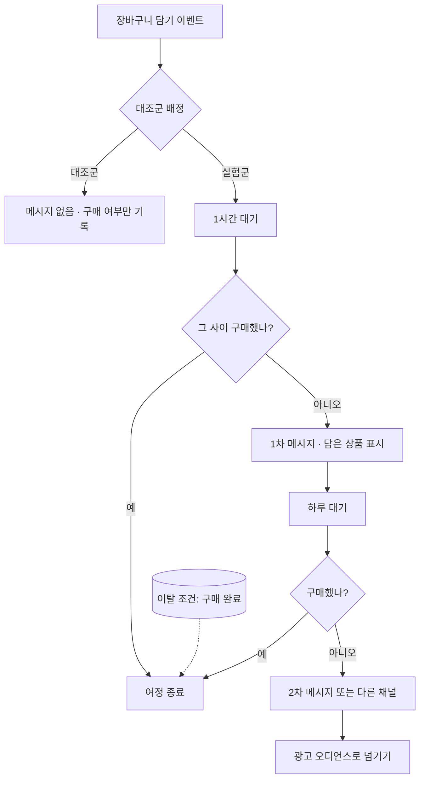

# 11장. 유스케이스 ② 떠나기 직전의 고객 — 장바구니 이탈·가격 인하·재입고

장바구니에 담고 앱을 닫은 고객은 정말 떠난 걸까, 아직 고민 중일까?

마케터라면 이 질문 앞에서 한 번쯤 손이 근질거린다. 담았다는 건 관심이 있다는 뜻이고, 결제하지 않았다는 건 무언가가 걸렸다는 뜻이다. 배송비가 마음에 걸렸을 수도 있고, 다른 쇼핑몰과 가격을 비교하러 갔을 수도 있다. 그냥 지하철에서 내려야 해서 앱을 닫았을 수도 있다. 이유는 제각각인데 우리가 볼 수 있는 건 "담았다, 그리고 사지 않았다"라는 두 줄의 기록뿐이다.

앞 장의 온보딩은 고객을 처음 가치 경험까지 데려가는 여정이었다. 이번에는 구매 문턱까지 와서 멈춘 고객을 다룬다. 생애주기로 치면 한가운데, 매출과 가장 가까운 자리다. 그래서 대부분의 회사가 CRM 자동화를 도입하고 가장 먼저 만드는 여정이 장바구니 이탈 여정이기도 하다.

## 멈춘 고객이 보내는 세 가지 신호

먼저 이 장에서 다룰 신호를 정리해 두자. 겉보기에는 모두 "구매 직전의 고객에게 메시지를 보낸다"로 묶이지만, 신호가 어디서 오는지는 서로 다르다.

첫째는 **고객의 행동이 멈춘 신호**다. 장바구니에 담았는데 일정 시간 안에 결제가 없다. 검색하고 상품을 들여다봤는데 예약하지 않았다. 고객이 무언가를 했고, 그다음 해야 할 일을 하지 않았다는 사실이 트리거가 된다.

둘째와 셋째는 **상품 쪽이 움직인 신호**다. 고객이 봐 두었던 상품의 가격이 내려갔다. 품절이던 상품이 다시 들어왔다. 이때 고객은 아무것도 하지 않았다. 바뀐 건 상품이고, 그 변화가 고객이 망설이던 이유를 풀어 줄 수 있기 때문에 연락할 명분이 생긴다.

이 구분이 왜 중요할까? 데이터가 들어오는 길이 다르기 때문이다. 행동 신호는 2장에서 본 커스텀 이벤트, 곧 앱과 웹이 심어 둔 "장바구니 담기", "구매 완료" 같은 기록에서 온다. 상품 신호는 상품 카탈로그나 상품 피드, 즉 가격과 재고가 적힌 상품 데이터에서 온다. 행동 트리거는 고객 데이터만 잘 깔려 있으면 되지만, 상품 트리거는 상품 데이터가 도구 안으로 꾸준히 흘러 들어와야 작동한다. 같은 "구매 직전 여정"이라도 개발팀에 요청할 내용이 달라지는 셈이다.

## BlaBlaCar의 예약 이탈 여정 해부

추상적인 이야기는 여기까지 하고 실제 사례를 하나 펼쳐 보자. 카풀·버스 예약 서비스 BlaBlaCar가 Braze로 만든 예약 이탈 여정이다. Braze가 공개한 고객 사례 페이지 기준이고(날짜 미표기, Canvas Flow 출시 이후인 2022년 이후 자료), 우리에게는 장바구니 이탈 여정의 교과서 같은 구조를 보여 준다. 예약 서비스라 "장바구니"라는 말 대신 "검색하고 조회했지만 예약하지 않은 사람"이 대상이지만, 뼈대는 쇼핑몰의 장바구니 이탈과 똑같다.

BlaBlaCar는 여정 입구에서 사용자를 네 무리로 나눴다. 이미 예약한 사람, 카풀을 검색하거나 조회한 사람, 버스를 검색하거나 조회한 사람, 그리고 나머지다. 이미 예약한 사람을 따로 떼어 둔 것이 눈에 띈다. 5장에서 "이미 구매한 사람 제외"를 여정 설계의 대표 사고 지점으로 짚었는데, 이 사례는 그것을 입구에서부터 막아 둔 셈이다. 카풀과 버스를 나눈 것도 의미가 있다. 같은 "예약 안 함"이라도 무엇을 찾다가 멈췄는지에 따라 할 말이 다르기 때문이다.

다음은 기다림이다. BlaBlaCar는 Action Paths 컴포넌트로 1시간처럼 정해 둔 시간 동안 사용자의 행동을 지켜보고, 그 시간 안에 예약하지 않은 사람만 다음 단계로 보냈다. 5장에서 본 대로 Action Paths는 "이 시간 안에 이 행동을 했는가"로 길을 가르는 컴포넌트다. 기다리는 동안 스스로 예약을 마친 고객에게는 아무 메시지도 가지 않는다. 고객 입장에서는 당연한 배려이고, 회사 입장에서는 쓸데없는 발송을 줄이는 장치다.

메시지 내용에는 고객이 검색했던 지역이 들어갔다. "검색" 이벤트에 붙어 온 이벤트 속성(어디서 어디로 가려 했는지)을 메시지에 넣은 것이다. 2장에서 이벤트 속성을 "그 행동에 딸린 세부 정보"라고 설명했는데, 바로 이런 데 쓰인다. 여기에 Connected Content로 외부 정보를 불러와 메시지를 채웠다. 7장에서 소개한 대로 Connected Content는 발송 순간에 회사 시스템이나 외부 서비스에서 최신 정보를 끌어오는 장치다. 예약 서비스라면 그 구간의 남은 좌석이나 출발 시각처럼 시시각각 바뀌는 정보를 넣을 수 있다.

가장 배울 만한 대목은 Experiment Paths로 대조군을 둔 것이다. 여정에 들어온 사람 일부에게는 일부러 메시지를 보내지 않았다. 이 대조군이 있었기 때문에 "메시지를 받은 무리가 받지 않은 무리보다 얼마나 더 예약했는가"를 말할 수 있게 된다. 이 장 마지막에 다시 이야기하겠지만, 대조군이 없는 장바구니 이탈 여정은 성과를 부풀려 말하기 쉽다.

마지막으로 메시지를 받고도 예약하지 않은 사람은 Audience Sync로 Facebook·Google 광고 대상에 넘겼다. CRM 메시지로 닿지 않은 고객을 유료 광고로 이어 받는 구조다. 채널은 이메일, 푸시, Content Cards, 인앱 메시지, 웹훅까지 두루 쓰였다.

성과는 어땠을까? 회사 측 발표에 따르면 메시지 클릭률이 "최대 48%", 예약 전환이 "최대 30%" 올랐다(벤더 발표). 원문 표현은 "up to"다. 가장 잘된 경우의 수치라는 뜻이고, 기준값과 표본은 공개되지 않았다. 숫자보다는 구조를 가져가자. 무리 나누기, 기다렸다가 행동 확인, 행동 속성으로 개인화, 대조군, 미전환자 후속 조치. 이 다섯 가지가 장바구니 이탈 여정의 뼈대다.

## 공통 구조로 다시 그리기

BlaBlaCar의 여정을 도구 이름을 지우고 다시 그리면 어떤 모양이 될까? 5장에서 만든 여정 설계서 양식을 꺼내 채워 보자.

- **목표:** 장바구니에 담은 상품의 구매 완료
- **진입 조건:** 장바구니 담기 이벤트 발생
- **대기:** 정해 둔 시간(예: 1시간) 동안 구매 여부 관찰
- **분기:** 그 사이 구매했으면 여정 종료, 아니면 다음 단계
- **이탈 조건:** 여정 어느 지점에서든 구매 완료 이벤트가 오면 즉시 이탈
- **대조군:** 진입자의 일부는 메시지 없이 관찰만
- **전환 이벤트:** 구매 완료

이것을 흐름으로 그리면 아래와 같다.

그림 1. 두 도구에 공통인 장바구니 이탈 여정 구조

그림에서 대기 시간은 예시일 뿐이다. 1시간이 맞는지, 30분이 맞는지는 우리 서비스의 구매 패턴과 실험으로 정할 일이다. 너무 빨리 보내면 아직 고민 중인 고객을 재촉하는 꼴이 되고, 너무 늦게 보내면 이미 다른 곳에서 샀을 수 있다.

이 구조를 두 도구의 부품에 대응시키면 다음과 같다.

| 공통 구조 | Braze (Canvas) | Insider One (Architect) |
|---|---|---|
| 진입 | 행동 기반 진입(장바구니 담기 이벤트) | 실시간 Starter(장바구니 담기 이벤트) |
| 대기 후 행동 확인 | Action Paths | Wait + Check, 또는 Live Actions |
| 대조군 | Experiment Paths | Journey A/B Split |
| 행동 속성 개인화 | 이벤트 속성 + Liquid, Connected Content | Dynamic Content / Liquid(얼리 액세스) |
| 이탈 조건 | Exit criteria | Exit criteria |
| 미전환자 광고 | Audience Sync | Facebook Custom Audiences·Google Ads Element |

## Braze로 만들기

Canvas에서는 입구부터 정하자. 5장에서 본 세 가지 진입 방식, 곧 일정 기반(Scheduled)·행동 기반(Action-Based)·API 기반(API-Triggered) 가운데, 장바구니 담기라는 행동이 일어나는 순간 고객을 들여보내는 행동 기반이 자연스럽다. 고객마다 담은 시각이 다르니 기다림의 시계도 고객마다 따로 돌아야 하기 때문이다.

입구 다음에는 Action Paths를 둔다. 관찰 시간을 정하고 "구매 완료 이벤트를 했는가"로 길을 가른다. 구매한 사람은 끝, 하지 않은 사람은 Message 컴포넌트로 간다. 메시지에는 장바구니 담기 이벤트에 딸려 온 상품명이나 이미지 같은 이벤트 속성을 넣는다. 이벤트 속성을 Liquid로 부르는 문법은 7장에서 다룬 사용자 속성 참조와 모양이 조금 다르니, 개발팀이 이벤트에 어떤 이름으로 속성을 실어 보내는지 먼저 확인하고 발송 전 테스트로 값이 제대로 찍히는지 보자. 장바구니가 비어 있거나 상품명이 없는 경우를 대비한 문구도 함께 준비해 두는 편이 낫다.

다음은 대조군이다. Message 앞에 Experiment Paths를 두고, 한 갈래는 메시지 없이 흘려보내도록 설정한다. 대조군 비율을 얼마로 할지, 결과를 어떻게 읽을지는 13장에서 자세히 다룬다. 여기서는 "처음 만들 때부터 대조군 갈래를 넣어 둔다"는 원칙만 챙기자. 여정이 돌아가기 시작한 뒤에 실험을 끼워 넣으면 앞뒤 기간이 섞여 비교가 흐려진다.

Exit criteria에는 구매 완료 이벤트를 걸어 둔다. Action Paths가 한 번 걸러 주더라도, 1차 메시지와 2차 메시지 사이에 구매한 사람이 2차 메시지를 받는 사고는 Exit criteria가 막아 준다. "방금 결제했는데 아직 안 사셨냐는 푸시가 왔다"는 고객 문의는 받는 순간 얼굴이 화끈해진다.

마지막으로 여정을 끝까지 따라와서도 사지 않은 사람은 Canvas Audience Sync로 광고 오디언스에 넘길 수 있다. 반대로 구매한 사람을 광고 대상에서 빼는 데도 같은 장치를 쓴다. 이미 산 상품의 광고를 계속 보는 것도 고객에게는 피로다.

채널 선택도 짚어 두자. 앱 사용자라면 푸시와 인앱 메시지가 기본이고, 앱을 다시 열었을 때 보이는 Content Cards나 인앱 메시지는 재촉하는 느낌이 덜하다. 이메일 주소만 있는 웹 고객이라면 이메일이 남는다. Braze는 2026-04에 카카오톡 채널을 출시하면서 리테일 업종의 활용 예로 장바구니 이탈을 들었다. 다만 카카오톡으로 장바구니 리마인드를 보낸다면 그것이 광고성 메시지인지, 수신 동의와 표기 의무를 어떻게 지킬지를 먼저 따져야 한다. 4장의 카카오톡 소절과 9장의 발송 규제 점검표를 함께 펼쳐 보자.

## Insider One으로 만들기

같은 여정을 Insider One Architect로 옮겨 보자. 6장에서 익힌 Element 이름을 떠올리면 어렵지 않다.

입구는 Starter Element다. 장바구니 담기 이벤트가 들어오는 순간 사용자를 진입시키는 실시간 Starter를 쓴다. 이때 진입 제한과 자격 규칙을 함께 정해 두자. 장바구니에 상품을 담을 때마다 여정에 다시 들어온다면, 상품을 여러 번 담는 고객은 하루에도 같은 메시지를 몇 번씩 받게 된다. 생각만 해도 아찔하다.

대기와 확인은 두 가지 방법이 있다. 하나는 Wait Element로 정해 둔 시간을 기다린 뒤 Check Element로 "구매 이벤트가 있었는가"를 보고 Path를 가르는 방법이다. 다른 하나는 Live Actions다. 6장에서 본 것처럼 Live Actions는 사용자가 특정 행동을 할 때까지 붙잡아 두는 대기 지점이라, "메시지를 보낸 뒤 구매할 때까지 기다렸다가, 일정 시간이 지나도 안 사면 다음 단계로" 같은 흐름을 표현하기에 좋다.

메시지를 보내기 전에는 도달 가능성(reachability) 체크를 넣자. 웹 푸시를 허용하지 않은 고객에게 웹 푸시 Element를 거쳐 봐야 아무 일도 일어나지 않는다. 도달 가능한 채널을 확인하고 갈래를 나누거나, 사용자별로 참여 가능성이 높은 채널을 고르는 Next Best Channel을 쓰는 방법이 있다(Next Best Channel은 8장 참조).

Insider One에서 장바구니 회수의 대표 채널은 웹 푸시다. 4장에서 본 것처럼 Insider One은 웹 사이트 위의 경험에 강점이 있고, 웹 푸시는 앱이 없는 웹 쇼핑몰도 쓸 수 있는 채널이다. Insider One의 Samsung 사례는 갤럭시 노트 출시 기간에 Architect와 웹 푸시(재방문·장바구니 회수)를 비롯한 여러 기능을 함께 썼고, 헤드라인은 "Increases Conversions by 275% in 20 days"다(벤더 발표). 사례 페이지 안에서 지표 정의가 일관되지 않아 세부 수치를 옮기지 않았다. 여러 기능을 함께 쓴 결과라서 장바구니 회수 여정 하나의 효과로 읽을 수도 없다.

개인화는 Dynamic Content로 담은 상품 정보를 넣는 것이 기본이다. Liquid는 2026-11 기준 얼리 액세스라 계정에서 쓸 수 있는지 먼저 확인해야 한다는 점, 7장에서 이미 짚었다.

대조군은 Journey A/B Split으로 만든다. 한 갈래에는 메시지 Element를 두지 않고 흘려보내면 된다. Conversion Goal에는 구매 이벤트를 걸고, Exit criteria에도 구매를 넣어 이미 산 사람이 다음 메시지를 받지 않게 한다. Conversion Goal의 귀속 방식(마지막 클릭 채널에 전량 귀속하는 식)은 13장에서 다시 따져 볼 대상이다.

두 가지를 더 챙기자. 장바구니 리마인드는 대개 프로모션 성격이다. 6장에서 본 Promotional과 Transactional 구분에서 Promotional Use Case는 opt-in이 필요하다. 이 설정을 Transactional로 잡아 수신 동의를 건너뛰는 일은 없어야 한다. 그리고 여정을 켜기 전에 Dry Run으로 실제 발송 없이 진입 인원과 흐름을 시뮬레이션해 보자. 진입 인원이 예상보다 열 배 많다면 진입 조건 어딘가가 잘못된 것이다.

## 상품이 움직일 때 — 가격 인하 알림

이제 상품 쪽 신호로 넘어가자. 위시리스트에 담아 두고 "조금만 더 싸지면 살 텐데" 하던 고객에게 가격이 내렸다는 소식만큼 반가운 메시지는 드물다. 두 도구 모두 이 경우를 위한 전용 트리거를 갖추고 있는데, 작동 방식이 꽤 다르다. 두 가지 질문으로 비교해 보자. 누가 알림을 받는가? 그리고 가격 변화를 도구가 어떻게 아는가?

**Braze**에서는 카탈로그 기반의 가격 인하 알림을 쓴다. 상품 정보가 Braze 카탈로그에 들어 있어야 하고, 고객은 그 상품의 가격 인하 알림에 "구독"되어 있어야 한다. 구독은 개발팀이 보내는 커스텀 이벤트로 이뤄진다. 고객이 "가격 내리면 알려 주세요"를 눌렀을 때, 상품 ID와 가격 인하 알림이라는 종류 정보를 담은 이벤트가 Braze로 들어오는 식이다. 알림 규칙은 퍼센트 변화나 절대 금액 변화로 정한다. Canvas에서는 Perform Price Drop Event라는 트리거로 여정을 시작한다. opt-in한 사용자만 받고, Quiet Hours 같은 Canvas 설정은 그대로 적용된다.

처리 한도도 알아 두자. 2026-11 기준 Braze 문서에 따르면 알림은 분당 10,000명 이하의 속도로 나가고, Notify all subscribed users를 고르면 10분 동안 100,000명까지 알린다. 하루에 가격이 바뀐 상품 중 최대 50,000개까지가 트리거 대상이고, 동시에 활성화된 구독은 최대 1억 건이다. 구독은 90일 동안 유지되며 그 안에 가격이 내리지 않으면 해지된다. 인터넷에 떠도는 예전 자료에는 다른 제한이 적혀 있기도 하니, 한도는 늘 현재 문서 기준으로 보자. 구독자가 수십만 명인 인기 상품이라면 모두에게 알림이 닿기까지 시간이 걸린다는 뜻이고, 한정 수량 특가라면 늦게 받은 고객이 품절을 마주할 수도 있다.

**Insider One**에서는 Architect의 On Price Drop Starter를 쓴다. Product Feed에서 상품 가격을 추적하다가 가격이 내려가면 사용자를 여정에 바로 들여보낸다. Academy 문서의 표현대로 "triggers the journey immediately when the price drops."다. 누가 들어오는지는 기준 이벤트로 정한다. 기본은 Product Page View, 곧 그 상품을 본 사람이다. 대신 위시리스트 담기, 장바구니 담기, 혹은 회사가 만든 "가격 알림 구독" 커스텀 이벤트를 기준으로 지정할 수도 있다. 하락률(예: 20% 이상)을 정하고, 원가나 하락률로 특정 상품을 빼는 필터도 걸 수 있다.

제약도 분명하다. 기준 이벤트에 Product ID 파라미터가 없으면 쓸 수 없다. 가격 인상은 트리거가 되지 않는다. 그리고 카탈로그를 어떤 방식으로 넣느냐에 따라 도달 범위가 갈린다. 카탈로그 소스는 Clickstream, XML, Catalog API가 있는데, 상품 페이지를 방문한 적 없는 사용자에게 닿으려면 XML이나 Catalog API 방식이어야 한다.

| 비교 항목 | Braze 가격 인하 알림 | Insider One On Price Drop |
|---|---|---|
| 대상 | 해당 상품 알림에 구독한 opt-in 사용자 | 기준 이벤트(기본 Product Page View, 위시리스트·장바구니·커스텀 구독 이벤트로 변경 가능)를 한 사용자 |
| 가격 정보 출처 | Braze 카탈로그 | Product Feed (Clickstream·XML·Catalog API) |
| 규칙 | 퍼센트 또는 절대값 변화 | 하락률, 원가·하락률 제외 필터 |
| 여정 연결 | Canvas 트리거 Perform Price Drop Event | Architect Starter |
| 알아 둘 제약 (2026-11 기준) | 분당 10,000명 이하, 하루 50,000개 상품, 구독 90일 유지 | Product ID 없는 이벤트 불가, 가격 인상 불가, 미방문자 도달은 XML/Catalog API만 |

이 차이가 설계에 주는 의미는 무엇일까? Braze 방식은 고객이 명시적으로 구독해야 하므로 대상은 좁지만 의도가 선명하다. "알려 달라"고 한 사람에게만 가니 반응도 좋을 가능성이 높다. 그 대신 앱과 웹에 "가격 알림 받기" 버튼과 구독 이벤트를 심는 개발 작업이 먼저다. Insider One은 기본값이 "본 사람"이라 별도 구독 장치 없이도 시작할 수 있지만, 상품을 한 번 스쳐 본 사람까지 대상이 되므로 하락률 기준과 빈도 상한을 더 신경 써야 한다. 어느 쪽이든 가격 인하 알림은 성격상 광고성 메시지에 가깝다. 수신 동의와 야간 발송 같은 점검은 9장의 점검표를 따르자.

## 다시 들어왔을 때 — 재입고 알림

재입고 알림은 가격 인하 알림의 사촌이다. 품절 때문에 사지 못한 고객에게 "다시 들어왔다"고 알리는 여정이고, 신호는 역시 상품 쪽에서 온다.

Braze에서는 카탈로그 트리거 중 Back in stock 알림이 이 역할을 한다. 구조는 가격 인하 알림과 거의 같다. 고객은 종류 정보에 재입고(`back_in_stock`)를 담은 커스텀 이벤트로 구독되는데, 재고가 0인 상품에만 구독할 수 있다. 카탈로그에서 숫자형 재고 필드를 하나 지정해 두면 그 값이 0보다 커지는 순간 구독자에게 알림이 나가고, 행동 기반 Canvas의 Back in stock 트리거로 여정을 시작한다. 2026-11 기준 Braze 문서에 적힌 처리 한도(분당 10,000명 이하, 하루 50,000개 상품)와 구독 유지 기간(90일)도 가격 인하 알림과 같다.

Insider One Architect에는 On Price Drop과 별도로 On Back in Stock Starter가 있다. 기본 기준 이벤트가 Product Page View이고 위시리스트 담기 같은 이벤트로 바꿀 수 있다는 점, Product ID 파라미터가 있는 이벤트만 쓸 수 있다는 점, 카탈로그 소스가 Clickstream·XML·Catalog API라는 점은 On Price Drop과 같다. 다른 점은 재고 수량을 조건으로 쓸 수 없다는 것이다. 2026-09 Academy 문서 기준으로 이 Starter는 상품이 "재고 있음"인지 "품절"인지만 본다. 세부 설정은 바뀔 수 있으니 실제로 만들기 전에 각 도구의 재입고 문서를 한 번 더 확인하자.

세부 설정과 별개로, 재입고 여정을 설계할 때 미리 정해 둘 것은 두 도구에서 같다. 누가 기다리고 있었는가(알림 신청자인가, 품절 상품을 본 사람인가)를 정해야 대상이 정해진다. 재고가 몇 개 들어왔을 때 몇 명에게 알릴지도 정해야 한다. 두 도구의 트리거는 품절에서 재고 있음으로 바뀌는 순간을 기준으로 하니, 수량에 맞춰 대상을 줄이는 일은 여정 쪽에서 따로 챙겨야 한다. 열 개 들어왔는데 만 명에게 알리면 대부분의 고객은 "다시 품절"이라는 화면을 보게 된다. 그 경험은 알림을 받지 않은 것보다 나쁘다. 알림을 받은 뒤 다시 품절된 고객에게 다음에 무엇을 해 줄지까지 정해 두면 설계가 한결 단단해진다.

## "회수된 매출"이라는 착시

장바구니 이탈 여정을 켜고 한 달이 지나면 대시보드에 숫자가 찍힌다. "이 여정을 거친 고객 중 몇 %가 구매했고, 그 매출이 얼마다." 회의에서 이 숫자를 "회수된 매출"이라고 부르고 싶은 유혹이 크다.

그런데 잠시 멈추고 생각해 보자. 장바구니에 담은 고객 중 상당수는 메시지가 없어도 돌아와서 샀을 것이다. 지하철에서 내리느라 앱을 닫았던 고객은 집에 가서 결제를 마쳤을 테고, 가격 비교를 하러 갔던 고객 중 일부는 결국 돌아왔을 것이다. 메시지를 받은 뒤 구매한 고객 전부를 메시지의 성과로 세면, 원래 일어났을 구매까지 우리 공으로 가져오게 된다.

"그렇다면 메시지를 받은 사람과 받지 않은 사람을 비교하면 되지 않나?"라고 생각할 수 있다. 하지만 받은 사람과 받지 않은 사람은 애초에 다른 사람들이다. 앱 푸시를 허용한 고객은 허용하지 않은 고객보다 원래 충성도가 높을 가능성이 크다. Facebook의 대규모 실험 663개를 놓고, 무작위 대조군 없이 관찰 데이터로 효과를 추정한 방법들이 얼마나 빗나가는지 검증한 연구가 있다. 실험으로 잰 효과와 비교했을 때 오차의 중앙값이 퍼널 하단에서도 62%, 상단에서는 115%에 이르렀다(Gordon 외 2023). 마케터가 대시보드에서 "보낸 사람 vs 안 보낸 사람"을 비교하는 것은 이보다 훨씬 거친 방법이다.

BlaBlaCar가 여정에 Experiment Paths로 대조군을 둔 이유가 여기에 있다. 무작위로 나눈 대조군이 있어야 "메시지가 없었어도 이만큼은 샀다"는 기준선이 생기고, 그 위로 올라간 만큼만 메시지의 몫이라고 말할 수 있다. 앞에서 Braze와 Insider One 여정 모두에 대조군 갈래를 처음부터 넣자고 한 것도 같은 이유다.

장바구니 이탈, 가격 인하, 재입고. 세 여정 모두 고객이 구매 문턱에서 멈췄다는 신호를 붙잡는다. 신호가 고객에게서 오든 상품에게서 오든, 여정의 뼈대는 진입·대기·확인·이탈·대조군으로 같았다. 그런데 여정을 다 만들고 나면 마지막 질문 하나가 남는다.

돌아온 고객은 정말 우리 메시지 덕분에 돌아온 걸까?
