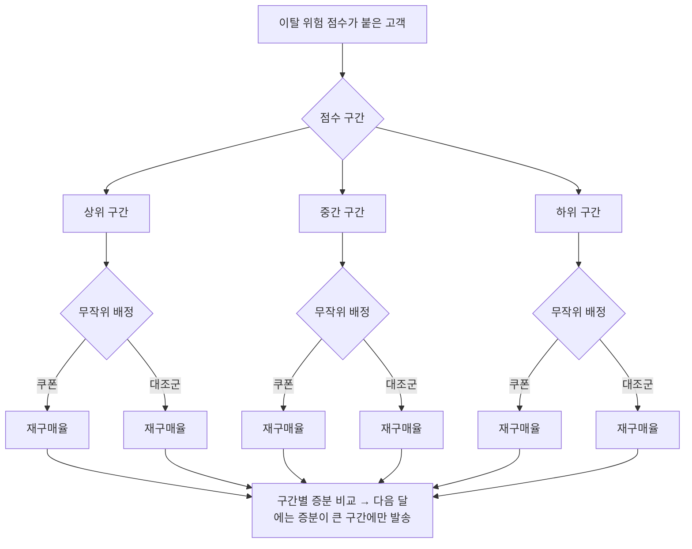
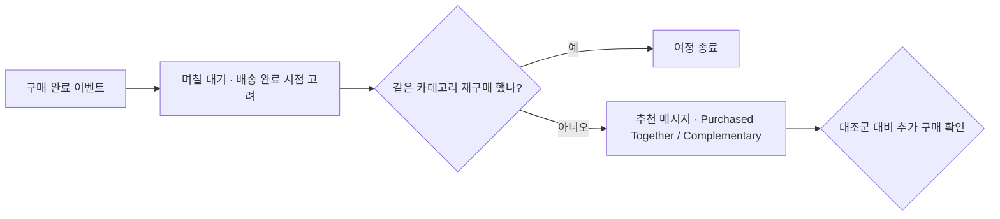

# 12장. 유스케이스 ③ 붙잡을 고객, 더 권할 고객 — 이탈 방지·윈백·크로스셀

이탈 예측 점수 상위 10%에게 20% 쿠폰을 보냈다. 한 달 뒤 결과는 대조군과 다르지 않았다.

처음 이 여정을 기획할 때만 해도 자신이 있었다. 팀장은 "이번 분기에는 이탈을 줄여 보자"고 했고, 마침 Braze에서 Predictive Churn을 켜 둔 참이었다. 3장에서 배운 대로 회사가 직접 정한 이탈 기준(최근 30일 동안 구매 없음)에 맞춰 예측을 만들었고, 0에서 100까지의 이탈 위험 점수가 고객마다 붙었다. 점수가 높을수록 떠날 가능성이 높다는 뜻이니, 가장 위험한 상위 10%를 골라 큼직한 쿠폰을 보냈다. 11장에서 배운 대로 대조군도 따로 떼어 두었다.

한 달 뒤 두 무리를 비교했다. 쿠폰을 받은 무리의 재구매율은 쿠폰을 받지 않은 대조군과 거의 같았다. 쿠폰은 꽤 많이 쓰였는데, 그 쿠폰을 쓴 고객들은 쿠폰이 없어도 돌아왔을 사람들이었던 셈이다. 매출은 그대로이고 할인 비용만 나갔다. 대조군을 둔 덕분에 이 사실을 알게 되었지만, 뒷맛이 영 찜찜하다.

무엇이 잘못된 걸까? 점수 모델이 틀렸을까, 쿠폰이 작았을까, 아니면 질문 자체가 잘못되었을까? 이 장은 이 실패를 풀어 가는 이야기다. 그리고 고객을 붙잡는 일 옆에 놓인 또 하나의 일, 이미 붙어 있는 고객에게 무엇을 더 권할지도 함께 다룬다.

## 리텐션이 중요하다는 말의 근거

윈백 여정을 기획하는 회의에서는 거의 빠짐없이 이런 말이 나온다. "고객 이탈을 5%만 줄여도 이익이 25%에서 85%까지 늘어난다." 1990년 Harvard Business Review에 실린 Reichheld와 Sasser의 글에서 나온 주장이다. 은행 지점, 보험 중개, 자동차 정비 체인 같은 업종의 사례를 들어 이탈 감소가 이익을 얼마나 키우는지 보였다.

이 숫자는 업계에 널리 퍼졌지만, 근거는 생각보다 약하다. 통제된 실증 연구가 아니라 몇몇 사례를 바탕으로 한 추정이기 때문이다. Byron Sharp 같은 마케팅 연구자들은 이 계산이 사고 실험에 가깝고, 고객을 붙잡는 데 드는 비용을 0으로 가정했다고 비판했다. 같은 맥락에서 돌아다니는 "신규 고객 획득 비용은 기존 고객 유지 비용의 몇 배" 같은 말도 학술 출처를 확인하기 어렵다.

물론 리텐션이 중요하지 않다는 뜻은 아니다. 떠나려는 고객을 붙잡는 일은 여전히 CRM 마케터의 핵심 업무다. 다만 "리텐션은 무조건 남는 장사"라는 통념을 근거로 삼으면, 앞의 실패처럼 비용을 쓰고도 아무것도 얻지 못하는 캠페인을 정당화하게 된다. 붙잡는 데에도 돈이 든다. 그렇다면 질문은 "리텐션을 할 것인가"에서 "누구를 붙잡는 데 돈을 쓸 것인가"로 옮겨 간다.

## 윈백 여정의 기본 재료

질문에 답하기 전에, 두 도구가 윈백 여정에 어떤 재료를 주는지 정리해 두자. 예측 세그먼트의 기능 자체는 3장에서 소개했으니 여기서는 여정에 어떻게 쓰는지에 집중한다.

**Braze**에서는 Predictive Churn이 출발점이다. 무엇을 이탈로 볼지 회사가 직접 정의한다는 점이 핵심이다. "30일간 구매 없음"일 수도 있고 "14일간 앱 실행 없음"일 수도 있다. 정의를 바탕으로 예측을 만들면 고객마다 0~100의 이탈 위험 점수가 붙고, 점수 구간으로 세그먼트를 만들어 Canvas의 진입 대상이나 Audience Paths 분기 조건으로 쓴다. 2026-11 기준으로 활성 예측은 최대 3개(프리뷰 모드는 1개)까지 둘 수 있으니, 어떤 이탈 정의에 예측 슬롯을 쓸지도 신중하게 고르자. 채널 쪽에서는 Intelligent Channel filter로, 고른 채널이 그 고객에게 가장 반응이 좋은 채널인 사람만 추려 낼 수 있다(8장 참조).

**Insider One**의 Predictive Segments에는 2026-11 기준 Academy 문서상 이탈 전용 유형이 따로 없다. "churn risk"는 예시로만 등장한다. 대신 Likelihood to Purchase(향후 7일 안에 구매할 가능성이 높은 사용자), User Engagement, Customer Lifecycle Status, Discount Affinity 같은 유형이 있다. 윈백 대상은 이 가운데 생애주기 상태나 참여 수준 유형을 기준으로 잡는 방법을 생각해 볼 수 있다. 각 유형이 정확히 어떻게 고객을 나누는지, 우리 계정에서 어떤 유형을 쓸 수 있는지는 계정마다 다를 수 있으니 Academy 문서와 담당 매니저에게 확인하자. 채널은 Next Best Channel이 고객별 채널 참여 가능성을 보고 도달 가능한 채널로 보낸다.

재료는 이렇게 갖춰져 있다. 두 도구 모두 "누가 떠날 것 같은가"를 점수나 세그먼트로 알려 주고, "어느 채널로 닿을까"를 골라 준다. 그런데 이 재료만으로 여정을 짜면 바로 앞의 실패를 반복하게 된다. 두 도구가 알려 주는 것은 위험도이지, 쿠폰이 그 고객에게 통할지가 아니기 때문이다.

## 왜 쿠폰은 듣지 않았을까

마케팅 연구자 Eva Ascarza는 2018년 Journal of Marketing Research에 실린 논문의 제목을 아예 "Retention Futility(리텐션의 헛수고)"로 붙였다. 부제는 "고위험 고객을 겨냥하는 것은 효과가 없을 수 있다"는 뜻이다. 두 건의 필드 실험에서 이탈 위험이 가장 높은 고객을 겨냥하는 대신, 리텐션 캠페인에 가장 민감하게 반응할 고객을 겨냥했더니 이탈이 더 많이 줄었다. AMA·MSI가 이 연구를 소개한 자료에 따르면, 민감도 기준 타기팅은 위험도 기준 타기팅보다 이탈률을 4.1~8.7%p 더 줄였다.

왜 그럴까? 의사에 비유하면 쉽다. 병원에 약이 한정되어 있다면 누구에게 줘야 할까? 가장 아픈 환자에게 주고 싶은 마음이 앞선다. 그런데 어떤 환자는 이미 너무 늦어서 약이 듣지 않고, 어떤 환자는 약 없이도 나을 사람이다. 약은 "가장 아픈 환자"가 아니라 "치료가 듣는 환자"에게 가야 한다. 이탈 위험 점수는 얼마나 아픈지를 알려 줄 뿐, 약이 들을지는 알려 주지 않는다.

이 생각을 정리하는 데 업계에서 흔히 쓰는 고객 4분류가 있다. 메시지(처치)를 받았을 때와 받지 않았을 때의 행동으로 고객을 나눈다.

| 분류 | 쿠폰을 받으면 | 쿠폰이 없으면 | 쿠폰을 보내면 |
|---|---|---|---|
| Persuadables (설득 가능 고객) | 돌아온다 | 떠난다 | 효과가 있다 |
| Sure things (어차피 올 고객) | 돌아온다 | 돌아온다 | 할인 비용만 나간다 |
| Lost causes (이미 떠난 고객) | 떠난다 | 떠난다 | 비용만 나간다 |
| Sleeping dogs (건드리면 떠날 고객) | 떠난다 | 남는다 | 오히려 손해다 |

앞의 실패에 이 표를 대 보자. 이탈 점수 상위 10%에는 Lost causes가 많이 섞여 있었을 것이다. 이미 마음이 떠난 고객은 20% 쿠폰에도 돌아오지 않는다. 그리고 쿠폰을 쓴 사람들은 대조군 결과로 보면 Sure things에 가까웠다. 쿠폰이 효과를 낸 Persuadables는 너무 적어서 결과에 드러나지 않았다. 마지막 칸 Sleeping dogs도 무시할 수 없다. 조용히 쓰던 서비스를 잊고 있었는데 "떠나지 마세요" 메시지를 받고 해지 버튼을 떠올리는 고객이다.

연구는 여기서 한 걸음 더 나아갔다. Lemmens와 Gupta는 2020년 Marketing Science 논문에서 이익을 기준으로 타기팅하는 방법이 위험도나 반응도 기준보다 낫다는 결과를 내놓았다. 흥미로운 점은 저자들 스스로 이 방법이 "누가 이탈할지" 맞히는 데에는 오히려 오차가 더 크다고 인정했다는 것이다. 이탈을 잘 맞히는 일과 이탈 방지로 돈을 버는 일은 다른 문제라는 이야기다. 위험도에서 반응도로, 반응도에서 이익으로. 타기팅의 기준이 이렇게 옮겨 가 왔다는 흐름만 기억해 두면 충분하다.

## 도구 안에서 민감도를 찾는 법

그렇다면 실무에서는 어떻게 해야 할까? 우리가 쓰는 도구는 위험 점수는 주지만 "쿠폰 민감도 점수"는 주지 않는다. 업리프트 모델을 직접 만들려면 데이터 조직의 도움이 필요하다. 주니어 마케터가 당장 할 수 있는 방법은 실험으로 민감도를 직접 재는 것이다.

방법은 이렇다. 상위 10%만 고르지 말고 이탈 위험 점수를 몇 개 구간으로 나눈다. 각 구간 안에서 고객을 무작위로 쿠폰 받는 무리와 받지 않는 무리로 다시 나눈다. 한 달 뒤 구간별로 두 무리의 재구매율 차이를 비교한다. 그 차이가 그 구간에서 쿠폰이 만들어 낸 증분이다.

그림 1. 점수 구간별로 쿠폰 효과를 재는 윈백 실험 구조

Braze라면 점수 구간을 Audience Paths로 나누고 각 갈래 안에 Experiment Paths를 두어 대조군을 만든다. Insider One이라면 Check Element로 세그먼트를 가른 뒤 Journey A/B Split으로 쿠폰 갈래와 메시지 없는 갈래를 나눈다. 어느 쪽이든 구조는 그림과 같다.

결과가 이렇게 나왔다고 해 보자. 상위 구간은 쿠폰을 받아도 받지 않아도 재구매율이 낮다. 하위 구간은 둘 다 높다. 중간 구간에서만 쿠폰 받은 무리가 눈에 띄게 높다. 이것이 Retention Futility가 말하는 장면이다. 다음 달부터는 중간 구간에만 쿠폰을 보내고, 상위 구간에는 할인이 아닌 다른 접근(불편 사항 설문, 서비스 개선 소식)을 시험해 볼 수 있다.

주의할 점이 몇 가지 있다. 구간을 너무 잘게 나누면 구간마다 사람이 적어 차이가 우연인지 아닌지 가리기 어렵다. 3장에서 "보낼 수 있는 세그먼트가 먼저"라고 했던 원칙이 실험에도 그대로 적용된다. 대조군 크기와 실험 기간을 정하는 법, 결과를 중간에 들여다보며 끄면 안 되는 이유는 13장에서 자세히 다룬다.

Insider One의 Discount Affinity 같은 유형도 같은 눈으로 보자. 이름만 보면 할인에 잘 반응하는 고객을 찾아 줄 것 같다. 하지만 할인에 잘 반응한다는 것이 "할인이 있어야 산다"는 뜻인지 "원래 잘 사는데 할인도 잘 쓴다"는 뜻인지는 대조군 없이는 알 수 없다. 후자라면 그 고객은 Sure things다. 할인 성향 점수가 높은 고객에게 쿠폰을 몰아주기 전에 같은 방식의 실험으로 확인하는 편이 낫다.

## 더 권할 고객 — 크로스셀과 상품 추천

이제 이 장의 두 번째 주제로 넘어가자. 이탈 방지가 떠나려는 고객을 붙잡는 일이라면, 크로스셀은 이미 잘 머물고 있는 고객에게 다음 상품을 권하는 일이다. 고객이 산 상품과 함께 쓰면 좋은 상품, 장바구니 금액을 무료 배송 기준까지 채워 줄 상품을 알맞은 때에 보여 주는 것이다.

8장에서 상품 추천 기능을 짧게 소개했다. 여기서는 Insider One Smart Recommender를 조금 더 깊이 들여다보자. 2026-10 기준 Academy 문서는 추천 알고리즘을 목적별로 여섯 그룹으로 나눈다. 2024년 문서는 네 그룹이었으니, 예전 자료를 볼 때는 구성이 다를 수 있다는 점을 염두에 두자.

1. **인기·성과로 전환 유도:** Top Sellers, Most Popular, Trending Products, Most Valuable Products
2. **상품 발견·참여:** New Arrivals, Real-Time User Engagement(세션 안의 실시간 브라우징을 바탕으로 추천), User-Based, Chef(60일 동안 여러 조합을 시험한 뒤 슬롯별로 최적 조합을 자동 선택)
3. **개인화:** Recently Viewed, User-Based, Purchased with Last Purchased, Real-Time User Engagement
4. **장바구니·객단가 증대:** Purchased Together, Complementary Products(LLM 기반 추론으로 보완 카테고리를 판단), Checkout Recommendation(무료 배송 같은 기준 금액에 닿도록 돕고, 이미 충족했으면 보여 주지 않음), Viewed Together
5. **대안 제시:** Similar Products, Visually Similar Products(이미지 비교), Viewed Together
6. **캠페인·비즈니스 목표:** Highest Discounted Products, Location-Based Top Sellers(IP 위치 기반) 등. 예전의 Manual Merchandising·Mixed Strategy는 새 전략에서 더는 제공되지 않고 Bundle Strategy 슬롯을 쓴다.

크로스셀에 직접 쓰이는 것은 4번 그룹이다. 구매 완료 직후 메시지에는 Purchased Together나 Complementary Products가, 결제 직전 장바구니 화면에는 Checkout Recommendation이 잘 어울린다. 같은 알고리즘이 여러 그룹에 겹쳐 나오는 것은 쓰임새가 여러 목적에 걸쳐 있기 때문이다.

크로스셀 여정은 대략 이런 모양이 된다.

그림 2. 구매 후 크로스셀 여정의 기본 구조

Braze에서는 AI item recommendations가 카탈로그를 바탕으로 딥러닝 추천을 만들어 메시지에 넣는다. 2026-11 기준 BrazeAI 기능 목록에는 Decisioning Studio도 있다. Decisioning Studio Go는 수신자별로 콘텐츠·타이밍·빈도를 개인화하고, Pro는 오퍼까지 포함한 여러 레버를 회사의 비즈니스·재무 지표에 맞춰 최적화한다고 설명된다. 어떤 상품을 누구에게 권할지를 쌓이는 결과를 보며 정하게 하는 장치다. 8장에서 말했듯 이런 기능의 베타·정식 여부와 계약 범위는 담당 매니저에게 확인하자.

사례 하나도 보자. Insider One의 adidas 사례는 온사이트 개인화와 Smart Recommender를 함께 썼고, 헤드라인은 "increased AOV by 259% and conversion rate by 13%"다(벤더 발표). 그런데 사례 페이지를 자세히 보면 Smart Recommender로 늘어난 사용자당 매출이 본문에는 18.8%, 소제목에는 18.5%로 적혀 있다. 사소해 보이지만, 벤더 사례 수치가 검증된 숫자가 아니라 홍보 문구라는 점을 보여 주는 장면이다. 벤더 사례에서는 숫자 대신 어떤 기능을 어떤 순서로 조합했는지를 가져오는 편이 남는 게 많다.

## 추천의 원리와 CTR의 함정

"이 상품을 산 고객이 함께 산 상품"은 어떻게 고를까? 원리는 의외로 오래되었다. Amazon.com의 추천 방식을 소개한 2003년 논문(Linden, Smith & York)의 아이템 기반 협업 필터링이 대표적이다. 고객과 고객을 비교하는 대신 상품과 상품을 비교한다. A를 산 사람들이 B도 많이 샀다면 A와 B는 가깝다고 보고, 이 상품 사이의 유사도를 미리 계산해 둔다. 그러면 누군가 A를 샀을 때 바로 B를 권할 수 있다. Smart Recommender의 Purchased Together나 Viewed Together도 이름으로 보아 같은 계열의 생각에 서 있다.

그런데 추천을 넣고 나면 꼭 이런 보고가 올라온다. "추천 블록을 넣었더니 클릭률이 올랐습니다." 이 말을 들으면 한 번 되물어 보자. 그게 매출 증분인가? 추천 시스템의 비즈니스 가치를 어떻게 재는지 연구들을 정리한 리뷰(Jannach & Jugovac 2019)는 오프라인에서 추천 정확도가 좋아지는 것이 실제 비즈니스 가치로 이어지는지 불분명하다고 정리했다. 클릭도 마찬가지다. 추천 블록을 눌렀다는 것은 고객이 그 상품을 봤다는 뜻이지, 추천이 없었다면 사지 않았을 상품을 샀다는 뜻이 아니다. 고객이 원래 사려던 상품을 추천 블록에서 눌렀을 뿐일 수도 있다.

크로스셀도 결국 윈백과 같은 질문으로 돌아온다. 추천 메시지를 받은 무리와 받지 않은 무리의 추가 구매 금액은 얼마나 다른가? 그림 2의 마지막 칸에 "대조군 대비 추가 구매 확인"을 넣은 이유다.

## 참여가 늘면 이익도 늘까

마지막으로 하나 더 불편한 연구를 보자. 미국의 한 대형 구독형 세차 체인에서 한 필드 실험이다(Wang, Lu & Shi 2022). 구독 고객에게 보름 간격으로 이메일 두 통을 한 달 동안 보냈다. 결과만 보면 성공적이다. 5개월 뒤 고객이 남아 있을 가능성은 7.4% 높아졌고, 5개월 동안 이탈할 오즈는 26.3% 줄었으며, 구독자의 기간당 서비스 이용량은 7.0% 늘었다.

그런데 이익을 등급별로 나눠 보니 그림이 달라졌다. 이용 빈도가 낮은 중간 등급 고객과 최상위 등급 고객에서는 이익이 늘었지만, 이용 빈도가 높은 중간 등급과 기본 등급에서는 이익이 오히려 줄었다. 저자들의 설명은 이렇다. 붙잡아 둔 고객이 서비스를 더 많이 쓰면 그만큼 운영 비용이 늘고, 그 비용이 리텐션으로 얻는 이득보다 커지는 고객군에서는 이익이 줄어든다. 등급별 구독료를 내는 서비스라면 고객이 더 자주 와도 요금은 그대로일 테니, 자주 오는 고객일수록 이 비용이 먼저 드러났으리라는 것은 논문이 직접 밝힌 내용이 아니라 이 책의 해석이다. 효과는 시간이 지나며 약해졌고, 두 번째 메일 이후에는 피로의 신호도 보였다. 저자들은 이메일 참여를 "양날의 검(double-edged sword)"이라고 부르며 선택적으로 보내라고 권했다.

이 연구가 주는 교훈은 명확하다. 리텐션이 오르고 참여가 늘었다고 해서 회사가 돈을 번 것은 아닐 수 있다. 윈백에서는 쿠폰 비용이, 크로스셀에서는 할인과 반품이, 구독 서비스에서는 이용량에 따른 원가가 숨어 있다. 여정을 설계할 때 목표 지표를 "재방문"이나 "클릭"으로만 두지 말고, 가능하면 이익에 가까운 지표를 함께 보자. 그 지표를 어떻게 정하고 무엇과 비교할지는 13장에서 이어서 다룬다.

## 그 쿠폰은 누구에게 갔어야 했나

다시 처음 장면으로 돌아가 보자. 이탈 예측 점수 상위 10%에게 20% 쿠폰을 보냈고, 결과는 대조군과 다르지 않았다. 이제 무엇이 잘못되었는지 말할 수 있다.

점수 모델이 틀린 것은 아니었을 수 있다. 상위 10%는 정말로 떠날 가능성이 높은 고객이었을 것이다. 문제는 질문이었다. 우리는 "누가 가장 떠날 것 같은가"를 물었다. 물었어야 할 것은 "누구에게 쿠폰이 들을까"였다. 상위 10%에는 이미 마음이 떠나 쿠폰에도 돌아오지 않는 고객과, 쿠폰이 없어도 돌아올 고객이 섞여 있었다. 할인 비용은 그 두 무리에게 고스란히 흘러갔다.

그 쿠폰은 쿠폰이 있어야만 돌아오는 고객에게 갔어야 했다. 그 고객이 누구인지는 도구가 바로 알려 주지 않는다. 점수 구간마다 대조군을 두고 쿠폰의 증분을 재 보면, 우리 서비스에서 치료가 듣는 고객이 어느 구간에 모여 있는지 드러난다. 그다음 달의 쿠폰은 그 구간으로 보내면 된다. 위험 점수는 출발점이고, 실험이 그 점수에 의미를 붙인다.
