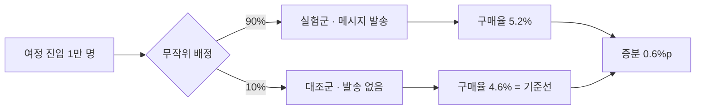
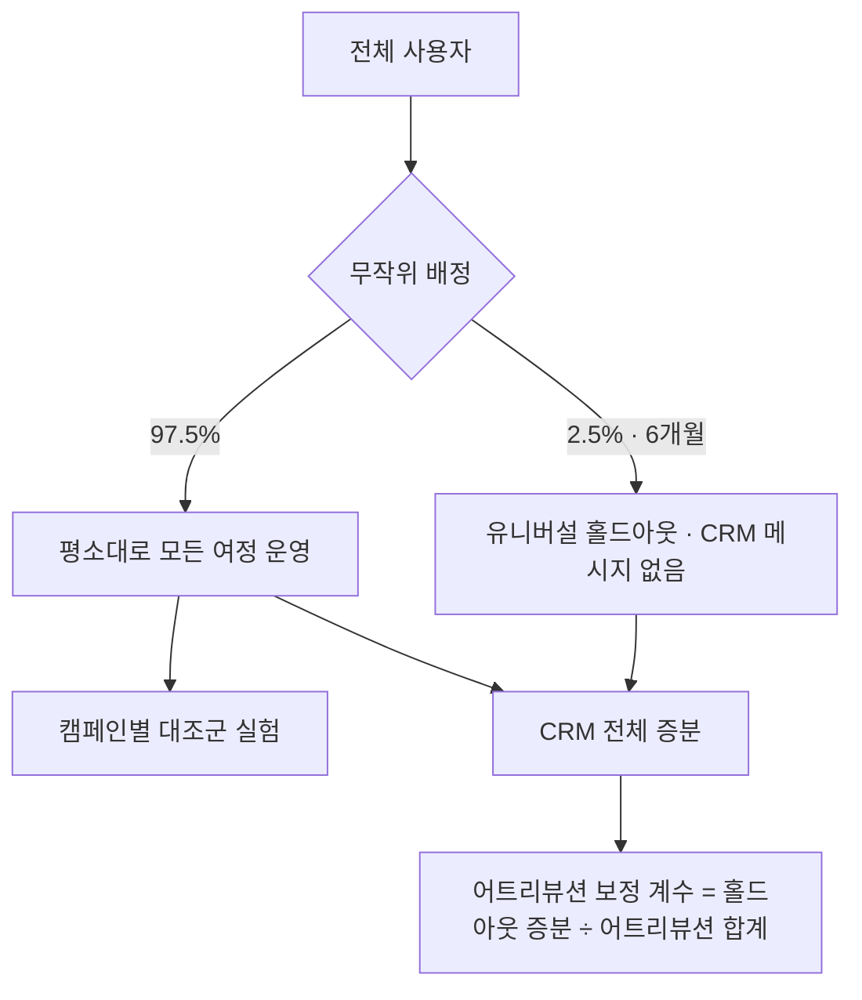

# 13장. 보내지 않았다면 어땠을까 — 대조군·A/B 테스트·성과 측정

주간 회의에서 지난주 장바구니 이탈 푸시의 성과를 보고한다고 해 보자. 클릭률(CTR) 12%. 평소 캠페인의 두 배가 넘는 숫자라 내심 칭찬을 기대하며 슬라이드를 넘겼다. 그런데 팀장이 화면을 잠시 보더니 이렇게 묻는다.

"좋네요. 그런데 이 푸시를 안 보냈으면 몇 명이 샀을까요?"

머릿속이 하얘진다. 보낸 푸시의 클릭 수는 대시보드에 또렷하게 찍혀 있다. 하지만 보내지 않은 세계의 숫자는 어디에도 없다. 팀장의 질문은 정당하다. 앞의 두 장에서 계속 남겨 둔 질문, "돌아온 고객은 정말 우리 메시지 덕분에 돌아왔을까"를 회의실 언어로 바꾼 것뿐이다. 이 장에서 그 질문에 답하는 방법을 함께 익혀 보자.

## CTR은 왜 성과가 아닐까

CTR은 메시지가 얼마나 눈길을 끌었는지 알려 준다. 제목이 매력적이었는지, 이미지가 눈에 띄었는지, 발송 시각이 적절했는지를 비교하는 데 유용한 지표다. 문제는 CTR이 "고객의 행동이 바뀌었는가"까지는 말해 주지 못한다는 점이다.

장바구니 이탈 푸시를 누른 고객을 생각해 보자. 그 고객은 장바구니에 상품을 담아 둔 사람이다. 원래 살 마음이 있었고, 푸시가 오지 않았어도 오늘 저녁에 앱을 열어 결제했을지 모른다. 그런 고객이 푸시를 눌러 결제했다면, 푸시는 구매를 만든 것이 아니라 원래 일어날 구매의 입구를 바꿨을 뿐이다. 클릭은 찍혔지만 매출은 늘지 않았다.

그래서 성과를 이야기하려면 반사실(counterfactual), 곧 "보내지 않았다면 어땠을까"라는 가상의 세계와 비교해야 한다. 같은 고객에게 메시지를 보낸 세계와 보내지 않은 세계를 동시에 볼 수는 없다. 대신 비슷한 고객을 둘로 나눠 한쪽에만 보내고, 다른 쪽을 "보내지 않은 세계"의 대역으로 삼는다. 이것이 대조군이다.

"보낸 사람과 안 보낸 사람을 나중에 비교하면 되지 않나?" 11장에서 이미 이 생각이 왜 위험한지 봤다. Facebook의 실험 663개를 기준으로 비실험적 추정 방법을 검증한 연구(Gordon, Moakler & Zettelmeyer 2023)에서, 관찰 데이터로 잰 효과는 실험으로 잰 효과와 중앙값 기준으로 퍼널 하단 62%, 중단 107%, 상단 115%만큼 어긋났다. 정교한 통계 기법을 써도 이 정도다.

게다가 마케팅 효과는 대체로 작다. 광고 효과를 잰 25개의 대규모 필드 실험을 분석한 연구(Lewis & Rao 2015)는 무작위 실험을 해도 광고 수익률을 정밀하게 재기가 매우 어렵고, 의미 있는 신뢰 구간을 얻으려면 실험 규모가 1,000만 인-주(person-weeks)를 넘기기 쉽다고 보고했다. 4장에서 본 헬스 앱 푸시 실험의 효과도 24시간 내 앱 참여 3.9% 증가였다. 작은 효과는 노이즈 낀 라디오 속의 작은 목소리와 같다. 귀를 바짝 대고 조건을 맞춰야 겨우 들린다. 대조군 없이 들으려 하면 잡음만 들린다.

## 대조군이라는 기준선

대조군(control group)은 일부러 메시지를 보내지 않는 무리다. 핵심은 무작위로 나눈다는 데 있다. 마케터가 "이 사람은 보내고 저 사람은 빼자"고 고르면, 두 무리는 처음부터 다른 사람들이 되어 비교가 무너진다. 동전을 던지듯 도구가 무작위로 배정해야 두 무리가 평균적으로 비슷해지고, 결과의 차이를 메시지 탓으로 돌릴 수 있다.

계산은 단순하다. 가상의 숫자로 예를 들어 보자. 장바구니 이탈 여정에 1만 명이 들어왔고, 9천 명은 메시지를 받는 실험군, 1천 명은 대조군으로 배정했다. 일주일 뒤 실험군의 구매율은 5.2%, 대조군은 4.6%였다.

- 메시지 없이도 일어났을 구매율(기준선): 4.6%
- 메시지가 만든 증분: 5.2% − 4.6% = 0.6%p
- 증분 구매 수: 9,000명 × 0.6%p = 54건

대시보드에는 실험군 구매 468건(9,000명 × 5.2%)이 "여정 전환"으로 찍혔을 것이다. 그중 메시지의 몫은 54건이다. 나머지 414건은 메시지가 없어도 일어났을 구매다. 이 차이를 알고 나면 CTR 12%를 보고할 때와는 전혀 다른 대화를 하게 된다.

그림 1. 대조군으로 증분을 재는 기본 구조 (숫자는 가상의 예)

대조군 크기는 어떻게 정할까? 크게 잡을수록 결과가 또렷해지지만, 그만큼 메시지를 못 받는 고객이 늘어 단기 매출을 포기하게 된다. 작게 잡으면 앞에서 본 것처럼 효과가 작아 "유의하지 않음"만 나오기 쉽다. 정답은 없고, 기대 효과의 크기와 여정에 들어오는 인원으로 정한다. 인원이 적은 여정이라면 실험 기간을 길게 잡아 사람을 모으는 편이 낫다. 처음이라면 데이터 분석가와 함께 정해 보자.

## 두 도구의 실험 장치

두 도구는 이 구조를 만드는 장치를 이미 갖추고 있다. 5·6·8장에서 컴포넌트로 짧게 만났던 것들을 실험의 눈으로 다시 보자. 기능 목록은 2026-11 기준이다.

**Braze**의 캠페인에는 다변량 테스트가 있다. 변형을 최대 8개까지 만들어 비교할 수 있고, 메시지를 받지 않는 대조군도 함께 둘 수 있다(사실 확인 필요). 주의할 점은 시작한 뒤 제목이나 본문을 바꾸면 실험이 무효가 된다는 것이다. 오타를 발견해 고치는 순간 그 앞의 결과와 뒤의 결과가 섞인다. 발송 전 QA를 꼼꼼히 하는 이유가 하나 더 생긴 셈이다.

Canvas 안에서는 Experiment Paths가 여정의 갈래 자체를 실험한다. 메시지 문구뿐 아니라 "1시간 뒤 보내기 vs 하루 뒤 보내기"처럼 흐름을 비교할 수 있고, 갈래 하나를 메시지 없는 대조군으로 둘 수도 있다. Winning Path를 켜면 일정 기간 뒤 성과가 좋은 갈래로 이후 진입자를 몰아준다. Optimize with BrazeAI(구 Intelligent Selection)는 변형별 성과를 보며 발송 비율을 자동으로 옮긴다. 반복 발송 캠페인이어야 하고, 변형이 두 개 이상이어야 하며, 전환 이벤트가 필요하다. 단일 발송에는 쓸 수 없다.

**Insider One** Architect에서는 Journey A/B Split이 여정을 갈래로 나눈다. A/B autowinner는 갈래 중 승자를 자동으로 고르고, A/B 통계로 결과를 확인한다. 여정에는 Conversion Goal을 정하고, Conversion Attribution Model로 전환을 어느 메시지의 몫으로 셀지 정한다. 6장에서 본 것처럼 마지막으로 클릭한 채널에 전환을 전부 돌리는 last-touch 방식이 대표적이다.

여기서 두 가지를 짚어 두자. 첫째, 자동 승자 선택이 고르는 것은 "변형 중 가장 나은 것"이다. 모든 변형이 보내지 않은 것보다 못할 수도 있다. 승자 선택을 쓰더라도 메시지 없는 갈래를 하나 두어야 그 승자가 기준선보다 나은지 알 수 있다. 둘째, 승자를 무엇으로 고르게 할지가 중요하다. 8장에서 본 소매은행 실험(Schwartz, Bradlow & Fader 2017)은 전환 대신 클릭률을 최적화했다면 고객 획득이 약 10% 줄었을 것이라고 추정했다. Optimize with BrazeAI가 전환 이벤트를 요구하는 것도, Conversion Goal을 구매로 잡아야 하는 것도 같은 이유다.

last-touch 어트리뷰션도 조심해서 읽자. 어트리뷰션은 일어난 전환을 메시지들에게 나눠 주는 회계 규칙이지, 메시지가 전환을 만들었는지 재는 실험이 아니다. 고객이 어차피 살 상품을 사기 직전에 푸시를 눌렀다면 last-touch는 그 구매를 통째로 푸시의 공으로 적는다.

## 실험이 스스로를 속이는 세 가지 방법

대조군을 두었다고 끝이 아니다. 실험은 생각보다 쉽게 스스로를 속인다. 주니어 마케터가 특히 자주 빠지는 함정 세 가지를 보자.

**첫째, 나눈 비율이 어긋난다.** 50:50으로 나눴는데 이메일을 실제로 받은 사람을 세 보니 52:48이라고 해 보자. "2%p쯤이야" 하고 넘기기 쉽지만, 이것은 표본비 불일치(SRM, Sample Ratio Mismatch)라는 경고등이다. 발송 실패나 하드 바운스, 푸시 토큰이 없는 사용자 제외 같은 처리가 한쪽 무리에만 걸리면 이런 일이 생긴다. 그러면 두 무리는 더 이상 비슷한 사람들이 아니다. Microsoft의 실험 플랫폼 팀이 보고한 바로는 그들이 돌린 실험의 약 6%에서 SRM이 발생했다. 관련 논문은 이렇게 비유한다. "열이 여러 병의 증상이듯, SRM은 다양한 데이터 품질 문제의 증상이다." 비율이 어긋났다면 결과를 해석하기 전에 원인부터 찾자.

**둘째, 중간에 들여다보고 끈다.** 실험을 켜 두고 매일 대시보드를 열어 보다가 실험군이 앞서는 날 "이겼다!" 하고 끝내는 습관이다. 결과는 날마다 출렁이기 마련이라, 계속 들여다보다 유리한 순간에 멈추면 실제로는 차이가 없는데도 차이가 있다는 결론을 내리기 쉽다. 연속 모니터링을 다룬 연구(Johari 외 2022)는 사용자가 테스트를 계속 지켜보며 표본 크기를 스스로 정하면 통상의 추론이 "전혀 믿을 수 없게(wholly unreliable)" 된다고 경고한다. 실험 기간과 판단 기준은 시작하기 전에 정해 두고, 그때까지는 결론을 미루자.

**셋째, 가장 높은 사람의 의견이 이긴다.** 실험 결과가 나왔는데 "그래도 나는 A안이 낫다고 본다"는 한마디에 B안이 묻히는 장면이다. 온라인 통제 실험의 실무 가이드로 널리 읽히는 논문(Kohavi 외 2009)은 개발팀이 고객의 목소리를 들을 때 큰 배움과 투자 수익이 생긴다고 하면서, 그 반대편을 "가장 높은 연봉을 받는 사람의 의견(HiPPO, Highest Paid Person's Opinion)"이라고 불렀다. 실험을 시작하기 전에 "무엇이 나오면 무엇을 하겠다"를 팀과 합의해 두면 결과가 나온 뒤의 논쟁이 훨씬 줄어든다.

## 캠페인 하나를 넘어서 — 유니버설 홀드아웃

캠페인마다 대조군을 두면 그 캠페인의 효과는 볼 수 있다. 그런데 팀장이 이번에는 이렇게 묻는다면 어떨까? "그래서 우리 CRM 전체가 회사 매출에 얼마나 기여하나요?" 캠페인별 증분을 모두 더하면 될 것 같지만 그렇지 않다. 같은 고객이 여러 여정에 동시에 들어가 있고, 메시지끼리 효과를 나눠 먹거나 서로 피로를 쌓기 때문이다.

Monzo의 시니어 데이터 과학자 Rodrigo Baptista가 2025-09에 공개한 방법이 좋은 참고가 된다. Monzo는 전체 사용자의 2.5%를 6개월 동안 CRM 메시지에서 무작위로 빼 둔다. 이것을 유니버설 홀드아웃(universal holdout)이라고 부른다. 6개월 뒤 홀드아웃 무리와 나머지 무리를 비교하면 CRM 프로그램 전체가 만든 효과를 볼 수 있다.

Monzo는 여기서 한 걸음 더 나아가 어트리뷰션을 홀드아웃 기준으로 보정한다. 예를 들어 홀드아웃으로 잰 CRM 전체 증분이 100건인데 어트리뷰션 모델은 200건을 CRM의 공으로 셌다면, 보정 계수 0.5를 곱해 어트리뷰션 수치를 낮춘다. 글은 어트리뷰션 모델이 "공을 지나치게 많이 가져가는 경향이 있다(tend to claim too much)"고 지적하고, "개별 실험의 업리프트는 더할 수 없다(Individual experiment uplifts are non additive)"고 못 박는다.

그림 2. 캠페인 대조군과 유니버설 홀드아웃을 함께 쓰는 구조 (Monzo 방식 참고)

유니버설 홀드아웃은 9장의 피로도 문제에도 답을 준다. 캠페인 하나의 대조군으로는 "얼마나 자주 보내야 하는가"를 알 수 없다. 메시지 한 통의 효과는 보이지만, 한 달 동안 쌓인 발송이 수신 거부와 앱 삭제를 얼마나 늘렸는지는 보이지 않기 때문이다. 한 CRM 실험 강의가 발송 주기(cadence)를 별도 실험으로 다루고 글로벌 홀드아웃을 유지하라고 권하는 이유다. 주 3회 무리와 주 1회 무리를 무작위로 나눠 몇 달간 비교하면, 캠페인 리포트에는 잡히지 않던 피로 비용이 드러난다.

물론 2.5%의 고객에게 6개월간 아무 메시지도 보내지 않는 결정은 마케터 혼자 내릴 수 없다. 정보성 메시지(주문 확인, 비밀번호 재설정 같은 것)는 홀드아웃에서도 계속 보내야 하고, 홀드아웃이 포기하는 단기 매출도 감수해야 한다. 팀장과 데이터 조직을 설득할 근거가 필요할 때 Monzo의 글을 함께 읽어 보자.

## 툴 밖으로 데이터 빼기

여기까지 오면 한 가지 벽에 부딪힌다. 유니버설 홀드아웃의 효과를 6개월치 매출로 비교하거나, 회원 등급별로 메시지 반응을 나눠 보려면 도구의 기본 대시보드로는 부족하다. 실제로 Insider One 리뷰에는 "대시보드 분석이 여전히 제한적이고 유연하지 않다"(리테일, 2026-10), "원하는 분석을 찾아내기가 어려울 때가 있다"(여행업) 같은 불만이 보인다. Braze 쪽에는 "대시보드로 무엇이 잘되고 있는지 한눈에 보기 쉽다"는 평도 있다. 한눈에 보는 일과 깊이 따져 보는 일은 다른 작업이다. 두 도구의 대시보드는 주로 발송·열람·클릭 중심이고, 회사의 매출·원가 데이터와 결합한 분석은 대개 도구 밖에서 한다.

**Braze**에서는 Currents가 그 출구다. 메시지 발송, 열람, 클릭 같은 참여 이벤트를 실시간 데이터 스트림으로 내보내는 기능이고, Braze에서 나가는 export 중 가장 세분화된 형태다. 데이터는 Avro 형식으로 데이터 파트너에 전달되고, Tealium·Segment·mParticle 같은 CDP로 보낼 수도 있다. 커넥터마다 어떤 종류의 이벤트를 내보낼지 엔타이틀먼트(Engagement Events 등)로 정하고, 이것이 과금과 연결된다. 2026-11 기준 Braze 문서는 Currents가 다수의 Pro/Enterprise 패키지에 포함되어 있고 가격은 담당 매니저에게 문의하라고 안내한다.

한국 사례로는 카카오스타일(지그재그)이 있다. Braze가 게재한 사례에 따르면, 카카오스타일은 Currents로 메시지 참여 이벤트를 AWS S3에 실시간으로 쌓고, 회원 등급·연령·구매 이력과 결합해 QuickSight 대시보드를 만들어 세그먼트별 크리에이티브 반응을 프로모션 팀과 공유했다. 사례 페이지는 앱 트래픽이 35% 늘었다고 적고 있다(벤더 게재, 게재일 미표기). 수치보다 구조를 보자. 도구 안의 참여 데이터와 회사의 고객·매출 데이터가 만나는 곳은 도구 밖이다.

**Insider One** Architect도 리포트 기능에 데이터 export를 포함한다. 실시간 흐름 통계, 채널별·여정 전체 통계, A/B 통계와 함께 데이터를 내보내 회사 분석 환경에서 결합할 수 있다. 어떤 형식과 주기로 내보낼 수 있는지는 계정 설정과 계약에 따라 다를 수 있으니 Academy 문서와 담당 매니저에게 확인하자.

주니어 마케터가 데이터 파이프라인을 직접 깔 일은 드물다. 하지만 "홀드아웃 무리의 6개월 매출을 실험군과 비교하고 싶다", "회원 등급별 쿠폰 증분을 보고 싶다"처럼 무엇을 보고 싶은지 말할 수 있으면, 데이터 조직이 무엇을 빼고 어떻게 결합할지 정하기가 훨씬 쉬워진다. 2장에서 이벤트를 요청하는 법을 익혔듯, 측정에서도 마케터의 몫은 질문을 정확히 만드는 일이다.

## 주간 리포트를 다시 쓰자

처음 장면으로 돌아가 보자. 팀장의 질문에 답하려면 리포트부터 바뀌어야 한다. CTR을 맨 위에 두던 리포트를, 대조군과 증분을 맨 위에 두는 리포트로 바꿔 보자. 아래는 한 장짜리 양식이다. 우리 팀 사정에 맞게 고쳐 쓰면 된다.

| 항목 | 이번 주 기록 |
|---|---|
| 여정·캠페인 이름 | 예: 장바구니 이탈 v2 |
| 목표 지표(전환 이벤트) | 예: 구매 완료 (클릭 아님) |
| 진입 인원 / 실험군 / 대조군 | 예: 10,000 / 9,000 / 1,000 |
| 배정 비율 점검(SRM) | 기대 90:10, 실제 배정 비율, 차이 원인 |
| 실험군 전환율 / 대조군 전환율 | 예: 5.2% / 4.6% |
| 증분(%p)과 증분 전환 수 | 예: 0.6%p, 54건 |
| 판단 시점과 기준(시작 전에 정한 것) | 예: 2주 후, 증분 0.3%p 이상이면 유지 |
| 비용 | 쿠폰·할인 비용, 채널 발송 비용 |
| 가드레일 지표 | 수신 거부, 푸시 권한 해제, 고객 문의 |
| 참고 지표 | CTR, 오픈율 (원인 분석용) |
| 다음 행동 | 유지 / 중단 / 다음 실험 가설 |

CTR이 사라진 것은 아니다. 맨 아래 "참고 지표" 칸으로 내려갔을 뿐이다. 증분이 작게 나왔을 때 그 원인이 메시지를 아무도 열지 않아서인지, 열었는데 행동이 바뀌지 않아서인지 가려낼 때 CTR이 다시 쓸모를 찾는다. 그리고 가드레일 칸에는 피로의 신호를 적는다. 증분이 늘었더라도 수신 거부가 함께 치솟았다면 그 여정은 다음 달의 고객을 당겨 쓴 것일 수 있다.

이 양식을 처음 내밀면 숫자가 초라해 보일 수 있다. 468건의 전환 대신 54건의 증분을 보고하는 일은 용기가 필요하다. 하지만 그 54건은 회사가 믿고 예산을 걸 수 있는 숫자다. "안 보냈으면 몇 명이 샀을까요?"라는 질문에 표 한 장으로 답할 수 있다면, 다음 회의에서는 당신의 실험이 이야기의 중심에 선다.

### 이 장의 핵심

- CTR은 메시지가 눈길을 끌었는지 보여 줄 뿐이다. 성과는 "보내지 않았다면"과의 차이, 곧 증분으로 말한다.
- 증분은 무작위로 나눈 대조군이 있어야 잴 수 있다. "보낸 사람 vs 안 보낸 사람"의 사후 비교는 크게 빗나간다.
- Braze(다변량·Experiment Paths·Winning Path·Optimize with BrazeAI)와 Insider One(Journey A/B Split·A/B autowinner·Conversion Goal)의 실험 장치를 쓰되, 메시지 없는 갈래를 두고 목표는 클릭이 아닌 전환으로 잡는다.
- SRM, 중간에 들여다보고 끄기, HiPPO는 대조군이 있어도 실험을 무너뜨린다. 판단 기준은 시작 전에 정한다.
- 캠페인을 넘어선 효과와 피로는 유니버설 홀드아웃과 발송 주기 실험으로 보고, 깊은 분석은 Currents나 데이터 export로 툴 밖에서 한다.
