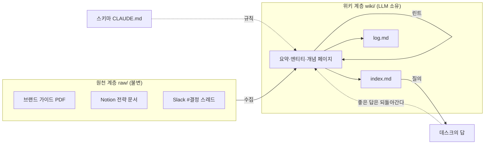

# 1장. 사람은 한 글자도 쓰지 않는 위키

흔히 위키는 사람이 쓰는 문서 모음이라고 한다. 누군가 페이지를 만들고, 누군가 고치고, 그러다 대부분은 아무도 손대지 않은 채 조용히 낡아 간다. 2026년 4월 초, Andrej Karpathy가 gist 한 편으로 내놓은 "LLM Wiki" 제안은 이 정의를 정반대로 뒤집는다. 사람이 한 글자도 쓰지 않는 위키다. 어떤 자료를 읽힐지 고르고 질문을 던지는 일은 사람이 하고, 페이지를 쓰고, 고치고, 서로 잇고, 모순을 찾아내는 일은 전부 LLM이 한다.

이 책은 그 제안을 회사 안으로 끌고 들어온다. 마케팅 리드가 "우리 톤앤매너에서 쓰면 안 되는 말이 뭐였지?"라고 묻고 CS 리드가 "환불 절차 바뀐 거 어디 적혀 있어?"라고 묻는 사내 지식 베이스를 짓는 이야기다. 그리고 그 위키에서 답을 찾아 주는 Claude 에이전트까지 한 묶음으로 간다. 책을 덮을 때 손에 남는 것은 자기 회사에 맞는 결정 목록과 첫 4주 구축 계획이다.

그 여정에 가상의 회사 하나가 끝까지 동행한다. **페이지원**(PageOne)이다. 서울에 있는 직원 32명짜리 회사로, 미용실과 네일숍 같은 소상공인에게 온라인 예약·고객관리 SaaS **원북**(OneBook)을 판다. 마케팅 리드 김보라가 마케팅 6명을, CS 리드 박태오가 CS 4명을 이끌고, 개발팀은 5명이다. 그 개발팀의 한 사람이 "나"다. 어느 날 대표 한서진이 이렇게 말했다. "우리 회사가 아는 걸 우리가 자꾸 다시 찾고 있어. 이거 좀 어떻게 안 될까?" 그래서 내가 맡게 된 일이 위키 저장소 `pageone-wiki`와, Slack에서 `@데스크`로 부르는 사내 Q&A 에이전트 **데스크**를 짓는 것이다.

### 위키는 왜 죽고, 왜 사는가

페이지원에도 이미 위키가 있다. 정확히 말하면 있었다. 예전에 누군가 Notion에 "온보딩 가이드"를 만들었고, 그 안에 플랜 설명과 환불 정책 링크가 들어 있었다. 지금 그 환불 정책 링크는 옮겨진 문서를 가리키고, 플랜 설명은 처음 쓴 그대로다. 아무도 고치지 않았고, 아무도 고치지 않았다는 사실조차 아무도 모른다. 익숙한 풍경 아닌가?

Karpathy는 사람 위키가 죽는 이유를 한 문장으로 짚는다. "Humans abandon wikis because the maintenance burden grows faster than the value." 유지보수 부담이 가치보다 빨리 자란다는 것이다. 그런데 그 부담의 정체가 무엇인지를 그는 더 정확히 가른다. "The tedious part of maintaining a knowledge base is not the reading or the thinking — it's the bookkeeping." 지루한 것은 부기(簿記)라는 것이다. 교차 참조를 갱신하고, 바뀐 사실을 다른 페이지에도 반영하고, 색인을 다시 맞추는 일. 페이지 하나를 고치면 그 페이지를 언급한 열 곳을 따라가야 하는데, 사람은 거기서 멈춘다.

LLM은 거기서 멈추지 않는다. "LLMs don't get bored, don't forget to update a cross-reference, and can touch 15 files in one pass. The wiki stays maintained because the cost of maintenance is near zero." 지루해하지 않고, 교차 참조 갱신을 잊지 않고, 한 번에 파일 열다섯 개를 건드린다. 유지보수 비용이 0에 가까우니 위키가 계속 유지된다는 논리다. 사람 위키가 죽는 이유와 LLM 위키가 사는 이유가 정확히 같은 변수, 그러니까 부기 비용에 걸려 있다는 점이 이 패턴의 핵심이다.

Karpathy는 이 아이디어의 뿌리를 1945년 Vannevar Bush의 Memex까지 끌어올린다. 문서 사이에 연상의 길을 내는 개인 지식 저장소. "The part he couldn't solve was who does the maintenance. The LLM handles that." 80년 동안 풀리지 않은 변수가 "누가 유지보수하는가"였고, 그 자리에 LLM을 넣었다는 것이다.

반응은 컸다. 같은 아이디어를 알린 X 포스트(2026-04-02)와 gist(생성 2026-04-04) 이후 Hacker News 원 스레드는 296점에 댓글 95개를 모았고, gist의 별·포크는 2026년 10월 11일 기준 5,000을 넘겼다. 국내에서는 GeekNews가 "LLM을 단순 질의 응답기가 아닌 자동화된 위키 관리자로 다루는 새로운 패러다임"이라고 소개했다. 이후 여섯 달 동안 HN에 "LLM wiki"를 제목에 단 Show HN이 40건 넘게 올라왔다. 다만 gist 본문 자체는 1,959단어짜리 짧은 글이고, Karpathy 스스로 "This document is intentionally abstract"라고 못 박는다. "Everything mentioned above is optional and modular — pick what's useful, ignore what isn't." 아이디어를 전하는 글이고, 구현은 각자 몫이다. 그래서 구현마다 모양이 다르고, 그래서 결정 가이드가 필요하다.

### 세 계층, 세 연산, 두 파일

그 짧은 글이 정의하는 구조는 단순하다. 계층 셋, 연산 셋, 특수 파일 둘. 여기서 쓰는 이름을 이후 모든 장이 그대로 쓴다.

**원천 계층 `raw/`**는 "your curated collection of source documents"다. 기사, 논문, 이미지, 데이터 파일. 핵심은 불변이라는 것이다. "These are immutable — the LLM reads from them but never modifies them. This is your source of truth." 페이지원이라면 브랜드 가이드 PDF, Notion에서 내려받은 분기 전략 문서, Slack #결정 채널의 스레드 덤프가 여기 들어간다.

**위키 계층 `wiki/`**는 "a directory of LLM-generated markdown files"다. 요약, 엔티티 페이지, 개념 페이지, 비교, 개요, 종합. "The LLM owns this layer entirely." 사람은 이 디렉터리에 손을 대지 않는다. 적어도 원전의 의도는 그렇다. 사내용으로 옮기면 이 원칙에 예외를 둘지가 10장의 논쟁이 된다.

**스키마**는 CLAUDE.md 같은 파일 하나다. "a document that tells the LLM how the wiki is structured, what the conventions are, and what workflows to follow when ingesting sources, answering questions, or maintaining the wiki." Karpathy는 이것을 "the key configuration file"이라 부르고, 이 파일이 있어야 LLM이 "a disciplined wiki maintainer rather than a generic chatbot"이 된다고 쓴다. 규율 있는 위키 관리자와 범용 챗봇의 차이가 파일 하나에 달려 있다는 말이다. 그리고 "You and the LLM co-evolve this over time" — 처음부터 완성되는 파일이 아니다. 6장이 통째로 이 파일 이야기다.

연산은 셋이다. **수집(ingest)**은 새 소스를 `raw/`에 넣고 LLM에게 처리하라고 말하는 것이다. 원문의 예시 흐름을 그대로 옮기면 이렇다. LLM이 소스를 읽고, 핵심을 사람과 논의하고, 위키에 요약 페이지를 쓰고, 색인을 갱신하고, 관련 엔티티·개념 페이지를 위키 전체에 걸쳐 갱신하고, 로그에 한 줄을 덧붙인다. "A single source might touch 10-15 wiki pages." 소스 하나가 페이지 열에서 열다섯 장을 건드린다. **질의**는 위키에 질문을 던지는 것이다. LLM이 관련 페이지를 찾아 읽고 인용과 함께 답을 종합한다. 그리고 원문이 굵게 강조한 통찰 하나. "good answers can be filed back into the wiki as new pages." 좋은 답은 새 페이지로 위키에 되돌아간다. **린트**는 주기적인 건강 검진이다. 페이지 간 모순, 새 소스가 밀어낸 낡은 주장, 들어오는 링크가 없는 고아 페이지, 언급은 되는데 자기 페이지가 없는 개념, 빠진 교차 참조, 웹 검색으로 메울 수 있는 데이터 공백을 찾는다.

특수 파일 둘은 모양이 다르다. `index.md`는 내용 지향이다. "a catalog of everything in the wiki — each page listed with a link, a one-line summary, and optionally metadata like date or source count." 질의할 때 LLM이 먼저 이 파일을 읽고 관련 페이지로 내려간다. Karpathy는 이 방식이 "moderate scale (~100 sources, ~hundreds of pages)"까지 놀랄 만큼 잘 작동하고 임베딩 기반 RAG 인프라가 필요 없다고 쓴다. 이 수치는 gist가 제시하는 유일한 규모 수치이고, 7장에서 검색 계층을 고를 때 기준점이 된다. `log.md`는 시간 지향이다. 수집·질의·린트가 언제 일어났는지 덧붙이기만 하는 원장이다. 각 항목이 `## [2026-04-02] ingest | Article Title` 같은 일관된 접두사로 시작하면 `grep "^## \[" log.md | tail -5`로 최근 다섯 건을 뽑을 수 있다는 팁이 원문에 붙어 있다.

그림 1. LLM 위키의 세 계층, 세 연산, 두 특수 파일 — 페이지원의 소스로 그린 것

한 가지 짚어 두자. gist는 "backlink"라는 말을 쓰지 않는다. "inbound link", "cross-reference"라고 쓴다. 그래서 이 책도 **들어오는 링크**라고 부르고, 들어오는 링크가 하나도 없는 페이지를 **고아 페이지**라고 부른다. Obsidian 사용자에게 익숙한 "역링크"라는 말은 쓰지 않는다. 작은 차이지만, 린트 규칙을 쓸 때 "역링크가 없는 페이지"라고 적으면 에이전트가 플러그인 기능을 찾으러 가는 일이 생긴다.

### 누가 무엇을 하는가

구조를 알았으니 역할을 보자. 원문은 역할 분담을 이렇게 가른다. "The human's job is to curate sources, direct the analysis, ask good questions, and think about what it all means. The LLM's job is everything else." 사람은 소스를 고르고, 분석 방향을 잡고, 좋은 질문을 던지고, 이것이 다 무슨 뜻인지 생각한다. 나머지 전부가 LLM 몫이다. gist 댓글에서 bluewater8008은 같은 말을 더 짧게 했다. "The LLM is the writer. You're the editor-in-chief."

페이지원에 대입해 보자. 김보라는 소싱을 맡는다. 브랜드 가이드 v3, 분기 전략 문서, 캠페인 카피가 어디 있는지 아는 사람이고, 어느 것이 정전(canonical)이고 어느 것이 초안인지 가릴 수 있는 사람이다. 박태오도 소싱을 맡는다. "노쇼 대응 시나리오"와 "환불 처리 흐름"은 CS 팀 머릿속과 흩어진 문서 몇 개에 있고, 그것을 소스로 꺼내 놓는 일은 LLM이 대신해 줄 수 없다. 그리고 두 사람은 질문하는 사람이기도 하다. 데스크의 첫 사용자다. 나는 스키마를 쓰고, 파이프라인을 짓고, 에이전트를 연결한다. 위키 페이지는 셋 중 아무도 쓰지 않는다.

Karpathy의 비유가 여기서 잘 들어맞는다. "Obsidian is the IDE; the LLM is the programmer; the wiki is the codebase." 개발자인 우리에게 이 문장은 바로 번역된다. 위키는 코드베이스고, LLM이 프로그래머고, 우리는 그 프로그래머에게 요구사항을 주고 코드 리뷰를 하는 사람이다. 코드를 직접 치지 않는 리드 개발자가 하루 종일 무엇을 하는지 떠올리면, 사람이 할 일이 결코 적지 않다는 것도 보인다.

그런데 "소싱"이 생각보다 무거운 일이라는 점은 미리 말해 두는 편이 낫다. 어떤 Slack 스레드가 결정이고 어떤 것이 잡담인지, 2026년 9월 캠페인 카피의 슬로건이 브랜드 가이드와 다른 것이 의도된 변경인지 실수인지. 이런 판단은 소스를 `raw/`에 넣기 전에 사람이 내려야 한다. 5장에서 이 문제를 정면으로 다룬다.

### "축적이 없다" — RAG와의 차이 한 줄

이쯤에서 자연스럽게 떠오르는 질문이 있다. 문서를 올리고 LLM이 답하는 것이라면, 이미 다들 쓰는 RAG(검색 증강 생성)와 무엇이 다른가?

Karpathy의 답은 한 줄이다. "This works, but the LLM is rediscovering knowledge from scratch on every question. There's no accumulation." RAG는 작동한다. 하지만 질문마다 지식을 처음부터 다시 발견한다. 축적이 없다. 위키는 반대다. "The knowledge is compiled once and then *kept current*, not re-derived on every query." 지식은 한 번 컴파일되고 그 뒤로는 최신으로 유지된다. 질의마다 다시 유도되지 않는다. 그래서 그는 위키를 "a persistent, compounding artifact"라고 부른다. 교차 참조는 이미 거기 있고, 모순은 이미 표시되어 있고, 종합은 이미 지금까지 읽은 모든 것을 반영한다.

이 한 줄을 지금은 그대로 받아 두자. "이건 그냥 RAG 아닌가"라는 반론은 Hacker News 원 스레드에서 가장 많이 나온 말이고, 그 논쟁에는 세 가지 다른 답이 있으며, 어느 답을 택하느냐가 페이지원의 아키텍처를 가른다. 그것이 3장이다.

### 업무 지식은 다르다

여기서 반론 하나를 미리 꺼내야 한다. Karpathy의 gist가 그리는 위키는 연구 노트다. 논문과 기사를 읽고 개념과 관계를 쌓는 개인 지식 베이스. 2026년 4월 8일 @_avichawla는 이렇게 썼다. "But this pattern breaks when you apply it to actual work." 연구 지식은 개념과 관계가 안정적이지만, 실제 업무는 마감·계획·회의가 계속 바뀐다는 것이다. 그는 사람·결정·약속·마감이라는 타입 엔티티를 가진 지식 그래프를 대안으로 제안했다. Karpathy가 이 포스트에 좋아요를 눌렀다는 후속 포스트도 있다.

이 반론은 맞다. 그리고 바로 그래서 이 책은 개인 연구 위키가 아니라 조직의 기억을 짓는 책이 된다. 페이지원의 소스를 다섯 유형으로 늘어놓으면 반론이 어디에 꽂히는지 보인다.

| 유형 | 페이지원의 예 | 변하는 속도 |
|---|---|---|
| 브랜드 | 브랜드 가이드 v3(PDF, 2026-02). 슬로건 "예약은 한 페이지면 된다", 금지 표현 목록("최저가", "무조건" 등) | 느림. 단, 2026-09 신규 캠페인 카피가 다른 슬로건을 썼다 |
| 마케팅 전략 | 분기 전략 문서(Notion). 2026 Q3: 네이버 검색광고 비중 축소, 콘텐츠 마케팅으로 전환 | 분기마다 |
| SaaS 도구 사용법 | HubSpot CRM 파이프라인 단계 정의, Figma 캠페인 템플릿, Zapier 자동화 목록 | 도구가 바뀔 때마다 |
| 활용 시나리오 | 미용실 고객 노쇼 대응 시나리오, 환불 요청 처리 흐름(CS) | 사례가 쌓이며 보강 |
| 전략 결정 | Slack #결정 채널 스레드. 프로 플랜 월 29,000원 → 39,000원(2026-08-20 결정, 9월 1일 적용). 타 업종 확장: 2026-06 "추진" → 2026-08 "보류". 일본 진출: 논의만 있고 결정 없음 | 빠름. 그리고 뒤집힌다 |

표의 위쪽 유형은 Karpathy의 연구 위키와 닮았다. 브랜드 가이드는 논문처럼 읽고 요약해 두면 한동안 유효하다. 아래로 내려올수록 @_avichawla의 반론이 들어맞는다. 가격은 바뀌고, "추진"이던 결정이 두 달 뒤 "보류"가 되고, 일본 진출은 결정이 난 적이 없는데 논의는 길게 남아 있다. 위키가 이것을 어떻게 다루느냐가 이 책의 설계 결정 대부분을 차지한다. 결정과 논의를 가르고, 뒤집힌 결정을 덮어쓰지 않고 이력으로 남기고, 결정이 없는 것에는 "없다"고 답하게 만드는 일이다.

그렇다면 사람 쪽은 홀가분해지는가? 꼭 그렇지는 않다. HN에서는 "Learn how to learn and answer your own damn questions"(qaadika) 같은, 생각을 외주화하는 데 대한 불안이 함께 나왔다. 개인 연구라면 그 불안은 정당하다. 위키를 쓰는 과정 자체가 배움이니까. 사내 지식은 무게가 다르다. 32명이 같은 질문을 각자 다시 찾는 비용은 개인의 배움과 맞바꿀 성질의 것이 아니다. 하지만 하나는 사람 몫으로 남는다. AI월드 2026에서 당근 쪽 발표가 짚은 대로, "판단의 결과뿐 아니라 이유와 근거를 남겨야 다음 사람과 에이전트가 이를 바탕으로 일할 수 있다." 가격을 39,000원으로 올렸다는 사실은 LLM이 Slack에서 읽어 낼 수 있다. 왜 올렸는지는 누군가 적어 두지 않으면 어디에도 없다. 이 점은 12장 끝에서 다시 만난다.

### 그런데 정말 다 넣으면 안 되는 걸까

여기까지 왔으니 다시 세어 보자. 페이지원의 출발 소스는 약 60건이다. Notion 페이지 35, Slack 스레드 15, PDF 10. 전부 합쳐도 아마 수십만 토큰 안쪽일 것이다. 그리고 2026년 10월 기준 Claude의 주요 모델은 100만 토큰 컨텍스트 윈도우를 기본으로 제공한다. 그러니 이런 생각이 들 수밖에 없다. 위키니 수집이니 린트니 할 것 없이, 60건을 통째로 프롬프트에 넣고 물으면 되지 않나? 지식을 따로 "컴파일"해 두어야 할 이유가 정말 있을까?

이 질문에 답하지 않고는 한 발짝도 설계로 나아갈 수 없다. 그리고 그 답은 연구에 있다.
